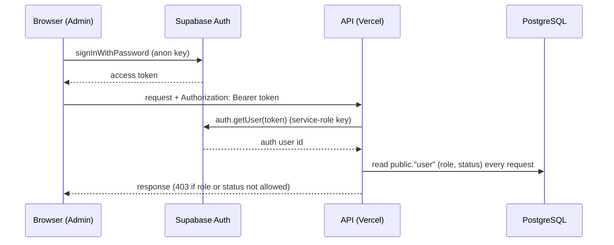

# 03. Supabase Setup

Supabase provides three things to this project: **PostgreSQL** (all application data, via Prisma), **Auth** (staff sign-in, invitations, password recovery) and **Storage** (one private bucket of candidate documents).

Do this once per environment (dev, stage, production). **Use a separate Supabase project for each.** Never share a project, bucket or key between environments.

## Project creation

1. Sign in at the Supabase dashboard and create a project (or ask the owner to add you to the existing organisation).
2. Choose a **strong database password** and store it in a password manager. You will need it for `DATABASE_URL`. If you lose it, reset it in Project Settings → Database.
3. **Region.** The current system runs Vercel functions in `hnd1` (Tokyo, `vercel.json`) and the submission worker in `asia-northeast1` (Tokyo), and the production database pooler is `aws-0-ap-northeast-1` (Tokyo) (`Docs/08-cloud-deployment.md`). Pick the Supabase region **closest to the Vercel function region and the submission worker**, because the backend calls the database far more often than anything else. For a new environment mirroring production, choose Northeast Asia (Tokyo). The region cannot be changed after creation.
4. Plan: the Free plan has 1 GB file storage, 5 GB egress, a 500 MB database, no daily backups and pauses after a week of inactivity. It is unsuitable for real candidate data. Check the current limits on the Supabase pricing page; for any production environment use a paid plan (a storage-platform comparison research document exists on the `version/Google-File-Sync` branch and is not part of `dev`).

Collect these values (Project Settings → API / Database) and keep them in your password manager, not in files in the repo:

| Value | Used as |
|---|---|
| Project URL `https://<project-ref>.supabase.co` | `SUPABASE_URL`, `VITE_SUPABASE_URL` |
| `anon` / publishable key | `VITE_SUPABASE_ANON_KEY` (public) |
| `service_role` / secret key | `SUPABASE_SERVICE_ROLE_KEY` (**server only, secret**) |
| Session pooler connection string | `DATABASE_URL` (**secret**) |

## PostgreSQL

### Which connection string

In the dashboard open **Connect** and copy the **Session pooler** string (Supavisor, session mode, port **5432**), shaped like:

```
postgresql://postgres.<project-ref>:<DATABASE_PASSWORD>@aws-0-<region>.pooler.supabase.com:5432/postgres
```

Why the session pooler and not another:

| Option | Use? | Reason (from the repo's own history) |
|---|---|---|
| **Session pooler**, port 5432 | **Yes** | The backend uses interactive Prisma transactions and `SELECT … FOR UPDATE` row locks (`adminReviewActionService.js`), which need one connection for the whole transaction. It has IPv4, so Cloud Run and Vercel can reach it |
| Direct connection (`db.<ref>.supabase.co`) | No | IPv6 only; unreachable from Cloud Run's default IPv4 egress |
| Transaction pooler (port 6543) | No | Transaction mode breaks interactive transactions and row locks. (`Docs/08-cloud-deployment.md` mentions 6543 as an alternative; the explanation in Step 2 says session mode is required, and the guide follows that) |

Special characters in the password must be URL-encoded in `DATABASE_URL`.

### Prisma usage

- Schema: `prisma/schema.prisma`; generated client: `generated/prisma` (git-ignored, created by `npm install` through `postinstall`, or `npx prisma generate`).
- `prisma/schema.prisma` has a single `url = env("DATABASE_URL")`. There is no `DIRECT_URL`.
- Prisma 6.19.3 with the `pg` driver adapter (`@prisma/adapter-pg`). The pool size per running instance is `DATABASE_POOL_MAX` (default **3**).
- Keep the pool small. Each Vercel function instance and each Cloud Run instance opens its own pool on top of Supavisor's session limit. Too many clients gives `EMAXCONNSESSION: max clients reached in session mode` ([11](11-TROUBLESHOOTING.md)).

### Test the connection

```bash
npm run db:check        # prints only "Database connection successful." / "failed (ErrorName)"
```

## Schema and migrations

There are 49 forward-only migrations in `prisma/migrations/` at the time of writing (count with `ls prisma/migrations`). **Rules:**

1. **Never run `prisma migrate dev` against Supabase, stage or production.** It is interactive, can propose resets, and can create unexpected migration files.
2. **Never edit a migration that has been applied anywhere.** It breaks the checksum (`P3009` / checksum mismatch). Write a new forward-only migration instead.
3. **Do not use `prisma db pull` or `prisma migrate diff` against the live Supabase database.** They fail with `P4002` because `"user".auth_user_id` references Supabase's `auth` schema, which Prisma does not manage (`Docs/SUPABASE_AUTH.md`, "Prisma tooling limitation"). This is accepted.

| Command | Safe on shared DB? | Purpose |
|---|---|---|
| `npx prisma validate` | Yes (no DB access) | Check `schema.prisma` syntax and relations |
| `npx prisma generate` | Yes | Regenerate `generated/prisma` |
| `npx prisma migrate status` | Yes (read-only) | Compare the migration ledger with the database |
| `npx prisma migrate deploy` | **Yes, this is the deployment command** | Applies pending migrations in order, forward only |
| `npx prisma migrate dev` | **NO. Local throwaway database only** | Prototyping migrations |

### Applying migrations to a new Supabase project

```bash
# .env must point DATABASE_URL at the TARGET database. Read it before running.
npx prisma validate
npx prisma migrate status         # a new empty project lists all migrations as not applied
npx prisma migrate deploy
npx prisma migrate status         # expect: Database schema is up to date
```

On a new, empty database nothing special is needed. The migration `20261009120000_supabase_auth_cutover` adds the foreign key to `auth.users` and refuses to run if any staff row lacks an auth user; an empty database passes.

Two things the migrations do that you should know about:

- `20260924140000_restrict_public_database_access` and later migrations turn on Row Level Security and revoke rights from Supabase's `anon` and `authenticated` roles on application tables. The backend connects as `postgres` (BYPASSRLS), so the app is unaffected, and the browser can never read tables through the Supabase API.
- `20261024120000_seed_job_types` seeds the 17 default Job Type categories (idempotent, additive only).

### Applying migrations to stage or production

Run `prisma migrate deploy` from a trusted machine **or** a one-off Cloud Run Job from the backend image (the root `Dockerfile` copies `prisma/migrations` for exactly this; the server itself never runs migrations):

```bash
# One-off job from the backend image (see 07 for the image build). Run only after reading --project and the secret binding.
gcloud run jobs create emlynk-db-migrate --project=<PROJECT_ID> --region=<REGION> \
  --image=<BACKEND_IMAGE> \
  --service-account=emlynk-backend@<PROJECT_ID>.iam.gserviceaccount.com \
  --command=npx --args=prisma,migrate,deploy \
  --set-secrets=DATABASE_URL=DATABASE_URL:latest
gcloud run jobs execute emlynk-db-migrate --project=<PROJECT_ID> --region=<REGION> --wait
```

This pattern is documented in `Docs/GOOGLE_SHEET_CANDIDATE_SYNC_ARCHITECTURE.md` §24.9. Its prerequisites (the image, the service account, the secret) are created in [05](05-GOOGLE-CLOUD-SETUP.md) and [07](07-SUBMISSION-WORKER-DEPLOYMENT.md).

**Order for a release:** migrate first (additive, backwards compatible), then deploy code. Take a database backup/snapshot first in production.

### Upgrading an old database that predates Supabase Auth

Only relevant if you inherit a database from before the Supabase Auth restructure. It needs a manual sequence (rename migration, create auth identities, link rows, then the cutover). Follow `Docs/SUPABASE_AUTH.md` → "B. Existing database from before the restructure" exactly. Do not improvise.

## Auth

The application has no JWT secret, no SMTP settings and stores no passwords. Supabase Auth owns identities and sessions; the application owns the profile, role and status in `public."user"` (`Docs/SUPABASE_AUTH.md`).

How it works at runtime:



Dashboard configuration (**manual, per project, before go-live**), from `Docs/SUPABASE_AUTH.md`:

1. **Authentication → URL Configuration**
   - Site URL: the Admin site, `https://<your-admin-domain>/admin`.
   - Redirect URLs must include `https://<your-admin-domain>/admin/setup-password` and `https://<your-admin-domain>/admin/reset-password`. For local development also add `http://localhost:5173/admin/*`.
   - The API builds invitation links from `APP_BASE_URL` (`${APP_BASE_URL}/admin/setup-password`) and **only** from it. If `APP_BASE_URL` is missing/invalid the invite endpoint answers 503 `INVITE_NOT_CONFIGURED` and sends nothing. Every environment's `APP_BASE_URL` origin must therefore be in this redirect list.
2. **Authentication → Providers → Email**: enable it and **disable public sign-ups**. Users are only invited.
3. **Authentication → SMTP Settings**: configure your SMTP provider and the **Invite** and **Reset password** templates. The built-in Supabase mailer is rate-limited and not for production.
4. **Authentication → Rate Limits and password policy**: the app asks for a minimum of 8 characters; set the dashboard minimum to match or higher.
5. **Keys**: the anon/publishable key goes to the Admin build (`VITE_SUPABASE_ANON_KEY`); the service-role/secret key goes only to the backend and workers. The Admin app refuses a service-role key.
6. A custom Supabase domain would also have to be added to the CSP `connect-src` (`vercel.json` and `src/createApp.js`); the default allows `https://*.supabase.co`.

Creating the first user is in [10](10-ADMIN-AND-OPTIONAL-COMPONENTS.md#first-system-administrator).

## Storage

### Create the private bucket

No script in the repo creates the bucket. Create it in the dashboard:

1. **Storage → New bucket**.
2. Name: anything; this exact name goes into `SUPABASE_BUCKET`. Keep a different name per environment (for example `<env>-documents`).
3. **Public bucket: OFF.** The bucket must be private. No public or signed *download* URLs are created anywhere in the code; admin previews stream through the API (`Docs/06-storage-management.md`).
4. Do **not** add Storage policies for `anon` or `authenticated`. The backend uses the service-role key, which does not need them, and no migration in the repo creates any. With no policy, private buckets are unreachable from the browser. Verify in Storage → Policies that there is none for this bucket.

### Behaviour the code relies on

| Behaviour | Detail |
|---|---|
| Layout | `temporary/<uuid>.<ext>` on upload, then copied to `clients/{passport_id}/{type}/…` or `pending/…` (`Docs/06-storage-management.md`) |
| Methods used | `upload`, `download`, `copy`, `exists`, `info`, `list`, `remove`, `createSignedUploadUrl` (via `supabase.storage.from(SUPABASE_BUCKET)`) |
| Admin uploads | The browser uploads **directly** to storage through a **signed upload URL** for one new object (2-hour expiry, set by Supabase), because a Vercel request body is capped far below file size. The server then verifies and moves the file (`candidateService.js` `createUploadTarget` / `finalizeUpload`) |
| Size limits in code | 10 MB for documents (`MAX_FILE_SIZE`), 50 MB for skill videos. Supabase's own global per-file limit is 50 MB on Free; on paid plans it is configurable. If you raise limits in the dashboard, keep them at or above the app's limits |
| Allowed types | Validated by the application: PDF, JPEG, PNG for documents; MP4, QuickTime, WebM for skill videos |
| Checksums | SHA-256 of every file is stored in the database (`documents.file_sha256`) |

### Verify storage from your machine

`scripts/e2e-supabase-storage.mjs` exercises the real bucket with test data and cleans up. It **writes to the bucket in `.env`**. Run it only against a development project:

```bash
node scripts/e2e-supabase-storage.mjs
```

## Supabase checklist

- [ ] Separate project per environment
- [ ] Session pooler string in `DATABASE_URL`
- [ ] `npx prisma migrate deploy` ran; `migrate status` is up to date
- [ ] Private bucket created; no `anon`/`authenticated` policies
- [ ] Email provider on, public sign-ups off, SMTP + templates set
- [ ] Redirect URLs contain `/admin/setup-password` and `/admin/reset-password` for this environment's origin
- [ ] Service-role key stored only in Vercel (sensitive) and Secret Manager
- [ ] Daily backups available (paid plan) for production
