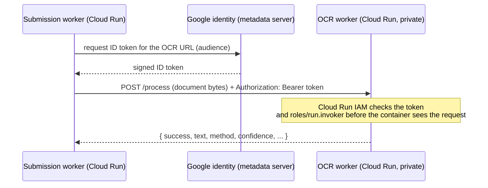

# 06. OCR Worker Deployment

Service name: **`emlynk-ocr-worker`**. Folder: [`ocr-worker/`](../ocr-worker/). Full reference: [`ocr-worker/README.md`](../ocr-worker/README.md) (API, error codes, measured timings).

## What it does

A small stateless Express service that reads text from a document with Tesseract.js (and `pdf-parse` for PDF text layers). It receives the document bytes, returns the extracted text and confidence, and forgets it. **It has no database, no Storage access, and no secrets.**



| | |
|---|---|
| Runtime | Node 22 (`node:22-bookworm-slim`), `node src/server.js` |
| Dependencies | `tesseract.js`, `@tesseract.js-data/eng` (English model shipped in the image, no download at runtime), `pdf-parse`, `@napi-rs/canvas`, `jpeg-js`, `pngjs`, `express` |
| Port | `$PORT`, 8080 in the container; binds `0.0.0.0` in the container (`HOST=0.0.0.0`), `127.0.0.1` when run with `npm start` |
| Endpoints | `POST /process` (body = document bytes, `Content-Type` = `application/pdf`, `image/jpeg` or `image/png`, max 10 MB), `GET /health` |
| Limits | 2 concurrent jobs + 10 waiting; 60 s wait; 120 s per job (`ocr-worker/README.md`) |
| Fails at startup if | `eng.traineddata.gz` is missing (dependencies installed without `@tesseract.js-data/eng`) |

Who calls it: **only the submission worker** (and the backend when run locally). The Vercel handler does not.

## 1. Run and test locally first

```bash
npm run ocr:install          # once
npm run ocr:test             # fast tests of the service
npm run ocr:start            # http://127.0.0.1:8080  (loopback only)
curl -s http://127.0.0.1:8080/health          # {"status":"OK"}
```

Real-Tesseract tests are opt-in and slow (a few minutes):

```bash
RUN_OCR_TESTS=1 npm run ocr:test          # PowerShell: $env:RUN_OCR_TESTS="1"; npm run ocr:test
```

Test the container before deploying:

```bash
cd ocr-worker
docker build -t emlynk-ocr-worker .
docker run --rm -p 127.0.0.1:8080:8080 emlynk-ocr-worker
curl -s http://127.0.0.1:8080/health
curl -s -X POST --data-binary @test/fixtures/files/image-medical.png \
     -H "Content-Type: image/png" http://127.0.0.1:8080/process
```

The fixtures under `ocr-worker/test/fixtures/` are synthetic. Do not test with real passports or medical documents.

## 2. Prerequisites

From [05](05-GOOGLE-CLOUD-SETUP.md): project and billing, APIs enabled, Artifact Registry repo `emlynk-ocr` in your OCR region, service accounts `ocr-worker-runtime` and (for the caller) `emlynk-backend`.

```bash
PROJECT=<PROJECT_ID>
REGION=asia-south1                       # current OCR region; use yours consistently
IMAGE=$REGION-docker.pkg.dev/$PROJECT/emlynk-ocr/ocr-worker:$(git rev-parse --short HEAD)
```

## 3. Build and push

```bash
gcloud builds submit ocr-worker --project=$PROJECT --tag $IMAGE
```

(or local Docker: see [05](05-GOOGLE-CLOUD-SETUP.md#or-build-locally-with-docker)).

## 4. Deploy (private)

```bash
gcloud run deploy emlynk-ocr-worker \
  --project=$PROJECT --region=$REGION \
  --image=$IMAGE \
  --service-account=ocr-worker-runtime@$PROJECT.iam.gserviceaccount.com \
  --no-allow-unauthenticated \
  --ingress=all \
  --port=8080 \
  --cpu=2 --memory=2Gi \
  --concurrency=2 \
  --timeout=300 \
  --min-instances=0 --max-instances=2 \
  --cpu-boost
```

Why these settings (from `ocr-worker/README.md`):

| Flag | Value | Reason |
|---|---|---|
| `--no-allow-unauthenticated` | | **The service must stay private.** Never use `--allow-unauthenticated` and never grant `allUsers` |
| `--ingress=all` | | Requests still need a valid identity token; `internal` would need VPC egress from the caller |
| `--cpu` / `--memory` | 2 / 2Gi | Tesseract is CPU-bound; large phone photos use a lot of memory when decoded or rotated. 512 MiB is likely to run out of memory under load |
| `--concurrency` | 2 | Equals the service's own job limit, so Cloud Run starts another instance rather than queueing inside one |
| `--timeout` | 300 | Above the worst case (60 s wait + 120 s job) and the caller's 240 s timeout |
| `--min-instances` | 0 | Scale to zero when idle: cold start delays only the first document after a quiet spell; the queue retries anyway |
| `--max-instances` | 2 | The backend sends at most 2 requests at a time; caps cost |
| `--cpu-boost` | on | Shorter cold start |

> **Note on the existing production service.** `ocr-worker/README.md` records that the currently running production service was created with smaller settings (1 vCPU, 512 MiB, concurrency 80, default compute service account). That is a known gap, not a template. For a new environment use the settings above. Whether to align production is a decision for the senior ([10](10-ADMIN-AND-OPTIONAL-COMPONENTS.md#items-needing-confirmation)).

## 5. Authentication: how the caller gets in

Cloud Run rejects any request without a Google-signed identity token for an account holding `roles/run.invoker` on this service. The caller (`src/services/ocrClient.js`) uses `google-auth-library` and **Application Default Credentials** to mint an ID token whose audience is the OCR service URL, caches it, and renews it before it expires. A loopback `OCR_SERVICE_URL` (`http://127.0.0.1…`) gets no token.

Grant the submission worker's account permission **on this service only**:

```bash
gcloud run services add-iam-policy-binding emlynk-ocr-worker \
  --project=$PROJECT --region=$REGION \
  --member=serviceAccount:emlynk-backend@$PROJECT.iam.gserviceaccount.com \
  --role=roles/run.invoker
```

| Caller location | How it authenticates |
|---|---|
| Submission worker on Cloud Run (production) | Runs **as** `emlynk-backend`; ADC resolves to it automatically. No key, no extra config |
| Developer machine, to call a deployed OCR service | `gcloud auth application-default login` with your own account (needs `roles/run.invoker`), **or** `GOOGLE_APPLICATION_CREDENTIALS` pointing at a key of an account with that role. Avoid creating keys; use your own login |
| Local OCR (`npm run ocr:start`) | None |

If credentials are missing the backend sends no request; the submission waits and is retried (see [11](11-TROUBLESHOOTING.md)).

## 6. Get the URL and configure the backend

```bash
gcloud run services describe emlynk-ocr-worker --project=$PROJECT --region=$REGION --format='value(status.url)'
```

Put that `https://…run.app` URL into `OCR_SERVICE_URL` for the **submission worker** ([07](07-SUBMISSION-WORKER-DEPLOYMENT.md)) and for Vercel project A ([04](04-VERCEL-DEPLOYMENT.md); required by the startup check even though Vercel never calls it).

## 7. Safe verification

```bash
URL=$(gcloud run services describe emlynk-ocr-worker --project=$PROJECT --region=$REGION --format='value(status.url)')

# Must be rejected: proves the service is private
curl -s -o /dev/null -w '%{http_code}\n' "$URL/health"                        # expect 403

# With your own identity token (you need roles/run.invoker or project-level invoke rights)
curl -s -H "Authorization: Bearer $(gcloud auth print-identity-token)" "$URL/health"   # {"status":"OK"}

# Process a SYNTHETIC test image from the repo (never a real document)
curl -s -H "Authorization: Bearer $(gcloud auth print-identity-token)" \
     -H "Content-Type: image/png" \
     --data-binary @ocr-worker/test/fixtures/files/image-medical.png "$URL/process"
```

Logs (contain only MIME type, size, method, reason codes and timings, never document text):

```bash
gcloud logging read 'resource.type="cloud_run_revision" AND resource.labels.service_name="emlynk-ocr-worker"' \
  --project=$PROJECT --limit=50 --format='value(timestamp,textPayload)'
```

Then confirm end to end after the submission worker is deployed ([09](09-TESTING-AND-VERIFICATION.md)).

## Updating and rollback

```bash
# New image: other settings are kept. In-flight requests finish on the old revision.
gcloud run deploy emlynk-ocr-worker --project=$PROJECT --region=$REGION --image=$NEW_IMAGE

# Roll back to the previous revision
gcloud run revisions list --service=emlynk-ocr-worker --project=$PROJECT --region=$REGION
gcloud run services update-traffic emlynk-ocr-worker --project=$PROJECT --region=$REGION --to-revisions=<REVISION_NAME>=100
```

While the service is down, nothing is lost: submissions stay queued in PostgreSQL and are retried.

## Cost note

Scale-to-zero (`--min-instances=0`) means an idle OCR worker costs nothing; `--max-instances` is the hard ceiling on spend. Set a Billing budget alert before going live.
