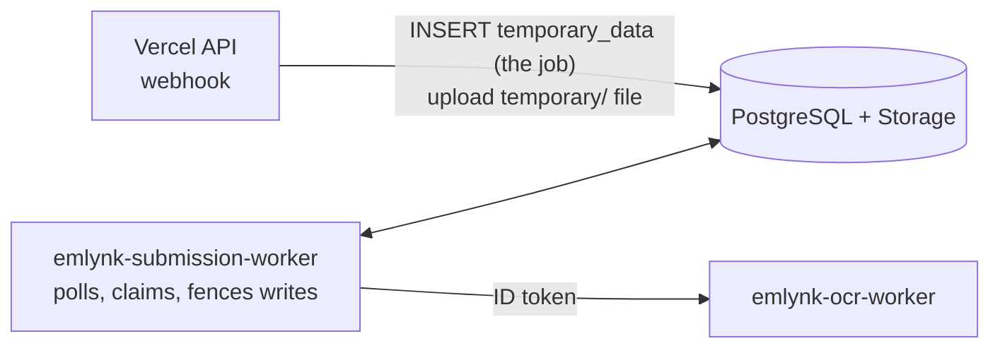

# 07. Submission Worker Deployment

Service name: **`emlynk-submission-worker`**. Entry point: `src/worker.js` (`npm run worker`). It is built from the **root `Dockerfile`**, the same image as the API would use, with the command overridden.

## Architecture: why this is a separate service

A Vercel function runs only while a request is in flight; it cannot host a polling loop. So the work is split (`Docs/08-cloud-deployment.md` Part 2, Steps 4–5):

| Step | Where | What happens |
|---|---|---|
| 1 | Vercel (`src/httpHandler.js`) | `POST /whatsapp/webhook`: verifies the Meta signature, downloads the media, uploads it to Storage `temporary/…`, writes a `temporary_data` row (the **job**), answers 200 |
| 2 | **Cloud Run submission worker** | Polls PostgreSQL about every 5 seconds, **claims** a row with a compare-and-swap lease, downloads the file from Storage, calls the OCR worker, classifies, identifies the client, stores the document (`clients/…` or `pending/…`) and updates the database |
| 3 | OCR worker | Returns the text ([06](06-OCR-WORKER-DEPLOYMENT.md)) |

**PostgreSQL is the queue.** There is no Pub/Sub or Cloud Tasks. The worker holds a claim for up to 10 minutes, fences every write with it, and retries within the recorded attempts (3). Because claims are compare-and-swap, running more than one worker (or `npm start`, which includes a worker, next to it) is safe: each submission is processed by one worker only.



## What it needs

| Need | Value |
|---|---|
| Database | `DATABASE_URL` (session pooler) from Secret Manager |
| Storage | `SUPABASE_URL`, `SUPABASE_SERVICE_ROLE_KEY` (secret), `SUPABASE_BUCKET` |
| OCR | `OCR_SERVICE_URL` + `roles/run.invoker` for its service account on the OCR service |
| **Not** needed | Meta/WhatsApp secrets, `APP_BASE_URL`, any Google key |

The worker's startup check (`WORKER_REQUIRED_ENV_VARS`) requires exactly: `DATABASE_URL`, `SUPABASE_URL`, `SUPABASE_SERVICE_ROLE_KEY`, `SUPABASE_BUCKET`, `OCR_SERVICE_URL`. When `PORT` is set (Cloud Run always sets it) it opens a minimal listener: `GET /health` → 200, everything else 404. The listener exists only because a Cloud Run service must listen on `$PORT` to become ready.

## Prerequisites

- [03](03-SUPABASE-SETUP.md): database migrated, bucket created.
- [05](05-GOOGLE-CLOUD-SETUP.md): APIs, Artifact Registry repo `emlynk-backend`, service account `emlynk-backend`, secrets `DATABASE_URL` and `SUPABASE_SERVICE_ROLE_KEY` created with `secretAccessor` granted to `emlynk-backend` **on each secret**.
- [06](06-OCR-WORKER-DEPLOYMENT.md): OCR deployed; `roles/run.invoker` granted to `emlynk-backend` on it; its URL known.

## 1. Test locally

```bash
npm run worker        # needs the 5 variables in .env; no PORT => no health listener
```

You should see "Submission worker running" and no missing-variable or Prisma error. `Ctrl+C` stops it gracefully (SIGTERM/SIGINT handler, `src/shutdown.js`).

Test the container if you have Docker (uses the real `.env`: only run against a **dev** project):

```bash
docker build -t emlynk-backend .
docker run --rm --env-file .env -e PORT=8080 -p 127.0.0.1:8080:8080 emlynk-backend node src/worker.js
curl -s http://127.0.0.1:8080/health
```

A locally run container has no Google metadata server, so the OCR call cannot get an identity token and logs a `CREDENTIALS` reason, then retries. That is expected; it works once deployed to Cloud Run.

## 2. Build and push

```bash
PROJECT=<PROJECT_ID>
REGION=asia-northeast1
IMAGE=$REGION-docker.pkg.dev/$PROJECT/emlynk-backend/worker:$(git rev-parse --short HEAD)

gcloud builds submit --project=$PROJECT --tag $IMAGE .     # from the repository root
```

## 3. Deploy

```bash
gcloud run deploy emlynk-submission-worker \
  --project=$PROJECT --region=$REGION \
  --image=$IMAGE \
  --service-account=emlynk-backend@$PROJECT.iam.gserviceaccount.com \
  --command=node --args=src/worker.js \
  --no-allow-unauthenticated \
  --cpu=1 --memory=1Gi \
  --no-cpu-throttling --cpu-boost \
  --min-instances=1 --max-instances=1 \
  --concurrency=80 --timeout=300 \
  --set-env-vars=SUPABASE_URL=<SUPABASE_URL>,SUPABASE_BUCKET=<BUCKET_NAME>,OCR_SERVICE_URL=<OCR_URL>,DATABASE_POOL_MAX=3 \
  --set-secrets=DATABASE_URL=DATABASE_URL:latest,SUPABASE_SERVICE_ROLE_KEY=SUPABASE_SERVICE_ROLE_KEY:latest
```

| Setting | Why |
|---|---|
| `--no-cpu-throttling` | **Required.** CPU must stay allocated between requests or the polling loop gets no CPU |
| `--min-instances=1 --max-instances=1` | Always one running worker. These are the values recorded in the original verified deployment; the original notes say `max-instances` was "kept low for this first verification" and should be revisited once traffic is known. More instances are safe (compare-and-swap claims) but each adds database pool connections |
| `--command=node --args=src/worker.js` | Overrides the image's default `node src/app.js` (which would run the API too) |
| `--no-allow-unauthenticated` | Nobody calls it; only the health probe needs the port. Keep private |
| `--set-secrets` | Secret values never appear in the service definition or logs |
| No `GOOGLE_APPLICATION_CREDENTIALS` | The attached service account supplies identity tokens for OCR |

Values in angle brackets are plain, non-secret configuration; they may appear in your deploy command. The database URL and service-role key must **not**.

## 4. Verify

```bash
URL=$(gcloud run services describe emlynk-submission-worker --project=$PROJECT --region=$REGION --format='value(status.url)')

curl -s -o /dev/null -w '%{http_code}\n' "$URL/health"          # expect 403 (private)

gcloud run services logs read emlynk-submission-worker --project=$PROJECT --region=$REGION --limit=50
#   expect: instance starting, "Submission worker running", startup probe succeeded;
#   NO "Invalid environment configuration", NO Prisma error, NO exception
```

Logs carry only `temporaryId`, `attempt`, `outcome` and `processingStatus`: never document text, file names, phone numbers, tokens or keys.

End-to-end check on **stage** (never with real candidate documents):

1. From a Meta **test** number, send a synthetic image (for example `ocr-worker/test/fixtures/files/image-medical.png`) to the stage WhatsApp number.
2. In the stage Admin console the submission appears; within a minute or two it moves from `TEMPORARY_STORED` to a final status. A message that matches no client lands in the review queue (`pending/unidentified/…`, `MANUAL_REVIEW`).
3. Worker log shows `Submission processed in background` (outcome `PROCESSED`).
4. Clean up test objects through the Admin console's delete/removal action, not by hand-editing the database.

If an OCR call fails the submission stays queued and is retried about a minute later, within 3 attempts; after the last one it is recorded `FAILED` at stage `TEXT_EXTRACTION` and can be retried from the Admin console (Retry processing).

## Updating and rollback

```bash
# Deploy a new image (other settings are kept)
gcloud run deploy emlynk-submission-worker --project=$PROJECT --region=$REGION --image=$NEW_IMAGE

# Roll back
gcloud run revisions list --service=emlynk-submission-worker --project=$PROJECT --region=$REGION
gcloud run services update-traffic emlynk-submission-worker --project=$PROJECT --region=$REGION --to-revisions=<REVISION_NAME>=100
```

Run migrations **before** deploying code that needs new columns ([03](03-SUPABASE-SETUP.md#applying-migrations-to-stage-or-production)). If the worker stops, nothing is lost: submissions wait in PostgreSQL until a worker returns.

## Monitoring

- Cloud Run → service → Metrics: instance count (should be 1), memory, restarts.
- Logs Explorer filter: `resource.type="cloud_run_revision" AND resource.labels.service_name="emlynk-submission-worker"`.
- In the Admin console watch for submissions stuck `TEMPORARY_STORED` or accumulating `FAILED`.
