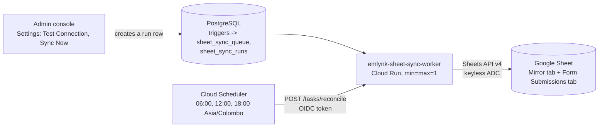

# 08. Google Sheet Sync Deployment

Service: **`emlynk-sheet-sync-worker`** (Cloud Run) plus one Cloud Scheduler job. Entry point `src/sheetSyncWorker.js` (`npm run sheet:worker`).

Design, column layout, safety invariants and the full runbook live in [`Docs/GOOGLE_SHEET_CANDIDATE_SYNC_ARCHITECTURE.md`](../Docs/GOOGLE_SHEET_CANDIDATE_SYNC_ARCHITECTURE.md) (§24 "As Built") and [`Docs/GOOGLE_SHEET_INTEGRATION.md`](../Docs/GOOGLE_SHEET_INTEGRATION.md). This page is the new-developer deployment path.

> **This feature writes to a real operational spreadsheet that people work in.** Deploy it with writes **disabled** (`SHEET_SYNC_ENABLED=false`, the default), test read-only, and enable writing only through the controlled activation procedure with the business owner's approval. Do not point a test deployment at the production spreadsheet.

## What it does

- Mirrors candidate data from PostgreSQL into a Google Sheet tab (the **Operational Mirror**) and writes Candidate Form submissions into a second tab (**Candidate Form Submissions**) of the **same** spreadsheet.
- **It is not real time.** Database triggers write change records into an outbox (`sheet_sync_queue`); the Sheet is updated only by (a) the scheduled reconciliation and (b) an admin pressing **Sync Now**. Test Connection is a read-only check, also run by this worker.
- The worker runs durable requests recorded in `sheet_sync_runs` and answers Cloud Scheduler's authenticated trigger `POST /tasks/reconcile`, which only *records* a reconcile run (HTTP 202); the worker then executes it.
- Safety: a write gate (`SHEET_SYNC_ENABLED`), a deletion guard, one writer lease in the database, row identity by the `_SYSTEM_CANDIDATE_ID` column, header validation by name before every write.



## Authentication: keyless

- The worker authenticates to Google with **Application Default Credentials**, which on Cloud Run is the attached service account (`emlynk-sheet-sync`). **No key file, no OAuth credentials.**
- `GOOGLE_APPLICATION_CREDENTIALS` set at all makes the worker **refuse to start**.
- While `SHEET_SYNC_ENABLED` is not exactly `true`, the Google token is requested with the **read-only** scope (`spreadsheets.readonly`), so the process cannot write even by mistake.
- Access to the spreadsheet is granted by **sharing the spreadsheet with the service account's e-mail address** (like a person), not by an IAM role.

## Prerequisites

- [03](03-SUPABASE-SETUP.md): the database is migrated (the Sheet Sync tables and triggers come from migrations `20261006120000_sheet_sync_outbox`, `20261012120000_sheet_sync_destination`, `20261028120000_candidate_form_sheet_sync`, among others).
- [05](05-GOOGLE-CLOUD-SETUP.md): `sheets.googleapis.com`, `run`, `cloudscheduler`, `secretmanager` enabled; Artifact Registry repo `emlynk-backend`; secret `DATABASE_URL`.
- A **Google spreadsheet** owned by the business, with a tab for the mirror and (optionally) the form-submissions tab. You need its ID and tab names.

## 1. The spreadsheet

1. Spreadsheet ID: the part of its URL between `/d/` and `/edit`: `https://docs.google.com/spreadsheets/d/<GOOGLE_SPREADSHEET_ID>/edit`.
2. Mirror tab: its exact name is `SHEET_TAB_NAME`. **Row 1 must already contain the exact required header row** (83 columns for the current layout; `Docs/CANDIDATE_BULK_IMPORT.md` §3–§4 and `src/services/sheetSchema.js` are the authority). The worker never invents the mirror's headers: it validates them by name (any order, extra operator columns tolerated; a missing, renamed or duplicated required header gives `SCHEMA_INVALID`).
3. Form Submissions tab (`SHEET_FORM_SUBMISSIONS_TAB_NAME`, default `Candidate Form Submissions`): the worker writes its headers automatically **only if the tab is completely blank**.
4. **Use a separate spreadsheet (a copy) for every non-production environment.** There is no "test mode" for a real spreadsheet other than `SHEET_SYNC_ENABLED=false`.
5. Before ever enabling writes, the Sheet owner makes a dated copy and downloads an `.xlsx` as a backup.

## 2. Service accounts and access

```bash
PROJECT=<PROJECT_ID>
SYNC_SA=emlynk-sheet-sync@$PROJECT.iam.gserviceaccount.com
SCHED_SA=emlynk-sheet-sync-scheduler@$PROJECT.iam.gserviceaccount.com

# Created in 05; shown here for completeness
gcloud iam service-accounts create emlynk-sheet-sync --display-name="Emlynk sheet sync worker" --project=$PROJECT
gcloud iam service-accounts create emlynk-sheet-sync-scheduler --display-name="Sheet sync scheduler" --project=$PROJECT

# The worker may read the DATABASE_URL secret (secret level only)
gcloud secrets add-iam-policy-binding DATABASE_URL --project=$PROJECT \
  --member=serviceAccount:$SYNC_SA --role=roles/secretmanager.secretAccessor
```

Share the spreadsheet (Google Sheets → Share) with `$SYNC_SA` as **Editor**. Staff keep **Viewer** access so nobody edits the mirror by hand. Ask the spreadsheet owner to do this; you do not need access to the Sheet yourself. Editor is the minimum that allows writing; for a read-only first test, **Viewer** also works.

| Account | Gets |
|---|---|
| `emlynk-sheet-sync` | `secretAccessor` on `DATABASE_URL`; Editor on the spreadsheet |
| `emlynk-sheet-sync-scheduler` | `roles/run.invoker` on `emlynk-sheet-sync-worker` only |

## 3. Environment file (non-secret values)

The repo contains `deploy/sheet-sync-worker.env.yaml`, used with `--env-vars-file`. **The committed file holds the production spreadsheet's real ID and tab name.** For any other environment, make your own copy **outside Git** (or edit locally and never commit it):

```yaml
# my-sheet-sync.env.yaml  (do not commit)
SHEET_SPREADSHEET_ID: "<GOOGLE_SPREADSHEET_ID>"
SHEET_TAB_NAME: "<SHEET_TAB_NAME>"
SHEET_SYNC_ENABLED: "false"          # stays false until the activation procedure
DATABASE_POOL_MAX: "2"
SHEET_SYNC_POLL_INTERVAL_MS: "10000"
SHEET_SYNC_DELETION_GUARD_MAX: "10"
SHEET_SYNC_DELETION_GUARD_FRACTION: "0.05"
```

`DATABASE_URL` is **not** in this file: it comes from Secret Manager. Optional tunables and `SHEET_SYNC_DESTINATIONS` are in [02](02-ENVIRONMENT-VARIABLES.md#6-google-sheet-sync-worker-cloud-run-emlynk-sheet-sync-worker-command-node-srcsheetsyncworkerjs). Note the committed file sets `SHEET_SYNC_ENABLED: "true"` for production; your copy should start `false`.

## 4. Build the image

The Sheet Sync worker uses the **same root `Dockerfile`** as the submission worker.

```bash
REGION=asia-south1                       # current Sheet Sync region; the registry below is in asia-northeast1
TAG=$(git rev-parse --short HEAD)
IMAGE=asia-northeast1-docker.pkg.dev/$PROJECT/emlynk-backend/sheet-sync:$TAG
gcloud builds submit --project=$PROJECT --tag=$IMAGE .
```

**Redeploy the worker with every change to Sheet Sync code.** The API (Vercel) and the worker (Cloud Run) deploy separately; code that the worker runs takes effect only after the image is rebuilt and the service updated (symptoms of an old worker: `Docs/GOOGLE_SHEET_CANDIDATE_SYNC_ARCHITECTURE.md` §25.9).

## 5. Optional: read-only connection check as a Cloud Run Job

`src/sheetSyncCheck.js` reads row 1 only, needs only `SHEET_SPREADSHEET_ID` and `SHEET_TAB_NAME`, no database, and **never writes**. Run it locally (with `gcloud auth application-default login`; locally it is *your* identity and needs read access to the Sheet) or as a one-off job under the service account:

```bash
npm run sheet:check        # local; reads .env

gcloud run jobs create emlynk-sheet-sync-check --project=$PROJECT --region=$REGION --image=$IMAGE \
  --service-account=$SYNC_SA --command=node --args=src/sheetSyncCheck.js \
  --set-env-vars=SHEET_SPREADSHEET_ID=<GOOGLE_SPREADSHEET_ID>,SHEET_TAB_NAME=<SHEET_TAB_NAME>
gcloud run jobs execute emlynk-sheet-sync-check --project=$PROJECT --region=$REGION --wait
#   expect output: "status":"CONNECTED","schema":"SCHEMA_VALID","writeGate":"DISABLED"
```

(Use `gcloud run jobs update` instead of `create` if the job already exists.) This is the proof that the Sheets API is enabled, the Sheet is shared correctly and the headers are valid.

## 6. Deploy the worker (writes disabled)

```bash
gcloud run deploy emlynk-sheet-sync-worker \
  --project=$PROJECT --region=$REGION --image=$IMAGE \
  --service-account=$SYNC_SA \
  --command=node --args=src/sheetSyncWorker.js \
  --no-allow-unauthenticated \
  --min-instances=1 --max-instances=1 --no-cpu-throttling \
  --cpu=1 --memory=512Mi \
  --env-vars-file=my-sheet-sync.env.yaml \
  --set-secrets=DATABASE_URL=DATABASE_URL:latest

gcloud run services logs read emlynk-sheet-sync-worker --project=$PROJECT --region=$REGION --limit=50
#   expect: sheet_sync.worker_config {"writeGate":"DISABLED",...} and sheet_sync.worker_started
```

| Setting | Why |
|---|---|
| `--min-instances=1 --max-instances=1` | **Exactly one worker per Sheet.** The database writer lease protects the Sheet even if this is violated, but do not rely on it |
| `--no-cpu-throttling` | The worker polls between requests |
| `--no-allow-unauthenticated` | Only Cloud Scheduler (OIDC) calls it |
| `DATABASE_URL` from Secret Manager | Same database as the application. **Run exactly one worker against the database whose candidates are authoritative.** Confirm with the senior whether stage and production share a database before deploying a stage worker (the runbook lists this as "needs confirmation") |

### Verify from the Admin console

Sign in as ADMIN (or OWNER): **Settings → Google Sheet Sync**:

1. **Test Connection** → expect `SUCCEEDED` (`CONNECTED`, `SCHEMA_VALID`).
2. **Sync Now** while the gate is disabled is a **dry run**: it reports counts and writes nothing. Review `databaseCandidates`, `blankIdRows`, `notInDatabase` and `deletionGuardTriggered`.

If a Test Connection or Sync Now request stays pending and never completes, the worker is not deployed, is an old version, or cannot read the database ([11](11-TROUBLESHOOTING.md)).

## Cloud Scheduler

One job, defined by `SHEET_SYNC_SCHEDULE` in `src/config/sheetSync.js`:

| Job | Target | Schedule | Timezone | Purpose |
|---|---|---|---|---|
| `emlynk-sheet-sync-reconcile` | `POST <worker-url>/tasks/reconcile` | `0 6,12,18 * * *` | `Asia/Colombo` | Starts a reconciliation of the Sheet from the database (06:00, 12:00, 18:00) |

Authentication is two layers: Cloud Run IAM (`roles/run.invoker` for the scheduler account) and the worker verifying the OIDC token again (signature, audience, verified e-mail). The trigger is **disabled (404)** unless **both** `SHEET_SYNC_SCHEDULER_AUDIENCE` and `SHEET_SYNC_SCHEDULER_INVOKER` are set.

```bash
# Allow the scheduler account to invoke the worker (this service only)
gcloud run services add-iam-policy-binding emlynk-sheet-sync-worker --project=$PROJECT --region=$REGION \
  --member=serviceAccount:$SCHED_SA --role=roles/run.invoker

URL=$(gcloud run services describe emlynk-sheet-sync-worker --project=$PROJECT --region=$REGION --format='value(status.url)')

# Tell the worker which audience and caller to accept (creates a new revision)
gcloud run services update emlynk-sheet-sync-worker --project=$PROJECT --region=$REGION \
  --update-env-vars=SHEET_SYNC_SCHEDULER_AUDIENCE=$URL,SHEET_SYNC_SCHEDULER_INVOKER=$SCHED_SA

# The schedule
gcloud scheduler jobs create http emlynk-sheet-sync-reconcile --project=$PROJECT --location=$REGION \
  --schedule="0 6,12,18 * * *" --time-zone=Asia/Colombo \
  --uri="$URL/tasks/reconcile" --http-method=POST \
  --oidc-service-account-email=$SCHED_SA --oidc-token-audience="$URL" \
  --attempt-deadline=30s

gcloud scheduler jobs describe emlynk-sheet-sync-reconcile --project=$PROJECT --location=$REGION
#   expect schedule '0 6,12,18 * * *', timeZone Asia/Colombo, httpTarget.oidcToken set
```

Use `gcloud scheduler jobs run emlynk-sheet-sync-reconcile --project=$PROJECT --location=$REGION` to trigger one immediately. While `SHEET_SYNC_ENABLED` is not `true` every run is a dry run.

Behaviour: the call returns 202 quickly (it only records a run; `--attempt-deadline=30s` is enough), so Scheduler's retries are not involved in the long-running work. Failures that are configuration or data problems (`CONFIG_ERROR`, `DATA_INTEGRITY`) are re-checked every 15 minutes without using up retry attempts. Cloud Scheduler applies the time zone itself; the server's time zone does not matter.

## Enabling writes (controlled; not part of the base deployment)

Do not do this on your own. The procedure has prerequisites (schema health, correct spreadsheet and tab, dedicated identity, authoritative database, duplicate-ID scan, Sheet backup, one-candidate pilot plan) and a one-candidate pilot with `SHEET_SYNC_PILOT_CANDIDATE_IDS`. Follow `Docs/GOOGLE_SHEET_CANDIDATE_SYNC_ARCHITECTURE.md` §24.10 exactly, with the Sheet owner and the senior.

Emergency stop (also §24.11):

```bash
gcloud run services update emlynk-sheet-sync-worker --project=$PROJECT --region=$REGION --update-env-vars=SHEET_SYNC_ENABLED=false
gcloud scheduler jobs pause emlynk-sheet-sync-reconcile --project=$PROJECT --location=$REGION
```

Candidate operations in the application are unaffected: the outbox keeps queueing, and the next run after writes are re-enabled catches everything up. Absolute stop on the Google side: remove the service account from the Sheet's sharing.

## Safe verification checklist

- [ ] `sheets.googleapis.com` enabled
- [ ] Spreadsheet shared with `emlynk-sheet-sync@…` (Editor), staff Viewer
- [ ] `sheet:check` or the check job reports `CONNECTED` / `SCHEMA_VALID` / `writeGate: DISABLED`
- [ ] Worker deployed with `SHEET_SYNC_ENABLED=false`; log shows `writeGate: DISABLED`
- [ ] Admin → Settings → Test Connection succeeds; Sync Now is a dry run
- [ ] Scheduler job exists with the right cron, time zone and OIDC settings
- [ ] Exactly one worker instance, one Sheet, one authoritative database
