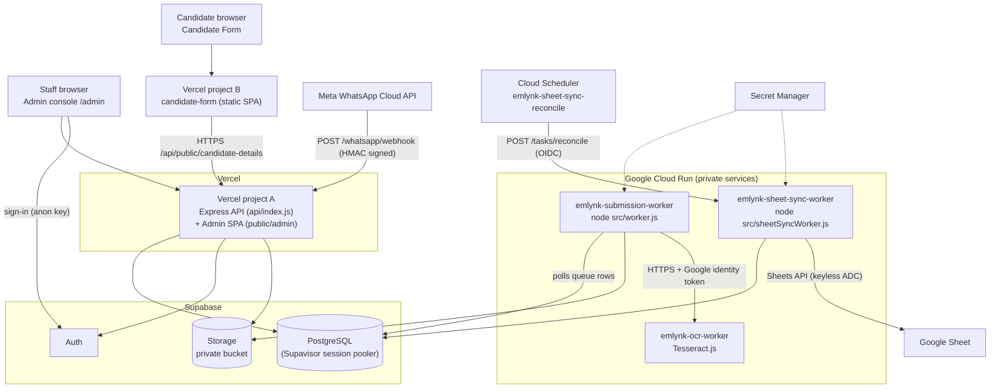

# Emlynk Deployment Guide

A step-by-step guide for a developer who has **never deployed EmlynkWABot before**. It explains *how to set up and deploy* the system. The detailed *design and behaviour* stays in [`../Docs/`](../Docs/README.md); this folder links there instead of repeating it.

> **Source of truth.** Every command, path, variable and service name here was checked against the repository (`package.json`, `vercel.json`, both Dockerfiles, `src/config/*`, `.env.example` files, `scripts/`, `ocr-worker/`) on the date the guide was written. If the repo and this guide ever disagree, the repo wins: fix the guide.

> **WARNING: secrets.** Every value in this guide is a placeholder (`<LIKE_THIS>`). Never paste a real database URL, service-role key, Meta token, OAuth credential or spreadsheet ID into a document, a commit, a chat or a ticket. Real `.env*` files exist in developers' working copies and are git-ignored (`.gitignore` excludes `.env` and `.env.*` except `.env.example`). Do not open them in screen shares and do not reuse production values locally (see [02](02-ENVIRONMENT-VARIABLES.md) and the security checklist in [10](10-ADMIN-AND-OPTIONAL-COMPONENTS.md#security-checklist)).

## What this guide covers

| Component | Where it runs | Guide |
|---|---|---|
| Express API + WhatsApp webhook + Admin console (React/Vite) | **Vercel** project "A" (repository root) | [04](04-VERCEL-DEPLOYMENT.md) |
| Candidate Form (public React/Vite SPA) | **Vercel** project "B" (root directory `candidate-form`) | [04](04-VERCEL-DEPLOYMENT.md) |
| PostgreSQL, Auth, private Storage bucket | **Supabase** | [03](03-SUPABASE-SETUP.md) |
| OCR service (`ocr-worker/`, Tesseract.js) | **Google Cloud Run** service `emlynk-ocr-worker` | [06](06-OCR-WORKER-DEPLOYMENT.md) |
| Submission worker (`src/worker.js`) | **Google Cloud Run** service `emlynk-submission-worker` | [07](07-SUBMISSION-WORKER-DEPLOYMENT.md) |
| Google Sheet Sync worker (`src/sheetSyncWorker.js`) + Cloud Scheduler | **Google Cloud Run** service `emlynk-sheet-sync-worker` | [08](08-GOOGLE-SHEET-SYNC-DEPLOYMENT.md) |
| Google Cloud project, APIs, Artifact Registry, Secret Manager, IAM | **Google Cloud** | [05](05-GOOGLE-CLOUD-SETUP.md) |

Target audience: a developer comfortable with Git, Node.js and a terminal, but new to this project, Supabase, Vercel and Google Cloud.

## Architecture

Key facts, all verified in the repo:

- The Vercel function **does not run the background worker** and never calls OCR. The webhook records each submission durably in PostgreSQL (`temporary_data`) and answers 200; the Cloud Run submission worker **polls PostgreSQL** and processes it. PostgreSQL is the queue ([`Docs/08-cloud-deployment.md`](../Docs/08-cloud-deployment.md) Part 2, Step 5).
- Admin and API share **one origin** on Vercel, so there is no CORS between them. Only the Candidate Form is cross-origin.
- Google authentication in the workers is **keyless** (Application Default Credentials from the Cloud Run service account). No Google key file is ever created.

## Deployment order

The dependency order is fixed. Follow it; later steps need values from earlier ones.

| # | Step | Guide |
|---|---|---|
| 1 | Install tools, clone, install dependencies | [01](01-LOCAL-SETUP.md) |
| 2 | Create the Supabase project; get DB URL, URL, keys | [03](03-SUPABASE-SETUP.md) |
| 3 | Create the private Storage bucket | [03](03-SUPABASE-SETUP.md#storage) |
| 4 | Apply database migrations (`prisma migrate deploy`) | [03](03-SUPABASE-SETUP.md#schema-and-migrations) |
| 5 | Configure Supabase Auth (redirect URLs, sign-ups, SMTP) | [03](03-SUPABASE-SETUP.md#auth) |
| 6 | Configure and test locally | [01](01-LOCAL-SETUP.md), [02](02-ENVIRONMENT-VARIABLES.md) |
| 7 | Create the Google Cloud project, enable APIs, create Artifact Registry repos | [05](05-GOOGLE-CLOUD-SETUP.md) |
| 8 | Deploy the OCR worker (gives you `OCR_SERVICE_URL`) | [06](06-OCR-WORKER-DEPLOYMENT.md) |
| 9 | Create secrets and service accounts | [05](05-GOOGLE-CLOUD-SETUP.md#6-secret-manager) |
| 10 | Deploy the submission worker | [07](07-SUBMISSION-WORKER-DEPLOYMENT.md) |
| 11 | Deploy the Sheet Sync worker and Cloud Scheduler job (writes **disabled**) | [08](08-GOOGLE-SHEET-SYNC-DEPLOYMENT.md) |
| 12 | Deploy Vercel project A (API + Admin) | [04](04-VERCEL-DEPLOYMENT.md) |
| 13 | Deploy Vercel project B (Candidate Form); set `CANDIDATE_FORM_ORIGIN` on project A | [04](04-VERCEL-DEPLOYMENT.md) |
| 14 | Point the Meta webhook at project A | [04](04-VERCEL-DEPLOYMENT.md#meta-whatsapp-webhook) |
| 15 | Create the first OWNER/ADMIN user | [10](10-ADMIN-AND-OPTIONAL-COMPONENTS.md#first-system-administrator) |
| 16 | Run automated checks and the smoke tests | [09](09-TESTING-AND-VERIFICATION.md) |

Why this order: the OCR URL is an input to both the submission worker and the Vercel app (the startup check requires `OCR_SERVICE_URL`); the Vercel domain is an input to Supabase redirect URLs (`APP_BASE_URL`); the Candidate Form domain is an input to project A (`CANDIDATE_FORM_ORIGIN`), and project A's domain is an input to the Candidate Form build (`VITE_API_BASE_URL`). That last pair is circular: see [04](04-VERCEL-DEPLOYMENT.md#3-order-for-the-two-vercel-projects).

## Required external accounts

| Account | Used for | Needed to |
|---|---|---|
| GitHub (access to the `EmlynkWABot` repository) | Source, Vercel Git integration | Clone, deploy |
| Supabase | PostgreSQL, Auth, Storage | Everything |
| Vercel | API, Admin, Candidate Form | Web deployment |
| Google Cloud (billing enabled) | Cloud Run, Artifact Registry, Secret Manager, Cloud Scheduler | Workers |
| Google account owning the target Google Sheet | Sheet Sync | Sheet Sync only |
| Meta developer account with a WhatsApp Business app | Webhook, media download | Live WhatsApp intake only |
| SMTP provider | Staff invitation and password-reset email (configured **inside Supabase**) | Staff onboarding |

## Required tools

| Tool | Version / note |
|---|---|
| Git | any recent |
| Node.js | **`^22.18.0 \|\| >=23.6.0`** (`package.json` `engines`). Older Node fails at startup because the generated Prisma client is TypeScript that Node must load natively |
| npm | ships with Node |
| Docker | Needed for local PostgreSQL (`docker-compose.yml`) and to test images locally. Optional for cloud deploys (Cloud Build can build) |
| Google Cloud CLI (`gcloud`) | for all Cloud Run, Artifact Registry, Secret Manager and Scheduler steps |
| Vercel CLI | optional; the dashboard with Git integration is the documented path |

## Documents in this folder

1. [`01-LOCAL-SETUP.md`](01-LOCAL-SETUP.md): tools, clone, install, run locally
2. [`02-ENVIRONMENT-VARIABLES.md`](02-ENVIRONMENT-VARIABLES.md): every variable, per service
3. [`03-SUPABASE-SETUP.md`](03-SUPABASE-SETUP.md): database, migrations, Auth, Storage
4. [`04-VERCEL-DEPLOYMENT.md`](04-VERCEL-DEPLOYMENT.md): both Vercel projects, Meta webhook
5. [`05-GOOGLE-CLOUD-SETUP.md`](05-GOOGLE-CLOUD-SETUP.md): project, APIs, Artifact Registry, Secret Manager, IAM
6. [`06-OCR-WORKER-DEPLOYMENT.md`](06-OCR-WORKER-DEPLOYMENT.md)
7. [`07-SUBMISSION-WORKER-DEPLOYMENT.md`](07-SUBMISSION-WORKER-DEPLOYMENT.md)
8. [`08-GOOGLE-SHEET-SYNC-DEPLOYMENT.md`](08-GOOGLE-SHEET-SYNC-DEPLOYMENT.md): worker, scheduler, Sheet access
9. [`09-TESTING-AND-VERIFICATION.md`](09-TESTING-AND-VERIFICATION.md): automated tests, smoke tests
10. [`10-ADMIN-AND-OPTIONAL-COMPONENTS.md`](10-ADMIN-AND-OPTIONAL-COMPONENTS.md): first admin, environments, security checklist, optional components
11. [`11-TROUBLESHOOTING.md`](11-TROUBLESHOOTING.md)

## Environments at a glance

| Environment | Git branch | Vercel | Database | Cloud Run |
|---|---|---|---|---|
| Local | any working branch | `npm start` / `npm run admin:dev` | local Docker Postgres **or** a dedicated dev Supabase project | local processes |
| Stage | `stage` | Preview deployment | the stage database (confirm: see [10](10-ADMIN-AND-OPTIONAL-COMPONENTS.md#environment-separation)) | separate services/secrets recommended |
| Production | `main` | Production deployment | production Supabase project | production services |

Full detail in [10](10-ADMIN-AND-OPTIONAL-COMPONENTS.md#environment-separation).

## Existing documentation

| Topic | Document |
|---|---|
| Local development and git workflow | [`Docs/11-development-guide.md`](../Docs/11-development-guide.md) |
| Original deployment log (history of how production was built) | [`Docs/08-cloud-deployment.md`](../Docs/08-cloud-deployment.md) |
| Supabase Auth design and project configuration | [`Docs/SUPABASE_AUTH.md`](../Docs/SUPABASE_AUTH.md) |
| Roles and permissions matrix | [`Docs/ROLES_AND_PERMISSIONS.md`](../Docs/ROLES_AND_PERMISSIONS.md), [`Docs/OWNER_ROLE.md`](../Docs/OWNER_ROLE.md) |
| OCR service reference | [`ocr-worker/README.md`](../ocr-worker/README.md) |
| Google Sheet Sync architecture and runbook | [`Docs/GOOGLE_SHEET_INTEGRATION.md`](../Docs/GOOGLE_SHEET_INTEGRATION.md), [`Docs/GOOGLE_SHEET_CANDIDATE_SYNC_ARCHITECTURE.md`](../Docs/GOOGLE_SHEET_CANDIDATE_SYNC_ARCHITECTURE.md) |
| Candidate Form | [`candidate-form/README.md`](../candidate-form/README.md), [`Docs/CANDIDATE_FORM_FEATURE_ARCHITECTURE.md`](../Docs/CANDIDATE_FORM_FEATURE_ARCHITECTURE.md) |
| Testing | [`Docs/12-testing-and-quality.md`](../Docs/12-testing-and-quality.md) |
| Storage layout | [`Docs/06-storage-management.md`](../Docs/06-storage-management.md) |

## Things this guide deliberately does not assume

- It does not contain the production project ID, URLs, spreadsheet ID or any key. Where the existing `Docs/` contain such identifiers, **do not copy them**; substitute your own.
- It does not deploy anything for you. Every `gcloud`, `vercel` and `prisma migrate deploy` command here changes a real environment: read the target (`--project`, `DATABASE_URL`) before running it.
