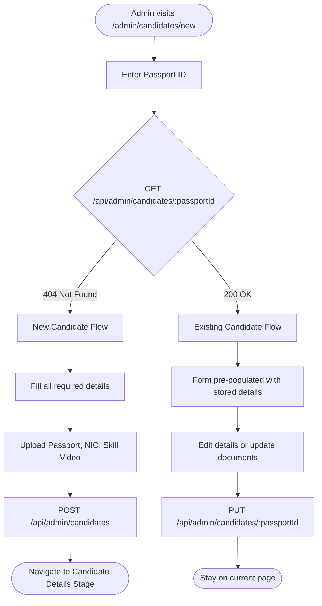
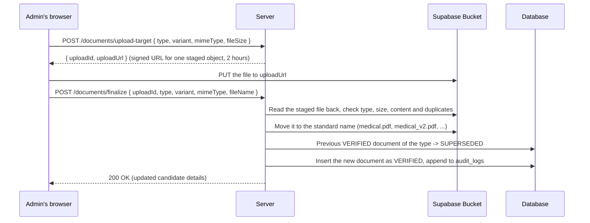

# Candidate Management

Status: **Implemented and verified. Applies to all active admin and reviewer accounts.**

This document covers the Candidate Management feature introduced after Phase 10: how candidates are registered, how their six-stage deployment process works, how documents are uploaded, and what the recent bug-fix release (C1, D1, E1) changed.

---

## 1. Overview

**Candidate Management** is a section of the admin dashboard (`/admin/candidates`) for managing deployment candidates — people being prepared for overseas deployment. It is separate from the main WhatsApp-driven document review workflow (clients).

A candidate is stored as a row in the `candidate` table (named `users` before migration `20261008120000_rename_candidate_user_tables`) identified by their **passport ID**. The same table is used for WhatsApp clients; a candidate who later sends documents via WhatsApp is the same row.

| | |
|---|---|
| URL | `/admin/candidates` |
| Add candidate | `/admin/candidates/new` |
| Candidate detail | `/admin/candidates/:passportId?stage=…` |
| Who can read | Any active admin |
| Who can write | Reviewer role or above |
| Search | By name, passport ID, unique ID, NIC, contact number or WhatsApp number (database-side, before paging) |
| Uniqueness | Passport ID and NIC are unique. WhatsApp number is unique per candidate (DB-level partial index). |

---

## 2. File Structure

### Backend

| File | Purpose |
|---|---|
| `src/services/candidateService.js` | All candidate business logic: registration, stage updates, document uploads, validation, uniqueness checks |
| `src/services/candidateAdditionalDetailsService.js` | Additional details: validation, read with suggestions, save with audit |
| `src/routes/admin.js` | Express routes for `/api/admin/candidates/*` |

### Frontend (admin/)

| File | Purpose |
|---|---|
| `admin/src/pages/CandidatesPage.tsx` | Candidates list with search, pagination |
| `admin/src/pages/CandidateRegistrationPage.tsx` | Add / edit candidate form |
| `admin/src/pages/CandidateDeploymentPage.tsx` | Six-stage deployment view per candidate |
| `admin/src/components/candidate/CandidateFields.tsx` | Shared form fields (all candidate detail inputs) |
| `admin/src/components/candidate/StagePanels.tsx` | Stage-specific panel components |
| `admin/src/components/candidate/DocumentRow.tsx` | Per-document upload row (used in both registration and stage 2) |
| `admin/src/components/candidate/CandidateStepper.tsx` | Progress stepper shown across the top of the deployment page |
| `admin/src/components/candidate/CallLogDialog.tsx` | Admin call log drawer: Candidate History, No Answer, Need Attention, collapsible compact add form |
| `admin/src/components/candidate/DocumentStatusSummary.tsx` | Compact current-document chips (no longer shown in the Call Log drawer or on the Need Attention page; the component is kept, unused) |
| `admin/src/pages/PriorityFollowUpsPage.tsx` | Need Attention page (formerly Priority Follow-Ups; the file keeps its name) |
| `admin/src/components/candidate/AdditionalDetailsPanel.tsx` | Additional details form: sections, conditional fields, sizes, save |
| `admin/src/api/candidates.ts` | Typed frontend API wrappers for all candidate endpoints |

### Database

| Table | Purpose |
|---|---|
| `candidate` | One row per candidate (same table used for WhatsApp clients) |
| `candidate_stages` | One row per stage per candidate: completion, notes, timestamps |
| `documents` | All uploaded files (passport, NIC, skill video, medical, police report, scan) |
| `candidate_additional_details` | At most one row per candidate: the Additional details form (primary key and foreign key `passport_id`) |
| `audit_logs` | Candidate, stage, document and additional-details changes are appended here |

---

## 3. Registration (`/admin/candidates/new`)

The **Add candidate** page (`CandidateRegistrationPage`) works in two modes depending on whether the entered passport ID is already on record:



### 3.1 New candidate

1. The admin enters a passport ID (6–9 alphanumeric characters, must include at least one digit).
2. On field blur (or form submit), the frontend calls `GET /api/admin/candidates/:passportId`.
3. If the response is **404**, the passport ID is new. The admin fills in the full details form and uploads:
   - **Passport** (required, PDF/JPG/PNG, ≤ 50 MB)
   - NIC document (optional)
   - Skill video (optional, `video/mp4`, `video/quicktime`, `video/webm`)
4. On submit, `POST /api/admin/candidates` creates the `candidate` row and stage rows, then documents are uploaded one by one.
5. On success the admin is navigated to the candidate's deployment page at `CANDIDATE_DETAILS` stage.

**Fields collected at registration:**

| Field | Required | Notes |
|---|---|---|
| Passport ID | ✓ | Normalized to uppercase, 6–9 letters and digits with at least one digit (hint `!` beside the label) |
| Surname | ✓ | |
| Other names | ✓ | |
| NIC | ✓ | 9 digits + V/X, or 12 digits |
| Address | | Optional everywhere (registration, saving details, completing Candidate details) |
| Job types | ✓ | Up to 10 chips; Enter or comma to add |
| Job experience | ✓ | |
| Nationality | | |
| Sex | | M / F / X (as on ICAO passports) |
| Date of birth | | |
| Place of birth | | |
| Passport issue date | ✓ | Before the expiry date (hint `!`) |
| Passport expiry date | ✓ | After the issue date (hint `!`) |
| WhatsApp number | ✓ | Fixed `+94` prefix; the user types the 9-digit mobile number (e.g. `771234567`). Stored as `94771234567`. Locked once saved (see §5.1) (hint `!`) |
| Contact number | | |
| Comment | | Internal note, saved to `CANDIDATE_DETAILS` stage |

### 3.2 Existing candidate

If `GET /api/admin/candidates/:passportId` returns **200**, the candidate already exists. The form is pre-populated with their stored details. The admin can:

- Edit any field (except the passport ID and a locked WhatsApp number — see §5.1).
- Replace or add their **Passport**, **NIC document**, or **Skill video** via the live `DocumentRow` upload controls (same versioning as WhatsApp documents: a new upload becomes `VERIFIED`, the previous one becomes `SUPERSEDED`).
- Update the `CANDIDATE_DETAILS` stage comment.

On save, the form calls `PUT /api/admin/candidates/:passportId` and, if the comment changed, `PUT /api/admin/candidates/:passportId/stages/CANDIDATE_DETAILS`.

---

## 4. Eight-Stage Deployment Process

Each candidate has exactly **eight stages**, always in this order (six of them, plus Additional details, have a circle on the progress stepper; see below):

```mermaid
flowchart LR
    S1[1. Test Details\n(Admin)] --> SJ[2. Job Details\n(Admin)]
    SJ --> S2[3. Candidate Details\n(Automatic)]
    S2 --> S3[4. Document Submission\n(Automatic)]
    S3 --> S4[5. IVS Interview\n(Admin)]
    S4 --> S5[6. Visa Submission\n(Admin)]
    S5 --> S6[7. Visa Approval\n(Admin)]
    S6 --> S7[8. Finalizing Job\n(Admin)]
    
    classDef auto fill:#e1bee7,stroke:#8e24aa,stroke-width:2px,color:#000;
    classDef manual fill:#bbdefb,stroke:#1976d2,stroke-width:2px,color:#000;
    
    class S1,SJ,S4,S5,S6,S7 manual;
    class S2,S3 auto;
```

| # | Stage key | Label | Completed by |
|---|---|---|---|
| 1 | `TEST_DETAILS` | Test details | Admin (checkbox) |
| 2 | `JOB_DETAILS` | Job details | Admin (checkbox); never automatic, even when a Job is assigned |
| 3 | `CANDIDATE_DETAILS` | Candidate details | Automatically — when required fields and passport are present |
| 4 | `DOCUMENT_SUBMISSION` | Document submission | Automatically — when all 5 required documents are present |
| 5 | `IVS_INTERVIEW` | IVS interview | Admin (checkbox) |
| 6 | `VISA_SUBMISSION` | Visa submission | Admin (checkbox) |
| 7 | `VISA_APPROVAL` | Visa approval | Admin (checkbox) |
| 8 | `FINALIZING_JOB` | Finalizing the job | Admin (checkbox) |

**Test details** records: *Agent name* (free text: the agent associated with the test, `test_agent_name`), *Test ID* (the test's own reference, `test_id`), *Test result* (Pass / Fail), *Test date* and *Notes*. It used to hold "Client name" (the candidate's own name, read-only) and a free-text "Job ID"; the Job is no longer entered here.

**Job details** records a *Date* (`job_details_date`), a *Note* (the stage's `notes`) and the completion checkbox, and **shows** two read-only values taken live from the candidate's Job assignments (`job_candidate` → `job` → `client`): *Job ID* (the human-readable Job code, e.g. `JOB-2026-000007`, never the UUID) and *Client name*. They are not stored on the stage, so a Client rename or a reassignment to another Job shows immediately; the API refuses to write them (`jobCode`, `clientName`, `jobId`). Which Job is shown follows a fixed priority: **(A)** the current PROCESSING assignment; else **(B)** the latest historical assignment (completed, cancelled, or one the candidate was removed from), with a small note under Job ID ("Completed job (not current)", "Cancelled job (not current)" or "Candidate was removed from this job (not current)"); else **(C)** "Not assigned" (the candidate never had a Job). "Latest" is the newest `job_candidate.assigned_at` (ties: the row's `created_at`, then the job id), so a candidate whose Job B completed after Job A keeps showing Job B. Removing a candidate from a job never deletes the `job_candidate` row (it sets `released_at`), so this history is complete. The fallback is display-only: it never re-activates an assignment, changes a Job, or writes anything to the stage. The old free-text `candidate_stages.job_id` is never read as a Job: it only appears as the Test ID of a Test details row that has no `test_id` yet.

The progress stepper on the candidate page shows Test details, Job details, Candidate details, Additional details, Document submission, Visa submission and Visa approval. IVS interview and Finalizing the job have no circle (their data and `?stage=` links are unchanged). The candidate list's progress counts all seven stages (`x/7`).

Stages are independent: any stage can be opened and edited in any order. The URL uses `?stage=<key>` to select which panel is shown; the default is the first incomplete stage.

### 4.0 Candidate list Status (derived workflow status)

The Candidates list has a **Status** column (it replaced the old *Progress* column; the stepper on the candidate page and every stage are unchanged). The Status is **derived** on the server on every list read from existing data (`src/services/candidateWorkflowStatus.js`, signals gathered in `candidateService.listCandidates`). It is never stored and never edited, so it follows the data automatically.

| Code | Label | Signal (source of truth) |
|---|---|---|
| `REGISTERED` | Registered | default: the candidate exists and nothing below applies |
| `STOPPED_WITH_TEST` | Stopped with Test | `candidate_stages.test_result = 'FAIL'` on `TEST_DETAILS` (the saved result, not stage completion) |
| `JOB_ASSIGNED` | Job Assigned | an **active** `job_candidate` on a PROCESSING job (never `candidate_stages.job_id` or `candidate.job` text) |
| `FORM_SUBMITTED` | Form Submitted | `candidate_form_access.status = 'SUBMITTED'` (Candidate Form, read-only, one query per page; see below) |
| `DETAILS_VERIFIED` | Details Verified | an explicit manual **Verify details** by an ADMIN or MANAGER (`candidate_verification.details_verified_at/by`); possible only while the Candidate details stage is complete. Completing or saving details, or Additional details, never verifies them |
| `DOCUMENTS_VERIFIED` | Documents Verified | an explicit manual **Verify documents** by an ADMIN or MANAGER (`candidate_verification.documents_verified_at/by`); possible once at least one required document is on record. An upload or an OCR-accepted document (`documents.verification_status = VERIFIED`, which the pipeline also sets automatically) is **not** a verification |
| `VISA_DOCUMENT_READY` | Visa Document Ready | the **Document submission** stage is completed (every required document on record). The Visa submission stage is not needed and does not count |

**Precedence.** Test FAIL first (Stopped with Test); then, the first that holds: `VISA_DOCUMENT_READY` (Document submission complete) > `DOCUMENTS_VERIFIED` > `DETAILS_VERIFIED` > `FORM_SUBMITTED` > `JOB_ASSIGNED` > `REGISTERED`. The signals are independent. **Test FAIL is an override**, not a step: while the saved result is FAIL the status is *Stopped with Test* whatever else is true (verifications stay on record); when it is no longer FAIL the status is read again from the current data. A FAIL does not remove an existing Job assignment, and a FAIL candidate still cannot be newly assigned a Job (that needs PASS). Because Document submission outranks Documents Verified, *Documents Verified* shows while Document submission is still incomplete, and *Visa Document Ready* takes over once it completes.

**Form Submitted source.** The Candidate Form is a separate application; its table `candidate_form_access` exists only where its migrations ran (the shared database), not in this branch's migrations. The list reads it with one guarded raw query (`to_regclass` check first), modelling nothing of the form: where the table is missing, or cannot be read, nobody shows Form Submitted.

**Manual verification.** `POST /api/admin/candidates/:passportId/verification { kind: "DETAILS" | "DOCUMENTS", verified: boolean }` (ADMIN and MANAGER; 409 `DETAILS_INCOMPLETE` / `DOCUMENTS_MISSING` when there is nothing to verify) writes `candidate_verification` (migration `20261021120000_candidate_verification`) and an audit entry (`VERIFY_DETAILS`, `UNVERIFY_DETAILS`, `VERIFY_DOCUMENTS`, `UNVERIFY_DOCUMENTS`). The candidate page shows a *Verify details* button on Candidate details and *Verify documents* on Document submission (and who verified, when). Repeating the current state does nothing. No Status field is stored or editable.

**Documents Verified** is the manager's sign-off on the required documents *currently on record* (it needs at least one; the whole set is not required). It is separate from the document-processing status: an OCR-accepted `VERIFIED` document is not a manual verification.

**Automatic reset.** A verification is cleared automatically, in the **same transaction** as the change that made it stale (database triggers, migration `20261022120000_candidate_verification_reset`), so there is never changed data with a stale verification and a rolled-back change leaves the verification alone. The edit itself always succeeds; the admin does not remove anything first.

| Verification | Cleared when | Not cleared by |
|---|---|---|
| Details Verified | a Candidate details value changes: first name, surname, address, NIC, job types, job experience, WhatsApp number, contact number, place of birth, date of birth, passport issue / expiry date, nationality, sex; or any Additional details value is saved for the first time or changes (all its fields) | saving the same values, the stage comment / completion, Test result, Job assignment or change, call logs, other stages, document uploads or review, Visa stages |
| Documents Verified | a required document (passport, medical, police report, scan) is added, removed, replaced (the previous one superseded), or changes status (for example a review approval), file or variant | Candidate details edits, Job or test changes, notes and other stages, other document types (NIC, skill video, police slip, visa document) |

Each reset is audited as `DETAILS_VERIFICATION_RESET` / `DOCUMENTS_VERIFICATION_RESET` (actor = the signed-in user whose edit, upload, approval or removal caused it; the reason names the kind of change and, for documents, the type; never field values or file contents). Only a verification that was actually set is cleared and audited, so an edit of unverified data writes nothing. **Limit:** a change made by an automated process with no signed-in user (WhatsApp document processing, OCR passport reconciliation) still resets the verification, but writes no audit entry, because an audit entry needs a user. Admin-driven transactions name the user to the database through `app.actor_id` (`src/services/auditActor.js`).

**Performance.** One COUNT and one bounded page query; job assignment, additional details, stages and required documents are relations of that single query, plus at most two raw reads for the form table. Nothing is queried per candidate.

### 4.1 Automatic stages (3 and 4)

**Stage 2 — Candidate details** is marked complete when the following required fields are filled **and** a `PASSPORT` document is uploaded:

- Surname, other names, NIC, passport issue date, passport expiry date, one or more job types, job experience, WhatsApp number. The address is **not** needed.

Candidates saved before the passport dates were required still load; their Candidate details shows the dates as missing until they are filled in (they must be, to save the details again).

The panel shows what is still missing (`Missing: …`) until complete.

**Stage 3 — Document submission** is marked complete when all five required documents are on record:

- PASSPORT, MEDICAL, POLICE_REPORT, SCAN.

A checklist of the five documents is shown at the top of the panel.

### 4.2 Notes stages (1, 4, 5, 6, 7)

Each has a free-text **Notes** field and a **Stage completed** checkbox. Changes are saved with **Save changes** / discarded with **Cancel**. The `PUT /api/admin/candidates/:passportId/stages/:stage` endpoint accepts `{ notes, completed }`.

### 4.3 Call log

Every candidate page has a **Call log** button (top right). It opens a drawer from the right: the candidate summary (name, passport ID, WhatsApp), **Candidate History**, and the **Add New Call Log** form at the bottom.

**Candidate History** (formerly *Call History*) is one timeline, newest first by when each thing happened, of:

- **Call logs**: date and time, who called, the note, with the *Call log* label. Soft amber tint.
- **No Answer calls**: the same card with a **No Answer** badge and no note. Soft red tint.
- **Candidate activity**: one short line with a small icon and the *Candidate activity* label. Soft green tint.

Colour supports scanning and never carries the meaning on its own: every entry says what it is in words (and an icon). Each tint is a light fill with a thin accent on the left and a small coloured icon, taken from the dashboard theme's `review` (amber), `critical` (red) and `verified` (green) tokens, so light and dark mode each get their own soft or muted version; no fixed colours are used. Text keeps the normal ink colours (at least 6.9:1 contrast in light mode, 8.6:1 in dark). Red is reserved for No Answer, an outcome and not an error, so the Need Attention flag uses amber (filled while open, a muted check once completed, an outline when not flagged). The Need Attention page uses the same No Answer badge and shows completed follow-ups in quieter, muted tones.

The drawer no longer shows the *Current documents* block. Document status is still on the candidate page, and `documentStatus` is still returned by the API (the Need Attention page no longer shows it either).

Candidate activity is built only from what is already on record. There is no new table and no migration, and nothing is reconstructed or guessed:

| Activity | Source | Shown as |
|---|---|---|
| Document received | `documents` (every row of a candidate type, superseded ones too) at `received_date` | *Passport uploaded* / *Police report - SL Verified uploaded*, **by &lt;staff&gt;** (an `UPLOAD_DOCUMENT` audit entry), **via WhatsApp** (stored from a WhatsApp submission), or with no byline when neither is known |
| Document verified | `APPROVE` / `REPLACE_VERIFIED` audit entries | *Medical verified*, by &lt;staff&gt; |
| Document removed | `REMOVE_DOCUMENT` audit entries | *Scan removed*, by &lt;staff&gt; |
| Candidate registered | `CREATE_CANDIDATE` | *Candidate registered* |
| Details updated | `UPDATE_CANDIDATE` (field **names** only; old and new values are never sent) | *Address updated*, *WhatsApp number updated*, *Passport details updated*, or *Candidate details updated* with the field names |
| Additional details | `CREATE_` / `UPDATE_ADDITIONAL_DETAILS` | *Additional details updated* |
| Stage saved by an admin | `UPDATE_STAGE` | *IVS interview marked complete* / *marked incomplete* / *updated* (notes are not repeated) |
| Older stage completion | `candidate_stages.completed_at` when no audited save matches it | *Visa approval marked complete* (no byline) |

Limitations:

- **Automatic stages:** Candidate details and Document submission keep no completion history, so their completion never appears.
- **Earlier stage completions:** for a manual stage, only its current `completed_at` exists from before stage saves were audited. Earlier completions, and reopenings, are not on record.
- **Approvals of removed documents:** an approval whose document was removed later is not shown. The audit entry has no document type to name it by.
- **Unattributed documents:** a document stored before submissions were linked (`temporary_id`) and without an upload audit entry has no "by" or "via" line.
- **Activity limit:** the latest 100 activity entries are returned. *Showing the latest candidate activity only* appears when there are more. Call logs are not limited.

**The Need Attention page** (sidebar, after Candidates; route `/follow-ups`) is the former *Priority Follow-Ups* page. Only what users read changed: the page, sidebar and dialog wording. The feature's internals keep their names (route, `/api/admin/follow-ups`, `call_log_follow_up`, the `FLAG_FOLLOW_UP`, `COMPLETE_FOLLOW_UP` and `DELETE_FOLLOW_UP` audit actions), and so do the rules: the *Open* / *Completed* filter, grouping by candidate (one card per candidate, newest follow-up first), completing by every Candidates role, deleting by ADMIN and MANAGER only, and deleting or completing never touching the call log, the candidate or a document. What changed on the page:

- The *Current documents* block is gone (the API still sends `documentStatus`; nothing renders it here).
- The follow-up's state is a compact icon at the top right of each row, beside who called, like a call in Candidate History: a filled flag, *Needs attention*, while open; a muted check, *Follow-up completed*, once completed. Each has an accessible name and a tooltip, and the icon shape differs, so colour is not the only cue. It shows the state only; **Mark complete** (open follow-ups) and **Delete** (ADMIN, MANAGER) stay as buttons in the row's footer, next to who flagged it and when.
- The "Needs attention" text badge is removed. A flagged No Answer call shows a No Answer badge instead of a note.

**Need Attention (flagging a call).** Each call shows a compact flag beside the caller's name, using the existing Priority Follow-Up:

- **Outline flag:** a button, *Mark as needs attention*.
- **Filled flag:** *Needs attention*, while the follow-up is open. There is no second flag.
- **Completed check:** *Follow-up completed*. The call can be marked again.

Roles that can only view see the state, not the button.

**No Answer.** When the candidate does not pick up, **No Answer** records the attempt at the selected date and time, signed with the staff member, with no note. It is a call log row like any other: `candidate_call_logs.call_outcome = 'NO_ANSWER'` (migration `20261013120000_call_log_outcome`; every earlier call is `ANSWERED`) and an empty `note`. Candidate History shows it as a **No Answer** badge (red icon and outline) with no note body, in the same time order. It counts in the Daily Report's Calls Taken (that count is of call rows). It does not open a follow-up by itself; flag it with the flag icon, or turn **Need Attention** on before pressing No Answer. A note typed in the box is not sent with No Answer and is kept for the next call.

| | **Add call** | **No Answer** |
|---|---|---|
| Request | `POST …/call-logs { note, calledAt }` | `POST …/call-logs { outcome: "NO_ANSWER", calledAt }` |
| Note | required (the database enforces it too) | not needed; one sent is ignored |

The add form's buttons are **Close**, **No Answer**, **Need Attention** (a toggle) and **Add call**. With Need Attention on, the one request (`POST …/call-logs` with `needsAttention: true`) creates the call and its OPEN follow-up, with its `FLAG_FOLLOW_UP` audit entry, in one transaction. You get one call, never two.

**Compact, collapsible add form.** *Add New Call Log* is compact (tighter spacing and controls, widths and heights that adapt to the screen) so Candidate History gets most of the drawer. A chevron beside its heading collapses it: expanded (down chevron) shows Date, Time and the note; collapsed (up chevron) hides those fields. **Close**, **No Answer**, **Need Attention** and **Add call** are always visible. Collapsing keeps what was typed and is only a display state; nothing is stored.

**Closing.** The drawer closes with X, Close, Escape, or a click on the page outside it. A click only counts when the press started outside too, so a text selection dragged out of the drawer doesn't close it. Nothing closes the drawer while a call is being saved.

A call can't have two open follow-ups (partial unique index `call_log_follow_up_one_open_per_call_log`, 409 `FOLLOW_UP_EXISTS`); after completion it can be marked again. Migration `20261011120000_call_log_follow_up` (additive).

### 4.4 Additional details (a progress step)

The candidate page's progress stepper shows five circles: Test details, Candidate details, **Additional details**, Document submission, Visa approval. Selecting *Additional details* shows its form (`?tab=additional`); selecting any other circle shows that stage (`?stage=…`). There is no separate tab bar. The circle is completed once additional details have been saved.

**IVS interview and Finalizing the job have no circle.** They are still stages (their data, panels and `?stage=IVS_INTERVIEW` / `?stage=FINALIZING_JOB` links are unchanged); only the circles are hidden. The candidate list's "current stage" and `x/6` still count all six stages.

Every role that manages candidates can edit the form, REGISTRATION_DESK included.

| Section | Fields |
|---|---|
| Passport & Personal Details | Passport number (read-only: the candidate's passport ID), name according to passport, permanent address, birthday |
| Clothing & Sizes | T-shirt size (XS–XXL), pant size (28–46 or custom), shoe size (UK 5–13 or custom) |
| Father Details | Is father alive?; full name (required only if alive); birthday. Name and birthday are always available |
| Mother Details | Is mother alive?; full name (required only if alive); birthday. Name and birthday are always available |
| Marital & Family Details | Marital status; if Married: wife full name (required), wife birthday; 1st–3rd child names (not for Single) |
| Employment / Skills | Other job skills |

- **Always the existing candidate**: the passport number is the candidate's own passport ID and can't be edited, so a duplicate candidate can't be created from here. The API resolves the passport ID to the existing record and returns 404 for an unknown one.
- **Auto-fill**: a form with nothing saved yet is pre-filled from the candidate's record (name, address, date of birth), with a note saying so. Those values are stored only when **Save additional details** is pressed.
- **The candidate's own record is never changed** from this tab; the details live in `candidate_additional_details`.
- **Parent name and birthday are independent of the alive answer.** The father and mother name and birthday fields are always shown, so a parent who has passed away can still be recorded; changing the answer never clears them. Only the name is required, and only when the parent is alive.
- **Children depend on marital status.** The 1st–3rd child name fields are hidden when the marital status is Single (they stay for Married, Divorced, Widowed, Separated, or not recorded) and are never required. Switching to Single in the form keeps what was typed until you save, and a Single candidate is never saved with child names (the server refuses them). A candidate already stored as Single with child names (from before this rule) is not changed until their details are next saved: the form then shows a note that the child names will be removed.
- Hidden details are cleared on save: the wife's details when not married, and the child names when Single.
- **Two people editing**: the form sends the `updatedDate` it loaded, and a save on a different version is refused with `409 DETAILS_CHANGED` ("changed by someone else… use Sync"). The typed values stay in the form. The page loads the details once and shares them with the stepper and the form.
- Every change appears in Audit Logs (`CREATE_ADDITIONAL_DETAILS` / `UPDATE_ADDITIONAL_DETAILS`) with only the changed fields. Saving without changes writes nothing.

---

### 4.5 Work Allocation and candidate access

Candidates are allocated to Analysts on the **Work Allocation** page (`/admin/work-allocation`, ADMIN and MANAGER only). Who may see and change which candidates:

| Role | Candidates | Work Allocation |
|---|---|---|
| ADMIN, MANAGER | all; can edit all | yes |
| REGISTRATION_DESK | all; can edit all; registers new candidates | no (page hidden, API 403) |
| ANALYST | **only the candidates allocated to them**; can edit only those | no (page hidden, API 403) |

**Storage.** `public.candidate_allocation` (migration `20261014120000_candidate_allocation`, additive): one row per allocated candidate (`passport_id` primary key, `analyst_id` → `"user"`, `assigned_date`). No row means unallocated, so every existing candidate started unallocated. It is a separate table, not a column on `candidate`, so allocating never updates the candidate row (no Google Sheet sync trigger, no `updated_date` change). History is in Audit Logs.

**Allocation rules** (`src/services/workAllocationService.js`):

- Only an `ACTIVE` user with role `ANALYST` can receive candidates. Others are refused with 409 (`ANALYST_INACTIVE`, `NOT_AN_ANALYST`, `ANALYST_NOT_FOUND`).
- One request assigns the whole selection, in one transaction, all or nothing. A missing candidate (`CANDIDATE_NOT_AVAILABLE`) or any invalid Analyst changes nothing.
- **Distribution:** `allocations: [{ analystId, count }]`. The counts must be whole numbers ≥ 0, with no Analyst twice, and must add up exactly to the number of candidates (400 `COUNT_MISMATCH` otherwise). At most 500 candidates per request.
- **Order:** the candidates are taken newest registered first (passport ID for ties: the list order, whatever order they were ticked in) and handed out in the order of `allocations`.
- **Reassignment** of already allocated candidates needs `reassign: true` (else 409 `ALREADY_ALLOCATED`, nothing changed). A second manager working from a stale page therefore never silently overwrites the first. Candidates are locked (`FOR UPDATE`) during the change, and target Analysts `FOR SHARE`.
- **Unassignment** needs `confirm: true` and returns candidates to Unallocated.
- New candidates are unallocated. **Analysts cannot register candidates** (403, and the Add candidate / Register Candidate links are hidden), because the new candidate would not be theirs.
- Audit: `ASSIGN_CANDIDATE`, `REASSIGN_CANDIDATE`, `UNASSIGN_CANDIDATE` (Candidate category). Each entry records the candidate, the acting user, and the previous and new Analyst's ID and name as JSON. A candidate given to the Analyst it already has is not audited.

**Analyst scoping** (`src/services/candidateAccess.js`) is applied on the server on every request, so a reassignment or role change applies to the very next one:

- `candidateScope(user)`: `{}` for ADMIN, MANAGER and REGISTRATION_DESK; for an Analyst, only candidates whose allocation is theirs; for any other role, no candidate (fails closed).
- **Lists:** the Candidates list (search and totals included: the scope is in the database query before paging), Need Attention, Clients, Documents, Missing Documents and Police Workflow.
- **Single candidate:** every `/candidates/:passportId/...` route resolves the passport ID *within* the scope. Another Analyst's or an unallocated candidate answers **404 "Candidate not found"**, exactly like one that does not exist, before anything is read or changed. This covers details, update, stages, document upload target, finalize and remove, call logs (Candidate History), adding a call, flagging a follow-up, and additional details. `GET /clients/:passportId` and completing a follow-up follow the same rule.
- **Review Queue → assign client:** an Analyst can only link a waiting file to one of their own candidates; any other passport ID gets the same 409 `CLIENT_NOT_FOUND` as an unknown one.
- **Review items (detail, file preview, every action) and deleting a waiting file:** an item linked to a candidate outside the Analyst's scope answers **404 "Review item not found"** before anything is shown or changed (`router.param("reviewId")`, and the same check on `DELETE /temporary-documents/:id`). A waiting file not yet linked to any candidate stays open to every Analyst, because that is the review work.
- **Review Queue list, Overview and Daily Report:** scoped in the database queries (`linkedScope`, `submissionScope`, `auditScope` in `candidateAccess.js`), not in the browser. An Analyst's Review Queue (list and summary counts), Overview (KPIs, recent files, review preview, police and completeness counts) and Daily Report (daily, Summary, incomplete-candidates drill-down, monthly) cover **their own candidates**, plus waiting files **not yet linked to any candidate** (that is the review work). Once a file is linked it follows the candidate's allocation. Audit-based counts (admin actions, uploads, removals) count the entries about their candidates. ADMIN, MANAGER and REGISTRATION_DESK are unchanged (global); Summary by Roles stays ADMIN and MANAGER only. Reassignment applies on the next request.

## 5. Bug-Fix Release (2026-10-01)

The following issues were fixed in a single release. The stage order, completion logic, and overall UI layout were not changed.

### 5.1 C1 — WhatsApp uniqueness race condition

**Problem:** Two near-simultaneous registrations could both pass the application-level WhatsApp duplicate check and save the same number.

**Fix:**

- A **partial unique index** was added to the database:

  ```sql
  -- prisma/migrations/20261001140000_whatsapp_unique_constraint/migration.sql
  CREATE UNIQUE INDEX "users_whatsapp_number_key" ON "users"("whatsapp_number")
  WHERE "whatsapp_number" IS NOT NULL AND "whatsapp_number" != '+94771581916';
  ```

  Historical SQL: migration `20261008120000_rename_candidate_user_tables` later renamed the table to `candidate` and this index to `candidate_whatsapp_number_key`.

  The exclusion covers one pre-existing duplicate that cannot be cleaned up without business input. All new registrations are enforced at the database level.

- `src/services/candidateService.js` was updated in `createCandidate` and `updateCandidateDetails` to catch Prisma's `P2002` error (unique constraint violation) and throw a friendly `CandidateError` with code `WHATSAPP_EXISTS` (HTTP 409) instead of letting a raw database error surface.

> The application-level check in `candidateService.js` is kept so admins still see a friendly validation message before the request reaches the database.

**Note on the known duplicate:** `+94771581916` is associated with two existing rows (`P0124960` and `P1215209`). It was excluded from the index. Do **not** silently delete, merge, or modify either row; resolve it with the business team.

---

### 5.2 D1 — WhatsApp field read-only for existing candidates

**Problem:** When an admin edited an existing candidate's details, the WhatsApp field appeared editable. But the server silently ignored any change to it (by design — the number must not change once registered). This caused confusion.

**Fix (UI only):** In `admin/src/components/candidate/CandidateFields.tsx`, when `whatsappLocked` is `true` (i.e. a WhatsApp number is already stored), the field renders as `readOnly` and a hint is shown below it:

```
Registered WhatsApp numbers cannot be changed.
```

The `whatsappLocked` prop is passed from both `CandidateDetailsStage` (deployment page) and `CandidateRegistrationPage` (registration form) as:

```tsx
whatsappLocked={Boolean(details.candidate.whatsappNumber)}
```

No API change was needed.

---

### 5.3 E1 — Stale state when navigating between candidates

**Problem:** Navigating from Candidate A's page directly to Candidate B's page (e.g. via breadcrumb → list → another row) could briefly show Candidate A's data in Candidate B's URL. React's local state was not reset on route parameter change.

**Fix** (`admin/src/pages/CandidateDeploymentPage.tsx`):

1. A `useEffect` dependent on `passportId` now clears the locally updated copy (`setUpdated(null)`) and closes the call log dialog (`setCallLogOpen(false)`) whenever the route changes.
2. The candidate data is gated: if `details.candidate.passportId` does not match the current URL `passportId`, the loading spinner is shown instead of stale data:

```tsx
if (!details || details.candidate.passportId.toUpperCase() !== passportId.toUpperCase()) {
    return <Card><LoadingState label="Loading candidate…" /></Card>;
}
```

---

### 5.4 Search retry stale results

**Problem:** When a candidate search failed and the admin clicked **Try again** (via `ErrorState`'s retry), the previous search results would flash briefly on screen before the new request completed.

**Fix** (`admin/src/pages/CandidatesPage.tsx`): A `useRef` flag tracks whether the last settled state was an error. During a retry (`status === "loading"` while `wasErrorRef.current` is `true`), `data` is forced to `null` so no stale rows are displayed:

```tsx
const wasErrorRef = useRef(false);
if (list.status === "error") wasErrorRef.current = true;
if (list.status === "success") wasErrorRef.current = false;
const data = (list.status === "error" || (list.status === "loading" && wasErrorRef.current)) ? null : list.data;
```

Normal pagination is unaffected: rows from the previous page remain visible while the next page loads.

---

## 6. Document Uploads

### Accepted file types

| Document type | Accepted MIME types |
|---|---|
| Passport, NIC, Medical, Police Report, Scan, Visa submission | `image/jpeg`, `image/png`, `application/pdf` |
| Skill video | `video/mp4`, `video/quicktime`, `video/webm` |

Size limits: **50 MB** for a skill video, **10 MB** for every other document. They are checked when the upload is requested, again on the stored file, and by the Supabase bucket (its file size limit must be at least 50 MB).

**Production note:** the Supabase bucket must stay private, and its **Allowed MIME types** must include the six types above (`video/mp4`, `video/quicktime`, `video/webm` for skill videos). This is set in the Supabase Dashboard under **Storage → Bucket Settings**, not in the source code.

### Upload flow (browser → Supabase, never through the API)

The file goes straight from the admin's browser to Supabase Storage; the API only receives two small JSON requests. On Vercel this keeps large files (videos) clear of the request body limit.



- The new file becomes `VERIFIED`; the previous `VERIFIED` file becomes `SUPERSEDED` (kept, not deleted) — the same rule as WhatsApp-submitted documents (`clientDocumentService.js`).
- A refused file (wrong type, too large, duplicate) is removed from storage and nothing is recorded.
- An upload never finalized (tab closed mid-way) stays as `upload_<uuid>` and is removed the next time that document type is uploaded for the candidate, once it is over an hour old.
- An upload or replacement is saved as soon as it finishes; the document row then shows **Saved**. **Save changes** is only for the form's fields.

### Removing a document

**Remove** (on a document row with a stored file; admins and reviewers) permanently deletes the candidate's current document of that type: its `documents` row and its file in storage.

- A reason is required; the removal is written to `audit_logs` (`REMOVE_DOCUMENT`, previous status, reason, type, checksum) and the entry is kept after the document is gone.
- Only the current document can be removed. Earlier versions (`SUPERSEDED`) stay as history, and the slot is left empty, not rolled back to the previous version.
- The file is kept if another record still points at it.
- Stage completion follows: removing the passport makes Candidate details incomplete again.
- The same file can be uploaded again afterwards.

This is one of two places that delete documents; the other is Remove from Review. A guard test (`test/adminReviewRemoveStored.test.js`) fails if any other code deletes a document.

### Document variants

| Document | Variants |
|---|---|
| Police Report | `SL_VERIFIED`, `ROMANIA`, `SL_NORMAL` |

| Others | None |

---

## 7. API Reference

All routes are mounted under `/api/admin/candidates` by `src/routes/admin.js`.

| Method | Path | Role | Description |
|---|---|---|---|
Every route below allows the same roles (`CANDIDATE_STAFF`): ADMIN, MANAGER, ANALYST, REGISTRATION_DESK. Any other role gets 403.

| Method | Path | Description |
|---|---|---|
| `GET` | `/candidates` | List candidates (paginated, searchable) |
| `POST` | `/candidates` | Register a new candidate |
| `GET` | `/candidates/:passportId` | Get a single candidate (also used for the registration lookup) |
| `PUT` | `/candidates/:passportId` | Update candidate details |
| `PUT` | `/candidates/:passportId/stages/:stage` | Update a stage (notes, completed) |
| `POST` | `/candidates/:passportId/documents/upload-target` | Check a file's description; returns a signed upload URL (JSON only) |
| `POST` | `/candidates/:passportId/documents/finalize` | Check the uploaded file and record it (JSON only) |
| `POST` | `/candidates/:passportId/documents/:documentId/remove` | Delete the current document and its file; `{ reason }` required |
| `GET` | `/candidates/:passportId/call-logs` | Call log entries, `documentStatus`, and `activity` (Candidate History, newest first, at most 100; `activityTruncated`) |
| `POST` | `/candidates/:passportId/call-logs` | Add a call log entry `{ note, calledAt?, needsAttention?, outcome? }`; `needsAttention: true` also opens its follow-up (one transaction); `outcome: "NO_ANSWER"` needs no note (default `ANSWERED`: note required). Each call in the responses carries `outcome` |
| `POST` | `/candidates/:passportId/call-logs/:callLogId/follow-up` | Mark a call for follow-up |
| `GET` | `/follow-ups?status` | Priority Follow-Ups grouped by candidate |
| `POST` | `/follow-ups/:followUpId/complete` | Complete a follow-up |
| `DELETE` | `/follow-ups/:followUpId` | Delete a follow-up (ADMIN, MANAGER) |
| `GET` | `/candidates/:passportId/additional-details` | Additional details, or suggestions from the candidate record when none are saved |
| `PUT` | `/candidates/:passportId/additional-details` | Save additional details (full replacement; audited; never creates a candidate) |

### Error codes

`CandidateError` is thrown by `candidateService.js` and returned as `{ message, code }` by the route handler.

| Code | HTTP | Meaning |
|---|---|---|
| `NOT_FOUND` | 404 | Passport ID does not exist |
| `CANDIDATE_EXISTS` | 409 | Passport ID is already registered |
| `NIC_EXISTS` | 409 | NIC is already in use by another candidate |
| `WHATSAPP_EXISTS` | 409 | WhatsApp number is already registered to another candidate |
| `WHATSAPP_LOCKED` | 409 | A different WhatsApp number was sent for a candidate who already has one |
| `AUTOMATIC_STAGE` | 409 | Completion was set by hand on a stage completed by its data (Candidate details, Document submission) |
| `FILE_REJECTED` | 422 | Wrong file type, empty, too large, or content not matching its type |
| `DUPLICATE_FILE` | 409 | This exact file is already stored for the candidate |
| `UPLOAD_NOT_FOUND` | 404 | Finalize found no uploaded file for that upload ID, candidate and type |
| `DOCUMENT_NOT_FOUND` | 404 | Remove: not the candidate's current document (already removed or replaced) |
| `TRY_AGAIN` | 503 | Registration could not get a free unique ID; retry |

An unknown stage key returns 404 `Stage not found`; malformed input returns 400 with `errors`.

### Query parameters — `GET /candidates`

| Parameter | Type | Default | Description |
|---|---|---|---|
| `page` | integer >= 1 | 1 | Page number |
| `pageSize` | integer | 25 | Results per page |
| `search` | string | — | Search by name, passport ID, NIC, contact number, WhatsApp number (database-side, before paging; a phone-like word also matches its 07… / 94… form, for both numbers) |

### Upload request bodies

No route accepts a file body; both upload requests are small JSON.

| Request | Body |
|---|---|
| `upload-target` | `{ type, variant?, mimeType, fileSize, fileName? }` (`variant` required for Police Report) |
| `finalize` | `{ uploadId, type, variant?, mimeType, fileName? }` (`uploadId` from `upload-target`) |
| `remove` | `{ reason }` (1–500 characters) |

---

## 8. Validation Rules

These are enforced by `parseCandidateBody` in `candidateService.js` (server) and `validateDetails` in `CandidateFields.tsx` (client):

| Field | Rule |
|---|---|
| Passport ID | `/^[A-Z0-9]{6,9}$/` with at least one digit |
| Surname, other names | Required, <= 100 characters |
| NIC | `/^(\d{9}[VX]|\d{12})$/` |
| Address | Optional everywhere, <= 500 characters |
| Job types | At least 1, at most 10; each <= 60 characters |
| Job experience | Required, <= 2000 characters |
| Nationality | Optional, <= 60 characters |
| Sex | `M`, `F`, or `X` (ICAO) |
| Dates | `YYYY-MM-DD`; passport issue and expiry dates **required** (registration and every save), issue date before expiry date |
| WhatsApp | Required. Form: fixed `+94` prefix plus 9 digits starting with 7 (a leading `0` or a pasted `+94…` / `0094…` is taken off). Stored as international digits without `+` (`94771234567`), the server's existing format (`normalizePhoneNumber`). A number already on record is read-only and kept as stored |
| Contact | If given: 8–15 digits (after removing spaces, dashes, `+`, leading `00`) |
| Comment | Optional, <= 2000 characters |

### 8.1 Additional details

Enforced by `parseAdditionalDetailsBody` in `candidateAdditionalDetailsService.js` (server) and `validateAdditionalDetails` in `AdditionalDetailsPanel.tsx` (client). Every field is optional unless stated.

| Field | Rule |
|---|---|
| Name according to passport, parent / wife / child names | <= 150 characters |
| Permanent address | <= 500 characters |
| Other job skills | <= 1000 characters |
| Birthdays | `YYYY-MM-DD`, a real date, from 1900-01-01, not in the future |
| T-shirt size | `XS`, `S`, `M`, `L`, `XL`, `XXL` |
| Pant / shoe size | A preset or a custom value: up to 10 letters, digits, spaces, `.`, `/`, `-` |
| Father / mother alive | `true` / `false` / not recorded; full name required when `true`, and accepted whatever the answer; birthday accepted whatever the answer |
| Marital status | `SINGLE`, `MARRIED`, `DIVORCED`, `WIDOWED`, `SEPARATED`; wife full name required when `MARRIED`; wife details refused otherwise |
| Children | In order: no 2nd without a 1st, no 3rd without a 2nd; refused when the marital status is `SINGLE` |

---

## 9. Debugging Utility

A script was used during the C1 investigation to check for duplicate WhatsApp numbers in the database:

```js
// check-duplicates.cjs  (CommonJS — run with: node check-duplicates.cjs)
const { PrismaClient } = require('./generated/prisma');

async function main() {
    const prisma = new PrismaClient();
    try {
        // Candidates are prisma.candidate (the model was named User when this
        // script was first written; prisma.user is now the staff table).
        const users = await prisma.candidate.findMany({
            where: { whatsappNumber: { not: null } }
        });
        const counts = {};
        for (const u of users) {
            counts[u.whatsappNumber] = (counts[u.whatsappNumber] || 0) + 1;
        }
        const duplicates = Object.keys(counts).filter(k => counts[k] > 1);
        console.log("Duplicates:", duplicates);
    } finally {
        await prisma.$disconnect();
    }
}
main();
```

This file lives at the project root as `check-duplicates.cjs` and is a one-off diagnostic tool; it is not part of the application.
