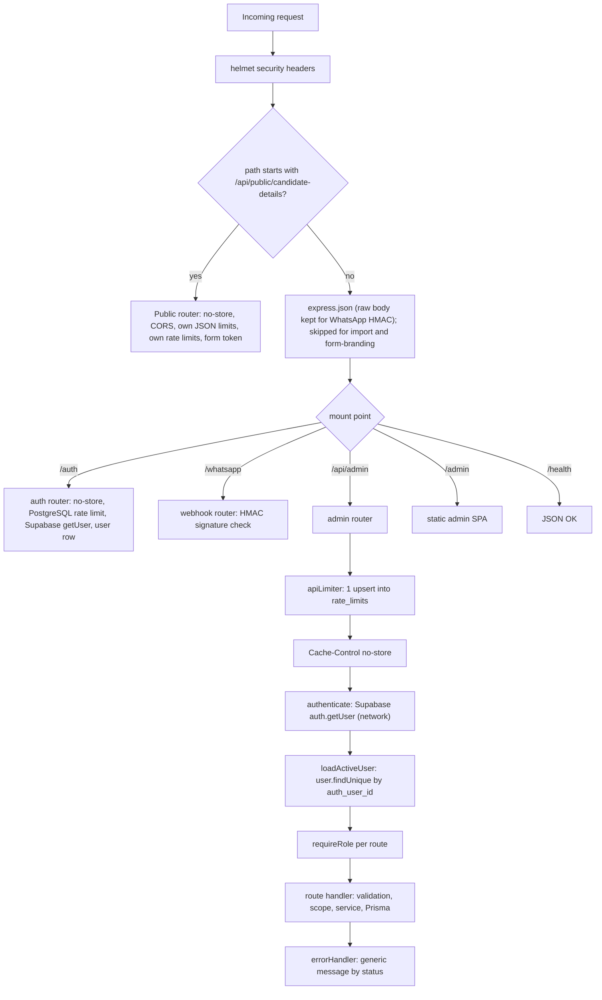
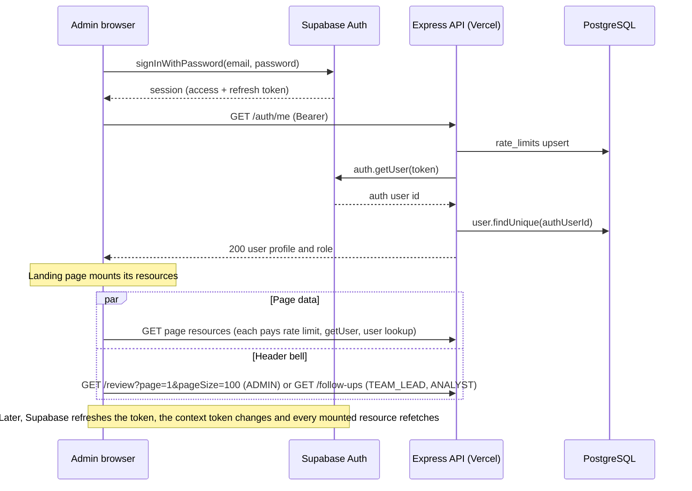
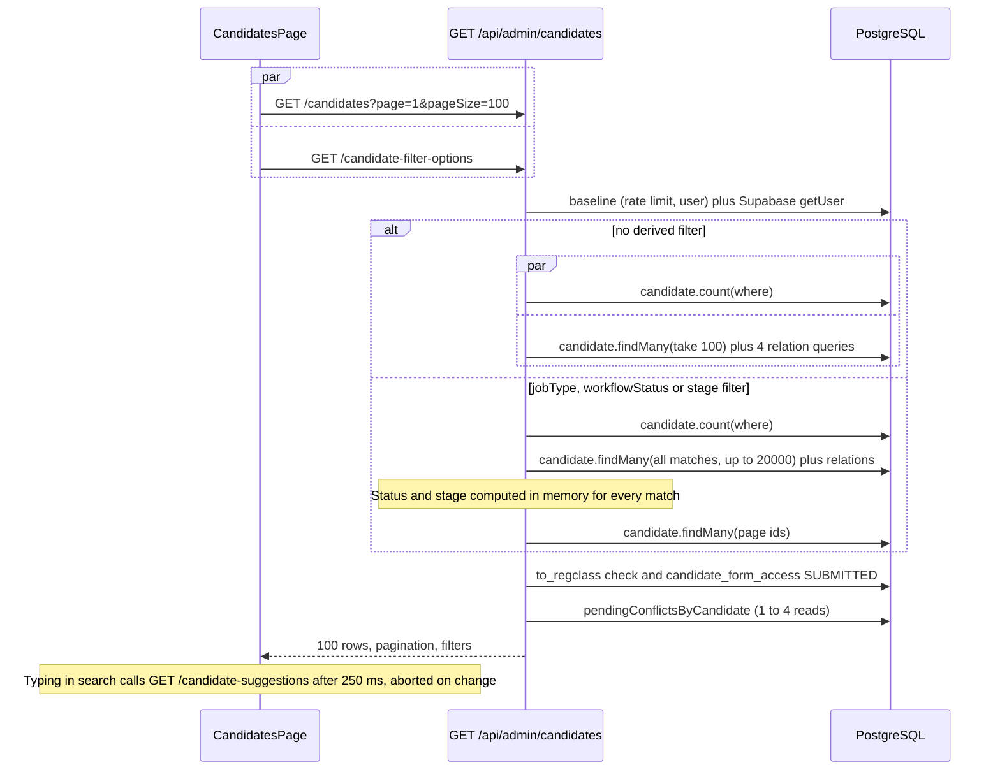
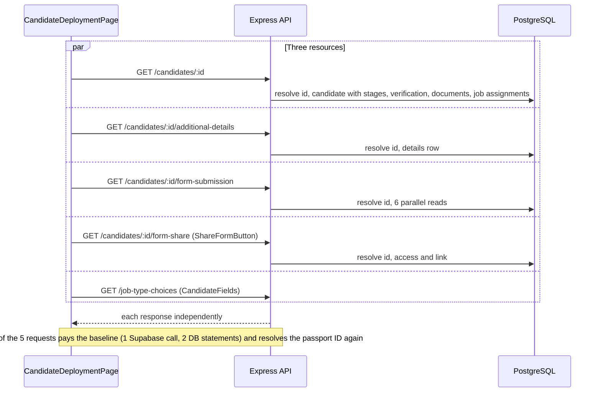
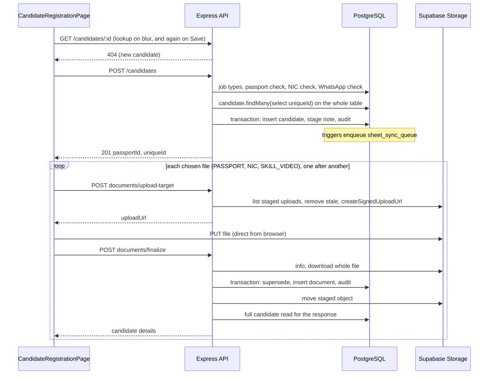
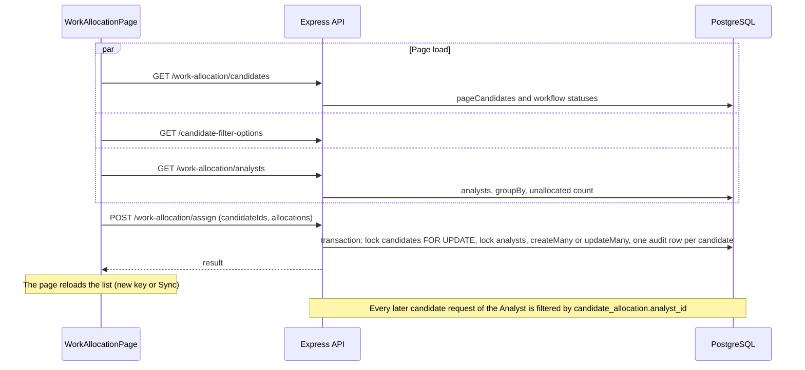
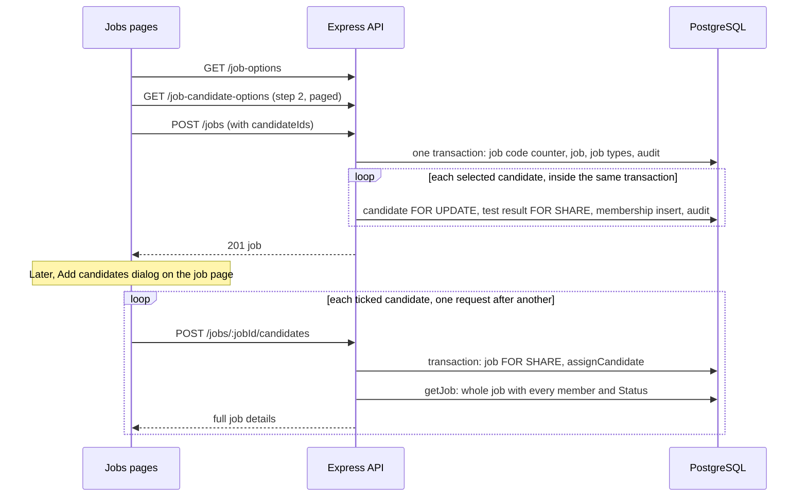
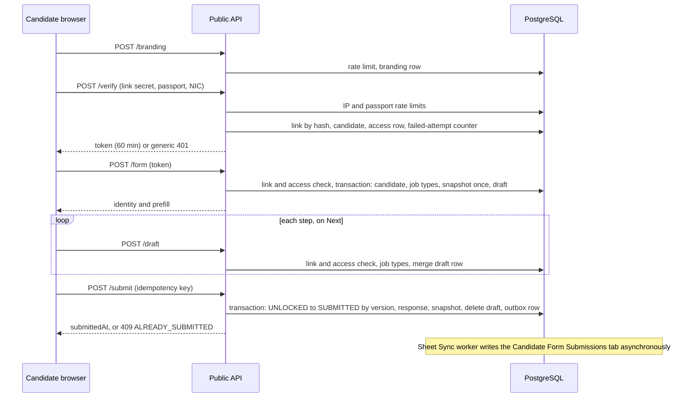
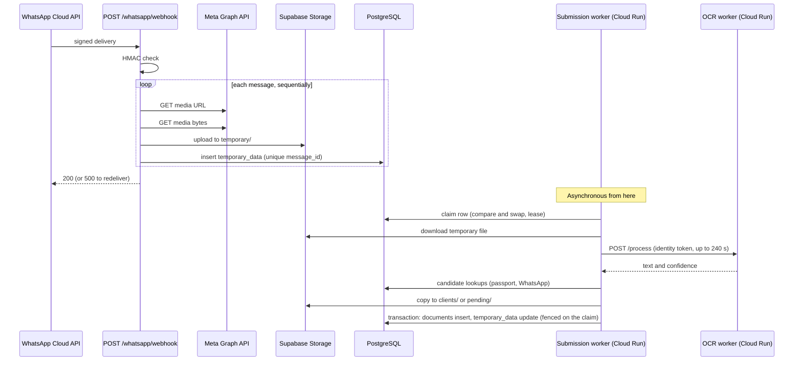
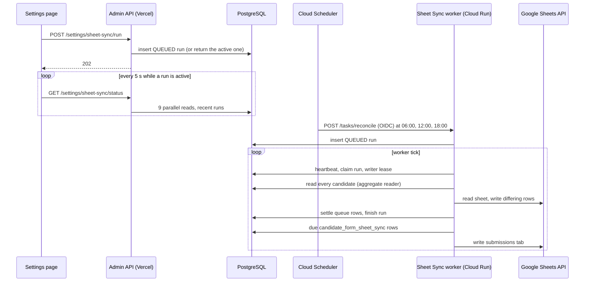

# API Calls and Performance Audit

Source-code audit of every HTTP API in EmlynkWABot: what each endpoint does, which frontend action calls it, what it does in the database and in external services, and which endpoints are the most likely to be slow.

**Audit date:** 2026-11-06 (branch `dev`, after commit `0fe6723`).
**Method:** static reading of the route files, middleware, services and both frontends. **No runtime measurement was taken** (see [§10](#10-measured-response-time-results)). Every performance statement is a **source-code observation** unless it says otherwise.

---

## Contents

1. [Scope and conventions](#1-scope-and-conventions)
2. [API inventory](#2-api-inventory)
3. [API architecture and request lifecycle](#3-api-architecture-and-request-lifecycle)
4. [Frontend action to API mapping](#4-frontend-action-to-api-mapping)
5. [Endpoint documentation by module](#5-endpoint-documentation-by-module)
6. [API request chain diagrams](#6-api-request-chain-diagrams)
7. [API security and RBAC](#7-api-security-and-rbac)
8. [API error handling and reliability](#8-api-error-handling-and-reliability)
9. [API performance audit](#9-api-performance-audit)
10. [Measured response-time results](#10-measured-response-time-results)
11. [Potential performance bottlenecks](#11-potential-performance-bottlenecks)
12. [Prioritized optimization recommendations](#12-prioritized-optimization-recommendations)
13. [Missing performance-test coverage](#13-missing-performance-test-coverage)
14. [Source file reference index](#14-source-file-reference-index)

---

## 1. Scope and conventions

**In scope:** every HTTP endpoint the Express app registers (`src/createApp.js` and the routers it mounts), the HTTP endpoints of the three Cloud Run worker processes, every frontend API call in `admin/` and `candidate-form/`, and every external API the code calls.

**Not in scope:** static file serving (`/admin/*` assets, `src/adminFrontend.js`), database architecture, deployment.

**Conventions**

| Term | Meaning |
|---|---|
| `ADMIN*` | ADMIN, and OWNER through inheritance: `hasRole()` admits OWNER wherever a tier names ADMIN (`src/middleware/requireRole.js`) |
| **Scoped** | The ANALYST role sees only candidates allocated to it (`candidateScope()` in `src/services/candidateAccess.js`); a candidate outside the scope answers 404 |
| **DB ops** | Prisma calls counted from source. Prisma 6 loads each `select`ed relation with **its own query** (no `relationJoins` preview feature in `prisma/schema.prisma`), so a `findMany` with 4 relations is 5 SQL statements |
| **Baseline** | The per-request middleware cost every `/api/admin` request pays before its handler runs ([§3.2](#32-the-per-request-baseline-cost)) |
| **Risk** | CRITICAL / HIGH / MEDIUM / LOW: a source-code risk assessment, **not** a measured latency |

The detailed per-endpoint record in [§5](#5-endpoint-documentation-by-module) uses one compact card per endpoint (purpose, trigger, request, flow, database, response, side effects, performance, recommendation, risk). The endpoints with the largest risk get an extended write-up in [§11](#11-potential-performance-bottlenecks).

---

## 2. API inventory

### 2.1 Summary counts

Counted from the `router.<method>(…)` and `app.<method>(…)` registrations. Method used: 88 statements in `src/routes/admin.js`, two of which run inside `for` loops that register two routes each (lines 853 and 875), giving **90 admin routes**. The router mounted by `router.use("/users", …)` and the routers mounted under `/settings/sheet-sync` are counted separately.

| Category | Count |
|---|---:|
| **Total internal endpoints (main Express app)** | **114** |
| GET | 48 |
| POST | 50 |
| PUT | 7 |
| PATCH | 6 |
| DELETE | 3 |
| Public (no staff session): `/health`, WhatsApp webhook ×2, Candidate Form ×5 | 8 |
| Authenticated (Supabase session): `/auth/*` ×2 + `/api/admin/*` ×104 | 106 |
| Restricted to ADMIN* (or OWNER/ADMIN for user management) | 50 |
| Aliases: `POST /work-allocation/allocate` = same handler as `/auto-allocate` | 1 (counted) |
| Backend routes with **no frontend caller** | 5 (see [§2.4](#24-routes-with-no-frontend-caller)) |
| Worker service endpoints (not part of the 114) | 5 |
| External API integrations | 8 (see [§2.3](#23-external-apis-called-by-the-project)) |

The 50 ADMIN*-only endpoints are: 36 in `admin.js` (tiers `ADMINS_ONLY` ×17 counting the loop routes, `DASHBOARD_READERS` ×10, `REVIEWERS` ×9, all `[ADMIN]`), plus users ×4 (OWNER and ADMIN), Sheet Sync settings ×5 and bulk import ×5.

### 2.2 Internal endpoint inventory

`/api/admin` is abbreviated **A**. "Session" = a valid Supabase access token **and** an ACTIVE `user` row with a supported role. "Form token" = the encrypted Candidate Form token.

| # | Module | Method | Endpoint | Auth | Allowed roles | Frontend usage |
|---:|---|---|---|---|---|---|
| 1 | Health | GET | `/health` | Public | — | none (platform checks) |
| 2 | Auth | GET | `/auth/me` | Session | any ACTIVE user | `AuthProvider.loadUser` (sign-in, page load) |
| 3 | Auth | POST | `/auth/complete-invite` | Supabase identity only | invitee | `SetupPasswordPage` |
| 4 | WhatsApp | GET | `/whatsapp/webhook` | Verify token | Meta | none (Meta handshake) |
| 5 | WhatsApp | POST | `/whatsapp/webhook` | HMAC signature | Meta | none (Meta delivery) |
| 6 | Candidate Form | POST | `/api/public/candidate-details/branding` | Public | — | `BrandingProvider` |
| 7 | Candidate Form | POST | `/api/public/candidate-details/verify` | Link secret + Passport + NIC | — | `VerifyPage` |
| 8 | Candidate Form | POST | `/api/public/candidate-details/form` | Form token | — | `App.tsx` |
| 9 | Candidate Form | POST | `/api/public/candidate-details/draft` | Form token | — | `CandidateFormPage` (Next) |
| 10 | Candidate Form | POST | `/api/public/candidate-details/submit` | Form token | — | `CandidateFormPage` (Submit) |
| 11 | Dashboard | GET | A`/overview` | Session | ADMIN* | `OverviewPage` |
| 12 | Documents | GET | A`/documents/missing` | Session | ADMIN* | `MissingDocumentsPage` |
| 13 | Documents | GET | A`/documents` | Session | ADMIN* | `DocumentsPage` |
| 14 | Clients (legacy) | GET | A`/clients` | Session | ADMIN* | `ClientsPage`, `ReviewDetailPage` ClientPicker |
| 15 | Reports | GET | A`/reports/daily` | Session | ADMIN*, TEAM_LEAD | **none** |
| 16 | Reports | GET | A`/reports/daily/summary` | Session | ADMIN*, TEAM_LEAD | `DailyReportPage` |
| 17 | Reports | GET | A`/reports/daily/incomplete` | Session | ADMIN*, TEAM_LEAD | `DailyReportPage` |
| 18 | Reports | GET | A`/reports/daily/roles` | Session | ADMIN* | `DailyReportPage` |
| 19 | Reports | GET | A`/reports/monthly` | Session | ADMIN* | `OverviewPage` |
| 20 | Clients (legacy) | GET | A`/clients/:passportId` | Session | ADMIN* | `ClientDetailsPage` |
| 21 | Review | GET | A`/review` | Session | ADMIN* | `ReviewQueuePage`, `NotificationBell` |
| 22 | Police | GET | A`/police` | Session | ADMIN* | `PoliceWorkflowPage` |
| 23 | Review | GET | A`/review/:reviewId` | Session | ADMIN* | `ReviewDetailPage` |
| 24 | Review | GET | A`/review/:reviewId/file` | Session | ADMIN* | `ReviewDetailPage` preview (blob) |
| 25 | Review | POST | A`/review/:reviewId/approve` | Session | ADMIN* | `ReviewDetailPage` |
| 26 | Review | POST | A`/review/:reviewId/keep-pending` | Session | ADMIN* | `ReviewDetailPage` |
| 27 | Review | POST | A`/review/:reviewId/remove` | Session | ADMIN* | `ReviewDetailPage` |
| 28 | Review | POST | A`/review/:reviewId/retry` | Session | ADMIN* | `ReviewDetailPage` |
| 29 | Review | POST | A`/review/:reviewId/replace-verified` | Session | ADMIN* | `ReviewDetailPage` |
| 30 | Review | POST | A`/review/:reviewId/keep-as-version` | Session | ADMIN* | `ReviewDetailPage` |
| 31 | Review | POST | A`/review/:reviewId/document-type` | Session | ADMIN* | `ReviewDetailPage` |
| 32 | Review | POST | A`/review/:reviewId/assign-client` | Session | ADMIN* | `ReviewDetailPage` |
| 33 | Review | DELETE | A`/temporary-documents/:temporaryId` | Session | ADMIN* | `ReviewDetailPage` |
| 34 | Police | POST | A`/documents/:documentId/police-date` | Session | ADMIN* | `ClientDetailsPage`, `ReviewDetailPage` |
| 35 | Candidates | GET | A`/candidates` | Session | ADMIN*, TEAM_LEAD, ANALYST (scoped), JOB_HANDLER | `CandidatesPage` |
| 36 | Candidates | GET | A`/candidate-filter-options` | Session | same as #35 | `CandidatesPage`, `WorkAllocationPage` |
| 37 | Candidates | GET | A`/candidate-suggestions` | Session | same as #35 | `CandidateSearchBox` |
| 38 | Candidates | POST | A`/candidates` | Session | ADMIN*, TEAM_LEAD, REGISTRATION_DESK | `CandidateRegistrationPage` |
| 39 | Candidates | GET | A`/candidates/:passportId` | Session | #35 roles + REGISTRATION_DESK (registration view) | `CandidateDeploymentPage`, `CandidateRegistrationPage`, `JobAssignmentPanel` |
| 40 | Candidates | PUT | A`/candidates/:passportId` | Session | ADMIN*, TEAM_LEAD, ANALYST (scoped), REGISTRATION_DESK | `CandidateRegistrationPage`, `StagePanels` |
| 41 | Stages | PUT | A`/candidates/:passportId/stages/:stage` | Session | as #40 (REGISTRATION_DESK: `CANDIDATE_DETAILS` only) | `CandidateRegistrationPage`, `StagePanels` |
| 42 | Verification | POST | A`/candidates/:passportId/verification` | Session | ADMIN* | `StagePanels` |
| 43 | Documents | POST | A`/candidates/:passportId/documents/upload-target` | Session | as #40 (REGISTRATION_DESK: PASSPORT, NIC, SKILL_VIDEO) | `uploadCandidateDocument` |
| 44 | Documents | POST | A`/candidates/:passportId/documents/finalize` | Session | as #43 | `uploadCandidateDocument` |
| 45 | Documents | POST | A`/candidates/:passportId/documents/:documentId/remove` | Session | ADMIN*, TEAM_LEAD, ANALYST (scoped) | `DocumentRow` |
| 46 | Call logs | GET | A`/candidates/:passportId/call-logs` | Session | #35 roles | `CallLogDialog` |
| 47 | Call logs | POST | A`/candidates/:passportId/call-logs` | Session | ADMIN*, TEAM_LEAD, ANALYST (scoped) | `CallLogDialog` |
| 48 | Follow-ups | POST | A`/candidates/:passportId/call-logs/:callLogId/follow-up` | Session | as #47 | `CallLogDialog` |
| 49 | Follow-ups | GET | A`/follow-ups` | Session | ADMIN*, TEAM_LEAD, ANALYST, REGISTRATION_DESK | `PriorityFollowUpsPage`, `NotificationBell` |
| 50 | Follow-ups | POST | A`/follow-ups/:followUpId/complete` | Session | ADMIN*, TEAM_LEAD, ANALYST | `PriorityFollowUpsPage` |
| 51 | Follow-ups | DELETE | A`/follow-ups/:followUpId` | Session | ADMIN* | `PriorityFollowUpsPage` |
| 52 | Additional details | GET | A`/candidates/:passportId/additional-details` | Session | #35 roles | `CandidateDeploymentPage` |
| 53 | Additional details | PUT | A`/candidates/:passportId/additional-details` | Session | ADMIN*, TEAM_LEAD, ANALYST (scoped) | `AdditionalDetailsPanel` |
| 54 | Form review | GET | A`/candidates/:passportId/form-submission` | Session | #35 roles | `CandidateDeploymentPage` |
| 55 | Form review | POST | A`/candidates/:passportId/form-submission/confirm-field` | Session | ADMIN* | `submittedChanges.tsx` |
| 56 | Form review | POST | A`/candidates/:passportId/form-submission/reject-field` | Session | ADMIN* | `submittedChanges.tsx` |
| 57 | Form review | POST | A`/candidates/:passportId/form-submission/confirm-all` | Session | ADMIN* | `submittedChanges.tsx` |
| 58 | Form review | POST | A`/candidates/:passportId/form-submission/reject-all` | Session | ADMIN* | `submittedChanges.tsx` |
| 59 | Form share | GET | A`/candidates/:passportId/form-share` | Session | ADMIN*, TEAM_LEAD, ANALYST (scoped) | `ShareFormButton` |
| 60 | Form share | POST | A`/candidates/:passportId/form-share` | Session | as #59 | `ShareFormButton` |
| 61 | Form share | POST | A`/candidates/:passportId/form-share/revoke` | Session | as #59 | `ShareFormButton` |
| 62 | Work Allocation | GET | A`/work-allocation/candidates` | Session | ADMIN*, TEAM_LEAD | `WorkAllocationPage` |
| 63 | Work Allocation | GET | A`/work-allocation/analysts` | Session | ADMIN*, TEAM_LEAD | `WorkAllocationPage` |
| 64 | Work Allocation | POST | A`/work-allocation/assign` | Session | ADMIN*, TEAM_LEAD | `WorkAllocationPage` |
| 65 | Work Allocation | POST | A`/work-allocation/auto-allocate` | Session | ADMIN*, TEAM_LEAD | `WorkAllocationPage` |
| 66 | Work Allocation | POST | A`/work-allocation/allocate` | Session | ADMIN*, TEAM_LEAD | **none** (alias of #65) |
| 67 | Work Allocation | POST | A`/work-allocation/unassign` | Session | ADMIN*, TEAM_LEAD | `WorkAllocationPage` |
| 68 | Jobs | GET | A`/job-options` | Session | ADMIN*, TEAM_LEAD, JOB_HANDLER | `JobsPage`, `JobDetailsPage` |
| 69 | Jobs | GET | A`/job-candidate-options` | Session | ADMIN*, TEAM_LEAD, JOB_HANDLER | `JobsPage` (New job), `JobDetailsPage` (Add candidates) |
| 70 | Job types | GET | A`/job-type-choices` | Session | #35 roles + REGISTRATION_DESK | `CandidateFields` |
| 71 | Job types | GET | A`/job-types` | Session | ADMIN* | `JobTypesSettings` |
| 72 | Job types | PATCH | A`/job-types/:id` | Session | ADMIN* | `JobTypesSettings` |
| 73 | Job types | POST | A`/job-types` | Session | ADMIN* | `JobTypesSettings`, `JobsPage`, `JobDetailsPage` |
| 74 | Jobs | GET | A`/jobs` | Session | ADMIN*, TEAM_LEAD, JOB_HANDLER | `JobsPage`, `JobAssignmentPanel` |
| 75 | Jobs | POST | A`/jobs` | Session | as #74 | `JobsPage` (New job) |
| 76 | Jobs | GET | A`/jobs/:jobId` | Session | as #74 | `JobDetailsPage` |
| 77 | Jobs | PUT | A`/jobs/:jobId` | Session | as #74 | `JobDetailsPage` |
| 78 | Jobs | POST | A`/jobs/:jobId/candidates` | Session | as #74 | `JobDetailsPage`, `JobAssignmentPanel` |
| 79 | Jobs | DELETE | A`/jobs/:jobId/candidates/:passportId` | Session | as #74 | `JobDetailsPage` |
| 80 | Job form link | GET | A`/jobs/:jobId/form-share` | Session | ADMIN* | `ShareFormButton` (job group) |
| 81 | Job form link | POST | A`/jobs/:jobId/form-share` | Session | ADMIN* | `ShareFormButton` (job group) |
| 82 | Job form link | POST | A`/jobs/:jobId/form-share/revoke` | Session | ADMIN* | `ShareFormButton` (job group) |
| 83 | Jobs | POST | A`/jobs/:jobId/complete` | Session | as #74 | `JobDetailsPage` |
| 84 | Jobs | POST | A`/jobs/:jobId/cancel` | Session | as #74 | `JobDetailsPage` |
| 85 | Agents | GET | A`/agents` | Session | ADMIN*, TEAM_LEAD, JOB_HANDLER | `AgentsPage` |
| 86 | Agents | GET | A`/agent-options` | Session | as #85 | `ClientManagementPage`, `ClientManagementDetailsPage` |
| 87 | Agents | POST | A`/agents` | Session | as #85 | `AgentsPage` |
| 88 | Agents | GET | A`/agents/:agentId` | Session | as #85 | `AgentDetailsPage`, `AgentsPage` (edit form) |
| 89 | Agents | PATCH | A`/agents/:agentId` | Session | as #85 | `AgentsPage` |
| 90 | Agents | PATCH | A`/agents/:agentId/status` | Session | as #85 | `AgentsPage`, `AgentDetailsPage` |
| 91 | Clients | GET | A`/client-management` | Session | as #85 | `ClientManagementPage` |
| 92 | Clients | GET | A`/client-options` | Session | as #85 | `AgentsPage` (agent form) |
| 93 | Clients | POST | A`/client-management` | Session | as #85 | `ClientManagementPage` |
| 94 | Clients | GET | A`/client-management/:clientId` | Session | as #85 | `ClientManagementDetailsPage` |
| 95 | Clients | PATCH | A`/client-management/:clientId` | Session | as #85 | `ClientManagementPage` |
| 96 | Clients | PATCH | A`/client-management/:clientId/agent` | Session | as #85 | **none** in `admin/src/api` |
| 97 | Clients | PATCH | A`/client-management/:clientId/status` | Session | as #85 | `ClientManagementPage` |
| 98 | Audit | GET | A`/audit-logs` | Session | ADMIN* | `AuditLogsPage` |
| 99 | Users | GET | A`/users` | Session | OWNER, ADMIN | `AdminRolesPage`, `InvitationsPage` |
| 100 | Users | POST | A`/users/invite` | Session | OWNER, ADMIN | `InvitationsPage` |
| 101 | Users | PUT | A`/users/:userId/role` | Session | OWNER, ADMIN | `AdminRolesPage` |
| 102 | Users | POST | A`/users/:userId/deactivate` | Session | OWNER, ADMIN | `InvitationsPage` |
| 103 | Sheet Sync | GET | A`/settings/sheet-sync/status` | Session | ADMIN* | `SettingsPage` |
| 104 | Sheet Sync | POST | A`/settings/sheet-sync/test` | Session | ADMIN* | `SettingsPage` |
| 105 | Sheet Sync | POST | A`/settings/sheet-sync/run` | Session | ADMIN* | `SettingsPage` |
| 106 | Sheet Sync | PUT | A`/settings/sheet-sync/destination` | Session | ADMIN* | `SettingsPage` |
| 107 | Sheet Sync | GET | A`/settings/sheet-sync/runs/:runId` | Session | ADMIN* | **none** |
| 108 | Bulk import | GET | A`/settings/sheet-sync/import/source-columns` | Session | ADMIN* | `CandidateImportDialog` |
| 109 | Bulk import | POST | A`/settings/sheet-sync/import/preview` | Session | ADMIN* | `CandidateImportDialog` |
| 110 | Bulk import | POST | A`/settings/sheet-sync/import/:importId/chunks/:index` | Session | ADMIN* | `CandidateImportDialog` |
| 111 | Bulk import | POST | A`/settings/sheet-sync/import/:importId/finish` | Session | ADMIN* | `CandidateImportDialog` |
| 112 | Bulk import | GET | A`/settings/sheet-sync/import/:importId` | Session | ADMIN* | **none** |
| 113 | Settings | GET | A`/settings/form-branding` | Session | ADMIN* | `FormBrandingSettings` |
| 114 | Settings | PUT | A`/settings/form-branding` | Session | ADMIN* | `FormBrandingSettings` |

**Worker service endpoints** (separate processes, not in the 114):

| Process | Method | Endpoint | Auth | Caller |
|---|---|---|---|---|
| Submission worker (`src/workerProcess.js`) | GET | `/health` | none | Cloud Run readiness |
| Sheet Sync worker (`src/sheetSyncWorkerProcess.js:51`) | GET/HEAD | `/health` | none | Cloud Run |
| Sheet Sync worker (`src/sheetSyncWorkerProcess.js:52`) | POST | `/tasks/reconcile` | Google OIDC (IAM + in-process verification) | Cloud Scheduler |
| OCR worker (`ocr-worker/src/app.js:33`) | GET | `/health` | IAM | Cloud Run |
| OCR worker (`ocr-worker/src/app.js:35`) | POST | `/process` | IAM identity token | Submission worker (`src/services/ocrClient.js`) |

### 2.3 External APIs called by the project

| # | External API | Called from | Calls | Synchronous to a user request? |
|---:|---|---|---|---|
| 1 | **Supabase Auth** (server, service-role client) | `src/auth/supabaseIdentity.js` `verifyAccessToken` | `auth.getUser(token)`: a network request | **Yes, on every `/auth/*` and `/api/admin/*` request** |
| 2 | **Supabase Auth Admin** | `src/auth/supabaseAuthAdmin.js` | `inviteUserByEmail`, `createUser`, `listUsers` (paged loop up to `MAX_LIST_PAGES`), `deleteUser` | Yes (user invite) |
| 3 | **Supabase Auth** (browser) | `admin/src/auth/AuthProvider.tsx`, `ForgotPasswordPage`, `ResetPasswordPage`, `SetupPasswordPage` | `signInWithPassword`, `getSession`, `signOut`, `resetPasswordForEmail`, `updateUser`, automatic token refresh | Browser → Supabase directly |
| 4 | **Supabase Storage** (server) | `candidateService.js`, `adminReviewActionService.js`, `adminReviewService.js`, `whatsappMediaService`/`temporaryStorageService`, worker placement | `createSignedUploadUrl`, `info`, `download`, `list`, `remove`, `exists`, copy/move | Yes (uploads, review actions, file preview) and async (worker) |
| 5 | **Supabase Storage** (browser) | `admin/src/api/client.ts` `uploadToSignedUrl` | `PUT` to a signed upload URL | Browser → Storage directly |
| 6 | **WhatsApp Cloud API** (Meta Graph) | `src/services/whatsappMediaService.js:93,179` | `GET /{version}/{mediaId}` (media URL), `GET <media url>` (download) | Yes, inside the webhook request |
| 7 | **OCR worker** (internal Cloud Run) | `src/services/ocrClient.js` | `POST /process` with a Google identity token, 240 s timeout | No: background worker only |
| 8 | **Google Sheets API** + Google OIDC | `src/services/googleSheetsAdapter.js`, `src/sheetSyncWorker.js` | Sheet reads/writes; OIDC verification of Scheduler calls | No: Sheet Sync worker only |

### 2.4 Routes with no frontend caller

| Endpoint | Note |
|---|---|
| GET A`/reports/daily` | `getDailyReport` exists in `admin/src/api/admin.ts:184` but no page imports it |
| POST A`/work-allocation/allocate` | Alias of `/auto-allocate` (`admin.js:957`) |
| PATCH A`/client-management/:clientId/agent` | No client function; agent links are changed through `PATCH /client-management/:clientId` |
| GET A`/settings/sheet-sync/runs/:runId` | The Settings page polls `/status` instead |
| GET A`/settings/sheet-sync/import/:importId` | The import dialog never re-reads an import |

These are unused, not broken. Removing or keeping them is a product decision.

---

## 3. API architecture and request lifecycle

### 3.1 Middleware order

From `src/createApp.js:31-91`:

### 3.2 The per-request baseline cost

Every `/api/admin/*` request runs these before its handler (`src/routes/admin.js:245-251`):

| Step | Code | Work |
|---|---|---|
| 1 | `createApiRateLimiter()` (`src/middleware/apiRateLimiter.js`) with `createPostgresRateLimitStore` | **1 SQL statement**: `INSERT … ON CONFLICT DO UPDATE … RETURNING` on `rate_limits`; plus at most one `DELETE` of expired rows per 15-minute window per instance |
| 2 | `createAuthenticateIdentity` (`src/middleware/requireActiveUser.js`) | **1 HTTPS call to Supabase Auth** (`auth.getUser(token)`, `src/auth/supabaseIdentity.js:38`). No cache: the code deliberately checks the session is still alive on every request |
| 3 | `loadActiveUser` | **1 SQL statement**: `user.findUnique({ where: { authUserId } })` |
| 4 | `requireRole` | in memory |

So **every admin API call costs at least 2 database statements and 1 external network round trip before any business logic.** `/auth/me` pays steps 1-3. The public Candidate Form routes do not call Supabase; their token is checked locally and then against the database (2-3 statements, `src/middleware/requireCandidateFormToken.js`).

Additional baseline facts:

- **Connection pool:** `PRISMA_POOL_MAX` defaults to **3 connections per process** (`src/config/prisma.js:16`), on top of Supavisor. On Vercel each function instance has its own pool. A handler that issues `Promise.all` of 12 queries (e.g. `/overview`) can use at most 3 at a time on that instance, so the parallel queries queue behind each other.
- **Vercel region** `hnd1` (`vercel.json`). Request latency also depends on the network distance to Supabase, which is not recorded in the repository.
- **Function limit:** `maxDuration: 60` s (`vercel.json`).
- **Rate limit:** 1000 requests per 15 minutes per client IP for `/api/admin` and `/auth` (separate counters, `prefix` differs). Every page in the admin issues several requests per view, so a heavy user behind one office IP shares this budget with colleagues behind the same NAT.

### 3.3 Frontend request model

| Mechanism | File | Behaviour |
|---|---|---|
| `apiRequest` | `admin/src/api/client.ts:61` | `fetch` with `Authorization: Bearer`, `cache: "no-store"`, no retries. Non-2xx → `ApiError` |
| `apiRequestBlob` | `admin/src/api/client.ts:115` | Same, for binary (review file preview) |
| `uploadToSignedUrl` | `admin/src/api/client.ts:98` | `PUT` straight to Supabase Storage |
| `useAdminResource(key, load)` | `admin/src/api/useAdminResource.ts` | One GET per mounted resource. **Effect dependencies: `key`, `token`, `attempt`, `syncVersion`.** Aborts the previous request on change. 401 → sign out |
| Sync button | `admin/src/sync/SyncProvider.tsx` | Bumps `syncVersion`: **every** mounted `useAdminResource` reloads at once |
| Token refresh | `admin/src/auth/AuthProvider.tsx:98-108` | On `TOKEN_REFRESHED` the context token changes, so **every mounted `useAdminResource` and every effect that lists `token` re-runs its GET** |
| Candidate Form client | `candidate-form/src/api/client.ts` | `postJson`: every call is POST, CORS, no retries |

---

## 4. Frontend action to API mapping

**How to read this section.** Each row is one user action or one automatic request. The endpoint number (`#`) links the row to the inventory and to its card in [§5](#5-endpoint-documentation-by-module), where the backend route, role, service, database work, response and failure handling are documented once. "Auto" marks requests that fire without a click.

Total rows mapped: **118** (see the count note at the end of this section).

### 4.1 Application shell (every page)

| UI element / trigger | Handler | Calls (in order) | Notes |
|---|---|---|---|
| Sign in button (Login) | `AuthProvider.signIn` | Supabase `signInWithPassword` → **#2** GET `/auth/me` | Sequential: the profile needs the session |
| Page load with an existing session (Auto) | `AuthProvider` effect | Supabase `getSession` → **#2** | Once per page load |
| Supabase token refresh (Auto) | `onAuthStateChange("TOKEN_REFRESHED")` | none directly; **re-runs every mounted resource GET** | See finding F-3 |
| Header bell, ADMIN/OWNER (Auto on mount) | `NotificationBell.loadReviewNotifications` | **#21** GET `/review?page=1&pageSize=100&order=desc`, then page 2, 3 … **sequentially** until all are read | See finding F-1 |
| Header bell, TEAM_LEAD/ANALYST (Auto on mount) | `loadFollowUpNotifications` | **#49** GET `/follow-ups?status=OPEN` | |
| Bell icon click (opening) | `NotificationBell.handleToggle` | Repeats the full load above | Every open re-reads every page |
| Sync button (header) | `SyncProvider.sync` | Every mounted `useAdminResource` GET on the page, in parallel | Bell and effect-based loaders (not `useAdminResource`) are **not** reloaded |
| Sign out | `AuthProvider.signOut` | Supabase `signOut` | No backend call |
| Forgot password → Send | `ForgotPasswordPage` | Supabase `resetPasswordForEmail` | Browser → Supabase |
| Reset password → Save | `ResetPasswordPage` | Supabase `updateUser` | |
| Setup password (invite) → Save | `SetupPasswordPage` | Supabase `updateUser` → **#3** POST `/auth/complete-invite` | Sequential |

### 4.2 Overview (ADMIN)

| UI element / trigger | Handler | Calls | Notes |
|---|---|---|---|
| Page load (Auto) | `OverviewPage` `useAdminResource("overview")` | **#11** GET `/overview` | Parallel with the next row |
| Page load (Auto) | `MonthlyOverview` `useAdminResource("monthly:")` | **#19** GET `/reports/monthly` | |
| Previous / Next month | `MonthNavigation.onChange` | **#19** with `?month=` | |

### 4.3 Candidates list

| UI element / trigger | Handler | Calls | Notes |
|---|---|---|---|
| Page load (Auto) | `CandidatesPage` `useAdminResource("candidates?…")` | **#35** GET `/candidates?page=&pageSize=100&…` | |
| Page load (Auto) | `useAdminResource("candidate-filter-options")` | **#36** GET `/candidate-filter-options` | Also loaded by Work Allocation (separate cache key) |
| Typing in search (≥2 chars, 250 ms debounce) | `CandidateSearchBox` effect | **#37** GET `/candidate-suggestions?q=` | Aborted when the text changes |
| Search button / Enter / pick a suggestion | `submitSearch` / `runSearch` → URL `search=` | **#35** | URL change → new key |
| Filters → apply a choice | `FilterBar.onChange` → `applyFilters` | **#35** with filter params | Text filters debounced 500 ms (`AdvancedFilters.tsx:36`) |
| Previous / Next page | URL `page=` | **#35** | |
| Page past the last one (Auto) | effect at `CandidatesPage.tsx:85` | **#35** again with the last page | `replace: true` |
| Add candidate | `<Link>` | none (navigation) | |

### 4.4 Add Candidate (registration)

| UI element / trigger | Handler | Calls | Notes |
|---|---|---|---|
| Field mount (Auto) | `CandidateFields` `useAdminResource("job-type-choices")` | **#70** GET `/job-type-choices` | |
| Passport ID field blur | `runLookup` (`CandidateRegistrationPage.tsx:118`) | **#39** GET `/candidates/:id` | 404 = new candidate |
| Save (new candidate) | `submit` | **#39** (lookup again) → **#38** POST `/candidates` → for each chosen file (PASSPORT, NIC, SKILL_VIDEO) **sequentially**: **#43** → Storage `PUT` → **#44** | Up to 11 sequential requests; see chain [§6.4](#64-candidate-registration-with-documents) |
| Save, POST answered 409 "passport ID" | `submit` catch | **#39** | Loads the existing candidate |
| Save (existing candidate) | `saveExisting` | **#40** PUT → (if the note changed) **#41** PUT `stages/CANDIDATE_DETAILS` | Sequential |
| Upload / Replace on a document row | `DocumentRow` → `uploadCandidateDocument` | **#43** → Storage `PUT` → **#44** | |
| Remove document → confirm | `DocumentRow` | **#45** | ADMIN, TEAM_LEAD, ANALYST |

### 4.5 Candidate page (`/candidates/:passportId`)

| UI element / trigger | Handler | Calls | Notes |
|---|---|---|---|
| Page load (Auto) | `CandidateDeploymentPage` | **#39**, **#52**, **#54** in parallel (3 resources) | |
| Page load (Auto) | `ShareFormButton` effect (staff roles) | **#59** GET `form-share` | Not a `useAdminResource`: not refreshed by Sync |
| Page load (Auto) | `CandidateFields` | **#70** | |
| Header bell (Auto) | see 4.1 | **#21** pages or **#49** | |
| Save candidate details | `StagePanels` (`StagePanels.tsx:319-323`) | **#40** → (if the note changed) **#41** | Sequential |
| Save a stage (Test, Job details, Visa, …) | `StagePanels` (`:183`) | **#41** PUT `stages/:stage` | |
| Verify / Unverify details or documents | `StagePanels` (`:117`) | **#42** | ADMIN |
| Upload / Replace / Remove document | `DocumentRow` | **#43** → Storage → **#44**, or **#45** | |
| Save additional details | `AdditionalDetailsPanel` (`:196`) | **#53** PUT | Optimistic concurrency via `expectedUpdatedDate` |
| Call log button (dialog opens) | `CallLogDialog` `useAdminResource("call-logs:")` | **#46** | |
| Add call | `CallLogDialog` (`:141`) | **#47** | Returns the updated log |
| Flag for follow-up | `CallLogDialog` (`:169`) | **#48** → on a stale list **#46** | |
| Share form → Create link | `ShareFormButton` (`:73`) | **#60** | |
| Share form → Revoke | `ShareFormButton` (`:80`) | **#61** | |
| Confirm / Reject one field | `submittedChanges.tsx:191-192` | **#55** / **#56** | Each returns the whole submission |
| Confirm all / Reject all | `submittedChanges.tsx:171-172` | **#57** / **#58** | |
| Add to job (ADMIN, panel) | `JobAssignmentPanel` load | **#74** GET `/jobs?view=processing` | Paged; search re-queries |
| Add to job → choose a job | `JobAssignmentPanel` (`:135-137`) | **#78** → **#39** | Sequential: re-reads the candidate |

### 4.6 Need Attention (follow-ups)

| UI element / trigger | Handler | Calls | Notes |
|---|---|---|---|
| Page load / Open-Completed tab | `PriorityFollowUpsPage` | **#49** `?status=OPEN` or `COMPLETED` | |
| Complete | `PriorityFollowUpsPage` (`:69`) | **#50** | |
| Delete (ADMIN) | `PriorityFollowUpsPage` (`:91`) | **#51** | |

### 4.7 Work Allocation

| UI element / trigger | Handler | Calls | Notes |
|---|---|---|---|
| Page load (Auto) | `WorkAllocationPage` (3 resources) | **#62**, **#36**, **#63** in parallel | |
| Search / suggestions / filters / page / status tab / analyst filter | URL change | **#62** (and **#37** with `allocation=` while typing) | |
| Assign (manual) | `WorkAllocationPage` (`:235`) | **#64** | One transaction for the whole selection |
| Auto-allocate | `WorkAllocationPage` (`:208`) | **#65** | |
| Unassign | `WorkAllocationPage` (`:258`) | **#67** | |
| Page past the last one (Auto) | effect `:280` | **#62** | |

### 4.8 Jobs

| UI element / trigger | Handler | Calls | Notes |
|---|---|---|---|
| Jobs list load / view tab / search / page | `JobsPage` `useAdminResource("jobs?…")` | **#74** | |
| New job dialog opens | `NewJobDialog` (`JobsPage.tsx:373`) `useAdminResource("job-options")` | **#68** | |
| New job step 2 (candidate picker) | `CandidatePicker` effect (`JobsPage.tsx:561`) | **#69** `?page=&pageSize=` | Search/page re-query |
| Add job type inline (ADMIN) | `JobsPage.tsx:469` | **#73** | |
| Create job | `JobsPage.tsx:429` | **#75** | Candidates are added in the same transaction |
| Job details load | `JobDetailsPage` | **#76** | |
| Edit job types dialog | `EditJobTypesDialog` (`JobDetailsPage.tsx:232`) | **#68** → Save **#77** | |
| Edit From Country / Client Job ID | `FromCountryDialog`, `CompanyJobIdDialog` | **#77** | |
| Add candidates dialog opens | `AddCandidateDialog` effect | **#69** `pageSize=20` | Search debounced 300 ms; aborted on change |
| Add selected (N) | `AddCandidateDialog.addMany` | **#78** × N, **sequentially** | One response per candidate; see finding F-11 |
| Remove candidate → confirm | `JobDetailsPage.tsx:219` | **#79** | |
| Complete job → confirm | `JobDetailsPage.tsx:202` | **#83** | |
| Cancel job → reason → confirm | `CancelDialog` (`JobDetailsPage.tsx:296`) | **#84** | |
| Share job-group form (ADMIN) | `ShareFormButton` (job) effect / create / revoke | **#80** / **#81** / **#82** | |

### 4.9 Agents and Clients

| UI element / trigger | Handler | Calls | Notes |
|---|---|---|---|
| Agents list load / search / filters / page | `AgentsPage` | **#85** | |
| New / Edit agent dialog opens | `AgentFormDialog` (`AgentsPage.tsx:177`) | **#92** client-options; edit also **#88** | |
| Save agent | `AgentsPage.tsx:209-210` | **#89** or **#87** | |
| Activate / Deactivate agent | `AgentsPage.tsx:139`, `AgentDetailsPage.tsx:189` | **#90** | |
| Agent details load | `AgentDetailsPage` | **#88** | |
| Clients list load / search / filters / page | `ClientManagementPage` | **#91** + **#86** | |
| Save client | `ClientManagementPage.tsx:222-223` | **#95** or **#93** | |
| Activate / Deactivate client | `ClientManagementPage.tsx:178` | **#97** | |
| Client details load | `ClientManagementDetailsPage` | **#94** + **#86** | |

### 4.10 Documents, Missing Documents, Clients (legacy), Police

| UI element / trigger | Handler | Calls | Notes |
|---|---|---|---|
| Documents list load / filters / page | `DocumentsPage` | **#13** | |
| Missing Documents load / filters / page | `MissingDocumentsPage` | **#12** | |
| Clients (legacy) load / search / filters / page | `ClientsPage` | **#14** | |
| Client details load | `ClientDetailsPage` | **#20** | |
| Correct police date | `ClientDetailsPage.tsx:91` | **#34** | |
| Police Workflow load / search / status / page | `PoliceWorkflowPage` | **#22** | |

### 4.11 Review Queue and Review detail (ADMIN)

| UI element / trigger | Handler | Calls | Notes |
|---|---|---|---|
| Queue load / kind / order / page | `ReviewQueuePage` | **#21** | |
| Review detail load | `ReviewDetailPage` `useAdminResource("review/:id")` | **#23** → preview **#24** (blob) | Sequential: the preview URL comes from #23 |
| Approve | `ReviewDetailPage.tsx:367` | **#25** | Storage download + copy in the request |
| Remove from review | `:399` | **#27** | |
| Delete temporary document | `:422` | **#33** | |
| Retry processing (failed) | `:482` | **#28** | |
| Replace verified | ReviewDetailPage | **#29** | |
| Keep as version | `:528` | **#30** | |
| Keep pending | `:548` | **#26** | |
| Change document type | ReviewDetailPage | **#31** | |
| Assign client → search | `ClientPicker.search` (`:191`) | **#14** `?search=&pageSize=10` | |
| Assign client → confirm | ReviewDetailPage | **#32** | |
| Police date (slip) | ReviewDetailPage | **#34** or inside **#25** | |

### 4.12 Daily Report

| UI element / trigger | Handler | Calls | Notes |
|---|---|---|---|
| Summary tab load / date change | `SummaryData` | **#16** | |
| Expand an incomplete stage / page | `IncompleteDetails` | **#17** `?stage=&page=` | Each stage re-reads every candidate (see F-6) |
| Summary by Roles tab / role / date (ADMIN) | `RoleData` | **#18** | |
| Export PDF | jsPDF in the browser | none | Uses data already loaded |

### 4.13 Settings, users, audit

| UI element / trigger | Handler | Calls | Notes |
|---|---|---|---|
| Google Sheet Sync section load | `GoogleSheetSyncSection` | **#103** | |
| While a run is active (Auto, every 5 s) | `setInterval(reload, 5000)` (`SettingsPage.tsx:351`) | **#103** | Stops when no run is active |
| Test Connection / Sync Now | `act("test")` / `act("run")` | **#104** / **#105** | Returns 202 at once; worker does the work |
| Sync Destination → choose | `SettingsPage.tsx:142` | **#106** | |
| Update Sheet (bulk upload) | `CandidateImportDialog` (`:109-141`) | **#108** → **#109** → **#110** × chunks **sequentially** → **#111** | 100 rows per chunk, ≤3000 rows |
| Job Types tab load | `JobTypesSettings` | **#71** | |
| Add / Rename / Activate job type | `JobTypesSettings` | **#73** / **#72** / **#72** | |
| Candidate Form branding load / Save / Reset | `FormBrandingSettings` | **#113** / **#114** / **#114** | Body up to 512 KB (logo) |
| Admin Roles load / change role | `AdminRolesPage` | **#99** / **#101** | Effect-based load, not `useAdminResource` |
| Invitations load / Refresh / Invite / Deactivate | `InvitationsPage` | **#99** / **#99** / **#100** / **#102** | |
| Audit Logs load / filters / page | `AuditLogsPage` | **#98** | |

### 4.14 Candidate Form (public app)

| UI element / trigger | Handler | Calls | Notes |
|---|---|---|---|
| App load (Auto) | `BrandingProvider` | **#6** POST `/branding` | Never fails (defaults on error) |
| Verify button | `VerifyPage.tsx:61` | **#7** POST `/verify` | |
| After verification (Auto) | `App.tsx:94` | **#8** POST `/form` | Sequential after #7 |
| Next (each step) | `CandidateFormPage.tsx:210` | **#9** POST `/draft` | Validated; not a submission |
| Submit | `CandidateFormPage.tsx:250` | **#10** POST `/submit` with an idempotency key | Retry of the same key → same success |

### 4.15 Count note

The tables above contain **118 rows**. A row that lists several calls counts once; the same action reached from two pages counts on each page. Actions that call **no** API (navigation links, PDF export, theme toggle) are only listed where they explain an API interaction.

---

## 5. Endpoint documentation by module

Each card: **Purpose · Trigger · Request · Flow · DB ops · Response · Side effects · Performance · Recommendation · Risk.** "Baseline" = [§3.2](#32-the-per-request-baseline-cost). Line numbers refer to `src/routes/admin.js` unless another file is named.

### 5.1 Health, auth, WhatsApp

**#1 GET `/health`** (`src/createApp.js:82`). Purpose: liveness. Request: none. Flow: returns JSON. DB: none. Response: `200 { status, message }`. Side effects: none. Performance: no work. Risk: **LOW**.

**#2 GET `/auth/me`** (`src/routes/auth.js:28`). Purpose: the signed-in user's application profile. Trigger: sign-in, page load. Request: `Authorization: Bearer`. Flow: rate limit → Supabase `getUser` → `user.findUnique`. DB: 2 (rate limit, user). Response: `200 { user: { userId, email, name, role, status } }`; 401 bad token; 403 `ACCOUNT_NOT_ACTIVE` / `ROLE_NOT_SUPPORTED`; 429. Side effects: none. Performance: baseline only. Recommendation: none. Risk: **LOW**.

**#3 POST `/auth/complete-invite`** (`auth.js:34`). Purpose: activate an INVITED account. Flow: rate limit → Supabase `getUser` → `completeInvitation` (`userAccountService.js:219`): `findUnique`, transaction `updateMany` INVITED→ACTIVE. DB: ~4. Response: `200 { user }`; `UserAccountError` status/code. Risk: **LOW** (rare).

**#4 GET `/whatsapp/webhook`** (`src/routes/whatsapp.js:202`). Purpose: Meta verification handshake. Request: `hub.mode`, `hub.verify_token`, `hub.challenge`. Flow: constant-time token compare. Response: `200 <challenge>`, 400 malformed challenge, 403. DB: none. Risk: **LOW**.

**#5 POST `/whatsapp/webhook`** (`whatsapp.js:299`). Purpose: receive WhatsApp messages and record each document for background processing.
- Request: Meta JSON, `X-Hub-Signature-256`; raw body kept by the global JSON parser.
- Flow: `verifyWhatsappSignature` (HMAC) → for **each message, one after another** (`whatsapp.js:303-309`): in-process idempotency claim → Graph `GET media URL` → Graph `GET media` (download) → `validateDocumentFile` (type, ≤10 MB) → SHA-256 → Storage upload to `temporary/` → `temporary_data` insert (unique `message_id`) → `notifySubmissionQueued()`.
- DB: 1 insert per media message (+ duplicate checks inside `createTemporaryDocumentRecord`). No rate limiter.
- Response: `200` when every message was handled; `500` makes Meta redeliver (handled ones are skipped by `message_id`); 401 bad signature; 400.
- Side effects: **async** OCR, classification, placement in the Submission worker. `notifySubmissionQueued` only wakes a worker in the same process; on Vercel the Cloud Run worker picks the row up by polling (5 s, `submissionQueue.js` `QUEUE_DEFAULTS.pollMs`).
- Performance: the response waits for **2 Meta calls + 1 Storage upload per message, sequentially**. A delivery batching several media messages is acknowledged only after all of them. OCR is correctly **not** on this path (pinned by `test/webhookResponseTiming.test.js`).
- Recommendation: measure p95 per message; if Meta deliveries carry several media, process messages of one delivery concurrently with a small limit (each message is already independently idempotent).
- Risk: **MEDIUM** (external latency in the request path; bounded by file size).

### 5.2 Candidate Form public API (`src/routes/publicCandidateDetails.js`)

Common: no Supabase call; `Cache-Control: no-store`; CORS for exactly `CANDIDATE_FORM_ORIGIN`; JSON limits 16 KB (64 KB for draft/submit); a 413 for oversize bodies.

**#6 POST `/branding`** (`:148`). Purpose: form title, logo, colours. Trigger: every form page load. Flow: rate limit (300 / 15 min / IP, PostgreSQL) → `getPublicFormBranding` (1 read of `candidate_form_branding`). Response: `200` branding; on any error `200` with defaults. DB: 2. Performance: payload can include a logo data URI up to 256 KB; read on every page load, never cached (`no-store`). Recommendation: allow short-lived `Cache-Control` for this non-personal response or move the logo to a static asset. Risk: **LOW**.

**#7 POST `/verify`** (`:157`). Purpose: exchange link secret + Passport + NIC for a 60-minute form token. Request: `{ linkSecret, passportNumber, nic }`, strict patterns. Flow: IP limiter (10 failed / 15 min) → parse → passport limiter (5 failed / 60 min, keyed by HMAC) → `verifyFormLinkAccess` (link by token hash, candidate, access row; job membership for JOB_GROUP; constant-time compare; failed-attempt counter update) → token issue (AES-GCM, local). DB: ~2 limiter upserts (+ decrements on success) + 3-5 reads + 0-1 update. Response: `200 { token, expiresAt }`; 400 invalid input; 401 `VERIFICATION_FAILED` (generic); 409 `ALREADY_SUBMITTED`; 429; 503 not configured. Risk: **LOW**.

**#8 POST `/form`** (`:190`). Purpose: identity (read-only) + prefill. Flow: `requireSession` (link lookup, job member check for JOB_GROUP, access row: 2-3 reads) → `loadCandidateForm` (`candidateFormDataService.js:251`) in a transaction: candidate, active job types, snapshot (created once), draft. DB: ~6-8. Response: `200` form + `expiresAt`; 401 verify again; 409 submitted. Risk: **LOW**.

**#9 POST `/draft`** (`:201`). Purpose: save one step's validated answers. Flow: session (2-3 reads) → `parseDraftBody` → `activeJobTypeNames` (1 read) → `saveCandidateFormDraft` (merge into the single draft row). DB: ~5-6. Response: `200 { savedSteps, savedAt }`; 400 field codes; 401; 409. Side effects: none on the lock or response. Risk: **LOW**.

**#10 POST `/submit`** (`:218`). Purpose: the single final submission. Flow: session (allowSubmitted) → `activeJobTypeNames` → `parseSubmission` → `submitCandidateForm` (`candidateFormDataService.js:586`) **one transaction**: (JOB_GROUP job `FOR SHARE` + membership) → compare-and-swap UNLOCKED→SUBMITTED on `version` → candidate read → snapshot read/create → response insert → draft delete → `candidate_form_sheet_sync` insert. DB: ~9-11, all in one transaction. Response: `200 { submittedAt }`; same idempotency key after success → same `200`; other duplicate → `409 ALREADY_SUBMITTED`; 400; 401. Side effects: **async** Sheet write by the Sheet Sync worker (outbox row). Performance: no external call; transaction is short. Risk: **LOW**. The single-submission rule must not be weakened by any optimization.

### 5.3 Dashboard and reports

**#11 GET `/overview`** (`:255`, `adminDashboardService.js:95` `getOverview`). Purpose: dashboard KPIs, breakdowns, recent documents, review preview, police due counts, client completeness. Trigger: Overview page load and Sync.
- DB (one `Promise.all`, 12 entries): `candidate.count`, `document.count` ×2, `temporaryData.count` ×3, `temporaryData.groupBy` ×3, `document.findMany` (8), `temporaryData.findMany` (5, with `user` relation → +1), **`policeDueCounts`** → `loadPoliceStatuses`: **`candidate.findMany` of every candidate**, **`document.findMany` of every police slip/report**, `temporaryData.groupBy`; **`clientCompletenessCounts`** → `loadClientCompleteness`: **`candidate.findMany` of every candidate**, 2 `groupBy`.
- About **19 statements**, two of which read the whole `candidate` table and one the whole set of police documents; with a pool of 3 they run 3 at a time.
- Response: one JSON object of counts plus ≤13 small rows. Payload is small; the cost is the reads and the in-memory evaluation.
- Recommendation: replace the two whole-table candidate reads with SQL aggregations (counts of complete/incomplete and police buckets) or a cached snapshot refreshed on a short interval; read the candidate list once and share it between the two helpers as a first step.
- Risk: **HIGH**.

**#19 GET `/reports/monthly`** (`:332`, `adminReportService.js:73`). 6 counts/groupBy in parallel over one month (`candidate`, `temporary_data`, `audit_logs` ×2, `document`). `audit_logs` is filtered by `action` + `created_date`; its only indexes are `(temporary_id, created_date)`, `(document_id, created_date)`, `(admin_id, created_date)` (`prisma/schema.prisma:116-118`), so these counts cannot use an index on `action`. Risk: **MEDIUM** (grows with the audit table).

**#15 GET `/reports/daily`** (`:291`, `adminReportService.js:127`). 4 groupBy/count + `clients` + `police` helpers. **Not called by the frontend.** Risk: **MEDIUM** if used (contains the same full-table helpers); otherwise unused.

**#16 GET `/reports/daily/summary`** (`:302`, `dailyReportService.js:197` `getDailySummary`). Purpose: one business day's activity plus the current incomplete snapshot.
- DB (one `Promise.all`, 10 entries): call logs `findMany` + `count` (by `created_date`), `audit_logs.groupBy` (action + date), `candidate_stages.findMany` + 2 `count` (by `completed_at`), **`readProgress`**: **`candidate.findMany` of every candidate in scope with stages and documents** (→ 3 statements), registered `findMany` (≤200, with relations and `_count`) + `count`; then `auditLog.findMany` by `passportId IN (…)` for registrations.
- About **16+ statements**, one reading every candidate with relations.
- Indexes: `candidate_call_logs` has `(passport_id, created_date)` only, not `created_date` alone; `candidate_stages` has no index on `completed_at`; `audit_logs` has none on `action` or `passport_id`. These date-only filters cannot use the existing indexes (source evidence; not measured).
- Risk: **HIGH**.

**#17 GET `/reports/daily/incomplete`** (`:311`, `dailyReportService.js:166`). Reads **every candidate in scope with stages and documents** (`readProgress`), evaluates the stage rules in memory, returns 25 rows. **Each expanded stage and each page repeats the full read.** Risk: **HIGH**.

**#18 GET `/reports/daily/roles`** (`:320`, `dailyReportService.js:334`). Staff of one role, then call logs + audit entries of the day for those staff, then candidate names. 3-5 statements; audit filter by action/date (no supporting index). Risk: **MEDIUM**.

### 5.4 Documents, clients (legacy), police

**#13 GET `/documents`** (`adminDashboardService.js:296`). `count` + paged `findMany` (+ `user` relation) + `groupBy(verificationStatus)` in parallel; server-side paging. Risk: **LOW-MEDIUM**.

**#12 GET `/documents/missing`** (`adminClientService.js:282`) and **#14 GET `/clients`** (`adminClientService.js:265`). Both call `loadClientCompleteness`: **`candidate.findMany` of every candidate matching the search (all candidates when no search)** + 2 `groupBy`, then filter, sort and page **in memory**. Response is paged; the work is not. #14 is also the Review detail "Assign client" search (`pageSize=10`, always with a search term, so smaller). Recommendation: push completion/missing-type filtering into SQL and page in the database. Risk: **HIGH** (#12 and #14 without search).

**#20 GET `/clients/:passportId`** (`adminDashboardService.js:348`). Scope check + candidate with documents + pending rows + police-date audit entries (3 parallel + relations). Risk: **LOW**.

**#22 GET `/police`** (`:371`, `adminPoliceService.js:152`). `accessiblePassportIds(user)` (all IDs for a scoped user) then `loadPoliceStatuses` with **no scope** (every candidate, every police document, a groupBy), computes the 21-day status for each, filters, sorts and pages in memory. Recommendation: SQL-side filtering of police documents and paging; pass the scope into the query. Risk: **HIGH**.

**#34 POST `/documents/:documentId/police-date`** (`:534`, `adminCorrectionService.js`). Transaction: lock, update date, audit. Risk: **LOW**.

### 5.5 Review Queue and actions (ADMIN)

**#21 GET `/review`** (`:361`, `adminReviewService.js:263`). Purpose: the merged queue of waiting files (`temporary_data`) and REVIEW_REQUIRED documents.
- Paging: both sources are read **`take: page × pageSize`** rows (`window`, line 268), merged and sorted in memory, then sliced. `page × pageSize` is capped at **1000** (`REVIEW_QUEUE_WINDOW`, 400 above it).
- DB: 2 counts + 2 `findMany` (+`user` and `temporaryData` relations) + `queueSummary` (a `groupBy`, **a `document.findMany` of every REVIEW_REQUIRED document** with its `temporaryData` relation, a count). ~9 statements.
- Response: items with `processingSummary` JSON per pending row.
- Called by `NotificationBell` page after page with `pageSize=100` (see F-1).
- Recommendation: replace the window merge with a single SQL `UNION ALL … ORDER BY … LIMIT/OFFSET` or keyset paging; compute `queueSummary` with a grouped query.
- Risk: **HIGH** (because of the bell).

**#23 GET `/review/:reviewId`** (`adminReviewActionService.js:319`). Record load + action availability (duplicate/verified lookups) + audit entries (≤50). ~5-8 statements. Risk: **LOW**.

**#24 GET `/review/:reviewId/file`** (`:417`, `adminReviewService.js:497`). Downloads the whole object from Supabase Storage into memory (`bucket.download`) and sends it as one buffer. Files are ≤10 MB (`MAX_FILE_SIZE`, `src/utils/fileValidation.js:8`); skill videos have a larger limit (`maxFileSizeFor`). The request waits for the full download before the first byte is sent. Note: the repository records a 4.5 MB Vercel body ceiling for requests (`src/routes/candidateImport.js` comment); whether a response above that size is delivered from the Vercel function **was not verified** and should be tested with a large file. Risk: **MEDIUM**.

**#25 approve, #29 replace-verified, #30 keep-as-version** (`adminReviewActionService.js:827, 501, 655`). Download the pending file from Storage (full buffer), `copyToFreeName` into `clients/…`, a DB transaction (locks, document insert/update, temporary update, audit), then remove the pending object. Two to three Storage calls **inside** the HTTP request; the DB transaction does not span the Storage calls. Risk: **MEDIUM**.

**#27 remove** (`:999`). Transaction then `Promise.all` of Storage removals. Risk: **LOW-MEDIUM**.

**#28 retry** (`:935`). `bucket.exists` + reset of the row; the worker re-processes it **asynchronously**. Risk: **LOW**.

**#26 keep-pending, #31 document-type, #32 assign-client, #33 DELETE temporary-documents.** One transaction each (+ an audit row); #33 also removes Storage objects. Risk: **LOW**.

All review routes run `router.param("reviewId")` first, which for a candidate-scoped user does an extra lookup + scope check (`:389-403`); the review tier is ADMIN only today, so that path does not run.

### 5.6 Candidates

**#35 GET `/candidates`** (`:586`, `candidateService.js:734` `listCandidates`). Purpose: the paged Candidates list with derived Status.
- Request: `page` (≤10 000), `pageSize` (≤100), `search` (≤100 chars), advanced filters (`candidateListFilters.js`).
- Flow without a derived filter: `count` ∥ `findMany(take 100)` with `WORKFLOW_STATUS_SELECT` (relations `stages`, `documents`, `jobAssignments`, `verification` → **4 extra statements**) → `submittedFormPassportIds` (**2 raw statements**: `to_regclass` check, then `candidate_form_access`) → in the route, `pendingConflictsByCandidate` (`candidateFormSubmissionService.js:90`: responses read, then 3 parallel reads when any page candidate has submitted).
- About **9-12 statements** per page, not the "4 queries" documented in `Docs/CANDIDATE_PAGINATION_AND_PERFORMANCE.md:185` (that document predates the Status, verification and form-conflict columns).
- **With a derived filter** (`jobType`, `workflowStatus`, `stage`; `needsDerivedFilter`, `candidateListFilters.js:240`): `count`, then **`findMany` of every matching candidate** (up to `MAX_DERIVED_FILTER_CANDIDATES = 20 000`, else 422) with relations, `candidateWorkflowStatuses` over all of them, in-memory filter, then the page re-read.
- Search: `contains … mode: insensitive` over passport, unique ID, names, phones, NIC (`candidateSearchWhere`, `:624`). No trigram/`lower()` index exists for these columns, so a search is a sequential scan of `candidate` (source evidence; scale-dependent).
- Response: up to 100 items with summary, Status, 8 stage flags, `formConflicts`; `pagination`; `filters`.
- Recommendation: drop the per-request `to_regclass` check (the table exists in every migrated environment); move derived Status/stage/job-type filters into SQL or a maintained column; add a `pg_trgm` index if measured search latency is high.
- Risk: **MEDIUM** (plain); **HIGH** (derived filters).

**#36 GET `/candidate-filter-options`** (`candidateListFilters.js` `listCandidateFilterOptions`). Up to 4 parallel reads (job types, users, clients with jobs, agents with jobs). Static-ish data, no caching. Risk: **LOW**.

**#37 GET `/candidate-suggestions`** (`candidateService.js:676`). Two parallel `findMany` (`take 50` each) with `contains`/`startsWith` insensitive conditions; ranking in memory; 8 results. Debounced 250 ms in the browser and aborted on change. Risk: **LOW-MEDIUM** (search scan per keystroke pause).

**#38 POST `/candidates`** (`:631`, `candidateService.js:1037` `createCandidate`).
- Flow: `parseCandidateBody` → `resolveCandidateJobTypes` (1 read) → case-insensitive passport check (`findFirst`) → `assertNicFree` → `assertWhatsappFree` → **`nextUniqueId`: `candidate.findMany({ select: { uniqueId } })` with no `where` and no `take`** (`:955-959`) — reads every candidate's unique ID to compute max+1 → transaction (insert candidate, optional stage note, audit).
- On a unique-ID collision the loop repeats the whole-table read, up to 5 times.
- Side effects: DB triggers enqueue `sheet_sync_queue`; audit row.
- Recommendation: compute the next ID in SQL (`SELECT max(unique_id::int) … WHERE unique_id ~ '^\d+$'`) or a sequence/counter table (the project already uses `job_code_counter` for jobs). Behaviour (zero-padded, numeric max+1) can be kept exactly.
- Risk: **HIGH** (full-table read on every registration).

**#39 GET `/candidates/:passportId`** (`:642`, `candidateService.js:852, 868`). `resolveCandidatePassportId` (exact, then case-insensitive `take 2`) → `findUnique` with `stages`, `verification` (+2 nested `user`), `documents` → `candidateJobAssignments`. ~7-9 statements. Also used by the registration lookup on every passport-field blur. Risk: **LOW-MEDIUM**.

**#40 PUT `/candidates/:passportId`** (`:652`). Scope resolution, stored `job` read, job-type resolution, `updateCandidateDetails` (transaction + audit), then the full candidate read for the response. Triggers: sheet-sync enqueue; verification reset (DB triggers). ~10+ statements. Risk: **LOW-MEDIUM**.

**#41 PUT `/candidates/:passportId/stages/:stage`** (`:668`, `candidateService.js:1144`). Scope resolution → transaction (stage upsert, audit) → full candidate read for the response. Risk: **LOW-MEDIUM**.

**#42 POST `/candidates/:passportId/verification`** (`candidateVerificationService.js`). Transaction + audit + candidate read. Risk: **LOW**.

**#43 POST `.../documents/upload-target`** (`:698`, `candidateService.js:1492`). `requireCandidate` → `removeStaleStagedUploads` (**Storage `list` + optional `remove`**) → `createSignedUploadUrl`. 2-3 Storage calls. Response: `{ uploadId, uploadUrl, maxFileSize }`. Risk: **MEDIUM** (external calls only).

**#44 POST `.../documents/finalize`** (`:716`, `candidateService.js:1506`). `requireCandidate` → Storage `info` (size, type) → **Storage `download` of the whole staged file into memory** (≤10 MB; videos larger) → signature checks → `storeCandidateDocument` (count, transaction with previous-version supersede, document insert, audit) → Storage move → full candidate read (`getCandidate`) for the response. Side effects: DB triggers (sheet-sync enqueue, verification reset for required types). Risk: **MEDIUM-HIGH** (large buffered download in a serverless function; 3+ Storage round trips).

**#45 POST `.../documents/:documentId/remove`** (`candidateService.js:1571`). Transaction (audit, delete, shared-path count) then Storage remove. Risk: **LOW**.

### 5.7 Call logs, follow-ups, additional details

**#46 GET `.../call-logs`** (`candidateService.js:1630`). 4 parallel reads (call logs, documents, audit entries, stages) for the activity timeline, plus the form response. Unbounded per candidate (one candidate's history). Risk: **LOW**.

**#47 POST `.../call-logs`** (`:1813`). Transaction (insert, optional follow-up, audit) then the list again. Risk: **LOW**.

**#48 POST `.../follow-up`** (`callLogFollowUpService.js:71`). Read + transaction. Risk: **LOW**.

**#49 GET `/follow-ups`** (`callLogFollowUpService.js:115`). `findMany` up to **501** follow-ups (`MAX_LISTED_FOLLOW_UPS = 500`) with call log and user relations, then candidates + `documentStatusByCandidate` for all of them. Not paged. Called on every bell load for TEAM_LEAD/ANALYST. Risk: **MEDIUM**.

**#50 POST complete / #51 DELETE.** Short transactions. Risk: **LOW**.

**#52 GET / #53 PUT `.../additional-details`** (`candidateAdditionalDetailsService.js:306, 320`). One read; save = transaction with optimistic check (`updatedDate`) + audit. Triggers: sheet-sync enqueue, verification reset. Risk: **LOW**.

### 5.8 Candidate Form review and share (admin side)

**#54 GET `.../form-submission`** (`candidateFormSubmissionService.js:44`). 6 parallel `findUnique`/`findMany`. Risk: **LOW**.

**#55-#58 confirm/reject field/all** (`candidateFormFieldConfirmService.js`). Transaction (review row(s), candidate/details update, audit), then **#54 again** in the same request for the response. Risk: **LOW**.

**#59-#61 form-share status/create/revoke** (`candidateFormShareService.js:50, 93, 136`). 2 reads; create/revoke = transaction with `FOR UPDATE` lock on the access row, revoke earlier links, insert link, bump version, audit. Risk: **LOW**.

### 5.9 Work Allocation

**#62 GET `/work-allocation/candidates`** (`workAllocationService.js:128`). Same `pageCandidates` as #35 (derived filters load every match), then `candidateWorkflowStatuses` (2 raw statements). Risk: **MEDIUM**; **HIGH** with derived filters.

**#63 GET `/work-allocation/analysts`** (`:165`). Users, `candidateAllocation.groupBy`, unallocated count, former analysts. Risk: **LOW**.

**#64 assign / #65 auto-allocate / #66 allocate (alias) / #67 unassign** (`:358, 466, 434`). One transaction each: lock candidates (`FOR UPDATE`), lock analysts, `createMany`/`updateMany`/`deleteMany`, one audit row **per candidate** (`assign` loops at `:370-385`). Holds row locks for the transaction duration; size grows with the selection. Risk: **MEDIUM** for large selections.

### 5.10 Jobs, job types

**#68 GET `/job-options`** (`jobService.js:358`). 3 parallel reads (active job types, clients with active agent links → relation, agents). Risk: **LOW**.

**#69 GET `/job-candidate-options`** (`jobService.js:575`). Calls `listCandidates` with `testResult=PASS`: the full #35 pipeline (relations, Status, form-submitted check) **without** the form-conflict step, then trims to 5 fields. The picker shows 5 fields but pays for the Status computation of every row. Risk: **MEDIUM**.

**#70 GET `/job-type-choices`**, **#71 GET `/job-types`**, **#72 PATCH**, **#73 POST**: small reads / single-row transactions + audit. Risk: **LOW**.

**#74 GET `/jobs`** (`jobService.js:508`). `count` ∥ paged `findMany` (+ relations) ∥ `groupBy(status)`, then `assignedCounts` (`groupBy`). Risk: **LOW**.

**#75 POST `/jobs`** (`jobService.js:642`). Resolves every requested candidate, then one transaction: job code counter upsert, job insert, job types, audit, then **`assignCandidate` per candidate inside the same transaction** (`:694`), each doing a `FOR UPDATE` lock, a test-result `FOR SHARE` read, membership read/insert and an audit insert (~5 statements per candidate). A job created with many candidates holds one long transaction. Risk: **MEDIUM**.

**#76 GET `/jobs/:jobId`** (`jobService.js:537`). `findFirst` with every member's `WORKFLOW_STATUS_SELECT` (4 nested relations), then `candidateWorkflowStatuses` (2 raw statements). Unpaged member list. Risk: **MEDIUM** for large jobs.

**#77 PUT `/jobs/:jobId`**: transaction (+ type links diff) then `getJob` again. Risk: **LOW-MEDIUM**.

**#78 POST `/jobs/:jobId/candidates`** (`jobService.js:828`). Transaction: job `FOR SHARE`, `assignCandidate` (~5 statements), then **`getJob` for the response** (the whole job with every member's Status). When the dialog adds N candidates, the browser sends N requests and each response re-reads the whole job (see F-11). Risk: **MEDIUM**.

**#79 DELETE member, #83 complete, #84 cancel** (`:846, 862`). Short transactions + audit, then `getJob`. Risk: **LOW-MEDIUM**.

**#80-#82 job form link** (`candidateFormJobGroupService.js`). Status reads every active member's access status (`findMany` with nested relation). Risk: **LOW**.

### 5.11 Agents and clients

**#85 GET `/agents`** (`agentService.js:305`): count ∥ paged list ∥ distinct countries, then `agentCounts` (2 groupBy). **#91 GET `/client-management`** (`clientService.js:179`): same shape + `jobCounts`. **#86 `/agent-options`, #92 `/client-options`**: unpaged lists of every agent/client (small tables). **#88 GET agent** / **#94 GET client**: entity + **3 `job.findMany` (one per job status, unpaged)** + groupBy. Writes **#87, #89, #90, #93, #95, #96, #97**: one transaction each with locks and audit. Risk: **LOW** (bounded master data), except **#88/#94** **LOW-MEDIUM** for an agent/client with many jobs.

### 5.12 Audit logs and users

**#98 GET `/audit-logs`** (`auditLogService.js:215`). Optional candidate search (`findMany take 200`), then paged `findMany` ∥ `count` ∥ **every user** (for the filter list), then candidate names for the page. `ORDER BY created_date DESC, audit_id DESC` with filters on action/category/date/passport: no index covers `created_date` alone or `action` (`schema.prisma:116-118`); the `count` over an append-only, ever-growing table is the likely cost. Risk: **MEDIUM**.

**#99 GET `/users`**: 1 read. **#100 POST invite**: DB reads + **Supabase Admin `inviteUserByEmail`**, on `EMAIL_EXISTS` **`listUsers` paged loop** (`supabaseAuthAdmin.js`, up to `MAX_LIST_PAGES`), then upsert. **#101, #102**: transaction with row locks. Risk: **LOW** (rare), #100 **MEDIUM** (external calls, rare).

### 5.13 Settings

**#103 GET `/settings/sheet-sync/status`** (`sheetSyncStatusService.js:58`). 9 parallel reads (state, queue counts, 7 × `latestRun`), then `recentRuns(10)`. Polled every 5 s while a run is active. Risk: **LOW-MEDIUM**.

**#104 POST test, #105 POST run, #106 PUT destination**: insert a QUEUED run (partial unique index makes duplicates return the active run). `202`. The worker does the work **asynchronously**. Risk: **LOW**.

**#107 GET runs/:runId**: 1 read (unused). Risk: **LOW**.

**#108-#112 bulk import** (`candidateImportService.js`). Body ≤4 MB, ≤3000 rows, chunks of 100 (`IMPORT_CHUNK_SIZE`). `test/candidateImportPerformance.test.js` asserts **≤12 Prisma operations for the preview and ≤15 per chunk** and **<10 s per chunk** on PGlite (assertions, not recorded measurements). Chunks are committed one request at a time by design. `finish` writes totals/audit and requests a RECONCILE run (**async**). Risk: **MEDIUM** (large body parsing, but bounded and tested).

**#113 GET / #114 PUT `/settings/form-branding`**: 1 read / 1 upsert + audit, body ≤512 KB. Risk: **LOW**.

---

## 6. API request chain diagrams

Solid arrows are synchronous HTTP or database calls inside one request; `-->>` are responses; notes mark asynchronous work.

### 6.1 Admin sign-in and session initialization

### 6.2 Candidate list load, filtering and pagination

### 6.3 Candidate details page load

### 6.4 Candidate registration with documents

The three document uploads are independent of each other and could run concurrently without changing what is stored; each `finalize` also returns the full candidate, of which only the last one is used.

### 6.5 Work allocation

### 6.6 Job creation and candidate assignment

### 6.7 Candidate Form verification and submission

### 6.8 WhatsApp document intake and OCR processing

### 6.9 Google Sheets synchronization

### 6.10 Unnecessary sequential calls (summary)

| Chain | Current | Could be | Behaviour change? |
|---|---|---|---|
| Registration document uploads (§6.4) | 3 × (target → PUT → finalize), one after another | The three files in parallel | None: independent objects and rows |
| Registration Save | Lookup GET repeated on Save after the blur lookup | Reuse the blur result (already cached in `pending.current` in some paths) | None |
| Add selected candidates to a job (§6.6) | N sequential POSTs, each returning the whole job | A bulk endpoint, or POSTs that return only the membership and one final GET | Needs a new endpoint or response option |
| Review detail | GET item → then GET file | Unavoidable (the URL comes from the item) | — |
| Notification bell (ADMIN) | Up to 10 sequential pages of 100 | One count/summary endpoint | Needs a new endpoint |
| Bulk import chunks | Sequential by design | Keep (ordering and idempotency are intentional) | — |

---

## 7. API security and RBAC

### 7.1 Authentication layers

| Surface | Mechanism | Source |
|---|---|---|
| `/api/admin/*`, `/auth/me` | Supabase access token verified **remotely** on every request + ACTIVE `user` row + supported role | `requireActiveUser.js`, `supabaseIdentity.js` |
| `/auth/complete-invite` | Supabase identity only (INVITED rows allowed) | `auth.js:34` |
| Candidate Form `/form`, `/draft`, `/submit` | AES-GCM token (60 min) + live link and lock-version check in the DB | `requireCandidateFormToken.js` |
| `/verify` | 256-bit link secret (hash lookup) + Passport + NIC (constant time) | `candidateFormVerificationService.js` |
| WhatsApp POST | HMAC-SHA256 of the raw body (`META_APP_SECRET`) | `verifyWhatsAppSignature.js` |
| Sheet Sync worker `/tasks/reconcile` | Cloud Run IAM + in-process OIDC audience/invoker check | `sheetSyncWorkerProcess.js` |
| OCR `/process` | Cloud Run IAM identity token | `ocrClient.js` |

### 7.2 Role tiers (backend is the authority)

| Tier constant (`admin.js:201-217`) | Roles | Routes |
|---|---|---|
| `DASHBOARD_READERS`, `REVIEWERS`, `ADMINS_ONLY` | ADMIN* | 36 |
| `REPORT_READERS` | ADMIN*, TEAM_LEAD | 3 |
| `CANDIDATE_STAFF` | ADMIN*, TEAM_LEAD, ANALYST | 8 |
| `CANDIDATE_READERS` | + JOB_HANDLER | 6 |
| `[...CANDIDATE_READERS, REGISTRATION_DESK]` | + REGISTRATION_DESK | 2 |
| `REGISTRATION_STAFF` | ADMIN*, TEAM_LEAD, REGISTRATION_DESK | 1 |
| `REGISTRATION_WORKFLOW` | ADMIN*, TEAM_LEAD, ANALYST, REGISTRATION_DESK (subset enforced in the handler) | 4 |
| `FOLLOW_UP_READERS` (removed: `GET /follow-ups` is now `CANDIDATE_STAFF`) | ADMIN*, TEAM_LEAD, ANALYST | 1 |
| `ALLOCATION_MANAGERS` | ADMIN*, TEAM_LEAD | 6 |
| `JOB_READERS`, `JOB_MANAGERS`, `MASTER_DATA_STAFF` | ADMIN*, TEAM_LEAD, JOB_HANDLER | 23 |
| `USER_MANAGER_ROLES` (`users.js`) | OWNER, ADMIN | 4 |
| Sheet Sync + import | ADMIN* | 10 |

**Candidate scoping.** Every candidate route resolves the passport ID through `storedCandidateId` → `resolveCandidatePassportId({ scope })` (`admin.js:569-573`), so an ANALYST gets **404** for an unallocated candidate before anything is read or changed. Lists AND the scope into the `where` (`candidateAccess.js`). The scope is re-read on every request (no caching), so a reassignment applies to the next request.

**REGISTRATION_DESK restrictions** are enforced in handlers, not only by tier: only the `CANDIDATE_DETAILS` stage (`:671`), only PASSPORT/NIC/SKILL_VIDEO uploads (`:704, :722`), registration view of a candidate (`registrationView`).

### 7.3 Input validation and limits

| Area | Limit / rule | Source |
|---|---|---|
| Global JSON body | Express default (100 KB) | `createApp.js:62` |
| Bulk import body | 4 MB | `candidateImport.js` |
| Form branding body | 512 KB | `admin.js:207` |
| Candidate Form bodies | 16 KB / 64 KB | `publicCandidateDetails.js` |
| Document uploads | ≤10 MB (video larger), MIME + signature checked after upload | `fileValidation.js`, `candidateService.js:1506` |
| WhatsApp media | ≤10 MB, MIME validated | `fileValidation.js` |
| Path IDs | regex validated (passport, document, call log, follow-up, UUIDs, run IDs) | each route |
| List params | `pageSize` ≤100 (candidates, review), search ≤100 chars | services |

### 7.4 Rate limits

| Limiter | Limit | Store |
|---|---|---|
| `/api/admin` and `/auth` (separate counters) | 1000 / 15 min / IP | PostgreSQL `rate_limits` |
| `/admin` static frontend | 1000 / 15 min / IP | PostgreSQL |
| Candidate Form `/verify` failures per IP | 10 / 15 min | PostgreSQL |
| Candidate Form `/verify` failures per passport | 5 / 60 min | PostgreSQL |
| Candidate Form `/branding` | 300 / 15 min / IP | PostgreSQL |
| WhatsApp webhook | none (HMAC protects it) | — |

### 7.5 Frontend visibility vs backend authorization

The frontend role helpers (`admin/src/auth/roles.ts`) mirror the backend tiers. Differences found:

| Item | Frontend | Backend | Effect |
|---|---|---|---|
| Add to job from the candidate page | `canAssignJobFromCandidatePage` = ADMIN only (`roles.ts:117`) | POST `/jobs/:jobId/candidates` = ADMIN, TEAM_LEAD, JOB_HANDLER | UI stricter than the API; not a security gap |
| Comment `admin.js:186` | — | says ADMIN, TEAM_LEAD and REGISTRATION_DESK "see all"; `candidateAccess.js` also leaves JOB_HANDLER unrestricted | Documentation drift only |
| Comment `admin.js:971` | — | "Membership rules (one PROCESSING job per candidate)" | Stale: migration `20261029120000` allows several active jobs; code follows the migration |

No case was found where the frontend shows an action the backend permits to fewer roles.

---

## 8. API error handling and reliability

### 8.1 Status codes in use

| Status | When | Body | Frontend handling |
|---|---|---|---|
| 400 | Validation (`errors: [{ field, message }]`), bad IDs | `{ message, errors? }` | `ApiError.fieldErrors` (≤50) mark form fields |
| 401 | Missing/invalid Supabase token; Candidate Form "verify again" | `{ message }` | Admin: `useAdminResource` signs out; Candidate Form: back to verify |
| 403 | Role not allowed; inactive account; REGISTRATION_DESK outside its subset; `POLICE_DATE_ADMIN_ONLY`; CORS origin | `{ message, code? }` | Message shown |
| 404 | Not found **or outside scope** (deliberately identical) | `{ message, code? }` | Not-found state |
| 409 | Business conflicts: `CANDIDATE_EXISTS`, `NIC_EXISTS`, `WHATSAPP_EXISTS`, `CANDIDATE_ALREADY_IN_JOB`, `CANDIDATE_TEST_NOT_PASSED`, `JOB_NOT_PROCESSING`, `ALREADY_SUBMITTED`, review conflicts | `{ message, code }` | Message shown |
| 413 | Body too large (Candidate Form router) | `{ message }` | Generic |
| 422 | `TOO_MANY_TO_FILTER` (derived filters over 20 000) | `{ message, code }` | Message shown |
| 429 | Rate limit | `{ message }` (+ draft-8 `RateLimit` headers) | Message shown; `resetTime` if present |
| 502 | Storage file unavailable (review file); Supabase invite failure | `{ message }` | Server message shown (client keeps 502 messages) |
| 503 | `TRY_AGAIN` (unique ID retries exhausted), invite not configured, Candidate Form not configured | `{ message, code }` | Message shown |
| 500 | Anything unexpected, **including Supabase Auth unreachable** and database pool exhaustion (e.g. Prisma P2024) | generic `{ message }` (`errorHandler.js`) | Generic "Something went wrong" |

### 8.2 Retries and duplicates

| Area | Behaviour |
|---|---|
| Admin `apiRequest` | **No automatic retry.** Users retry manually (Try again buttons, Sync) |
| Candidate Form submit | Idempotency key: a repeat of the same request after success returns the same `200`; any other repeat `409` |
| WhatsApp | Meta redelivers on non-200; `message_id` is unique so a message is recorded once; per-message claim in process memory during the request |
| Submission worker | 3 attempts, 10-minute lease, 60 s retry delay (`QUEUE_DEFAULTS`); then FAILED (visible, retryable by #28) |
| Sheet Sync | Run-level retry at the next scheduled run; Candidate Form outbox: exponential backoff, dead letter after 5 permanent failures |
| `createCandidate` | Up to 5 internal attempts on a unique-ID collision, each re-reading every unique ID |

### 8.3 Reliability findings

| ID | Finding | Evidence |
|---|---|---|
| R-1 | **The ADMIN notification bell fails once the review queue exceeds 1000 items.** It requests `pageSize=100` pages until all are read; page 11 has `page × pageSize = 1100 > REVIEW_QUEUE_WINDOW (1000)`, which the server rejects with 400, and the bell shows its error state | `NotificationBell.tsx:80-97`, `adminReviewService.js:70, 106, 117` |
| R-2 | **A Supabase Auth outage fails every admin request with a generic 500**, including read-only pages, because tokens are verified remotely on each request (fail-closed by design) | `supabaseIdentity.js:35-45`, `errorHandler.js` |
| R-3 | A burst of parallel page loads can exhaust the 3-connection pool per instance; Prisma then raises pool timeouts (P2024), surfaced as 500 | `config/prisma.js` comment and `PRISMA_POOL_MAX` |
| R-4 | The rate-limit store fails the request (500) when the database is unreachable (fail-closed by design) | `postgresRateLimitStore.js` header |
| R-5 | Token refresh re-runs every mounted GET at once; if the session is invalid at that moment, the first 401 signs the user out | `useAdminResource.ts`, `AuthProvider.tsx:105` |

The candidate-form single-submission rule, scope-based 404s, and append-only audit must be preserved by any change made from this document.

---

## 9. API performance audit

### 9.1 Per-endpoint assessment (non-trivial endpoints)

Columns: **Q** = approximate SQL statements in the handler (excluding the baseline), **Pg** = server-side paging, **Ext** = external calls in the request, **Full** = reads a whole table or unbounded set, **Async** = expensive part already in the background.

| # | Endpoint | Q | Pg | Ext | Full | Payload | Async | Risk |
|---:|---|---:|---|---|---|---|---|---|
| 11 | GET `/overview` | ~19 | n/a | — | **Yes** (candidates ×2, police docs) | small | — | **HIGH** |
| 16 | GET `/reports/daily/summary` | ~16 | ≤200 lists | — | **Yes** (candidates + relations) | medium | — | **HIGH** |
| 17 | GET `/reports/daily/incomplete` | 3 | in memory | — | **Yes**, per stage expand | small | — | **HIGH** |
| 22 | GET `/police` | ~4 | in memory | — | **Yes** (candidates, police docs; unscoped) | small | — | **HIGH** |
| 12 | GET `/documents/missing` | 3 | in memory | — | **Yes** | small | — | **HIGH** |
| 14 | GET `/clients` | 3 | in memory | — | **Yes** without search | small | — | **HIGH** |
| 21 | GET `/review` (+ bell loop) | ~9 per page | window merge | — | REVIEW_REQUIRED docs | large with bell | — | **HIGH** |
| 38 | POST `/candidates` | ~8 | — | — | **Yes** (all unique IDs) | small | triggers | **HIGH** |
| 35 | GET `/candidates` (derived filters) | ~10 + full | in memory | — | **Yes** (≤20 000 + relations) | 100 rows | — | **HIGH** |
| 35 | GET `/candidates` (plain) | ~9-12 | Yes | — | — | 100 rows | — | MEDIUM |
| 62 | GET `/work-allocation/candidates` | ~8-10 | Yes / in memory | — | derived filters | 100 rows | — | MEDIUM / HIGH |
| 44 | POST `documents/finalize` | ~10 | — | Storage ×3 + download | — | candidate | triggers | MEDIUM |
| 43 | POST `documents/upload-target` | 1 | — | Storage ×2-3 | — | small | — | MEDIUM |
| 24 | GET `/review/:id/file` | ~2 | — | Storage download | — | **file ≤10 MB+** | — | MEDIUM |
| 25/29/30 | review approve family | ~6-8 | — | Storage ×3 | — | small | — | MEDIUM |
| 5 | POST `/whatsapp/webhook` | ~2 per msg | — | Meta ×2 + Storage per msg | — | tiny | OCR async ✓ | MEDIUM |
| 49 | GET `/follow-ups` | ~5 | **No** (≤500) | — | — | up to 500 groups | — | MEDIUM |
| 69 | GET `/job-candidate-options` | ~8 | Yes | — | — | 20-50 rows | — | MEDIUM |
| 76 | GET `/jobs/:jobId` | ~7 | **No** (all members) | — | — | members | — | MEDIUM |
| 78 | POST `/jobs/:jobId/candidates` | ~5 + getJob | — | — | — | whole job | — | MEDIUM |
| 75 | POST `/jobs` (with candidates) | 5 + 5/candidate | — | — | — | job | — | MEDIUM |
| 64/65/67 | Work allocation writes | 4 + 1 audit/candidate | — | — | — | small | — | MEDIUM |
| 98 | GET `/audit-logs` | ~5 | Yes | — | count over growing table | 50 rows | — | MEDIUM |
| 19 | GET `/reports/monthly` | 6 | n/a | — | — | small | — | MEDIUM |
| 103 | GET `/settings/sheet-sync/status` (polled) | 10 | n/a | — | — | small | worker ✓ | LOW-MEDIUM |
| 109/110 | Import preview / chunk | ≤12 / ≤15 (tested bound) | chunked | — | — | ≤4 MB in | reconcile async ✓ | MEDIUM |
| 39 | GET `/candidates/:id` | ~8 | — | — | — | medium | — | LOW-MEDIUM |
| 37 | GET `/candidate-suggestions` | 2 | take 50 ×2 | — | scan for `contains` | 8 rows | — | LOW-MEDIUM |
| 100 | POST `/users/invite` | ~4 | — | Supabase Admin (+ listUsers loop) | — | small | — | MEDIUM (rare) |
| — | Every `/api/admin/*` | +2 | — | **Supabase Auth ×1** | — | — | — | baseline |

All endpoints not listed are **LOW**: single-row reads, short transactions with an audit row, or small bounded lists.

### 9.2 Classification rationale

- **CRITICAL** — none assigned. No endpoint is shown to be slow by measurement, and none has an unbounded external call on the request path. The two closest candidates (the ADMIN bell loop and the whole-table report reads) are rated HIGH pending measurement.
- **HIGH** — the handler reads every row of `candidate` (or an unbounded related set) on each request, does the filtering/paging in JavaScript, and the work grows with the total number of candidates rather than with the page size; or the frontend repeats such a request in a loop.
- **MEDIUM** — bounded database work but external calls (Storage, Meta, Supabase Admin) in the request path, large buffered files, transactions that grow with a user's selection, or unpaged lists whose size depends on one entity.
- **LOW** — bounded, indexed, or rare.

### 9.3 Cross-cutting findings

| ID | Finding | Evidence | Affected |
|---|---|---|---|
| F-1 | ADMIN header bell reads the **entire review queue** page by page (pageSize 100, sequential), on every app load, every token refresh, and every bell open. Page *n* makes the server read *n × 100* rows from each source (window merge), so 10 pages read ~11 000 rows and run `queueSummary` 10 times | `NotificationBell.tsx:80-97, 147-184`; `adminReviewService.js:268-296` | #21 |
| F-2 | Every admin request makes a Supabase Auth network call plus 2 DB statements (rate limit upsert, user lookup) | §3.2 | all `/api/admin` |
| F-3 | A Supabase token refresh changes `token` in context, which is a dependency of `useAdminResource` and of effect-based loaders (bell, ShareFormButton, user pages): all mounted GETs re-run together | `useAdminResource.ts` deps; `AuthProvider.tsx:105-107` | all pages |
| F-4 | Whole-table candidate reads with in-memory paging: `loadClientCompleteness`, `loadPoliceStatuses`, `readProgress` | `adminClientService.js:107-110`; `adminPoliceService.js:41-53`; `dailyReportService.js:131-137` | #11, #12, #14, #15, #16, #17, #22 |
| F-5 | `/overview` runs two of the F-4 helpers in one request (candidate table read twice) with ~19 statements against a pool of 3 | `adminDashboardService.js:95-136` | #11 |
| F-6 | `/reports/daily/incomplete` re-reads every candidate for each stage and page | `dailyReportService.js:166-168` | #17 |
| F-7 | `nextUniqueId` reads every `candidate.unique_id` on every registration (and on each retry) | `candidateService.js:955-959` | #38 |
| F-8 | Derived candidate filters (job type, Status, stage) load up to 20 000 candidates with 4 relations | `candidateService.js:762-793` | #35, #62 |
| F-9 | `submittedFormPassportIds` runs a `to_regclass` catalog query on every list request | `candidateService.js:713` | #35, #62, #69, #76 |
| F-10 | Candidate list returns more queries than documented (relations, form-submitted check, form conflicts): ~9-12, not 4 | `candidateService.js:734-754`; `admin.js:596` | #35 |
| F-11 | "Add selected" sends one request per candidate; each response re-reads the full job with every member's Status (`getJob`) | `JobDetailsPage.tsx:415`; `jobService.js:828-845` | #78 |
| F-12 | `/police` loads police statuses for **all** candidates, then filters by `allowedPassportIds` in memory; the scope is not pushed into the query | `admin.js:377`; `adminPoliceService.js:152-157` | #22 |
| F-13 | Upload `finalize` downloads the whole staged file into function memory to validate it, then moves it; `upload-target` lists the staging folder on each call | `candidateService.js:1477-1562` | #43, #44 |
| F-14 | Review file preview buffers the whole object before sending | `adminReviewService.js:497-507` | #24 |
| F-15 | Audit and report filters on `audit_logs.action`, `audit_logs.passport_id`, `candidate_call_logs.created_date`, `candidate_stages.completed_at` have no supporting index | `prisma/schema.prisma:116-118, 921`; no index in migrations | #16, #18, #19, #98 |
| F-16 | Several pages fire 3-5 parallel GETs on load, each paying F-2 and each resolving the candidate ID again | §6.3 | candidate page, Work Allocation |

---

## 10. Measured response-time results

**Runtime latency has not been measured.** The repository contains:

| Looked for | Found |
|---|---|
| k6 / Artillery / JMeter scripts | **None.** `Deployment/09-TESTING-AND-VERIFICATION.md:56` states there is no load-test tooling and only an `.env.loadtest` name and a `hotfix/loadtest-production-fixes` branch hint that load testing happened earlier |
| Load-test reports or results files | None |
| Request-duration instrumentation (middleware, `Server-Timing`, `pino-http`, `morgan`) | **None** in `src/` |
| Timing logs | Only `sheet_sync.reconcile_completed` logs `durationMs` for the background reconcile (`src/services/sheetSyncWorker.js:318`), not an API |
| Performance tests | `test/candidateImportPerformance.test.js`: asserts on PGlite (no network) that the import preview uses ≤12 Prisma operations, each chunk ≤15, and each chunk <10 s; results are not stored. `test/webhookResponseTiming.test.js`: asserts the webhook does not wait for OCR (behavioural, not a latency number) |
| Existing performance documentation | `Docs/CANDIDATE_PAGINATION_AND_PERFORMANCE.md` §6: query counts and row counts (no times); its "4 queries per request" is now outdated (F-10) |

Therefore:

| Category | Endpoints |
|---|---|
| **1. Measured slow APIs** | **None** (no measurements exist) |
| **2. Potential bottlenecks (source-code evidence)** | #11, #12, #14, #16, #17, #21 (bell), #22, #35 (derived filters), #38, #62 (derived filters) — HIGH; the MEDIUM rows of §9.1 |
| **3. Not yet measured** | All 114 endpoints |

### 10.1 How to measure safely (future task, not implemented)

1. **Minimal instrumentation**: one Express middleware that records `process.hrtime.bigint()` at entry and logs, on `res.on("finish")`, the method, the **route pattern** (`req.baseUrl + req.route?.path`, never the raw URL with IDs), status and duration as one JSON line; optionally a `Server-Timing` header with `auth`, `db` and `total` phases. A Prisma `$extends` query hook (the pattern already used in `test/candidateImportPerformance.test.js:58-59`) can count statements per request. No personal data, IDs or query strings in logs.
2. **Environment**: the `stage` environment with synthetic data at production-like volume (candidates, documents, audit rows). Never production.
3. **Tooling**: k6 is not in the repo. A new k6 script per endpoint group, authenticated with a test user's Supabase token (refreshed by the script), staying under the 1000 / 15 min / IP rate limit or run from several IPs. Separate scenarios for: candidate list (plain, search, each derived filter), overview, daily summary + each incomplete stage, police, missing documents, review queue at 100/500/1000 items (and the bell loop), registration, upload finalize with 1/5/10 MB files, Add selected with 10/50 candidates, Candidate Form verify → form → draft ×N → submit.
4. **Report**: per scenario VUs, requests, average, p50, p90, p95, p99, error rate, plus statement count per request.

---

## 11. Potential performance bottlenecks

Extended write-ups for the HIGH endpoints. All are **source-code observations**.

### 11.1 Header notification bell → GET `/review` loop (F-1, R-1)

- **What happens**: `loadReviewNotifications` loops `page = 1, 2, …` with `pageSize: 100` until it has `summary.total` items. Each request runs the full `listReviewQueue`: 2 counts, 2 `findMany` with `take: page × 100` (so page 5 reads 500 rows from each source), the `queueSummary` (all REVIEW_REQUIRED documents), plus the baseline.
- **When**: app load for ADMIN/OWNER, every token refresh (F-3), and every time the bell opens (`handleToggle`).
- **Data actually needed**: the unread count and the newest items for the dropdown.
- **Cost growth**: quadratic in queue size up to 1000 items; above 1000 the loop fails (R-1).
- **Optimization (no behaviour change for the user)**: a dedicated endpoint returning `{ total, items: newest N }`, or call `/review?page=1&pageSize=N` once and use `summary.total` for the badge. Keep the read/unread logic in the browser.

### 11.2 GET `/overview` (F-4, F-5)

- 12-way `Promise.all` → ~19 statements, through a 3-connection pool.
- `policeDueCounts` and `clientCompletenessCounts` each read **every candidate**; `policeDueCounts` also reads **every police slip/report**.
- **Optimization**: SQL `GROUP BY` / `COUNT FILTER` queries for the completeness buckets and police due buckets; or compute both from one shared candidate read; or cache the overview for a short time per scope (ADMIN only, so one scope).

### 11.3 Daily Report summary and incomplete (F-4, F-6, F-15)

- `readProgress` reads every candidate with stages and required documents for the summary **and again for every incomplete-stage expansion and page**.
- Date filters on call logs, stage completions and audit actions have no matching index.
- **Optimization**: compute the incomplete snapshot once per request and share it; for the incomplete list, filter in SQL on missing stage rows/documents, or cache the snapshot for the page's lifetime (the page already shows "as of" time). Add indexes only after measuring (e.g. `candidate_call_logs(created_date)`, `audit_logs(action, created_date)`, `candidate_stages(stage, completed_at)`).

### 11.4 Police Workflow, Missing Documents, Clients (legacy) (F-4, F-12)

- All three load every candidate (filtered only by search), compute status in JavaScript, then page.
- `/police` does not pass the scope into the query at all (filters afterwards).
- **Optimization**: push filters and paging into SQL; at minimum pass `scope` and `passportId`/`search` into `loadPoliceStatuses` so the read shrinks.

### 11.5 POST `/candidates` registration (F-7)

- `nextUniqueId` reads every candidate's `unique_id`; retried up to 5 times on a collision.
- **Optimization**: `SELECT max(...)` in SQL, or a counter table updated with `INSERT … ON CONFLICT DO UPDATE … RETURNING` (same pattern as `job_code_counter`). Keep the 4-digit zero padding and numeric-max semantics.

### 11.6 Candidate lists with derived filters (F-8, F-9, F-10)

- Up to 20 000 candidates with 4 relations loaded and evaluated per request; page re-read afterwards.
- Every list request also runs the `to_regclass` probe.
- **Optimization**: drop the probe; express job-type matching in SQL (the `job` column is a comma list, so a normalized join or `string_to_array` condition); for Status/stage, a maintained derived column or a SQL expression. Measure first: the 20 000 cap exists to bound this.

---

## 12. Prioritized optimization recommendations

Expected benefits are qualitative until measured.

| Priority | API | Risk | Identified problem | Evidence | Recommended optimization | Expected benefit |
|---:|---|---|---|---|---|---|
| 1 | GET `/review` via `NotificationBell` | HIGH | Sequential full-queue paging on every load, refresh and bell open; fails above 1000 items | `NotificationBell.tsx:80-97`; `adminReviewService.js:70,117` | One request for `{ total, newest N }` (new lightweight endpoint or `pageSize=N` once) | Up to 10 requests and ~11 000 row reads removed per bell load; R-1 fixed |
| 2 | GET `/overview` | HIGH | Two whole-table candidate reads + police documents, ~19 statements, pool of 3 | `adminDashboardService.js:95-136` | SQL aggregates for completeness and police buckets; share one candidate read; short cache | Overview cost independent of candidate count |
| 3 | GET `/reports/daily/summary`, `/incomplete` | HIGH | `readProgress` reads every candidate per request and per stage expansion | `dailyReportService.js:131-168` | Compute once per request; SQL filtering per stage; short-lived snapshot | Stage expansion no longer repeats a full scan |
| 4 | POST `/candidates` | HIGH | Whole-table `unique_id` read per registration and per retry | `candidateService.js:955-959` | SQL `max()` or counter table | Registration cost constant |
| 5 | GET `/police` | HIGH | Unscoped whole-table read + in-memory paging | `adminPoliceService.js:41-53,152-157` | SQL filter/scope/paging | Police page cost scales with page, not table |
| 6 | GET `/documents/missing`, `/clients` | HIGH | Whole-table read + in-memory filter/page | `adminClientService.js:107-110,265-296` | SQL completeness filter and paging | Same |
| 7 | All `/api/admin/*` | baseline | Supabase Auth network call + 2 statements per request; token refresh refetches everything | `supabaseIdentity.js:38`; `useAdminResource.ts`; `AuthProvider.tsx:105` | Measure first. Options that keep security: verify the JWT signature locally (Supabase JWKS) and keep a short revocation check window as a product decision; exclude `token` from the reload trigger (read the latest token at call time) | Fewer external round trips; no request burst on refresh |
| 8 | GET `/candidates`, `/work-allocation/candidates` (derived filters) | HIGH | ≤20 000 rows + relations in memory | `candidateService.js:762-793` | SQL-side job type / Status / stage; remove `to_regclass` probe from every list | Derived filters scale with page size |
| 9 | POST `/jobs/:jobId/candidates` (Add selected) | MEDIUM | N sequential requests, each re-reading the full job | `JobDetailsPage.tsx:415`; `jobService.js:828` | Bulk add endpoint with per-candidate results (same rules per candidate), or skip `getJob` per call and reload once | N× fewer full job reads |
| 10 | POST `documents/finalize`, `upload-target`; registration uploads | MEDIUM | Whole-file download for validation; sequential uploads of 3 files | `candidateService.js:1477-1562`; `CandidateRegistrationPage.tsx:231-238` | Upload the three registration files concurrently; validate signature from a range read (first bytes) instead of a full download where the checks allow it | Shorter registration; less function memory |
| 11 | GET `/follow-ups` | MEDIUM | Up to 500 rows + relations, unpaged; fetched by the bell | `callLogFollowUpService.js:115-140` | Page it, or a count endpoint for the bell | Bell cost bounded |
| 12 | GET `/audit-logs`, report audit filters | MEDIUM | No index on `audit_logs(action)`, `(created_date)`, `(passport_id)` | `schema.prisma:116-118` | Measure; add the index that the measured slow query needs | Counts and filters on a growing table |
| 13 | GET `/jobs/:jobId` | MEDIUM | Unpaged members with Status relations | `jobService.js:537-573` | Page members, or a lighter member projection | Large jobs load faster |
| 14 | GET `/review/:id/file` | MEDIUM | Whole file buffered, possible Vercel response size issue | `adminReviewService.js:497-507` | Stream from Storage; test files above 4.5 MB | Faster first byte; avoids size failures |

### 12.1 Top 10 (summary)

1. Notification bell full-queue loop (#21)
2. `/overview` whole-table reads (#11)
3. Daily Report `readProgress` (#16, #17)
4. Registration `nextUniqueId` (#38)
5. `/police` unscoped whole-table read (#22)
6. `/documents/missing` and `/clients` in-memory paging (#12, #14)
7. Per-request Supabase Auth call and token-refresh refetch burst (all admin APIs)
8. Derived candidate filters (#35, #62)
9. Add selected → N requests each re-reading the job (#78)
10. Document upload finalize and sequential registration uploads (#43, #44)

---

## 13. Missing performance-test coverage

| Area | Current coverage | Missing |
|---|---|---|
| Any HTTP latency | none | Request-duration instrumentation and a load-test harness (§10.1) |
| Candidate list | Query-count statement in docs (outdated) | Statement count and latency for plain, search and each derived filter at 1k/5k/20k candidates |
| Overview, Daily Report, Police, Missing Documents, Clients | none | Latency vs candidate count; pool contention with parallel page loads |
| Review queue + bell | none | Latency at 100/500/1000/1001 queue items; bell loop end-to-end |
| Registration | none | `POST /candidates` vs table size; collision retries under parallel registrations |
| Uploads | none | `finalize` with 1/5/10 MB and video sizes; memory in the Vercel function; review file preview above 4.5 MB |
| Job Add selected | none | 10/50 sequential adds |
| Auth baseline | none | Share of each request spent in `auth.getUser`; behaviour during a Supabase Auth slowdown |
| Rate limiter | Functional tests | Throughput of the `rate_limits` upsert under concurrency |
| Candidate Form | Security tests | Verify/draft/submit latency under concurrent candidates (job-group link opening) |
| WhatsApp webhook | Behavioural timing test | Latency per message with real Meta + Storage; multi-message deliveries |
| Bulk import | Operation-count bounds on PGlite | Same on Supabase over the network; stored results |

---

## 14. Source file reference index

### Backend

| File | Role in the API |
|---|---|
| `src/createApp.js` | App assembly, middleware order, `/health` |
| `api/index.js`, `src/httpHandler.js` | Vercel entry (no worker, no listener) |
| `src/routes/admin.js` | 90 admin routes, role tiers (`:201-217`), scope resolution (`:569-573`) |
| `src/routes/auth.js` | `/auth/me`, `/auth/complete-invite` |
| `src/routes/users.js` | User management |
| `src/routes/sheetSyncSettings.js` | Sheet Sync settings |
| `src/routes/candidateImport.js` | Bulk import |
| `src/routes/publicCandidateDetails.js` | Candidate Form public API, its limiters and CORS |
| `src/routes/whatsapp.js` | Webhook |
| `src/middleware/requireActiveUser.js`, `src/auth/supabaseIdentity.js` | Session verification (Supabase `getUser`) and user load |
| `src/middleware/requireRole.js` | Roles, `hasRole`, user-management rules |
| `src/middleware/apiRateLimiter.js`, `src/middleware/postgresRateLimitStore.js` | Rate limiting in PostgreSQL |
| `src/middleware/requireCandidateFormToken.js` | Candidate Form session |
| `src/middleware/verifyWhatsAppSignature.js` | HMAC |
| `src/middleware/errorHandler.js` | Generic error responses |
| `src/config/prisma.js` | Pool size (`PRISMA_POOL_MAX`, default 3) |
| `src/services/candidateAccess.js` | Candidate scope |
| `src/services/candidateService.js` | Candidates, list, suggestions, registration, uploads, call logs |
| `src/services/candidateListFilters.js` | Advanced filters, filter options |
| `src/services/adminDashboardService.js` | Overview, documents, client details |
| `src/services/adminClientService.js` | Clients (legacy), missing documents |
| `src/services/adminPoliceService.js` | Police workflow |
| `src/services/adminReportService.js`, `src/services/dailyReportService.js` | Reports |
| `src/services/adminReviewService.js`, `src/services/adminReviewActionService.js` | Review queue and actions |
| `src/services/workAllocationService.js` | Work Allocation |
| `src/services/jobService.js`, `src/services/candidateFormJobGroupService.js` | Jobs |
| `src/services/agentService.js`, `src/services/clientService.js` | Agents, clients |
| `src/services/callLogFollowUpService.js` | Follow-ups |
| `src/services/candidateFormDataService.js`, `candidateFormVerificationService.js`, `candidateFormShareService.js`, `candidateFormSubmissionService.js`, `candidateFormFieldConfirmService.js` | Candidate Form |
| `src/services/auditLogService.js` | Audit logs |
| `src/services/sheetSyncStatusService.js` | Sheet Sync status and requests |
| `src/services/candidateImportService.js` | Bulk import |
| `src/services/userAccountService.js`, `src/auth/supabaseAuthAdmin.js` | Users, Supabase Admin |
| `src/services/whatsappMediaService.js`, `src/services/ocrClient.js`, `src/services/submissionQueue.js` | WhatsApp media, OCR, background queue |
| `src/sheetSyncWorker.js`, `src/sheetSyncWorkerProcess.js`, `src/workerProcess.js`, `ocr-worker/src/app.js` | Worker service endpoints |

### Frontend

| File | Role |
|---|---|
| `admin/src/api/client.ts` | `apiRequest`, `apiRequestBlob`, `uploadToSignedUrl` |
| `admin/src/api/useAdminResource.ts` | Resource loading, abort, reload triggers |
| `admin/src/sync/SyncProvider.tsx` | Sync button reload |
| `admin/src/auth/AuthProvider.tsx`, `admin/src/auth/roles.ts` | Session, token refresh, role helpers |
| `admin/src/api/*.ts` | One client function per endpoint |
| `admin/src/components/NotificationBell.tsx` | Bell loaders (F-1) |
| `admin/src/components/CandidateSearchBox.tsx`, `AdvancedFilters.tsx` | Debounced suggestions and filters |
| `admin/src/pages/*.tsx` | Page-level calls (§4) |
| `admin/src/components/candidate/*.tsx` | Candidate page panels and dialogs |
| `admin/src/components/CandidateImportDialog.tsx` | Bulk import chain |
| `candidate-form/src/api/client.ts`, `candidate-form/src/api/candidateDetails.ts` | Candidate Form client |
| `candidate-form/src/App.tsx`, `pages/VerifyPage.tsx`, `pages/CandidateFormPage.tsx`, `branding/BrandingProvider.tsx` | Candidate Form callers |

### Evidence used for performance statements

| Evidence | Location |
|---|---|
| Indexes | `prisma/schema.prisma` (`@@index`, `@@unique`), `prisma/migrations/*/migration.sql` |
| Pool size | `src/config/prisma.js:16` |
| Function limits, region | `vercel.json` |
| Import operation bounds | `test/candidateImportPerformance.test.js:111-113` |
| Webhook non-blocking OCR | `test/webhookResponseTiming.test.js` |
| No load-test tooling | `Deployment/09-TESTING-AND-VERIFICATION.md:56` |
