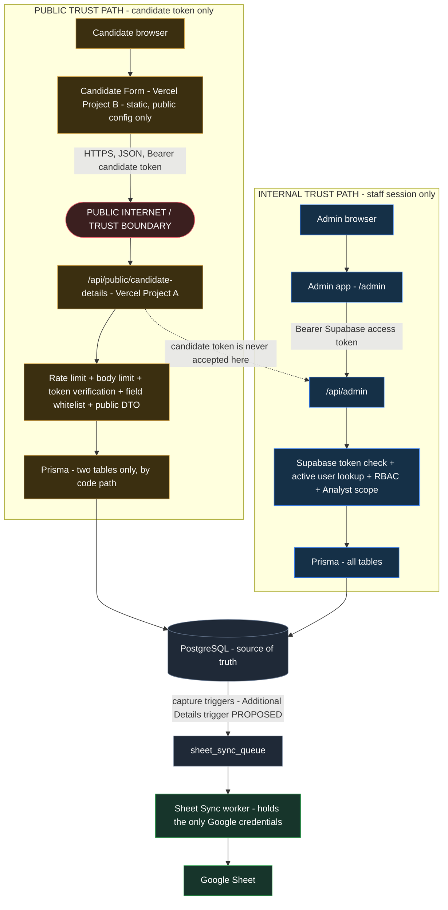
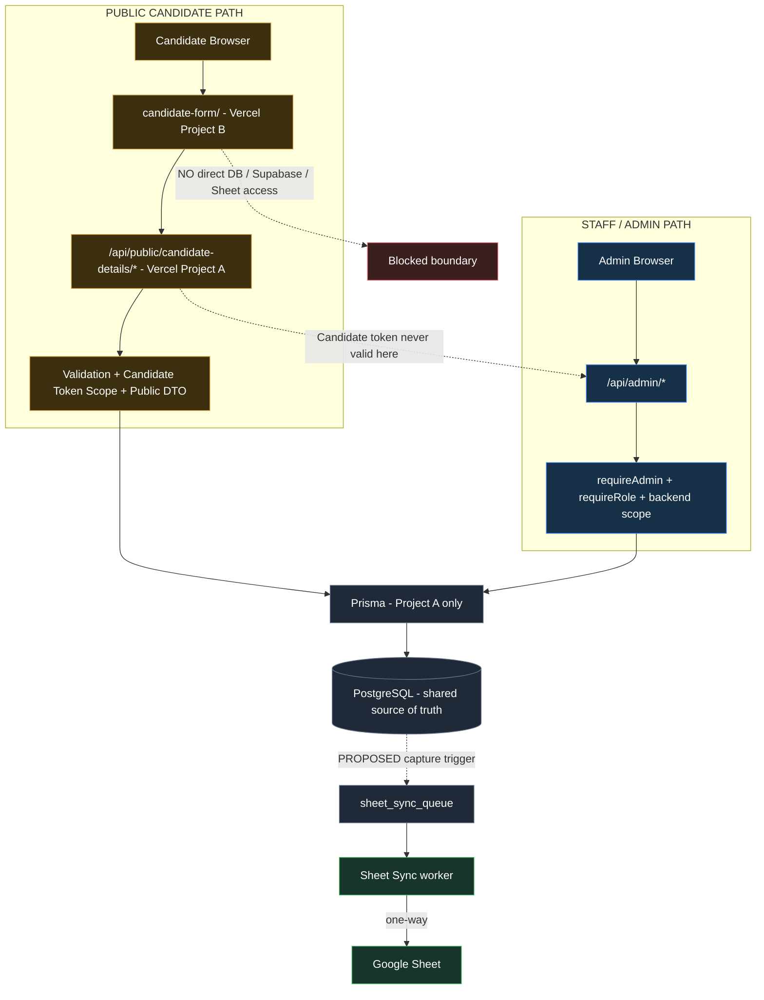

# Candidate Extra Details Form — Security & Data Exposure Risk Assessment

**Status:** Pre-implementation security planning, updated on 2026-10-15 with the completed repository audit (static review of the route table, raw SQL, services, migrations, Vite / Vercel configuration, plus four executed read-only checks). Documentation only: nothing in this document is implemented, and no application, schema, migration or deployment file was changed.
**Branch:** `version/candidate-extra-details-form`
**Companion documents:** [MASTER_DATABASE_ARCHITECTURE.md](MASTER_DATABASE_ARCHITECTURE.md) (design, section 6), [README.md](../README.md).

Language used in this document: "designed to prevent" means a control is specified but not yet built; "requires verification" means it must be proven by a test before release; "no issue found in audited path" means the code was read and nothing was found, which is **not** proof that no issue exists. No risk is considered closed until the control is implemented and its test passes.

Evidence labels used in the register (the audit gave most items a definite status):

| Status | Meaning |
|---|---|
| **Verified existing protection** | Found in the repository and verified by reading the code and, where noted, by an executed test. Must be re-verified for the new public routes |
| **Confirmed implementation risk** | A defect or hazard that is real today and will bite the new feature if the existing code is reused or the control is skipped |
| **Needs implementation** | The control is specified but not built |
| **Needs live verification** | Depends on the live Supabase / Vercel / data state that the repository cannot show |
| **Known hardening gap** | A known weakness that is not currently exploitable but should be closed |
| **Not currently vulnerable in audited path** | Code was read and tested; nothing found. **Not** proof that no issue exists |
| **Not applicable** | Cannot occur in the planned design |

---

## 1. Scope

**In scope:** the public form `candidate-form/` (Vercel Project B), the proposed public API `/api/public/candidate-details/*` on the existing Express backend (Vercel Project A), the verification token, the reuse of `candidate` (read, verification only) and `candidate_additional_details` (read / write), the audit and Google Sheet consequences of a public write, and the shared infrastructure (Supabase, Vercel, rate limiting, logging).

**Out of scope:** Admin dashboard feature security in general, WhatsApp webhook security, OCR worker, staff authentication design. They appear only where the public form can reach or affect them.

**Design in one paragraph.** A candidate opens the public form, enters Passport Number and WhatsApp Number; the backend checks both belong to the same existing candidate; it returns a short-lived signed token; the form reads and saves only that candidate's Additional Details through the public API. No new table. The form never talks to the database, Supabase or Google directly.

**Key weakness of the design itself.** Verification is a **knowledge factor only**: a passport number and a phone number. Both are routinely known to agents, relatives, recruiters and anyone who has handled the candidate's documents. Whoever knows both can read and rewrite that candidate's family and personal details. The controls below limit guessing, not knowing. See risks R-028, R-029 and open question Q-1.

---

## 2. Architecture and Trust Boundaries



Trust rules the implementation must keep:

1. The **public token is a different credential type from a staff session.** Every admin route verifies a Supabase access token and reads the staff user and role from the database; a candidate token has no role and no `auth.users` identity, so it must fail that check on every `/api/admin` and `/auth` route (R-008, AUTHZ-002..006).
2. **CORS is not authorization.** CORS only restricts what a browser lets JavaScript read. `curl`, scripts and other backends ignore it. Every admin and internal route must reject unauthenticated or wrongly-authenticated requests server-side whatever the origin.
3. Candidate identity inside the public API comes **only** from the verified token (section 6).
4. The public router shares the Express process, pool and database with the admin API (section 16), so it is an **availability** boundary as well as a data boundary.

Using one GitHub repository for Admin, backend and the Candidate Form is **not itself a vulnerability**; the real risk is incorrect deployment and configuration isolation (R-083, section 23).

---

## 3. Assets to protect

| Asset | Why it matters | Where it lives |
|---|---|---|
| Candidate Additional Details (parents' and spouse's names and birthdays, children, marital status, sizes, address, skills) | Personal and family data of a third party population; the primary target and the only table the form may touch | `candidate_additional_details` |
| Candidate identity (passport ID, NIC, WhatsApp, contact, DOB, address, job) | Used for verification; must never be returned or changed through the form | `candidate` |
| Verification inputs | Passport and WhatsApp numbers are also the "password"; logging or returning them weakens everything | request bodies, logs |
| Verification token and its signing secret | Forgery or theft gives write access to one candidate's details; the secret gives it for all | backend env, browser memory |
| Documents and passport scans | Highest-sensitivity files; unreachable by design | `documents`, Supabase Storage |
| Stages, allocation, call logs, Jobs | Operational integrity | their tables |
| Audit log | Evidence; must stay append-only and trustworthy | `audit_logs` |
| Staff accounts and roles | Privilege escalation target | `user`, Supabase Auth |
| Database and service credentials | Total compromise | backend env only |
| Google Sheet and its credentials | Operational mirror of candidate data | Sheet worker only |
| Availability of the Admin / backend | Staff work depends on it | shared Vercel function and pool |

---

## 4. Data access matrix

Current staff rules are taken from `src/routes/admin.js` and `Docs/20-candidate-management.md`: `CANDIDATE_STAFF` = ADMIN, MANAGER, ANALYST, REGISTRATION_DESK; an ANALYST is limited to allocated candidates; ADMIN-only routes are users, audit logs and settings.

| Resource | Candidate Public Form | Staff / Admin |
|---|---|---|
| `candidate` identity | **Verify only.** Read inside the backend to compare Passport + WhatsApp; **never returned**, never written | Per RBAC: ADMIN, MANAGER, REGISTRATION_DESK all; ANALYST own allocated |
| `candidate_additional_details` | **Read / write own row only** (the 19 approved fields), identity from the token | Per RBAC: all four roles; ANALYST own allocated |
| `candidate_stages` | No | CANDIDATE_STAFF (ANALYST scoped) |
| `candidate_allocation` | No | ADMIN, MANAGER manage; an ANALYST's own scope derives from it |
| `candidate_call_logs`, `call_log_follow_up` | No | CANDIDATE_STAFF (ANALYST scoped); follow-up delete ADMIN, MANAGER |
| `documents`, `temporary_data`, Review Queue, document files | No | ADMIN, MANAGER, ANALYST (scoped); candidate document upload CANDIDATE_STAFF |
| `audit_logs` | No | ADMIN only |
| `agent`, `company`, `job`, `job_candidate` (proposed) | No | Proposed: ADMIN, MANAGER manage; ANALYST read-only scoped; REGISTRATION_DESK open |
| `user` / staff, Supabase Auth admin | No | ADMIN only |
| Sheet sync settings and runs | No | ADMIN only |
| `rate_limits` | Backend writes counters only | Backend only |
| Supabase Storage / Auth from the browser | **None** (no Supabase key in Project B) | Admin browser uses the public anon key for sign-in only |

---

## 5. Risk register

Severity is the impact if the control is absent or wrong, adjusted by realistic likelihood. Where several rows share a root cause the register keeps them separate because they need separate tests. "Test" names refer to section 18.

| ID | Category | Risk | Attack / failure scenario | Data / impact | Current protection | Required control | Severity | Verification test | Status |
|---|---|---|---|---|---|---|---|---|---|
| R-001 | IDOR / BOLA | Public handler uses a client-supplied candidate id | Verified A changes a body, query or path ID to B | B's family data read or rewritten | No existing staff route exposes it: admin routes resolve the ID from the URL with the user's scope (`storedCandidateId`). The public route does not exist yet | Candidate identity only from the verified token; no ID accepted anywhere in the public API | HIGH | AUTHZ-001, TOKEN-003 | Needs implementation |
| R-002 | SQL injection | Injection through passport, WhatsApp or detail values | `' OR 1=1 --` in a lookup | DB read / write | Audited: 11 raw SQL uses in 5 files, all bound parameters (tagged templates); no `*Unsafe`, `Prisma.raw`, direct `pg` or string-built SQL; dynamic sort whitelisted. Not proof of absence | Keep it so; add no raw SQL; see R-081 for the wildcard input-validation risk (not an injection) | LOW | SQLI-001..003 | Not currently vulnerable in audited path |
| R-003 | Admin data exposure | Public API or its token reaches admin data | Token or public endpoint returns/permits admin reads | Candidates, documents, staff | Verified: all 48 admin route registrations use `requireRole`; `requireAdmin` runs first; executed test: 25 admin / internal endpoints returned 401 for no token, a non-JWT candidate-style token and a JWT-shaped one, with no leak | Separate public router, no shared handlers; token rejected by admin routes | HIGH | AUTHZ-002..006 | Verified existing protection |
| R-004 | Over-fetching | Public response carries core candidate data | Reusing `getAdditionalDetails` returns `suggested` name, address, DOB and `passportId` from the candidate record | Candidate core data returned to the browser | None: the existing `getAdditionalDetails` / `saveAdditionalDetails` return `view()` (`passportId` + `suggested` name, address, date of birth from `candidate`); `getCandidate` returns NIC, nationality, sex, passport dates, WhatsApp, contact, address, stages, documents | Dedicated public DTO / mapper (19 fields + `updatedDate` + token expiry); never reuse those services' output | HIGH | DATA-001, DATA-002, OVR-001 | Confirmed implementation risk |
| R-005 | Mass assignment | Crafted PUT with extra fields | Body adds `passport_id`, `whatsapp_number`, `stage`, `analyst_id`, `job_id`, `role` | Core / system data changed | Verified by execution: `parseAdditionalDetailsBody` uses a 19-field whitelist; `passport_id`, `whatsapp_number`, `nic`, `stage`, `analyst_id`, `job_id`, `role` and `__proto__` never reach the parsed payload. Unknown keys are ignored silently | Reuse the whitelist; the public route rejects unknown fields with `400` so tampered requests are visible | HIGH | MASS-001, MASS-002 | Verified existing protection |
| R-006 | Broken authorization | A public route is reachable without a valid token | Call GET/PUT without or with a bad token | Unauthenticated read / write | None yet | Token verification as the first step of every public route except `verify`; deny by default | HIGH | TOKEN-001..003, AUTHZ-001 | Needs implementation |
| R-007 | Privilege escalation | Candidate token or payload becomes staff | `role` in body, token claims treated as role | Staff / admin access | Role is read from the `user` table on every request, never from token claims | Candidate token carries no role; admin middleware unchanged | MEDIUM | AUTHZ-002, MASS-001 | Verified existing protection |
| R-008 | Token accepted by admin routes | Admin middleware accepts the candidate token | Send the candidate token as Bearer to `/api/admin/*` | Staff-level access | Verified by execution: 25 of 25 probes returned 401 for a non-JWT-shaped candidate token (0 Supabase Auth calls); a JWT-shaped token also returned 401 but caused 25 Auth calls (R-084) | Candidate token must be **non-JWT-shaped** and use a separate secret; test every admin route | HIGH | AUTHZ-002..006 | Verified existing protection |
| R-009 | Cross-candidate access | Candidate A reads or writes B through any path | See R-001 plus the list / search APIs | Other candidates' data | No existing path: staff routes are scoped per user; the public route does not exist yet | Same server-side identity rule; no list / search / lookup endpoint in the public API | HIGH | AUTHZ-001, TOKEN-003 | Needs implementation |
| R-010 | Fields outside Additional Details | Public write changes anything else | Hidden or extra fields | Candidate record, stages, allocation | Whitelist parser; the existing save only touches `candidate_additional_details` | Public router imports only the Additional Details service; no other write | HIGH | MASS-001 | Verified existing protection |
| R-011 | Candidate core data | Public path writes `candidate` | Reuse of `updateCandidateDetails` | Identity / contact corruption | `saveAdditionalDetails` never writes `candidate` (documented, read in code) | Public code has no import of candidate-write services | HIGH | MASS-001, DATA-002 | Verified existing protection |
| R-012 | Stages | Public path changes stages | Crafted stage fields | Pipeline integrity | Stage routes are staff-only | No stage handler in the public router | MEDIUM | MASS-001, AUTHZ-002 | Verified existing protection |
| R-013 | Work Allocation | Public path changes allocation | Crafted `analyst_id` | Analyst access changed | Allocation routes ADMIN / MANAGER only | Not reachable from the public router | MEDIUM | MASS-001, AUTHZ-004 | Verified existing protection |
| R-014 | Job Assignment (proposed) | Public path changes Jobs | Crafted `job_id` | Job links changed | Module not built | Not reachable from the public router | MEDIUM | MASS-001 | Needs implementation |
| R-015 | Documents | Public path reads document metadata or files | Call document / review endpoints with the token | Passport scans and PII | Document and review routes behind staff auth and scope | No document field in the DTO; admin routes reject the token | HIGH | AUTHZ-003, DATA-002 | Verified existing protection |
| R-016 | Audit logs | Candidate reads audit history | Token on `/api/admin/audit-logs` | Staff actions, candidate history | `ADMINS_ONLY` role check | Token rejected; public API returns no audit data | MEDIUM | AUTHZ-005 | Verified existing protection |
| R-017 | Staff / user data | Candidate reads staff data | Token on `/api/admin/users` | Staff names, emails, roles | `ADMINS_ONLY` | Token rejected; no staff field in DTO | MEDIUM | AUTHZ-006, DATA-002 | Verified existing protection |
| R-018 | Other candidates | Candidate lists or searches others | Token on `/api/admin/candidates?search=` | Other candidates' identity | Staff auth + scope on all list routes | No list / search in the public API; token rejected by admin | HIGH | AUTHZ-002, AUTHZ-001 | Verified existing protection |
| R-019 | Direct Supabase / DB access | Browser bypasses Express | Direct PostgREST / Storage call with a Supabase key | Table reads / writes | 13 of 14 application tables have `ENABLE ROW LEVEL SECURITY` + `REVOKE ALL … FROM anon, authenticated`, no public policies (migrations). Not confirmed on the live project | Project B holds no Supabase key; run the live privilege and Storage checks (SUPA-001, SUPA-002) | HIGH | SUPA-001, SECRET-001 | Needs live verification |
| R-020 | RLS / privilege misconfiguration | A table or bucket is exposed to `anon` | `candidate_allocation` has no RLS; Storage policies are not in migrations | Allocation rows or files readable with the anon key | Known gap: `candidate_allocation` has neither RLS nor an explicit revoke in its migration; protection is expected from the default-privilege rule (`ALTER DEFAULT PRIVILEGES FOR ROLE postgres`) and is not verified live. Storage policies are not in any migration | Enable RLS on `candidate_allocation`; verify table privileges and Storage policies on the live project | MEDIUM | SUPA-001, SUPA-002 | Known hardening gap |
| R-021 | Secret in frontend bundle | A secret is built into Project B | `VITE_*` secret or service key in the bundle | Total compromise | Repository is safe today: Vite exposes only `VITE_*`, no custom `envPrefix`, source maps off, the Admin app refuses a service-role key, no real secrets tracked (credential scan). Project B deployment isolation is not implemented | Project B Root Directory `candidate-form/`; environment `VITE_API_BASE_URL` only; no Supabase, database, Meta, Google, OCR or token-secret variables | HIGH | SECRET-001 | Needs implementation |
| R-022 | Vercel env exposure | Secrets shared across projects or scopes | Backend secrets added to Project B, or to Preview scope | Secret exposure | Per-project environment variables | Separate projects, minimum scopes, no copy of backend secrets into B | MEDIUM | SECRET-002 | Needs implementation |
| R-023 | CORS misconfiguration | Wildcard or reflected origin | `Access-Control-Allow-Origin: *` or credentials with reflection | Any site can call the API from a browser | None: no CORS package or configuration exists (Admin is same-origin) | Exact allow-list `CANDIDATE_FORM_ORIGIN`; `GET, POST, PUT, OPTIONS`; headers `Content-Type, Authorization`; never `*`; no reflected origin; no credentials. CORS is not authorization (admin routes verified to reject unauthenticated requests regardless of origin) | MEDIUM | CORS-001, CORS-002 | Needs implementation |
| R-024 | Preview deployments | Preview of A or B exposes the public API against real data | Public preview URL of the backend with a real database URL | Production data via an unreviewed build | Not determined (Vercel Deployment Protection setting is not in the repository) | Previews use a non-production database or protection; Project B previews not in the CORS allow-list | MEDIUM | PREV-001 | Needs live verification |
| R-025 | Error / stack / Prisma leakage | Internal detail in a response | Force a Prisma or validation error | SQL, table, path, existence hints | Verified: `errorHandler` returns fixed `400` / `413` / `500` with no `NODE_ENV` branch and value-free logs; `safeLog` redacts values. Staff messages (`CandidateError`, `UserAccountError`) must not be reused publicly | Public router maps every error to its own fixed message | MEDIUM | ERROR-001, ERROR-002 | Needs implementation |
| R-026 | Sensitive logging | Passport, phone, token or body is logged | Logs contain `Authorization` or request bodies | Credential reuse | Verified: no Authorization header, body or query logged; `safeLog` redacts storage paths, emails, passport-like IDs and long numbers; WhatsApp logs use a hashed message reference. The request path is logged, so public URLs must contain no IDs | Keep it so; no candidate IDs in public URL paths (the log records `baseUrl + path`) | MEDIUM | LOG-001 | Verified existing protection |
| R-027 | Enumeration | Responses or timing reveal who exists | Compare failure responses, status codes or latency | Candidate list by passport / phone | Task 1: `verifyCandidateDetailsAccess` makes exactly one candidate query (same `findMany` shape, columns and limit) for every syntactically valid request and always runs the normalise-and-compare step, against a placeholder number when nothing matched; one generic 401 body for not-found, wrong WhatsApp and ambiguous case variants; strict passport validation before the lookup; no fake rows, writes or sleeps. Residual: the database's zero-row vs one-row difference (sub-millisecond, below network jitter), bounded by the per-IP and per-passport rate limits | One response body and status for every verify failure; comparable work on all failure paths | MEDIUM | ENUM-001, TIMING-001, TIMING-002, TIMING-003 | Verified existing protection |
| R-028 | Brute-force verification | Guess phone for a known passport | Script tries many WhatsApp numbers for one passport | Takeover of a candidate's form | None for the public path (staff limiter is 1000 / 15 min per IP) | Per-passport and per-IP failure limits; consider a possession factor (Q-1) | HIGH | RATE-001, RATE-002 | Needs implementation |
| R-029 | Distributed brute force | Many IPs defeat per-IP limits | Botnet or rotating proxies | Same as R-028 | Per-IP limiter only, keyed by `req.ip` (trusted proxy hop 1 on Vercel) | Per-passport (hashed) limit independent of IP; optional edge firewall | HIGH | RATE-002 | Needs implementation |
| R-030 | Rate-limit DoS on a candidate | Attacker locks a real candidate out | Deliberate failures on one passport | Candidate cannot use the form | Not applicable yet | Per-passport lockout with a short window; accept and document the trade-off; staff can still edit via Admin | MEDIUM | RATE-003 | Needs implementation |
| R-031 | Token forgery | Attacker mints a valid token | Guess or recover the secret; algorithm confusion | Access to any candidate | Not applicable yet | HMAC-SHA256 with a random 32-byte secret, fixed algorithm, constant-time compare | HIGH | TOKEN-002 | Needs implementation |
| R-032 | Token replay | Captured token reused | Replay within its lifetime | Same candidate's data | Not applicable yet | Short expiry (15 min), HTTPS only; optional version / jti binding | MEDIUM | TOKEN-001, TOKEN-005 | Needs implementation |
| R-033 | Token theft | Token stolen from the device | XSS, shared device, malware | Same candidate's data | Not applicable yet | In-memory storage preferred; strict CSP; short expiry | MEDIUM | XSS-001, SHARED-001 | Needs implementation |
| R-034 | Token leakage | Token in URL, logs, history, referrer | Token in query string or logged header | Credential exposure | Error log never prints headers | Header only, never URL; no header logging; `Referrer-Policy: no-referrer` | MEDIUM | LOG-001, TOKEN-006 | Needs implementation |
| R-035 | Long token lifetime | Token outlives the need | 24 h token left on a shared phone | Extended exposure | Not applicable yet | Max 15 minutes; re-verify for each session | MEDIUM | TOKEN-001 | Needs implementation |
| R-036 | Token survives WhatsApp change | Old token valid after the number changed | Staff change the number; old token still works | Former holder keeps access | Not applicable yet | Bind a hash of the normalised WhatsApp to the token; recheck on every request | LOW | TOKEN-004 | Needs implementation |
| R-037 | XSS | Script injected through stored free text or the form | `<script>` in name / address / skills | Token theft; staff browser compromise | React escapes by default; CSP on `/admin`; Sheet writes are `RAW` | No raw HTML rendering in either app; CSP on Project B; output stays text everywhere | MEDIUM | XSS-001 | Needs implementation |
| R-038 | CSRF | Cross-site request performs a save | Forged PUT from another site | Unwanted edit | Not applicable: token in an `Authorization` header, no cookies | Never move the token into a cookie; no cookie auth | LOW | CSRF-001 | Not applicable |
| R-039 | CSP / security headers (Project B) | Missing headers on the public app | Clickjacking, injection, framing | Token theft, UI redress | Task 1: `candidate-form/csp.ts` builds the build-time `<meta>` CSP with `connect-src` set to exactly the `VITE_API_BASE_URL` origin (an invalid value fails the build); the `candidate-form/vercel.json` header CSP carries only `frame-ancestors 'none'; base-uri 'none'; form-action 'self'; object-src 'none'; upgrade-insecure-requests` (no fetch directives, no `https:`, no `*`), plus X-Frame-Options, nosniff, Referrer-Policy, Permissions-Policy, HSTS, COOP, X-Robots-Tag. Verified in the repo and build; the deployed headers are not yet checked | Project B headers: CSP, `frame-ancestors 'none'`, nosniff, referrer, permissions policy | MEDIUM | HDR-001, CSP-001, CSP-002, CSP-003 | Needs live verification |
| R-040 | Input validation | Oversized, malformed or hostile values | Long strings, wrong types, control characters | Data corruption, errors | Field kinds, lengths (150 / 500 / 1000), enums, date rules, family-rule checks | Reuse; add a public body limit and a control-character rule | MEDIUM | VAL-001, VAL-002 | Verified existing protection |
| R-041 | Unicode / normalisation | Look-alike or invisible characters | Zero-width, RTL override, homoglyphs in names | Misleading staff, Sheet rows, matching | Names accept any text up to the length limit | NFC normalise, strip control and bidi-control characters, reject empty-after-trim | LOW | VAL-003 | Needs implementation |
| R-042 | Passport canonicalisation | Different rules match different candidates | Three patterns exist: OCR `^[A-Z0-9]{6,9}$` with a digit; routes `^[A-Za-z0-9]{1,20}$`; legacy lower-case rows | Wrong or missing match | Lookup is exact, else a single case-insensitive match; ambiguity returns no match | One documented canonical form for the public lookup; fail closed on zero or several matches | MEDIUM | ENUM-002, VAL-004 | Needs implementation |
| R-043 | Phone normalisation | Local-form expansion makes a foreign-looking input match | `normalizePhoneNumber("+0771234567")` and `("+771234567")` both become `94771234567` (it expands Sri Lankan local forms after stripping non-digits) | A non-international input matches a Sri Lankan number | Confirmed by execution: `findUsersByWhatsappNumber('+0771234567')` and `('+771234567')` both matched a stored `+94771234567` (local-form expansion) | Validate `^\+[1-9]\d{7,14}$` **before** normalising; compare digits without local-form expansion on the input side | LOW | VAL-005 | Confirmed implementation risk |
| R-044 | Ambiguous candidate match | Two rows could satisfy the lookup | Case-different passport duplicates; the WhatsApp unique index exempts `+94771581916`; WhatsApp stored in different textual forms | Wrong candidate verified | Passport is the primary key; ambiguity makes the existing resolver return null | Look up by passport only, then compare the phone in the application; any ambiguity fails closed | MEDIUM | ENUM-002 | Needs live verification |
| R-045 | Race conditions | Two saves interleave | Two tabs or devices save at once | One save silently lost | Compare-and-swap on `updated_date`; unique-violation mapped to `409` | Reuse the same service for the public save | LOW | CONC-001 | Verified existing protection |
| R-046 | Concurrent Admin + Candidate edits | Candidate overwrites a staff correction | Staff fix a value while the candidate's form is open | Staff data lost | Version check exists but runs only when `expectedUpdatedDate` is sent; otherwise there is no check (confirmed in `saveAdditionalDetails`) | Public PUT **requires** `expectedUpdatedDate`; `409` shows a candidate-friendly message | MEDIUM | CONC-001, CONC-002 | Confirmed implementation risk |
| R-047 | Lost updates / mass clearing | Full-replacement save wipes data | PUT `{}` or a partial body clears every field (missing fields become null) | All Additional Details cleared | Confirmed by execution: an empty body, or a body with only unknown fields, parses as all 19 fields empty and `saveAdditionalDetails` would replace the stored details with nulls (no version check when `expectedUpdatedDate` is absent) | Public PUT requires `expectedUpdatedDate` and all 19 fields (null explicit), and rejects an empty or unknown-fields-only payload; patch semantics only if separately approved and designed | MEDIUM | MASS-003, CONC-003 | Confirmed implementation risk |
| R-048 | Audit gaps | Candidate self-updates are not audited | Public save succeeds | No record of who changed what | `audit_logs.admin_id` is required; the save audits only with a staff actor | Proposed `actor_type = CANDIDATE`, `admin_id` nullable, changed-fields entry | MEDIUM | AUD-001 | Needs implementation |
| R-049 | Audit spoofing | Client influences the audit entry | Body supplies actor or reason | Forged history | Audit fields are server-built; values are the changed fields, truncated to 300 chars | Actor and action only from server code; never from the body | MEDIUM | AUD-002 | Needs implementation |
| R-050 | Self-update attribution | Cannot tell who "the candidate" was | Passport + phone holder may be someone else | Weak accountability | Not applicable yet | Record actor type, timestamp and a hashed client IP where policy allows | MEDIUM | AUD-001 | Needs implementation |
| R-051 | Sheet data exposure | Sensitive family data reaches a wider audience | Sheet mapping includes parents, spouse, children | Personal data in a shared spreadsheet | Credentials confined to the worker; Additional Details are **not** mapped today | Owner approves each mapped field; restrict Sheet sharing | MEDIUM | SHEET-003 | Needs implementation |
| R-052 | Sheet writes wrong candidate | Row mismatch | Wrong `unique_id` or row identity | Another candidate's row updated | Rows matched by the system candidate ID (`_SYSTEM_CANDIDATE_ID`), not by editable values | Same identity for the new fields; test with two candidates | MEDIUM | SHEET-001 | Verified existing protection |
| R-053 | Mapping mistakes | Wrong column or field mapped | Mapping typo, swapped parents | Wrong data visible to staff | Not applicable yet (mapping TBD) | Single mapping table, header validation, reviewed by the owner | MEDIUM | SHEET-003 | Needs implementation |
| R-054 | Form writes the Sheet directly | Public path calls Google | Google credential reachable from the public router | Sheet overwrite | Google access only in the Sheet worker; Project A has no Google credentials (worker identity is keyless ADC) | Public code has no Google import; Project B has no Google config | LOW | SHEET-004 | Verified existing protection |
| R-055 | Queue / trigger mismatch | Public save is not queued | `candidate_additional_details` has no capture trigger | Sheet stays stale after a save | Triggers exist on `candidate`, `candidate_stages`, `documents` only | Add the capture trigger with the Sheet mapping | MEDIUM | SHEET-001 | Needs implementation |
| R-056 | Delayed / stale Sheet | Users expect real-time | Reconciliation runs at 06:00, 12:00, 18:00 or on Sync Now | Sheet lags the database | Documented one-way, scheduled design | State the delay in the product; Sync Now remains the manual path | LOW | SHEET-002 | Verified existing protection |
| R-057 | Shared backend load | Public traffic affects staff | Burst on the public verify endpoint | Slow or failing Admin | One Express app and function for both | Separate, strict limiters; consider a separate function or edge rate limiting | MEDIUM | LOAD-001 | Needs implementation |
| R-058 | DB connection pool exhaustion | Public requests hold the 3-connection pool | Many concurrent requests, each doing a limiter write and a user / candidate read | Admin requests time out (`P2024`) | Pool max 3 per instance (documented in `prisma.js`); no isolation | Cheap pre-checks before any DB work; per-request query budget; load test | HIGH | LOAD-001 | Needs implementation |
| R-059 | Denial of service | Endpoint flooding | Large or high-rate requests | Availability | Staff limiter exists; the admin router limiter counts in PostgreSQL | Public limits plus edge protection; fail-closed behaviour reviewed | MEDIUM | LOAD-001 | Needs implementation |
| R-060 | Payload size | Large JSON bodies | Megabyte body to PUT | Memory / CPU, parse cost | `express.json` default limit (100 kb) applies globally; no public-specific limit | 16 KB body limit on the public router; 413 mapped safely | MEDIUM | SIZE-001 | Needs implementation |
| R-061 | JSON parser abuse | Deep nesting, odd keys, `__proto__` | Crafted JSON | Crash or prototype pollution | The parser reads only whitelisted keys by property access; `JSON.parse` does not pollute prototypes | Keep reading only whitelisted keys; reject non-object bodies | LOW | SIZE-002 | Verified existing protection |
| R-062 | Dependency vulnerabilities | Known CVEs in packages | Public app and API use vulnerable libraries | Compromise | Not assessed in this audit (`npm audit` was not run) | `npm audit` and review before release; pin versions | MEDIUM | DEP-001 | Needs live verification |
| R-063 | npm supply chain | Malicious package in the new app | Typosquat or compromised update | Token theft, data theft | Lockfile and exact-pinned admin dependencies | Minimal dependency list, lockfile, `npm ci`, no install scripts from unknown packages | MEDIUM | DEP-001 | Needs implementation |
| R-064 | Insecure caching | Responses cached by browser or proxy | Shared computer or CDN caches details | PII leakage | `/api/admin` sends `Cache-Control: no-store` (router level) | `no-store` on every public response; no caching of the form's API calls | MEDIUM | CACHE-001 | Needs implementation |
| R-065 | Browser history leakage | Data in URLs | Passport or token in a query string | History, logs | Not applicable by design (POST bodies and headers) | No identifiers in URLs, ever | LOW | URL-001 | Needs implementation |
| R-066 | Referrer leakage | URL sent to third parties | Outbound links or assets | Form URL exposure | `Referrer-Policy: no-referrer` on `/admin` | Same on Project B; no third-party requests | LOW | HDR-001 | Needs implementation |
| R-067 | Analytics / third-party scripts | Tracker sees PII | Analytics, fonts or widgets on the form | Data to third parties | Admin has none | No third-party scripts or analytics on Project B | MEDIUM | HDR-001, SECRET-001 | Needs implementation |
| R-068 | HTTP / mixed content | Traffic or assets over HTTP | Downgrade, mixed content | Interception | Vercel serves HTTPS | HTTPS-only API base URL; CSP `upgrade-insecure-requests`; reject non-HTTPS config | LOW | HDR-001 | Needs live verification |
| R-069 | Missing HSTS | No transport hardening | First-visit downgrade | Interception | Helmet sets HSTS on the API; `/admin` header block sets HSTS | Set HSTS for Project B | LOW | HDR-001 | Needs live verification |
| R-070 | Response headers | Missing or weak headers | Sniffing, framing | UI redress | Helmet on the API | Header set for Project B and the public API responses | LOW | HDR-001 | Needs implementation |
| R-071 | Open redirect | Redirect parameter abused | Future `?next=` | Phishing | No redirects planned | Do not add navigation parameters | LOW | — | Not applicable |
| R-072 | File upload | Future uploads | Upload added later | Malware, storage abuse | No upload in this feature | Out of scope; a new assessment before any upload | LOW | — | Not applicable |
| R-073 | API versioning / legacy endpoints | Old paths stay reachable | Legacy or renamed routes | Unreviewed surface | Legacy names exist (`/clients`) but are behind staff auth | New public routes only under `/api/public/candidate-details`; no aliases | LOW | AUTHZ-002 | Verified existing protection |
| R-074 | Unused public endpoints | Extra reachable routes | Leftover public routes | Surface growth | Public routes today: `/health`, `/whatsapp/webhook`, `/auth/*`, static `/admin` | Exactly three public routes (verify, get, put); no other | LOW | SURF-001 | Needs implementation |
| R-075 | Debug endpoints | Debug route in production | Hidden diagnostics | Info leak | None found in the audited app wiring | Keep none; test the route table | LOW | SURF-001 | Not currently vulnerable in audited path |
| R-076 | Source maps | Implementation visible | Public `.map` files | Easier attack | Admin build uses `sourcemap: false` | Same for Project B | LOW | SECRET-001 | Needs implementation |
| R-077 | Verbose health | `/health` reveals internals | Health output | Recon | Returns a fixed status message | Do not extend it | LOW | SURF-001 | Verified existing protection |
| R-078 | Search-engine indexing | The form is indexed | Crawlers index the page | Reputational, phishing aid | Not applicable yet | `noindex` meta and `X-Robots-Tag`, `robots.txt` disallow | LOW | HDR-002 | Needs implementation |
| R-079 | Browser autofill | Sensitive values stored by the browser | Autofill of passport or family details | Local exposure | Not applicable yet | `autocomplete` attributes set deliberately; no persistence of form state | LOW | SHARED-001 | Needs implementation |
| R-080 | Shared devices | Candidate uses a public computer | Next user opens the form or back button | Family PII exposure | Not applicable yet | Token in memory, cleared on save, idle and tab close; show a "close this page" message | MEDIUM | SHARED-001 | Needs implementation |
| R-081 | SQL wildcard / pattern input | Wildcard characters in the case-insensitive passport lookup | `resolveCandidatePassportId` (`candidateService.js:632`, `equals` + `mode: insensitive`) treats `%` and `_` as wildcards. Executed: `AB%` and `A_123456` both resolved `AB123456`. A public verify without the strict pattern becomes a passport-prefix oracle | Confirms which passports exist; narrows enumeration (not an injection) | Admin callers (`admin.js:464`, `:491`) pass only values validated by `isValidCandidateIdParam` (`^[A-Za-z0-9]{1,20}$`), so wildcards cannot reach it today | Public verify applies the same strict pattern **before** calling the lookup and rejects (never escapes) anything else | MEDIUM | WILD-001, SQLI-001 | Needs implementation |
| R-082 | IDOR / BOLA | Existing services trust a caller-supplied `passportId` | `getAdditionalDetails` and `saveAdditionalDetails` act on the `passportId` their caller passes. Safe today only because `admin.js:640` and `:652` first resolve and scope it. A public route passing an ID from the URL, query, body, hidden field or client state would read or write another candidate | Cross-candidate read / write of Additional Details | Admin routes call `storedCandidateId` (resolve + scope) first | Public route passes only the token-derived ID; no `:passportId` route; exactly `POST /verify`, `GET /`, `PUT /`; no `passport_id`, `candidate_id` or `passportId` in path, query or body | HIGH | AUTHZ-001, SURF-001 | Needs implementation |
| R-083 | Deployment isolation | Incorrect deployment / configuration isolation in a shared repository | Project B created from the repository root deploys the root `vercel.json` (rewrites `/api/*` to the backend function) with Project B's environment; or backend secrets, `VITE_SUPABASE_*` or the token secret are added to Project B. The shared repository itself is not the vulnerability | Backend deployed under the public project; secrets in a public bundle | Vite exposes only `VITE_*`, no custom `envPrefix`, source maps off, only example env files tracked | Project B Root Directory `candidate-form/`; `VITE_API_BASE_URL` only; no backend secret in Project B; verify project settings and build output | HIGH | DEPLOY-001, SECRET-001..003 | Needs implementation |
| R-084 | Token format | A JWT-shaped candidate token enters the Supabase staff-verification path | A candidate token shaped `h.p.s` is rejected (401) but each request makes a Supabase Auth verification call. Executed: 25 requests, 25 Auth calls; a non-JWT-shaped token made 0 | Auth-load amplification; staff sign-in can be rate-limited by public traffic | A non-JWT-shaped token never reaches Supabase (verified by execution) | Candidate token must not be JWT-shaped | MEDIUM | AUTHZ-008 | Needs implementation |

---

## 6. IDOR / Cross-Candidate Access

**Requirement.** After verification the server derives the candidate **only** from the signed token. The public API accepts no candidate identifier in any form.

| Attack | Required outcome |
|---|---|
| Verified A sends `passport_id` = B in the PUT body | **Rejected with `400`** (unknown field); nothing is written; B is never touched |
| `GET /api/public/candidate-details?passportId=B` | The query identifier is never read (rejected with `400`, or ignored); the response is A's data |
| `PUT /api/public/candidate-details/B` | **No such route exists** (404); the only public routes are `/verify`, `/` GET and `/` PUT |
| Hidden form field / client state changes the ID | Irrelevant: the client never sends an ID after verification |
| Token for A + body passport B | The body identifier is rejected (`400`, unknown field) and never read; any response or write concerns A only |
| Replay of A's token after A's WhatsApp changes | Rejected by the WhatsApp-hash binding (R-036) |
| Verify with passport B + phone A | Same generic failure as any mismatch |

Design rules:

1. `verify` is the **only** route that reads a passport or WhatsApp from the request, and it does so only to look a candidate up and compare. It returns a token; it never echoes the passport or number.
2. GET and PUT take identity from the token and nowhere else. No path parameters with identifiers, no query parameters, no body identifiers.
3. The service is called as `saveAdditionalDetails({ passportId: tokenPassportId, ... })`; there is no code path where the value comes from `req.body`, `req.query` or `req.params`.
4. A unit test asserts that the public router registers exactly three routes and none has a `:param`.

**Audit evidence (existing code).** `getAdditionalDetails` and `saveAdditionalDetails` (`src/services/candidateAdditionalDetailsService.js`) act on whatever `passportId` their caller passes. This is **safe today**: their only callers are `src/routes/admin.js:640` and `:652`, which first call `storedCandidateId` (`resolveCandidatePassportId` with `candidateScope(req.user)`) and answer 404 for an Analyst outside their scope. No IDOR issue was found in the current staff routes. It becomes a **HIGH-priority authorization requirement** for the public route (R-001, R-009, R-082): the service must receive only the token-derived ID.

Required route shape, and nothing else:

```
POST /api/public/candidate-details/verify
GET  /api/public/candidate-details
PUT  /api/public/candidate-details
```

No `:passportId` route, and no `passport_id`, `candidate_id` or `passportId` accepted in the path, the query string or the PUT body.

---

## 7. Admin / Internal API Exposure

**Audit result (read in `src/createApp.js`, `src/routes/admin.js`, `src/routes/auth.js`, `src/middleware/requireActiveUser.js`).**

- `router.use(requireAdmin)` runs before every route in the admin router; the only routes registered before it are the rate limiter and a `Cache-Control: no-store` header. **No issue found in audited path** for unauthenticated access to `/api/admin/*`.
- `requireActiveUser` verifies the Bearer token with Supabase Auth (`auth.getUser`) and then loads an `ACTIVE` `user` row. A token that Supabase does not recognise gets `401`; a recognised identity without an active `user` row gets `403`.
- The Supabase verifier first requires the token to look like a JWT (three dot-separated segments, at most 8192 characters). A candidate token that is **not** JWT-shaped is rejected **before** any Supabase call. A JWT-shaped candidate token would still be rejected by Supabase but would cost one Auth request per attempt (an amplification vector); so the candidate token must not be JWT-shaped.
- `/auth/me` and `/auth/complete-invite` use the same Supabase verification.
- `/whatsapp/webhook` is public by design but verified by Meta's HMAC signature; the candidate token is not involved.
- `/health` returns a fixed message; `/admin/*` serves static files.

**Audit evidence (completed).** `src/routes/admin.js` has **48** route registrations and **all 48** use `requireRole(...)`; `router.use(requireAdmin)` (`:152`) runs before every one of them. `/users` (`users.js:34`) and `/settings/sheet-sync` (`sheetSyncSettings.js:34`, `admin.js:710`) are role-protected at router level; `/auth/me` and `/auth/complete-invite` use `createRequireActiveUser` / `createAuthenticateIdentity`. Analyst candidate scoping is enforced in the backend queries (`storedCandidateId` -> `candidateScope`), not in the frontend.

**Executed test (real `createAdminRouter`, real `createRequireActiveUser` and `createAccessTokenVerifier`, stub Supabase client, no database).** 25 probes across candidates, additional-details, stages, call logs, documents, the review file and actions, work-allocation, audit-logs, users, invite, sheet-sync, overview, reports, clients, follow-ups, police and an unknown path:

| Token sent | Result | Supabase Auth calls made |
|---|---|---|
| none | 25 x `401` | 0 |
| non-JWT-shaped candidate-style token (`cef1~payload~sig`) | 25 x `401` | **0** |
| JWT-shaped, HMAC-signed candidate-style token | 25 x `401` | 25 |

No response contained a stack trace, Prisma detail, SQL, candidate data or admin data. An unknown path also returns `401` (authentication runs before the final 404 handler), so route names are not revealed. **Conclusion: no existing public path was found that lets a Candidate Form request or a candidate-style token reach admin or internal data.** A JWT-shaped token is still rejected but triggers a Supabase verification attempt, so the candidate token must **not** be JWT-shaped (R-084).
**Routes that must reject a candidate token (test every one):** `/api/admin/*` (candidates, additional-details, stages, documents, review, follow-ups, work-allocation, reports, overview, police, audit-logs, users, settings), `/auth/*`, and any future `/api/admin/agents|companies|jobs`.

**CORS is not a control here.** A browser-enforced origin policy does not stop `curl` or another server. The protection is server-side authentication and RBAC on every route; the public CORS allow-list (section 13) only limits which sites' scripts may read public API responses.

**Isolation rules for the public router:** its own file, its own limiter, no shared middleware that attaches a staff identity, no import of admin route helpers, mounted at a path that cannot be confused with `/api/admin`.

---

## 8. SQL Injection Review

Search covered `src/`, `scripts/` and `api/` for `$queryRaw`, `$queryRawUnsafe`, `$executeRaw`, `$executeRawUnsafe`, `Prisma.sql`, `Prisma.raw`, direct `pg` use and string-built SQL.

| Location | Statement | Classification | Notes |
|---|---|---|---|
| `src/middleware/postgresRateLimitStore.js` (4 occurrences) | `INSERT … ON CONFLICT`, `UPDATE`, two `DELETE`s on `rate_limits` | **SAFE** | Tagged templates; values (`rowKey`, window) are bound parameters; the key is a SHA-256 hash; the table name is a literal |
| `src/services/adminReviewActionService.js` (3) | `SELECT … FOR UPDATE` on `temporary_data`, `documents`, `candidate` by ID | **SAFE** | Tagged templates, bound parameters |
| `src/services/workAllocationService.js` (2) | `SELECT … ANY(${ids})`, `FOR UPDATE` / `FOR SHARE` | **SAFE** | Array bound as a parameter; IDs also validated by pattern before the query |
| `scripts/checkDatabaseConnection.js` | `SELECT 1` | **SAFE** | Constant |
| Dynamic `ORDER BY` (documents list) | `sort` query parameter | **SAFE** | Whitelisted (`receivedDate`, `ocrConfidence`, `documentType`) and passed to Prisma `orderBy` |
| Candidate search (`candidateSearchWhere`) | Prisma `contains` with `mode: "insensitive"` | **NEEDS REVIEW** (not an injection) | Parameterised by Prisma; confirm how `%` / `_` in the search term behave. Not used by the public form |
| Passport lookup `resolveCandidatePassportId` (`candidateService.js:632`) | Prisma `equals` + `mode: "insensitive"` | **NEEDS CONTROL / NEEDS VERIFICATION** (not an injection) | Parameterised, but **`%` and `_` act as wildcards**: executed against an in-memory PostgreSQL, `AB%` and `A_123456` both resolved `AB123456` (a lone `%` matched nothing only because two candidates existed). Current admin callers (`admin.js:464`, `:491`) validate with `isValidCandidateIdParam` (`^[A-Za-z0-9]{1,20}$`) first, so wildcards cannot reach it. The public verify **must apply the same strict pattern before this call** (R-081) |
| WhatsApp lookup `findUsersByWhatsappNumber` (`userLookupService.js:51`) | Prisma `endsWith` on the last four digits, then an application-side comparison | **SAFE** | Input is reduced to digits by `normalizePhoneNumber` before the query; `%4567` and `' OR 1=1 --` returned `INVALID_INPUT`. Normalisation edge case: see R-043 |

**No `*Unsafe` raw API, `Prisma.raw` or string-built SQL was found. No SQL injection vulnerability was found in the audited code. This is not a proof of absence.** For the public form: look up the candidate with Prisma by passport only, compare the WhatsApp number in application code (no phone-based query), accept only strictly validated inputs, and add no raw SQL. Tests: SQLI-001..003.

---

## 9. Mass Assignment / Over-fetching

### 9.1 Mass assignment

- `parseAdditionalDetailsBody` iterates its own `FIELDS` constant (19 names) and reads `body[field]`; it never spreads the request body. Verified by execution: `passport_id`, `whatsapp_number`, `nic`, `stage`, `analyst_id`, `job_id`, `role` and `__proto__` never reach the parsed payload (the output always has exactly the 19 whitelisted keys, snake-case aliases are dropped, SQL text in a field is kept as plain text). Unknown keys are **ignored silently today, not rejected**, so a tampered request looks identical to an empty one.
- The write goes through `saveAdditionalDetails`, which only touches `candidate_additional_details` and `audit_logs`.

**Preferred public behaviour:** accept exactly the 19 fields plus `expectedUpdatedDate`; **reject unknown keys with `400`** (a crafted request is then visible in logs rather than silently ignored); reject non-object bodies; never pass `req.body` to Prisma. Camel-case and snake-case aliases are not accepted.

### 9.2 Full-replacement semantics (confirmed by execution)

The existing save is a **full replacement**: a field missing from the body becomes `null`. With no `expectedUpdatedDate` the version check is skipped. Executed: a body of only unknown fields, and `{}`, both parse as **all 19 fields empty** with `expectedUpdatedDate` undefined, so `saveAdditionalDetails` would replace the stored details with nulls. A request `PUT {}` from a token holder would therefore clear every stored detail. This is a **data-integrity** risk, not a data-leak risk. Required for the public PUT: `expectedUpdatedDate` mandatory, all 19 fields present (null explicit), and an all-empty body refused when data exists. R-046, R-047.

### 9.3 Over-fetching

The existing `getAdditionalDetails` view (`view()` in `candidateAdditionalDetailsService.js`) returns `passportId`, `details`, `suggested` (**name, address and date of birth taken from the `candidate` record**) and `updatedDate`; `saveAdditionalDetails` returns the same `view()`. `getCandidate` (`candidateService.js`) returns NIC, nationality, sex, passport dates, WhatsApp, contact number, address, stages, documents and required documents. **None of these may be reused for the public API** (R-004): a dedicated public DTO / mapper is required.

**Public DTO (explicit mapper, no spreading):**

| Returned | Not returned |
|---|---|
| The 19 Additional Details fields | NIC, contact number, WhatsApp number, passport ID, unique ID, name / address / DOB from `candidate`, `suggested` values |
| `updatedDate` (version for conflict detection) | Stages, documents, storage paths, allocation, analyst, Job history, visa status |
| Token `expiresAt` | Audit data, admin IDs, staff names / emails, internal timestamps |

The verify response carries the same DTO plus the token and its expiry.

---

## 10. Token / Session Risks

**Recommended simplest design (stateless signed token), to be proven by the token tests:**

| Property | Design | Reason |
|---|---|---|
| Format | **Not JWT-shaped**: `v1.<base64url payload>.<base64url signature>` would be 3 segments and look like a JWT; use two segments joined by `~` or a prefix such as `cef1~payload~signature` so the Supabase verifier rejects it by shape | Keeps it out of the Supabase path (R-008, R-084): executed, a non-JWT-shaped token made 0 Supabase Auth calls, a JWT-shaped one made one per request |
| Algorithm | HMAC-SHA256 via `node:crypto`, fixed in code (no algorithm field to confuse) | Prevents algorithm confusion (R-031) |
| Secret | 32 random bytes, backend-only (`CANDIDATE_FORM_TOKEN_SECRET`), not the Supabase or database secret, rotatable | R-021, R-031 |
| Payload | `passportId`, `waHash` (SHA-256 of the normalised WhatsApp), `iat`, `exp` (15 minutes), `aud = "candidate-form"`, version | Candidate and phone binding, short life |
| Verification on every request | Signature (constant-time), `exp`, `aud`, candidate still exists, stored WhatsApp hash still equals `waHash` | R-036 |
| Transport | `Authorization: Bearer`, never a URL or cookie | R-034, R-038 |
| Browser storage | **In memory** (no `localStorage`); optionally `sessionStorage` if a reload must survive | R-033, R-080 |
| End of session | Cleared after a successful save, on idle timeout and on page close; "verify again" starts a new token | R-080 |
| Replay | Accepted within 15 minutes by design; HTTPS only; `Cache-Control: no-store` | R-032 |
| Revocation | Not needed for one 15-minute token; secret rotation invalidates all | — |
| Admin acceptance | **Never**: different format, different secret, no staff claims | R-008 |

What the token must not contain: the passport or WhatsApp in clear text, any role, any staff data. Authorization-header logging must be off (R-034); the existing error log prints no headers (**no issue found in audited path**).

Alternatives (server session, DB-backed token) add a table and cleanup for a 15-minute need; they are not recommended unless server-side revocation becomes a requirement (Q-4).

---

## 11. Supabase / Database Exposure

| Check | Finding | Status |
|---|---|---|
| Explicit RLS and revoke | **13 of 14** application tables have `ENABLE ROW LEVEL SECURITY` and `REVOKE ALL … FROM anon, authenticated` with no public policies (`user`/`candidate` via the restrict migration, then `audit_logs`, `rate_limits`, `candidate_stages`, `candidate_call_logs`, the three `sheet_sync_*` tables, `candidate_additional_details`, `call_log_follow_up`) | Verified existing protection (migrations); Needs live verification on the live project |
| `candidate_allocation` | Its migration creates the table, an index and two foreign keys only: **no RLS and no explicit revoke**. Protection is expected from the earlier `ALTER DEFAULT PRIVILEGES FOR ROLE postgres … REVOKE ALL ON TABLES FROM anon, authenticated`, not verified against the live database | Known hardening gap; Needs live verification |
| Default privileges | The restrict migration states that defaults owned by `supabase_admin` cannot be changed from the migration role | Needs live verification |
| Storage | Storage policies are not in any migration; the app uses a private bucket through the service-role client only | Needs live verification (Supabase dashboard) |
| Browser Supabase key | The Admin bundle already ships the **public anon key** (documented; the app refuses a service-role key). Project B must ship **no** Supabase key | Needs implementation |
| Public form bypassing Express | Prevented only if Project B has no Supabase key **and** the anon key has no table or Storage access | Needs live verification |

**Pre-release live checks (read-only):**

1. `anon` cannot `SELECT` `candidate`; `authenticated` cannot `SELECT` `candidate` (DB-001 / SUPA-001).
2. Neither role can `SELECT` `candidate_additional_details` or `candidate_allocation` (`has_table_privilege`).
3. Neither role has any privilege on any other application table (DB-002).
4. Storage policies reviewed in the Supabase dashboard (SUPA-002).
5. Proposed hardening: enable RLS on `candidate_allocation`.

The Candidate Form must not receive a Supabase key; **all** its database access goes through the Express public API.

Verification queries and checks (read-only) are in SUPA-001 and SUPA-002 (section 18). The public form must use the backend API only.

---

## 12. Secrets / Vercel / Frontend Bundle

- **All `VITE_*` variables are embedded in the public bundle.** Project B may define only `VITE_API_BASE_URL`. It must not define any `VITE_SUPABASE_*`, because the form does not use Supabase.
- **Vercel Root Directory.** The repository's root `vercel.json` installs the Admin app and routes `/auth`, `/api`, `/whatsapp` and `/health` to the backend function (`api/index.js`). A Vercel project created from the repository root would deploy the backend. **Project B must use Root Directory `candidate-form/`** and have no `api/` function; this is a release check (DEPLOY-001, SECRET-003).
- **Audit facts (existing repository):** Vite exposes only `VITE_*`; `admin/vite.config.ts` has no `define` and no custom `envPrefix`; the Admin app reads exactly two `VITE_*` values (Supabase URL and the public anon key) and refuses a service-role key; source maps are off; the only tracked env-like files are `.env.example`, `admin/.env.example` (placeholders) and configuration code; a credential scan of tracked files found only local / test placeholder database URLs and one test JWT fixture; `DIRECT_URL` is not used anywhere. Vite loads env files from its own project folder, so the repository-root `.env` is not read by the Admin build and would not be read by `candidate-form/`.
- **Never provide to Project B:** `DATABASE_URL`, `DIRECT_URL`, `SUPABASE_SERVICE_ROLE_KEY`, `META_APP_SECRET`, `WHATSAPP_VERIFY_TOKEN`, `WHATSAPP_ACCESS_TOKEN`, Google credentials, `SHEET_*` secrets, OCR secrets, any JWT / auth secret, `CANDIDATE_FORM_TOKEN_SECRET`, and any `VITE_SUPABASE_*` variable.
- **Must not exist in Project B:** `DATABASE_URL`, `DIRECT_URL`, `SUPABASE_SERVICE_ROLE_KEY`, Meta secrets, Google credentials, `CANDIDATE_FORM_TOKEN_SECRET`, any backend JWT / auth secret.
- Backend secrets live only in Project A's environment, scoped to Production (and a **non-production** value for Preview).
- Evidence from the repository: the Admin app documents that only public values belong in `VITE_*` and refuses a service-role key; `.env.local` files are git-ignored (`.gitignore` rule `.env*`).
- Release gate (SECRET-001): build Project B, scan the output for the names and for high-entropy strings (service-role key, database URL patterns, token-secret name), and inspect the environment-variable list of the Vercel project. Source maps disabled (the Admin build uses `sourcemap: false`; same for B).
- `CANDIDATE_FORM_ORIGIN` and `CANDIDATE_FORM_TOKEN_SECRET` are backend-only variables in Project A.

---

## 13. CORS / Browser Security

- **CORS today:** no CORS package or configuration exists (confirmed by search; the Admin app is same-origin, `src/adminFrontend.js`). Project B is cross-origin, so CORS must be added **only** to the public router. Even then, **CORS is not authorization**: the executed test in section 7 shows admin routes reject unauthenticated and candidate-style requests regardless of origin.
- **Required CORS:** `Access-Control-Allow-Origin` equal to the exact Project B production origin (read from `CANDIDATE_FORM_ORIGIN`), methods `GET, POST, PUT, OPTIONS`, headers `Content-Type, Authorization`, **no** `Access-Control-Allow-Credentials`, `Vary: Origin`, never `*`, never a reflected arbitrary origin, no wildcard on subdomains. Preflight answered by the public router only.
- **Not a security boundary:** CORS does not protect against non-browser clients (section 7). Authorization and rate limits do that.
- **Preview deployments of Project B** are not in the allow-list by default; if previews must work, use a staging backend with non-production data (R-024).
- **Project B response headers:** CSP (`default-src 'self'`, `connect-src` = the API origin only, no inline scripts), `frame-ancestors 'none'`, `X-Content-Type-Options: nosniff`, `Referrer-Policy: no-referrer`, a restrictive `Permissions-Policy`, HSTS, `X-Robots-Tag: noindex`, `Cache-Control: no-store` on HTML and API responses. The existing header set in `vercel.json` covers `/admin` only and is a template, not coverage.
- **Browser behaviour:** no third-party scripts, analytics, fonts or widgets; `autocomplete` set deliberately; no values in URLs; clear sensitive state on completion.

---

## 14. Error / Logging Exposure

- **Existing:** the global `errorHandler` answers only `400`, `413` or `500` with fixed messages and logs `method`, `path`, `status`, error type and an allow-listed, value-free Prisma subset. No body, query string, header, message or stack is logged. **No issue found in audited path.**
- **Also verified:** `errorHandler` has no `NODE_ENV` branch (it answers the same way in production and development); `src/utils/safeLog.js` redacts quoted values, storage paths, emails, passport-like IDs and long numbers; the WhatsApp routes log a hashed message reference, not raw numbers; no Authorization-header logging was found. Executed: none of the 25 admin probes returned stack, Prisma or SQL text.
- **Risk:** the log records `${req.baseUrl}${req.path}`. Public routes must therefore never contain identifiers in the path (they do not, by design).
- **Risk:** existing service errors (`CandidateError`) carry staff-oriented text ("Candidate not found", "Use Sync to load their changes"). The public router must map errors to its own fixed messages and must not return `CandidateError` text or codes that reveal existence.
- **Public responses (fixed set):** `400 "Please check the form and try again."` (field-level messages for validation only, from the whitelist parser, never echoing input); `401 "We couldn't verify your details. Please check your Passport Number and WhatsApp Number and try again."` (all verify failures, bad or expired token returns `401` with a re-verify message); `409 "These details were changed by someone else. Reload and try again."`; `413`, `429` with a generic retry message; `500 "Something went wrong."`
- No Prisma codes, SQL, table names, file paths, staff IDs or connection details in any public response. Failed verifications are logged with a hash of the passport, never the raw passport or number.

---

## 15. Google Sheet Risks

Database remains the source of truth; the Sheet is a one-way mirror.

| Topic | Audit result |
|---|---|
| Direct write from the form | Not possible in design: Google access exists only in the Sheet worker (keyless identity on its own service account); Project A and B hold no Google credential. **Verified existing protection** |
| Additional Details capture | **No trigger** on `candidate_additional_details`; the mapper does not read it. A public save is therefore not queued today (R-055) |
| Wrong candidate row | Rows are matched by the system candidate ID column, not by editable values; header validation precedes writes. **Verified existing protection**; re-test with the new fields (SHEET-001) |
| Formula / content injection | Writes use `valueInputOption: "RAW"`, so text starting with `=`, `+`, `-`, `@` is stored as text. **No issue found in audited path** |
| Over-sharing | Mapping is TBD. Each mapped field makes family data visible to everyone with Sheet access; the owner must approve the list (R-051, R-053) |
| Stale Sheet | Reconciliation at 06:00 / 12:00 / 18:00 or **Sync Now**; the Sheet can lag by hours (R-056) |
| Sync Now consistency | Reads current database values at run time, independent of the queue. Needs a test once columns exist (SHEET-002) |
| Trigger design | A database trigger reusing the existing candidate-child capture function matches the current outbox design; an application-side enqueue would miss other writers (open question Q-6) |

---

## 16. Availability / Shared Backend Risks

- The public router runs in the **same Express app, Vercel function and connection pool** as the Admin API. The pool is 3 connections per function instance (`DATABASE_POOL_MAX` default), and every request already costs a PostgreSQL rate-limit write; the load-testing review found the admin path costs at least two database round trips plus a Supabase Auth call per request.
- A burst against `verify` (unauthenticated, each request reaching the database for the limiter and the candidate lookup) can consume the pool and degrade or fail Admin requests (`P2024`) (R-057, R-058).
- Controls: reject obviously invalid input (shape, length) **before** any database work; keep the per-request query count minimal (one limiter write, one candidate read); put the cheapest limiter first; consider an edge or WAF rate limit (Vercel Firewall, availability unverified) and, if the load test shows impact, a separate function for `/api/public/*`; the 16 KB body limit applies before parsing the rest.
- The existing limiter allows 1000 requests per 15 minutes per IP and shares the `generic-api:` counter with `/auth` and `/api/admin`; it must **not** be reused for the public router (it would also let one public attacker consume staff quota behind a shared IP, and vice versa). New prefixes: `public-verify-ip:`, `public-verify-passport:`, `public-details:`.
- Proposed starting values (to be tuned): verify failures 10 / 15 min per IP, 5 / hour per hashed passport; read and save 60 / 15 min per IP. The per-passport limit has a denial-of-service trade-off (R-030) which is accepted because staff can still edit details in the Admin.
- Candidates on mobile carriers often share an IP (CGNAT): a strict per-IP limit can block honest users; rely mainly on the per-passport limit.

---

## 17. Concurrency / Audit Risks

- **Existing protection:** the save runs in a transaction with compare-and-swap on `updated_date`, so two saves at the same moment cannot both win (`409 DETAILS_CHANGED`), and a unique violation on a first save is mapped to the same error. A save that changes nothing writes nothing.
- **Gap:** the check runs only if `expectedUpdatedDate` is supplied (R-046); the public PUT must require it.
- **Candidate vs Admin:** the later save is refused with `409`; the public form must reload and show the staff change rather than overwrite it.
- **Audit gap:** `audit_logs.admin_id` is required and must reference a staff user, and the save audits only when an actor is passed. Candidate self-updates are therefore **not audited today** (R-048). Proposed: nullable `admin_id`, `actor_type` (`STAFF` / `CANDIDATE`), CHECK keeping the pair consistent, server-built entries only (R-049), existing "changed fields only" content.
- **Attribution:** the actor is "someone who knew the passport and phone", not a person; record time and a hashed IP where policy allows (R-050). Staff reading the history see "Candidate (public form)".
- The audit log stays append-only (trigger); no public path can edit or delete entries.

---

## 18. Abuse Test Plan

Each test states the expected result. "Reject" means `401` / `403` / `404` / `400` as specified, with no data and no internal detail.

| ID | Test | Expected |
|---|---|---|
| AUTHZ-001 | Candidate A token requests Candidate B (path, query, body variants) | A's data only, or `400` / `404`; B never returned or changed |
| AUTHZ-002 | Candidate token calls `/api/admin/candidates` (list, detail, search) | `401` |
| AUTHZ-003 | Candidate token calls document, review and file endpoints | `401` |
| AUTHZ-004 | Candidate token calls work-allocation endpoints | `401` |
| AUTHZ-005 | Candidate token calls `/api/admin/audit-logs` | `401` |
| AUTHZ-006 | Candidate token calls `/api/admin/users`, `/auth/me`, settings, Agent / Company / Job routes | `401` |
| AUTHZ-007 | No token, empty Bearer, wrong scheme on every public route except `verify` | `401` |
| MASS-001 | PUT with `passport_id`, `whatsapp_number`, `stage`, `analyst_id`, `job_id`, `role` | `400` (unknown keys); database unchanged |
| MASS-002 | PUT with snake_case aliases and nested objects | `400`; unchanged |
| MASS-003 | PUT `{}` / missing `expectedUpdatedDate` / partial body when data exists | Rejected; stored data unchanged |
| SQLI-001 | Passport `' OR '1'='1`, `%`, `_`, `;--`, very long | Generic verify failure; no SQL error, no wildcard match |
| SQLI-002 | WhatsApp `+94' OR 1=1--` | Rejected by the shape rule |
| SQLI-003 | SQL payloads inside every Additional Details field | Stored as text or rejected by validation; no query side effect |
| ERROR-001 | Force validation errors, malformed JSON, oversized body | Fixed messages; no stack, SQL, table, path |
| ERROR-002 | Force a database error (stub) on the public path | `500` fixed message; log is value-free |
| SECRET-001 | Build Project B; scan the bundle and Vercel variables | No secret names or values; no source maps; only `VITE_API_BASE_URL` |
| SECRET-002 | Compare Project A and B variable lists | No backend secret in B; Preview uses non-production values |
| AUTHZ-008 | Candidate token (non-JWT shape) against every admin route, counting Supabase verification calls | `401`, **0** Supabase Auth calls |
| WILD-001 | Verify with passport `%`, `_`, `AB%`, `A_123456`, `a%` | Rejected before the lookup; generic failure; no match |
| DEPLOY-001 | Inspect Project B settings and build output | Root Directory `candidate-form/`; no `api/` function; no backend rewrites |
| SECRET-003 | Project B environment-variable list | `VITE_API_BASE_URL` only; no `VITE_SUPABASE_*` |
| DB-001 | `anon` / `authenticated` `SELECT` on `candidate`, `candidate_additional_details`, `candidate_allocation` | No access |
| DB-002 | `has_table_privilege` for both roles on every application table | No privileges |
| CORS-001 | Preflight and request from an unauthorised origin | No allow-origin header |
| CORS-002 | Request from the allowed origin; wildcard / reflected origin probes | Exact origin only; no credentials header |
| TOKEN-001 | Expired token | `401` |
| TOKEN-002 | Modified payload or signature, `alg` tricks, token signed with another secret | `401` |
| TOKEN-003 | Token for A + body passport B | A's row only |
| TOKEN-004 | Old token after the stored WhatsApp changes | `401` |
| TOKEN-005 | Token replay after a successful save and idle timeout | Behaviour as designed (valid until expiry); documented |
| TOKEN-006 | Token in a URL or cookie | Rejected; never accepted outside the header |
| DATA-001 | Public GET and PUT responses | Only the 19 fields, `updatedDate`, token expiry |
| DATA-002 | Inspect responses for documents, stages, allocation, Jobs, staff, audit, NIC, contact, WhatsApp, unique ID | None present |
| OVR-001 | Compare the DTO with the existing `view()` output | No `suggested`, no `passportId`, no candidate core fields |
| VAL-001 | Oversized strings, wrong types, bad dates, future dates | `400` field errors |
| VAL-002 | Family-rule violations (wife when not married, children when single) | `400` |
| VAL-003 | Zero-width, bidi-control and control characters, mixed Unicode forms | Normalised or rejected |
| VAL-004 | Passport with spaces, hyphens, lower case, 25 characters | Handled by the documented canonical rule |
| VAL-005 | WhatsApp `+0771234567`, `+771234567`, no plus, spaces, 16 digits | Rejected by the shape rule |
| ENUM-001 | Verify with unknown passport vs wrong phone vs both wrong | Identical status, body and similar latency |
| ENUM-002 | Ambiguous passport (case-different duplicate), shared WhatsApp (`+94771581916`) | Generic failure; fails closed |
| RATE-001 | Repeated wrong phone for one passport | Locked after the per-passport limit |
| RATE-002 | Many IPs against one passport | Per-passport limit still applies |
| RATE-003 | Lockout of a real candidate | Staff can edit via Admin; lockout expires |
| SIZE-001 | 1 MB / 20 KB bodies | `413` |
| SIZE-002 | Deeply nested JSON, `__proto__` keys | `400`; no pollution |
| CONC-001 | Admin and candidate save at the same time | One `409`, no silent loss |
| CONC-002 | Candidate form opened before an Admin edit, then saved | `409`, friendly message |
| CONC-003 | Two candidate tabs | `409` for the stale one |
| AUD-001 | Public save writes an audit entry (once implemented) | `actor_type = CANDIDATE`, changed fields only |
| AUD-002 | Body tries to set actor / action / reason | Ignored or `400` |
| SUPA-001 | As `anon` and `authenticated`: select on every application table, `has_table_privilege` | No access |
| SUPA-002 | Storage bucket and policies reachable with the anon key | No access |
| SHEET-001 | Additional Details update queues the correct candidate once (after the trigger exists) | One pending row for that candidate; no other |
| SHEET-002 | Sync Now after a public save | Sheet shows the latest database value for that candidate only |
| SHEET-003 | Mapped columns | Only owner-approved fields, correct columns |
| SHEET-004 | Public code and Project B | No Google import or credential |
| LOAD-001 | Public verify burst while a staff load test runs | Admin p95 stays within the agreed threshold; no `P2024` |
| HDR-001 | Project B response headers | CSP, framing, nosniff, referrer, HSTS, `no-store` |
| HDR-002 | `robots.txt`, `X-Robots-Tag`, meta robots | Not indexable |
| CACHE-001 | Public responses | `Cache-Control: no-store` |
| URL-001 | Network and history review | No identifiers or tokens in any URL |
| XSS-001 | Script and HTML payloads in each field, rendered in the form, the Admin panel, audit page and PDF export | Rendered as text only |
| CSRF-001 | Cross-site request without the header | Rejected (no cookie auth) |
| LOG-001 | Review request and error logs after tests | No passport, WhatsApp, token or body |
| PREV-001 | Preview URLs of A and B | Protected or non-production data; not in CORS list |
| DEP-001 | `npm audit` and lockfile review for Project B and the backend | No unaddressed high / critical finding |
| SURF-001 | Dump the route table | Exactly the three public routes; no debug or unused route |
| SHARED-001 | Shared-device walkthrough (back button, reload, idle) | Token and data cleared as designed |

---

## 19. Required Security Controls Before Release

1. Public router with exactly three routes; identity only from the verified token (no ID accepted anywhere).
2. Explicit public DTO (19 fields, `updatedDate`, token expiry); no reuse of the existing `view()`.
3. The existing whitelist parser plus **rejection of unknown fields with `400`**; PUT requires `expectedUpdatedDate` and all 19 fields; an empty or unknown-fields-only body is rejected (it must not clear stored data).
4. Strict input shapes before any lookup: passport `^[A-Za-z0-9]{1,20}$` after trimming spaces and hyphens, WhatsApp `^\+[1-9]\d{7,14}$` **before** normalisation; fail closed on any ambiguity.
5. Verification by passport lookup, then application-side WhatsApp comparison; one generic failure for every cause; comparable work on every failure path.
6. Dedicated limiters (per IP and per hashed passport, plus read / save) with their own prefixes; the staff limiter is not reused.
7. Non-JWT-shaped, HMAC-SHA256 token, 15-minute lifetime, separate backend-only secret, WhatsApp-hash binding, Authorization-header transport, in-memory browser storage.
8. Every admin and internal route verified to reject the candidate token (AUTHZ-002..006).
9. Public CORS allow-list with the exact Project B origin; no wildcard, no credentials.
10. Project B holds only `VITE_API_BASE_URL`; no Supabase, database, Meta, Google or token-secret variables; source maps off; bundle scanned.
11. Project B security headers and `noindex`; `Cache-Control: no-store` on public responses; no third-party scripts.
12. Body limit (16 KB) on the public router; fixed public error messages; value-free logs with hashed identifiers.
13. `audit_logs` actor change (or an approved alternative) so candidate self-updates are recorded.
14. Live verification of `anon` / `authenticated` privileges, Storage policies and RLS; RLS on `candidate_allocation`.
15. Load test showing public bursts do not degrade the Admin API; decision on a separate function if they do.
16. Capture trigger and Sheet mapping approved by the owner before any Additional Details field reaches the Sheet.
17. `npm audit` and a dependency review for Project B and the new backend code.
18. Preview deployments use non-production data or are access-protected.
19. Project B Root Directory is `candidate-form/`; its environment is `VITE_API_BASE_URL` only (section 23).
20. The strict passport pattern is applied before `resolveCandidatePassportId` (R-081); the WhatsApp shape rule before normalisation (R-043).

---

## 20. Security Acceptance Criteria

The form is releasable only when **all** of the following are demonstrated by passing tests, not by design statements:

1. AUTHZ-001..008, TOKEN-001..006, MASS-001..003, DATA-001..002, OVR-001, SQLI-001..003, WILD-001, DEPLOY-001 and CORS-001..002 pass.
2. A candidate token is rejected by every route in the admin route table.
3. The production bundle of Project B contains no secret, no Supabase key and no source map.
4. Public responses contain only the approved fields on every path (success and error).
5. ENUM-001 shows one indistinguishable failure response.
6. RATE-001..003 and LOAD-001 pass at the agreed values.
7. `anon` / `authenticated` have no table or Storage access on the live project (SUPA-001..002).
8. Candidate self-updates are audited (AUD-001), or the senior reviewer has accepted the gap in writing.
9. The route table contains exactly the intended public routes (SURF-001).
10. No residual **CRITICAL** or **HIGH** item in section 5 is open.

---

## 21. Open Questions

| # | Question | Why it matters |
|---|---|---|
| Q-1 | Is knowledge of Passport + WhatsApp enough, or should a possession factor be added (for example a one-time code sent to the candidate's WhatsApp)? The application sends no outbound WhatsApp messages today, so a code would be a new integration | The central weakness (R-028, R-029): anyone who knows both values can read and rewrite family data |
| Q-2 | May a candidate clear or change values staff entered or verified, and are any of the 19 fields read-only for the public (for example name according to passport)? | Data integrity (R-046, R-047) |
| Q-3 | Rate-limit values and whether a temporary lockout of one candidate is acceptable | R-030 |
| Q-4 | Is server-side revocation of a token required (which would justify a stored token)? | Token design |
| Q-5 | Is one shared backend acceptable, or should `/api/public/*` run as a separate function / project? | R-057, R-058 |
| Q-6 | Sheet capture by database trigger (recommended) or application enqueue; which fields go to the Sheet and who may see them | R-051, R-053, R-055 |
| Q-7 | How should previews of the public form work (non-production backend, or none)? | R-024 |
| Q-8 | Should the public form expose a read-only view of values after saving, or only a confirmation? | Reduces exposure on shared devices (R-080) |
| Q-9 | Candidates with no WhatsApp number on record cannot verify; is staff-assisted entry acceptable for them? | Product / abuse |
| Q-10 | Is a WAF or edge rate limit available on the Vercel plan? | R-029, R-059 |

---

## 22. Risk Summary and Counts

**Total risks in the register: 84.**

| Severity | Count |
|---|---|
| CRITICAL | 0 |
| HIGH | 19 |
| MEDIUM | 42 |
| LOW | 23 |

| Status | Count |
|---|---|
| Verified existing protection | 22 |
| Confirmed implementation risk | 4 |
| Needs implementation | 45 |
| Needs live verification | 7 |
| Known hardening gap | 1 |
| Not currently vulnerable in audited path | 2 |
| Not applicable | 3 |

Severity is the impact if the control is absent or wrong, adjusted by likelihood. After the audit the two IDOR items (R-001, R-009) are rated **HIGH**: no existing path exposes another candidate's data, and the risk arises only if the new public route accepts an identifier or reuses a service that trusts a caller-supplied one.

**Findings that come from the audit (read in the code or shown by an executed test):**

- **SQL:** 11 raw SQL uses in 5 files, all bound parameters; no `*Unsafe` API, `Prisma.raw`, direct `pg` or string-built SQL; dynamic sort whitelisted. No SQL injection vulnerability was found in the audited code; this is not a proof of absence. `resolveCandidatePassportId` treats `%` and `_` as wildcards (executed: `AB%`, `A_123456` resolved `AB123456`); current callers validate first (R-081).
- **Admin / internal exposure:** all 48 admin route registrations use `requireRole` and `requireAdmin` precedes them; 25 of 25 executed probes with no token, a non-JWT candidate-style token and a JWT-shaped one returned 401 with no leak. The candidate token must not be JWT-shaped (R-084).
- **IDOR:** no issue in the current staff routes; `getAdditionalDetails` / `saveAdditionalDetails` trust a caller-supplied `passportId` and are safe today only because the admin routes resolve and scope it first (R-082).
- **Over-fetching:** `view()` returns `passportId` and `suggested` core data; `getCandidate` returns NIC, contacts, nationality, sex, passport dates, stages and documents. None may be reused; a dedicated public DTO is required (R-004).
- **Mass assignment:** the 19-field whitelist holds (executed); unknown keys are ignored silently, so the public route should reject them with `400` (R-005).
- **Full replacement:** an empty or unknown-fields-only body parses as all 19 fields empty and would clear stored details; the public PUT needs `expectedUpdatedDate` and all fields (R-047, R-046).
- **Secrets / frontend:** no real secrets tracked; Vite exposes only `VITE_*`; Project B must use Root Directory `candidate-form/` because the root `vercel.json` deploys the backend (R-083, R-021).
- **Supabase:** 13 of 14 tables have explicit RLS and revoke; `candidate_allocation` has neither in its migration; live privileges and Storage policies are unverified (R-019, R-020).
- **Errors / logs:** fixed error messages, no `NODE_ENV` branch, redacted logs, no Authorization logging; public URLs must contain no IDs and the public router needs its own fixed messages (R-025, R-026).
- **CORS:** none exists today; an exact-origin allow-list is required, and CORS is not authorization (R-023).
- **Audit / Sheet:** `audit_logs.admin_id` is required, so candidate self-updates cannot be audited today (R-048); `candidate_additional_details` has no Sheet capture trigger and is not mapped (R-055).
- **Phone / passport normalisation:** `+0771234567` and `+771234567` match a stored `+94771234567` (executed, R-043); passport rules differ between OCR, routes and legacy rows (R-042).

**Risk remains until implementation and testing.** The largest residual design-level risk is verification by two widely known identifiers (Q-1).

---

## 23. Same-Repository Security Conclusion

Using the same GitHub repository for the Admin app, the backend and the Candidate Form is **not itself a security vulnerability**. Security depends on the runtime, deployment and API boundaries, not on where the source lives. The same-repository architecture is acceptable **if** the following hold:

| | Vercel Project A (backend and Admin) | Vercel Project B (Candidate Form) |
|---|---|---|
| Root Directory | repository root (`vercel.json`) | **`candidate-form/`** |
| Contents | Express API, Admin static app | static frontend only; no `api/` function |
| Owns | Database credentials, Supabase service role, Meta and Google secrets, staff authentication, the candidate token secret | Nothing secret |
| Environment | all backend variables (Production; non-production values for Preview) | `VITE_API_BASE_URL` only |
| Talks to | PostgreSQL, Supabase Auth and Storage, OCR, WhatsApp | only `/api/public/candidate-details/*` over HTTPS |
| Can do | Everything the backend does, under staff RBAC | Verify, read and save one candidate's 19 Additional Details through the public API |
| Cannot do | n/a | Access PostgreSQL or Supabase directly; call Admin APIs with a valid staff identity; receive anything beyond the public DTO |

**The actual risk is not "same repository" but incorrect deployment and configuration isolation in a shared repository (R-083):**

1. Project B created from the repository root deploys the root `vercel.json`, whose rewrites send `/api/*`, `/auth/*`, `/whatsapp/*` and `/health` to the backend function. The backend would then run under the public project with Project B's environment.
2. Backend secrets, `VITE_SUPABASE_*` or the token secret copied into Project B (all `VITE_*` values are public in the bundle).
3. Shared environment-variable groups or Preview scopes carrying backend secrets into the public project.
4. A build or CI step that deploys both projects from one configuration.

Controls: Root Directory `candidate-form/`, `VITE_API_BASE_URL` only, no `api/` function in Project B, backend secrets scoped to Project A, a documented checklist and a release test (DEPLOY-001, SECRET-001..003).

---

## 24. Public Data Boundary

**The Candidate Extra Details Form may READ:**

- the verified candidate's approved **19** Candidate Additional Details fields;
- `updatedDate` (version metadata);
- token expiry metadata, if needed.

**It may WRITE:**

- the verified candidate's approved **19** Candidate Additional Details fields (and nothing else).

**It must NOT READ:** the full candidate core record; `passport_id` after verification (unless truly required); NIC; WhatsApp number; contact number; nationality; address from the candidate core record; passport dates; documents; storage paths; stages; Work Allocation; Job Assignment; calls; follow-ups; audit logs; user / staff information; Sheet settings.

**It must NOT WRITE:** `candidate`; `candidate_stages`; `candidate_allocation`; `documents`; `job_candidate`; `audit_logs` directly (an audit entry is written by the backend, never from the request); users; settings; Sheet data.

**Comparison with the existing code:**

| Existing function | Meets the boundary? | Rule for the public API |
|---|---|---|
| `parseAdditionalDetailsBody` | Yes for the write set (19-field whitelist); unknown keys ignored silently; empty body parses as all-empty | Reuse; add rejection of unknown fields and of empty / unknown-only bodies |
| `saveAdditionalDetails` | Write scope yes (touches only `candidate_additional_details` and `audit_logs`); **return value no** (`view()` includes `passportId` and `suggested` core data); full replacement; version check optional; audit only with a staff actor | Reuse the write logic with the token-derived ID; map the result through a public DTO; require `expectedUpdatedDate`; audit with a candidate actor once approved |
| `getAdditionalDetails` | **No**: `view()` adds `passportId` and `suggested` name, address, date of birth from `candidate` | Do not return its output; read the 19 fields through the public DTO |
| `getCandidate` | **No**: NIC, nationality, sex, passport dates, WhatsApp, contact, address, stages, documents | Never use |
| `resolveCandidatePassportId` | Only after the strict passport pattern (`%` and `_` are wildcards) | Validate first; use only for the match decision |
| `findUsersByWhatsappNumber` | Matching only; normaliser accepts local forms (`+0771…`) | Apply the WhatsApp shape rule first; never return the candidate record it loads |
| Admin routes, `requireActiveUser` | Not reachable with a candidate token (executed) | Keep the public router separate |

---

## 25. Audit Evidence: Verified, Remaining Risk, Proposed Control, Live Verification

| Area | Verified (evidence) | Remaining risk | Proposed control | Live verification needed |
|---|---|---|---|---|
| SQL injection | 11 raw SQL uses in 5 files, all bound parameters; no `*Unsafe` / `Prisma.raw` / string-built SQL; sort whitelisted | Wildcards `%` `_` in the passport lookup (not an injection) | Strict passport pattern before the lookup; no new raw SQL | None |
| Admin / internal API | 48 / 48 routes use `requireRole`; `requireAdmin` first; 25 / 25 probes returned 401 with no leak | A future public route could bypass the pattern if it shares admin middleware | Separate public router; test every admin route with a candidate token | Re-run on the deployed Project A |
| Cross-candidate / IDOR | Staff routes resolve and scope the ID first | Services trust a caller-supplied `passportId` | Token-derived identity only; exactly three routes; no identifier in path, query or body | None |
| Over-fetching | Confirmed: `view()` and `getCandidate` over-return | Reuse would leak core data | Dedicated public DTO / mapper | None |
| Mass assignment | Whitelist holds under execution | Unknown keys ignored silently | Reject unknown fields with `400` | None |
| Full replacement | Confirmed by execution | Empty body clears stored data | Require `expectedUpdatedDate` and all 19 fields; reject empty / unknown-only | None |
| Secrets / frontend | No real secrets tracked; Vite `VITE_*` only; no `envPrefix`; source maps off | Project B built from the repository root; secrets copied to B | Root Directory `candidate-form/`; `VITE_API_BASE_URL` only | Inspect Project B settings and environment |
| Supabase / DB | 13 of 14 tables with explicit RLS + revoke | `candidate_allocation` gap; defaults unverified; Storage policies unknown | Enable RLS on `candidate_allocation`; no Supabase key in Project B | `has_table_privilege` checks; Storage policies |
| Errors / logs | Fixed `400` / `413` / `500`; `safeLog` redaction; no Authorization logging | Public router could reuse staff messages; request path is logged | Own fixed public messages; no IDs in public URLs | Review production logs after tests |
| CORS | None exists; admin rejects unauthenticated calls regardless | Misconfigured allow-list on the new router | Exact `CANDIDATE_FORM_ORIGIN`; no `*`; no credentials | Test from an unauthorised origin |
| Same repository | Not a vulnerability by itself | Wrong deployment isolation (R-083) | Section 23 | Verify Project B settings |

---

## 26. Recommended Secure Implementation Architecture

This section turns the risk assessment into an implementation baseline. It adds no new finding: every rule maps to a risk in section 5 and to a test in section 18. Nothing here is implemented, and no live check described below has been performed yet.

### 26.1 Same-repository strategy

Using the same GitHub repository is acceptable and is **not itself a security vulnerability**.

```
EmlynkWABot/
  admin/              Existing Admin frontend
  candidate-form/     New Candidate Extra Details frontend
  src/                Existing backend
  prisma/             Existing database schema
  Docs/
```

**The security boundary is not the repository boundary.** The boundaries that matter are:

| Boundary | Meaning |
|---|---|
| Deployment isolation | The public frontend is built and deployed as its own project from its own folder |
| API isolation | The public form can reach only a dedicated public namespace |
| Authentication isolation | A candidate token is never a staff credential and never enters the staff path |
| Secret isolation | No backend or admin secret exists in the public project |
| Data-response isolation | The public API returns only an explicit, minimal public DTO |

### 26.2 Separate Vercel project

The Candidate Form is deployed as **Vercel Project B** with **Root Directory `candidate-form/`**. Project B holds only public-safe frontend configuration.

| Allowed in Project B | Never provided to Project B |
|---|---|
| `VITE_API_BASE_URL` | `DATABASE_URL`, `DIRECT_URL`, `SUPABASE_SERVICE_ROLE_KEY`, `META_APP_SECRET`, `WHATSAPP_VERIFY_TOKEN`, `WHATSAPP_ACCESS_TOKEN`, Google credentials, `SHEET_*` credentials, JWT / auth secrets, `CANDIDATE_FORM_TOKEN_SECRET`, any `VITE_SUPABASE_*` variable |

The Candidate Form does not need direct Supabase access. **Vercel Project A** remains responsible for the Admin frontend, the Express backend, database credentials, Supabase service-role access, the candidate token signing secret, staff authentication and the WhatsApp webhook. If a project were ever created from the repository root, the root `vercel.json` would deploy the backend (R-083), which is why the Root Directory is a release check (DEPLOY-001).

### 26.3 Dedicated public API boundary

```
POST /api/public/candidate-details/verify
GET  /api/public/candidate-details
PUT  /api/public/candidate-details
```

Do **not** create `GET /api/public/candidate-details/:passportId` or `PUT /api/public/candidate-details/:passportId`, or any route with an identifier. After verification the candidate identity is derived **only from the verified, server-issued token**. It is never taken from URL parameters, query parameters, the request body, hidden frontend fields or local frontend state. This is the primary control against cross-candidate access (R-001, R-009, R-082).

### 26.4 Public DTO and response model

Existing services must **not** be reused for the public response without a dedicated public mapper:

| Existing function | Why it is unsafe for direct public reuse |
|---|---|
| `getAdditionalDetails` | `view()` adds `passportId` and `suggested` name, address and date of birth taken from `candidate` |
| `saveAdditionalDetails` | returns the same `view()`; also a full replacement |
| `getCandidate` | returns NIC, nationality, sex, passport dates, WhatsApp, contact number, address, stages, documents and required documents |

The public DTO contains only the **approved 19 Additional Details fields**, `updatedDate`, and token expiry metadata if needed. It must **not** contain: `passportId`, `unique_id`, NIC, WhatsApp number, contact number, nationality, the candidate core address, passport metadata, stages, documents, storage paths, Work Allocation, Job Assignment, call logs, follow-ups, audit logs, staff IDs, staff names or emails, or any "suggested" value derived from the candidate core record.

### 26.5 Strict input validation

- Reuse the existing Additional Details validation logic (the 19-field whitelist parser and its family rules).
- The public API accepts **only the approved 19 fields** (plus `expectedUpdatedDate`) and **rejects every unknown field with HTTP 400**, including `passport_id`, `candidate_id`, `whatsapp_number`, `stage`, `analyst_id`, `job_id`, `role` and any internal or admin field.
- For verification, apply the **strict passport pattern before** calling `resolveCandidatePassportId`. The audit confirmed that `%` and `_` behave as wildcards in its case-insensitive lookup. This is not SQL injection, but public input must not reach that lookup unvalidated (R-081, WILD-001).
- Apply the WhatsApp shape rule (`+` then 8 to 15 digits, first digit not 0) before any normalisation (R-043).

### 26.6 Version and concurrency control

The public PUT **requires `expectedUpdatedDate`**. An empty payload, or a payload containing only unknown fields, must not clear existing Additional Details. If the current full-replacement model is retained:

- all 19 fields follow the agreed full-save contract;
- a stale update returns `409 DETAILS_CHANGED`;
- an empty or malformed full-save request returns `400`.

Existing data is never silently wiped (R-046, R-047, MASS-003). A move to patch semantics is possible only if separately approved and designed.

### 26.7 Candidate token design

A short-lived signed verification token that:

- identifies exactly one candidate;
- has a short expiry (proposed 15 minutes);
- is verified on **every** GET and PUT;
- becomes invalid when the stored WhatsApp binding changes;
- never appears in a URL and is never logged;
- is never accepted by `/api/admin/*`.

Prefer a format that is **not shaped like a Supabase staff JWT**. The audit confirmed that a JWT-shaped candidate token is rejected by the Admin routes (401) but still causes one Supabase Auth verification call per request, whereas a non-JWT-shaped token causes none. Avoid any coupling to the staff authentication path (R-084). Detailed token properties are in section 10.

### 26.8 Admin authentication stays separate

Do not modify the existing Admin authentication model for the Candidate Form. The staff path stays exactly:

```
/api/admin/*  ->  requireAdmin  ->  requireRole  ->  backend scoping
```

Candidate public authentication is a separate path. A candidate token must never become a Supabase user, a staff user, an admin session or an authenticated Admin identity. The Candidate Form must never depend on frontend route hiding for security.

### 26.9 Database access

The Candidate Form browser **must not** connect to PostgreSQL, use Prisma, use the Supabase service role, use Supabase REST for candidate data, or write to Google Sheets. The only path is:

```
Candidate Browser -> Candidate Form -> Public Express API
  -> Validation / Token scope / DTO -> Prisma -> PostgreSQL
```

PostgreSQL remains the single source of truth.

### 26.10 Supabase / RLS hardening (live checks still pending)

**Status: the live checks below have NOT been performed.** The repository shows explicit RLS and revoke on 13 of 14 tables; `candidate_allocation` has neither in its migration, and Storage policies are not in any migration. Before release, verify on the live project that:

1. `anon` cannot `SELECT` `candidate`; `authenticated` cannot `SELECT` `candidate`;
2. `anon` and `authenticated` cannot `SELECT` `candidate_additional_details`;
3. `anon` and `authenticated` cannot `SELECT` `candidate_allocation`;
4. Storage policies do not expose private candidate documents.

Known hardening to implement: enable RLS explicitly on `candidate_allocation`. Project B receives **no** Supabase key.

### 26.11 CORS

Configure CORS **only on the public router**: allow exactly `CANDIDATE_FORM_ORIGIN`; methods `GET`, `POST`, `PUT`, `OPTIONS`; headers `Content-Type` and `Authorization`. Do not use `*`, do not reflect arbitrary origins, do not enable credentials or cookies, and never treat browser CORS as authorization. Admin routes remain protected independently by server-side authentication and RBAC (verified: 25 of 25 admin probes returned 401 with no origin at all).

### 26.12 Error and logging rules

Public responses use **fixed, generic errors**, with no stack traces, Prisma objects, SQL, table names, file paths, candidate-existence hints, raw passport numbers, raw WhatsApp numbers or Authorization headers. Candidate or passport identifiers never appear in public URLs, because request paths are logged. Reuse the safe-logging principles already in the project (`errorHandler` fixed messages, `safeLog` redaction). Do not reuse staff-facing `CandidateError` / `UserAccountError` messages.

### 26.13 Google Sheet boundary

The Candidate Form never writes to Google Sheets directly. Required flow:

```
Candidate Form -> Public API -> PostgreSQL -> candidate_additional_details
  -> PROPOSED capture trigger -> sheet_sync_queue
  -> scheduled reconciliation / Sync Now -> Google Sheet
```

The capture trigger on `candidate_additional_details` is **proposed and not implemented**. The database remains the source of truth and the Sheet sync remains one-way.

### 26.14 Trust boundary diagram



The diagram separates the public candidate path, the staff / admin path, the shared database and the blocked direct accesses.

### 26.15 Implementation principles

1. Same repository is acceptable.
2. Separate frontend deployment (Project B, Root Directory `candidate-form/`).
3. Separate public API namespace (`/api/public/candidate-details/*`).
4. Candidate identity from the token only.
5. No identifier accepted after verification.
6. Public DTO only.
7. Strict whitelist validation; unknown fields rejected with `400`.
8. Required version control (`expectedUpdatedDate`).
9. No direct Supabase, database or Sheet access from the form.
10. Backend and admin secrets never enter Project B.
11. Admin authentication remains unchanged.
12. All release-blocking security checks (section 27) pass before production.

### 26.16 Best-practice conclusion

The recommended implementation keeps the Candidate Extra Details Form in the same repository but isolates it at the deployment, API, authentication, secret and data-response boundaries. The form should run as a separate Vercel frontend, use only dedicated public endpoints, derive candidate identity from a short-lived server-issued token, expose only an explicit public DTO, and never connect directly to PostgreSQL, Supabase or Google Sheets. Existing Admin authentication and RBAC remain unchanged. With the documented controls and release-blocking tests enforced, this architecture minimizes the risk of cross-candidate access, admin data exposure, over-fetching and secret leakage. Risk remains until the controls are implemented and the tests pass.

---

## 27. Release-Blocking Security Checks

The Candidate Form must **not** be released until **all** of these pass (test IDs in section 18):

1. Candidate A cannot read Candidate B (AUTHZ-001, TOKEN-003).
2. Candidate A cannot modify Candidate B (AUTHZ-001, MASS-001).
3. A candidate token cannot access `/api/admin/*` (AUTHZ-002, AUTHZ-006, AUTHZ-008).
4. A candidate token cannot access documents (AUTHZ-003).
5. A candidate token cannot access Work Allocation (AUTHZ-004).
6. A candidate token cannot access Job Assignment, once that module exists (AUTHZ-006).
7. The public API returns only the approved 19 fields plus minimal metadata (DATA-001, DATA-002, OVR-001).
8. The public API accepts no passport or candidate identifier after verification (AUTHZ-001, SURF-001).
9. Unknown PUT fields return `400` (MASS-001, MASS-002).
10. An empty PUT cannot clear stored data (MASS-003).
11. SQL-wildcard passport inputs are rejected (WILD-001, SQLI-001).
12. No backend secrets exist in the Project B bundle or environment (SECRET-001, SECRET-002, SECRET-003).
13. Project B Root Directory is `candidate-form/` (DEPLOY-001).
14. `anon` and `authenticated` cannot access application tables (DB-001, DB-002).
15. `candidate_allocation` privileges and RLS are verified (DB-001, DB-002, SUPA-001).
16. Storage policies are verified (SUPA-002).
17. Public errors expose no Prisma, SQL or stack information (ERROR-001, ERROR-002).
18. CORS allows only the approved Candidate Form origin (CORS-001, CORS-002).

---

## 28.  Summary — Candidate Data Leakage Risk

1. **SQL injection.** No SQL injection vulnerability was found in the audited code (not a proof of absence): all 11 raw SQL uses bind their parameters, no unsafe APIs exist, sorting is whitelisted. One input-validation hazard: the case-insensitive passport lookup treats `%` and `_` as wildcards; the public route must apply the strict passport pattern first.
2. **Admin / internal API exposure.** No existing path was found that lets a public request or a candidate-style token reach admin or internal data: 48 of 48 admin routes require a role and 25 of 25 executed probes returned 401 with no leak. The candidate token must not be JWT-shaped.
3. **Cross-candidate access / IDOR.** No issue in the current staff routes. The Additional Details services trust a caller-supplied `passportId`, so the public route must derive the candidate only from the verified token and expose only `POST /verify`, `GET /` and `PUT /`, with no identifier anywhere.
4. **Exposure beyond Additional Details.** Existing services return more than the form may see (`view()` adds `passportId` and the candidate's name, address and date of birth; `getCandidate` returns NIC, contacts, stages and documents). A dedicated public DTO is required. The existing save is a full replacement: an empty body would clear stored details, so the public PUT needs the version and all 19 fields.
5. **Supabase / direct DB access.** 13 of 14 tables have explicit RLS and revoke. `candidate_allocation` is a known hardening gap, and live privileges and Storage policies are unverified. The form must hold no Supabase key.
6. **Secrets / frontend.** No real secrets are tracked and Vite exposes only `VITE_*`. Project B must have Root Directory `candidate-form/` and `VITE_API_BASE_URL` only, because the root `vercel.json` deploys the backend.
7. **Errors / logs.** Existing handlers return fixed messages and redact values. The public router needs its own fixed messages and no identifiers in URLs.
8. **Same-repository architecture.** Not a vulnerability by itself. The risk is incorrect deployment and configuration isolation (section 23).
9. **Remaining pre-release controls.** The 18 release-blocking checks in section 27 and the implementation architecture of section 26, the dedicated public DTO, token-derived identity, strict input validation, isolated Project B configuration, CORS allow-list, public rate limits and live Supabase privilege verification.

**Overall conclusion:** No current candidate/admin data leak was found in the audited existing routes. The main risk is creating a leak while implementing the new public API, especially by reusing existing candidate services that return more data than the public form is allowed to see. A dedicated public DTO, token-derived candidate identity, strict input validation, isolated Project B configuration, and live Supabase privilege verification are required before release.

---

## 29. Task 3 update (2026-10-16): share links, Passport + NIC, single submission

Task 3 changed the design described in section 1. Verification now needs a personal **share link** created by staff (a 256-bit secret in the URL fragment), plus the candidate's **Passport Number and NIC Number** (NIC replaces WhatsApp). The candidate submits once; answers go to the new `candidate_form_response` table and never to `candidate`, `candidate_additional_details` or `candidate_stages`. The full design, sources and field mapping are in [CANDIDATE_EXTRA_DETAILS_FORM_SHARE_LINKS_DESIGN.md](CANDIDATE_EXTRA_DETAILS_FORM_SHARE_LINKS_DESIGN.md).

Effect on the earlier register: R-028 / R-029 (knowledge-only verification) are reduced, because a guess now also needs the link secret. R-001 / R-082 (IDOR) stay controlled: the candidate comes only from the token, which now also carries the link ID and the access version. R-047 / R-046 (full replacement, concurrent edits) no longer apply to the public path: it never writes the staff tables.

New risks:

| ID | Category | Risk | Scenario | Control | Severity | Verification | Status |
|---|---|---|---|---|---|---|---|
| R-085 | Link secret leakage | The secret reaches logs, proxies or `Referer` | Secret in a path or query string | Secret only in the fragment; read once, kept in memory, removed from the address bar; sent only in the `POST /verify` body; `Referrer-Policy: no-referrer` on the form | HIGH | LINK-001, UI-002, UI-005 | Implemented, tested |
| R-086 | Secret at rest | A database read discloses usable links | Plain secret stored | Only `SHA-256(secret)` stored (unique); shown once; never in audit rows or logs | HIGH | share: link creation, logs | Implemented, tested |
| R-087 | Brute force of the link | Guessing or trying many secrets | Online guessing | 256-bit secret; per-IP and per-passport limits (Task 1); per-link lock after 10 failures for 1 hour | MEDIUM | RATE-001; share: link lock | Implemented, tested |
| R-088 | Link misuse after replacement | An old link or an old session keeps working | Staff create a new link or revoke | One active link per candidate; revoke and replace in one transaction; the token carries the link ID and access version, checked on every request | HIGH | TOKEN-005; share: replace / revoke | Implemented, tested |
| R-089 | Double or late submission | Two submits, or a submit after the form closed | Double click, retry, two tabs | Compare-and-set on `status = UNLOCKED AND version`; `SUBMITTED` final by trigger; idempotency key | HIGH | share: concurrent, idempotent; SUBMIT-002/003 | Implemented, tested |
| R-090 | Submitted-state oracle | "Already submitted" reveals that a candidate exists | Probing with guessed details | The 409 is returned only when link, passport and NIC all match; any mismatch is the generic 401 | MEDIUM | VERIFY suite; share: after submit | Implemented, tested |
| R-091 | Over-exposure in prefill | The form receives staff-only data | Reusing staff services | Whitelist DTO (`loadCandidateForm`); identity limited to passport, NIC and WhatsApp | HIGH | share: DTO whitelist | Implemented, tested |
| R-092 | Public write to core data | A submission changes the main tables | Reusing the staff save | Separate `candidate_form_response`; the public path has no code that writes `candidate`, `candidate_additional_details` or `candidate_stages` | HIGH | share: main tables unchanged | Implemented, tested |
| R-093 | Link lock as denial of service | Someone with the link locks it with wrong details | 10 deliberate failures | Lock lasts 1 hour; staff can create a new link (audited) | LOW | share: link lock | Accepted risk |
| R-094 | Forwarded link | The link reaches someone else who also knows the Passport and NIC | Shared phone, forwarded message | 3-day expiry; revoke; one submission only; staff can see the state | MEDIUM | — | Accepted risk (residual) |

New tables `candidate_form_link`, `candidate_form_access`, `candidate_form_prefill_snapshot` and `candidate_form_response` have RLS enabled and all privileges revoked from `anon` and `authenticated` in their migration. Their live privileges still need the ISS-013 check once the migration is applied.
