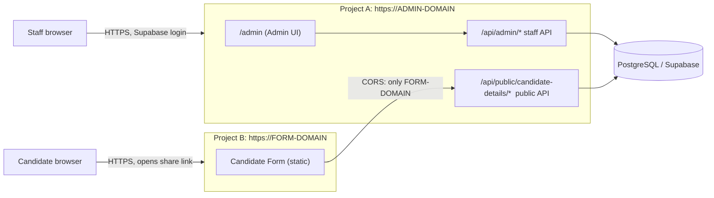
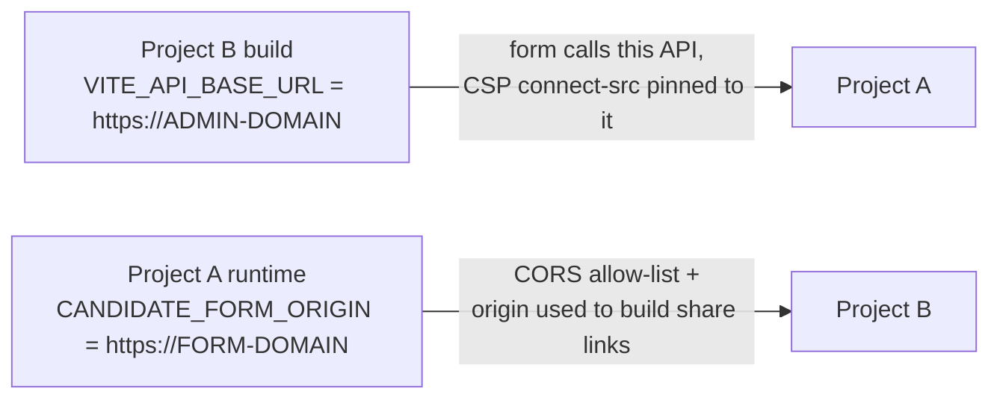

# Candidate Form: Production Deployment and How It Works With the Admin Panel

Audience: the operator deploying the Candidate Form to production and anyone who needs to understand how the Candidate Form, the Admin panel and the backend fit together.

Sources: `candidate-form/vercel.json`, `candidate-form/vite.config.ts`, `candidate-form/README.md`, root `vercel.json`, `src/routes/publicCandidateDetails.js`, `src/routes/admin.js`, `src/config/candidateForm.js`, `Docs/CANDIDATE_FORM_FEATURE_ARCHITECTURE.md`, `Docs/DEPLOYMENT_AND_QA_PROCESS.md`. This file is a deployment and integration guide; the architecture document remains the detailed reference for locking, tokens and the confirm workflow.

---

## 1. The big picture

There are **two Vercel projects** from one repository, one backend and one database.

| | Project A: Admin + Backend | Project B: Candidate Form |
|---|---|---|
| Vercel Root Directory | repository root | `candidate-form` |
| What it serves | The Admin panel (static, under `/admin`) **and** the Express API (`/api/...`) as a serverless function | A static React/Vite single-page app |
| Config file | root `vercel.json` | `candidate-form/vercel.json` |
| Build | `npm --prefix admin run build -- --outDir ../public/admin` | `npm run build` (`tsc --noEmit` then `vite build`) |
| Output | `public/` | `dist/` |
| Users | Staff (ADMIN, MANAGER, ANALYST, REGISTRATION_DESK) | Candidates (no account) |
| Secrets | Yes (database, Supabase service role, Meta, form token secret) | **None**, only two public build-time values |
| Database access | Yes | **None** |

The Admin panel is **not** a separate project: the root build compiles `admin/` into `public/admin`, so the Admin UI and the API share one origin. The Candidate Form is the only separate public site.



Important boundaries:

- The Candidate Form talks **only** to the public API (`/api/public/candidate-details/*`) of Project A. It has no database, Supabase, Google or Meta access.
- The Admin UI talks to the staff API (`/api/admin/*`) with a Supabase session; every request re-checks the user's role in the database.
- The two frontends **never call each other**. They are connected only through the backend and the database.

---

## 2. How the Admin panel and the Candidate Form work together

### 2.1 End-to-end flow

```text
Staff (Admin panel)                         Candidate (Candidate Form)
1. Open a candidate, click "Share Form"
2. Backend creates a link, stores only its hash
3. Admin shows  https://FORM-DOMAIN/#k=<secret>   (once)
4. Staff send it (WhatsApp / copy)  ------->  5. Candidate opens the link
                                              6. Enters Passport Number + NIC
                                              7. Reviews prefilled answers, fills the rest
                                              8. Submits ONCE
9. Admin shows "Candidate submitted"
10. ADMIN / MANAGER confirms or revokes each changed field
11. Confirmed values update the candidate record (and the Google Sheet mirror)
```

### 2.2 Step by step

| Step | What happens | Where |
|---|---|---|
| Create link | `POST /api/admin/candidates/:passportId/form-share` (personal) or `POST /api/admin/jobs/:jobId/form-share` (job group, ADMIN/MANAGER only). The backend generates a 32-byte random secret, stores its **SHA-256 hash**, and returns `https://FORM-DOMAIN/#k=<secret>` **once**. | Project A |
| Link base URL | Built from the backend variable `CANDIDATE_FORM_ORIGIN`. If it is missing or invalid, creating a link returns `503 FORM_NOT_CONFIGURED`. | Project A env |
| Open link | The form reads `#k=<secret>` from the address bar once, keeps it in memory, and removes it from the URL. The fragment is never sent to any server. Without a link the form shows "Open your link". | Project B |
| Verify | `POST /api/public/candidate-details/verify` with `{ linkSecret, passportNumber, nic }`. The backend checks the link (valid, not expired or revoked, not locked), the scope, the Passport Number and NIC, and that the form is not already submitted. Success returns a **60-minute session token**. | Form to Project A |
| Load form | `POST /api/public/candidate-details/form` with `Authorization: Bearer <token>`. Returns the prefill built from the candidate's record. Passport, NIC and WhatsApp number are shown read-only. | Form to Project A |
| Submit | `POST /api/public/candidate-details/submit`, once. A second submit is rejected by a compare-and-set on the database row, so another device, incognito or cleared storage changes nothing. | Form to Project A |
| Review | `GET /api/admin/candidates/:passportId/form-submission` shows the submitted values, the original prefill and the pending differences. `POST .../form-submission/<confirm or revoke action>` (ADMIN, MANAGER) decides **one field at a time**. | Admin to Project A |

### 2.3 Why a submission never changes the record by itself

A submission is a **proposal**. The public API only writes `candidate_form_*` tables. It never writes `candidate` or `candidate_additional_details`. Only an ADMIN or MANAGER, through the per-field **Confirm** in the Admin, can change the candidate record. **Revoke** dismisses a pending proposal. Every decision is final and audited (`CANDIDATE_FORM_FIELD_CONFIRMED`, `CANDIDATE_FORM_FIELD_REJECTED`).

### 2.4 Links and sessions

| Item | Value |
|---|---|
| Link format | `https://FORM-DOMAIN/#k=<43 base64url characters>` |
| Link lifetime | 3 days from creation |
| Personal link (`SINGLE`) | One candidate. A new link revokes the candidate's earlier one. |
| Job-group link (`JOB_GROUP`) | One link for everyone currently assigned to one PROCESSING job. Membership is checked live. |
| Session token | 60 minutes, `Authorization: Bearer` only, never in a URL, cookie or storage. Encrypted (AES-256-GCM) with keys derived from `CANDIDATE_FORM_TOKEN_SECRET`. |
| Submission | Candidate-level, once. Personal and group links share the same lock. |
| Revoke link | Takes effect immediately; open sessions fail on the next request. |

### 2.5 Which role can do what

| Role | Candidate Form actions in Admin |
|---|---|
| ADMIN, MANAGER | Create and revoke personal and job-group links, see submissions, Confirm and Revoke fields |
| ANALYST | Personal links for **allocated** candidates only, see their submissions, no Confirm |
| REGISTRATION_DESK | Personal links, see submissions, no Confirm |
| CANDIDATE | Open a link, verify, submit once. Never a staff user. |

### 2.6 Google Sheet link

Confirmed form answers are stored in `candidate_additional_details`. The Operational Mirror columns `FULL NAME` through `GUARDIAN ADDRESS` (AO to CE) mirror them. Submitted answers are also written to the **Candidate Form Submissions** tab by the Sheet sync worker, only while `SHEET_SYNC_ENABLED` is exactly `true`. The Candidate Form itself never touches Google.

---

## 3. What ties the two projects together (configuration)

Two settings connect the projects. Both must match the other project's real domain.



| Where | Variable | Value | Effect if wrong |
|---|---|---|---|
| Project B (build time) | `VITE_API_BASE_URL` | Project A's **bare origin**, e.g. `https://admin.example.com`. No trailing slash, no `/admin`. | Build fails if invalid; the form cannot reach the API; the browser blocks calls because the CSP `connect-src` is pinned to this value. |
| Project A (runtime) | `CANDIDATE_FORM_ORIGIN` | The form's **bare origin**, e.g. `https://form.example.com`. No path, no trailing slash, no fragment. | Share links cannot be created (`503 FORM_NOT_CONFIGURED`), or links point to the wrong site (for example `localhost`); CORS returns `403` to the form. |
| Project A (runtime) | `CANDIDATE_FORM_TOKEN_SECRET` | 32+ random characters, backend only | Without it candidate sessions cannot be issued. Changing it invalidates all existing sessions and links. |

Because `VITE_API_BASE_URL` is baked into the form at build time, **changing the Admin/API domain requires rebuilding and redeploying Project B**. Changing the form's domain requires updating `CANDIDATE_FORM_ORIGIN` on Project A and redeploying Project A.

---

## 4. Production deployment, in order

Placeholders: `ADMIN-DOMAIN` is the production URL of Project A (already deployed). `FORM-DOMAIN` is the form's production URL.

### Step 0. Checks before you start
- Project A is live and the Admin panel opens.
- The production database already has the Candidate Form tables (`candidate_form_link`, `candidate_form_access`, `candidate_form_response`, and so on). Check that the Prisma migrations are applied with `npx prisma migrate status` against the production database (read the Prisma rules in `Docs/DEPLOYMENT_AND_QA_PROCESS.md` section 7; never run `migrate dev` on a shared database).
- The branch Vercel deploys as Production contains the `candidate-form/` folder. If the folder is not visible when you pick the Root Directory, change the Production Branch or merge the feature first.

### Step 1. Generate the token secret (once)
```bash
node -e "console.log(require('crypto').randomBytes(32).toString('hex'))"
```
Keep the value. Do not paste it in chat or commit it. See section 6 for where it goes.

### Step 2. Create Vercel Project B
1. In Vercel, choose **Add New, Project** and import the same Git repository.
2. Name it for the form, for example `emlynk-candidate-form`.
3. Set **Root Directory** to `candidate-form`. This is mandatory. If it points to the repository root, the build deploys the backend instead.
4. Build settings (they match `candidate-form/vercel.json`):

| Field | Value |
|---|---|
| Framework Preset | Vite |
| Install Command | `npm ci` |
| Build Command | `npm run build` |
| Output Directory | `dist` |
| Development Command | `vite --port $PORT` (only used by `vercel dev`) |

5. Environment variables for **Production**:

| Name | Value |
|---|---|
| `VITE_API_BASE_URL` | `https://ADMIN-DOMAIN` (Project A, no trailing slash, no `/admin`) |
| `VITE_API_ADMIN_MOBILE_NUMBERS` | optional, comma-separated contact numbers for error screens |

   Add **nothing else**. `vite.config.ts` only exposes variables starting with `VITE_API_`, but anything else you add here is still public-facing configuration. Never add `CANDIDATE_FORM_TOKEN_SECRET`, `DATABASE_URL`, Supabase, Meta or Google values to this project.
6. Click **Deploy**. Note the production URL (or attach a custom domain first, so the final domain is known). This is `FORM-DOMAIN`.

### Step 3. Configure Project A to know the form
In Project A, **Settings, Environment Variables**, scope **Production**:

| Name | Value |
|---|---|
| `CANDIDATE_FORM_ORIGIN` | `https://FORM-DOMAIN` (bare origin) |
| `CANDIDATE_FORM_TOKEN_SECRET` | the value from step 1 |

Then **redeploy Project A** (environment variable changes apply only to new deployments).

### Step 4. Test the whole chain
1. Open `https://FORM-DOMAIN` directly. It should show **Open your link** with no input fields. That is the expected behaviour without a link.
2. In the Admin (`https://ADMIN-DOMAIN/admin`), sign in as ADMIN, open a **test candidate**, and choose **Share Form**. The link must start with `https://FORM-DOMAIN/#k=`.
3. Open the link in a private window. Enter the test candidate's Passport Number and NIC. The form should load with prefilled answers.
4. Fill it in and submit. You should see the Thank you screen.
5. Back in the Admin, the candidate shows **Candidate submitted** and the changed fields can be confirmed or revoked.
6. Open the link again. You should see the neutral already-submitted screen.

Use a test candidate, not a real one: a submission is final.

### Step 5. Check the security headers
After deploy, verify in the browser developer tools (Network, Response Headers) that the form returns `Content-Security-Policy`, `X-Frame-Options: DENY`, `Strict-Transport-Security`, `Referrer-Policy: no-referrer` and `X-Robots-Tag: noindex, nofollow`. They come from `candidate-form/vercel.json`.

---

## 5. Troubleshooting

| Symptom | Cause | Fix |
|---|---|---|
| Form root shows "Open your link" | Normal. No `#k=` in the address. | Open the form from an Admin **Share Form** link. |
| Share Form returns `503 FORM_NOT_CONFIGURED` | `CANDIDATE_FORM_ORIGIN` missing, or has a path, trailing slash or fragment | Set the bare origin on Project A, then redeploy A. |
| Share link points to `localhost` | `CANDIDATE_FORM_ORIGIN` is a local value | Set the production origin on Project A, then redeploy A. |
| Verify fails with a network or CORS error in the browser | `CANDIDATE_FORM_ORIGIN` does not exactly match the form's origin (the backend answers `403` to any other `Origin`), or `VITE_API_BASE_URL` points to the wrong API | Make the two settings match the real domains. Rebuild B after changing `VITE_API_BASE_URL`. |
| Build of Project B fails on `VITE_API_BASE_URL` | Invalid value (path, trailing slash, not a URL) | Use a bare `https://` origin. |
| Build deploys the backend or fails on the wrong files | Root Directory not set to `candidate-form` | Fix the Root Directory and redeploy. |
| `candidate-form` folder not visible when choosing Root Directory | The deployed branch lacks the folder | Use the right Production Branch, or merge the feature. |
| Env change had no effect | Variable scoped to the wrong environment, or no redeploy | Enable the right scope (Production or Preview) and redeploy. |
| "Too many attempts" for a candidate | Per-link attempt lockout | Wait for the lock to expire, or create a new link. |
| Candidate sessions all stop after a deploy | `CANDIDATE_FORM_TOKEN_SECRET` changed | Keep the value stable. Rotating it invalidates all sessions and links. |

---

## 6. Secrets and what goes where

| Value | Project A (Admin + API) | Project B (Form) |
|---|---|---|
| `CANDIDATE_FORM_TOKEN_SECRET` | **Yes** (secret) | **Never** |
| `CANDIDATE_FORM_ORIGIN` | **Yes** | No |
| `DATABASE_URL`, `SUPABASE_SERVICE_ROLE_KEY`, `META_APP_SECRET`, `WHATSAPP_*`, Google credentials | **Yes** (secrets) | **Never** |
| `VITE_SUPABASE_URL`, `VITE_SUPABASE_ANON_KEY` | Yes (Admin build, browser-safe) | No |
| `VITE_API_BASE_URL` | No | **Yes** (public) |
| `VITE_API_ADMIN_MOBILE_NUMBERS` | No | Optional (public) |

Notes:
- `CANDIDATE_FORM_TOKEN_SECRET` is generated by you; nothing issues it. Use a different value in Preview and Production.
- Rotate it only on purpose: every issued link and session stops working.
- `.env.prod` and other `.env*` files are gitignored; do not commit them or paste their contents anywhere.
- The test `test/publicCandidateDetails.test.js` scans the form's source and build output for backend secret names, so a leaked secret name in the bundle fails the tests.

---

## 7. Operations checklist

Before go-live:
- [ ] Project B Root Directory is `candidate-form`.
- [ ] `VITE_API_BASE_URL` is Project A's production origin.
- [ ] `CANDIDATE_FORM_ORIGIN` and `CANDIDATE_FORM_TOKEN_SECRET` are set on Project A for Production, and Project A was redeployed.
- [ ] Production migrations are applied.
- [ ] Share link, verify, submit and Confirm tested with a test candidate.
- [ ] Security headers present on the form.
- [ ] Custom domain (if any) attached before the domain is used in `CANDIDATE_FORM_ORIGIN`.

When a domain changes:
- API (Project A) domain changes: update `VITE_API_BASE_URL`, rebuild and redeploy Project B. Also check `APP_BASE_URL` on Project A.
- Form (Project B) domain changes: update `CANDIDATE_FORM_ORIGIN` on Project A and redeploy Project A. Links already shared point to the old domain and need to be re-created.

---

## 8. Open items to confirm

- Which exact domains are the production values of `ADMIN-DOMAIN` and `FORM-DOMAIN`.
- Whether the Production Branch in Vercel for Project B is the branch that contains `candidate-form/`.
- Whether the production database has all Candidate Form migrations applied (run `npx prisma migrate status` against it; this was not checked here).
- The exact request limits per IP and per link are described in the architecture document, section 19, and were not restated here.

---

## 9. Conclusion

- **Two projects, one backend.** Project A (repository root) serves the Admin panel and the API from one origin and holds every secret. Project B (`candidate-form/`) is a static public site with no secrets and no database access.
- **The Admin and the form never talk to each other.** They are connected only through the backend and the database: staff create a share link in the Admin, the candidate uses it in the form, and the form's public API stores the answers separately from the candidate record.
- **Two settings connect the projects.** `VITE_API_BASE_URL` on the form (the API's origin) and `CANDIDATE_FORM_ORIGIN` on the backend (the form's origin). If either is wrong, links, CORS or API calls fail.
- **The candidate never changes the record directly.** A submission is a proposal. An ADMIN or MANAGER confirms or revokes each field, and every decision is final and audited.
- **Security rests on layers.** The link secret travels in the URL fragment and only its hash is stored. The candidate must also match Passport and NIC. Sessions last 60 minutes, a form can be submitted once, and the secrets stay on the backend.
- **Deploy in this order:** generate `CANDIDATE_FORM_TOKEN_SECRET`; create Project B with Root Directory `candidate-form` and `VITE_API_BASE_URL`; set `CANDIDATE_FORM_ORIGIN` and `CANDIDATE_FORM_TOKEN_SECRET` on Project A and redeploy it; then test with a test candidate before sharing any real link.
