# Candidate Form Feature Architecture

Status: describes the implementation on branch `version/candidate-extra-details-form` as of 2026-10-17. Anything not yet built is marked **Pending** (see section 26). Exact values (lifetimes, limits, column names, routes, roles) were taken from the code and tests, not from memory.

---

---

## 1. Purpose

Staff keep a candidate's record in the Admin. Some details (family, guardian, measurements, contact, passport dates) are better collected from the candidate. The **Candidate Form** is a public web form where an *existing* candidate, using a link that staff shared, proves who they are with Passport Number + NIC, reviews the details already on record, fills in the rest and submits **once**.

Design goals, in priority order:

1. A link alone never opens anyone's data: the candidate must also match Passport + NIC.
2. The candidate can never change the Admin record directly. Their answers are stored separately and staff apply them field by field.
3. A form can be submitted exactly once, enforced by the server, not by the browser.
4. One link can serve a whole job's candidates, without exposing who else is on the job.

---
## 2. Scope

| In scope | Out of scope |
|---|---|
| Personal (single-candidate) and job-group share links | Candidate registration (the candidate must already exist) |
| Passport + NIC verification, short-lived candidate session | WhatsApp document flow, OCR |
| Prefill, review, single submission, locking | Google Sheet sync of form answers (**Pending**) |
| Separate storage of submitted answers and the original prefill | Editing a submitted form by the candidate |
| Admin inline review of changed values and per-field Confirm | Bulk or automatic merge of submissions |
| Job Management as it affects group sharing (`job`, `job_candidate`) | Job management screens in general (see `JOB_MANAGEMENT_IMPLEMENTATION.md`) |

---
## 3. High-Level Architecture

Two Vercel projects in one repository share one backend and one PostgreSQL database. The candidate's browser only ever talks to the public API.

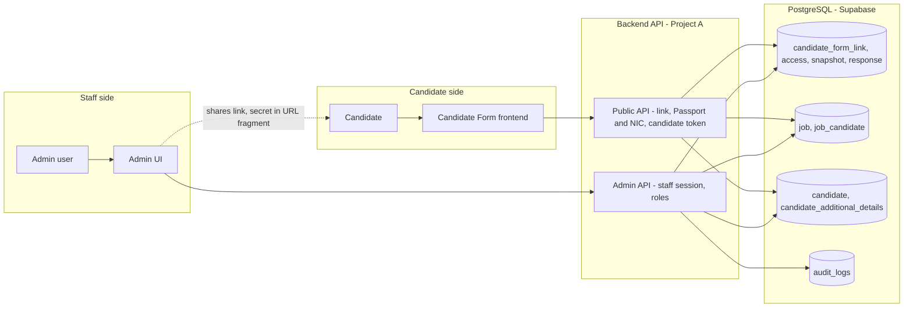

Notes on the boundaries:

* The Candidate Form frontend has **no** database, Supabase or storage access and no secrets. It calls three public routes only (section 21).
* The public API **reads** `candidate` and `candidate_additional_details` (to build the prefill) and `job_candidate` / `job` (to check group membership). It **writes** only `candidate_form_*` tables and the rate-limit table. It never writes `candidate` or `candidate_additional_details`.
* Only the Admin API (staff session, role checked on every request) can change the candidate record, and only through the per-field Confirm (section 18).

---
## 4. User Roles and Permissions

The role is read from the database on every request. Details are in section 21 (role matrix). Summary:

| Actor | What they can do with the Candidate Form |
|---|---|
| ADMIN, MANAGER | Create / revoke personal and job-group links, see submitted changes, Confirm a change, assign candidates to jobs |
| ANALYST | Create / revoke a personal link for **allocated** candidates only, see submitted changes for them; cannot Confirm; read-only on jobs |
| REGISTRATION_DESK | Create / revoke a personal link, see submitted changes; cannot Confirm; no access to Jobs |
| CANDIDATE | Open a link, verify with Passport + NIC, fill and submit their own form once. Never a staff user |

---
## 5. Candidate Form Lifecycle

```text
Staff                                   Candidate
 1. (optional) create job, assign        .
 2. Share Form: personal or group link   .
 3. send link (WhatsApp / copy)  ----->  4. open link, verify Passport + NIC
                                         5. review prefilled data, fill the rest
                                         6. Review & Submit (once)
 7. Admin shows "Candidate submitted"    .
 8. Admin/Manager confirms or revokes field by field
```

The candidate-facing journey has four stages: **Verify**, **Personal Details** (Basic + Contact), **Work & Family Details** (Passport & Qualifications, Measurements, Family, Guardian) and **Review & Submit**. English / Sinhala and Light / Dark are available; only the theme is stored in the browser.

---
## 6. Share Link Architecture

A share link is `https://<candidate-form-origin>/#k=<secret>`.

* `<secret>` is 32 random bytes from the operating system's CSPRNG (`crypto.randomBytes(32)`), encoded base64url (43 characters). It carries no meaning.
* It travels in the URL **fragment**, which browsers never send to a server, so it stays out of server logs and the `Referer`.
* The backend stores only a **SHA-256 hash** (`candidate_form_link.token_hash`, unique). The raw secret exists in the Admin's create response and in the Admin dialog, once. It cannot be read back; a lost link is replaced by creating a new one.
* The link is **not authentication**. It selects a scope; the candidate must still match Passport + NIC (section 9).

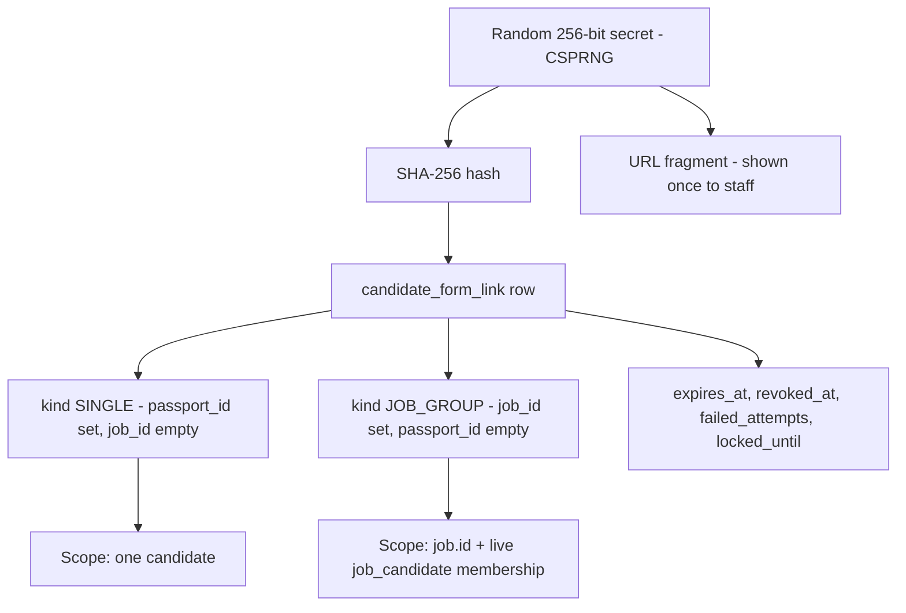

| | Raw secret | `token_hash` | Scope | Expiry | Revoked |
|---|---|---|---|---|---|
| Where it lives | Admin response and the shared URL only | `candidate_form_link` | `passport_id` or `job_id` | `expires_at` | `revoked_at`, `revoked_by` |
| Stored in the database | **No** | Yes | Yes | Yes | Yes |
| Logged | Never | Never | n/a | n/a | n/a |

A database CHECK requires exactly one valid target per kind (`SINGLE`: `passport_id` and no `job_id`; `JOB_GROUP`: `job_id` and no `passport_id`).

---
## 7. Single-Candidate Share Flow

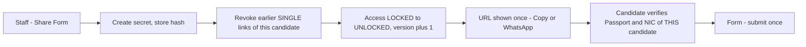

* Who: ADMIN, MANAGER, REGISTRATION_DESK for any candidate; ANALYST only for candidates allocated to them (others return 404, as if absent).
* One transaction: the candidate's `candidate_form_access` row is locked, earlier unrevoked SINGLE links of that candidate are revoked, the new link is stored, the access state becomes `UNLOCKED` (version + 1), and `CREATE_FORM_LINK` is audited. A candidate who has already submitted gets `409 FORM_SUBMITTED` and no link.
* Revoking sets `revoked_at`, and if the form was `UNLOCKED` it returns to `LOCKED` (version + 1). A `SUBMITTED` form stays `SUBMITTED`.
* Regenerating therefore invalidates the old link at once (old link: generic failure; old sessions: next request fails).

---
## 8. Job-Group Share Flow

One link serves everyone currently assigned to one job. It is created from the Share Form of any candidate who is on a PROCESSING job ("Share link for the job group"), by ADMIN or MANAGER only.

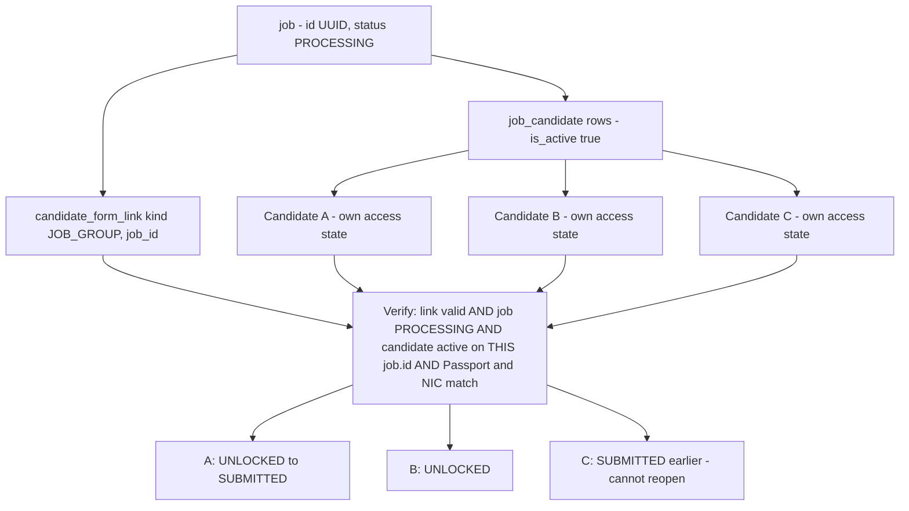

Rules, as implemented:

* The link is bound to the immutable `job.id` (UUID). It is **never** bound to `job_code` or `company_job_id`; changing the Company Job ID does not affect it.
* Creating it requires the job to be `PROCESSING` (`409 JOB_NOT_PROCESSING` otherwise). One active group link per job: creating a new one revokes the previous one (a partial unique index also enforces it).
* Creating it unlocks the members whose form is `LOCKED`. Members already `UNLOCKED` keep their sessions; `SUBMITTED` members are never touched.
* **Membership is checked live**, at verification and on every protected request, against `job_candidate` (`is_active`). It is not copied into the link: a candidate added later can use the link while it is active; one removed from the job cannot.
* Each candidate has their own lock. One candidate's submission changes only their own state.
* When the job becomes `COMPLETED` or `CANCELLED`: no new verification through its group links; open sessions are rejected on their next protected request; already-submitted candidates stay submitted; links are not deleted, they simply become unusable. Personal links are unaffected.
* Revoking a group link ends sessions bound to it and re-locks members it had unlocked who have not submitted. Submitted answers and job assignments are untouched.
* Verification failures never reveal job membership (section 22).

---
## 9. Candidate Verification

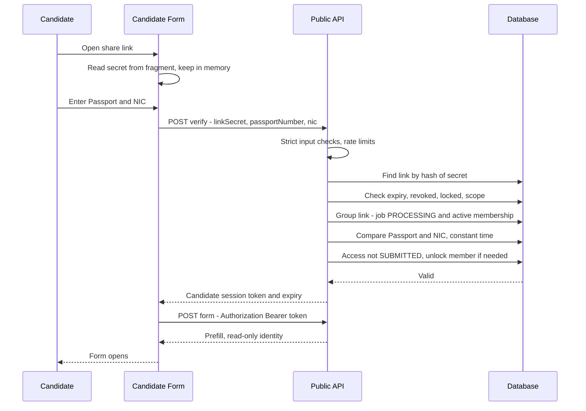

Required checks, all of which must pass:

1. the secret has the right shape and its hash matches a stored link;
2. the link is not expired, not revoked and not temporarily locked;
3. scope: `SINGLE` - the link's own candidate; `JOB_GROUP` - the job is PROCESSING and the typed candidate has an active `job_candidate` row for that exact `job.id`;
4. Passport Number matches (case-insensitive, spaces and hyphens ignored);
5. NIC matches exactly as recorded (old and new NIC formats are *not* treated as the same);
6. the candidate's form is not already `SUBMITTED` (the neutral "already submitted" answer is given only after 1-5 matched).

Input is validated **before** any database lookup (Passport: letters and digits, 1-20; NIC: 9 digits + V/X, or 12 digits; secret: 43 base64url characters), so `%`, `_` and SQL-like text can never reach a query. Every failing path does the same lookup and comparisons (against placeholders when the link is unknown) so responses look and take about the same.

---
## 10. Candidate Session Token

| Property | Value |
|---|---|
| Format | `cf1~<iv>~<ciphertext>` - deliberately not JWT-shaped, so the staff verifier rejects it by shape |
| Crypto | AES-256-GCM (encrypted and authenticated); keys derived with HKDF from `CANDIDATE_FORM_TOKEN_SECRET` (backend only, at least 32 characters) |
| Payload (version 3) | candidate passport id, link id, link kind, job id (group links), access version, issued-at, expiry |
| Lifetime | **60 minutes** |
| Transport | `Authorization: Bearer` header only; kept in browser memory only, never in a URL, cookie or storage |
| Server state | none; the link and the lock are re-read from the database on **every** request |

On every call to `POST /form` and `POST /submit` the middleware reloads the link and checks: kind matches the token; `SINGLE` - the link's passport equals the token's; `JOB_GROUP` - the link's `job_id` equals the token's, the link is not revoked or expired, the job is still PROCESSING and the candidate is still an active member; then the lock is `UNLOCKED` at the token's version (or `SUBMITTED`, answered with a neutral 409). The candidate and job are never taken from the request body, path or query. `/submit` repeats the job/membership check inside its transaction.

The staff API rejects these tokens by shape, and the public API accepts nothing else, so the two credential types cannot be confused.

---
## 11. Locking and Submission State Machine

State is stored server-side in `candidate_form_access` (one row per candidate; no row means `LOCKED`).

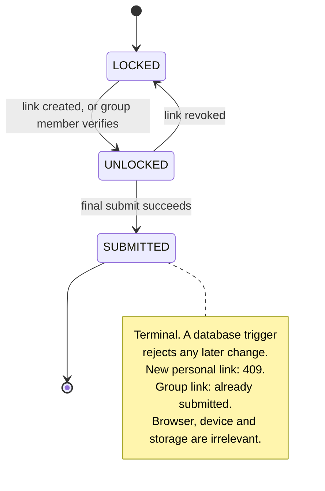

* Every transition changes `version`, which invalidates sessions issued before it.
* Submission is **candidate-level, not link-level**: submitting through a personal link blocks the group link and vice versa. Incognito, another phone or cleared storage change nothing, because the decision is made from the database.
* The submit is a compare-and-set: `UPDATE ... WHERE status = 'UNLOCKED' AND version = <session version>` must affect exactly one row. A second submit, a replaced link or a revoke makes it match zero rows.

---
## 12. Link Expiry, Revocation and Regeneration

| Event | Effect |
|---|---|
| Lifetime | **3 days** from creation (`expires_at`) |
| Expired link | Generic verification failure; cannot start a session. An open session ends on its next request (the link is re-checked each time). An expired link never reactivates by itself |
| Revoke (personal) | Link fails at once; sessions fail on the next request; form returns to `LOCKED` if it was `UNLOCKED`; `SUBMITTED` stays |
| Regenerate (personal) | Previous unrevoked SINGLE links of that candidate are revoked in the same transaction; new 3-day expiry |
| Revoke (group) | Link and its sessions stop; unsubmitted members it had unlocked are locked again |
| Regenerate (group) | Previous group link of the job revoked; one active group link per job; submitted candidates stay submitted |
| Job COMPLETED / CANCELLED | Group link unusable for new and open sessions (not deleted) |
| Attempt lockout | See "Rate limits and lockout" in section 19 |
| Candidate session | 60 minutes; the page also checks every 10 seconds that its in-memory token is still present |

---
## 13. Job Integration

Group sharing depends on Job Management but never on the *labels* of a job.

| Column | Meaning | Mutable | Used for authorization or as a key |
|---|---|---|---|
| `job.id` | UUID primary key, generated by the database (`gen_random_uuid()`) | **Never** | **Yes** - every relation |
| `job.job_code` | `JOB-YYYY-NNNNNN`, system generated, unique | No | No - display only |
| `job.company_job_id` | Employer's own ID, e.g. `Y26S01`; nullable; unique per company | Yes (ADMIN, MANAGER) | No - a label |

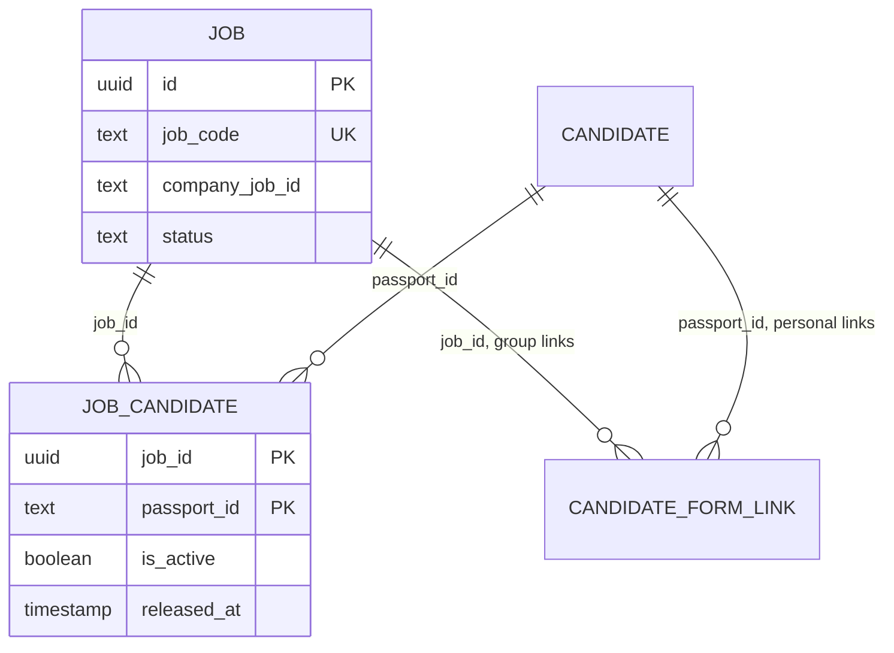

* A candidate can be **active on one PROCESSING job at a time** (partial unique index). Completing or cancelling a job clears `is_active` by trigger and keeps the rows as history.
* Assigning a candidate is done in Admin (Jobs page "Add to job", or "Assign to Job" on Candidate Details); the one-job rule is checked in the service under row locks and by the database.
* The legacy free-text `candidate_stages.job_id` is **not** used for sharing or assignment.

---
## 14. Form Auto-Population

Prefill is built on the server, from the existing records, and returned by `POST /form`. The browser never receives raw tables.

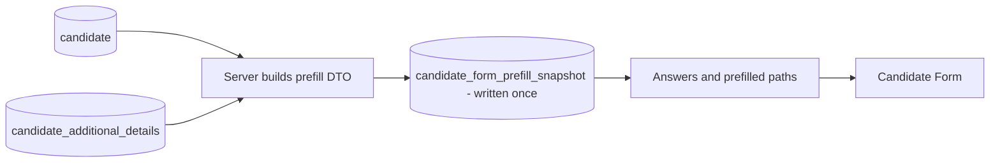

* The first `POST /form` after verification builds the prefill from the records and stores it once in `candidate_form_prefill_snapshot` (values immutable). Every later visit returns that same snapshot; staff edits made afterwards do not change it. If a candidate submits without ever loading the form, the snapshot is created at submit.
* **`candidate_form_response` is never used for prefill**, and the public submission never updates `candidate` or `candidate_additional_details`.
* Mapping highlights (core field names are as the project uses them): `surname` from core `other_name`, `other names` from core `first_name`, `full name` from additional `name_as_in_passport`, `sex` M/F/X to MALE/FEMALE/OTHER, `civil status` from `marital_status`, `birth date` from additional `birthday` else core `date_of_birth`, `address` from additional `permanent_address` else core `address`, `alternative contact` from `contact_number`, passport dates, `job category` only if the record's job exactly matches a category, `experience`, `other skills 1` from `other_job_skills`, sizes, parents' names and birthdays, spouse from the "wife" fields, children. Guardian fields are not prefilled (no source).
* Paths prefilled are flagged so the form shows "From your record". Passport, NIC and WhatsApp are shown read-only and are never part of the answers; there is no staff-only data in the response.

---
## 15. Separate Candidate Form Data Storage

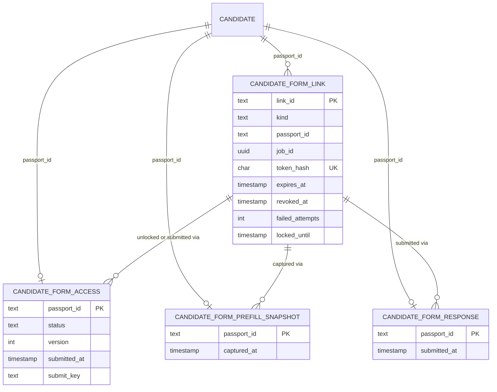

| Table | Purpose | Key relations | Lifecycle and constraints |
|---|---|---|---|
| `candidate_form_link` | A share link: hash, scope, expiry, revocation, attempt counters | `passport_id` -> `candidate` (SINGLE), `job_id` -> `job` (JOB_GROUP), `created_by` / `revoked_by` -> `user` | CHECK on kind and exactly-one-target; `token_hash` unique, 64 hex; partial unique index: one active group link per job |
| `candidate_form_access` | The lock: `LOCKED` / `UNLOCKED` / `SUBMITTED`, `version`, `submit_key` (idempotency key of the winning submit) | `passport_id` -> `candidate`, links for audit trail | CHECK status and `submitted_at` consistent; **trigger**: a `SUBMITTED` row cannot change |
| `candidate_form_prefill_snapshot` | What the form was prefilled with (the "original") | `passport_id` -> `candidate` | Written once; **trigger** rejects value changes |
| `candidate_form_response` | The candidate's submitted answers (46 answers + the verified NIC), every field nullable, typed | `passport_id` -> `candidate` | Written once in the submit transaction; **trigger** rejects value changes; CHECKs on code columns |

---
## 16. Original vs Submitted Data

Three different things, never merged implicitly:

| | Table | Meaning |
|---|---|---|
| Admin record (canonical) | `candidate`, `candidate_additional_details` | What staff maintain and the rest of the system uses |
| Original / prefill | `candidate_form_prefill_snapshot` | What the form showed the candidate first |
| Candidate submitted | `candidate_form_response` | The candidate's *proposed* values |

A submission is a proposal. A value becomes canonical only when an authorised staff member confirms that one field (section 18). Case-only differences (the form capitalises English text) are not treated as changes.

---
## 17. Admin Inline Change Review

The existing Admin fields stay the primary UI. When the candidate submitted a *different* value for a field that has a place in the record, a compact line appears directly below that field:

```text
Date of birth   [ 2003-06-05 ]
Candidate submitted: 06 May 2003   [Confirm] [Revoke]
```

* Shown on Candidate Details (core fields) and Additional Details (sizes, name according to passport, parents' birthdays); nothing is shown when values are equal or nothing was submitted.
* There is **no** duplicate "Candidate Form submission" panel and no second copy of the form. Submitted fields with no Admin counterpart (Guardian, email, city, district, DS / GN division, English knowledge, other skills, civil status, spouse, children, parents' names and passport numbers, other job category, job category) are stored but not displayed in Admin yet (**Pending**, section 26).
* A small line "Candidate Form submitted: <date/time>" appears on the Additional Details tab once the form is submitted.
* ADMIN and MANAGER see **Confirm** and **Revoke**; ANALYST and REGISTRATION_DESK see the hint without buttons.
* After a Revoke, the buttons give way to a small read-only note, "Candidate change rejected". A decided field never returns to pending.
* Source: `GET /api/admin/candidates/:passportId/form-submission` returns the form status, submitted time, the submitted values, the original prefill, the changed paths, a `pending` list of confirmable differences (fields with no decision yet) and `reviews` (decisions already taken).

---
## 18. Per-Field Confirm and Revoke Workflow

Every pending change gets one decision, per field. **Confirm** accepts the candidate's value and updates one canonical field. **Revoke** rejects the proposal and leaves the canonical value as it is. Revoke is not an undo of a Confirm: it dismisses a *pending* proposal. There is no bulk action.

### Review state

Both actions use one model, the table `candidate_form_field_review` (one row per candidate and field). **PENDING is the absence of a row**; a decision is `CONFIRMED` or `REJECTED`. The primary key makes a field impossible to both confirm and reject, and a trigger makes a decision final (no undo). `candidate_form_response` is never modified: what the candidate submitted stays separate from how staff reviewed it.

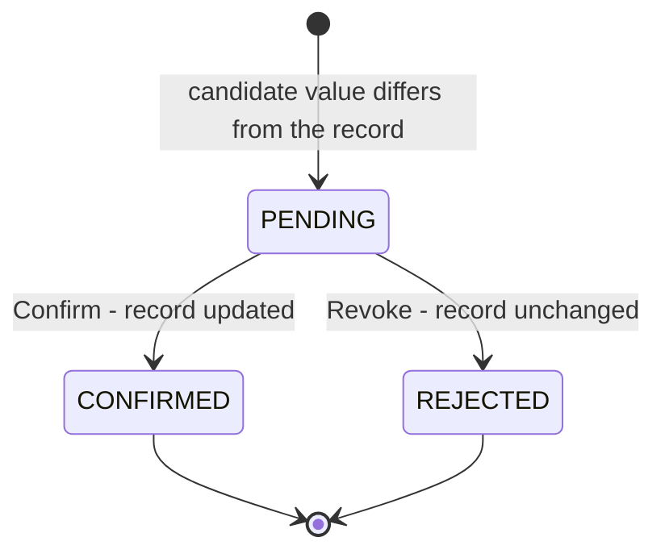

### Confirm

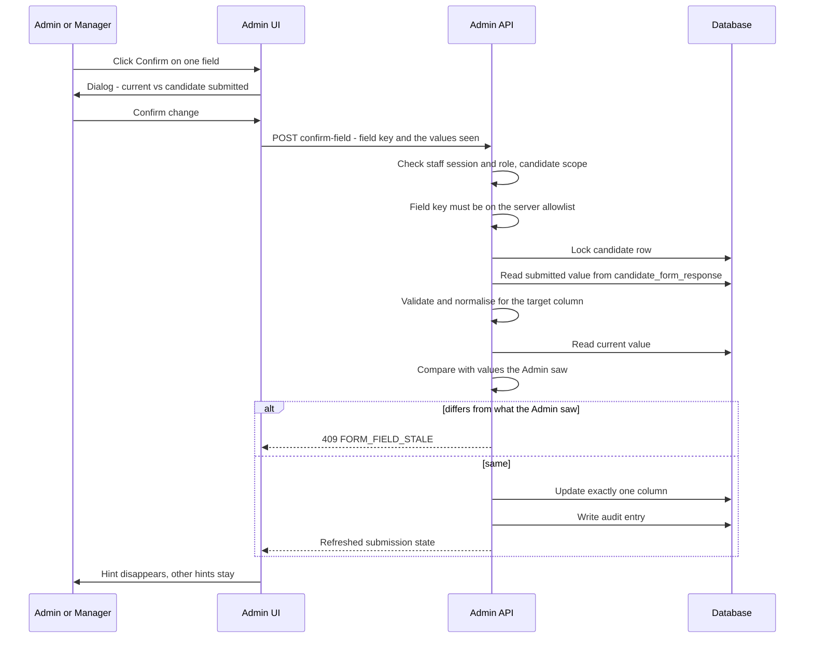

* **Allowlist (16 fields).** Core: surname (`other_name`), other names (`first_name`), sex, date of birth, place of birth, address, alternative contact (`contact_number`), passport issue and expiry dates, job experience. Additional details: full name (`name_as_in_passport`), shirt / waist (`pant_size`) / shoe size, father's and mother's birthday. The browser sends only a stable field key plus the two values it saw (used to detect a stale screen); it never sends a table, a column or the new value.
* Not confirmable (no canonical target, or ambiguous): everything else, including all Guardian fields. They remain read-only candidate-submitted information.
* The submitted value is read from `candidate_form_response` on the server and validated again. Extra body keys are rejected (`400`), unknown or odd field keys (`__proto__`, SQL text, other tables) return `400 FIELD_NOT_CONFIRMABLE`.
* After a Confirm, `candidate_form_response` is unchanged; the hint disappears because the record now equals the submitted value, and a `CONFIRMED` review row is written.

### Revoke (reject)

`POST /api/admin/candidates/:passportId/form-submission/reject-field` takes the same body as confirm-field and goes through the same checks (staff session, role, candidate scope, allowlisted field key, locked candidate row, submitted value re-read from `candidate_form_response`, stale check). It then writes a `REJECTED` review row and an audit entry, and changes nothing in the candidate record. If the field was already decided it returns `409 FORM_FIELD_REVIEW_STALE`; if the record changed since the screen loaded, `409 FORM_FIELD_STALE`. The browser still sends only a field key and the two values it saw; it can never send a table, a column or a replacement value.
* In the Admin forms, a refresh after Confirm is merged field by field: the confirmed field takes its new value, anything else the Admin is typing is kept.
* Audit: `CANDIDATE_FORM_FIELD_CONFIRMED` with actor, candidate, the record's column name, old value and new value; `CANDIDATE_FORM_FIELD_REJECTED` with actor, candidate, field, the current value and the rejected submitted value.

---
## 19. Security Controls

| Control | Where |
|---|---|
| Random opaque tokens (256-bit CSPRNG), no meaning | `candidateFormShareService.js` |
| Hash at rest (SHA-256); raw secret shown once, never stored or logged | `token_hash`; Admin dialog |
| Secret in URL fragment; kept in memory; removed from the address bar | Candidate Form frontend |
| Generic verification failure (identical body and status) | verification service, tested for indistinguishability |
| Passport/NIC checked in constant time; strict input patterns before any lookup | verification service |
| Rate limits and per-link lockout | "Rate limits and lockout" below |
| Session token isolated from Admin auth (different format and key); re-validated every request | token service, middleware |
| Exact CORS: only `CANDIDATE_FORM_ORIGIN`, methods `POST, OPTIONS`; other origins get 403; CORS is not authorization | public router |
| CSP and security headers on the form site (`frame-ancestors 'none'`, `nosniff`, `no-referrer`, HSTS, `noindex`, `no-store`); build pins `connect-src` to the one API origin | `candidate-form/vercel.json`, build |
| Candidate frontend has no DB access and no secrets; only `VITE_API_*` reaches the bundle | `vite.config.ts` |
| Public DTO allowlists: `/form` returns only identity, answers and prefilled paths; unknown fields in `/submit` are refused | data service |
| Request body limits: 16 KB (verify, form), 64 KB (submit) | public router |
| No arbitrary field, table or column writes: Confirm uses a server allowlist | confirm service |
| Submitted state enforced server-side (compare-and-set + trigger) | access table |
| RLS enabled, `anon` / `authenticated` privileges revoked, no policies | all `candidate_form_*`, `job*` tables |
| No raw Passport, NIC or secret in logs; failures log only a keyed reference | public router |

### Rate limits and lockout

All values are from the code (`publicCandidateDetails.js`, `candidateFormShareService.js`, `candidateFormJobGroupService.js`).

| Control | Applies to | Limit | Window / duration |
|---|---|---|---|
| Per client IP | failed `/verify` requests | 10 | 15 minutes |
| Per Passport number (HMAC of the passport, not the raw value) | failed `/verify` requests, any IP | 5 | 1 hour |
| Per link - personal | wrong Passport + NIC (or not a member) on that link | 10 failures | link locked for 1 hour |
| Per link - group | same | 100 failures | link locked for 1 hour |

Only failures count against the IP and Passport limits (a successful verification is taken off again). Exceeding a limit answers `429` with a fixed message. The group-link limit is higher on purpose: many people share one link, and the personal limit would let a few typos lock out the whole job; the IP and Passport limits remain the main brute-force control. The counters are stored in PostgreSQL, so they hold across serverless instances.

---
## 20. Database Tables

Prisma model -> table. Column-level detail for the form tables is in section 15 and for the Job tables in section 13; the full reference is `DATABASE_IMPLEMENTATION.md`.

| Table | Role in this feature | Written by |
|---|---|---|
| `candidate_form_link` | Share links: hash, kind, scope, expiry, revocation, attempt counters | Admin API (create, revoke); public API (failed-attempt counters, last verified) |
| `candidate_form_access` | The per-candidate lock and its version | Admin API (unlock, re-lock); public API (lazy unlock of a group member, final submit) |
| `candidate_form_prefill_snapshot` | The original prefill, written once | Public API (first form load, or submit) |
| `candidate_form_response` | The candidate's submitted answers, written once | Public API (submit) |
| `job` | Immutable `id`, `job_code`, `company_job_id`, status, company, type, agent | Admin API |
| `job_candidate` | Candidate-to-job membership and history (`is_active`, `released_at`) | Admin API |
| `candidate`, `candidate_additional_details` | The canonical record; prefill source; target of Confirm | Admin API only (never the public API) |
| `candidate_form_field_review` | Per-field staff decision on a submitted value (`CONFIRMED` / `REJECTED`; no row = pending). Final, one per field | Admin API (confirm-field, reject-field) |
| `audit_logs` | Append-only staff action history | Admin API |
| `rate_limits` | Failed-verification counters shared across serverless instances | Public API |

Their protection:

### Database protection

* **RLS** is enabled on `candidate_form_link`, `_access`, `_prefill_snapshot`, `_response`, `job`, `job_candidate`, `job_type`, `company`, `agent`, `job_code_counter`, with all privileges revoked from `anon` and `authenticated` and no policies. The backend connects with its owner / service connection, which bypasses RLS.
* **Triggers**: `SUBMITTED` access rows cannot change; response and snapshot values cannot be updated; a job leaving PROCESSING clears `is_active` and a finished job cannot be reopened; a membership cannot be active on a non-PROCESSING job; a field-review decision cannot be changed.
* **Constraints / indexes**: `token_hash` unique; one active group link per job; one active job per candidate (`job_candidate_one_active_per_candidate`); `job_code` unique and formatted; `company_job_id` unique per company; link kind / target CHECK; foreign keys to the immutable UUID `job.id`.
* **Known gap (separate):** `candidate_allocation` (Work Allocation, not a Candidate Form table) has RLS off in the migrated schema - tracked as ISS-012. Live Supabase privileges were not verified from the repository (ISS-013). The triggers guard `UPDATE`; a direct `DELETE` of a `candidate_form_access` row by a database owner is not blocked, and no application code does it.

---
## 21. API Endpoints

Public API (no staff session; candidate token where noted), mounted at `/api/public/candidate-details`:

| Area | Method | Endpoint | Auth | Purpose |
|---|---|---|---|---|
| Verify | POST | `/api/public/candidate-details/verify` | link secret + Passport + NIC | Start a candidate session |
| Form | POST | `/api/public/candidate-details/form` | candidate token | Identity (read-only) and prefill |
| Submit | POST | `/api/public/candidate-details/submit` | candidate token | Submit the answers once (idempotency key required) |

Admin API (`/api/admin`, staff session; roles in the matrix below):

| Area | Method | Endpoint | Auth (roles) | Purpose |
|---|---|---|---|---|
| Personal link | GET | `/candidates/:passportId/form-share` | ADMIN, MANAGER, ANALYST*, REGISTRATION_DESK | Link state |
| Personal link | POST | `/candidates/:passportId/form-share` | same | Create link (URL returned once) |
| Personal link | POST | `/candidates/:passportId/form-share/revoke` | same | Revoke |
| Group link | GET | `/jobs/:jobId/form-share` | ADMIN, MANAGER | State and counts |
| Group link | POST | `/jobs/:jobId/form-share` | ADMIN, MANAGER | Create (URL returned once) |
| Group link | POST | `/jobs/:jobId/form-share/revoke` | ADMIN, MANAGER | Revoke |
| Review | GET | `/candidates/:passportId/form-submission` | ADMIN, MANAGER, ANALYST*, REGISTRATION_DESK | Status, submitted values, original, changes, pending |
| Confirm | POST | `/candidates/:passportId/form-submission/confirm-field` | ADMIN, MANAGER | Confirm one field |
| Revoke | POST | `/candidates/:passportId/form-submission/reject-field` | ADMIN, MANAGER | Reject one pending field; record unchanged |
| Jobs | POST | `/jobs/:jobId/candidates` | ADMIN, MANAGER | Assign a candidate (one PROCESSING job rule) |
| Jobs | DELETE | `/jobs/:jobId/candidates/:passportId` | ADMIN, MANAGER | Remove from a PROCESSING job |
| Jobs | PUT | `/jobs/:jobId` | ADMIN, MANAGER | Includes editing `companyJobId` |
| Jobs | POST | `/jobs/:jobId/complete`, `/jobs/:jobId/cancel` | ADMIN, MANAGER | Close a job (disables its group link) |

\* ANALYST only for candidates allocated to them.

### Role matrix

| Capability | ADMIN | MANAGER | ANALYST | REGISTRATION_DESK | CANDIDATE |
|---|---|---|---|---|---|
| Create personal link | Yes | Yes | Allocated candidates only | Yes | - |
| Create group link | Yes | Yes | No | No | - |
| Revoke personal link | Yes | Yes | Allocated candidates only | Yes | - |
| Revoke group link | Yes | Yes | No | No | - |
| View submitted changes (hints) | Yes | Yes | Allocated candidates only | Yes | - |
| Confirm a submitted change | Yes | Yes | No | No | - |
| Revoke (reject) a submitted change | Yes | Yes | No | No | - |
| Assign candidate to a job | Yes | Yes | No (read-only on jobs) | No (no Jobs access) | - |
| Fill and submit the Candidate Form | - | - | - | - | Yes, once, via link + Passport + NIC |

---
## 22. Error and Failure Behavior

| Situation | Response | Notes |
|---|---|---|
| Unknown / expired / revoked / locked link, wrong Passport, wrong NIC, mixed identities, candidate not on the job, job completed or cancelled | `401 VERIFICATION_FAILED`, identical body | Never says which part failed or whether a job exists |
| Malformed Passport, NIC or secret | `400`, fixed message, no echo of the input | Rejected before any lookup |
| Already submitted (after link + Passport + NIC + membership matched) | `409 ALREADY_SUBMITTED`, neutral text | Also for any later `/form` or `/submit` call |
| Session expired, link revoked, job closed or member removed mid-session | `401 VERIFICATION_REQUIRED` | Candidate is returned to verification |
| Too many failed attempts (IP or Passport) | `429`, fixed message | "Rate limits and lockout" (section 19) |
| Link locked after repeated failures | Generic `401` | Lock lasts 1 hour |
| Concurrent submit (double click, two tabs or devices) | One `200`, the others `409 ALREADY_SUBMITTED`; a retry with the same idempotency key gets the original success | One stored response |
| Backend not configured (no token secret) | `503`, fixed message | Fails closed |
| Admin: create personal link for a submitted candidate | `409 FORM_SUBMITTED` | |
| Admin: group link for a non-PROCESSING job | `409 JOB_NOT_PROCESSING` | |
| Admin Confirm or Revoke: record changed since the screen loaded | `409 FORM_FIELD_STALE` | Nothing overwritten or recorded |
| Admin Confirm or Revoke: field already decided by someone else | `409 FORM_FIELD_REVIEW_STALE` | Decisions are final |
| Admin Confirm: nothing left to confirm / field not allowed | `409 FORM_FIELD_NOT_PENDING` / `400 FIELD_NOT_CONFIRMABLE` | |

The Candidate Form shows fixed texts per case and never the server's own message.

### Concurrency

* **Candidate submit.** `submit` runs in one transaction. The compare-and-set on `candidate_form_access` (`status = UNLOCKED` and the session's `version`) lets exactly one request win; the winner's `submit_key` (the request's idempotency key) is stored. A loser gets a safe `409`. A retry of the *winning* request (same key) returns the original success and stores nothing twice. Two devices submitting at once produce one `candidate_form_response` row.
* **Link creation.** The candidate's access row (personal) or the job row (group, `FOR SHARE`) is locked, so two staff members creating links at once are serialised, and a job completion cannot interleave with a group-link creation.
* **Job membership.** Assigning a candidate locks the job and the candidate row; with the partial unique index, two concurrent assignments to different jobs yield one success.
* **Admin Confirm.** The candidate row is locked (`FOR UPDATE`), the current and submitted values are re-read, and the values the Admin saw must still match. Two Admins confirming the same field: one `200`, one `409`. A staff edit between page load and Confirm yields `409 FORM_FIELD_STALE`.

---
## 23. Audit and Logging

| Event | Audit action |
|---|---|
| Personal link created / revoked | `CREATE_FORM_LINK`, `REVOKE_FORM_LINK` |
| Group link created / revoked | `CREATE_JOB_FORM_LINK`, `REVOKE_JOB_FORM_LINK` |
| Candidate added to / removed from a job | `ADD_CANDIDATE_TO_JOB`, `REMOVE_CANDIDATE_FROM_JOB` |
| Job created / updated / completed / cancelled | `CREATE_JOB`, `UPDATE_JOB` (records Company Job ID changes), `COMPLETE_JOB`, `CANCEL_JOB` |
| Field confirmed | `CANDIDATE_FORM_FIELD_CONFIRMED` |
| Field rejected (Revoke) | `CANDIDATE_FORM_FIELD_REJECTED` |

`audit_logs` is append-only (a trigger rejects update and delete). No entry holds a link secret or a session token. A candidate's own submission has no staff actor and is recorded on `candidate_form_access` (`submitted_at`, `submitted_via_link_id`, `submit_key`). Public failures are logged with a keyed reference only, never the Passport, NIC or secret.

---
## 24. Testing Coverage

Totals measured on the current tree (2026-10-17):

| Suite | Result |
|---|---|
| Backend (`npm test`) | 1690 passed, 0 failed, 22 skipped (1712 tests) |
| Admin (`npm run admin:test`) | 514 passed |
| Candidate Form (`candidate-form`, `npm test`) | 68 passed |

Areas and the main files:

| Area | Where |
|---|---|
| Link lifecycle, roles, one-way hash, revoke / regenerate, lockout, prefill, snapshot, submit, retry, concurrency | `test/candidateFormShare.test.js` |
| Verification security (identical failures, input rejection, timing/work equality), token, CORS, rate limits, CSP, no-secret bundle | `test/publicCandidateDetails.test.js` |
| Job-group links (membership, added / removed candidates, job completed / cancelled, regenerate, per-candidate locks, SINGLE-GROUP interaction), Company Job ID | `test/jobGroupShare.test.js` |
| End-to-end lifecycle on a real database: expiry, revoke after submit, lock-bypass attempts, request-selected candidate, group lockout and double submit, DB triggers / constraints | `test/candidateFormVerification.e2e.test.js` |
| Job rules (one PROCESSING job, complete / cancel, roles, scope, concurrency, RLS / migration replay) | `test/jobManagement.test.js` |
| Admin submitted-changes API | `test/candidateFormSubmissionView.test.js` |
| Per-field Confirm (allowlist, injection, stale, roles, audit, response preserved) | `test/candidateFormFieldConfirm.test.js` |
| Per-field Revoke and the shared review state (record and response unchanged, final decisions, stale and concurrent reviews, roles, allowlist, audit) | `test/candidateFormFieldReject.test.js` |
| Admin UI: Share Form (personal and group), Assign to Job, inline hints, Confirm and Revoke dialogs, unsaved-edit preservation, Jobs screens | `admin/src/test/*.test.tsx` |
| Candidate Form UI: 4 stages, all fields, validation focus, review / edit routing, language, theme, submit states | `candidate-form/src/test/*.test.tsx` |

Backend tests that need real database behaviour run on PGlite (PostgreSQL in WebAssembly) with every migration applied. Migration replay was also confirmed with `prisma migrate deploy` / `migrate status` against a throwaway database. **Not covered by automation:** a real-browser responsive pass (320 / 375 / 390 / 768 / 1280 px, English and Sinhala, light and dark) and live Supabase privileges (section 26).

---
## 25. Deployment Architecture

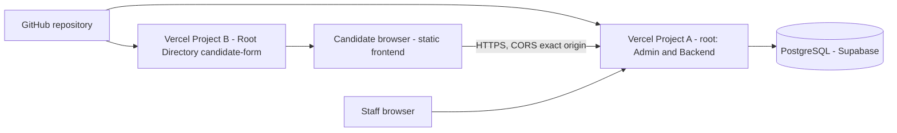

| | Project A | Project B |
|---|---|---|
| Content | Backend API (`/api`, `/auth`, `/api/admin`, `/api/public/candidate-details`) and the Admin app | `candidate-form/` static site only |
| Vercel Root Directory | repository root | `candidate-form/` (never the repository root) |
| Configuration | `CANDIDATE_FORM_ORIGIN` (the form's exact origin, CORS allow-list), `CANDIDATE_FORM_TOKEN_SECRET` (at least 32 characters, backend only) | `VITE_API_BASE_URL` (Project A's public origin, build time) |
| Secrets | in the backend project only | none |

Both Candidate Form settings are optional for the server as a whole: unset, the public form does not work (verification answers 503) and nothing else is affected. Migrations are applied with `prisma migrate deploy` (never `migrate dev`, a known Supabase shadow-replay issue). The Candidate Form migrations and the Job migrations (`20261017120000`, `20261018120000`, `20261018130000`, `20261018140000`) must be applied before deploying the matching code.

---
## 26. Known Limitations / Remaining Work

Only items that are open today:

| Item | Status |
|---|---|
| `candidate_allocation` has RLS off in the migrated schema (ISS-012, release blocker); live `anon` / `authenticated` privileges and Storage policies not verified from the repository (ISS-013) | Open |
| Google Sheet sync of Candidate Form answers (ISS-033) | **Pending** |
| Candidate Form fields with no canonical Admin counterpart (Guardian, email, city, district, DS / GN division, English knowledge, other skills, job category, other job category, civil status, spouse, children, parents' names and passport numbers) are stored but not shown in Admin and cannot be confirmed | **Pending** (needs Admin fields / sections) |
| Job categories are a frontend list plus a server list, not a database table (ISS-031) | Open |
| Manual responsive QA in a real browser (five widths, English / Sinhala, light / dark) | Not yet done |
| Legacy `candidate_stages.job_id` (one value, `Job12`) kept read-only; column not dropped | Open |
| `DELETE` of a `candidate_form_access` row by a database owner is not blocked by a trigger | Accepted residual risk |
| Anyone holding a group link who also knows another member's Passport and NIC can submit for them (same trust model as a personal link, larger audience) | Accepted residual risk |
| Deploying the version-3 session token ends sessions issued before the deploy (at most 60 minutes) | Accepted (ISS-046) |
| Per-passport lockout window / policy review (ISS-015) | Accepted risk |

---
## 27. Final End-to-End Flow

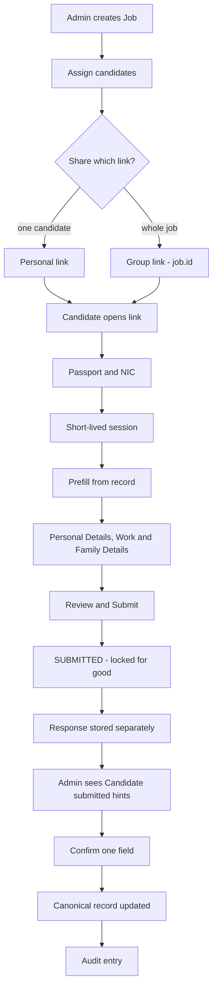

---

## Related Documentation

| Document | Use it for |
|---|---|
| [CANDIDATE_EXTRA_DETAILS_FORM_SECURITY_RISKS.md](CANDIDATE_EXTRA_DETAILS_FORM_SECURITY_RISKS.md) | Threat model, risk register, abuse test plan, acceptance criteria |
| [CANDIDATE_EXTRA_DETAILS_FORM_ISSUES_AND_SOLUTIONS.md](CANDIDATE_EXTRA_DETAILS_FORM_ISSUES_AND_SOLUTIONS.md) | Every issue found, its fix and status (ISS-001 onward) |
| [CANDIDATE_EXTRA_DETAILS_FORM_SHARE_LINKS_DESIGN.md](CANDIDATE_EXTRA_DETAILS_FORM_SHARE_LINKS_DESIGN.md) | Detailed link, verification, prefill mapping and group-link design |
| [JOB_MANAGEMENT_IMPLEMENTATION.md](JOB_MANAGEMENT_IMPLEMENTATION.md) | Job model, Job Code, assignment rules, migration from the legacy job field |
| [DATABASE_IMPLEMENTATION.md](DATABASE_IMPLEMENTATION.md) | Table and migration reference |
| [20-candidate-management.md](20-candidate-management.md) | Admin candidate screens and API reference |
| [../candidate-form/README.md](../candidate-form/README.md) | The public frontend (commands, configuration) |
