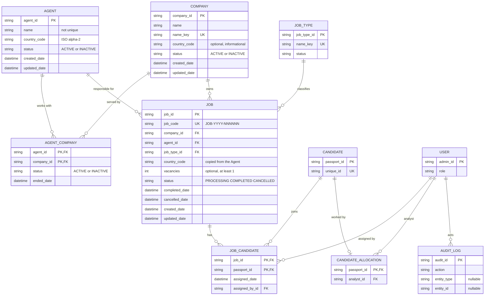
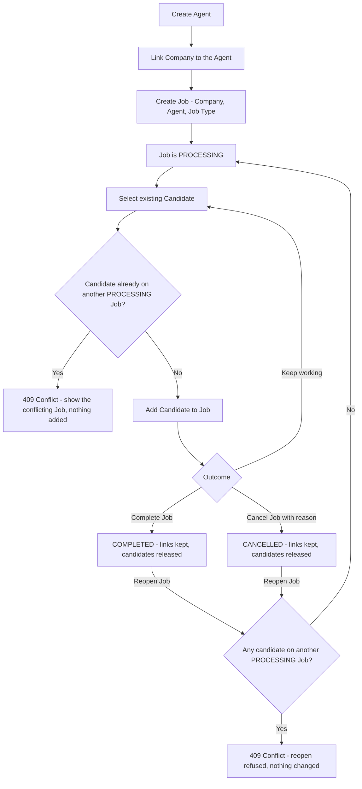
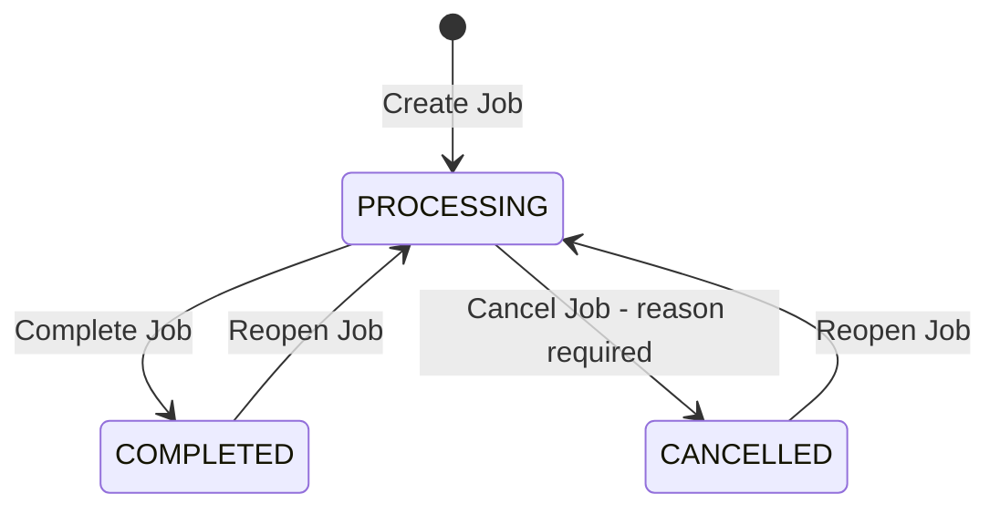
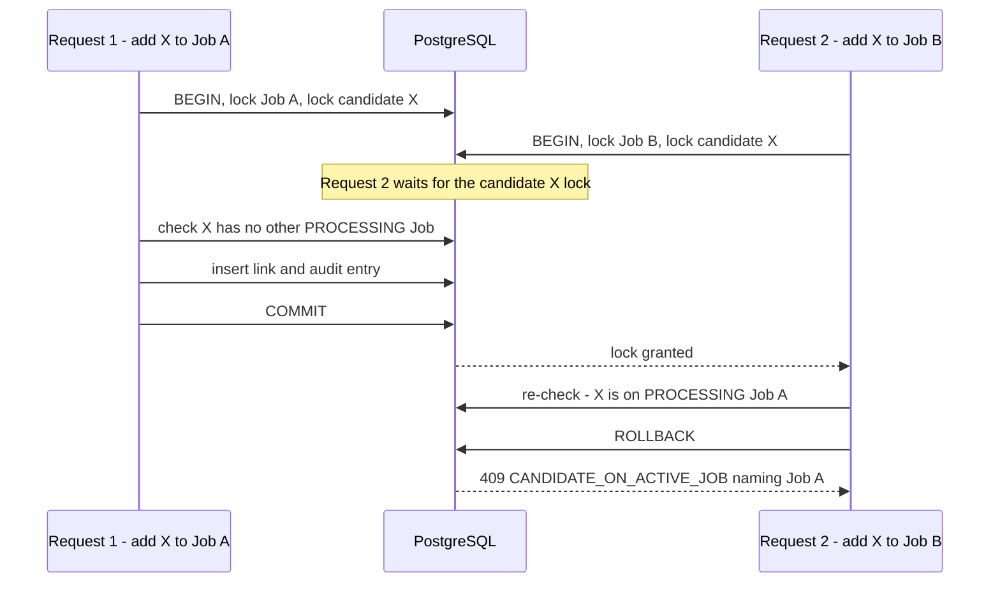
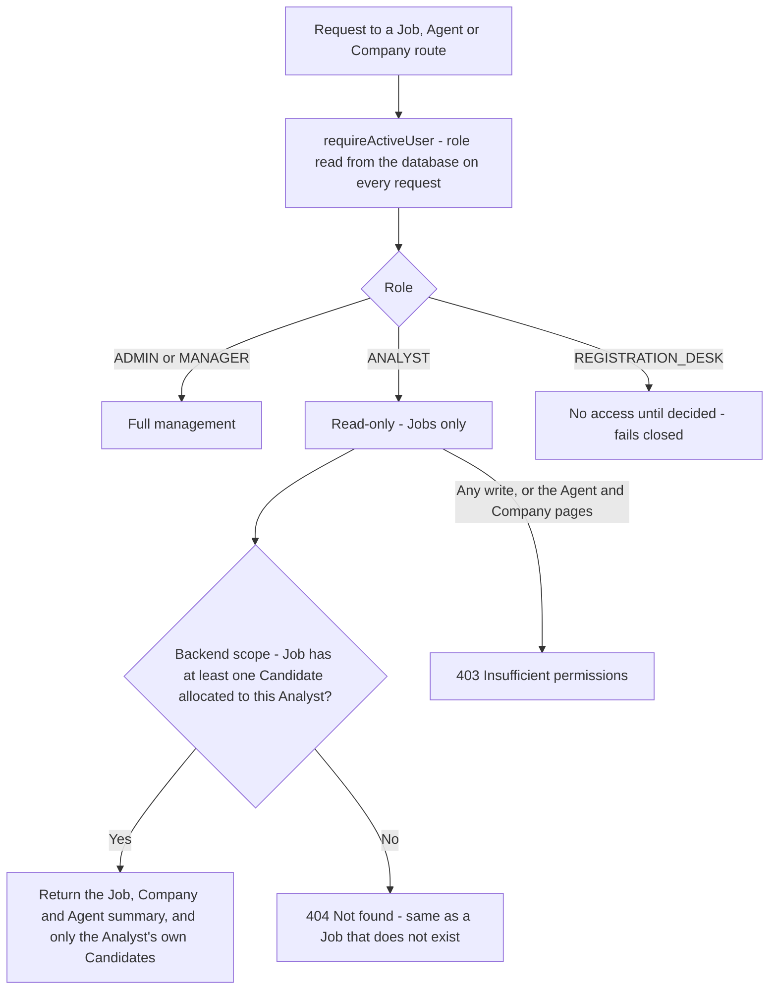

# Client / Agent / Company / Job Management

**Version:** 2.0 (implementation specification)
**Status:** Architecture approved, ready for migration design. Not implemented.
**Branch:** `version/client-management`

> Naming: the employer is called **Company** everywhere (database, API, UI). The word "client" is already used in this codebase for *candidates* (`/clients` routes and pages), so it is not reused.

---

## 1. Feature overview

| Entity | What it is |
|---|---|
| **Agent** | A broker / responsible contact person in **one country**. Works with **several Companies** and is responsible for **several Jobs**. |
| **Company** | The employer (client). Can work with **several Agents** and **owns Jobs**. |
| **Job** | A recruitment requirement. Belongs to **one Company**, has **one responsible Agent** and **one Job Type**. Its **country always comes from the Agent**. Contains **Candidates**. |
| **Candidate** | The existing Candidate record (unchanged). Can join Jobs over time, but is on **only one PROCESSING Job at a time**. |

Sidebar: **Agent**, **Job**, **Company**, placed after **Work Allocation**.

Integration note: Candidate Work Allocation stays separate from Job assignment. Work Allocation controls which **Analyst** handles a Candidate; `job_candidate` controls which **Job** the Candidate belongs to. Neither changes the other. The feature never writes to the `candidate` table, so it does not trigger the Google Sheet sync.

---

## 2. Core business rules

| # | Rule |
|---|---|
| 1 | One Agent belongs to exactly **one country**. Agent names are **not unique**; the internal ID is the identity. |
| 2 | Agent <-> Company is **many-to-many** (`agent_company`). Links are ended (`INACTIVE`), never deleted. |
| 3 | A Job belongs to **one Company** and has **one responsible Agent**. |
| 4 | A Job can only be created when the Agent and the Company have an **ACTIVE link**, and both are `ACTIVE`. |
| 5 | **A Job's country always comes from its Agent** (copied at creation, never accepted from the client). A Company's optional country never derives or overrides it. |
| 6 | Job status is `PROCESSING`, `COMPLETED` or `CANCELLED`. It changes **only** through Complete, Cancel and Reopen. A Job starts as `PROCESSING`. |
| 7 | A `COMPLETED` or `CANCELLED` Job can be **reopened** (back to `PROCESSING`). |
| 8 | `vacancies` is **optional**, a whole number **>= 1** when given. The number of Candidates on a Job is **derived** from `job_candidate`, never stored. |
| 9 | A Candidate can be on many Jobs over time but on **only one `PROCESSING` Job at a time**. |
| 10 | Removing a Candidate from a Job **deletes the link**. History is the audit log only. |
| 11 | Completing or cancelling a Job **keeps** its Candidate links and **releases** those Candidates for another Job. Reopening re-checks the one-PROCESSING rule. |
| 12 | Cancel **requires a reason**. Cancellation and completion history is never erased (append-only audit log). |
| 13 | Agents, Companies, Jobs and Job Types are **never hard-deleted**: `INACTIVE` / `COMPLETED` / `CANCELLED`. An Agent or Company with `PROCESSING` Jobs **cannot be deactivated**. |
| 14 | A Job code `JOB-YYYY-NNNNNN` is generated by the server. Users cannot submit it. |
| 15 | An Analyst has **read-only** access to Jobs relevant to their allocated Candidates, enforced in the backend. |
| 16 | The existing free-text `candidate_stages.job_id` (Test details stage) stays **unchanged and unrelated** to the Job module. It is not linked, backfilled or validated against `job_code`. |

---

## 3. Database architecture

Conventions: string UUID primary keys generated by the application, snake_case columns, `created_date` / `updated_date`, status as `String` with a `CHECK` constraint (the schema has no enums), `RESTRICT` foreign keys. Every new table gets RLS enabled and privileges revoked from `anon` / `authenticated`.

### New tables

#### `job_type`
Controlled list of job types, seeded once from the distinct values already typed on `candidate.job` (the candidate field itself is unchanged).

| Field | Type | Rule |
|---|---|---|
| job_type_id | String (UUID) | PK |
| name | String | required, trimmed, no commas, max 60 |
| name_key | String | unique; lower-cased, trimmed, spaces collapsed |
| status | String | `ACTIVE` / `INACTIVE`, default `ACTIVE` |
| created_date, updated_date | DateTime | defaults |

#### `agent`

| Field | Type | Rule |
|---|---|---|
| agent_id | String (UUID) | PK |
| name | String | required, 1-100, **not unique** (no unique index) |
| country_code | CHAR(2) | required, ISO 3166-1 alpha-2 (`CHECK ^[A-Z]{2}$`) |
| contact_number | String? | optional |
| email | String? | optional |
| status | String | `ACTIVE` / `INACTIVE`, default `ACTIVE` |
| created_date, updated_date | DateTime | defaults |

Indexes: `(country_code)`, `(status, name)` (non-unique).

#### `company`

| Field | Type | Rule |
|---|---|---|
| company_id | String (UUID) | PK |
| name | String | required, 1-150 |
| name_key | String | **unique** (normalised name; blocks "ABC Ltd" / "abc ltd") |
| country_code | CHAR(2)? | optional, nullable, informational only (same `CHECK` when set) |
| status | String | `ACTIVE` / `INACTIVE`, default `ACTIVE` |
| created_date, updated_date | DateTime | defaults |

Index: `(status, name)`.

#### `agent_company`

| Field | Type | Rule |
|---|---|---|
| agent_id | String | PK part, FK -> agent, `RESTRICT` |
| company_id | String | PK part, FK -> company, `RESTRICT` |
| status | String | `ACTIVE` / `INACTIVE`, default `ACTIVE` |
| created_date | DateTime | default now |
| ended_date | DateTime? | set when the link is ended; cleared on re-link |

Composite PK `(agent_id, company_id)`; index `(company_id, status)`. Re-linking reactivates the same row.

#### `job_code_counter`

| Field | Type | Rule |
|---|---|---|
| year | Int | PK |
| last_value | Int | last number issued in that year |

#### `job`

| Field | Type | Rule |
|---|---|---|
| job_id | String (UUID) | PK, internal; used in URLs and foreign keys |
| job_code | String | **unique**, `JOB-YYYY-NNNNNN`, generated by the server |
| company_id | String | FK -> company, `RESTRICT` |
| agent_id | String | FK -> agent, `RESTRICT` (responsible Agent) |
| job_type_id | String | FK -> job_type, `RESTRICT` |
| country_code | CHAR(2) | required; **copied from the Agent at creation**, never client-supplied |
| vacancies | Int? | optional; `CHECK vacancies IS NULL OR vacancies >= 1` |
| status | String | `PROCESSING` / `COMPLETED` / `CANCELLED`, default `PROCESSING` |
| completed_date | DateTime? | set on Complete, cleared on Reopen |
| cancelled_date | DateTime? | set on Cancel, cleared on Reopen (current state only; history is the audit log) |
| created_date, updated_date | DateTime | defaults |

`CHECK`s: `completed_date` is set exactly when status is `COMPLETED`, `cancelled_date` exactly when `CANCELLED`.
Indexes: `(status, created_date DESC)`, `(agent_id, status)`, `(company_id, status)`, `(country_code)`, `(job_type_id)`.

#### `job_candidate`

| Field | Type | Rule |
|---|---|---|
| job_id | String | PK part, FK -> job, `RESTRICT` |
| passport_id | String | PK part, FK -> candidate, `CASCADE` (only if a candidate is erased) |
| assigned_date | DateTime | default now |
| assigned_by_id | String | FK -> user (`admin_id`), `RESTRICT` |

Composite PK `(job_id, passport_id)`; indexes `(passport_id)`, `(job_id, assigned_date)`. No candidate data is copied.

### Changed table: `audit_logs`

| Field | Type | Rule |
|---|---|---|
| entity_type | String? | nullable; `AGENT`, `COMPANY`, `JOB`, `JOB_TYPE` |
| entity_id | String? | nullable; the entity's internal ID |

`CHECK ((entity_type IS NULL) = (entity_id IS NULL))`; index `(entity_type, entity_id, created_date)`. Existing rows keep both `NULL`. `previous_value` / `new_value` keep the detailed before/after data.

---

## 4. Relationship model

| Relationship | Cardinality |
|---|---|
| Agent -> Job | one Agent, many Jobs |
| Company -> Job | one Company, many Jobs |
| Agent <-> Company | many-to-many through `agent_company` |
| Job -> Job Type | one Job Type per Job |
| Job <-> Candidate | many-to-many through `job_candidate` (at most one `PROCESSING` Job per Candidate) |
| Candidate -> Analyst | `candidate_allocation` (0..1), **separate** from `job_candidate` |

Country is a plain code on Agent, Job and (optionally) Company, not a table. It is validated in the application against one shared ISO country list.

---

## 5. ER diagram

`AGENT`, `COMPANY`, `AGENT_COMPANY`, `JOB_TYPE`, `JOB`, `JOB_CANDIDATE` and the two `AUDIT_LOG` entity columns are new. `CANDIDATE`, `CANDIDATE_ALLOCATION`, `USER` already exist. There is deliberately no link between `JOB_CANDIDATE` and `CANDIDATE_ALLOCATION`.



---

## 6. High-level feature flow



---

## 7. Job lifecycle

| Status | Meaning | Allowed while in this status |
|---|---|---|
| `PROCESSING` | Active | Edit, add / remove Candidates, Complete, Cancel |
| `COMPLETED` | Historical, fulfilled | Read-only; Reopen |
| `CANCELLED` | Historical, stopped | Read-only; Reopen |

| Action | From -> To | Input | Audit action |
|---|---|---|---|
| Complete Job | `PROCESSING` -> `COMPLETED` | none | `COMPLETE_JOB` |
| Cancel Job | `PROCESSING` -> `CANCELLED` | **reason (required)** | `CANCEL_JOB` |
| Reopen Job | `COMPLETED` / `CANCELLED` -> `PROCESSING` | none | `REOPEN_JOB` |



Rules:

- **No generic status editing** anywhere (API or UI). Any other transition returns `409`.
- Complete and Cancel keep the Candidate links and release the Candidates for other Jobs.
- **Reopen re-validates** the one-PROCESSING rule for every Candidate on the Job (section 9). If any is on another `PROCESSING` Job, reopen fails with `409` naming them; nothing changes. Reopen also requires the Job's Agent and Company to be `ACTIVE` (`409 AGENT_INACTIVE` / `COMPANY_INACTIVE`).
- A `COMPLETED` / `CANCELLED` Job rejects edits and Candidate changes (`409 JOB_NOT_PROCESSING`) until reopened.
- Reopen never erases history: every `CANCEL_JOB` (with its reason) and `COMPLETE_JOB` entry stays in the audit log; `REOPEN_JOB` records the previous status.

---

## 8. Job code generation

Format `JOB-YYYY-NNNNNN`, for example `JOB-2026-000123`. The counter resets each year. `job_id` (UUID) stays the internal key; the code is for people and is never a foreign key.

Inside the Job-creating transaction:

1. Validate the request (section 17), with the Agent and Company rows locked `FOR SHARE`.
2. `year` = current year in the business time zone (Asia/Colombo).
3. `INSERT INTO job_code_counter (year, last_value) VALUES ($year, 1) ON CONFLICT (year) DO UPDATE SET last_value = job_code_counter.last_value + 1 RETURNING last_value;` (via `$queryRaw`), done late to keep the row lock short.
4. `job_code = 'JOB-' || year || '-' || lpad(last_value, 6, '0')`.
5. Insert the Job (`PROCESSING`, `country_code` from the Agent) and the `CREATE_JOB` audit entry; commit.

Properties: concurrency-safe (the counter row serialises creators), gap-free (a rolled-back creation rolls the counter back), resets yearly with no DDL, never uses a row count. `UNIQUE(job_code)` is the final guard. A code is never reused or changed. The API **rejects** a `jobCode` in the request body (`400`). Sort lists by `created_date`, not by code text.

---

## 9. One PROCESSING Job rule

A Candidate can belong to many Jobs over time but to **only one Job with status `PROCESSING`**. The primary key `(job_id, passport_id)` only prevents the same Job twice; it cannot see another Job's status, and the rule must also hold on **Reopen**. It is therefore enforced in the transaction.

**Operations that can break the rule:** *Add Candidates to a Job* and *Reopen a Job*. (Complete and Cancel only release Candidates.)

**Procedure (add and reopen), one transaction:**

1. Lock the **Job row** `FOR UPDATE`; check its status (`PROCESSING` for add, `COMPLETED` / `CANCELLED` for reopen).
2. Lock the **Candidate rows** `SELECT passport_id FROM candidate WHERE passport_id = ANY($ids) ORDER BY passport_id FOR UPDATE` (always ascending, so two requests cannot deadlock). The lock changes no data, so no Google Sheet trigger fires. For reopen, the ids are the Candidates currently on that Job.
3. **After** the locks are held, check for conflicts: Candidates linked to another Job with `status = 'PROCESSING'`.
4. Any conflict: roll back, return `409 CANDIDATE_ON_ACTIVE_JOB`. Otherwise insert the links (or set `PROCESSING`), write the audit entries, commit. All or nothing.

Global lock order: **Job row, then Candidate rows ascending.**



Outcomes: two managers adding the same Candidate to different Jobs -> exactly one link, the other gets `409`; same Job twice -> `409 ALREADY_ON_JOB`; reopen racing an add -> whichever commits second fails its re-check.

Conflict response:

```json
{
  "message": "Candidate PN1234567 is already assigned to processing Job JOB-2026-000123.",
  "code": "CANDIDATE_ON_ACTIVE_JOB",
  "conflicts": [ { "passportId": "PN1234567", "jobCode": "JOB-2026-000123" } ]
}
```

With several conflicts the message names the first and the count; `conflicts` lists all.

**Optional database backstop** (decided at migration design; the locks above are required either way): add `job_candidate.job_status` with composite FK `(job_id, job_status) -> job (job_id, status) ON UPDATE CASCADE` (needs `UNIQUE (job_id, status)` on `job`) and a SQL-only partial unique index `ON job_candidate (passport_id) WHERE job_status = 'PROCESSING'`. A violation maps to the same `409`.

---

## 10. Agent management

**Agent list** (Admin, Manager)

| Column | Meaning |
|---|---|
| Agent | name |
| Country | country (code and name) |
| Processing | number of the Agent's `PROCESSING` Jobs |
| Completed | number of the Agent's `COMPLETED` Jobs |
| Status | Active / Inactive |
| Actions | View / Edit |

No "Ongoing Jobs" column. `CANCELLED` Jobs appear in the Agent detail only. Filters: search, country, status. Counts come from one grouped query per page.

**Actions:** create, edit (name, country, contact, linked Companies), activate / deactivate, link / end Company links.

**Rules**

- Name required; country required and valid; **duplicate names are allowed** (a future UI warning on name + country is advice only, never a constraint).
- Linked Companies must exist and be `ACTIVE`; no Company twice.
- **Deactivating an Agent is blocked while any of its Jobs is `PROCESSING`** (`409 AGENT_HAS_PROCESSING_JOBS`). The deactivation locks the Agent row `FOR UPDATE` and counts its `PROCESSING` Jobs; Job creation locks the Agent `FOR SHARE`, so the two cannot race.
- Ending an Agent-Company link is blocked while a `PROCESSING` Job uses that pair.
- Completed / cancelled Jobs stay linked to an inactive Agent; an inactive Agent cannot be chosen for new Jobs.

Message: `Cannot deactivate Agent "Kamal Silva": 2 jobs are still processing (JOB-2026-000123, JOB-2026-000131). Complete or cancel them, or move their responsibility to another Agent, then try again.`

```
Agent Management
[ Search Agent ] [ Country v ] [ Status v ]                         [ + Add Agent ]

| Agent        | Country | Processing | Completed | Status   | Actions |
| Kamal Silva  | RO      |     3      |    12     | Active   | View    |

Add Agent
  Agent Name  [____________]
  Country     [ dropdown  v ]
  Companies   [ Company A x ] [ Company B x ]   [ + Add Company ]
                                   [ Cancel ] [ Save Agent ]
```

`+ Add Company` **selects an existing Company** from a search list (already-added ones disabled); it never creates a Company, so no accidental duplicates. Agent detail shows Summary, Companies (add / end link), Jobs (Processing / Completed / Cancelled) and Activity (audit entries for the Agent).

---

## 11. Company management

**Company list** (Admin, Manager)

| Column | Meaning |
|---|---|
| Company | name |
| Agents | number of ACTIVE Agent links |
| Processing Jobs | Company's `PROCESSING` Jobs |
| Completed Jobs | Company's `COMPLETED` Jobs |
| Status | Active / Inactive |
| Actions | View / Edit |

**Fields:** name, optional country (shown only when set; informational), Agent links, status.

**Rules**

- Name required and unique after normalisation (`409` showing the existing Company).
- An `ACTIVE` Company is required for new Jobs (and for reopening).
- **Cannot be deactivated while `PROCESSING` Jobs exist** (`409 COMPANY_HAS_PROCESSING_JOBS`); same lock pattern as Agents.
- Linked Agents must exist and be `ACTIVE`.

```
Company Management
[ Search Company ] [ Status v ]                                  [ + Add Company ]

| Company   | Agents | Processing Jobs | Completed Jobs | Status | Actions |
| Company A |   2    |        3        |       12       | Active | View    |
```

Company detail: information, linked Agents (add / end link), Jobs grouped Processing / Completed / Cancelled, Activity.

---

## 12. Job management

**Job page**

```
Job
[ Processing ] [ Completed ] [ Cancelled ]        <- see open decision O-2
[ Search Job ] [ Country v ] [ Agent v ] [ Company v ]                [ + Add Job ]

| Job ID          | Job Type | Country | Company   | Agent       | Candidates | Status     | Actions |
| JOB-2026-000123 | Welder   | RO      | Company A | Kamal Silva |     18     | PROCESSING | View    |
```

Candidates = linked count (shown as "7 of 10" when `vacancies` is set). An Analyst sees the same page read-only, only relevant Jobs, no `+ Add Job`.

**Create Job**

```
Create Job
Company            [ select company v ]
Responsible Agent  [ select agent v ]   only ACTIVE Agents linked to the Company
Country            Romania              derived from the Agent, read-only
Job Type           [ select or create v ]
Vacancies          [ ___ ]              optional, whole number >= 1
Job Code: generated by the server after submit
                                    [ Cancel ] [ Create Job ]
```

Company first; the Agent list is then limited to valid pairs. The server validates the same rules regardless. No status control: a new Job is `PROCESSING`.

**Job detail**

```
JOB-2026-000123                                   Status: PROCESSING
[ Complete Job ] [ Cancel Job ]                   ( [ Reopen Job ] when COMPLETED / CANCELLED )

Summary:  Job Type | Country (from the Agent) | Company | Responsible Agent | Vacancies | Created
          Completed / Cancelled date, and the cancel reason when cancelled

Candidates (18)                                              [ + Add to Job ]
| Candidate    | Passport  | Contact      | Analyst (read-only) | Actions |
| Nimal Perera | PN1234567 | 071 000 0000 | Ann                 | Remove  |

Activity
  2026-10-14  Job created               by Max Manager
  2026-10-20  Job cancelled - reason ... by Max Manager
  2026-10-25  Job reopened              by Max Manager
```

- Buttons follow status: Complete / Cancel / Add / Remove only on `PROCESSING`; Reopen on `COMPLETED` / `CANCELLED`.
- The Analyst column is information only; there are **no Work Allocation controls** on this page.
- Activity reads the audit log by entity and shows every cancellation with its reason, even after a reopen.
- Status is a read-only badge: `PROCESSING` active, `COMPLETED` done, `CANCELLED` muted. No free status field exists.

**Cancel dialog:** `Reason *` (required, button disabled while empty) -> `[ Back ] [ Cancel Job ]`. **Reopen dialog:** `Reopen JOB-2026-000123? The previous cancellation or completion stays in the history.` -> `[ Back ] [ Reopen Job ]`; on `409` it lists the blocking Candidates and their Jobs.

---

## 13. Add Candidates to a Job

```
Add Candidates to Job - JOB-2026-000123
[ Search existing candidates ]                  (name, passport, phone)

[ ]  Nimal Perera       PN1234567   (job type match)
[x]  Kamali Jayasuriya  PN1111111
[-]  Ruwan Silva        PN2222222   Unavailable: on processing Job JOB-2026-000098
[-]  Amila Perera       PN3333333   Already on this Job
2 selected                                      [ Cancel ] [ Add Selected ]
```

- Search covers all existing Candidates (Admin / Manager); it neither uses nor changes Work Allocation.
- Multi-select, **bulk add**, per-page selection, maximum **500** Candidates per request.
- A Candidate **already on this Job** is blocked (never duplicated). A Candidate **on another `PROCESSING` Job** is disabled and the conflicting Job code is shown.
- A Candidate whose job types include the Job's type is flagged as a match (advisory only).
- **All or nothing:** if the server still answers `409` (stale picker), the dialog stays open, shows the message with the conflicting Job, refreshes the list, and nothing is added.
- **Remove** deletes the `job_candidate` row (audited) and is only allowed while the Job is `PROCESSING`.

---

## 14. API design

Paths under `/api/admin`, one router per module, `PUT` for updates, action routes for state changes. Lists return `{ items, pagination, filters }` (default 25, max 100). Errors use the existing shapes: `400 { message, errors:[{field,message}] }`, conflicts `409 { message, code }`. No create/update body accepts `status`, Job `country_code` or `jobCode`.

| Method | Path | Purpose | Roles |
|---|---|---|---|
| GET | `/agents` | list (`search`, `country`, `status`, `page`) with Processing / Completed counts | Admin, Manager |
| POST | `/agents` | create (name, country, contact, `companyIds[]`) | Admin, Manager |
| GET | `/agents/:id` | detail: companies, Jobs by status, activity | Admin, Manager |
| PUT | `/agents/:id` | edit fields and the Company set (adds / ends links) | Admin, Manager |
| POST | `/agents/:id/deactivate`, `/reactivate` | status (deactivate blocked by PROCESSING Jobs) | Admin, Manager |
| GET | `/companies` | list with Agents / Processing / Completed counts | Admin, Manager |
| POST | `/companies` | create (name, optional country, `agentIds[]`) | Admin, Manager |
| GET | `/companies/:id` | detail: Agents, Jobs by status, activity | Admin, Manager |
| PUT | `/companies/:id` | edit and the Agent set | Admin, Manager |
| POST | `/companies/:id/deactivate`, `/reactivate` | status | Admin, Manager |
| GET, POST | `/job-types` | picker list / create | Admin, Manager |
| GET | `/jobs` | list (`status`, `agentId`, `companyId`, `country`, `jobTypeId`, `search`, `page`) | Admin, Manager (all); Analyst (scoped) |
| POST | `/jobs` | create (`companyId`, `agentId`, `jobTypeId`, optional `vacancies`) | Admin, Manager |
| GET | `/jobs/:id` | detail with Company / Agent summary and activity | Admin, Manager; Analyst (scoped, summary only) |
| PUT | `/jobs/:id` | edit (PROCESSING only) | Admin, Manager |
| POST | `/jobs/:id/complete` | Complete | Admin, Manager |
| POST | `/jobs/:id/cancel` | Cancel (`{ reason }` required) | Admin, Manager |
| POST | `/jobs/:id/reopen` | Reopen | Admin, Manager |
| GET | `/jobs/:id/candidates` | Candidates on the Job | Admin, Manager (all); Analyst (own allocated only) |
| GET | `/jobs/:id/candidates/available` | picker: Candidates with their blocking Job, if any | Admin, Manager |
| POST | `/jobs/:id/candidates` | add `{ candidateIds[] }`, bulk, all or nothing | Admin, Manager |
| DELETE | `/jobs/:id/candidates/:passportId` | remove one | Admin, Manager |
| GET | `/candidates/:passportId/jobs` | a Candidate's Jobs (candidate access rules) | candidate access rules |

There is no `DELETE` for Agents, Companies, Jobs or Job Types.

---

## 15. Role-based access

| Action | Admin | Manager | Analyst | Registration Desk |
|---|---|---|---|---|
| View Agents / Companies | Yes | Yes | No (summary inside a relevant Job only) | No (open, O-1) |
| Create / edit / deactivate Agent, Company; Job Type | Yes | Yes | No | No (open, O-1) |
| View Jobs | Yes (all) | Yes (all) | **Read-only, only Jobs with a Candidate allocated to them** | No (open, O-1) |
| Create / edit Job | Yes | Yes | No | No |
| Complete / Cancel / Reopen Job | Yes | Yes | No | No |
| Add / remove Candidate on a Job | Yes | Yes | No | No |

**Analyst scope (backend, mandatory)** applied in the query on every request, so a reassignment takes effect on the next one:



- Job visibility for an Analyst: `jobs where candidates some { candidate in the Analyst's allocation }` (the existing candidate scope). Any other role fails closed.
- The Job's Candidates list and its count are limited to the Analyst's own Candidates.
- Company and Agent appear only as a **summary inside the Job** (Company name / status; Agent name / country; no contact details).
- Totals that could leak other Analysts' data are not shown to Analysts.

---

## 16. Audit logging

`audit_logs` stays append-only. The two nullable columns `entity_type` / `entity_id` (section 3) give indexed history per Agent, Company or Job. Writes happen in the same transaction as the change.

| Action | Entity | Notes |
|---|---|---|
| `CREATE_AGENT`, `UPDATE_AGENT` | `AGENT` | includes Company link changes and (de)activation |
| `CREATE_COMPANY`, `UPDATE_COMPANY` | `COMPANY` | includes Agent link changes and (de)activation |
| `CREATE_JOB_TYPE` | `JOB_TYPE` | |
| `CREATE_JOB`, `UPDATE_JOB` | `JOB` | create stores `jobCode`; an Agent change stores both Agents |
| `COMPLETE_JOB` | `JOB` | `PROCESSING` -> `COMPLETED` |
| `CANCEL_JOB` | `JOB` | `PROCESSING` -> `CANCELLED`, **reason in `reason`** |
| `REOPEN_JOB` | `JOB` | `COMPLETED` / `CANCELLED` -> `PROCESSING` |
| `ADD_CANDIDATE_TO_JOB` | `JOB` | one entry per Candidate, `passport_id` set |
| `REMOVE_CANDIDATE_FROM_JOB` | `JOB` | one entry per Candidate, `passport_id` set |

`previous_status` / `new_status` are required: creates use `NONE`. Add `AGENT`, `COMPANY`, `JOB` categories to the audit page filters and labels. Cancellation reasons are never overwritten: each cancel is its own entry.

---

## 17. Validation rules

| Entity | Rules |
|---|---|
| **Agent** | name required (trimmed, 1-100); **duplicates allowed**; country required and valid; contact / email optional; linked Companies exist and are `ACTIVE`, no repeats; deactivation per section 10 |
| **Company** | name required (1-150) and unique after normalisation; country optional (valid code or null); linked Agents exist and are `ACTIVE`; deactivation per section 11 |
| **Job Type** | trimmed, no commas, max 60, case-insensitive unique |
| **Job (create)** | Company, Agent, Job Type required and existing; Agent, Company, Job Type `ACTIVE`; **Agent-Company link `ACTIVE`**; country **derived from the Agent**; `vacancies` optional, whole number >= 1 (else `400`); `status`, `country_code`, `jobCode` rejected if sent |
| **Job (edit)** | `PROCESSING` only; vacancies and Job Type editable; Company not editable after creation; changing the responsible Agent per O-3 |
| **Job (actions)** | Complete / Cancel only from `PROCESSING`; **Cancel needs a non-empty reason** (max 500); Reopen only from `COMPLETED` / `CANCELLED`, re-checks the one-PROCESSING rule and requires `ACTIVE` Agent and Company |
| **JobCandidate (add)** | Job exists and is `PROCESSING`; every Candidate exists; no repeat in the request; not already on this Job (`409 ALREADY_ON_JOB`); **no other `PROCESSING` Job** (`409 CANDIDATE_ON_ACTIVE_JOB`); max 500; all or nothing |
| **JobCandidate (remove)** | Job is `PROCESSING`; the link exists |

---

## 18. Indexes

| Table | Index | Serves |
|---|---|---|
| agent | `(country_code)`, `(status, name)` | list filters and ordering |
| company | `(name_key)` unique, `(status, name)` | duplicate check, list |
| agent_company | PK `(agent_id, company_id)`, `(company_id, status)` | links in both directions |
| job | `(job_code)` unique | open by code |
| job | `(status, created_date DESC)` | Processing / Completed tabs |
| job | `(agent_id, status)` | Agent counts and detail |
| job | `(company_id, status)` | Company counts and detail |
| job | `(country_code)`, `(job_type_id)` | filters |
| job_candidate | PK `(job_id, passport_id)`, `(job_id, assigned_date)` | Job Candidates list |
| job_candidate | `(passport_id)` | one-PROCESSING check, Analyst scope, a Candidate's Jobs |
| audit_logs | `(entity_type, entity_id, created_date)` | entity history |

---

## 19. Migration plan

Two additive, hand-written SQL migrations applied with `prisma migrate deploy` (technical note: `prisma migrate dev` cannot replay this repository's history, so it is not used). Nothing is created in this phase. No existing column changes and no `candidate` row is updated.

| Migration | Contents |
|---|---|
| **A** | `job_type`, `agent`, `company`, `agent_company` (status and country `CHECK`s, indexes, RLS + `REVOKE`); `audit_logs.entity_type` / `entity_id` (nullable) + pairing `CHECK` + index. Optional one-off seed of `job_type` from distinct `candidate.job` values (read-only on `candidate`). |
| **B** | `job_code_counter`, `job` (status, date and `vacancies` `CHECK`s, `UNIQUE(job_code)`, indexes), `job_candidate` (composite key, indexes), RLS + `REVOKE`; the optional one-PROCESSING backstop from section 9 if accepted. |

Why two: Agent and Company ship before Jobs and each migration is tested and rolled back on its own. Before real data exists, rollback is dropping the new objects; afterwards it is a forward fix (deactivate / cancel).

---

## 20. Implementation order

1. Database migration A
2. Agent backend + UI
3. Company backend + UI
4. Database migration B
5. Job backend + UI (creation with code, lifecycle, Analyst scope)
6. Candidate-to-Job integration (bulk add, remove, picker, one-PROCESSING rule)
7. Audit / report integration (audit categories and labels, Candidate "Jobs" panel)
8. Full tests and documentation

---

## 21. Test plan

**Backend** (PostgreSQL via PGlite, real Prisma client and router):

- CRUD for Agent, Company, Job Type, Job; Agent-Company link add / end / re-link.
- Validation (section 17): duplicate Agent names accepted; Company name unique; `vacancies` below 1 rejected; `jobCode` / `country_code` / `status` rejected; Company country never affects Job country.
- RBAC for every route and role; Analyst sees only Jobs with an allocated Candidate (404 otherwise), only own Candidates and counts, no Agent / Company pages, no writes; Registration Desk fails closed.
- Lifecycle: allowed transitions only; Cancel reason required; Reopen from both states; edits blocked when not `PROCESSING`; history survives reopen.
- Job code: format, yearly reset, uniqueness under concurrent creation, no gap after rollback.
- **Concurrency / conflicts:** same Candidate added to two Jobs by two managers -> exactly one link; reopen conflict; reopen racing an add; bulk all-or-nothing; completing / cancelling releases Candidates.
- Deactivation blocked with `PROCESSING` Jobs (Agent, Company, link end), allowed otherwise; deactivation racing Job creation.
- Audit: every action in the same transaction with `entity_type` / `entity_id`; Candidate events carry `passport_id`.
- No `candidate` row change and no `sheet_sync_queue` rows after any Job operation; `candidate_stages.job_id` untouched.

**Frontend:** Agent and Company forms (`+ Add Company` selects existing only), list columns and counts, filters and search, Job creation (Agent list limited to the Company's linked Agents, country read-only), Add to Job (disabled rows with the blocking Job, 409 refresh), Cancel (reason required) and Reopen dialogs, read-only status badge, role-based sidebar and restricted pages, Analyst read-only view.

**Integration:** Agent -> Company -> Job -> Candidate end to end; Work Allocation and Job assignment stay independent (allocating changes no Job; Job changes change no allocation).

---

## 22. Diagram index

| Diagram | Section |
|---|---|
| Entity relationships | 5 |
| Feature / business flow | 6 |
| Job lifecycle | 7 |
| Concurrency (two managers, same Candidate) | 9 |
| Access-control flow | 15 |

---

## 23. Open implementation decisions

None of these changes the database schema.

| # | Question | Options | Recommendation |
|---|---|---|---|
| O-1 | **Registration Desk** access to Agents, Companies and Jobs | No access (as now) / read-only on Jobs | No access until a need is stated; the backend fails closed meanwhile |
| O-2 | **Cancelled Jobs** on the Job page | third tab / status filter | Third tab |
| O-3 | **Moving a PROCESSING Job to another Agent** | allowed to an ACTIVE, linked Agent of the **same country** / not allowed (cancel and recreate) | Allowed (keeps "Job country = Agent country" true; audited as `UPDATE_JOB`) |

---

## 24. Final architecture summary

```
Agent
  -> Country (country_code)
  -> Companies (agent_company, many-to-many)
  -> Jobs (responsible Agent)
  name not unique; cannot be deactivated with PROCESSING Jobs

Company
  -> Agents (agent_company)
  -> Jobs
  unique normalised name; optional informational country

Job
  -> Company
  -> Agent (country copied from it)
  -> Job Type
  -> Candidates (job_candidate)
  job_id (UUID) + job_code JOB-YYYY-NNNNNN
  status PROCESSING | COMPLETED | CANCELLED; optional vacancies >= 1

Candidate
  -> JobCandidate (at most one PROCESSING Job)
  -> CandidateAllocation (Analyst), separate and unrelated
  candidate_stages.job_id unrelated to job_code

Cross-cutting
  audit_logs + entity_type / entity_id; no hard deletes;
  Analyst read-only scoped Job access; two migrations (A, B)
```
