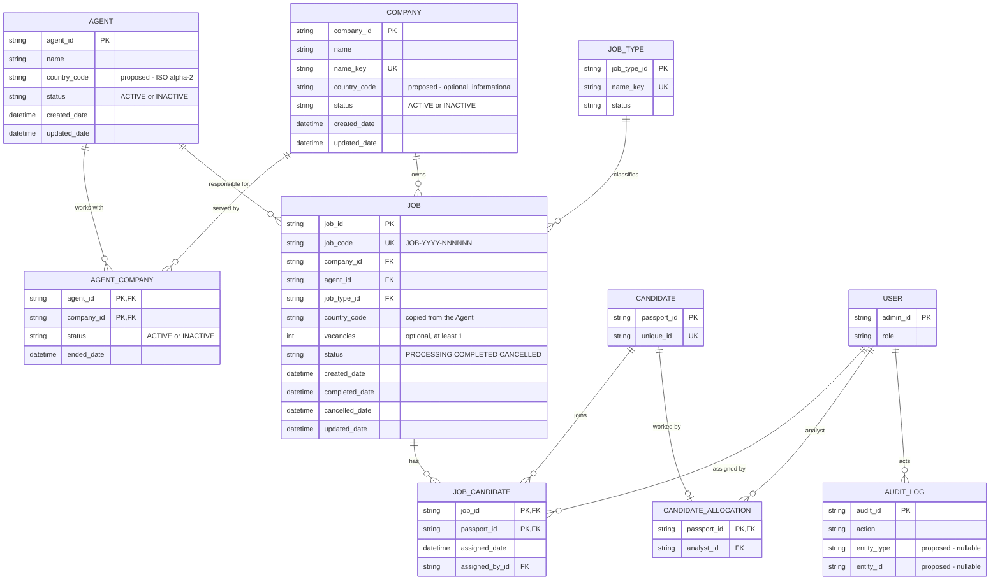
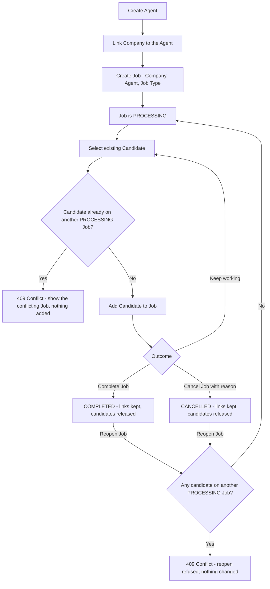
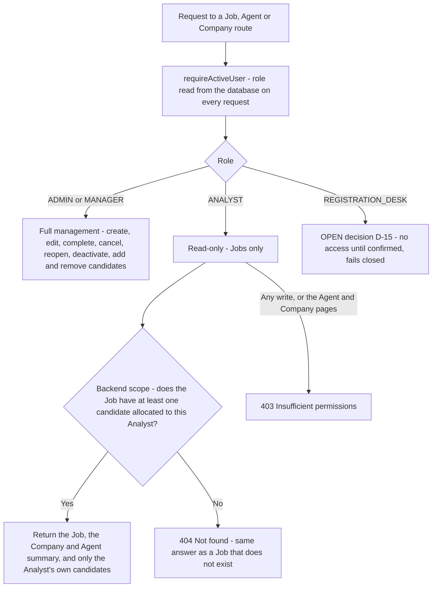
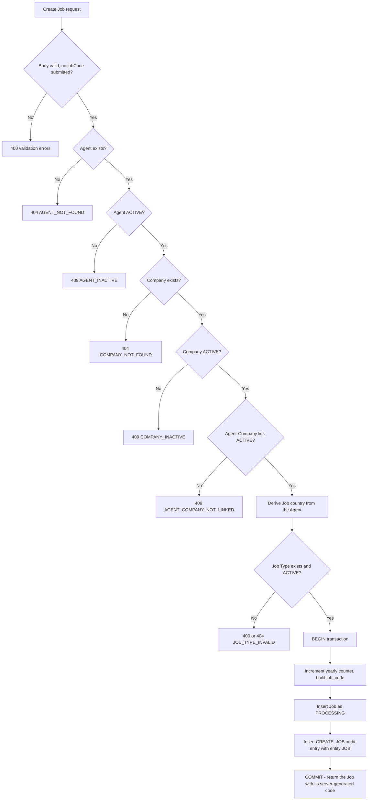
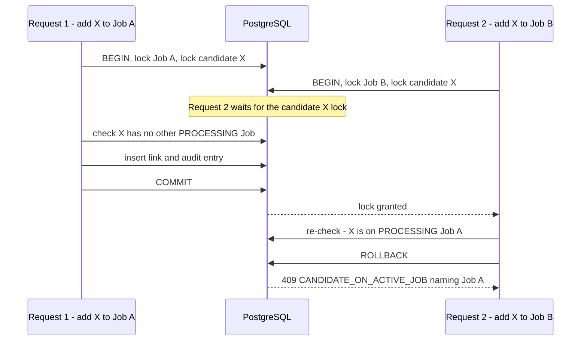
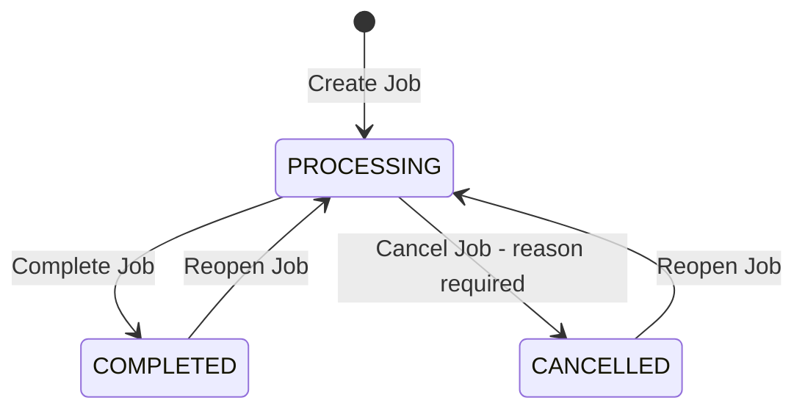

# Client / Agent / Job Management Architecture

**Version:** 1.3
**Status:** Architecture Approved / Ready for Migration Design. Every schema-affecting decision is confirmed. The remaining open items (D-15, D-17, D-18) are product / implementation decisions that do not change the schema (section 28).
**Branch:** `version/client-management`
**Date:** 2026-10-14
**Scope:** Architecture, database design and UI design for four related pieces of work: (1) this design, (2) Agent Management, (3) Job Management, (4) Company Management. Nothing here is implemented. `prisma/schema.prisma`, migrations, the API and the admin app are unchanged by this phase.

Every model, endpoint, rule and wireframe below is **PROPOSED, NOT YET IMPLEMENTED**.

---

## 0. Confirmed decisions

Answered by the owner on 2026-10-14. They are applied throughout this document and are not reopened here.

| # | Question | Final decision | Where applied |
|---|---|---|---|
| D-1 | Can a candidate be on more than one PROCESSING Job at once? | **No.** One PROCESSING Job per candidate | 3.2, 10, 11, 21 |
| D-2 | Where does a Job's country come from? | **From the responsible Agent** | 7, 21 |
| D-3 | Must a Job's Agent and Company be actively linked? | **Yes** | 6, 21 |
| D-4 | Does a removed candidate stay visible on the Job? | **No.** The link row is deleted; history is the audit log only | 10 |
| D-5 | Reopen and cancel | **Reopen allowed; a `CANCELLED` status exists** | 9 |
| D-6 | Job code format | **`JOB-2026-000123`**: yearly human-readable code, separate internal primary key, counter resets each year | 8 |
| D-7 | Agent list columns | **No "Ongoing Jobs".** The list shows **Processing** and **Completed** Job counts | 4, 23 |
| D-8 | Does a Job have a vacancy count? | **Yes: an optional, nullable integer `vacancies`**, at least 1 when given, not required on every Job. Meant for future required-vs-filled reporting. The number of candidates on a Job is **derived** from `job_candidate`, never stored as a "filled" count | 7, 14, 21, 23.9, 24 |
| D-9 | The existing free-text `candidate_stages.job_id` | **Unchanged and unrelated** to the Job module. Not linked, backfilled or validated against `job_code`. The Job module has its own `job_code` | 2.3, 19.2 |
| D-10 | Does a Company keep a country? | **Yes: an optional, nullable, informational `country_code`.** It never overrides or derives a Job's country, which always comes from the responsible Agent | 5, 14, 21, 24 |
| D-11 | Audit entity reference | **Add nullable `entity_type` and `entity_id`** to `audit_logs` (additive) | 16 |
| D-12 | Deactivating an Agent/Company that has PROCESSING Jobs | **Blocked** with a clear message | 17 |
| D-13 | Analyst permissions on Jobs | **Read-only, only Jobs relevant to the Analyst's allocated candidates**; backend scope mandatory | 19.1, 20 |
| D-14 | Agent name uniqueness | **Agent name is not unique.** The internal ID is the identity; same or similar names are allowed; **no unique index on name**. A future UI duplicate *warning* (name + country) is acceptable but never a database constraint | 4, 14, 21, 23.4, 24 |
| D-16 | Can a CANCELLED Job be reopened? | **Yes**, by the explicit **Reopen Job** action, audited, cancellation history preserved | 9, 16 |

---

## 1. Summary of the recommendation

| Topic | Recommendation |
|---|---|
| Naming | Use **Company** in the database, API and UI for the employer. "Client" already means *candidate* in this codebase (2.3) |
| Agent -> Country | One required country code per Agent (`country_code`, ISO 3166-1 alpha-2) |
| Agent <-> Company | **Many-to-many** through `agent_company` (links ended, never deleted) |
| Company -> Job | One-to-many, `RESTRICT` |
| Agent -> Job | One-to-many (responsible Agent), `RESTRICT` |
| Job country | Always the responsible Agent's country, stored on the Job as a snapshot; the Company's optional country never overrides it |
| Optional fields | Job `vacancies` (nullable, >= 1) and Company `country_code` (nullable, informational); Agent name is **not** unique |
| Job <-> Candidate | **Many-to-many** through `job_candidate` (composite key); a candidate is on **at most one PROCESSING Job** (enforced by locks in the transaction, optionally backed by a database constraint, section 11) |
| Job status | `PROCESSING` / `COMPLETED` / `CANCELLED` (string + `CHECK`); changes only through Complete / Cancel / Reopen actions |
| Job code | Internal UUID `job_id` + separate `job_code` `JOB-YYYY-NNNNNN` from a **yearly counter table** updated inside the creating transaction (section 8) |
| Country / Job Type | Country = code string validated in the app; Job Type = new small `job_type` table seeded from candidate data |
| Work Allocation | Completely separate from Job assignment |
| Google Sheet | No triggers on the new tables; nothing writes to `candidate`; no sync |
| Audit | Reuse `audit_logs` plus nullable `entity_type` / `entity_id` and an index |
| Deletion | No hard delete; `INACTIVE` / `COMPLETED` / `CANCELLED`; every foreign key `RESTRICT` except the candidate link |
| Migrations | Two additive hand-written SQL migrations, applied with `migrate deploy` (section 24) |

---

## 2. Audit of the existing system

### 2.1 What exists today

| Area | Finding | Source |
|---|---|---|
| Prisma models | `User` (staff), `AuditLog`, `Candidate`, `CandidateAllocation`, `Document`, `TemporaryData`, `CandidateAdditionalDetails`, `CandidateStage`, `CandidateCallLog`, `CallLogFollowUp`, `RateLimit`, `SheetSyncQueue`, `SheetSyncRun`, `SheetSyncState`. **No Agent, Company, Job, Country or JobType model** | [schema.prisma](../prisma/schema.prisma) |
| Enums | **None.** Statuses and roles are plain `String` columns with the allowed values in comments, and some `CHECK` constraints written in SQL (for example `call_outcome`) | schema, migration `20261013120000_call_log_outcome` |
| IDs | String IDs generated in the application (`crypto.randomUUID()` for documents, audit rows, call logs). Candidates use the passport ID as key plus a sequential `unique_id` | `candidateService.js` |
| Column naming | snake_case with `@map`; timestamps are `created_date` / `updated_date`; tables are mostly singular (`candidate`, `user`, `candidate_allocation`) | schema |
| Candidate job types | `candidate.job` is **free text**, a comma-separated list, up to 10 types of 60 characters, parsed by `parseJobTypes`. No job-type table | `candidateService.js`, `CandidateFields.tsx` |
| Country | **No country column.** `candidate.nationality` is free text from the passport (citizenship, not a job destination) | schema |
| Romania | The document model hard-codes a `ROMANIA` police-report variant, so the business is single-destination today | `candidateService.js` |
| "Job ID" | `candidate_stages.job_id` (Test details stage only) is a **free-text "job ID the admin enters"**, up to 50 characters, mirrored to the Google Sheet, linked to nothing | schema, `candidateService.js:257` |
| Candidate stages | Seven stages including `FINALIZING_JOB`; job type and job experience feed the automatic `CANDIDATE_DETAILS` completeness check | `candidateService.js:366` |
| Work Allocation | `candidate_allocation` (candidate -> Analyst, 1:1, a separate table so it never touches `candidate`) | migration `20261014120000_candidate_allocation` |
| Roles | `ADMIN`, `MANAGER`, `ANALYST`, `REGISTRATION_DESK`; route tiers `ALL_ACTIVE`, `CANDIDATE_STAFF`, `ANALYSTS_UP`, `MANAGERS_UP`, `ADMINS_ONLY`, `REGISTRATION_STAFF`; the role is read from the database on every request | `requireRole.js`, `routes/admin.js`, `admin/src/auth/roles.ts` |
| Analyst scope | `candidateAccess.js` is the single place that limits an Analyst to allocated candidates (and the scope helpers for related tables) | `candidateAccess.js` |
| Audit | `audit_logs` is append-only (trigger rejects update/delete/truncate). Columns: `admin_id`, `action`, `temporary_id`, `document_id`, `passport_id`, `previous_status`, `new_status` (both required), `reason`, `previous_value`, `new_value`. Categories are in `auditLogService.js`. **No generic entity reference** | schema, `auditLogService.js` |
| Sheet sync | Triggers on `candidate`, `candidate_stages`, `documents` queue a sync for that candidate. Call logs, allocations and every new table would not | migration `20261006120000_sheet_sync_outbox` |
| Sidebar | Flat list in [navigation.ts](../admin/src/layout/navigation.ts); each entry has a `roles` list; Settings is last | `navigation.ts` |
| Routes | `/clients` and `/clients/:passportId` exist for the *candidate* "Clients" pages | `App.tsx` |
| API conventions | Express router in `routes/admin.js` plus separate routers mounted with `router.use` (`users.js`, `sheetSyncSettings.js`); `parse*Body` functions return `{ errors }` or `{ values }`; errors `{ message, errors:[{field,message}], code? }`; lists `{ items, pagination, filters }`; updates use `PUT` | `routes/admin.js` |
| Reports | Daily Report, Overview, Police, Clients read candidate/document/stage data. **None reads agent, company or job data** | services |

### 2.2 What can be reused

- Audit logging (`audit_logs`, `AUDIT_CATEGORIES`, the audit page): extend, do not duplicate.
- The Work Allocation pattern for **bulk, all-or-nothing, row-locked** writes (`workAllocationService.js`): the model for "Add to Job".
- The "separate relation table instead of touching `candidate`" pattern from `candidate_allocation`.
- Candidate search (`candidateSearchWhere`) and the candidate scope (`candidateScope`, and the `linkedScope`/`submissionScope` helpers) for the "Add to Job" picker and for Analyst visibility.
- RBAC middleware and the `NAV_ITEMS` role lists.
- The `parse*Body` + service + router file layout, `listPagination`, and the upsert-counter pattern of the rate limiter.
- Job-type validation rules (trim, no commas, 60 characters, case-insensitive duplicates).

### 2.3 Conflicts and things to be careful about

1. **"Client" already means "candidate".** `GET /api/admin/clients`, `ClientsPage`, `ClientDetailsPage`, the audit action `ASSIGN_CLIENT`, `clientName()`, `adminClientService.js` all refer to candidates (legacy naming). **Use "Company" everywhere** (`/api/admin/companies`, `company` table, `/companies` UI route); if the business wants "Client" in the UI, it is a label only.
2. **Two "Job ID" concepts.** The existing free-text `candidate_stages.job_id` and the new `job_code` are different things. **D-9: the old field stays exactly as it is, unrelated, not linked, backfilled or validated.** In the UI keep the names apart ("Test job ID" there, "Job" here).
3. **Two "job type" concepts** (candidate free text vs a controlled list). See section 13.
4. **Country does not exist anywhere.** It is new data.
5. **`audit_logs` has no entity reference.** Section 16.
6. **`migrate dev` cannot be used.** The historical migration `20260924140000_restrict_public_database_access` breaks shadow-database replay. Future migrations are hand-written SQL applied with `prisma migrate deploy`, like `candidate_allocation`.
7. **New tables need the SEC-001 treatment** (RLS enabled, privileges revoked from `anon`/`authenticated`).

### 2.4 What needs a new model

`Agent`, `Company`, `AgentCompany`, `Job`, `JobCandidate`, `JobType`, `JobCodeCounter`. Nothing existing can be extended safely: `Candidate` and `User` are the wrong shape, and a new column on `candidate` would fire the Google Sheet trigger.

---

## 3. Domain model

| Relationship | Cardinality | Implementation |
|---|---|---|
| Country -> Agent | one country, many Agents; an Agent has exactly one | `agent.country_code` (required) |
| Agent <-> Company | **many-to-many** | `agent_company` |
| Company -> Job | one Company, many Jobs; a Job has one Company | `job.company_id` |
| Agent -> Job | one Agent, many Jobs; a Job has one responsible Agent | `job.agent_id` |
| Job -> Job Type | one Job Type per Job | `job.job_type_id` |
| Job -> Country | one country per Job, **derived from the Agent** | `job.country_code` (snapshot) |
| Job <-> Candidate | **many-to-many over time**, at most one PROCESSING Job per candidate | `job_candidate` |
| Candidate <-> Analyst | unchanged, 0..1 allocation | `candidate_allocation`, **not touched** |
| Staff user | records who acted | audit log; `job_candidate.assigned_by_id` |

### 3.1 Agent <-> Company

A direct `company.agent_id` would force a destructive migration the day a second Agent works with a Company or an Agent is replaced and the history must survive. A junction table costs one table now and still supports the simple case (one active link per Company). **Decision: many-to-many through `agent_company`.**

### 3.2 Job <-> Candidate

- **A. One Candidate belongs to one Job only.** Simple, but a candidate who finishes or is dropped from Job 1 can never join Job 2 without losing history, and it cannot be relaxed later without a migration.
- **B. Many Jobs over time, with a rule.** A junction `(job_id, passport_id)`; the business rule "at most one **PROCESSING** Job per candidate" is enforced on top. A candidate can have any number of `COMPLETED` / `CANCELLED` Jobs and one `PROCESSING` Job.

**Decision (D-1): B with the rule enforced.** The rule is harder than a normal unique key; section 11 explains how it is enforced.

---

## 4. Agent model

| Field | Why |
|---|---|
| `agent_id` (UUID, PK) | Stable internal ID, app-generated like other IDs |
| `name` | Required |
| `country_code` | Required; the Agent's one country (ISO alpha-2) |
| `contact_number`, `email` | Optional. An Agent is a broker/contact person. Not in the brief: **recommendation**; shown to ADMIN/MANAGER only (the Analyst summary excludes them, 19.1) |
| `status` | `ACTIVE` / `INACTIVE` instead of deleting (section 17) |
| `created_date`, `updated_date` | Repository convention |

No `created_by` (the audit log records who). No address or notes (not requested).

**Name uniqueness (D-14 confirmed): an Agent's name is not unique.** The internal `agent_id` is the identity. Two Agents may have the same or similar names, even in the same country, and the database has **no unique index on `name`** (and no `name_key` on Agent). A future UI **duplicate warning** by name + country ("An Agent with this name already exists in Romania. Create anyway?") is acceptable, but it is advice in the interface, never a constraint and never a rejection from the API.

**List columns (D-7): Agent, Country, Processing, Completed, Status, Actions.** There is no "Ongoing Jobs" column. **Processing** = number of the Agent's Jobs with status `PROCESSING`; **Completed** = number with status `COMPLETED`. `CANCELLED` Jobs are not a primary column; they appear in the Agent detail.

---

## 5. Company model

A dedicated table is required (shared by several Agents, owns many Jobs).

| Field | Why |
|---|---|
| `company_id` (UUID, PK) | Internal ID |
| `name` | Required |
| `name_key` | Lower-cased, trimmed, whitespace-collapsed copy of `name`, **unique**; stops "ABC Ltd" / "abc ltd" duplicates (Prisma cannot declare a functional unique index, so the key is stored) |
| `country_code` | **Optional, nullable, informational (D-10 confirmed):** where the Company is based, shown in the UI only when set. **It never overrides or derives a Job's country**, which always comes from the responsible Agent. It is not used to filter Jobs or to validate an Agent-Company link |
| `status` | `ACTIVE` / `INACTIVE` |
| `created_date`, `updated_date` | Convention |

Contact details, address, registration number: not requested; left out.

**List columns:** Company, Agents (active links), Processing Jobs, Completed Jobs, Status, Actions.

---

## 6. AgentCompany (Agent <-> Company)

`agent_company(agent_id, company_id)` composite primary key, `status` (`ACTIVE` / `INACTIVE`), `created_date`, `ended_date`.

- A link is **ended** (`INACTIVE`, `ended_date` set), never deleted, so "who handled this Company" stays answerable. Re-linking reactivates the same row; earlier periods are in the audit log.
- **D-3 (confirmed):** a Job's Agent and Company must be **actively linked when the Job is created**; the Job form only offers valid pairs and the server validates it (section 21).
- Jobs do **not** reference `agent_company` with a foreign key, so ending a link can never be blocked by, or corrupt, historical Jobs.
- Ending a link while a `PROCESSING` Job uses that Agent-Company pair is blocked with the same rule as D-12 (recommended consistency, 17).

---

## 7. Job model

| Field | Notes |
|---|---|
| `job_id` | UUID primary key (internal, used in URLs and foreign keys) |
| `job_code` | Human-readable, unique, user-facing, generated by the server (section 8) |
| `company_id` | Required, `RESTRICT` |
| `agent_id` | Required, the responsible Agent, `RESTRICT` |
| `job_type_id` | Required, `RESTRICT` |
| `country_code` | Required. **Set from the Agent's country at creation (D-2)**; never accepted from the client; stored as a snapshot so filters and history survive an Agent change |
| `vacancies` | **Optional, nullable integer, at least 1 when provided (D-8 confirmed).** Not required on every Job. Intended for future required-vs-filled reporting. It is the *required* number; the *filled* number is never stored: it is derived as the count of `job_candidate` rows for the Job (a Job with `vacancies = 10` and 7 linked candidates is "7 of 10") |
| `status` | `PROCESSING`, `COMPLETED` or `CANCELLED` (default `PROCESSING`) |
| `completed_date` | Set on Complete, cleared on Reopen |
| `cancelled_date` | Set on Cancel, cleared on Reopen. **Recommended**: gives lists a current-state date without an audit join. It is current state only; the history is in the audit log (section 16) |
| `created_date`, `updated_date` | Convention |

Candidate count is **derived** (`COUNT` on `job_candidate`), never stored. A `CHECK` (`vacancies IS NULL OR vacancies >= 1`) guards the vacancy count, and another ties the dates to the status: `completed_date` is set exactly when status is `COMPLETED`, `cancelled_date` exactly when `CANCELLED`.

---

## 8. Job code generation design

Format: **`JOB-YYYY-NNNNNN`**, for example `JOB-2026-000123`. The counter resets each year. The internal primary key `job_id` (UUID) is separate; the code is for people (search, display, messages), never a foreign key.

Requirements: unique, concurrency-safe, year resets the counter, no row-count calculation, generated on the server, users cannot submit a final code, internal key separate.

### 8.1 Options compared

| | A. Yearly counter table (recommended) | B. PostgreSQL sequence |
|---|---|---|
| Mechanism | one row per year, `INSERT … ON CONFLICT (year) DO UPDATE SET last_value = last_value + 1 RETURNING last_value`, inside the Job-creating transaction | `nextval()` on a sequence |
| Concurrency | Row lock serialises concurrent creators for the rest of the transaction; correct | Never blocks; correct |
| Gaps | **None.** A rolled-back creation rolls the counter back too | **Gaps** on any rollback or crash (sequences are not transactional) |
| Yearly reset | Natural: a new year is a new row, no DDL | Needs a new sequence per year (DDL at year start, or a scheduled reset) or a single global number with no reset |
| Prisma / Postgres fit | One small model plus `$queryRaw` in the interactive transaction; same pattern already used by the rate limiter | `$queryRaw` `nextval`; per-year sequences need migrations or elevated DDL |
| Cost | Job creation is serialised on one row; fine for the expected volume (Jobs are created by a few managers) | None |

**Recommendation: A.** It is the only option that is both gap-free and resets yearly without DDL, and Job creation is low-volume. A global sequence is the fallback only if the business drops the yearly reset (which D-6 does not).

### 8.2 Algorithm (inside one `$transaction`)

1. Validate everything (section 21) first, with the Agent and Company rows locked `FOR SHARE` (so a concurrent deactivation cannot slip in, 17.1).
2. Compute `year` from the business clock (`Asia/Colombo`, as in `businessDay.js`), not from the server's or UTC's calendar.
3. `INSERT INTO job_code_counter (year, last_value) VALUES ($year, 1) ON CONFLICT (year) DO UPDATE SET last_value = job_code_counter.last_value + 1 RETURNING last_value;` through `$queryRaw`. Do this **late** (just before the insert) so the row lock is held for as little time as possible.
4. `job_code = 'JOB-' || year || '-' || lpad(last_value::text, 6, '0')`. At 1,000,000 Jobs in a year the number simply gets a 7th digit; the code stays unique, but never sort by code text, sort by `created_date`.
5. Insert the Job with `job_id = randomUUID()`, status `PROCESSING`, `country_code` from the Agent.
6. Insert the audit entry (`CREATE_JOB`) in the same transaction, then commit.

Concurrent creations: the second waits on the counter row until the first commits, then gets the next number. The first Job of a year: two simultaneous inserts conflict on the primary key; one becomes the update, so each still gets a distinct value. `UNIQUE(job_code)` is the final guard. A failed transaction leaves no gap and consumes no number. A Job's code is never reused or changed (Cancelled Jobs keep theirs).

### 8.3 Rules

- The API **rejects** a `jobCode` in the request body (400), so a wrong client is noticed rather than silently ignored.
- The code is returned by the server in the create response and shown in the UI after submit ("generated by the server").
- `job_code` is searchable (exact and prefix) and unique; URLs use the internal `job_id`.

---

## 9. Job status and lifecycle

| Status | Meaning |
|---|---|
| `PROCESSING` | Active operational state: candidates can be added or removed, the Job can be edited |
| `COMPLETED` | Historical: the requirement was fulfilled. Read-only |
| `CANCELLED` | Historical: the Job was stopped (reason required). Read-only |

Status is **never** edited directly (no generic status field in the API or UI). It changes only through three explicit actions:

| Action | From -> To | Who | Required input | Audit |
|---|---|---|---|---|
| **Complete Job** | `PROCESSING` -> `COMPLETED` | Admin, Manager | none | `COMPLETE_JOB` |
| **Cancel Job** | `PROCESSING` -> `CANCELLED` | Admin, Manager | **reason (required)** | `CANCEL_JOB` (reason kept) |
| **Reopen Job** | `COMPLETED` or `CANCELLED` -> `PROCESSING` | Admin, Manager | none | `REOPEN_JOB` |

Any other transition is a `409`. Rules:

- A Job starts as `PROCESSING` when created.
- **Candidate links are kept** on Complete and on Cancel. The Job remains a historical record of who was on it. Completing or cancelling **releases** the one-PROCESSING-Job rule for those candidates (the rule looks at Job status), so they can join another Job.
- **Reopen** (D-16) is an explicit action, never an edit. It clears `completed_date` / `cancelled_date`. **It does not erase history:** the `CANCEL_JOB` entry (with its reason) and the earlier `COMPLETE_JOB` entry stay in the append-only audit log, and the `REOPEN_JOB` entry records `previous_status` (`COMPLETED` or `CANCELLED`). The Job detail history panel shows them (section 23).
- **Reopen re-checks the one-PROCESSING-Job rule** for every candidate on the Job, under the candidate locks of section 11. If any is on another PROCESSING Job, reopening fails with `409` naming those candidates and Jobs; nothing changes.
- Reopen also requires the Job's Agent and Company to be `ACTIVE` (otherwise `409 AGENT_INACTIVE` / `COMPANY_INACTIVE`), because D-12 forbids a PROCESSING Job whose Agent or Company is inactive. Reactivate them first.
- A COMPLETED or CANCELLED Job rejects edits and candidate additions/removals (`409 JOB_NOT_PROCESSING`).
- Editing a PROCESSING Job may change its responsible Agent (section 17, D-18); every edit is audited.

No `DRAFT` / `ON_HOLD` states: nothing requires them; a string status with a `CHECK` constraint can gain values later without a table rewrite.

---

## 10. JobCandidate

`job_candidate(job_id, passport_id)` **composite primary key**, `assigned_date`, `assigned_by_id` (staff `admin_id`).

- No candidate data is copied: only the passport ID reference.
- A duplicate on the same Job is impossible (primary key) and reported as `409 ALREADY_ON_JOB`.
- **Removal deletes the row** (D-4) and writes `REMOVE_CANDIDATE_FROM_JOB` to the audit log. That is the only history of who was on a Job and when they left; no history table (the removed candidate is not shown on the Job).
- The same candidate on several Jobs over time is natural (different `job_id`), subject to the one-PROCESSING rule.
- Candidate erasure (a database operation, not an app action today) cascades the link away, like other candidate child tables; audit rows stay.
- Adding is **bulk and all-or-nothing**, with the candidate rows locked, up to a fixed maximum per request (500, like Work Allocation).
- Creating or deleting a `job_candidate` row **never writes to `candidate`**, so no Google Sheet sync is triggered (19.2).

---

## 11. The "one PROCESSING Job per candidate" rule

### 11.1 Why `UNIQUE(job_id, passport_id)` is not enough

The primary key only stops the same candidate being on the **same** Job twice. The rule needs the opposite: a candidate must not be linked to **two different** Jobs that are **both PROCESSING**. Whether a Job counts depends on the status column of another table (`job`), and that status changes over time (Complete, Cancel, Reopen). A plain unique constraint on `job_candidate` cannot see it, and a check-then-insert in the service alone is a race. The rule is also violated by a **Reopen**, not only by an add.

### 11.2 Operations that can create a violation

1. **Add candidates to a Job** (`POST /jobs/:id/candidates`).
2. **Reopen a Job** (its candidates may have joined another PROCESSING Job while it was closed).

Complete and Cancel can only remove a Job from the PROCESSING set, never add to it.

### 11.3 Approaches evaluated

| Approach | Verdict |
|---|---|
| Service validation only (query for other PROCESSING links, then insert) | Insufficient: two concurrent requests both see "no conflict" and both insert |
| **Transaction + row locks + re-check** | **Required.** Correct under concurrency, gives clear error messages, same pattern as Work Allocation |
| Database partial unique index (`UNIQUE(passport_id) WHERE job_status = 'PROCESSING'`) kept in step with the Job status by a composite foreign key | Possible and practical; a hard backstop. More schema complexity (11.5) |
| Serializable isolation for the whole transaction | Works but retries and failures are harder to explain to users; not needed when locks are taken |

### 11.4 Required approach: locks in a fixed order

For add and for reopen, inside one transaction (READ COMMITTED, as elsewhere):

1. Lock the **Job row** `SELECT … FROM job WHERE job_id = $1 FOR UPDATE`, check it exists and is `PROCESSING` (for add) or `COMPLETED`/`CANCELLED` (for reopen).
2. Lock the **candidate rows** `SELECT passport_id FROM candidate WHERE passport_id = ANY($ids) ORDER BY passport_id FOR UPDATE`. Always the same order (passport ID ascending) so two requests can never deadlock on candidates. A `FOR UPDATE` row lock changes no data, so the Sheet triggers (which fire on insert/update/delete) do not run, as Work Allocation already relies on. For reopen, the ids are the candidates currently linked to that Job.
3. **After** the locks are held, query: `SELECT jc.passport_id, j.job_code FROM job_candidate jc JOIN job j ON j.job_id = jc.job_id WHERE jc.passport_id = ANY($ids) AND j.status = 'PROCESSING' AND j.job_id <> $target`. Any row is a conflict: roll back and return `409 CANDIDATE_ON_ACTIVE_JOB` listing them. (Because the check runs after the lock is granted, it sees everything committed by the request that held the lock before.)
4. Insert the links (or set the status to `PROCESSING` for reopen), write the audit entries, commit.

Lock order is global: **Job row first, then candidate rows ascending.** Two requests touching different Jobs but the same candidate serialise on the candidate; two touching the same Job serialise on the Job; no cycle is possible.

Concurrency outcomes:

- **Two managers add the same candidate X to Jobs A and B at once:** one gets the candidate lock first and commits; the other, once the lock is granted, finds X on a PROCESSING Job and gets `409` naming that Job. Exactly one link exists.
- **Same Job, same candidate:** the second sees the first's row, `409 ALREADY_ON_JOB`.
- **Reopen of Job A races an add of X to Job B** (X is on A, which is closed): both lock X; whichever commits second fails its re-check.
- **Bulk request:** all or nothing; one conflicting candidate fails the whole request and nothing changes (the UI shows the conflicting Job, section 23).

### 11.5 Database backstop (recommended, decided at migration design)

To make a violation impossible even if a future code path forgets the locks:

- Add `job_status` to `job_candidate` and a **composite foreign key** `(job_id, job_status) REFERENCES job (job_id, status) ON UPDATE CASCADE ON DELETE RESTRICT`, which requires `UNIQUE (job_id, status)` on `job`. The database then copies every Job status change into its link rows automatically (a few rows per Job), so the copy cannot drift.
- Add `CREATE UNIQUE INDEX … ON job_candidate (passport_id) WHERE job_status = 'PROCESSING'` (SQL only; Prisma cannot express partial indexes, as with the existing partial indexes).
- A violation (add or reopen) surfaces as a unique-violation error that the service maps to the same `409 CANDIDATE_ON_ACTIVE_JOB`; the locks of 11.4 remain the normal path so users get a precise message.

Trade-offs: a denormalised column (maintained by the database, not by code), a status change touches the Job's link rows, and one composite relation in the Prisma schema. The locks alone are **sufficient and required**; the backstop is defence in depth. The final decision on the backstop is made when the migration is designed; it does not change any product behaviour.

---

## 12. Country strategy

| Option | Pros | Cons |
|---|---|---|
| A. Free string | zero setup | "Romania" / "romania" / "RO" fragment filters and reports |
| B. DB enum / `CHECK` list | consistent | list changes need a migration; the repository has no enums |
| C. Lookup table | metadata (names, regions, active flag) | a table and joins for ~200 constant values; no metadata is needed now |

**Recommendation:** store an **ISO 3166-1 alpha-2 code** (`CHAR(2)`, e.g. `RO`, `LK`) validated in the application against one constant list shared by backend and frontend (names from `Intl.DisplayNames`). Filtering and grouping by code is exact; a lookup table with a foreign key can be added later without rewriting data. `candidate.nationality` is not reused (it means citizenship).

---

## 13. Job Type strategy

| Option | Verdict |
|---|---|
| Free string on Job | Simple, but spelling drift fragments counts and matching |
| **New `job_type` table** (`name`, `name_key` unique, `status`) | Recommended: one controlled list, small |
| Normalise candidate job types (junction table) | Correct long term but touches `candidate`, the Sheet sync and the `CANDIDATE_DETAILS` rule: out of scope |

**Recommendation:** add `job_type`, **seed it from the distinct, normalised values already on `candidate.job`** (one-off, read-only on `candidate`), and leave the candidate field exactly as it is. In the "Add to Job" picker a candidate whose job types include the Job's type is **flagged as a match** (advisory, never a constraint). Admin/Manager can create a missing Job Type from the Job form, with the same validation as the candidate field (trim, no commas, 60 characters, case-insensitive unique).

---

## 14. Proposed Prisma models

> **PROPOSED, NOT YET IMPLEMENTED.** Conceptual only. Conventions follow the existing schema (string IDs generated in the app, `created_date`/`updated_date`, snake_case `@map`, status strings with comments, no Prisma enums). Partial unique indexes, `CHECK` constraints and RLS are SQL in the migration (Prisma cannot express them), as in earlier migrations. All schema decisions are confirmed (section 0); no field below depends on an open decision.

```prisma
// PROPOSED — NOT YET IMPLEMENTED
// Controlled list of job types (Job.jobTypeId). Seeded from candidate.job.
model JobType {
  jobTypeId   String   @id @map("job_type_id")
  name        String
  // lower(trim(name)) with collapsed spaces: the case-insensitive unique key
  nameKey     String   @unique @map("name_key")
  // ACTIVE | INACTIVE (CHECK constraint in SQL)
  status      String   @default("ACTIVE")
  createdDate DateTime @default(now()) @map("created_date")
  updatedDate DateTime @updatedAt @map("updated_date")

  jobs Job[]

  @@map("job_type")
}

// PROPOSED — NOT YET IMPLEMENTED
// A broker/contact person in one country.
model Agent {
  agentId       String   @id @map("agent_id")
  name          String
  // ISO 3166-1 alpha-2, validated in the app (CHECK ~ '^[A-Z]{2}$' in SQL)
  countryCode   String   @map("country_code") @db.Char(2)
  contactNumber String?  @map("contact_number")
  email         String?
  // ACTIVE | INACTIVE (CHECK in SQL)
  status        String   @default("ACTIVE")
  createdDate   DateTime @default(now()) @map("created_date")
  updatedDate   DateTime @updatedAt @map("updated_date")
  // D-14 confirmed: name is NOT unique. No name_key, no unique index on name.
  // The internal agentId is the identity; duplicate names are allowed.

  companies AgentCompany[]
  jobs      Job[]

  @@index([countryCode])
  @@index([status, name])
  @@map("agent")
}

// PROPOSED — NOT YET IMPLEMENTED
// An employer. Shared by several Agents; owns many Jobs.
model Company {
  companyId   String   @id @map("company_id")
  name        String
  // lower(trim(name)), spaces collapsed: duplicate guard
  nameKey     String   @unique @map("name_key")
  // D-10 confirmed: optional, nullable, informational. Never derives or overrides Job.countryCode.
  countryCode String?  @map("country_code") @db.Char(2)
  // ACTIVE | INACTIVE (CHECK in SQL)
  status      String   @default("ACTIVE")
  createdDate DateTime @default(now()) @map("created_date")
  updatedDate DateTime @updatedAt @map("updated_date")

  agents AgentCompany[]
  jobs   Job[]

  @@index([status, name])
  @@map("company")
}

// PROPOSED — NOT YET IMPLEMENTED
// Which Agents work with which Companies. A link is ended, never deleted.
model AgentCompany {
  agentId     String    @map("agent_id")
  companyId   String    @map("company_id")
  // ACTIVE | INACTIVE (CHECK in SQL)
  status      String    @default("ACTIVE")
  createdDate DateTime  @default(now()) @map("created_date")
  endedDate   DateTime? @map("ended_date")

  agent   Agent   @relation(fields: [agentId], references: [agentId], onDelete: Restrict, onUpdate: Cascade)
  company Company @relation(fields: [companyId], references: [companyId], onDelete: Restrict, onUpdate: Cascade)

  @@id([agentId, companyId])
  @@index([companyId, status])
  @@map("agent_company")
}

// PROPOSED — NOT YET IMPLEMENTED
// A recruitment requirement of one Company, handled by one Agent.
model Job {
  jobId         String    @id @map("job_id")
  // JOB-<year>-<6 digits>, generated in the creating transaction (job_code_counter)
  jobCode       String    @unique @map("job_code")
  companyId     String    @map("company_id")
  agentId       String    @map("agent_id")
  jobTypeId     String    @map("job_type_id")
  // Copied from the responsible Agent at creation (D-2); never taken from the client
  countryCode   String    @map("country_code") @db.Char(2)
  // D-8 confirmed: optional required-headcount, >= 1 when set (CHECK in SQL).
  // Filled count is derived from job_candidate, never stored.
  vacancies     Int?
  // PROCESSING | COMPLETED | CANCELLED (CHECK in SQL); changed only by the
  // complete / cancel / reopen actions
  status        String    @default("PROCESSING")
  completedDate DateTime? @map("completed_date")
  cancelledDate DateTime? @map("cancelled_date")
  createdDate   DateTime  @default(now()) @map("created_date")
  updatedDate   DateTime  @updatedAt @map("updated_date")

  company    Company        @relation(fields: [companyId], references: [companyId], onDelete: Restrict, onUpdate: Cascade)
  agent      Agent          @relation(fields: [agentId], references: [agentId], onDelete: Restrict, onUpdate: Cascade)
  jobType    JobType        @relation(fields: [jobTypeId], references: [jobTypeId], onDelete: Restrict, onUpdate: Cascade)
  candidates JobCandidate[]

  @@index([status, createdDate(sort: Desc)])
  @@index([agentId, status])
  @@index([companyId, status])
  @@index([countryCode])
  @@index([jobTypeId])
  // Only needed for the optional database backstop (11.5): target of the composite key
  @@unique([jobId, status])
  @@map("job")
}

// PROPOSED — NOT YET IMPLEMENTED
// Candidates on a Job. References the candidate only; no candidate data here.
// Removal deletes the row (D-4); history is the audit log.
model JobCandidate {
  jobId        String   @map("job_id")
  passportId   String   @map("passport_id")
  assignedDate DateTime @default(now()) @map("assigned_date")
  assignedById String   @map("assigned_by_id")

  job        Job       @relation(fields: [jobId], references: [jobId], onDelete: Restrict, onUpdate: Cascade)
  candidate  Candidate @relation(fields: [passportId], references: [passportId], onDelete: Cascade, onUpdate: Cascade)
  assignedBy User      @relation(fields: [assignedById], references: [adminId], onDelete: Restrict, onUpdate: Cascade)

  @@id([jobId, passportId])
  @@index([passportId])
  @@index([jobId, assignedDate])
  @@map("job_candidate")
}

// PROPOSED — NOT YET IMPLEMENTED
// One row per year; incremented inside the Job insert transaction (section 8).
model JobCodeCounter {
  year      Int @id
  lastValue Int @map("last_value")

  @@map("job_code_counter")
}
```

**Optional database backstop variant of `JobCandidate` (11.5):** the `job` relation becomes composite, and a SQL-only partial unique index is added.

```prisma
// PROPOSED — NOT YET IMPLEMENTED (variant, only if the backstop is accepted)
//   jobStatus String @map("job_status")   // copied from job.status by ON UPDATE CASCADE
//   job Job @relation(fields: [jobId, jobStatus], references: [jobId, status], onDelete: Restrict, onUpdate: Cascade)
// SQL only:
//   CREATE UNIQUE INDEX job_candidate_one_processing
//     ON job_candidate (passport_id) WHERE job_status = 'PROCESSING';
```

**Additions to existing models (proposed):** back-relations only (`Candidate.jobCandidates`, `User.assignedJobCandidates`), which create **no column** on `candidate` or `user`; and two nullable columns on `AuditLog`:

```prisma
// PROPOSED — NOT YET IMPLEMENTED (AuditLog additions, section 16)
//   entityType String? @map("entity_type")   // AGENT | COMPANY | JOB | JOB_TYPE
//   entityId   String? @map("entity_id")
//   @@index([entityType, entityId, createdDate])
```

SQL-only items: `CHECK`s for every status value, `country_code ~ '^[A-Z]{2}$'` (Agent, Job, and Company when not null), `vacancies IS NULL OR vacancies >= 1`, the completed/cancelled date rules (section 7), `(entity_type IS NULL) = (entity_id IS NULL)`; RLS + `REVOKE … FROM anon, authenticated` on every new table.

---

## 15. Architecture diagrams

All diagrams are Mermaid and written for GitHub rendering. Everything except Candidate, Candidate Allocation, User and Audit Log is **proposed**.

### 15.1 High-level entity relationships

Work Allocation and Job assignment are **separate**: the dotted line means "no relation between them".

```mermaid
flowchart LR
    subgraph NEW["Client / Agent / Job module - PROPOSED"]
        COUNTRY["Country code - a value, not a table"]
        AGENT["Agent"]
        COMPANY["Company"]
        AC["AgentCompany link"]
        JOB["Job"]
        JC["JobCandidate link"]
    end
    subgraph EXISTING["Existing system - unchanged"]
        CAND["Candidate"]
        ALLOC["CandidateAllocation"]
        USER["User - Analyst"]
    end

    COUNTRY -->|"1 to many"| AGENT
    AGENT ---|"many"| AC
    AC ---|"many"| COMPANY
    COMPANY -->|"1 to many"| JOB
    AGENT -->|"1 to many - responsible Agent"| JOB
    JOB ---|"many"| JC
    JC ---|"many"| CAND
    CAND -->|"0 or 1"| ALLOC
    ALLOC -->|"assigned Analyst"| USER
    JC -.-|"separate concepts - no link"| ALLOC

    classDef proposed fill:#e8f0fe,stroke:#3b5b92,color:#111;
    classDef existing fill:#eeeeee,stroke:#777777,color:#111;
    class COUNTRY,AGENT,COMPANY,AC,JOB,JC proposed;
    class CAND,ALLOC,USER existing;
```



### 15.2 Entity-relationship diagram

Field names follow the repository convention (`created_date`, not `created_at`). Job Type is the small controlled list of section 13. `AGENT`, `COMPANY`, `AGENT_COMPANY`, `JOB_TYPE`, `JOB`, `JOB_CANDIDATE` and the two `AUDIT_LOG` entity columns are **proposed**; `CANDIDATE`, `CANDIDATE_ALLOCATION`, `USER` are existing.



### 15.3 Business flow



The rule shown: **a candidate may belong to only one PROCESSING Job at a time.**

### 15.4 Access control flow



Enforcement is in the **backend queries** (the existing candidate scope), never in the browser; the sidebar only hides entries.

### 15.5 Job creation validation



The validation reads run inside the same transaction, with the Agent and Company rows locked `FOR SHARE` (the `BEGIN` is drawn later only to keep the diagram readable). Every failure path returns **before the counter is touched**, so no code number is consumed.

### 15.6 Concurrency: two managers add the same candidate



### 15.7 Job lifecycle



---

## 16. Audit log design

Reuse `audit_logs`; no history tables.

### 16.1 Additive schema change (D-11)

| Column | Type | Meaning |
|---|---|---|
| `entity_type` | text, **nullable** | `AGENT`, `COMPANY`, `JOB`, `JOB_TYPE` (validated in the app) |
| `entity_id` | text, **nullable** | the entity's internal ID (`agent_id`, `company_id`, `job_id`, `job_type_id`) |

- **Additive only:** two nullable columns, no default, no rewrite of existing rows. Existing candidate/document/review/user audit rows keep both `NULL`, and every existing query, the audit page and the append-only trigger keep working unchanged.
- A `CHECK ((entity_type IS NULL) = (entity_id IS NULL))` keeps the pair consistent.
- **Index:** `(entity_type, entity_id, created_date)` for "history of this Job / Agent / Company, newest first" (the Job detail history panel). No other new index: existing indexes cover candidate and admin lookups, and a filter by `entity_type` alone is served by the same index's leading column.
- `previous_value` / `new_value` (the existing JSON/text columns) **remain** for the detailed before/after data; the entity columns only make the lookup reliable and indexed. (IDs inside JSON alone cannot be indexed or filtered cleanly.)
- Entries about a candidate on a Job carry **both** the candidate's `passport_id` (so the existing audit page shows the candidate and Analyst-scoped counts follow) **and** `entity_type = JOB` with the Job's ID.

### 16.2 Actions

| Action | When | `passport_id` | Entity | Values |
|---|---|---|---|---|
| `CREATE_AGENT`, `UPDATE_AGENT` | create / edit, including company link changes and (de)activation | null | `AGENT` | changed fields as JSON |
| `CREATE_COMPANY`, `UPDATE_COMPANY` | same | null | `COMPANY` | same |
| `CREATE_JOB_TYPE` | a new job type is created | null | `JOB_TYPE` | name |
| `CREATE_JOB`, `UPDATE_JOB` | create / edit (an Agent change records both Agents) | null | `JOB` | JSON incl. `jobCode` |
| `COMPLETE_JOB` | Complete | null | `JOB` | status `PROCESSING` -> `COMPLETED` |
| `CANCEL_JOB` | Cancel | null | `JOB` | status `PROCESSING` -> `CANCELLED`, **reason in `reason`** |
| `REOPEN_JOB` | Reopen | null | `JOB` | status `COMPLETED`/`CANCELLED` -> `PROCESSING` (the earlier `CANCEL_JOB` entry and its reason are untouched) |
| `ADD_CANDIDATE_TO_JOB` | per candidate added | **the candidate** | `JOB` | `{jobId, jobCode}` |
| `REMOVE_CANDIDATE_FROM_JOB` | per candidate removed | **the candidate** | `JOB` | same |

Notes: `previous_status` / `new_status` are required columns, so creates use `NONE` (as the follow-up flag already does). New categories `AGENT`, `COMPANY`, `JOB` are added to `AUDIT_CATEGORIES` and the audit page labels. Audit writes are in the **same transaction** as the change.

**Cancellation history is never erased:** because the log is append-only, a Job that was cancelled, reopened, completed and cancelled again shows every `CANCEL_JOB` with its own reason.

---

## 17. Deactivation, deletion and archiving

No `DELETE` endpoint for Agent, Company, Job or Job Type in the first version.

| Entity | Strategy | Foreign keys |
|---|---|---|
| Agent | `status = INACTIVE`; stays on historic Jobs; cannot be chosen for new Jobs | `RESTRICT` from `job`, `agent_company` |
| Company | `status = INACTIVE`; same | `RESTRICT` |
| Job Type | `INACTIVE`; hidden from pickers; historic Jobs keep it | `RESTRICT` |
| Job | never deleted; `COMPLETED` and `CANCELLED` are the end states (a Job created by mistake is cancelled with a reason) | `RESTRICT` |
| AgentCompany | link ended (`INACTIVE`, `ended_date`) | `RESTRICT` |
| JobCandidate | row deleted on removal (audited) | candidate `CASCADE` (erasure only), job `RESTRICT` |

`SET NULL` is deliberately not used anywhere: a Job must never lose its Agent or Company.

### 17.1 Deactivation is blocked while PROCESSING Jobs depend on it (D-12)

- **Deactivate Agent** is refused (`409 AGENT_HAS_PROCESSING_JOBS`) if any Job with `agent_id = this Agent` is `PROCESSING`.
- **Deactivate Company** is refused (`409 COMPANY_HAS_PROCESSING_JOBS`) if any Job with `company_id = this Company` is `PROCESSING`.
- Recommended for consistency: **ending an Agent-Company link** is refused while a PROCESSING Job uses that pair.
- The response names the Jobs and tells the user what to do. Suggested message:

  > Cannot deactivate Agent "Kamal Silva": 2 jobs are still processing (JOB-2026-000123, JOB-2026-000131). Complete or cancel them, or move their responsibility to another Agent, then try again.

- **Race-free by locking.** Deactivation locks the Agent (or Company) row `FOR UPDATE`, then counts its `PROCESSING` Jobs, in one transaction. Job creation, Reopen and an Agent change on a Job lock the Agent and Company rows `FOR SHARE` while they validate. So a deactivation and a Job creation serialise: either the Job is created first (the deactivation is then refused) or the deactivation commits first (the creation is then refused as inactive). A Job can never end up `PROCESSING` under an inactive Agent or Company.
- **Historical `COMPLETED` and `CANCELLED` Jobs stay linked** to the inactive Agent/Company and remain visible; deactivation never changes a Job.
- A deactivated Agent/Company is hidden from pickers but shown in historic Jobs with an "inactive" tag; reactivation is a normal edit.

### 17.2 Moving responsibility (D-18, derived)

The message above mentions moving responsibility. Because the Job's country comes from its Agent (D-2), a PROCESSING Job's responsible Agent may be changed (Edit Job, audited as `UPDATE_JOB`) only to an Agent that is `ACTIVE`, **actively linked to the Job's Company**, and in the **same country** as the Job (`409 AGENT_COUNTRY_MISMATCH` otherwise). This keeps "the Job's country is the Agent's country" true. It is listed in section 28 for confirmation.

---

## 18. Indexing and performance

Expected queries and the index serving each (no index without a use):

| Query | Index |
|---|---|
| Agent list by country / status, ordered by name (non-unique; names are not unique, D-14) | `agent(country_code)`, `agent(status, name)` |
| Company list / search by name; duplicate check | `company.name_key` unique; `company(status, name)` |
| Job lists: Processing / Completed tab, newest first | `job(status, created_date DESC)` |
| Agent detail and the Agent-list counts (`GROUP BY agent_id, status`) | `job(agent_id, status)` |
| Company detail and counts, Job filter by Company | `job(company_id, status)` |
| Job filter by country, job type | `job(country_code)`, `job(job_type_id)` |
| Open a Job by code | `job.job_code` unique |
| Job candidates list and counts | primary key `(job_id, passport_id)`; `(job_id, assigned_date)` for ordering |
| A candidate's Jobs; the one-PROCESSING check; Analyst Job scope | `job_candidate(passport_id)` |
| Agents of a Company, Companies of an Agent | primary key `(agent_id, company_id)`; `agent_company(company_id, status)` |
| History of one entity | `audit_logs(entity_type, entity_id, created_date)` |
| One-PROCESSING backstop (optional) | partial unique `job_candidate(passport_id) WHERE job_status = 'PROCESSING'` |

Lists are server-side paginated (default 25, max 100, like the audit page). Agent- and Company-list counts are one grouped query per page, never per row. These tables are small compared with candidates, so no search-specific (trigram) indexes.

---

## 19. Candidate access, Work Allocation and Google Sheet

### 19.1 Work Allocation vs Job assignment, and the Analyst's view (D-13)

| | Work Allocation | Job assignment |
|---|---|---|
| Question | Which **Analyst** owns the operational work on this candidate? | Which **employer Job** is this candidate connected to? |
| Table | `candidate_allocation` | `job_candidate` |
| Managed by | Admin, Manager | Admin, Manager |
| Controls what an Analyst can see | **Yes** (the only thing that does) | **No** |

They are never combined: no shared column or table, no cascade. Allocating a candidate does not add them to a Job; adding them to a Job does not allocate them. The Job detail may show the candidate's Analyst as **read-only information**; it carries no allocation controls.

**Analyst access to Jobs (confirmed):** read-only, only for Jobs **relevant to candidates allocated to that Analyst**.

- **Job scope (backend, mandatory).** A Job is visible to an Analyst only if at least one of its candidates is allocated to them. In query terms: ADMIN/MANAGER no restriction; ANALYST `{ candidates: { some: { candidate: candidateScope(user) } } }`; any other role fails closed (no Jobs). It is applied in the database query on every request, like the existing candidate scope, so a reassignment applies on the next request.
- A Job outside the scope answers **404**, exactly like one that does not exist (never 403, so existence is not revealed).
- **Job candidates for an Analyst:** only their allocated candidates (`candidate: candidateScope(user)` in the query). Other candidates on the same Job are neither listed nor counted for them (the candidate count and any "of N" figure also use the scoped count).
- **Company / Agent summary:** returned inside the Job response only: Company name and status; Agent name and country. No Agent contact details, no Agent or Company list pages, no `/agents` or `/companies` access for Analysts (`403`).
- **No write is available to Analysts:** no create, edit, complete, cancel, reopen, Agent/Company relationship change, or candidate add/remove, until explicitly approved later.
- `GET /candidates/:passportId/jobs` follows the candidate's own access (404 for an Analyst when the candidate is not allocated to them).
- Aggregates that could leak other Analysts' data (Job totals, per-Agent counts) are not shown to Analysts.

### 19.2 Google Sheet impact

The sync is triggered by changes on `candidate`, `candidate_stages` and `documents`. `agent`, `company`, `agent_company`, `job`, `job_type`, `job_candidate` and `job_code_counter` have **no trigger**, and no proposed write updates a candidate row (the `FOR UPDATE` row lock in section 11 does not fire triggers), so `candidate.updated_date` is untouched. Creating Agents/Companies/Jobs and adding/removing candidates **does not enqueue or write anything to the Sheet**.

- The Sheet will not show Job/Company/Agent for a candidate; showing them later needs a trigger on `job_candidate`, a mapper change and new Sheet columns (separate work).
- **`candidate_stages.job_id` stays exactly as it is (D-9)**: it keeps syncing as before, and the new `job_code` is never written to it, backfilled into it or validated against it.
- Migrations must not update `candidate` rows (a bulk update would queue every candidate).

---

## 20. Permission matrix (RBAC)

**Confirmed:** ADMIN and MANAGER have full management; ANALYST is read-only on Jobs, scoped to allocated candidates, with no Agent/Company access beyond the Job summary (D-13). **Open:** REGISTRATION_DESK (D-15). Until D-15 is answered, the backend gives Registration Desk **no access** (fail closed); no permission is invented for it.

| Action | Admin | Manager | Analyst | Registration Desk |
|---|---|---|---|---|
| View Agents (list, detail) | Yes | Yes | No (Agent summary inside a relevant Job only) | **OPEN (D-15)** |
| Create Agent | Yes | Yes | No | **OPEN (D-15)** |
| Edit Agent (incl. Company links) | Yes | Yes | No | **OPEN (D-15)** |
| Deactivate / reactivate Agent | Yes | Yes | No | **OPEN (D-15)** |
| View Companies (list, detail) | Yes | Yes | No (Company summary inside a relevant Job only) | **OPEN (D-15)** |
| Create Company | Yes | Yes | No | **OPEN (D-15)** |
| Edit Company (incl. Agent links) | Yes | Yes | No | **OPEN (D-15)** |
| Deactivate / reactivate Company | Yes | Yes | No | **OPEN (D-15)** |
| View Jobs | Yes (all) | Yes (all) | **Read-only, only Jobs with a candidate allocated to them** | **OPEN (D-15)** |
| Create Job | Yes | Yes | No | **OPEN (D-15)** |
| Edit Job (incl. responsible Agent) | Yes | Yes | No | **OPEN (D-15)** |
| Complete Job | Yes | Yes | No | **OPEN (D-15)** |
| Cancel Job | Yes | Yes | No | **OPEN (D-15)** |
| Reopen Job | Yes | Yes | No | **OPEN (D-15)** |
| Add Candidate to Job | Yes | Yes | No (unless explicitly approved later) | **OPEN (D-15)** |
| Remove Candidate from Job | Yes | Yes | No (unless explicitly approved later) | **OPEN (D-15)** |
| Create Job Type | Yes | Yes | No | **OPEN (D-15)** |

Implementation pattern: new tier constants next to the existing ones in `routes/admin.js` (`JOB_VIEW_ROLES = [ADMIN, MANAGER, ANALYST]`, `JOB_MANAGE_ROLES = MANAGERS_UP`, Agent/Company routes `MANAGERS_UP`), `requireRole` on every route, and the Analyst Job scope inside the query (19.1). The backend is authoritative; the sidebar only hides entries.

---

## 21. Validation rules

Rules marked *(rec.)* are recommendations, not stated requirements.

**Agent:** `name` required, trimmed, 1-100 characters; **not unique (D-14): the same or a similar name is accepted, with or without another Agent of the same name or country; no uniqueness check or error exists**; `country_code` required and in the constant country list; `contact_number` / `email` optional and validated like the candidate fields *(rec.)*; each linked Company must exist and be `ACTIVE`; no Company twice in the list; deactivation per 17.1. A duplicate warning by name + country is a possible later UI hint only.

**Company:** `name` required, trimmed, 1-150 characters; `name_key` unique (`409` showing the existing Company); **optional `country_code`**: if present it must be a valid code, if absent or empty it is stored as NULL (D-10); it is informational and plays no part in Job validation; each linked Agent must exist and be `ACTIVE`; deactivation per 17.1.

**Job Type:** trim, no commas, at most 60 characters, case-insensitive unique.

**Job (create):** as flow 15.5. `company_id`, `agent_id`, `job_type_id` required and existing; Agent, Company and Job Type `ACTIVE`; the Agent-Company link `ACTIVE` (D-3); `country_code` **derived from the Agent, never accepted from the client** (D-2); `status` not accepted (always `PROCESSING`); **`jobCode` is rejected** (generated on the server, section 8); **`vacancies` optional (D-8): when present it must be a whole number of at least 1, otherwise `400`; absent or null is valid and stored as NULL; it may be edited on a PROCESSING Job.** The number of candidates added is never limited by `vacancies` (it is informational for reporting).

**Job (edit, PROCESSING only):** responsible Agent change per 17.2; Company change *(rec.: not allowed after creation; cancel and recreate)*; Job Type change allowed *(rec.)*; `COMPLETED` / `CANCELLED` Jobs reject edits (`409 JOB_NOT_PROCESSING`).

**Job (actions):** Complete and Cancel only from `PROCESSING`; **Cancel requires a non-empty reason** (trimmed, at most 500 characters *(rec.)*); Reopen only from `COMPLETED` / `CANCELLED`, with the checks of section 9 (one-PROCESSING rule, Agent and Company `ACTIVE`).

**JobCandidate:** the Job exists and is `PROCESSING`; every passport ID exists (nothing changes if any is missing); no repeated ID in the request; not already on this Job (`409 ALREADY_ON_JOB`); **one-PROCESSING rule: a candidate already on another PROCESSING Job gives `409 CANDIDATE_ON_ACTIVE_JOB`**, the whole request fails and nothing changes; maximum 500 per request *(rec.)*; all or nothing.

Conflict response for the one-PROCESSING rule:

```json
{
  "message": "Candidate PN1234567 is already assigned to processing Job JOB-2026-000123.",
  "code": "CANDIDATE_ON_ACTIVE_JOB",
  "conflicts": [ { "passportId": "PN1234567", "jobCode": "JOB-2026-000123" } ]
}
```

With several conflicts the message names the first and the count ("and 2 more candidates"); `conflicts` lists them all (capped *(rec.)*). All errors use the existing shapes: `400 { message, errors:[{field,message}] }`, conflicts `409 { message, code }`.

---

## 22. API design

Proposed, aligned with the current style: kebab-case paths under `/api/admin`, one router file per module mounted with `router.use` (like `users.js`), `PUT` for updates, explicit action routes for state changes (like `/work-allocation/assign`).

| Method | Path | Purpose | Roles |
|---|---|---|---|
| GET | `/agents?search&country&status&page&pageSize` | list with **Processing** and **Completed** Job counts | Admin, Manager |
| POST | `/agents` | create (name, country, companyIds[]) | Admin, Manager |
| GET | `/agents/:agentId` | detail (companies, Jobs by status incl. Cancelled, history) | Admin, Manager |
| PUT | `/agents/:agentId` | edit fields and the Company set (adds/ends links) | Admin, Manager |
| POST | `/agents/:agentId/deactivate`, `/reactivate` | status change (D-12 check) | Admin, Manager |
| GET | `/companies?search&status&page` | list with Agents / Processing / Completed counts | Admin, Manager |
| POST | `/companies` | create (name, optional country, agentIds[]) | Admin, Manager |
| GET | `/companies/:companyId` | detail (Agents, Jobs by status) | Admin, Manager |
| PUT | `/companies/:companyId` | edit and the Agent set | Admin, Manager |
| POST | `/companies/:companyId/deactivate`, `/reactivate` | status change (D-12 check) | Admin, Manager |
| GET / POST | `/job-types` | picker list / create | Admin, Manager |
| GET | `/jobs?status=PROCESSING\|COMPLETED\|CANCELLED&agentId&companyId&country&jobTypeId&search&page` | list with candidate counts | Admin, Manager (all); Analyst (scoped) |
| POST | `/jobs` | create (companyId, agentId, jobTypeId; no country, status or code) | Admin, Manager |
| GET | `/jobs/:jobId` | detail incl. Company/Agent summary and history | Admin, Manager; Analyst (scoped, summary only) |
| PUT | `/jobs/:jobId` | edit (PROCESSING only) | Admin, Manager |
| POST | `/jobs/:jobId/complete` | Complete Job | Admin, Manager |
| POST | `/jobs/:jobId/cancel` | Cancel Job (`{ reason }` required) | Admin, Manager |
| POST | `/jobs/:jobId/reopen` | Reopen Job | Admin, Manager |
| GET | `/jobs/:jobId/candidates?page` | candidates on the Job | Admin, Manager (all); Analyst (own allocated only) |
| GET | `/jobs/:jobId/candidates/available?search&page` | Add-to-Job picker: candidates with their blocking Job, if any | Admin, Manager |
| POST | `/jobs/:jobId/candidates` `{ candidateIds[] }` | add, bulk, all or nothing | Admin, Manager |
| DELETE | `/jobs/:jobId/candidates/:passportId` | remove one | Admin, Manager |
| GET | `/candidates/:passportId/jobs` | a candidate's Jobs (candidate access rules) | candidate access rules |

Notes: lists return `{ items, pagination, filters }`; there is **no generic status field** on any create/update body; the Job is addressed by its internal ID in URLs and `job_code` is searchable and displayed; no `DELETE` for the entities themselves.

---

## 23. Proposed UI design

Architecture-level wireframes only, not implementation. They reuse the existing patterns (server-side pagination, URL query parameters for filters, `Pager`, `ActionDialog`, `EmptyState` / `ErrorState`, sidebar `roles`).

### 23.1 Sidebar

Insert **Agent**, **Job**, **Company** directly after **Work Allocation** and before **Missing Documents**; no other entry is reordered.

```
Overview
Documents
Review Queue
Candidates
Need Attention
Work Allocation
Agent      <- Admin, Manager
Job        <- Admin, Manager, Analyst (read-only, scoped)
Company    <- Admin, Manager
Missing Documents
...
Settings
```

Registration Desk: no entry until D-15 is answered.

### 23.2 Agent page

```
Agent Management

[ Search Agent ]  [ Country: All v ]  [ Status: Active v ]            [ + Add Agent ]

+--------------------+---------+------------+-----------+----------+---------+
| Agent              | Country | Processing | Completed | Status   | Actions |
+--------------------+---------+------------+-----------+----------+---------+
| Kamal Silva        | RO      |      3     |     12    | Active   | View    |
| Ion Popescu        | RO      |      0     |      4    | Inactive | View    |
+--------------------+---------+------------+-----------+----------+---------+
                                                         < Prev  Page 1 of 3  Next >
```

- **No "Ongoing Jobs" column** (D-7). **Processing** = the Agent's `PROCESSING` Jobs; **Completed** = the Agent's `COMPLETED` Jobs. Cancelled Jobs are not a primary column.
- Empty state: "No agents match this search." with a clear-filters action.

### 23.3 Agent detail (page or drawer)

```
Kamal Silva                                     [ Edit ]  [ Deactivate ]

Summary
  Agent name : Kamal Silva
  Country    : Romania (RO)
  Status     : Active
  Contact    : +40 ...   email ...            (Admin / Manager only)

Companies                                       [ + Link Company ]
  Company A      Active link       [ End link ]
  Company B      Active link       [ End link ]

Jobs        [ Processing 3 ] [ Completed 12 ] [ Cancelled 1 ]
  JOB-2026-000123   Welder     Company A   PROCESSING   18 candidates
  ...

Activity                                         (audit entries for this Agent)
  2026-10-14  Updated agent  - linked Company B  - by Max Manager
```

- Deactivate follows D-12: refused with the message of 17.1 while PROCESSING Jobs exist.
- **Cancelled** appears here, in the detail only.

### 23.4 Add Agent form

```
Add Agent

Agent Name          [____________________]
Country             [ Select country   v ]

Companies
  [ Company A   x ]
  [ Company B   x ]
  [ + Add Company ]

                         [ Cancel ]  [ Save Agent ]
```

- **`+ Add Company` links or selects an existing Company; it never creates one.** It opens a search-and-select list of existing active Companies (a Company already in the list is disabled). Typing a free name does not create a Company, so a duplicate Company cannot appear by accident; a separate, explicit **Create Company** action exists on the Company page (and its name must be unique after normalisation).
- Country is required and cannot be changed to anything but one valid code; an Agent has exactly one country.
- Agent names are **not unique** (D-14): saving never fails because of the name. A future optional **duplicate warning** ("An Agent with this name already exists in this country. Create anyway?") may be shown before saving; it never blocks.

### 23.5 Company page

```
Company Management

[ Search Company ]  [ Status: Active v ]                         [ + Add Company ]

+-----------------+--------+-----------------+----------------+----------+---------+
| Company         | Agents | Processing Jobs | Completed Jobs | Status   | Actions |
+-----------------+--------+-----------------+----------------+----------+---------+
| Company A       |   2    |        3        |       12       | Active   | View    |
+-----------------+--------+-----------------+----------------+----------+---------+
```

Company detail: Company information (the optional country, **informational only**, appears **only when it is set**), linked Agents (add / end link), Jobs grouped **Processing**, **Completed**, **Cancelled**, and activity. Deactivate follows D-12.

### 23.6 Job page

```
Job

[ Processing ]  [ Completed ]   [ Cancelled ]  <- see note

[ Search Job ]  [ Country v ]  [ Agent v ]  [ Company v ]                [ + Add Job ]

+------------------+----------+---------+-----------+-------------+------------+------------+---------+
| Job ID           | Job Type | Country | Company   | Agent       | Candidates | Status     | Actions |
+------------------+----------+---------+-----------+-------------+------------+------------+---------+
| JOB-2026-000123  | Welder   | RO      | Company A | Kamal Silva |     18     | PROCESSING | View    |
+------------------+----------+---------+-----------+-------------+------------+------------+---------+
```

- Tabs per the brief: **Processing** and **Completed**.
- **Cancelled display is still open (D-17):** either a third tab (as drawn) or a Status filter inside the page. Until decided, both are specified; the data and API are the same (`status=CANCELLED`).
- For an Analyst: same page, read-only, only relevant Jobs, no `+ Add Job`, no actions other than View.

### 23.7 Job detail

```
JOB-2026-000123                                  Status: PROCESSING

[ Complete Job ]  [ Cancel Job ]                 ( [ Reopen Job ] when COMPLETED or CANCELLED )

Summary
  Job Type          : Welder
  Country           : Romania (from the Agent)
  Company           : Company A
  Responsible Agent : Kamal Silva
  Created           : 2026-10-14
  Completed / Cancelled : -                       (date, and the cancel reason if cancelled)

Candidates (18)                                              [ + Add to Job ]
+----------------------+-----------+----------------+-----------------+---------+
| Candidate            | Passport  | Contact        | Analyst         | Actions |
+----------------------+-----------+----------------+-----------------+---------+
| Nimal Perera         | PN1234567 | 071 000 0000   | Ann (read-only) | Remove  |
+----------------------+-----------+----------------+-----------------+---------+

History
  2026-10-14  Job created                       by Max Manager
  2026-10-20  Job cancelled - reason: ...       by Max Manager
  2026-10-25  Job reopened                      by Max Manager
```

- Buttons depend on status: **Complete / Cancel** on PROCESSING; **Reopen** on COMPLETED and CANCELLED; **Add to Job** and **Remove** only on PROCESSING.
- The Analyst column is **information only** (from Work Allocation); there are **no allocation controls** on this page.
- The history panel reads the audit log by entity (D-11) and shows every cancellation with its reason, even after a reopen.
- For an Analyst: no buttons; the candidates table shows only their own allocated candidates.

### 23.8 Add to Job

```
Add Candidates to Job  -  JOB-2026-000123

[ Search existing candidates ]                      (name, passport, phone)

[ ]  Nimal Perera        PN1234567    Welder      (job type match)
[ ]  Sunil Fernando      PN7654321
[x]  Kamali Jayasuriya   PN1111111
[-]  Ruwan Silva         PN2222222    Unavailable: on processing Job JOB-2026-000098
[-]  Amila Perera        PN3333333    Already on this Job

2 selected                                     [ Cancel ]  [ Add Selected ]
```

- Candidates **already on another PROCESSING Job are disabled**, with the conflicting Job shown. Candidates **already on this Job are disabled** and never duplicated.
- If the picker is stale and the server still answers `409 CANDIDATE_ON_ACTIVE_JOB`, the dialog stays open, shows the message naming the conflicting Job, refreshes the list, and **nothing is added** (all or nothing). Same refresh-on-409 behaviour as Work Allocation.
- Selection is per page, as in Work Allocation. Searches all candidates (Admin/Manager); it neither uses nor changes allocation.

### 23.9 Create Job form

```
Create Job

Company             [ Select company v ]
Responsible Agent   [ Select agent   v ]     only Agents with an active link to the Company
Country             Romania                  derived from the Agent, read-only
Job Type            [ Select or type to create v ]
Vacancies           [ ___ ]                  optional, whole number >= 1, may be left empty

Job Code: generated by the server after you submit (JOB-YYYY-NNNNNN)

                         [ Cancel ]  [ Create Job ]
```

- Order: Company first; the Agent list is then limited to **ACTIVE Agents actively linked with that Company**. The server validates the same rule (D-3) whatever the UI does.
- **Country is read-only and always derived from the Agent** (D-2); it is not submitted. The Company's optional country (D-10) is **not** used here.
- **Vacancies is optional** (D-8). When set, the Job page and detail can later show "7 of 10" (candidates linked of vacancies); the linked count is derived, not typed.
- No status control: a new Job is `PROCESSING`.

### 23.10 Cancel Job dialog

```
Cancel Job

Cancel JOB-2026-000123? Its candidates stay linked to this Job but become
available for another Job. You can reopen the Job later.

Reason *
[____________________________________]
[____________________________________]

                         [ Back ]  [ Cancel Job ]
```

The reason is required (the button stays disabled while it is empty). Audit: `CANCEL_JOB`.

### 23.11 Reopen Job dialog

```
Reopen JOB-2026-000123?

The previous cancellation (or completion) stays in the history.
Candidates on another processing Job will block this.

                         [ Back ]  [ Reopen Job ]
```

On `409` the dialog lists the blocking candidates and their Jobs. Audit: `REOPEN_JOB`.

### 23.12 Status UX

| Status | Semantics | Visual proposal (existing status tokens) | Actions offered |
|---|---|---|---|
| `PROCESSING` | Active operational state | "in progress" tone (like the existing pending/info badges) | Edit, Add/Remove candidates, Complete, Cancel |
| `COMPLETED` | Completed historical state | "done" tone (like `verified`) | Reopen |
| `CANCELLED` | Cancelled historical state | muted/neutral-critical tone | Reopen |

Status is always a read-only badge. **There is no free status text or select anywhere**: it changes only through Complete, Cancel and Reopen, which run the checks of section 9, so no screen can bypass the workflow.

### 23.13 The one-PROCESSING-Job rule in the UI

A candidate can belong to only **one PROCESSING Job at a time**.

- The picker disables such candidates and names the Job (23.8).
- If an add still reaches the server, it returns `409` with `Candidate PN1234567 is already assigned to processing Job JOB-2026-000123.`; the UI shows that Job, creates no partial or duplicate link, and refreshes.
- Completing or cancelling the existing Job releases the candidate for another Job.

---

## 24. Migration plan (future; nothing created now)

All migrations are **hand-written, additive SQL** applied with `prisma migrate deploy` (never `migrate dev`, 2.3). Nothing is created in this phase. Two migrations are recommended because the Agent and Company screens (implementation phases 3-4) ship before Jobs and each migration can be tested and rolled back on its own.

| # | Contents | Existing data | Backfill | Nullability | Rollback |
|---|---|---|---|---|---|
| **A** | `job_type`, `agent` (**no unique index on `name`**; non-unique `(status, name)` list index only), `company` (`name_key` unique; **optional nullable `country_code`**, D-10), `agent_company` with status `CHECK`s, country `CHECK` (`^[A-Z]{2}$`, also for the nullable Company column), indexes (section 18), RLS + `REVOKE`; **`audit_logs.entity_type`, `entity_id`** (nullable) + pairing `CHECK` + index | none touched; existing audit rows keep NULL | optional one-off `INSERT INTO job_type` from distinct normalised `candidate.job` values (read-only on `candidate`) | `company.country_code` nullable; new columns on `audit_logs` nullable with no default; everything else is a new table | drop the new tables and the two columns and the index (nothing depends on them yet) |
| **B** | `job_code_counter`, `job` (CHECKs for status, the completed/cancelled dates and **`vacancies IS NULL OR vacancies >= 1`**; `UNIQUE(job_code)`; indexes; `UNIQUE(job_id, status)` if the backstop is accepted), `job_candidate` (composite key, indexes, and the backstop's `job_status` + composite foreign key + partial unique index if accepted), RLS + `REVOKE` | none | none (no historical jobs) | **`job.vacancies` nullable integer (D-8)**; all other columns required with defaults | drop `job_candidate`, `job`, `job_code_counter` (empty before first use) |

Why two rather than one atomic migration: a single migration would put the Agent/Company tables and the Job tables in one release, so Agent/Company could not ship before Jobs, and a Job-side problem would roll back the working Agent/Company tables with it. Why not three (as in version 1.1): `job_candidate` depends on `job`, so splitting them adds no safety.

Rules for both: no existing column changes, **no `candidate` row is updated** (so no Sheet sync is triggered), `candidate_stages.job_id` untouched. Rollback after real data exists is a forward fix (deactivate / cancel), not a drop. The in-repo test database helper (PGlite applies every migration) and the audit category lists change in the same releases.

---

## 25. Implementation order

1. **Phase 1:** architecture approved (this document, version 1.3); all schema decisions are confirmed. D-15, D-17 and D-18 stay open but do not block the schema.
2. **Phase 2:** migration A and the Agent, Company, AgentCompany, JobType models; audit entity columns; tests on a real PostgreSQL (PGlite).
3. **Phase 3:** Agent backend + UI.
4. **Phase 4:** Company backend + UI.
5. **Phase 5:** migration B; Job backend + UI (create with code generation, lifecycle actions, scope for Analysts).
6. **Phase 6:** Job <-> Candidate (bulk add, remove, picker, one-PROCESSING rule, concurrency tests).
7. **Phase 7:** integrations: candidate "Jobs" panel, audit page categories and labels, optional report columns.
8. **Phase 8:** documentation and the full test matrix.

---

## 26. Test plan (future; none written now)

**Backend (PostgreSQL via PGlite, real Prisma client, real router):**

- CRUD for Agent, Company, Job Type, Job; Agent-Company link add / end / re-link; D-3 (Job needs an active link).
- Validation per section 21, including `jobCode` rejected, country never accepted from the client, cancel reason required, **`vacancies` optional and rejected below 1 or non-integer**, **two Agents with the same name accepted (same and different country)**, Company country optional and **never affecting a Job's country**.
- Duplicate Company / Job Type names (case and spacing).
- **Job code:** format `JOB-YYYY-NNNNNN`, yearly reset (year change), uniqueness under many **concurrent creations**, no gap after a rolled-back creation, business-clock year.
- **Lifecycle:** Complete / Cancel / Reopen transitions only as allowed; reopen from CANCELLED; edits and candidate changes blocked when not PROCESSING; history preserved in audit (cancel reason survives reopen).
- **One-PROCESSING rule:** add to a second PROCESSING Job -> `409` naming the Job; **two managers adding the same candidate concurrently -> exactly one link**; reopen conflict; reopen racing an add; bulk all-or-nothing; completing/cancelling releases candidates; backstop index (if accepted).
- Deactivation blocked with PROCESSING Jobs (Agent, Company, link end) and allowed otherwise; historical Jobs stay linked.
- RBAC for every route and role; **Analyst scope**: only Jobs with an allocated candidate, 404 otherwise, only own candidates listed and counted, no Agent/Company pages, no writes; Registration Desk fails closed until D-15.
- Audit: every action in the same transaction, `entity_type` / `entity_id` set, candidate events carry `passport_id`, old rows unaffected.
- **No `candidate` row changes and no `sheet_sync_queue` rows** after any Job/candidate operation; migrations apply on an empty database.

**Frontend:** forms (required fields, `+ Add Company` selects existing only), tables and counts (no Ongoing column), search, filters, pagination, Processing / Completed (and Cancelled per D-17), Add to Job (disabled rows with the blocking Job, 409 refresh), Cancel dialog (reason required), Reopen dialog, status badge read-only, role-based sidebar and restricted pages, Analyst read-only view.

**Integration:** Agent -> Company -> Job -> Candidate end to end; Work Allocation and Job assignment independent (allocating does not change Jobs; Job changes do not change allocation); `candidate_stages.job_id` untouched; Sheet sync untouched.

---

## 27. Risks

| Risk | Mitigation |
|---|---|
| Duplicate Company / Job Type names | `name_key` unique, normalised in one function |
| Agent reassignment on a Job | explicit audited edit; same-country, active-link rule (D-18) |
| Job country drifting from the Agent | country copied from the Agent at creation, never client-supplied |
| Violating the one-PROCESSING rule under concurrency or reopen | locks in fixed order (11.4) + optional database backstop (11.5) + concurrency tests |
| Job code collisions or gaps | counter row in the creating transaction, `UNIQUE(job_code)` |
| Confusion between `candidate_stages.job_id` and `job_code` | untouched (D-9), different names in the UI |
| Two Job Type concepts | one controlled list, seeded from candidates, matching advisory |
| "Client" naming collision | use "Company" in code, routes and UI |
| Completed / cancelled Job mutation | status checks in the service inside the transaction; no generic status edit |
| Losing cancellation history on reopen | append-only audit log; reopen writes a new entry |
| Analyst seeing other Analysts' candidates through a Job | backend scope on every Job query, scoped counts, 404 not 403 |
| Hidden Sheet sync cost | no writes to `candidate`, no triggers on new tables |
| Audit lookups by entity | `entity_type` / `entity_id` + index |
| `migrate dev` unusable | hand-written SQL + `migrate deploy` |
| New tables exposed through Supabase's public API | RLS + revoke in each migration |
| Large "Add to Job" requests | cap per request, one locked transaction, 409 refresh |

---

## 28. Open questions / decisions required

Only genuinely unresolved items. The confirmed decisions of section 0 (including D-8, D-10 and D-14) are not repeated here. **None of the items below changes the database schema.**

| # | Question | Option A | Option B | Recommendation | Blocks the schema? |
|---|---|---|---|---|---|
| **D-15** | **Registration Desk** permissions on Agents, Companies and Jobs | No access (Candidates area only, as today) | Read-only on Jobs | **A** until a need is stated | **No** (role lists only); the backend fails closed meanwhile |
| **D-17** | **Cancelled Jobs display** on the Job page | Third tab | Status filter | **A** (a third tab is more discoverable) | **No** (UI only; the data and API are identical) |
| **D-18** | Moving a PROCESSING Job to another **responsible Agent** (derived from D-2 / D-3 / D-12) | Allowed to an ACTIVE, actively linked Agent of the **same country** | Not allowed (cancel and recreate) | **A** (it is what the D-12 message offers) | **No** (service rule only) |

Other questions to answer when convenient (not blocking):

1. Is the word "Client" required in the UI (as a label), given the existing candidate "Clients" pages?
2. Expected volumes (Agents, Companies, Jobs per year, candidates per Job) to confirm the 500-per-request cap and list defaults.
3. Is the business staying single-destination (Romania document variants exist) or becoming multi-country with country-specific requirements?
4. Should Agent contact details (phone / email) exist at all (recommendation only)?
5. Required-vs-filled reporting (the purpose of `vacancies`) is a future feature; its screens and reports are not designed here.

**Readiness:** the architecture is approved and **migration design can proceed for both migrations** (section 24). Migration A (`job_type`, `agent`, `company`, `agent_company`, audit entity columns) and migration B (`job_code_counter`, `job`, `job_candidate`) are fully designable now: every column, constraint and index is decided. The only schema-level choice still to be made is the optional one-PROCESSING database backstop (11.5), which is a technical decision at migration-design time and does not depend on any product answer.

---

## 29. Final proposed architecture summary

```
Agent
  - belongs to one Country (country_code)
  - many-to-many Companies (agent_company, links ended not deleted)
  - one-to-many Jobs (responsible Agent)
  - list shows Processing and Completed Job counts (no "Ongoing Jobs")
  - name is NOT unique (D-14): internal agent_id is the identity
  - cannot be deactivated while PROCESSING Jobs depend on it

Company
  - many-to-many Agents (agent_company)
  - one-to-many Jobs
  - unique normalised name; optional nullable informational country (D-10), never used for Job country
  - cannot be deactivated while PROCESSING Jobs depend on it

Job
  - belongs to one Company, one responsible Agent, one Job Type
  - Agent and Company must be actively linked when the Job is created
  - country_code copied from the responsible Agent (never client-supplied)
  - optional vacancies (nullable, >= 1); filled count derived from job_candidate
  - internal job_id (UUID) + human-readable job_code JOB-YYYY-NNNNNN
    from a yearly counter inside the creating transaction
  - status PROCESSING | COMPLETED | CANCELLED, changed only by
    Complete / Cancel (reason required) / Reopen; cancelled Jobs can reopen
  - many-to-many Candidates through job_candidate

JobCandidate
  - (job_id, passport_id) composite key; assigned_date, assigned_by
  - a candidate is on at most ONE PROCESSING Job (locks in a fixed order,
    re-check after the lock, optional database backstop)
  - removal deletes the link; history is the audit log only
  - no candidate data copied; never writes to candidate

JobType
  - small controlled list, seeded from candidate.job values

Candidate
  - existing model, untouched (no new columns, no Sheet trigger)
  - may connect to Jobs through job_candidate
  - Analyst Work Allocation (candidate_allocation) remains separate
  - candidate_stages.job_id stays exactly as it is, unrelated to job_code

Access
  - Admin / Manager: full management
  - Analyst: read-only, only Jobs with a candidate allocated to them, only
    their own candidates on those Jobs, Company/Agent summary inside the Job
    only; backend scope enforces it (404 outside it)
  - Registration Desk: open (D-15); no access until confirmed

Cross-cutting
  - audit_logs reused, plus nullable entity_type / entity_id and an index
  - no hard deletes; RESTRICT foreign keys; INACTIVE / COMPLETED / CANCELLED
  - two additive hand-written migrations (A: Agent, Company, link, Job Type,
    audit columns; B: Job, counter, JobCandidate), applied with migrate deploy
```
