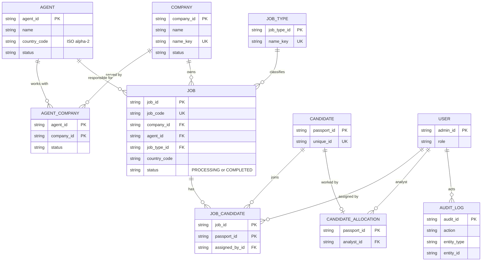

# Client / Agent / Job Management Architecture

**Version:** 1.0
**Status:** Proposed / Pre-Implementation
**Branch:** `version/client-management`
**Date:** 2026-10-14
**Scope:** Architecture and database design for four related pieces of work: (1) this design, (2) Agent Management, (3) Job Management, (4) Company Management. Nothing here is implemented. `prisma/schema.prisma`, migrations, the API and the admin app are unchanged by this phase.

Every model, endpoint and rule below is **PROPOSED, NOT YET IMPLEMENTED** until the decisions in section 18 are confirmed.

---

## 0. Summary of the recommendation

| Topic | Recommendation |
|---|---|
| Naming | Use **Company** in the database, API and UI for the employer. The word "client" already means *candidate* in this codebase (section 1.3) |
| Agent -> Country | One required country code per Agent (`country_code`, ISO 3166-1 alpha-2 string) |
| Agent <-> Company | **Many-to-many** through `agent_company` (covers one-to-many and avoids a destructive migration later) |
| Company -> Job | One-to-many, `RESTRICT` |
| Agent -> Job | One-to-many (responsible Agent), `RESTRICT`; changing it is an audited edit |
| Job <-> Candidate | **Many-to-many** through `job_candidate` (composite key), no candidate data copied |
| Country | **String code validated against an application constant list**, no lookup table yet |
| Job Type | **New small `job_type` table**, seeded from the distinct values already typed on candidates; candidates keep their existing comma-separated field for now |
| Job ID | Internal UUID primary key **plus** a separate human-readable `job_code` (`JOB-2026-000123`) from a per-year counter row inside the creating transaction |
| Job status | String `PROCESSING` / `COMPLETED` with a `CHECK` constraint (matches the repository's existing no-enum convention); reopen allowed for Admin/Manager |
| Work Allocation | Stays completely separate from Job assignment |
| Google Sheet | New tables carry **no** sheet triggers; nothing updates `candidate`, so no sync |
| Audit | Reuse `audit_logs`; add two **nullable** columns (`entity_type`, `entity_id`) for non-candidate entities |
| Deletion | No hard delete in the API; `INACTIVE` for Agent/Company, `COMPLETED` for Job; every foreign key `RESTRICT` except the candidate link |

The decisions that I could not settle from the repository or the brief are in **section 18** and must be confirmed before Phase 2.

---

## 1. Audit of the existing system

### 1.1 What exists today

| Area | Finding | Source |
|---|---|---|
| Prisma models | `User` (staff), `AuditLog`, `Candidate`, `CandidateAllocation`, `Document`, `TemporaryData`, `CandidateAdditionalDetails`, `CandidateStage`, `CandidateCallLog`, `CallLogFollowUp`, `RateLimit`, `SheetSyncQueue`, `SheetSyncRun`, `SheetSyncState`. **No Agent, Company, Job, Country or JobType model** | [schema.prisma](../prisma/schema.prisma) |
| Enums | **None.** Statuses and roles are plain `String` columns with the allowed values in comments, and some `CHECK` constraints written in SQL (for example `call_outcome`) | schema, migration `20261013120000_call_log_outcome` |
| IDs | String IDs generated in the application (`crypto.randomUUID()` for documents, audit rows, call logs). Candidates use the passport ID as key plus a sequential `unique_id` | `candidateService.js` |
| Column naming | snake_case with `@map`; timestamps are `created_date` / `updated_date`; tables are mostly singular (`candidate`, `user`, `candidate_allocation`) | schema |
| Candidate job types | `candidate.job` is **free text**, a comma-separated list (`"Construction Worker, Caregiver"`), up to 10 types of 60 characters, parsed by `parseJobTypes`. There is no job-type table | `candidateService.js`, `CandidateFields.tsx` |
| Country | There is **no country column**. `candidate.nationality` is free text from the passport and is the candidate's citizenship, not a job destination | schema |
| Romania | The document model hard-codes a `ROMANIA` police-report variant (next to `SL_VERIFIED`), i.e. the business is currently single-destination | `candidateService.js` |
| "Job ID" | `candidate_stages.job_id` (Test details stage only) is a **free-text "job ID the admin enters"**, up to 50 characters, mirrored to the Google Sheet. It is not linked to anything | schema, `candidateService.js:257` |
| Candidate stages | Seven stages including `FINALIZING_JOB`; "job type" and "job experience" are inputs to the automatic `CANDIDATE_DETAILS` completeness check | `candidateService.js:366` |
| Work Allocation | `candidate_allocation` (candidate -> Analyst, 1:1, separate table so it never touches `candidate`) | migration `20261014120000_candidate_allocation` |
| Roles | `ADMIN`, `MANAGER`, `ANALYST`, `REGISTRATION_DESK`; route tiers `ALL_ACTIVE`, `CANDIDATE_STAFF`, `ANALYSTS_UP`, `MANAGERS_UP`, `ADMINS_ONLY`, `REGISTRATION_STAFF`; the role is read from the database on every request | `requireRole.js`, `routes/admin.js`, `admin/src/auth/roles.ts` |
| Analyst scope | `candidateAccess.js` is the single place that limits an Analyst to allocated candidates | `candidateAccess.js` |
| Audit | `audit_logs` is append-only (trigger rejects update/delete/truncate). Columns: `admin_id`, `action`, `temporary_id`, `document_id`, `passport_id`, `previous_status`, `new_status` (both required), `reason`, `previous_value`, `new_value`. Categories are listed in `auditLogService.js`. **No generic entity reference** | schema, `auditLogService.js` |
| Sheet sync | Triggers on `candidate`, `candidate_stages`, `documents` queue a sync for that candidate. Call logs, allocations and every new table would not | migration `20261006120000_sheet_sync_outbox` |
| Sidebar | Flat list in [navigation.ts](../admin/src/layout/navigation.ts); each entry has a `roles` list; Settings is last | `navigation.ts` |
| Routes | `/clients` and `/clients/:passportId` exist for the *candidate* "Clients" directory pages | `App.tsx` |
| API conventions | Express router in `routes/admin.js` (688 lines) plus separate routers mounted with `router.use` (`users.js`, `sheetSyncSettings.js`); `parse*Body` functions return `{ errors }` or `{ values }`; errors are `{ message, errors:[{field,message}], code? }`; lists return `{ items, pagination, filters }`; updates use `PUT` | `routes/admin.js` |
| Reports | Daily Report, Overview, Police, Clients read candidate/document/stage data. **None reads agent, company or job data** (those do not exist) | services |

### 1.2 What can be reused

- Audit logging (`audit_logs`, `AUDIT_CATEGORIES`, the audit page): extend, do not duplicate.
- The Work Allocation pattern for **bulk, all-or-nothing, row-locked** writes (`workAllocationService.js`): the model for "Add candidates to Job".
- The "separate relation table instead of touching `candidate`" pattern from `candidate_allocation`.
- Candidate search (`candidateSearchWhere`) and the candidate scope (`candidateScope`) for the "Add to Job" picker and for Analyst visibility.
- RBAC middleware and the `NAV_ITEMS` role lists.
- The `parse*Body` + service + router file layout and the pagination helper `listPagination`.
- Job-type validation rules (trim, no commas, 60 characters, case-insensitive duplicates) so the new Job Type follows the same rules.

### 1.3 Conflicts and things to be careful about

1. **"Client" already means "candidate".** `GET /api/admin/clients`, `ClientsPage`, `ClientDetailsPage`, the audit action `ASSIGN_CLIENT`, `clientName()`, `adminClientService.js` all refer to candidates (legacy naming from before the Candidate rename). A new "Client" (employer) would be ambiguous in routes, code and the audit log. **Use "Company" everywhere** (`/api/admin/companies`, `company` table, `/companies` UI route) and, if the business wants the word "Client" in the UI, show it only as a label.
2. **Two "Job ID" concepts.** The existing free-text `candidate_stages.job_id` and the new Job's human-readable ID are different things that will be confused. See decision D-9.
3. **Two "job type" concepts.** Candidates have free-text job types; a Job needs a controlled one. See section 11.
4. **Country does not exist anywhere.** It is new data, not something to extend.
5. **`audit_logs` has no entity reference.** Agent/Company/Job events need one (section 14).
6. **`migrate dev` cannot be used.** The historical migration `20260924140000_restrict_public_database_access` breaks shadow-database replay (already hit once). Future migrations are written by hand as SQL and applied with `prisma migrate deploy`, like `candidate_allocation` was.
7. **New tables need the SEC-001 treatment** (RLS enabled, privileges revoked from `anon`/`authenticated`), as earlier migrations do.

### 1.4 What needs a new model

`Agent`, `Company`, `AgentCompany`, `Job`, `JobCandidate`, `JobType`, and a small `JobCodeCounter`. Nothing existing can be extended safely: `Candidate` and `User` are the wrong shape, and adding columns to `candidate` would fire the Google Sheet trigger (section 17).

---

## 2. Domain model

| Relationship | Cardinality | Decision |
|---|---|---|
| Country -> Agent | one country, many agents; an Agent has exactly one | `agent.country_code` (required) |
| Agent <-> Company | **many-to-many** | `agent_company` junction |
| Company -> Job | one Company, many Jobs; a Job has exactly one Company | `job.company_id` |
| Agent -> Job | one Agent, many Jobs; a Job has exactly one responsible Agent | `job.agent_id` |
| Job -> Job Type | a Job has one Job Type; a Job Type has many Jobs | `job.job_type_id` |
| Job -> Country | a Job has one country | `job.country_code` (stored, see D-2) |
| Job <-> Candidate | **many-to-many over time** | `job_candidate` junction |
| Candidate <-> Analyst | unchanged, 1:1 allocation | `candidate_allocation`, **not touched** |
| Staff user | creates/edits; recorded in the audit log | no foreign key on these tables except `job_candidate.assigned_by` |

### 2.1 Agent <-> Company: one-to-many vs many-to-many

The brief says an Agent can work with several Companies, and a Company may have "one or more Agents depending on the final business model". A direct `company.agent_id` (one Agent per Company) would force a destructive migration the day a second Agent works with the same Company, or an Agent is replaced and the history of who handled the Company must survive. A junction table costs one table now and never has to be undone, and it still supports the simple case (exactly one active link per Company). **Recommendation: many-to-many through `agent_company`.**

### 2.2 Job <-> Candidate: A (one Job only) vs B (many Jobs over time)

Evidence in the repository: no candidate field refers to a job; `candidate_stages.job_id` is free text; stage `FINALIZING_JOB` marks one candidate being finalised for a job but does not say one-job-only. The brief says "A Candidate may later be assigned to one or more Jobs depending on the business rule".

- **A. One Candidate belongs to one Job only.** Simple (a nullable `job_id` on a link row), but a candidate who finishes or is dropped from Job 1 can never join Job 2 without losing history, and it cannot be relaxed later without a migration.
- **B. Many Jobs over time.** A junction with a composite key `(job_id, passport_id)`. It also supports A as a **rule** enforced in the service layer ("a candidate can be in at most one PROCESSING Job"), which can be switched on or off without changing the schema.

**Recommendation: B (junction), with the "one PROCESSING Job at a time" rule as decision D-1.** My default proposal for that rule is to enforce it, because a candidate is normally processed for one employer at a time; the business must confirm.

---

## 3. Agent model

Fields (each justified):

| Field | Why |
|---|---|
| `agent_id` (UUID, PK) | Stable internal ID, app-generated like other IDs |
| `name` | Required. Shown in lists |
| `country_code` | Required; the Agent's one country (ISO 3166-1 alpha-2) |
| `contact_number`, `email` | Optional. An Agent is a broker/contact person, so staff need a way to reach them. Not in the brief: **recommendation**, drop if not wanted |
| `status` | `ACTIVE` / `INACTIVE` instead of deleting (section 15) |
| `created_date`, `updated_date` | Repository convention |

No `created_by`: the audit log records who did it. No address, no notes (not requested).

List page columns: Agent, Country, **Ongoing Jobs**, **Processing**, status. The brief does not define these two counts; interpretations in D-7.

---

## 4. Company model

A dedicated table is required (the Company must be shared by several Agents and own many Jobs).

| Field | Why |
|---|---|
| `company_id` (UUID, PK) | Internal ID |
| `name` | Required, shown everywhere |
| `name_key` | Lower-cased, trimmed, whitespace-collapsed copy of `name`, **unique**: stops "ABC Ltd" / "abc ltd" duplicates. Prisma cannot declare a functional unique index, so the key is stored |
| `country_code` | Optional: where the Company is based. Not authoritative for Jobs (D-2) |
| `status` | `ACTIVE` / `INACTIVE` |
| `created_date`, `updated_date` | Convention |

Contact details, address, registration number: not requested; leave out.

---

## 5. AgentCompany (Agent <-> Company)

`agent_company(agent_id, company_id)` composite primary key, `status` (`ACTIVE` / `INACTIVE`), `created_date`, `ended_date`.

- A link is **ended** (status `INACTIVE`, `ended_date` set), never deleted, so "who handled this Company" stays answerable.
- Re-linking after an end reactivates the same row (the key is unique); the earlier period is kept in the audit log.
- Jobs do **not** reference this table with a foreign key: ending a link must never be blocked by, or corrupt, historical Jobs. The rule "a Job's Agent and Company must be actively linked **when the Job is created**" is checked in the service (D-3).

---

## 6. Job model

| Field | Notes |
|---|---|
| `job_id` | UUID primary key (internal, used in URLs/FKs) |
| `job_code` | Human-readable, unique (section 7) |
| `company_id` | Required, `RESTRICT` |
| `agent_id` | Required, the responsible Agent, `RESTRICT` |
| `job_type_id` | Required, `RESTRICT` |
| `country_code` | Required, stored on the Job (snapshot) so filtering and history survive an Agent change (D-2) |
| `vacancies` | Optional positive integer: how many people the requirement needs. **Not in the brief**; include only if the business wants "filled / needed" counts (D-8) |
| `status` | `PROCESSING` or `COMPLETED` |
| `created_date`, `updated_date` | Convention |
| `completed_date` | Set when completed, cleared on reopen |

Candidate count is **derived** (`COUNT` on `job_candidate`), never stored.

---

## 7. Job ID strategy

Requirements: unique, safe under concurrent creation, not row-count based, readable.

**Recommendation:** keep two identifiers.

1. `job_id`: UUID primary key. Never shown; used in the API and foreign keys, so a corrected code can never break a relation.
2. `job_code`: `JOB-<year>-<6 digits>` (for example `JOB-2026-000123`), `UNIQUE`.

Generation: a one-row-per-year counter table updated **inside the same transaction that inserts the Job**:

```sql
INSERT INTO job_code_counter (year, last_value) VALUES ($1, 1)
ON CONFLICT (year) DO UPDATE SET last_value = job_code_counter.last_value + 1
RETURNING last_value;
```

The row lock serialises concurrent creators, the number rolls back with the transaction (no gaps from failed creates), and the same upsert-counter pattern is already used by the rate limiter. The year comes from the database clock in the business time zone (Asia/Colombo, as in `businessDay.js`). `UNIQUE(job_code)` is the final guard.

Alternatives rejected: `count(*) + 1` or `max + 1` (race-prone: the candidate `nextUniqueId` works this way and relies on retry-on-collision); a plain Postgres sequence (simple and safe, but gaps on rollback and no yearly reset). A single global sequence is an acceptable simplification if the year prefix is not wanted (D-6).

---

## 8. Job status and lifecycle

Two stored states are enough for the stated UI: **`PROCESSING`** and **`COMPLETED`**. No `DRAFT`, `CANCELLED`, `ON_HOLD` yet: nothing in the requirements needs them, and a string status with a `CHECK` constraint can gain values later without a table rewrite.

| Question | Proposal |
|---|---|
| When does Processing start? | At creation. A new Job is `PROCESSING` |
| When is it Completed? | Manager/Admin presses **Complete** (`POST /jobs/:id/complete`); `completed_date` is set |
| Can it reopen? | Yes, Admin/Manager, audited, `completed_date` cleared (D-5). Safer than locking a mistake in |
| Candidate links on completion | **Kept unchanged.** The Job is a historical record of who was on it |
| Edits to a completed Job | Blocked, except reopen (and `notes`-type fields if added later) |
| Adding/removing candidates on a completed Job | Blocked until reopened |
| Candidate lifecycle | A completed Job releases the "one PROCESSING Job" rule for its candidates automatically (the rule looks at Job status) |

---

## 9. JobCandidate

`job_candidate(job_id, passport_id)` **composite primary key**, `assigned_date`, `assigned_by_id` (staff `admin_id`).

- No candidate details are copied (only the passport ID reference).
- Duplicate assignment to the same Job is impossible (primary key).
- **Removal deletes the row** and writes a `REMOVE_CANDIDATE_FROM_JOB` audit entry. History of who was on a Job and when they left is in `audit_logs` (the brief asks to reuse it, not to build a history table). If the business wants removed candidates to stay visible on the Job screen, switch to a `removed_date` soft removal with a partial unique index (decision D-4); the model below shows that alternative in a comment.
- The same candidate in several Jobs over time is natural (different `job_id`).
- Candidate deletion (not an application action today; possible as a database operation for erasure): the link cascades with the candidate, like the other candidate child tables. Audit rows remain.
- Adding is **bulk and all-or-nothing** with the candidates locked `FOR UPDATE` (as in Work Allocation), up to a fixed maximum per request.

---

## 10. Country strategy

| Option | Pros | Cons |
|---|---|---|
| A. Free string | zero setup | "Romania"/"romania"/"RO" fragment filters and reports |
| B. DB enum / `CHECK` list | consistent | changing the list needs a migration; the repository has no enums |
| **C. Lookup table** | metadata (names, regions, active flag) | a table and joins for ~200 constant values; no metadata is needed today |

**Recommendation:** store an **ISO 3166-1 alpha-2 code** (`CHAR(2)`, for example `RO`, `LK`) and validate it in the application against one constant list shared by backend and frontend (names from `Intl.DisplayNames`). Filtering and grouping by code is exact and cheap, the data is already normalised for a later lookup table (a foreign key can be added without rewriting data), and nothing is added that nobody uses yet. Revisit if per-country settings appear (D-2, D-10).

`candidate.nationality` is **not** reused or changed: it means citizenship.

---

## 11. Job Type strategy

Today a candidate's job types are free text in one column. A Job needs a controlled value so that Agents, Companies and Jobs filter and report consistently, and the same name must mean the same thing for candidates.

| Option | Verdict |
|---|---|
| Free string on Job, same rules as candidates | Simple, but spelling drift fragments counts and matching |
| **New `job_type` table** (`name`, `name_key` unique, `status`) referenced by Job | Recommended: one controlled list, small |
| Normalise candidate job types now (junction `candidate_job_type`) | Correct long term but touches `candidate` and the Sheet sync and the `CANDIDATE_DETAILS` rule; **out of scope** |

**Recommendation:** add `job_type`, **seed it from the distinct, normalised values already typed on `candidate.job`** (one-off backfill, see section 23), and leave the candidate field exactly as it is. Matching a candidate to a Job is then a **suggestion** in the "Add to Job" picker (case-insensitive comparison of the Job Type name with the candidate's parsed list), never a constraint. Creating a Job Type is done by Admin/Manager from the Job form ("create if missing"), with the same validation as the candidate field (trim, no commas, 60 characters, case-insensitive unique). This avoids two incompatible concepts while keeping one possible future step (normalising the candidate side).

---

## 12. Proposed Prisma models

> **PROPOSED, NOT YET IMPLEMENTED.** Conceptual only. The real models will be written in Phase 2 after the decisions in section 18. Conventions follow the existing schema (string IDs generated in the app, `created_date`/`updated_date`, snake_case `@map`, status strings with comments, no Prisma enums). Partial unique indexes, `CHECK` constraints and RLS are SQL in the migration (Prisma cannot express them), as in earlier migrations.

```prisma
// PROPOSED — NOT YET IMPLEMENTED
// Controlled list of job types (Job.jobTypeId). Seeded from candidate.job.
model JobType {
  jobTypeId   String   @id @map("job_type_id")
  name        String
  // lower(trim(name)) with collapsed spaces: the case-insensitive unique key
  nameKey     String   @unique @map("name_key")
  // ACTIVE | INACTIVE (CHECK constraint in SQL)
  status      String   @default("ACTIVE")
  createdDate DateTime @default(now()) @map("created_date")
  updatedDate DateTime @updatedAt @map("updated_date")

  jobs Job[]

  @@map("job_type")
}

// PROPOSED — NOT YET IMPLEMENTED
// A broker/contact person in one country.
model Agent {
  agentId       String   @id @map("agent_id")
  name          String
  // ISO 3166-1 alpha-2, validated in the application (CHECK ~ '^[A-Z]{2}$' in SQL)
  countryCode   String   @map("country_code") @db.Char(2)
  contactNumber String?  @map("contact_number")
  email         String?
  // ACTIVE | INACTIVE (CHECK in SQL)
  status        String   @default("ACTIVE")
  createdDate   DateTime @default(now()) @map("created_date")
  updatedDate   DateTime @updatedAt @map("updated_date")

  companies AgentCompany[]
  jobs      Job[]

  @@index([countryCode])
  @@index([status, name])
  @@map("agent")
}

// PROPOSED — NOT YET IMPLEMENTED
// An employer. Shared by several Agents; owns many Jobs.
model Company {
  companyId   String   @id @map("company_id")
  name        String
  // lower(trim(name)), spaces collapsed: duplicate guard
  nameKey     String   @unique @map("name_key")
  countryCode String?  @map("country_code") @db.Char(2)
  // ACTIVE | INACTIVE (CHECK in SQL)
  status      String   @default("ACTIVE")
  createdDate DateTime @default(now()) @map("created_date")
  updatedDate DateTime @updatedAt @map("updated_date")

  agents AgentCompany[]
  jobs   Job[]

  @@index([status, name])
  @@map("company")
}

// PROPOSED — NOT YET IMPLEMENTED
// Which Agents work with which Companies. A link is ended, never deleted.
model AgentCompany {
  agentId     String    @map("agent_id")
  companyId   String    @map("company_id")
  // ACTIVE | INACTIVE (CHECK in SQL)
  status      String    @default("ACTIVE")
  createdDate DateTime  @default(now()) @map("created_date")
  endedDate   DateTime? @map("ended_date")

  agent   Agent   @relation(fields: [agentId], references: [agentId], onDelete: Restrict, onUpdate: Cascade)
  company Company @relation(fields: [companyId], references: [companyId], onDelete: Restrict, onUpdate: Cascade)

  @@id([agentId, companyId])
  @@index([companyId, status])
  @@map("agent_company")
}

// PROPOSED — NOT YET IMPLEMENTED
// A recruitment requirement of one Company, handled by one Agent.
model Job {
  jobId         String    @id @map("job_id")
  // JOB-<year>-<6 digits>, generated in the creating transaction (job_code_counter)
  jobCode       String    @unique @map("job_code")
  companyId     String    @map("company_id")
  agentId       String    @map("agent_id")
  jobTypeId     String    @map("job_type_id")
  countryCode   String    @map("country_code") @db.Char(2)
  // Optional, only if the business wants "needed vs filled" (decision D-8)
  vacancies     Int?
  // PROCESSING | COMPLETED (CHECK in SQL)
  status        String    @default("PROCESSING")
  completedDate DateTime? @map("completed_date")
  createdDate   DateTime  @default(now()) @map("created_date")
  updatedDate   DateTime  @updatedAt @map("updated_date")

  company    Company        @relation(fields: [companyId], references: [companyId], onDelete: Restrict, onUpdate: Cascade)
  agent      Agent          @relation(fields: [agentId], references: [agentId], onDelete: Restrict, onUpdate: Cascade)
  jobType    JobType        @relation(fields: [jobTypeId], references: [jobTypeId], onDelete: Restrict, onUpdate: Cascade)
  candidates JobCandidate[]

  @@index([status, createdDate(sort: Desc)])
  @@index([agentId, status])
  @@index([companyId, status])
  @@index([countryCode])
  @@index([jobTypeId])
  @@map("job")
}

// PROPOSED — NOT YET IMPLEMENTED
// Candidates on a Job. References the candidate only; no candidate data here.
model JobCandidate {
  jobId        String   @map("job_id")
  passportId   String   @map("passport_id")
  assignedDate DateTime @default(now()) @map("assigned_date")
  assignedById String   @map("assigned_by_id")
  // Alternative if removed candidates must stay visible (D-4): add
  //   removedDate DateTime? @map("removed_date")
  // and replace the primary key with a UUID plus a partial unique index
  //   UNIQUE (job_id, passport_id) WHERE removed_date IS NULL   (SQL only)

  job        Job       @relation(fields: [jobId], references: [jobId], onDelete: Restrict, onUpdate: Cascade)
  candidate  Candidate @relation(fields: [passportId], references: [passportId], onDelete: Cascade, onUpdate: Cascade)
  assignedBy User      @relation(fields: [assignedById], references: [adminId], onDelete: Restrict, onUpdate: Cascade)

  @@id([jobId, passportId])
  @@index([passportId])
  @@index([jobId, assignedDate])
  @@map("job_candidate")
}

// PROPOSED — NOT YET IMPLEMENTED
// One row per year; incremented inside the Job insert transaction.
model JobCodeCounter {
  year      Int @id
  lastValue Int @map("last_value")

  @@map("job_code_counter")
}
```

Additive changes to existing models (also proposed): back-relations only (`Candidate.jobCandidates JobCandidate[]`, `User.assignedJobCandidates JobCandidate[]`), which create **no column** on `candidate` or `user`. And two nullable columns on `AuditLog` (section 14):

```prisma
// PROPOSED — NOT YET IMPLEMENTED (AuditLog additions)
//   entityType String? @map("entity_type")   // AGENT | COMPANY | JOB | JOB_TYPE
//   entityId   String? @map("entity_id")
//   @@index([entityType, entityId, createdDate])
```

SQL-only items in the migrations: `CHECK` constraints for the status values, `country_code ~ '^[A-Z]{2}$'`, `vacancies > 0`; RLS + `REVOKE … FROM anon, authenticated` on every new table.

---

## 13. ER diagram



`country_code` is a plain attribute (not an entity): see section 10. `CANDIDATE_ALLOCATION` is shown only to make clear it is a separate relation.

---

## 14. Audit log design

Reuse `audit_logs`; no history tables.

| Action | When | `passport_id` | Entity | `previous_value` / `new_value` |
|---|---|---|---|---|
| `CREATE_AGENT`, `UPDATE_AGENT` | create / edit (including company link changes) | null | AGENT + id | changed fields as `{field: value}` JSON |
| `CREATE_COMPANY`, `UPDATE_COMPANY` | same | null | COMPANY + id | same |
| `CREATE_JOB_TYPE` | a new job type is created | null | JOB_TYPE + id | name |
| `CREATE_JOB`, `UPDATE_JOB` | create / edit (an Agent change is an `UPDATE_JOB` with both agents in the JSON) | null | JOB + id | JSON, includes `jobCode` |
| `COMPLETE_JOB`, `REOPEN_JOB` | status change | null | JOB + id | status `PROCESSING` -> `COMPLETED` (uses `previous_status`/`new_status`) |
| `ADD_CANDIDATE_TO_JOB` | per candidate added | **the candidate** | JOB + id | `{jobId, jobCode}` |
| `REMOVE_CANDIDATE_FROM_JOB` | per candidate removed | **the candidate** | JOB + id | same |

Notes:

- `previous_status` / `new_status` are required columns; use `NONE` on creation (as the follow-up flag already does) and `ACTIVE`/`INACTIVE` or `PROCESSING`/`COMPLETED` where meaningful.
- Candidate-job actions carry the candidate's `passport_id`, so the existing audit page already shows the candidate name, and Analyst-scoped audit counts follow the candidate.
- **Recommended additive change:** two nullable columns `entity_type`, `entity_id` with an index, so "history of Job X / Agent Y" is a direct query. The alternative (the ID only inside `new_value` JSON) needs no schema change but cannot be indexed or filtered (decision D-11).
- New categories in `AUDIT_CATEGORIES`: `AGENT`, `COMPANY`, `JOB`; the admin audit page gets matching labels. The append-only trigger is unaffected.
- Audit writes happen in the **same transaction** as the change, as in Work Allocation.

---

## 15. Deletion and archiving

No `DELETE` endpoint for Agent, Company, Job or Job Type in the first version.

| Entity | Strategy | Foreign keys |
|---|---|---|
| Agent | `status = INACTIVE`; stays on historic Jobs; cannot be chosen for new Jobs | `RESTRICT` from `job`, `agent_company` |
| Company | `status = INACTIVE`; same | `RESTRICT` |
| Job Type | `INACTIVE`; hidden from pickers; historic Jobs keep it | `RESTRICT` |
| Job | never deleted; `COMPLETED` is the end state (a Job created by mistake: Admin edit, or an audited cancel if D-5 adds a status) | `RESTRICT` |
| AgentCompany | link ended (`INACTIVE`, `ended_date`) | `RESTRICT` |
| JobCandidate | row deleted on removal (audited); cascades only if the candidate itself is erased | candidate: `CASCADE`; job: `RESTRICT` |

Deactivating an Agent who still has `PROCESSING` Jobs: block (recommended) or allow and show a warning (D-12). `SET NULL` is deliberately not used anywhere: a Job must never lose its Agent or Company.

---

## 16. Indexing and performance

Expected queries and the index that serves each (no index without a use):

| Query | Index |
|---|---|
| Agent list filtered by country / status, ordered by name | `agent(country_code)`, `agent(status, name)` |
| Company list / search by name; duplicate check | `company.name_key` unique; `company(status, name)` |
| Job lists: Processing / Completed tab, newest first | `job(status, created_date DESC)` |
| Agent detail and Agent-list counts (`GROUP BY agent_id, status`) | `job(agent_id, status)` |
| Company detail, Job filter by Company | `job(company_id, status)` |
| Job filter by country, job type | `job(country_code)`, `job(job_type_id)` |
| Open a Job by code | `job.job_code` unique |
| Job candidates list; counts per Job | primary key `(job_id, passport_id)`; `(job_id, assigned_date)` for ordering |
| A candidate's Jobs; "already in a PROCESSING Job?" rule | `job_candidate(passport_id)` |
| Agents of a Company, Companies of an Agent | primary key `(agent_id, company_id)`; `agent_company(company_id, status)` |
| Audit history of one entity | `audit_logs(entity_type, entity_id, created_date)` (if D-11 accepted) |

Lists are server-side paginated (default 25, maximum 100, like the audit page). Agent-list counts are computed with one grouped query per page, not per row. These tables are small compared with candidates, so no extra search indexing (no trigram) is proposed.

---

## 17. Candidate access, Work Allocation and Google Sheet

### 17.1 Work Allocation vs Job assignment (different concepts)

| | Work Allocation | Job assignment |
|---|---|---|
| Question | Which **Analyst** owns the operational work on this candidate? | Which **employer Job** is this candidate connected to? |
| Table | `candidate_allocation` (candidate -> staff user) | `job_candidate` (candidate -> Job) |
| Managed by | Admin, Manager | Admin, Manager (proposed) |
| Affects Analyst visibility | **Yes** (the only thing that does) | **No** |

They are never combined: no column, no shared table, no cascade between them. Allocating a candidate does not add them to a Job, and adding them to a Job does not allocate them.

Interaction rules (proposed, D-13):

- An Analyst sees a Job's candidate list **only for candidates allocated to them** (the existing `candidateScope`, applied in the query); other candidates on the Job are not listed and not counted for that Analyst.
- Analysts **cannot** add or remove candidates on Jobs by default (Admin/Manager do). The candidate detail page can later show a read-only "Jobs" panel for the candidates the user may see.
- "Add to Job" search for Admin/Manager is over all candidates; it does not use or change allocation.

### 17.2 Google Sheet impact

The sync is triggered by changes on `candidate`, `candidate_stages` and `documents`. `agent`, `company`, `agent_company`, `job`, `job_type`, `job_candidate` and `job_code_counter` have **no trigger**, and none of the proposed writes updates a candidate row (so `candidate.updated_date` is untouched). Result: creating Agents/Companies/Jobs and adding or removing candidates **does not enqueue or write anything to the Sheet**. Adding a column to `candidate` would have; this design avoids it.

Implications and watch points:

- The Sheet will not show Job/Company/Agent for a candidate. If the business later wants that, it needs a new capture trigger on `job_candidate`, a mapper change and new Sheet columns: a separate piece of work.
- The existing `candidate_stages.job_id` (free text) keeps syncing as before. The new Job code must not be written there automatically.
- Do not backfill or touch `candidate` rows in the migrations (a bulk update would queue every candidate).
- The sync-engine "deletion guard" is unaffected.

---

## 18. Business decisions requiring confirmation

Each is a real ambiguity in the brief. Defaults below are my recommendation, not a decision.

| # | Question | Option A | Option B | Recommendation | Impact |
|---|---|---|---|---|---|
| **D-1** | Can a candidate be on more than one **PROCESSING** Job at once? | Yes, unrestricted | No: reject adding to a second PROCESSING Job | **B** (service rule, no schema change either way) | Add-to-Job validation and its error message |
| **D-2** | Where does a Job's **country** come from? | Always the Agent's country (derived, stored as snapshot) | Independent, chosen per Job | **A**, stored on the Job; if an Agent is later replaced by one from another country, the Job keeps its country (explicit override) | Job form, filters, reports; can an Agent in Sri Lanka manage a Romanian Job? Under A: no |
| **D-3** | Must the Job's Agent and Company be **actively linked** (AgentCompany)? | Yes, validated at creation; Company picker shows only the Agent's Companies | No, linking is created automatically | **A** | Job form flow; Agent B taking over Company X's Job needs an active link first |
| **D-4** | When a candidate is removed from a Job, must the Job still show them as "removed"? | No (history only in the audit log) | Yes (soft removal) | **A** | `job_candidate` shape (composite key vs UUID + partial unique) |
| **D-5** | Can a COMPLETED Job be **reopened**, and is there a cancel/archived state? | Reopen allowed (Admin/Manager), no other states | Completed is final; add `CANCELLED` | **A** | Status `CHECK`, UI buttons |
| **D-6** | Job code format | `JOB-2026-000123` per-year counter | Single global number (`JOB-000123`) | **A** | Counter table vs a plain sequence |
| **D-7** | What do the Agent list columns mean? **Ongoing Jobs** / **Processing** | Ongoing = Agent's PROCESSING Jobs; Processing = candidates currently in those Jobs | Ongoing = all non-completed Jobs of the Agent; Processing = the same count | **A** | Aggregation queries; needs the owner's wording |
| **D-8** | Does a Job have a **number of vacancies** (needed vs filled)? | No | Yes (`vacancies`, "3 of 10 filled") | **B only if used**; otherwise leave out | One nullable column and one report |
| **D-9** | The existing free-text `candidate_stages.job_id` (Test details) | Leave unrelated | Later: validate or link it to `job_code` | **A** for now | Avoids a Sheet-visible change; revisit when Jobs are in use |
| **D-10** | Can a **Company** span several countries / need a country at all? | Optional single country, informational | No company country | **A** (optional) | Company form only |
| **D-11** | Audit entity reference | Add `entity_type`/`entity_id` columns | Put the ID inside `new_value` JSON | **A** | One additive nullable migration vs no schema change; indexed history queries |
| **D-12** | Deactivate an Agent/Company with PROCESSING Jobs | Block | Allow with warning | **A** | Validation message |
| **D-13** | Analyst permissions on Jobs | View-only, scoped to allocated candidates | No access to Jobs at all | **A** | Sidebar visibility, route tier |
| **D-14** | Agent name uniqueness | Unique per country (case-insensitive) | Duplicates allowed (warn) | **B** with a duplicate warning (two real people can share a name) | Index and error handling |
| **D-15** | Can Registration Desk see Jobs (for example to register a candidate for a Job)? | No (Candidates area only, as today) | Read-only | **A** | Role lists |

---

## 19. Validation rules

Rules marked *(rec.)* are my recommendations, not stated requirements.

**Agent:** `name` required, trimmed, 1-100 characters; `country_code` required, in the constant country list; `contact_number`/`email` optional, validated like the existing candidate fields *(rec.)*; every company in the list must exist and be `ACTIVE`; no duplicate company in the list; status `ACTIVE`/`INACTIVE`.

**Company:** `name` required, trimmed, 1-150 characters; `name_key` unique (409 with the existing company shown); optional `country_code` valid; linked agents must exist and be `ACTIVE`.

**Job Type:** same rules as the candidate field (trim, no commas, ≤ 60 characters), case-insensitive unique.

**Job:** `company_id`, `agent_id`, `job_type_id` required and existing and `ACTIVE`; Agent and Company actively linked (D-3); `country_code` per D-2; `status` is not accepted on create (always `PROCESSING`) and changes only through `complete` / `reopen`; `job_code` is never accepted from the client; `vacancies` positive integer if present (D-8); a COMPLETED Job rejects edits and candidate changes (409 `JOB_COMPLETED`).

**JobCandidate:** Job exists and is `PROCESSING`; every passport ID exists (404/409 for any missing one, nothing changed); no repeat in the request; a candidate already on this Job is reported (`ALREADY_ON_JOB`, nothing changed, or idempotent skip: choose when implementing); D-1 rule; maximum per request (500, like Work Allocation) *(rec.)*; all or nothing in one transaction.

All errors use the existing shape: `400 { message, errors:[{field,message}] }`, domain conflicts `409 { message, code }`.

---

## 20. API design

Proposed, aligned with the current style: kebab-case paths under `/api/admin`, one router file per module mounted with `router.use` (like `users.js`), `PUT` for updates (candidates use `PUT`; partial bodies are accepted), explicit action routes for state changes (like `/work-allocation/assign`).

| Method | Path | Purpose |
|---|---|---|
| GET | `/agents?search&country&status&page&pageSize` | list with Ongoing Jobs / Processing counts |
| POST | `/agents` | create (name, country, companyIds[]) |
| GET | `/agents/:agentId` | detail (companies, job counts) |
| PUT | `/agents/:agentId` | edit fields and the company set (adds/ends links) |
| GET | `/companies?search&status&page` | list |
| POST | `/companies` | create (name, optional country, agentIds[]) |
| GET | `/companies/:companyId` | detail (agents, jobs) |
| PUT | `/companies/:companyId` | edit and the agent set |
| GET | `/job-types?status` / POST `/job-types` | picker list / create |
| GET | `/jobs?status=PROCESSING\|COMPLETED&agentId&companyId&country&jobTypeId&search&page` | list with candidate counts |
| POST | `/jobs` | create |
| GET | `/jobs/:jobId` | detail |
| PUT | `/jobs/:jobId` | edit (not when COMPLETED) |
| POST | `/jobs/:jobId/complete` / `/reopen` | lifecycle |
| GET | `/jobs/:jobId/candidates?page` | candidates on the Job (Analyst: scoped) |
| GET | `/jobs/:jobId/candidates/available?search&page` | picker: candidates not on this Job (job-type match flagged) |
| POST | `/jobs/:jobId/candidates` `{ candidateIds[] }` | add, bulk, all or nothing |
| DELETE | `/jobs/:jobId/candidates/:passportId` | remove one |
| GET | `/candidates/:passportId/jobs` | a candidate's Jobs (scoped like the candidate) |

Notes: lists return `{ items, pagination, filters }`; no `DELETE` for the entities themselves; the Job is addressed by its internal ID in URLs, and `job_code` is searchable and displayed.

---

## 21. RBAC design

Current roles and tiers are in section 1.1. Proposed matrix (**requirements do not define this; every cell is a recommendation pending D-13 / D-15**):

| Action | ADMIN | MANAGER | ANALYST | REGISTRATION_DESK |
|---|---|---|---|---|
| View Agents / Companies | yes | yes | read-only | no |
| Create / edit Agent, Company, Job Type | yes | yes | no | no |
| View Jobs | yes | yes | read-only (own allocated candidates only) | no |
| Create / edit Job | yes | yes | no | no |
| Complete / reopen Job | yes | yes | no | no |
| Add / remove candidates on a Job | yes | yes | no | no |
| Deactivate Agent / Company | yes | yes | no | no |

Implementation pattern: new tier constants next to the existing ones (`JOB_VIEW_ROLES`, `JOB_MANAGE_ROLES = MANAGERS_UP`), `requireRole` on every route (the backend is authoritative; the sidebar only hides entries), and the Analyst candidate scope applied inside the query, not in the browser.

---

## 22. UI architecture (high level)

- **Agent page:** table (Agent, Country, Ongoing Jobs, Processing, status) with search and country/status filters; **Add Agent** form (name, country, add multiple Companies, optional contact); Agent detail/edit with the Company list and its Jobs.
- **Job page:** two views, **Processing** and **Completed**; table (Job code, Job Type, Country, Agent, Company, candidate count); Job detail with candidates, **Add to Job** (search/select existing candidates, bulk), remove, Complete / Reopen.
- **Company page:** needed (the Company is shared by Agents and owns Jobs): table, Add Company, detail with Agents and Jobs.
- Same patterns as the existing pages: server-side pagination, URL query parameters for filters, the `Pager`, `ActionDialog`, `EmptyState`/`ErrorState` components. Not designed in detail here.

**Sidebar placement** (no unrelated reordering): insert **Agent**, **Job**, **Company** directly after **Work Allocation** and before **Missing Documents**, using the same `roles` mechanism. Final labels: "Agent", "Job", "Company" (D-13 decides whether Analysts see Job).

---

## 23. Migration plan (future; nothing created now)

All migrations are **hand-written, additive SQL** applied with `prisma migrate deploy` (never `migrate dev`, section 1.3). Each is independently deployable and reversible.

| # | Contents | Existing data | Backfill | Rollback |
|---|---|---|---|---|
| 1 | `job_type`, `agent`, `company`, `agent_company` + `CHECK`s + RLS/REVOKE; `audit_logs.entity_type`, `entity_id` (nullable) + index | none touched | optional one-off `INSERT INTO job_type` from distinct normalised values of `candidate.job` (read-only on `candidate`) | drop the new tables and columns (no data depends on them yet) |
| 2 | `job_code_counter`, `job` + `CHECK`s + indexes + RLS | none | none (no historical jobs) | drop (empty before use) |
| 3 | `job_candidate` + indexes + RLS | none | none | drop |

Why three and not one: each stage can be deployed, tested and rolled back on its own; Agent/Company/Job Type are useful before Jobs exist, and `job_candidate` is the only one that references `candidate`. All new columns are nullable or have defaults; no existing column changes; no `candidate` row is updated (so no Sheet sync is triggered). Rollback after real data exists is a forward fix (deactivate), not a drop. Update the in-repo test database setup (the PGlite helper applies every migration) and the audit category lists in the same releases.

---

## 24. Implementation order

1. **Phase 1:** approve this document and the section 18 decisions.
2. **Phase 2:** migration 1 and schema models for Agent, Company, AgentCompany, Job Type; audit columns; tests on a real PostgreSQL (PGlite, as the allocation tests do).
3. **Phase 3:** Agent backend + UI (list, add with companies, edit).
4. **Phase 4:** Company backend + UI.
5. **Phase 5:** migration 2, Job backend + UI (Processing/Completed, create, edit, complete/reopen).
6. **Phase 6:** migration 3, Job <-> Candidate (bulk add, remove, picker, Analyst scope).
7. **Phase 7:** integrations: candidate "Jobs" panel, audit page categories/labels, optional report columns.
8. **Phase 8:** documentation and the full test matrix.

Order differs from the brief's example only by putting Company before Job (a Job needs both), and by making the audit-column change part of the first migration.

---

## 25. Test plan (future)

**Backend (PostgreSQL via PGlite, real Prisma client, real router):** CRUD for Agent, Company, Job Type, Job; relationships (Agent-Company link add/end/re-link; Job requires an active link, D-3); validation per section 19; duplicate Company/Job Type names (case and spacing); Job code uniqueness under **concurrent creation** (many parallel creates, no duplicates, no gaps on rollback); status rules (create = PROCESSING, complete, reopen, completed Job rejects edits and candidate changes); candidate assignment (bulk, all-or-nothing, duplicate on same Job, missing passport, D-1 rule, locking under two concurrent managers); RBAC for every route and role; Analyst sees only allocated candidates on a Job; deactivation/archival behaviour and `RESTRICT`s; audit entries for every action in one transaction; **no `candidate` row changes and no `sheet_sync_queue` rows** after Job/candidate operations; migrations apply cleanly on an empty database.

**Frontend:** forms (required fields, multiple Companies), tables, search, filters, pagination, Processing/Completed views, Add to Job (select, bulk, errors, stale-state refresh after a 409, as in Work Allocation), Complete/Reopen, relationship editing, role-based sidebar and restricted pages.

**Integration:** Agent -> Company -> Job -> Candidate end to end; Work Allocation unaffected (allocating does not change Jobs; Job changes do not change allocation); Analyst scope across both; Google Sheet sync untouched.

---

## 26. Risks

| Risk | Mitigation |
|---|---|
| Duplicate Company / Job Type names | `name_key` unique, normalised in one function |
| Agent reassignment on an existing Job | explicit audited edit; rule D-2/D-3; history in `audit_logs` |
| Conflicting country ownership (Agent country vs Job country) | D-2; store the Job's country as a snapshot |
| Two Job Type concepts (candidate free text vs `job_type`) | one controlled list, seeded from candidates, matching is advisory; revisit normalising candidates later |
| Confusion between `candidate_stages.job_id` and the new Job code | D-9; different names in the UI ("Test job ID" vs "Job") |
| "Client" naming collision | use "Company" in code and routes |
| Candidate on several Jobs | junction model; D-1 rule in the service |
| Completed Job mutation | blocked by status checks in the service inside the transaction |
| Historical integrity | `RESTRICT` everywhere, no hard delete, no `SET NULL` |
| Hidden Sheet sync cost | no writes to `candidate`, no triggers on new tables |
| Audit log growth / unfilterable entity history | add `entity_type`/`entity_id` + index (D-11) |
| `migrate dev` unusable | hand-written SQL + `migrate deploy` |
| New tables exposed through Supabase's public API | RLS + revoke in each migration (SEC-001) |
| Large "Add to Job" requests | cap per request, one locked transaction, 409 on conflict |

---

## 27. Open questions / decisions required

Mandatory list (the same items as section 18, in short form):

1. D-1: can a candidate be on several PROCESSING Jobs at once?
2. D-2: is a Job's country derived from the Agent or independent? Can a Sri Lankan Agent run a Romanian Job?
3. D-3: must Agent and Company be actively linked for a Job?
4. D-4: do removed candidates stay visible on the Job?
5. D-5: can a completed Job reopen; is a cancel state needed?
6. D-6: Job code format and yearly reset.
7. D-7: exact meaning of "Ongoing Jobs" and "Processing" in the Agent list.
8. D-8: vacancy count per Job?
9. D-9: what to do with the existing free-text Test-stage `job_id`.
10. D-10: does a Company have a country, or several?
11. D-11: audit entity columns or JSON only.
12. D-12: deactivating an Agent/Company that has PROCESSING Jobs.
13. D-13/D-15: Analyst and Registration Desk access to Agents, Companies and Jobs.
14. D-14: Agent name uniqueness.
15. Is the word "Client" required in the UI (label only), given the existing candidate "Clients" pages?
16. Expected volumes (Agents, Companies, Jobs per year, candidates per Job) for the maximum request size and list defaults.
17. Is the business staying single-destination (Romania document variants exist) or becoming multi-country with country-specific requirements?

---

## 28. Final proposed architecture summary

```
Agent
  - belongs to one Country (country_code)
  - many-to-many Companies (agent_company, links ended not deleted)
  - one-to-many Jobs (responsible Agent)

Company
  - many-to-many Agents (agent_company)
  - one-to-many Jobs
  - unique normalised name; optional country

Job
  - belongs to one Company, one responsible Agent, one Job Type
  - has its own country_code (snapshot)
  - internal job_id (UUID) + human-readable job_code (JOB-YYYY-NNNNNN)
  - status PROCESSING | COMPLETED (reopen allowed), completed_date
  - many-to-many Candidates through job_candidate

JobCandidate
  - (job_id, passport_id) composite key; assigned_date, assigned_by
  - no candidate data copied; removal audited

JobType
  - small controlled list, seeded from candidate.job values

Candidate
  - existing model, untouched (no new columns, no Sheet trigger)
  - may connect to Jobs through job_candidate
  - Analyst Work Allocation (candidate_allocation) remains separate

Cross-cutting
  - audit_logs reused (+ entity_type/entity_id, new categories)
  - RBAC: Admin/Manager manage; Analyst read-only and scoped (D-13)
  - no hard deletes; RESTRICT foreign keys; INACTIVE/COMPLETED instead
  - three additive hand-written migrations, applied with migrate deploy
```
