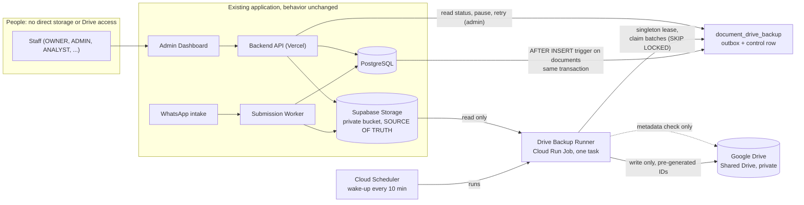
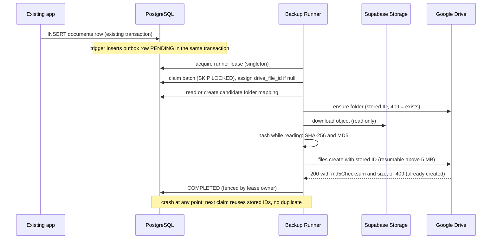
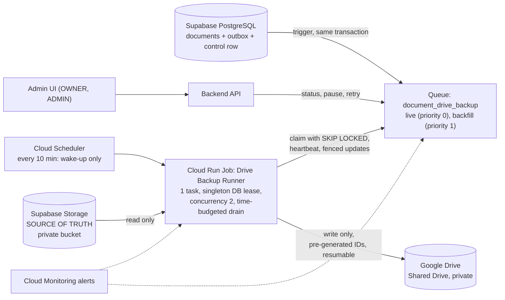

# Google Drive Document Backup: Implementation Guide (Option A)

| | |
|---|---|
| **Status** | Design only. Nothing in this guide is implemented, applied or deployed. SQL and code shown are drafts for review. |
| **Version** | Revision 2, 2026-11-01 (revision 1 was the first complete guide) |
| **Decision** | Option A: one-way, append-only backup. **Supabase Storage → Backup Worker → Google Drive.** Supabase Storage plus the `documents` table stay the source of truth. Google Drive is a backup and archive only. |
| **Background** | [`GOOGLE_DRIVE_DOCUMENT_BACKUP_RESEARCH.md`](GOOGLE_DRIVE_DOCUMENT_BACKUP_RESEARCH.md) compares the options and explains the reasoning. This guide is the how-to. |

**Convention.** **Confirmed** = from this repository or an official Google or Supabase page. **Proposed** = design for this project. **Needs verification** = not settled by official documentation read during this research; test it in Phase 0 or confirm with the vendor. Figures marked *(summary)* came from a machine summary of an official page rather than verbatim page text; check them against the live page before relying on them.

---

## 0. What changed in revision 2

Revision 2 adds production requirements: backups of 1,000+ files, overlapping runs, queue hardening, platform choice (Supabase vs Google Cloud), limits and capacity, backlog behavior and a failure matrix. Everything from revision 1 is kept unless listed here as changed.

| Topic | Revision 1 | Revision 2 | Why |
|---|---|---|---|
| Processing model | An always-on Cloud Run service polling the outbox | **A continuous outbox drained by a singleton Cloud Run Job, woken every 10 minutes by Cloud Scheduler.** An always-on service stays an accepted alternative (section 5.4). | A backup is idle most of the time. A Job costs only while it runs and has a natural restart model. Overlap safety no longer depends on "one instance" but on the database (section 4). |
| 6-hour schedule | Not specified | **Not the processing model.** The queue is continuous. The schedule is only a frequent wake-up, plus an optional daily safety-net sweep. | A 6-hour drain gives a 6-hour backup gap, and "skip the next run" neither prevents duplicates nor handles a crashed run (section 5.1). |
| Overlap protection | Row-level lease and fixed Drive IDs | Adds a **runner-level singleton lease**, a control row, priorities, pause and backfill caps | Row leases and fixed IDs already prevent duplicate files; the singleton bounds load and API pressure (section 4.2). |
| Queue | One table, four states | Adds priority (live vs backfill), `SKIP LOCKED` batch claim, heartbeat, fencing, stale recovery | 1,000+ items need ordering, fairness and control |
| Supabase compute | Not evaluated | **Not suitable** (Edge Function 150 s wall clock on Free, 256 MB, 2 s CPU time; no ADC for Drive) | Section 5.3 |
| Shared Drive item cap | 400,000 (older Admin Help) | **500,000** per Drive's current API page; plan against the lower figure | Google's pages disagree |
| Integrity | MD5 check after upload | Three-layer verification, mostly without downloading the Drive copy | Section 13 |
| Wording | One-way backup | The one-way rule and the access boundaries are explicit (section 3.1) | Required rule |

---

## Contents

1. [Which Drive can we use? Free vs paid](#1-which-drive-can-we-use-free-vs-paid-read-first)
2. [Pricing](#2-pricing)
3. [Architecture](#3-architecture)
4. [Queue architecture and duplicate prevention](#4-queue-architecture-and-duplicate-prevention)
5. [Scheduling and platform choice](#5-scheduling-and-platform-choice)
6. [Limits and quotas reference](#6-limits-and-quotas-reference)
7. [Capacity and duration calculations](#7-capacity-and-duration-calculations)
8. [Prerequisites checklist](#8-prerequisites-checklist)
9. [Step-by-step build](#9-step-by-step-build)
10. [Deployment and rollout](#10-deployment-and-rollout)
11. [Backfill runbook](#11-backfill-runbook)
12. [Operations: monitoring, failure matrix, runbooks](#12-operations-monitoring-failure-matrix-runbooks)
13. [Integrity verification](#13-integrity-verification)
14. [Security checklist](#14-security-checklist)
15. [Testing plan](#15-testing-plan)
16. [Final recommended architecture](#16-final-recommended-architecture)
17. [Implementation phases](#17-implementation-phases)
18. [Open decisions](#18-open-decisions)
19. [Sources](#19-sources)

---

## 1. Which Drive can we use? Free vs paid (read first)

The Drive account type decides the authentication method, and therefore the whole setup. There are three tracks.

| | **Track 1: Workspace Shared Drive** | **Track 2: Personal Gmail / Google One (My Drive)** | **Track 3: Free 15 GB personal account** |
|---|---|---|---|
| **Cost** | Paid (Google Workspace) | 15 GB free; paid storage plans above that | Free |
| **Authentication** | Service account (no key, Cloud Run identity) | OAuth refresh token of one human account | Same as Track 2 |
| **Shared Drive** | Yes | **No** (personal accounts cannot create shared drives) | No |
| **Capacity** | Pooled Workspace storage (TB) | 15 GB free, shared with that account's Gmail and Photos | 15 GB |
| **Production-grade** | **Yes (recommended)** | Possible, with real weaknesses | Pilot or proof of concept only |

### What is confirmed

- **A free Shared Drive does not exist.** Official Drive API docs state: "Shared drives are available with supported Google Workspace editions, such as Business Standard, Business Plus, Enterprise, and Education. Personal Google Accounts (`@gmail.com`) cannot create shared drives" ([Shared drives overview](https://developers.google.com/workspace/drive/api/guides/about-shareddrives)). Workspace has a 14-day free trial, not a free plan ([Workspace pricing](https://workspace.google.com/pricing)).
- **A service account cannot use My Drive.** The same page: "Service accounts don't have storage quota and can't own files. Instead, they must upload files and folders into shared drives, or use OAuth 2.0 to upload items on behalf of a human user." So the free-Gmail path cannot use a service account; it must use OAuth on behalf of a person.
- **Whether Business Starter includes Shared Drives is not settled.** Google's Drive docs list "Business Standard, Business Plus, Enterprise, and Education" and do not name Starter. Third-party price comparisons disagree. Treat Starter as **not available until Google confirms it** (**Needs verification** in the Workspace admin console or with Google sales).

### Recommendation

- **Production: Track 1** (Workspace Shared Drive with a service account). It is the only option with organisation ownership, no dependency on a person, proper audit and the documented service-account path.
- **If there is no budget for Workspace: Track 2**, on a **dedicated** account (not an employee's personal Gmail), with the risks in section 9.1 accepted in writing. Candidate documents include passports and police and medical records; treat this as a compromise, not the target.
- **Track 3** only to prove the pipeline with test data. 15 GB is shared with that account's Gmail and Photos, and one skill video can be 50 MB.

The rest of this guide describes the common build, then the steps specific to each track.

---

## 2. Pricing

All figures were read from Google's and Supabase's own pages on 2026-11-01 (Google pages showed the Sri Lanka region). Prices change; confirm before purchasing.

### 2.1 Google Workspace (Track 1)

Source: [workspace.google.com/pricing](https://workspace.google.com/pricing). Prices in USD per user per month, excluding tax.

| Plan | List price | Storage | Shared Drives (per Drive API docs) |
|---|---|---|---|
| Business Starter | $7.00 | 30 GB per user, pooled | **Not listed. Needs verification.** |
| Business Standard | $14.00 | 2 TB per user, pooled | Yes |
| Business Plus | $22.00 | 5 TB per user, pooled | Yes |
| Enterprise | "Contact sales" | Pooled | Yes |

Notes:

- The page shows a 14-day free trial.
- The page shows an introductory 10% discount for the first 20 users for 12 months, dated 15 Nov 2026 to 15 Nov 2027, so it is **not active today**.
- The page mentions "Save 16% with 1 year commitment" but shows no separate annual price. Confirm the billing options at purchase.
- **The service account needs no licence.** A licence is needed for the people who administer the Workspace and who access the Drive. The smallest practical set is **one** licensed user who creates and administers the Shared Drive. **Needs verification**: the minimum seat count at purchase.
- **Minimum cost, Track 1:** one Business Standard seat is about **$14 per month** (about $168 per year at list price), with 2 TB of pooled storage. The Drive API itself has no per-call charge in any plan.

### 2.2 Google One and free storage (Track 2 and 3)

Sources: [one.google.com/about/plans](https://one.google.com/about/plans) and [Manage your storage](https://support.google.com/drive/answer/6374270). Prices below are the LKR monthly prices shown on the page.

| Plan | Storage | Monthly price (LKR) |
|---|---|---|
| Free | 15 GB per Google Account | 0 |
| Google One Lite | 30 GB | 250 |
| Google One Basic | 100 GB | 575 |
| Google AI Pro | 5 TB | 6,425 (a bundle that includes Gemini and YouTube Premium Lite; expensive if you only want storage) |

Notes:

- The page shows annual billing ("Save up to 16%") but only monthly prices were visible. Intermediate plans (for example 200 GB or 2 TB) were not shown for this region; **Needs verification** on the live page.
- Free storage is **shared among Drive, Gmail and Photos** of the one account, and WhatsApp backups on Android count too. A full account cannot upload to Drive, and content can be deleted if the account stays over quota for two years ([storage help](https://support.google.com/drive/answer/6374270)).
- Only files the account **owns** count against its storage.

### 2.3 Other costs (updated in revision 2)

| Item | Notes |
|---|---|
| Drive API | No per-call charge. Subject to quotas ([usage limits](https://developers.google.com/workspace/drive/api/guides/limits)). The page says charges for exceeding quota are "planned" for later in 2026 with at least 90 days' notice *(summary)*: **Needs verification**, watch for it. |
| Cloud Run (the worker) | A Cloud Run **Job** is billed only while it runs; all jobs use instance-based billing ([billing settings](https://docs.cloud.google.com/run/docs/configuring/cpu-allocation)). An always-on **service** with CPU allocated outside requests is billed for the whole instance lifetime. The free-tier amounts and per-vCPU-second and per-GiB-second prices could not be read from the pricing page during this research: **Needs verification** with the [Google Cloud Pricing Calculator](https://cloud.google.com/products/calculator). Cost model: `monthly cost ≈ (vCPU × price_cpu + GiB × price_mem) × busy_seconds` for a Job, and the same with `busy_seconds = 2.6 million` (a month) for an always-on instance. |
| Cloud Scheduler | One job. Free-tier count and per-job price could not be read: **Needs verification**. |
| **Supabase egress** | Every download from Supabase Storage counts as egress, whichever cloud reads it. Free plan: 5 GB egress and 5 GB cached egress (Free is not billed for overage but has a fair-use grace). Pro: 250 GB egress included, then $0.09 per GB (uncached) ([Supabase pricing](https://supabase.com/pricing), [egress](https://supabase.com/docs/guides/platform/manage-your-usage/egress)). A full backup of N GB of files is at least N GB of egress, and a backfill is all of it at once. |
| Supabase Storage size | Free: 1 GB file storage and a 50 MB maximum file size. Pro: 100 GB included, then $0.0213 per GB, and the file-size limit can be raised ([file limits](https://supabase.com/docs/guides/storage/uploads/file-limits)). **Needs verification: which plan the project is on.** |
| Secret Manager | A handful of secrets: negligible. |
| Engineering | About 2 to 3 weeks for build and visibility, about 1 week for backfill (estimate). |

### 2.4 Cost summary

| Scenario | Monthly cost (list) | Capacity | Verdict |
|---|---|---|---|
| Track 3: free personal account | 0 | 15 GB shared with Gmail and Photos | Pilot only |
| Track 2: dedicated account, Google One Basic | LKR 575 | 100 GB | Cheapest real option; weaker security and continuity |
| Track 1: Workspace Business Standard, 1 seat | about $14 | 2 TB pooled | **Recommended** |
| Track 1: Workspace Business Starter | about $7 | 30 GB per user | Only if Google confirms Shared Drives on Starter, and capacity is enough |

Section 7 shows how to estimate your actual storage need and backup duration.

---

## 3. Architecture

### 3.1 The one-way pipeline and who may touch what (Confirmed rules, Proposed wiring)

```
Supabase Storage bucket  ──(read only)──▶  Backup Worker  ──(write only)──▶  Google Drive
          ▲                                     │
          │                              Postgres outbox (state)
   source of truth                       no reverse path exists
```

Rules:

1. **Supabase Storage remains the source of truth.** Google Drive is a backup and archive only.
2. **One-way only.** Nothing from Drive is ever read back into Supabase or into the application. The worker has no code path that downloads from Drive for restoration or sync; the only Drive reads are metadata checks (section 13). A restore, if ever needed, is a separate, manual, audited tool (out of scope).
3. **Normal system users do not access the Supabase Storage bucket directly.** *Confirmed in this repository:* the bucket is private, and the processing flow creates no public or signed **download** URLs (`Docs/06-storage-management.md`); the code uses a Supabase signed **upload** URL for admin uploads (`createSignedUploadUrl`, a single object, expiring), and no download-URL or public-URL call exists in `src` (searched). Admin and review previews go through the backend API. **Needs verification** in the Supabase dashboard: that there are no Storage policies on `storage.objects` granting `anon` or `authenticated` access (none are created in this repository's migrations).
4. **Normal system users do not need Google Drive access.** Application roles (ANALYST, REGISTRATION_DESK, JOB_HANDLER, and ADMIN in the console) never receive Drive access. Staff keep working through the normal backend and UI permissions, where RBAC and the audit log apply.
5. **Only the Backup Worker holds privileged credentials:** the Supabase service-role key (to read Storage and the database) and the Google identity that is a member of the backup Drive. No browser, Vercel function or other service has Drive credentials.
6. The backend API **never** talks to Drive. It only reads backup status from the database and can pause or retry (admin-only, audited).

### 3.2 Component diagram



There is no arrow from Drive to Supabase or to the application.

### 3.3 Sequence for one document



### 3.4 Design rules

1. **One-way and append-only.** The worker never deletes, overwrites, renames or moves Drive items, and never changes sharing.
2. **The main flow cannot fail because of Drive.** The only change to it is one extra small row written by a trigger.
3. **Every write path is covered** because the trigger sits on `documents` (WhatsApp, admin upload, review approve, replace verified, keep as version).
4. **Idempotent** through Drive file IDs generated in advance (`files.generateIds`) and stored before the first upload byte. Google documents that a retried create with the same ID returns 409 instead of creating a duplicate ([upload guide](https://developers.google.com/workspace/drive/api/guides/manage-uploads)).
5. **The queue is the unit of work, not a scan.** Work arrives continuously; schedules only wake a consumer.
6. **A separate service and identity** from the Sheet Sync worker and the submission worker.
7. **Write gate and pause** (`DRIVE_BACKUP_ENABLED`, and a database pause flag) so the feature ships disabled and can be stopped instantly.

### 3.5 Folder and file layout

```
{Shared Drive or app root folder}
└── {unique_id}/                          e.g. 0006
    ├── PASSPORT_20261031_a1b2c3d4.pdf
    ├── POLICE-REPORT_SL-VERIFIED_20261031_e5f6a7b8.pdf
    └── MEDICAL_20261101_c9d0e1f2.pdf
```

- Folder name = `unique_id`. The real link is the stored mapping `passport_id → drive_folder_id`. No passport number, NIC, phone number, name or original file name appears in any Drive name.
- File name = `{TYPE}[_{VARIANT}]_{yyyymmdd of received_date}_{first 8 chars of document_id}.{ext}`. `TYPE` values from `DOCUMENT_STORAGE_TYPES`: `PASSPORT`, `POLICE-SLIP`, `POLICE-REPORT`, `MEDICAL`, `NIC`, `SKILL-VIDEO`, `SCAN`, `VISA-SUBMISSION`. Variants (police report only): `SL-VERIFIED`, `ROMANIA`, `SL-NORMAL`.
- Each document is its own file; versions are separate files, never overwritten.
- Put the full `document_id` and the SHA-256 in the file's `appProperties` (private to the app). (The `appProperties` size limits are not stated on the official files page: **Needs verification**; two short values are expected to be fine.)
- One folder per candidate keeps item use low. A folder can hold at most 500,000 items directly, and a hierarchy at most 100 levels ([error reference](https://developers.google.com/workspace/drive/api/guides/handle-errors)); this layout is nowhere near either.

### 3.6 Behavior for changes (Proposed)

| Event | Drive |
|---|---|
| New document | New file |
| Replaced or corrected document | New file; the old one stays |
| Document removed in the app | **File kept**; the database records `lifecycle = REMOVED` |
| Document superseded | File kept; `lifecycle = SUPERSEDED` |
| Candidate passport ID | Cannot change in the app (primary key) |
| `unique_id` corrected | Folder name goes stale; the stored folder ID still works |
| Candidate deleted in the database | Never deletes Drive files; flag for review |
| Privacy erasure request | A manual, audited purge procedure (section 12.4) |

---

## 4. Queue architecture and duplicate prevention

### 4.1 Four processing models compared

| | **A. Scheduled batch scan** | **B. Persistent outbox, continuous consumer** | **C. Outbox, scheduled drain** | **D. Hybrid: one outbox, live and backfill priorities, singleton consumer** |
|---|---|---|---|---|
| **How it works** | Every N hours, scan `documents` and compare with Drive; upload the difference | Each new document adds a queue row at once; a consumer always runs | Queue as in B, but a consumer runs only every N hours | Queue as in B; rows carry a priority; one consumer drains live first, backfill with a cap |
| **State** | Implicit (compare listings); fragile | Explicit per-item state | Explicit per-item state | Explicit per-item state plus control row |
| **Overlapping runs** | **Dangerous**: two scans see the same "missing" files | Safe if rows are leased | Needs a singleton or the same rows are fought over | Safe: singleton plus row leases plus fixed IDs |
| **Backup gap (RPO)** | Up to N hours | Seconds to minutes | Up to N hours | Minutes (live), unbounded but capped (backfill) |
| **Scales to 1,000+** | Scan cost grows with history; a large run is all-or-nothing | Good | Good, but a 6-hour gap | Good, with fairness controls |
| **Backfill** | Same mechanism, can starve live files | Competes with live files | Competes with live files | **Separated by priority, concurrency and daily cap** |
| **Verdict** | Rejected | Good, needs an always-on consumer | Acceptable only with a short interval | **Chosen**: B's queue with D's controls |

**Conclusion.** The architecture is a **continuous outbox** (every document is queued the moment it is stored) with **priorities** (live before backfill) and a **singleton consumer** that is woken frequently. The consumer type (Job or always-on service) is a compute choice (section 5); the data model does not change.

### 4.2 Does the revision-1 outbox already solve overlapping runs?

**Partly.** What revision 1 already guaranteed (and still does):

- One row per document (primary key `document_id`, `ON CONFLICT DO NOTHING`), so a document is never queued twice.
- A row lease and a pre-generated Drive file ID stored before upload, so even two workers fighting over one row cannot create two Drive files (section 4.6).

What revision 1 did **not** cover, and what is added:

| Gap | Risk | Added protection |
|---|---|---|
| No limit on how many runners work at once | Two executions double the Supabase egress rate, memory pressure and Drive API usage, even if no duplicates result | **Runner-level singleton lease** in a control row (section 4.5) |
| No priorities | A 1,200-file backfill delays brand-new documents | `priority` column and claim ordering (section 4.9) |
| No pause or caps | Cannot stop quickly or throttle a backfill | Control row: `paused`, `backfill_paused`, daily cap |
| Stale `PROCESSING` recovery only implied | A crashed run could leave rows stuck | Claim query also takes expired `PROCESSING` rows (section 4.7) |
| No fencing | A slow "zombie" runner could overwrite newer state | Every state change is conditional on the lease owner (section 4.5) |
| Scheduler behavior | Cloud Scheduler can, rarely, fire more than once per slot | Runner lease makes a second start exit immediately (section 5.1) |

### 4.3 Schema additions (draft, supersedes the revision-1 SQL where they differ)

The full migration draft is in section 9.2. In summary, relative to revision 1:

- `document_drive_backup` gains `priority`, `claimed_at`, `drive_md5`, `drive_size`, `verified_at`.
- A new single-row table `document_drive_backup_control` holds the runner lease, heartbeat, pause flags and backfill controls.
- A partial index serves the claim query.

### 4.4 Row states

```
PENDING ──claim──▶ PROCESSING ──ok──▶ COMPLETED
   ▲                    │
   │                    ├─ retryable error ──▶ PENDING (next_attempt_at = backoff)
   │                    ├─ lease expired ────▶ (re-claimed as PROCESSING by the next claim)
   │                    ├─ permanent / exhausted ─▶ FAILED   (dead letter)
   │                    └─ source object missing ─▶ SOURCE_MISSING
   └── admin "Retry failed" ◀── FAILED, SOURCE_MISSING
```

- `COMPLETED` rows are never reclaimed.
- `attempts` counts claims, as in the Sheet Sync store, so a crash also counts. A configuration halt (permissions, quota, expired token) **gives the claim back without using an attempt**, as the Sheet worker does.

### 4.5 Atomic claiming, runner lease and fencing

**Per-row claim: one statement.** A single `UPDATE ... WHERE document_id IN (SELECT ... FOR UPDATE SKIP LOCKED LIMIT n) RETURNING` is atomic: concurrent claimers skip rows that are locked by another transaction, so two claimers can never receive the same row. It also takes expired `PROCESSING` rows (stale recovery) in the same query.

```sql
UPDATE "document_drive_backup" AS q
   SET "status" = 'PROCESSING',
       "lease_owner" = $1,                                   -- runner id
       "lease_expires_at" = now() + interval '10 minutes',
       "claimed_at" = now(),
       "attempts" = q."attempts" + 1,
       "updated_at" = now()
 WHERE q."document_id" IN (
        SELECT "document_id" FROM "document_drive_backup"
         WHERE ("status" = 'PENDING'    AND "next_attempt_at" <= now())
            OR ("status" = 'PROCESSING' AND "lease_expires_at" <  now())   -- stale recovery
         ORDER BY "priority", "created_at"                    -- live (0) before backfill (1)
         FOR UPDATE SKIP LOCKED
         LIMIT $2)                                            -- batch size
RETURNING q.*;
```

(Prisma: run it with `$queryRaw`. The project already claims rows by compare-and-swap in `sheetSyncStore.js`; either style is correct, but a single `SKIP LOCKED` statement claims a whole batch atomically.)

**Runner lease: one control row, compare-and-set.** Only one runner may drain at a time:

```sql
-- acquire (returns a row only if this caller now holds the lease)
UPDATE "document_drive_backup_control"
   SET "runner_id" = $1, "runner_lease_expires_at" = now() + interval '2 minutes',
       "runner_heartbeat_at" = now(), "last_run_started_at" = now()
 WHERE "name" = 'drive-backup'
   AND ("runner_id" IS NULL OR "runner_lease_expires_at" < now())
RETURNING "name";

-- heartbeat every ~30 s (also the fence): 0 rows updated = lease lost, stop at once
UPDATE "document_drive_backup_control"
   SET "runner_lease_expires_at" = now() + interval '2 minutes', "runner_heartbeat_at" = now()
 WHERE "name" = 'drive-backup' AND "runner_id" = $1
RETURNING "name";
```

Why a table row and not `pg_advisory_lock`: Supabase's shared pooler in transaction mode (port 6543) does not keep a session between statements, so session-level advisory locks are unreliable there (**Needs verification** against your connection string; the project's pooler usage is documented in `Docs/08-cloud-deployment.md`). A lease row works with any connection mode and survives a crash (it simply expires).

**Fencing.** Every status change by a runner carries `AND lease_owner = $runner`:

```sql
UPDATE "document_drive_backup" SET "status" = 'COMPLETED', ... 
 WHERE "document_id" = $d AND "lease_owner" = $runner AND "status" = 'PROCESSING';
```

A "zombie" runner whose lease was taken over cannot overwrite the new owner's state.

### 4.6 Exactly how duplicates are prevented

**The invariant.** *A document has exactly one `drive_file_id`, assigned once and stored in the database before the first upload byte is sent. Drive IDs are unique, so two creates with the same ID can never produce two files.* The lease and singleton are for efficiency and ordering; **correctness does not depend on them.**

Assigning the ID race-free (two runners must never store different IDs):

```sql
-- generateIds() is called first; then the claim stores the ID only if none exists
UPDATE "document_drive_backup"
   SET "drive_file_id" = COALESCE("drive_file_id", $newId)
 WHERE "document_id" = $d AND "lease_owner" = $runner
RETURNING "drive_file_id";      -- always use the RETURNED value
```

The same pattern assigns folder IDs:

```sql
INSERT INTO "candidate_drive_folder" ("passport_id","drive_folder_id") VALUES ($p, $newFolderId)
ON CONFLICT ("passport_id") DO NOTHING;
SELECT "drive_folder_id" FROM "candidate_drive_folder" WHERE "passport_id" = $p;  -- create with THIS id
```

| Scenario | What happens | Why there is no duplicate |
|---|---|---|
| **Worker crashes during upload** | The row stays `PROCESSING` until its lease expires; the next claim re-takes it. The stored `drive_file_id` is reused. If the upload had finished, `create` returns **409**: the worker reads size and MD5 (`files.get`), they match, and the row is completed. If it had not finished, `create` simply uploads. An interrupted resumable session never produced a file (Needs verification in the spike); if a partial object were ever found with the wrong MD5, the worker repairs **its own file ID** with `files.update` content upload, not a second file. | Same ID every time |
| **Cloud Run restarts or is preempted** | SIGTERM: stop claiming, finish or abandon the current upload within the grace period, release the rows without using an attempt, release the runner lease. If it is killed hard, leases expire (2 min runner, 10 min row) and the next execution recovers everything. | Same as above |
| **The schedule fires twice (or two executions overlap)** | The second execution cannot acquire the runner lease and exits within seconds. Even if it did not exist, row claims use `SKIP LOCKED`, and uploads use fixed IDs. Cloud Scheduler is documented as "at least once", and "in some rare circumstances, it is possible for a job to run multiple times in association with a single instance of the schedule, so your code must ensure that there are no harmful side-effects" ([overview](https://docs.cloud.google.com/scheduler/docs/overview)). Whether Cloud Run lets a second execution of the same Job start while one is running is **not stated** in the pages read: design for it (this design does). | Singleton lease, `SKIP LOCKED`, fixed IDs |
| **Network timeout after Drive already accepted the upload** | The client sees a timeout, not success. The retry uses the same stored ID, receives **409**, verifies size and MD5, and completes. | Same ID, 409 is treated as success after verification |
| **Two workers claim at nearly the same time** | `SKIP LOCKED` gives each row to exactly one. If both somehow work on one row (an expired lease while a slow upload continued), both use the same stored ID: the second gets 409. The fenced completion update lets only the current owner write state. | Same ID plus fencing |
| **Duplicate queue row** | `document_id` is the primary key; the trigger uses `ON CONFLICT DO NOTHING`; a backfill insert does the same. | Primary key |
| **Same content uploaded twice by the application** | Cannot occur: `documents` is unique on `(passport_id, file_sha256)`, and duplicates never become rows. | Existing database rule |

### 4.7 Heartbeat, graceful shutdown, stale recovery

| Mechanism | Design |
|---|---|
| Runner heartbeat | Renew the runner lease and `runner_heartbeat_at` every 30 s. Lease 2 min. A missed renewal (0 rows) means the lease was lost: stop claiming and abandon in-flight work at the next safe point. |
| Row lease | 10 min per row, renewed while an upload is active (every 2 min). Sized so a 50 MB file on a slow link still fits. |
| Graceful shutdown | On SIGTERM: stop claiming, let in-flight uploads finish up to the grace period, then set unfinished rows back to `PENDING` **without** counting an attempt, release the runner lease, exit. Cloud Run's termination grace is limited; anything unfinished is recovered by lease expiry. |
| Stale `PROCESSING` recovery | Built into the claim query (`status = 'PROCESSING' AND lease_expires_at < now()`), so no separate janitor is required. The attempt counter still advances, which bounds crash loops (after the maximum, `FAILED`). |
| Time budget | A run exits cleanly after its time budget (for example 50 minutes) so the next execution starts with a fresh process; the queue continues across executions. |
| Heartbeat for monitoring | `runner_heartbeat_at` and `last_success_at` in the control row feed the health card and alerts (section 12.1). |

### 4.8 Concurrency and batch size

| Setting | Recommendation | Reason |
|---|---|---|
| Runner count | **1** (singleton) | Bounds Supabase egress, memory and Drive API pressure; the Drive API is not the bottleneck at our volume (section 7), so more runners add risk, not speed |
| Parallel uploads in the runner | **2** to start; raise to **3** only after the Phase 0 spike and a memory check | Network time dominates; 2 to 3 streams use the link well |
| Backfill share | At most **1** of those slots, and only when the live queue is shallow | Live files must not wait (section 4.9) |
| Claim batch size | 5 (about 2 to 3 times the concurrency) | Short claims keep rows available to a successor if this runner dies |
| Instance size | 1 vCPU, 1 GiB | The existing code downloads whole objects into memory; at 3 parallel 50 MB files that is about 150 MB plus overhead |
| Cloud Run limits | Max instances / job parallelism: 1 task | Belt and braces; the database lease is the real control |

### 4.9 Live documents vs historical backfill

| | Live | Backfill |
|---|---|---|
| Source | Trigger on new `documents` rows | One-off script inserting rows for existing documents (`is_backfill = true`) |
| `priority` | 0 | 1 |
| Claim order | First | Only when no live row is claimable now |
| Concurrency | Up to the runner's slots | At most 1 slot |
| Batch size | 5 | 5 |
| Daily cap | None | `backfill_daily_cap` (for example 2,000 files per day), counted in the control row |
| Pause | `paused` stops everything | `backfill_paused` stops only backfill; also **automatic**: backfill claims are skipped when live pending exceeds a threshold (for example 100) |
| SLO | Backup within 1 hour | None; alert only when no progress for 24 hours while enabled |

Live files always outrank backfill: the ordering is by `priority`, then `created_at`.

### 4.10 Pause and resume

- **Pause all:** `UPDATE ... SET paused = true` (admin button, or `DRIVE_BACKUP_ENABLED=false`). Runners finish the current file and stop claiming; the outbox keeps filling.
- **Pause backfill only:** `backfill_paused = true`.
- **Configuration halt** (permissions revoked, quota full, token revoked): the runner sets `halted = true` with a `halt_reason`, gives rows back without using attempts, and exits. A halted state raises a critical alert. Clearing the cause and pressing **Resume** continues from the same queue.
- **Resume:** clear the flags; the next scheduled wake-up (at most 10 minutes) picks up. Nothing is lost because the queue is the state.

### 4.11 Backlog behavior

Example: 6 PM, 1,200 pending; 12 AM, 400 still pending; 12 AM, 500 new files arrive.

1. The queue is a table. At 12 AM it holds 400 older rows. The 500 new rows are inserted by the trigger as they are stored. The queue now holds **900 rows**.
2. **No second scan or copy process starts.** The drain that began at 6 PM is still running; each scheduler wake-up (every 10 minutes) starts a runner that fails to acquire the lease and exits in seconds.
3. The running drain keeps claiming by `priority`, `created_at`: the 500 new live rows go ahead of any backfill rows, and oldest-first within the same priority.
4. If the run dies, the lease expires within about 2 minutes and the next wake-up (within 10 minutes) takes over the in-flight rows.
5. Total time to clear is `queue length × time per file ÷ concurrency` (section 7). The backlog age, not the schedule, is what is monitored.

Backlog thresholds (Proposed; tune after observation):

| Signal | Warning | Critical |
|---|---|---|
| Oldest **live** `PENDING` age | over 2 hours | over 6 hours |
| Live queue depth | over 500 | over 2,000, or no completion in 30 minutes while rows exist |
| Backfill progress | none for 24 hours while enabled | none for 72 hours |
| `FAILED` rows | any older than 24 hours | over 20 |
| `SOURCE_MISSING` rows | any (informational) | n/a |
| Runner heartbeat | older than 15 minutes while rows are pending | older than 1 hour |
| `halted = true` | n/a | immediately |

**Maximum acceptable backlog age (live): 1 hour target, 6 hours hard limit** (Proposed; confirm with the senior, Q13).

---

## 5. Scheduling and platform choice

### 5.1 Do we need the 6-hour schedule?

**No, not as the processing model.** A 6-hour cadence (6 PM, 12 AM, 6 AM, 12 PM) has three problems:

1. **It creates a backup gap of up to 6 hours** for new documents, and a document removed in that gap is lost (section 8.4 of the research document).
2. **"Skip the next run if one is still running" is neither necessary nor sufficient.** It is not sufficient because Cloud Scheduler can, rarely, fire twice, and because a crashed run would block the next one until someone notices. It is not necessary because the work comes from a queue, so a second run has nothing to fight over once a singleton lease exists.
3. **A single huge run is a bigger failure domain** than a continuous trickle.

What the schedule is for in the recommended design: **a frequent wake-up** (every 10 minutes), because a Job needs something to start it. If the runner finds the queue empty it exits in seconds. A 6-hour drain would only be acceptable if the business explicitly accepts a 6-hour backup gap (decision Q13); it is not recommended.

Optional **daily safety-net sweep**: once a day the runner enqueues any `documents` row that has no outbox row (an anti-join). It is idempotent because the outbox key is `document_id`. This heals the case where the trigger was disabled, a migration was applied late, or rows were inserted by an unusual path.

### 5.2 Options compared

Limits are from official pages read during this research; the sources are in section 19.

| Option | Reliability | Overlap protection | Runtime limits | 1,000+ files | Cost | Supabase Free fit | Drive auth | Storage access | Complexity |
|---|---|---|---|---|---|---|---|---|---|
| **Always-on Cloud Run service** (polling loop, as the existing workers) | High; Cloud Run restarts it | One instance plus the database lease | Request timeout up to 60 minutes (not relevant to a background loop); a container is restarted at least every 7 days | Excellent | Billed for the whole instance lifetime with instance-based billing (price **Needs verification**) | Independent of Supabase plan | ADC, no key | Service-role key as a secret | Low; same pattern as the Sheet and submission workers |
| **Cloud Run Job + Cloud Scheduler** | High; Scheduler retries (`retryCount` default 0, maximum 5) | **Not guaranteed by the platform**: Scheduler is at-least-once and concurrent executions of one Job are not documented either way; the database lease provides it | Task timeout default 10 min, up to 168 hours (7 days); no execution timeout; retries 0 to 10 per task | Excellent (one task, time-budgeted loop) | Billed only while running (instance-based) | Independent | ADC, no key | Service-role key as a secret | Low to medium; one extra moving part (Scheduler) |
| **Supabase Edge Function** triggered by cron | Medium | Needs the same database lease | **Free: 150 s wall clock; Paid: 400 s; 2 s CPU time; 256 MB memory** | Poor: a few small files per invocation; a 50 MB video buffer plus overhead is tight in 256 MB | Invocations 500,000 free (Pro 2 M) | Possible only for tiny volumes | **No ADC outside Google Cloud**: would need a long-lived service-account key stored as an Edge secret, or workload identity federation (complex) | Native | Medium; key handling is a security downgrade |
| **`pg_cron` / Supabase Cron** | Medium | Needs the same lease; jobs "should run no more than 10 minutes" and "no more than 8 Jobs concurrently" (recommendations) | SQL or an HTTP call to another endpoint | Cannot upload to Drive itself; can only trigger something that does | Free of extra charge if available | **Free-plan availability not stated on the pages read: Needs verification** | n/a | n/a | Low as a trigger, but adds nothing the Scheduler does not |
| **Supabase Queues (`pgmq`)** | High | Visibility timeout gives row-level, not runner-level, exclusivity | n/a | Fine as storage of work | Included if available | **Plan availability not stated: Needs verification** | n/a | n/a | Adds a new queue system; a plain table already matches the project's outbox pattern |
| **Google Pub/Sub** | High | Delivery is at least once: duplicates must still be handled | n/a | Fine | Small | n/a | ADC | n/a | Adds a second system; the database is already the coordination point, so no benefit here |
| **Extend the Sheet Sync worker** | n/a | n/a | n/a | n/a | n/a | n/a | Would give the Sheets identity Drive access | n/a | Rejected in the research document: mixes responsibilities and widens the blast radius |

### 5.3 Can Supabase run the backup? (Free Tier feasibility)

**Not realistically on the Free plan, and not the right place on any plan.**

| Constraint (official) | Effect |
|---|---|
| Edge Function wall clock **150 s** (Free), 400 s (Paid); CPU time 2 s; memory **256 MB** ([limits](https://supabase.com/docs/guides/functions/limits)) | At an effective 4 MB/s, 150 s moves at most about 600 MB, in practice a handful of files; 1,000+ files would need hundreds of invocations, each re-claiming work. A 50 MB video plus buffers is tight in 256 MB. |
| Storage: Free plan **1 GB** file storage, **50 MB** per-file limit ([file limits](https://supabase.com/docs/guides/storage/uploads/file-limits)) | The whole bucket cannot exceed 1 GB on Free. A project holding real candidate documents and videos is therefore almost certainly on a paid plan; **Needs verification: which plan the project uses.** |
| Egress: Free **5 GB** (and 5 GB cached); Pro **250 GB** then $0.09 per GB ([pricing](https://supabase.com/pricing), [egress](https://supabase.com/docs/guides/platform/manage-your-usage/egress)) | Storage downloads count as egress. A backup moves every file out once; a backfill of more than a few GB exceeds the Free allowance. Free overage is not billed but is subject to a fair-use grace. |
| Free projects "are paused after 1 week of inactivity" ([pricing](https://supabase.com/pricing)) | A paused project stops everything, including the backup. Production should not be on Free. |
| Database connections: Free (Nano) **60** maximum, pooler **200** clients, default pool size **15** ([compute and disk](https://supabase.com/docs/guides/platform/compute-and-disk)) | Keep the worker's pool at 2; the Vercel API already uses a small pool. |
| Drive credentials | Edge Functions have no Google runtime identity, so a key file would have to be stored: a security downgrade compared with Cloud Run ADC. |
| Cron / Queues on Free | **Needs verification** (not stated on the pages read). |

Supabase **does** remain the right home for the source files and the **queue state** (a Postgres table). Only the compute should be elsewhere.

### 5.4 Recommendation

| | Choice |
|---|---|
| **Queue location** | A table in the existing Supabase PostgreSQL database (`document_drive_backup`), fed by a trigger |
| **Compute** | **Google Cloud Run Job**, one task, time-budgeted drain loop |
| **Wake-up** | **Cloud Scheduler every 10 minutes** (not 6 hours) |
| **Overlap protection** | **Database runner lease** (primary), row leases and `SKIP LOCKED`, fixed Drive IDs (correctness) |
| **Sweep** | Optional daily anti-join enqueue |

Why a Job rather than an always-on service (this **changes** revision 1):

- The backup is idle for most of the day; a Job is billed only while it runs (instance-based, so all job time is billed, but idle time is not). The always-on instance is billed for the full month.
- A Job has a natural restart and time-budget model: each execution starts with a fresh process and fresh credentials.
- Overlap safety is in the database either way, so the Job's weaker platform guarantee (undocumented same-Job concurrency, at-least-once Scheduler) costs nothing extra.

When the always-on **service** is the better choice, and is acceptable: if the team prefers the single, already-understood pattern of the two existing workers (a polling loop with `min-instances=1`, instance-based billing and `GET /health`), if sub-minute latency is wanted, or if Cloud Scheduler is undesirable. The queue, claim, lease and idempotency design in section 4 is identical for both; only section 10 differs. Decision Q14 in section 18 records the choice.

---

## 6. Limits and quotas reference

Figures are quoted from official pages read on 2026-11-01. *(summary)* = from a machine summary of the page; verify against the live page. **Needs verification** = not stated.

### 6.1 Google Drive

| Limit | Figure | Source |
|---|---|---|
| Quota per minute per project | 1,000,000 quota units *(summary)* | [Usage limits](https://developers.google.com/workspace/drive/api/guides/limits) |
| Quota per minute per user per project | 325,000 quota units *(summary)* | same |
| Daily | "no limit to the number of requests you can make per day" if per-minute quotas are respected; a daily billing threshold of 400,000,000 units per project, not increasable *(summary)* | same |
| Cost per method | read 5, list 100, edit 50, download 200, other 5 quota units *(summary)* | same |
| Uploads per user per day | 750 GB across My Drive and all shared drives; also applies to copies | same, [Admin Help](https://support.google.com/a/answer/7338880) |
| Maximum file size | 5 TB upload; 750 GB copy *(summary)* | same |
| Egress | 1 TB per 24 hours before charges *(summary)* | same |
| Quota change | Projects created on or after **1 May 2026** use new quotas; older projects that used the API between Nov 2025 and Apr 2026 keep previous quotas; the page gives no figures for the difference *(summary)*. **Needs verification** which regime our project is in, and the actual figures in the Cloud Console | same |
| Per-minute or per-second write limits per folder or account | **Not stated** on the pages read. Treat as **Needs verification**; throttle conservatively (concurrency 2 to 3) | same |
| 403 / 429 | 403 `userRateLimitExceeded` and `rateLimitExceeded`, 429: retry with exponential backoff; `dailyLimitExceeded`: not retryable; `storageQuotaExceeded`: storage full | [Resolve errors](https://developers.google.com/workspace/drive/api/guides/handle-errors) |
| Backoff formula | `min(2^n + random_ms (≤1,000), maximum_backoff)`, maximum typically 32 or 64 seconds *(summary)* | [Usage limits](https://developers.google.com/workspace/drive/api/guides/limits) |
| Simple / multipart upload | 5 MB or less | [Upload guide](https://developers.google.com/workspace/drive/api/guides/manage-uploads) |
| Resumable upload | For files over 5 MB, and when interruption is likely; works for small files at the cost of one extra request. Session URI expires after **one week** | same |
| Resumable chunking | Chunks in multiples of 256 KB (except the last); an empty `PUT` with `Content-Range: bytes */TOTAL` asks how much was received; `308` = continue, `200/201` = done, `404` = session expired, start over *(summary)* | same |
| Shared drive item cap | **500,000** items including files, folders, shortcuts and items in the trash ([API page](https://developers.google.com/workspace/drive/api/guides/about-shareddrives)); the older Admin Help page says 400,000. Plan against the lower figure | [Admin Help](https://support.google.com/a/answer/7338880) |
| Folder depth | 100 nested levels | same pages |
| Items in one folder | 500,000 directly in a folder (error `numChildrenInNonRootLimitExceeded`) | [Resolve errors](https://developers.google.com/workspace/drive/api/guides/handle-errors) |
| Items created per account | up to 500 million (error `activeItemCreationLimitExceeded`) | same |
| Shared drive membership | 600 total members, 100 groups, 50,000 individuals overall *(summary)* | [Admin Help](https://support.google.com/a/answer/7338880) |
| Checksums | `md5Checksum` for binary files; `sha1Checksum` and `sha256Checksum` for files with content stored in Drive *(summary)* | [files resource](https://developers.google.com/workspace/drive/api/reference/rest/v3/files) |
| `generateIds` | `count` IDs, `space` `drive`; maximum count not stated; usable in create and copy requests | [generateIds](https://developers.google.com/workspace/drive/api/reference/rest/v3/files/generateIds) |
| `appProperties` | "arbitrary key-value pairs which are private to the requesting app"; number and size limits not stated: **Needs verification** | files resource |

### 6.2 Google Cloud

| Limit | Figure | Source |
|---|---|---|
| Service request timeout | Default 5 min, up to **60 min** | [Request timeout](https://docs.cloud.google.com/run/docs/configuring/request-timeout) |
| Container memory / CPU | up to 32 GiB / 8 vCPU | [Quotas](https://docs.cloud.google.com/run/quotas) |
| Concurrency per instance | The page's table is ambiguous (1,000 vs 80 per instance): **Needs verification** in the console. Irrelevant to a Job | same |
| Job task timeout | Default **10 min**, maximum **168 hours (7 days)** (12 hours with GPUs). "There is no explicit timeout on a job execution" | [Create jobs](https://docs.cloud.google.com/run/docs/create-jobs), [Task timeout](https://docs.cloud.google.com/run/docs/configuring/task-timeout) |
| Task retries | Default 3, range 0 to 10, per task | [Max retries](https://docs.cloud.google.com/run/docs/configuring/max-retries) |
| Tasks per job / parallelism | Up to 10,000 tasks; parallelism limited by quota | [Quotas](https://docs.cloud.google.com/run/quotas), [Parallelism](https://docs.cloud.google.com/run/docs/configuring/parallelism) |
| Running executions per project and region | 1,000; jobs per project and region 1,000; job run rate 180 per 60 seconds | [Quotas](https://docs.cloud.google.com/run/quotas) |
| Two executions of the same Job at once | **Not stated** in the pages read: design for it | [Execute jobs](https://docs.cloud.google.com/run/docs/execute/jobs) |
| Job billing | All jobs use instance-based billing | [Billing settings](https://docs.cloud.google.com/run/docs/configuring/cpu-allocation) |
| Background work in a service | Needs instance-based billing ("CPU allocated even outside of request processing") | same |
| Always-on container | Restarted at least every 7 days of continuous execution | [Quotas](https://docs.cloud.google.com/run/quotas) |
| Scheduler delivery | "At least once"; rare multiple runs per schedule slot; dedupe with the job name and `X-CloudScheduler-ScheduleTime` | [Overview](https://docs.cloud.google.com/scheduler/docs/overview) |
| Scheduler retries | `retryCount` default 0, maximum 5; `minBackoffDuration` 5 s; `maxBackoffDuration` 3,600 s; `maxDoublings` 5; a failure does not stop later scheduled runs | [Retry jobs](https://docs.cloud.google.com/scheduler/docs/configuring/retry-jobs) |
| Scheduler limits | Job duration limit 30 minutes for an HTTP target (the call to start a Cloud Run Job returns immediately, so this is not expected to bind: **Needs verification**); 1 MB payload; 5,000 jobs per region | [Quotas](https://docs.cloud.google.com/scheduler/quotas) |
| Cloud Run and Scheduler prices and free tiers | **Needs verification** (not retrievable from the pricing pages during this research) | Pricing Calculator |

### 6.3 Supabase

| Limit | Figure | Source |
|---|---|---|
| Edge Functions | Wall clock Free **150 s**, Paid 400 s; CPU time 2 s; memory 256 MB; 100 functions on Free; 500,000 invocations free | [Functions limits](https://supabase.com/docs/guides/functions/limits), [pricing](https://supabase.com/pricing) |
| Storage max file | Free **50 MB**; Pro and above configurable up to 500 GB | [File limits](https://supabase.com/docs/guides/storage/uploads/file-limits) |
| Storage included | Free 1 GB; Pro 100 GB then $0.0213 per GB | [Pricing](https://supabase.com/pricing) |
| Egress included | Free 5 GB + 5 GB cached; Pro 250 GB + 250 GB cached, then $0.09 and $0.03 per GB. Storage downloads count. Cached and uncached have independent quotas | [Pricing](https://supabase.com/pricing), [Egress](https://supabase.com/docs/guides/platform/manage-your-usage/egress) |
| Database size | Free 500 MB; Pro 8 GB then $0.125 per GB | [Pricing](https://supabase.com/pricing) |
| Connections (Nano, Free) | 60 maximum, pooler 200 clients, default pool 15 | [Compute and disk](https://supabase.com/docs/guides/platform/compute-and-disk) |
| Project pausing | Free projects paused after 1 week of inactivity; paid projects are not | [Pricing](https://supabase.com/pricing) |
| Cron | "no more than 8 Jobs run concurrently… each Job no more than 10 minutes" (recommendations). Free-plan availability: **Needs verification** | [Cron](https://supabase.com/docs/guides/cron) |
| Queues | Postgres-native (`pgmq`). Plan availability and limits: **Needs verification** | [Queues](https://supabase.com/docs/guides/queues) |
| Storage download rate limits / fair use | Not stated on the pages read: **Needs verification** | |

---

## 7. Capacity and duration calculations

### 7.1 Formula

```
t_file   = overhead + size / throughput          # seconds per file in one stream
T_total  ≈ N × t_file / C                        # N files, C parallel uploads
```

- **overhead** covers the database claim, ID assignment, `create` call, response and bookkeeping. Assume **about 1 second** (**Needs verification** by measurement).
- **throughput** is the effective rate of one stream. When the worker downloads a file fully and then uploads it, `throughput = 1 / (1/download + 1/upload)`; when it streams, roughly the slower of the two. Assume a conservative **4 MB per second** effective per stream (**an assumption, not a measurement**). Measure it in the Phase 0 spike and substitute.
- **C** is the number of parallel uploads. API quotas do not bind at this scale (see 7.4), so throughput scales close to linearly with C until the network or Supabase becomes the limit; real scaling is usually sub-linear.

### 7.2 Worked examples (assumptions: overhead 1 s, throughput 4 MB/s per stream)

Per-file time: 2 MB = 1.5 s, 10 MB = 3.5 s, 25 MB = 7.25 s, 50 MB = 13.5 s.

| Files | Size each | C = 1 | C = 2 | C = 3 |
|---|---|---|---|---|
| 100 | 2 MB | 2.5 min | 1.3 min | 0.8 min |
| 100 | 10 MB | 5.8 min | 2.9 min | 1.9 min |
| 100 | 25 MB | 12.1 min | 6.0 min | 4.0 min |
| 100 | 50 MB | 22.5 min | 11.3 min | 7.5 min |
| 1,000 | 2 MB | 25 min | 12.5 min | 8.3 min |
| 1,000 | 10 MB | 58 min | 29 min | 19 min |
| 1,000 | 25 MB | 2.0 h | 1.0 h | 40 min |
| 1,000 | 50 MB | 3.75 h | 1.9 h | 1.25 h |
| 5,000 | 2 MB | 2.1 h | 1.0 h | 42 min |
| 5,000 | 10 MB | 4.9 h | 2.4 h | 1.6 h |
| 5,000 | 25 MB | 10.1 h | 5.0 h | 3.4 h |
| 5,000 | 50 MB | 18.8 h | 9.4 h | 6.3 h |

**These are illustrations, not guarantees.** Halve or double the throughput to see the sensitivity: at 8 MB/s per stream the 1,000 × 50 MB case at C = 2 takes about 1.0 hour; at 2 MB/s about 3.5 hours.

### 7.3 Data volume per scenario

| Files | Size each | Total | Supabase egress used | Fits the Supabase Free egress (5 GB)? | Fits Pro included egress (250 GB)? | Within Drive's 750 GB/day? |
|---|---|---|---|---|---|---|
| 1,000 | 2 MB | 2 GB | 2 GB | Yes | Yes | Yes |
| 1,000 | 10 MB | 10 GB | 10 GB | **No** | Yes | Yes |
| 1,000 | 50 MB | 50 GB | 50 GB | **No** | Yes | Yes |
| 5,000 | 10 MB | 50 GB | 50 GB | **No** | Yes | Yes |
| 5,000 | 50 MB | 250 GB | 250 GB | **No** | At the limit | Yes |

### 7.4 API quota check

Each file costs about three Drive calls (`generateIds` amortised, `create`, and optionally `get`). Even at 60 quota units each *(summary of per-method costs)*, 1,000 files use about 60,000 units in total; at C = 3 and 1.5 s per file that is about 2 files per second, or about 7,000 units per minute, far below the per-minute quotas quoted above (*(summary)*, **Needs verification** in the Cloud Console). **At this volume the constraint is bandwidth and per-file latency, not API quota.**

### 7.5 Storage planning (kept from revision 1)

Measure first (read-only query, run by you):

```sql
SELECT count(*) AS files,
       pg_size_pretty(sum(file_size)) AS total,
       pg_size_pretty(avg(file_size)::bigint) AS average
FROM documents;
SELECT document_type, count(*), pg_size_pretty(sum(file_size))
FROM documents GROUP BY document_type ORDER BY 1;
SELECT count(*) AS candidates FROM candidate;
```

Rough sizing (assumptions, replace with your numbers). Limits: documents at most 10 MB, skill videos at most 50 MB (**Confirmed**).

| Candidates | Documents only (4 files at about 2 MB) | With one 25 MB skill video each |
|---|---|---|
| 1,000 | about 8 GB | about 33 GB |
| 5,000 | about 40 GB | about 165 GB |
| 10,000 | about 80 GB | about 330 GB |

The **free 15 GB will not hold real production data** once videos are included. Google One Basic (100 GB) covers about 1,000 to 3,000 candidates depending on videos; Workspace Standard's pooled 2 TB covers any realistic volume here.

**Item limit.** Each candidate costs one folder plus its files (about 8 to 12 items). Plan against 400,000 items (the lower of Google's two figures): about 30,000 to 40,000 candidates. The flat layout keeps item use low. Items in the trash count towards the limit.

---

## 8. Prerequisites checklist

Complete these **before** writing code. Items 1 to 5 block the design.

| # | Item | Owner |
|---|---|---|
| 1 | Track chosen (section 1): Workspace, or an accepted compromise | Senior |
| 2 | Legal and data-protection sign-off for a second provider (Sri Lankan candidates, Romanian placements) | Senior and legal |
| 3 | Retention and erasure policy (how long, and the purge procedure) | Senior |
| 4 | Estimated data volume (section 7.5) and a storage plan that covers it | You |
| 5 | **Supabase plan confirmed** (Free or Pro) and its egress allowance | You |
| 6 | Google Cloud project for the worker, and billing enabled | You |
| 7 | Workspace admin identified (Track 1) or a dedicated account created (Track 2) | Senior |
| 8 | Backup RPO accepted (1 hour target, 6 hour limit proposed) and alert recipients | Senior |
| 9 | A stage environment to rehearse in, with its own Drive | You |

---

## 9. Step-by-step build

### 9.1 Phase 0: Google setup and spike

#### Track 1: Workspace Shared Drive and service account (recommended)

1. **Workspace.** Buy or enable a plan that includes Shared Drives (section 2.1). Confirm in the Admin console that Shared Drives are available.
2. **Create the Shared Drive**, for example "Emlynk Candidate Documents", in the Drive UI.
3. **Lock down its settings** (Drive settings): turn off access for people outside the drive, restrict who can share, disable link sharing, and prevent members from adding external people. (Names of the settings vary by edition: **Needs verification** in your console.)
4. **Google Cloud project.** Use the project that hosts the other Cloud Run services, or a new one. Enable the **Google Drive API**.
5. **Service account.** Create `emlynk-drive-backup` in that project. **Do not create a key.** The runner will run on Cloud Run as this account and use Application Default Credentials, as the Sheet Sync worker does today (**Confirmed**: `googleSheetsAdapter.js`, no key file).
6. **Add the service account to the Shared Drive** as a member with the lowest role that can create files and folders. In the Drive API, `writer` adds files; `fileOrganizer` can also trash; `organizer` can permanently delete and change membership ([roles](https://developers.google.com/workspace/drive/api/guides/about-shareddrives)). Start with **`writer`**, because the worker never trashes or deletes. Note that `writer` can also share items; the Shared Drive's sharing restrictions from step 3 are what prevent that.
7. **Spike (a throwaway script, not committed to the app).** Generate IDs, create a folder and a file in the Shared Drive with `supportsAllDrives=true`, retry the same create to see the 409, read back size and MD5. Answer these **Needs verification** items:
   - Which OAuth scope is accepted: the narrow `drive.file` (non-sensitive, per-file access) or the restricted full `drive`. `drive.file` grants access to files the app creates or that are opened with or shared to it ([scopes](https://developers.google.com/workspace/drive/api/guides/api-specific-auth)); whether a service account may create inside a pre-existing Shared Drive under `drive.file` is not stated. If it fails, use the `drive` scope, acceptable here because the service account is a member of this one Shared Drive only.
   - That Cloud Run's metadata-server token works for Drive (it does for Sheets today), **including from a Cloud Run Job**.
   - Whether `files.create` with `fields=id,size,md5Checksum,sha256Checksum` returns the checksums in the create response (this removes a second call per file), and whether `sha256Checksum` equals our stored SHA-256.
   - Whether an interrupted resumable upload leaves any object behind.
   - The real **effective throughput** (MB/s per stream) from Cloud Run to Drive, and from Supabase Storage to Cloud Run, for a 2 MB, 10 MB and 50 MB file (replaces the assumption in section 7).
   - The current API quota regime for your project ([usage limits](https://developers.google.com/workspace/drive/api/guides/limits): quotas changed on 1 May 2026) and the real per-minute figures in the Cloud Console.
   - Whether two executions of the same Cloud Run Job can run at once (expected: yes; the design tolerates it).
   - The actual per-Shared-Drive item limit (400,000 or 500,000).

#### Track 2: personal Gmail with OAuth (compromise)

Use only if Track 1 is not possible. A service account **cannot** be used here.

1. **Create a dedicated Google account** for the archive (not an employee's account). Turn on 2-step verification, keep recovery info with the organisation.
2. **Google Cloud project.** Enable the Drive API. Configure the **OAuth consent screen** and create an OAuth client.
3. **Publish the consent screen to "In production".** In "Testing" status with an external user type, refresh tokens **expire after 7 days** ([Google's OAuth documentation](https://developers.google.com/identity/protocols/oauth2)), which would silently stop the backup weekly. With only the non-sensitive `drive.file` scope, production should not need app verification (**Needs verification**).
4. **Authorize once** with `access_type=offline` and the scope `drive.file`, signed in as the dedicated account. Store the **refresh token** in Secret Manager (never in Vercel, never in git).
5. **Let the app create its own root folder** (so `drive.file` is enough): the first runner execution creates "Emlynk Candidate Documents" and stores its ID. All later items are created inside it. Do not use a pre-existing folder (the scope would not cover it).
6. **Accept and document these risks:**
   - Ownership and continuity depend on one account; if it is suspended, locked out or the recovery owner leaves, the archive is at risk.
   - Capacity is 15 GB shared with the account's Gmail and Photos unless storage is bought (section 2.2).
   - Weaker audit and sharing controls than a Shared Drive.
   - A revoked or expired refresh token stops all backups: the runner must treat it as a configuration halt and alert.
   - Using a personal account for sensitive third-party documents may conflict with your data-protection obligations: raise with the senior and legal.

#### Track 3: free personal account (pilot only)

Follow Track 2 with test data only. Do not store real candidate documents.

### 9.2 Phase 1: database (draft SQL, not applied)

Add **one migration** with the tables, indexes and trigger below, following the project's forward-only rules (`Docs/08-cloud-deployment.md`). Never run `prisma migrate dev` against a shared database. Rehearse on a scratch PostgreSQL first.

```sql
-- Outbox: one row per documents row. NO foreign key to documents, so the row
-- survives removal of the document (same idea as audit_logs).
CREATE TABLE "document_drive_backup" (
    "document_id"      TEXT PRIMARY KEY,
    "passport_id"      TEXT NOT NULL,
    "status"           TEXT NOT NULL DEFAULT 'PENDING',
    "lifecycle"        TEXT NOT NULL DEFAULT 'ACTIVE',
    "priority"         SMALLINT NOT NULL DEFAULT 0,          -- 0 live, 1 backfill
    "is_backfill"      BOOLEAN NOT NULL DEFAULT false,
    "drive_file_id"    TEXT,                                 -- assigned once, before the first upload byte
    "file_sha256"      CHAR(64),
    "file_size"        BIGINT,
    "mime_type"        TEXT,
    "document_type"    TEXT NOT NULL,
    "document_variant" TEXT,
    "received_date"    TIMESTAMP(3) NOT NULL,
    "source_path"      TEXT NOT NULL,                        -- contains the passport ID: never logged
    "attempts"         INTEGER NOT NULL DEFAULT 0,
    "next_attempt_at"  TIMESTAMPTZ(3) NOT NULL DEFAULT now(),
    "lease_owner"      TEXT,
    "lease_expires_at" TIMESTAMPTZ(3),
    "claimed_at"       TIMESTAMPTZ(3),
    "last_error_class" TEXT,
    "last_error_code"  TEXT,
    "drive_md5"        TEXT,                                 -- as reported by Drive after upload
    "drive_size"       BIGINT,
    "verified_at"      TIMESTAMPTZ(3),
    "created_at"       TIMESTAMPTZ(3) NOT NULL DEFAULT now(),
    "updated_at"       TIMESTAMPTZ(3) NOT NULL DEFAULT now(),
    "completed_at"     TIMESTAMPTZ(3),
    CONSTRAINT "document_drive_backup_status_check"
        CHECK ("status" IN ('PENDING','PROCESSING','COMPLETED','FAILED','SOURCE_MISSING')),
    CONSTRAINT "document_drive_backup_lifecycle_check"
        CHECK ("lifecycle" IN ('ACTIVE','SUPERSEDED','REMOVED')),
    CONSTRAINT "document_drive_backup_priority_check"
        CHECK ("priority" IN (0, 1))
);
-- serves the claim query (only open work is indexed)
CREATE INDEX "document_drive_backup_claim_idx"
    ON "document_drive_backup" ("priority", "created_at")
 WHERE "status" IN ('PENDING','PROCESSING');
CREATE INDEX "document_drive_backup_status_idx"
    ON "document_drive_backup" ("status", "next_attempt_at");
CREATE INDEX "document_drive_backup_passport_idx"
    ON "document_drive_backup" ("passport_id");

-- Candidate -> Drive folder. Pre-generated ID stored BEFORE the folder is created.
CREATE TABLE "candidate_drive_folder" (
    "passport_id"     TEXT PRIMARY KEY,
    "drive_folder_id" TEXT NOT NULL,
    "created_at"      TIMESTAMPTZ(3) NOT NULL DEFAULT now()
);

-- One row ('drive-backup'): runner lease, heartbeat, pause and backfill controls.
CREATE TABLE "document_drive_backup_control" (
    "name"                    TEXT PRIMARY KEY,
    "runner_id"               TEXT,
    "runner_lease_expires_at" TIMESTAMPTZ(3),
    "runner_heartbeat_at"     TIMESTAMPTZ(3),
    "last_run_started_at"     TIMESTAMPTZ(3),
    "last_run_finished_at"    TIMESTAMPTZ(3),
    "last_success_at"         TIMESTAMPTZ(3),
    "last_sweep_at"           TIMESTAMPTZ(3),
    "paused"                  BOOLEAN NOT NULL DEFAULT false,
    "backfill_paused"         BOOLEAN NOT NULL DEFAULT true,   -- backfill starts off
    "backfill_daily_cap"      INTEGER NOT NULL DEFAULT 2000,
    "backfill_day"            DATE,
    "backfill_done_today"     INTEGER NOT NULL DEFAULT 0,
    "halted"                  BOOLEAN NOT NULL DEFAULT false,
    "halt_reason"             TEXT,                            -- a code, never a message from Google
    "updated_at"              TIMESTAMPTZ(3) NOT NULL DEFAULT now()
);
INSERT INTO "document_drive_backup_control" ("name") VALUES ('drive-backup');

-- Enqueue in the SAME transaction as the documents insert.
CREATE FUNCTION "document_drive_backup_enqueue"() RETURNS trigger
LANGUAGE plpgsql AS $$
BEGIN
    INSERT INTO "document_drive_backup"
        ("document_id","passport_id","file_sha256","file_size","mime_type",
         "document_type","document_variant","received_date","source_path")
    VALUES
        (NEW."document_id", NEW."passport_id", NEW."file_sha256", NEW."file_size", NEW."mime_type",
         NEW."document_type", NEW."document_variant", NEW."received_date", NEW."storage_path")
    ON CONFLICT ("document_id") DO NOTHING;
    RETURN NEW;
END $$;

CREATE TRIGGER "documents_drive_backup_enqueue"
    AFTER INSERT ON "documents"
    FOR EACH ROW EXECUTE FUNCTION "document_drive_backup_enqueue"();

-- Optional lifecycle tracking (database only; Drive is not touched).
-- AFTER UPDATE OF verification_status -> SUPERSEDED, AFTER DELETE -> REMOVED.

ALTER TABLE "document_drive_backup" ENABLE ROW LEVEL SECURITY;
ALTER TABLE "candidate_drive_folder" ENABLE ROW LEVEL SECURITY;
ALTER TABLE "document_drive_backup_control" ENABLE ROW LEVEL SECURITY;
```

Notes:

- Model after `20261006120000_sheet_sync_outbox` (trigger-fed outbox) and `candidate_form_sheet_sync` (per-item outbox with lease fields).
- The trigger copies what the worker needs, so the row stays useful after a `Remove document` deletes the original row.
- Add the models to `prisma/schema.prisma` with comments (as the other outbox models have), mapped with `@@map`. Prisma cannot express the CHECK constraints or the partial index; keep them in SQL.
- No column is added to `documents` or `candidate`.
- The trigger only inserts one row with `ON CONFLICT DO NOTHING`: it must never block a document write.

### 9.3 Phase 1: runner code (proposed files, all new)

Follow the structure of the Sheet Sync worker. Nothing in the existing document flow changes.

| File | Role |
|---|---|
| `src/config/driveBackup.js` | Reads configuration; the write gate; validates settings |
| `src/services/googleDriveAdapter.js` | The only module that talks to Drive: `generateIds`, `ensureFolder`, `uploadFile`, `getFileMetadata`. Errors carry status, Google reason code and class, **never Google's message text** (as `googleSheetsAdapter.js` does). Contains **no download-from-Drive and no delete, trash, move, rename or permission call** |
| `src/services/driveBackupStore.js` | Runner lease, claim with `SKIP LOCKED`, assign IDs, complete, retry with backoff, dead-letter, re-queue, pause flags, counts. Modeled on `sheetSyncStore.js` |
| `src/services/driveBackupEngine.js` | Processes one claimed row (section 3.3) and the drain loop with its time budget and concurrency |
| `src/services/driveBackupNaming.js` | Pure functions: folder name, file name from the row; fully unit-tested |
| `src/driveBackupRunner.js`, `src/driveBackupRunnerProcess.js` | Entry point for the Cloud Run Job (a run-to-completion process); for the service alternative, a poll loop and `GET /health` listener as the other workers |
| `package.json` | script `"drive:runner": "node src/driveBackupRunner.js"`; dependency `@googleapis/drive` (`google-auth-library` already present) |
| `deploy/drive-backup-runner.env.yaml` | Non-secret settings, like `deploy/sheet-sync-worker.env.yaml` |

#### Configuration (proposed names)

| Variable | Purpose |
|---|---|
| `DRIVE_BACKUP_ENABLED` | Write gate. Default `false`. When false the runner records a heartbeat and writes nothing (dry run) |
| `DRIVE_AUTH_MODE` | `adc` (Track 1) or `oauth` (Track 2) |
| `DRIVE_ROOT_FOLDER_ID` | Shared Drive ID (Track 1) or the app-created root folder ID (Track 2) |
| `DRIVE_OAUTH_CLIENT_ID`, `DRIVE_OAUTH_CLIENT_SECRET`, `DRIVE_OAUTH_REFRESH_TOKEN` | Track 2 only, from Secret Manager |
| `DRIVE_BACKUP_CONCURRENCY` | Parallel uploads (start at 2) |
| `DRIVE_BACKUP_BATCH_SIZE` | Rows per claim (start at 5) |
| `DRIVE_BACKUP_RUN_BUDGET_SECONDS` | Time budget per execution (for example 3000) |
| `DRIVE_BACKUP_MAX_ATTEMPTS` | Attempts before `FAILED` (for example 10) |
| `DRIVE_BACKUP_ROW_LEASE_SECONDS`, `DRIVE_BACKUP_RUNNER_LEASE_SECONDS` | 600 and 120 |
| `DATABASE_URL`, `SUPABASE_URL`, `SUPABASE_SERVICE_ROLE_KEY`, `SUPABASE_BUCKET` | As the submission worker (secrets for the first and third). Keep the connection pool at 2 |

#### Runner loop (pseudocode)

```text
start:
    if not ENABLED: record heartbeat, exit                        # dry run
    if control.paused or control.halted: exit
    if not acquire_runner_lease(me): exit                         # another runner is draining
    optional daily sweep: enqueue documents rows that have no outbox row
    while time_budget_left and lease_held (heartbeat every 30 s):
        batch = claim(me, size = BATCH, order = priority, created_at, SKIP LOCKED)
        if empty: break
        run up to CONCURRENCY rows in parallel:
            id     = assign_drive_file_id(row)                    # COALESCE, store before any upload
            folder = ensure_folder(row.passport_id)               # stored ID, 409 = exists
            stream = storage.download(row.source_path)            # read only; not found -> SOURCE_MISSING
            hash while streaming: sha256, md5; compare sha256 with row.file_sha256 and size with row.file_size
            result = drive.create(id, parents=[folder], name, stream, fields = id,size,md5Checksum)   # 409 -> get
            verify result.md5 == local md5 and size matches
            complete(row) WHERE lease_owner = me                  # fenced
        on error: classify -> RETRY (backoff) | HALT | FAILED | SOURCE_MISSING
    release_runner_lease(me); exit
```

#### Retry and error handling

Per Google's guidance ([errors](https://developers.google.com/workspace/drive/api/guides/handle-errors), [limits](https://developers.google.com/workspace/drive/api/guides/limits)):

| Error | Action |
|---|---|
| 403 `rateLimitExceeded` / `userRateLimitExceeded`, 429 | Retry with truncated exponential backoff plus jitter (`min(2^n + random_ms, 32 to 64 s)`) inside the call; if it persists, reschedule the row and pause the runner for a few minutes |
| 5xx, network errors, timeouts | Reschedule with backoff |
| 403 `dailyLimitExceeded` | Halt for hours; alert (a limit, not a transient error) |
| 403 `storageQuotaExceeded` | **Halt** without consuming attempts; alert (add storage) |
| 401 / 403 permission, 404 on the parent | **Halt** (configuration); alert |
| Source object not found in Supabase | `SOURCE_MISSING` |
| SHA-256 or size mismatch against `documents` (corrupt source) | `FAILED` with class `SOURCE_CORRUPT`; never upload a file that does not match its recorded hash |
| Drive MD5 mismatch after upload | One repair attempt with `files.update` on the same ID, then `FAILED` |
| Attempts exhausted | `FAILED` (dead letter) |

Row-level backoff between attempts: about 1 min, 2 min, 5 min, 15 min, 1 h, 3 h, 6 h, 12 h with jitter, then `FAILED` after `DRIVE_BACKUP_MAX_ATTEMPTS`. (Tune after the spike.) A global quota pause stops the whole runner, not just one row.

#### Folder creation without duplicates

Never "find or create by name". Generate the folder ID, store it in `candidate_drive_folder` first (`ON CONFLICT DO NOTHING`, then read the stored value), then create with that ID; a 409 means a previous attempt succeeded. Two runners racing on one candidate converge on the same stored ID.

### 9.4 Phase 2: admin visibility (minimal)

Backend (ADMIN and OWNER, audited, following `requireRole` tiers in `src/routes/admin.js`):

| Endpoint (proposed) | Purpose |
|---|---|
| `GET /api/admin/settings/drive-backup/status` | Counts by status and priority, oldest pending age, last success time, runner heartbeat, `paused`, `halted` and its reason code |
| `POST /api/admin/settings/drive-backup/retry` | Sets `FAILED` and `SOURCE_MISSING` rows back to `PENDING` (audit entry) |
| `POST /api/admin/settings/drive-backup/pause` and `/resume` | Pause or resume all, or backfill only (audit entry) |
| Document list data | Add each document's backup status to the candidate documents response |

Front end: a small status mark on each document row (Backed up, Pending, Failed) and one card under Settings, **Document Backup**: counts, last successful backup, queue depth and oldest age, pause and resume, **Retry failed**. Do not link to Drive from the UI (staff work in the console, not in Drive).

### 9.5 Phase 3: tests

See section 15.

---

## 10. Deployment and rollout

### 10.1 Deploy the runner (Cloud Run Job, recommended)

The submission worker is built from the root `Dockerfile` with a command override; do the same:

```bash
# A Cloud Run Job from the existing backend image
gcloud run jobs deploy emlynk-drive-backup-runner \
  --image <registry>/<image> \
  --command=node --args=src/driveBackupRunner.js \
  --service-account=emlynk-drive-backup@<project>.iam.gserviceaccount.com \
  --env-vars-file deploy/drive-backup-runner.env.yaml \
  --set-secrets=DATABASE_URL=<secret>:latest,SUPABASE_SERVICE_ROLE_KEY=<secret>:latest \
  --tasks=1 --parallelism=1 --max-retries=1 \
  --task-timeout=3600s --cpu=1 --memory=1Gi \
  --region <region near the database>

# Wake-up every 10 minutes (Cloud Scheduler calls the Jobs API)
gcloud scheduler jobs create http emlynk-drive-backup-wake \
  --schedule="*/10 * * * *" --time-zone="Asia/Colombo" \
  --uri="https://run.googleapis.com/v2/projects/<project>/locations/<region>/jobs/emlynk-drive-backup-runner:run" \
  --http-method=POST \
  --oauth-service-account-email=<scheduler-sa>@<project>.iam.gserviceaccount.com
```

(The flag names follow Google's documented examples; check the current `gcloud` reference at deployment time.)

- The task timeout is the **upper bound** of one execution; the runner's own time budget (for example 50 minutes) ends it earlier and cleanly, so the task timeout is only a safety net.
- `--max-retries=1` is enough: the next wake-up recovers anyway, and every step is idempotent.
- `--tasks=1 --parallelism=1` bounds the platform side; the **database runner lease** bounds it across executions, because Scheduler may fire more than once and a second execution of the same Job is not documented as blocked.
- The Scheduler's identity needs a role that allows starting the Job (a role containing `run.jobs.run`, for example Cloud Run Invoker: **Needs verification**), granted on this Job only. The runner's own service account holds no run permissions.
- A failed or skipped wake-up is harmless: the next one is 10 minutes later and the queue is unchanged.
- Region: close to the database and Supabase Storage to keep downloads fast (the submission worker's region is a reasonable default).

### 10.2 Alternative: always-on service

```bash
gcloud run deploy emlynk-drive-backup-worker \
  --image <registry>/<image> \
  --command=node --args=src/driveBackupWorker.js \
  --service-account=emlynk-drive-backup@<project>.iam.gserviceaccount.com \
  --no-allow-unauthenticated \
  --env-vars-file deploy/drive-backup-worker.env.yaml \
  --set-secrets=DATABASE_URL=<secret>:latest,SUPABASE_SERVICE_ROLE_KEY=<secret>:latest \
  --no-cpu-throttling --min-instances=1 --max-instances=1 --cpu=1 --memory=1Gi \
  --region <region near the database>
```

Same code, with the loop running for the process lifetime (and still taking the database lease), plus a `GET /health` listener as in the other workers. Choose this if the team prefers the existing pattern (decision Q14).

### 10.3 Rollout order

1. **Stage environment:** migrate, deploy the runner with `DRIVE_BACKUP_ENABLED=false`. Confirm the trigger enqueues rows and the runner only records a heartbeat (dry run).
2. **Enable in stage** against the stage Drive. Upload test documents of every type through WhatsApp and admin upload; check naming, one folder per candidate, MD5 match.
3. **Failure and overlap drills in stage** (section 15.3): revoke permission, block the network, kill the runner mid-upload, start two executions at once, remove a document before backup.
4. **Production migration** (trigger on). The outbox fills; nothing is uploaded yet because the gate is off. Confirm the main flow is unaffected (document processing time unchanged).
5. **Enable the gate in production** for new documents only.
6. **Backfill** (section 11), with `backfill_paused` cleared deliberately.

### 10.4 Rollback

- **Pause:** set the pause flag or `DRIVE_BACKUP_ENABLED=false` (instant, no code deploy).
- **Stop the runner:** pause the Scheduler job. The outbox keeps filling harmlessly.
- **Remove the trigger** (one `DROP TRIGGER`) if it ever misbehaves. The main flow is unaffected either way.
- **Nothing in Drive needs reverting:** it is append-only.

---

## 11. Backfill runbook

Backfill is a separate workload with its own priority, concurrency and cap (section 4.9). It never delays live documents.

1. **Measure first** (read-only queries, section 7.5): file count and total bytes of `documents`, and rows whose storage object is missing.
2. **Check capacity and cost.** Drive storage; and **Supabase egress**: a backfill downloads every file once. Compare the total with your plan's allowance (Free 5 GB; Pro 250 GB included, then $0.09 per GB uncached). Plan the date so the egress falls inside a billing period you can afford.
3. **Enqueue** existing documents that have no outbox row, in batches (for example 500), ordered by `document_id`, with `priority = 1` and `is_backfill = true`, through a one-off script (resumable by cursor). The script only inserts outbox rows (`ON CONFLICT DO NOTHING`).
4. **Start it deliberately:** clear `backfill_paused`; set `backfill_daily_cap` to a value your Supabase egress and Drive storage can absorb for that day.
5. **Run** at most one backfill slot, only when the live queue is shallow, preferably off-peak. Quota errors pause the runner automatically (section 9.3). The runner stops claiming backfill rows when the daily cap is reached.
6. **Monitor:** counts by status and priority give percent complete. Investigate `FAILED` and `SOURCE_MISSING`. A reasonable pace is the daily cap per day; a 5,000-file backfill at a 2,000 per day cap takes 3 days.
7. **Verify:** compare `COMPLETED` counts to `documents`; check a sample by metadata (size and MD5 from Drive against the database).
8. **Never** backfill `temporary/` or `pending/` objects.
9. **Pause on pressure:** if the live queue grows beyond the threshold, backfill claims are skipped automatically; set `backfill_paused = true` for a manual stop.

---

## 12. Operations: monitoring, failure matrix, runbooks

### 12.1 What to watch

| Signal | Source | Warning | Critical |
|---|---|---|---|
| Oldest live `PENDING` age | Outbox | over 2 hours | over 6 hours |
| Live queue depth | Outbox | over 500 | over 2,000, or no completion for 30 minutes |
| Backfill progress | Outbox | no progress for 24 hours while enabled | 72 hours |
| `FAILED` count | Outbox | any older than 24 hours | over 20 |
| `SOURCE_MISSING` count | Outbox | any (informational) | |
| Runner heartbeat / last success | Control row | heartbeat over 15 minutes while rows pending | over 1 hour |
| `halted` | Control row | | immediately |
| Cloud Run Job execution failures | Cloud Monitoring | 2 consecutive failures | 5 |
| Scheduler job failures | Cloud Monitoring | any | repeated |
| Drive storage used | Drive admin / account | over 80% | over 90% |
| Supabase egress used | Supabase usage page | over 70% of plan | over 90% |
| Drive item count | Drive admin | over 70% of 400,000 | over 85% |

**Monitoring must not share a single point of failure with the runner**: a Cloud Monitoring alert on "no successful backup for N hours" (a log-based or metric alert) is independent of the runner's own code, and the Settings health card is a second view.

### 12.2 Failure matrix

| # | Failure | Detection | Impact | Mitigation | Automatic recovery? |
|---|---|---|---|---|---|
| 1 | Drive storage full | 403 `storageQuotaExceeded`; storage alert | Uploads stop | Halt without using attempts; add storage; Resume | After cause fixed and Resume (a quick-to-clear halt) |
| 2 | Supabase egress exhausted | Usage alert; download errors or throttling | Reads fail or become billable (Pro) / grace then limits (Free) | Alert at 70% and 90%; cap backfill; upgrade plan; schedule backfill across billing periods | Retries succeed once allowance returns |
| 3 | Google API rate limit | 403 `rateLimitExceeded` / `userRateLimitExceeded`, 429 | Slower backup | Exponential backoff with jitter; low concurrency; global pause | **Yes** |
| 4 | Service account permission removed | 403 or 404 on parent; halt reason code | Backups stop | Halt without using attempts; alert; restore Shared Drive membership | After restore and Resume |
| 5 | OAuth refresh token revoked or expired (Track 2) | 401 `invalid_grant`; halt | Backups stop | Halt; alert; re-authorize and replace the secret; publish consent screen to production | Manual |
| 6 | Cloud Run Job crash or killed | Execution failure metric; stale lease | In-flight rows paused | Leases expire; the next wake-up resumes; same IDs prevent duplicates | **Yes** |
| 7 | Database unavailable | Connection errors; heartbeat stale | Claims and completions fail; the main app may also be affected | Runner exits; next wake-up retries; Drive state is idempotent | **Yes** |
| 8 | Storage object missing | Download 404 | One document cannot be backed up | `SOURCE_MISSING`; check the audit log (often a removed document) | No (informational) |
| 9 | File partially transferred | Short stream or size/hash mismatch | Bad copy | Hash and size verified; resumable upload; repair with `files.update` on the same ID; then `FAILED` | Usually **yes** (one repair attempt) |
| 10 | Worker killed mid-upload | Lease expiry | Duplicate risk | Fixed ID and 409 verification (section 4.6) | **Yes** |
| 11 | Duplicate queue row | Primary key violation (ignored) | None | `ON CONFLICT DO NOTHING` | n/a |
| 12 | Duplicate Drive upload | Should be impossible; audit by counting files per `document_id` in `appProperties` | Clutter, wasted space | Stored ID assigned once; 409 handling; periodic audit | n/a |
| 13 | Corrupted source file | SHA-256 or size differs from `documents` | A bad file would be archived | Refuse to upload; `FAILED` `SOURCE_CORRUPT`; investigate (storage integrity) | No (needs attention) |
| 14 | Checksum mismatch after upload | Drive `md5Checksum` differs from local MD5 | Bad copy | One repair attempt, then `FAILED` | Partly |
| 15 | Very large files | Long upload; memory use | Lease expiry, memory pressure | 10-minute row lease renewed while uploading; resumable upload above 5 MB; 1 GiB memory; concurrency 2 to 3; only 50 MB videos exist | **Yes** |
| 16 | 1,000+ backlog | Queue depth and age alerts | Delayed backup | Continuous queue; priorities; singleton drain; backlog thresholds (section 4.11) | **Yes** (drains over time) |
| 17 | Schedule overlap or double fire | Runner lease contention logged | Wasted start | Runner lease; the second execution exits | **Yes** |
| 18 | Network interruption | Timeouts | Retries | Backoff; resumable sessions (expire after a week); 409 verification | **Yes** |
| 19 | Secrets expired or rotated | 401/403 or DB auth failure; halt | Backups stop | Secret Manager versions; rotate with overlap; alert; restart | After the new secret is deployed |
| 20 | Shared Drive item limit | 403 `teamDriveFileLimitExceeded` (a limit reached) | New files rejected | Monitor item count; trash counts; plan a second drive | No (needs a second drive) |
| 21 | Google account suspension | 403/401; halt | Backups stop; the archive may be inaccessible | Organisation-owned Workspace; named recovery owners; do not use a personal account for production | No |
| 22 | Legal, privacy or retention issue | Review; complaints | Obligation to erase or restrict | Documented purge procedure; retention policy; legal sign-off | Manual |
| 23 | Cost growth | Billing alerts; egress and storage trend | Surprise cost | Budget alerts on Google Cloud and Supabase; backfill cap; review monthly | n/a |
| 24 | Monitoring failure | No alert although the backup is stalled | Silent gap | A second, independent alert on "no success in N hours"; the Settings health card | n/a |
| 25 | Cloud Scheduler stops firing | No new executions; heartbeat stale | Backlog grows | Cloud Monitoring alert on stale heartbeat; Scheduler job health | After the Scheduler is fixed |
| 26 | Supabase project paused (Free only) | Everything unavailable | Whole system | Do not run production on Free | After unpausing |
| 27 | Trigger misbehaves | Document writes fail or slow | Main flow impact | Trigger is one `INSERT ... ON CONFLICT DO NOTHING`; `DROP TRIGGER` rollback | n/a |
| 28 | Runner lease stuck | `runner_id` set, heartbeat stale | No drains | Lease expires in 2 minutes | **Yes** |

### 12.3 Failure runbook (quick reference)

| Symptom | Likely cause | Action |
|---|---|---|
| Many rows retrying with 403 rate limit | Quota or too much concurrency | Lower concurrency; wait; check quota in the Google Cloud console |
| `halted`: permission or 404 on parent | Service account removed from the Shared Drive, wrong `DRIVE_ROOT_FOLDER_ID`, or (Track 2) revoked token | Restore membership or token; Resume |
| `halted`: storage quota exceeded | Drive full | Add storage or clean up; Resume |
| `SOURCE_MISSING` | File removed before backup | Expected for removed documents; check the audit log; no action unless unexpected |
| `FAILED` after max attempts | Persistent error | Read the error class and code, fix, press **Retry failed** |
| Duplicate files in Drive | Should not happen | Check that `drive_file_id` was stored before upload; open an incident |
| Job keeps ending early | Memory (large video) | Raise memory; check concurrency |
| Queue growing, runner healthy | Throughput below inflow | Raise concurrency to 3 after a memory check; pause backfill; check Supabase and Drive latency |

### 12.4 Monthly checks and privacy erasure

Monthly: review Shared Drive members, confirm no sharing links exist, check item count and storage growth, review `FAILED` history, review egress and storage cost.

Privacy erasure procedure (to be defined before go-live): list the candidate's rows in `document_drive_backup`, delete the files and the folder in Drive **and** the Shared Drive trash (requires an organizer, not the runner), record the action in the application audit log, and mark the rows. This is a manual, audited operation, never an automatic side effect.

---

## 13. Integrity verification

Goal: prove that what is in Drive is what was in Supabase, **without downloading the Drive copy again**.

| Layer | Check | Needs a Drive download? |
|---|---|---|
| **1. Source integrity** | While streaming the object from Supabase, compute SHA-256 and compare with `documents.file_sha256` (recorded at intake); compare the byte count with `documents.file_size`. A mismatch means the source is corrupt or changed: do **not** upload. | No |
| **2. Transfer integrity** | Compute MD5 of the same stream. After `files.create`, compare with Drive's `md5Checksum` (and `size`). Ask for them in the create response with `fields=id,size,md5Checksum` so no extra call is needed (**Needs verification** in the spike). MD5 exists for binary files ([files resource](https://developers.google.com/workspace/drive/api/reference/rest/v3/files), *(summary)*). | No |
| **3. Direct SHA-256 comparison (if available)** | If Drive's `sha256Checksum` is populated for our files (it is described as populated for files with content stored in Drive, *(summary)*), compare it with the stored `documents.file_sha256`: the strongest check, again metadata only. **Needs verification** in the spike. | No |
| **4. Presence check (periodic sweep)** | Metadata `files.get` for a sample or for all `COMPLETED` rows: file still exists, not trashed, size and MD5 unchanged. Cheap (5 quota units per read, *(summary)*). | No |
| **5. Deep audit (optional)** | Download a small random sample (for example 1% a month) and re-hash. | Yes, rarely |

Store `drive_md5`, `drive_size` and `verified_at` in the outbox row. Supabase Storage's own object metadata is not relied on for integrity; our SHA-256 from intake is the reference.

What cannot be proven without a download: bit-rot inside Drive after the upload. Layers 4 and 5 detect changes in size and checksum metadata; durability of Drive's storage is Google's responsibility.

---

## 14. Security checklist

- [ ] Shared Drive (or archive folder) is private: no link sharing, no external sharing, members only
- [ ] Members: the service account (`writer`) plus a named few, reviewed monthly
- [ ] **Application roles (ANALYST, REGISTRATION_DESK, JOB_HANDLER, and ADMIN in the console) have no Drive access and no direct Supabase Storage access**
- [ ] No public or signed **download** URLs exist for the bucket (Confirmed in code); Storage policies on `storage.objects` checked in the dashboard (Needs verification)
- [ ] The worker never calls `permissions.create`, delete, trash, move or update-name, and has **no code path that downloads from Drive into Supabase or the application**
- [ ] The backend API and Vercel hold no Drive credentials
- [ ] No service-account key exists (Track 1); if Track 2, the refresh token lives only in Secret Manager
- [ ] Dedicated service account, no project-wide IAM roles; the Scheduler identity may only start this Job
- [ ] No passport ID, NIC, phone number, candidate name or original file name in any Drive name, description or `appProperties`
- [ ] Logs carry codes only: no paths (they contain the passport ID), checksums or Google message text
- [ ] The Supabase service-role key is a Cloud Run secret scoped to this runner
- [ ] Row Level Security on all three new tables
- [ ] Retention and erasure procedure approved and documented
- [ ] Legal sign-off recorded
- [ ] Alerts reach a real person, and an independent "no success in N hours" alert exists

---

## 15. Testing plan

### 15.1 Unit tests (fakes, `node:test`, no live services)

- `driveBackupNaming`: every document type and variant, date formats, extension from MIME, no personal data, deterministic output.
- `driveBackupStore`: claim ordering (live before backfill), `SKIP LOCKED` behavior with concurrent claimers, lease expiry and stale recovery, retry backoff, dead letter, re-queue, config halt not using an attempt, pause flags, backfill daily cap, runner lease acquire/renew/lost (use the Sheet Sync store tests as a model).
- `driveBackupEngine` with a fake Drive adapter and fake storage: happy path, 409 on create, partial failure after upload, source hash mismatch, MD5 mismatch and repair, `SOURCE_MISSING`, classification of each error.
- The adapter never includes Google's message text in errors, and exposes no delete, move, rename, permission or download-from-Drive method.

### 15.2 Database tests (throwaway PostgreSQL only)

- The trigger enqueues exactly one row per inserted document, and `ON CONFLICT DO NOTHING` makes re-runs safe.
- Removing a document does not remove its outbox row.
- **Concurrency:** many parallel claimers on a queue of N rows: every row claimed exactly once; none twice; no row lost.
- **Race-free ID assignment:** two sessions assigning IDs to one row end with one stored ID.
- A failure inside the trigger does not leave a half-written document.

### 15.3 Failure and overlap drills (stage, real Drive)

1. Start **two executions at once**: one acquires the lease, the other exits; no duplicate files.
2. Revoke the service account's membership: the runner halts, an alert fires, restoring it and Resume continues without duplicates.
3. Kill the runner between "ID stored" and "upload": no duplicate file after restart.
4. Kill it after the upload but before `COMPLETED`: restart yields a 409, verification passes, one file.
5. Remove a document before its backup: `SOURCE_MISSING`.
6. Simulate quota errors: backoff and pause behave as designed.
7. Upload a 50 MB video: resumable upload completes.
8. Queue 1,200 rows, then add 500 live rows mid-run: live rows are drained ahead of backfill; no second scan; no duplicates.
9. Stop the Scheduler for an hour: backlog grows, alerts fire, resuming drains it.

### 15.4 Acceptance criteria

- A document of each type, from WhatsApp and from admin upload, appears in the right folder with the right name within about 10 to 15 minutes.
- MD5 and size match the source; SHA-256 matches where Drive provides it.
- No duplicate files or folders after any drill, including simultaneous executions.
- Main-flow latency and behavior unchanged, including with Drive unreachable.
- A 1,000-file queue drains without exceeding the chosen concurrency and without live files waiting behind backfill.
- The existing test suite still passes.

---

## 16. Final recommended architecture



| Item | Decision |
|---|---|
| **Source of truth** | Supabase Storage plus the `documents` table. Drive is a one-way archive; nothing flows back |
| **Queue location** | A Postgres table (`document_drive_backup`) in the existing Supabase database, fed by a trigger on `documents` |
| **Scheduler** | Cloud Scheduler wake-up every **10 minutes** (not 6 hours); optional daily safety-net sweep inside the runner |
| **Worker type** | **Cloud Run Job**, one task, time-budgeted drain loop (an always-on Cloud Run service is an accepted alternative with the same design) |
| **Overlap protection** | Database runner lease (singleton), row leases, `SKIP LOCKED` claims, fenced updates, **fixed Drive IDs** (the correctness guarantee) |
| **Concurrency** | 1 runner; **2** parallel uploads (3 after the spike and a memory check); backfill at most 1 slot |
| **Priority** | Live before backfill; backfill capped per day, paused automatically when the live queue is deep |
| **Retry** | Exponential backoff with jitter per call and per row; configuration problems halt without consuming attempts |
| **Dead letter** | `FAILED` (and `SOURCE_MISSING`), visible to ADMIN and OWNER, one-click retry |
| **Idempotency** | `document_id` primary key; `drive_file_id` assigned once before the first byte; folder ID stored before creation; 409 means "already created, verify" |
| **Integrity** | SHA-256 of the source against `documents`; MD5 (and SHA-256 if available) against Drive, from metadata, no re-download |
| **Backfill** | Separate priority, cap and pause; resumable enqueue script; egress and Drive capacity checked first |
| **Monitoring** | Queue depth and oldest age, heartbeat, `FAILED`, halts, Scheduler and Job failures, Drive storage, Supabase egress, item count; an independent "no success in N hours" alert |
| **Authentication** | Service account with Application Default Credentials on Cloud Run (no key file); Supabase service-role key and database URL as secrets |
| **Drive type** | **Workspace Shared Drive** (Track 1); personal Gmail with OAuth only as an accepted compromise |
| **Supabase compute** | **Not used** for the backup (Edge Functions too limited, no Google identity); Supabase hosts the data and the queue state |
| **Cost considerations** | Workspace from about $14 per month (1 Standard seat); Cloud Run Job billed while running (price to verify); Supabase egress for the backup and especially the backfill; Drive storage growth |

This is the architecture requested (`Supabase Storage → DB outbox/queue → Cloud worker → Google Drive`). Research did not find a better one: Pub/Sub, Supabase Queues and Edge Functions each add a system or a limit without improving correctness, because the database queue plus fixed Drive IDs already gives exactly-once outcomes.

---

## 17. Implementation phases

| Phase | Content | Exit criteria |
|---|---|---|
| **0. Decisions and spike** | Resolve section 18 questions. A throwaway spike: a Shared Drive, a service account, ADC on a Cloud Run **Job**, create a folder and a file with pre-generated IDs, retry for the 409, test `drive.file` vs `drive` scope, check checksum fields, **measure throughput**, check quotas, test simultaneous executions. | Auth model, scope, throughput and quotas confirmed; Workspace and legal approval in hand |
| **1. Core** | Migration (three tables, indexes, trigger, RLS), Drive adapter, store with runner lease and `SKIP LOCKED` claims, engine, Job entry point, config with a disabled write gate, tests with fakes and concurrency tests, deployment settings. | New documents backed up in stage; main flow unaffected when Drive is down (tested); two simultaneous executions produce no duplicates |
| **2. Visibility and control** | Admin API for status, pause, resume and retry; the document status mark; the Settings card; audit entries; Cloud Monitoring alerts and thresholds; Scheduler wired up. | Operators can see, pause and fix; alerts fire in a drill |
| **3. Backfill** | Enqueue script, caps and automatic pause, dry run, throttled run in stage then production, reconciliation report. | All existing documents backed up or reported; live latency unaffected |
| **4. Integrity and optional** | Metadata sweep, sampled deep audit, lifecycle labels in Drive, pending-files area, restore tooling, the privacy purge procedure as a tool, a second drive when nearing the item cap. | As approved |

Estimated implementation components: 1 migration (3 tables, 3 indexes, 1 trigger), 1 Drive adapter, 1 store with lease and claim logic, 1 engine, 1 Job entry point and its deploy settings, a Scheduler job, 4 admin API endpoints, 2 small UI pieces, 1 backfill script, a larger test suite (concurrency and drills), alert definitions, and documentation updates. Rough effort for one developer, including tests and review: about 3 weeks for phases 1 and 2, plus about 1 week for phase 3 (an estimate, to be refined after the spike).

---

## 18. Open decisions

| # | Decision | Needed by |
|---|---|---|
| 1 | Track 1 (Workspace) or Track 2 (accepted compromise)? Does a Workspace already exist? | Before Phase 0 |
| 2 | Is a second provider and region acceptable for this data? Legal review? | Before Phase 0 |
| 3 | Retention period, and the erasure procedure | Before go-live |
| 4 | Business Starter vs Standard: is Shared Drive available on the cheaper plan? | Phase 0 |
| 5 | Folder layout: flat per candidate (recommended) or per-type subfolders? | Before Phase 1 |
| 6 | Accept the small remove-before-backup window, or make removal wait for a completed backup? | Before Phase 1 |
| 7 | Cloud Run region and Google Cloud project for the runner | Before Phase 1 |
| 8 | Who receives alerts | Before go-live |
| 9 | Should pending (unresolved) files ever be backed up? | Later |
| 10 | **Which Supabase plan is production on** (Free or Pro)? Storage allowance and egress headroom | Before Phase 0 |
| 11 | **Backfill budget:** how much egress and Drive storage may the backfill use per day, and when? | Before Phase 3 |
| 12 | **Daily backfill cap** and the live-queue depth at which backfill pauses (proposed: 2,000 files per day; 100 live pending) | Before Phase 3 |
| 13 | **Acceptable live backlog age** (proposed target 1 hour, hard limit 6 hours) and the alert thresholds in section 4.11 | Before Phase 1 |
| 14 | **Runner type:** Cloud Run Job + Scheduler (recommended) or an always-on service (existing pattern) | Before Phase 1 |
| 15 | Confirm Cloud Run and Cloud Scheduler pricing in the Pricing Calculator and approve the monthly estimate | Before Phase 1 |
| 16 | Wake-up interval (proposed 10 minutes) | Before Phase 1 |

---

## 19. Sources

Official Google documentation and pages (retrieved 2026-11-01):

- [Shared drives overview (Drive API)](https://developers.google.com/workspace/drive/api/guides/about-shareddrives): supported editions, personal accounts, service accounts, roles, 500,000 item and 100 level limits
- [Choose Google Drive API scopes](https://developers.google.com/workspace/drive/api/guides/api-specific-auth): `drive.file` non-sensitive, `drive` restricted
- [Drive API usage limits](https://developers.google.com/workspace/drive/api/guides/limits): quotas, 750 GB per day, May 2026 quota change
- [Drive API: resolve errors](https://developers.google.com/workspace/drive/api/guides/handle-errors): 403/429 reasons, folder and item limits
- [Drive API: upload file data](https://developers.google.com/workspace/drive/api/guides/manage-uploads): resumable, 5 MB threshold, pre-generated IDs, 409 on retry
- [Drive API: files resource](https://developers.google.com/workspace/drive/api/reference/rest/v3/files) and [files.generateIds](https://developers.google.com/workspace/drive/api/reference/rest/v3/files/generateIds)
- [Google Workspace: bulk importing files (generate IDs first)](https://developers.google.com/workspace/cse/guides/bulk-import-files)
- [Google Workspace Admin Help: shared drive limits](https://support.google.com/a/answer/7338880)
- [Using OAuth 2.0 to access Google APIs](https://developers.google.com/identity/protocols/oauth2): refresh token expiry in Testing status
- [Google Workspace pricing](https://workspace.google.com/pricing): plans, USD prices, storage, 14-day trial
- [Google One plans](https://one.google.com/about/plans) and [Manage your Google storage](https://support.google.com/drive/answer/6374270)
- Google Cloud: [Cloud Run quotas](https://docs.cloud.google.com/run/quotas), [create jobs](https://docs.cloud.google.com/run/docs/create-jobs), [execute jobs](https://docs.cloud.google.com/run/docs/execute/jobs), [run jobs on a schedule](https://docs.cloud.google.com/run/docs/execute/jobs-on-schedule), [task timeout](https://docs.cloud.google.com/run/docs/configuring/task-timeout), [max retries](https://docs.cloud.google.com/run/docs/configuring/max-retries), [parallelism](https://docs.cloud.google.com/run/docs/configuring/parallelism), [request timeout](https://docs.cloud.google.com/run/docs/configuring/request-timeout), [billing settings](https://docs.cloud.google.com/run/docs/configuring/cpu-allocation), [Cloud Scheduler overview](https://docs.cloud.google.com/scheduler/docs/overview), [retry jobs](https://docs.cloud.google.com/scheduler/docs/configuring/retry-jobs), [Scheduler quotas](https://docs.cloud.google.com/scheduler/quotas)
- Supabase: [Edge Function limits](https://supabase.com/docs/guides/functions/limits), [Storage file limits](https://supabase.com/docs/guides/storage/uploads/file-limits), [pricing](https://supabase.com/pricing), [egress](https://supabase.com/docs/guides/platform/manage-your-usage/egress), [Cron](https://supabase.com/docs/guides/cron), [Queues](https://supabase.com/docs/guides/queues), [compute and disk](https://supabase.com/docs/guides/platform/compute-and-disk)

Not retrievable during this research (marked **Needs verification** above): Cloud Run and Cloud Scheduler price lists and free tiers; Supabase Cron and Queues availability on the Free plan; Cloud Run's behavior when a Job is started while an execution of the same Job is running.

Community source, not authoritative:

- [Google Developer Community: service account storage quota](https://discuss.google.dev/t/storagequotaexceeded-the-users-drive-storage-quota-has-been-exceeded-for-service-account/104375)

Repository sources: `Docs/GOOGLE_DRIVE_DOCUMENT_BACKUP_RESEARCH.md`, `Docs/06-storage-management.md`, `Docs/08-cloud-deployment.md`, `prisma/schema.prisma`, `src/utils/storageNaming.js`, `src/services/googleSheetsAdapter.js`, `src/services/sheetSyncStore.js`, `src/services/submissionQueue.js`, `src/services/candidateService.js`, `deploy/sheet-sync-worker.env.yaml`.

Third-party price-comparison blogs were consulted only to notice a disagreement about Shared Drives on Business Starter; they are not relied on for any figure here.
