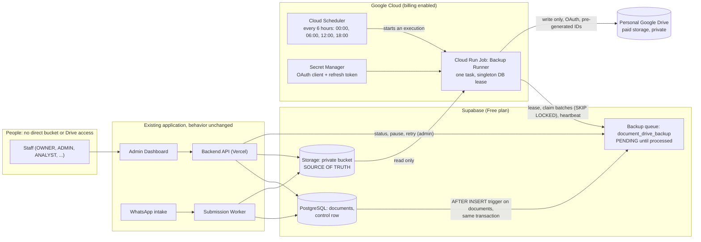
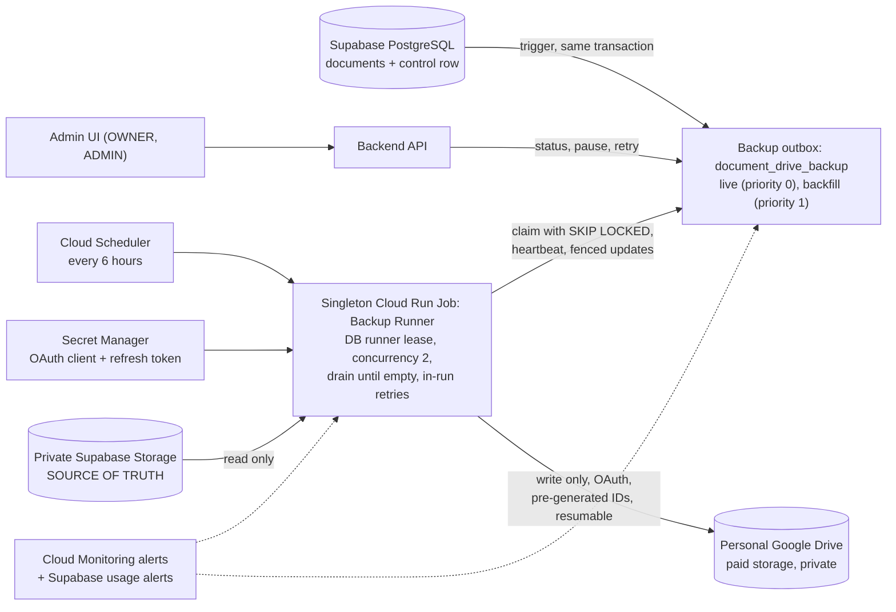

# Google Drive Document Backup: Implementation Guide (Option A)

| | |
|---|---|
| **Status** | Design only. Nothing in this guide is implemented, applied or deployed. SQL and code shown are drafts for review. |
| **Version** | Revision 3, 2026-11-01 (revision 1: first complete guide; revision 2: queue, scheduling and limits research; revision 3: confirmed project decisions) |
| **Decision** | Option A: one-way, append-only backup. **Supabase Storage → Backup Queue → Google Cloud → Google Drive.** Supabase Storage plus the `documents` table stay the source of truth. Google Drive is a backup and archive only. |
| **Background** | [`GOOGLE_DRIVE_DOCUMENT_BACKUP_RESEARCH.md`](GOOGLE_DRIVE_DOCUMENT_BACKUP_RESEARCH.md) compares the options and explains the reasoning. This guide is the how-to. |

## Confirmed project decisions (revision 3)

These were confirmed by the project owner and are the basis of this revision.

| Topic | Confirmed decision |
|---|---|
| **Supabase plan** | **Free** |
| **Google Drive** | A **personal Google account with additional paid storage** (not a Google Workspace Shared Drive) |
| **Backup direction** | **One-way only** (Supabase → Drive; nothing flows back) |
| **Pipeline** | `Supabase Storage → Backup Queue (PostgreSQL outbox) → Google Cloud (Cloud Scheduler + Cloud Run Job) → Google Drive` |
| **Schedule** | Every 6 hours: 6:00 AM, 12:00 PM, 6:00 PM, 12:00 AM (time zone assumed Asia/Colombo, as for the Sheet sync schedule: **confirm**) |
| **Google Cloud project** | Billing enabled (paid) |
| **Retention and privacy policy** | **Not decided. Needs senior/business approval before production go-live** (section 12.4) |
| **Access** | Normal application users must **not** access the Supabase bucket or Google Drive directly |

**Convention.** **Confirmed** = from this repository, an official Google or Supabase page, or the decisions above. **Proposed** = design for this project. **Needs verification** = not settled by official documentation read during this research; test it in Phase 0 or confirm with the vendor. Figures marked *(summary)* came from a machine summary of an official page rather than verbatim page text; check them against the live page before relying on them.

---

## 0. What changed in revision 3

Revision 3 applies the confirmed decisions above. All research from revisions 1 and 2 is kept unless this table says it was superseded.

| Topic | Revision 2 | Revision 3 | Why |
|---|---|---|---|
| Supabase plan | Unknown (to be confirmed) | **Free, confirmed.** Its limits are now treated as design constraints (section 6.4) | Free has 1 GB storage, 5 GB egress and tight Edge Function limits |
| Drive type | Workspace **Shared Drive** (recommended) | **Personal Google account with paid storage.** Shared Drive is a documented **future upgrade** (section 1.6) | Confirmed project decision |
| Authentication | Service account with Application Default Credentials (no key) | **OAuth 2.0 with a refresh token** held in Google Secret Manager (section 3.7) | A service account cannot own files or use My Drive (Google's documentation); a personal account needs OAuth |
| Schedule | Cloud Scheduler wake-up every 10 minutes; a 6-hour drain was "not recommended" | **Every 6 hours is confirmed.** It starts a singleton drain of a **continuous queue**; it is not a scan (section 5) | Confirmed project decision. The queue and lease design from revision 2 is what makes a 6-hour cadence safe |
| Overlap protection | Runner lease, row leases, fixed IDs | **Unchanged and now essential**: a 6 PM run still draining at 12 AM must not be competed with | Section 5.3 |
| Compute | Cloud Run Job | Cloud Run Job (confirmed). Edge Functions explicitly **not** the worker | Free-plan limits (sections 5.8 and 6.4) |
| Backup gap | Target 1 hour | **Up to one schedule interval (6 hours) plus drain time, by design.** Alert thresholds revised (section 4.11) | The cadence is now 6 hours |
| Run model | Time-budgeted run of about 50 minutes | **Drain until empty, with a long ceiling and in-run retries** (section 5.4) | With a 6-hour interval a run that stops early would leave work waiting 6 hours |
| Removal before backup | Small window | **Window up to about 6 hours or more**; deferred object deletion is recommended for approval (section 3.6) | A removed document's file is deleted from Supabase right away |
| Supabase egress | A cost to check | **Highlighted risk:** every backup downloads the file, so `backup size ≈ egress used` (section 6.4) | Free allows 5 GB |
| Stage testing | Drills only | **A full performance and resilience test plan** (section 10.3) | Real speeds and limits must be measured before production |
| Retention and privacy | Open question | **Explicitly undecided; blocks production go-live** (section 12.4). The design stays append-only | Not decided |
| Open decisions | 16 items | Confirmed items removed; remaining items listed (section 18) | |

---

## Contents

1. [Which Drive are we using? (personal account with paid storage)](#1-which-drive-are-we-using-confirmed-personal-google-account-with-paid-storage)
2. [Pricing](#2-pricing)
3. [Architecture](#3-architecture) (3.7 OAuth authentication)
4. [Queue architecture and duplicate prevention](#4-queue-architecture-and-duplicate-prevention)
5. [Scheduling and platform choice (6-hour schedule)](#5-scheduling-and-platform-choice)
6. [Limits and quotas reference](#6-limits-and-quotas-reference) (6.4 Supabase Free plan risks)
7. [Capacity and duration calculations](#7-capacity-and-duration-calculations) (7.6 Free-plan egress budget)
8. [Prerequisites checklist](#8-prerequisites-checklist)
9. [Step-by-step build](#9-step-by-step-build)
10. [Deployment, stage performance test and rollout](#10-deployment-stage-performance-test-and-rollout) (10.3 stage test)
11. [Backfill runbook](#11-backfill-runbook)
12. [Operations: monitoring, failure matrix, runbooks](#12-operations-monitoring-failure-matrix-runbooks) (12.4 retention and privacy)
13. [Integrity verification](#13-integrity-verification)
14. [Security checklist](#14-security-checklist)
15. [Testing plan](#15-testing-plan)
16. [Final recommended architecture](#16-final-recommended-architecture)
17. [Implementation phases](#17-implementation-phases)
18. [Open decisions](#18-open-decisions)
19. [Sources](#19-sources)

---

## 1. Which Drive are we using? (confirmed: personal Google account with paid storage)

The Drive account type decides the authentication method, and therefore the whole setup.

### 1.1 Confirmed decision

| | |
|---|---|
| **Drive** | A personal Google account (not Google Workspace) with additional paid storage (Google One) |
| **Authentication** | OAuth 2.0 on behalf of that account, offline access, refresh token |
| **Account** | A **dedicated, company-controlled** Google account if possible, not an employee's personal account |
| **Credentials** | OAuth client ID, client secret and refresh token in **Google Secret Manager only** (never Vercel, source control, the frontend or ordinary env files) |
| **Future option** | Workspace Shared Drive (section 1.6) |

### 1.2 Why OAuth and not a service account (Confirmed)

Google's Drive API documentation states: "Service accounts don't have storage quota and can't own files. Instead, they must upload files and folders into shared drives, or use OAuth 2.0 to upload items on behalf of a human user." It also states that personal `@gmail.com` accounts cannot create shared drives ([Shared drives overview](https://developers.google.com/workspace/drive/api/guides/about-shareddrives)). With a personal account the only supported server-side route is therefore **OAuth on behalf of that account**.

### 1.3 Chosen setup vs the Shared Drive alternative

| | **Chosen now: personal account + OAuth** | **Future upgrade: Workspace Shared Drive + service account** |
|---|---|---|
| Cost | Google One storage plan (section 2.2) | Workspace seat(s), from about $14 per month (section 2.1) |
| Authentication | OAuth refresh token (a secret that must be protected, monitored and rotated) | Service account with Application Default Credentials, no key |
| Ownership | The account owns the files | The organisation owns the files |
| Capacity | The paid Google One plan | Pooled Workspace storage |
| Access control and audit | Basic account-level controls; no Workspace audit console | Membership roles, admin-controlled sharing, audit events (edition dependent) |
| Continuity | Depends on one account and its recovery details | Survives staff changes |
| Item limit | The per-account limits in section 6.1 (500 million items created per account); the 500,000-item Shared Drive cap does not apply | 500,000 items per shared drive |
| Status | **Confirmed choice** | Documented upgrade option |

### 1.4 Risks of the personal account (compared with a Shared Drive)

| Risk | Why it matters | Mitigation |
|---|---|---|
| **The account is a single point of failure** | Suspension, lockout, compromise or loss of recovery access makes the archive unreachable | Dedicated company-controlled account; two named owners; recovery email and phone owned by the company; backup codes stored in a company vault; documented recovery (open decision, section 18) |
| **Ownership and continuity** | Files belong to one account, not the organisation | Same as above; consider the Shared Drive upgrade if the archive becomes business-critical |
| **The refresh token can stop working** | A stopped token halts every backup | Google lists these causes: the user revoked access; the token was unused for six months; the user changed password **and the token includes Gmail scopes** (not our case); the account exceeded its live-token limit (100 per account per client, the oldest is invalidated first); time-based access expired; an admin policy restricted the scope; and **a Testing-status consent screen issues tokens that expire after 7 days** ([OAuth 2.0 documentation](https://developers.google.com/identity/protocols/oauth2)). Mitigation: publish the consent screen to **In production**, use only the Drive scope, run every 6 hours (so "unused for six months" cannot happen), halt and alert on `invalid_grant`, keep a re-authorization runbook (section 3.7) |
| **Storage is the account's quota** | The archive shares the account's quota with its Gmail and Photos. A full account cannot upload, and content can be deleted if it stays over quota for two years ([storage help](https://support.google.com/drive/answer/6374270)). A lapsed payment reduces the quota | Use the account for nothing else; buy storage with headroom; alert at 80%; keep billing under company control |
| **Weaker audit and sharing controls** | No Shared Drive roles; the account owner can share anything | The system never shares (no permission calls); never create links; periodic review of the account's sharing and security settings |
| **Automated use of a consumer account** | Google's terms and risk systems may treat large automated activity on a consumer account differently from Workspace. **Needs verification** | Confirm the terms with the senior before production; keep activity within normal API quotas |
| **Personal data on a consumer account** | Passports, police and medical records. Legal obligations may differ from a Workspace tenant | Legal review (section 12.4); private by default; no public links |
| **No admin console to recover access** | A Workspace admin could reset or recover; a consumer account cannot | Recovery details and a second owner |
| **The consent screen "In production"** | Without verification some apps show an "unverified" warning. For non-sensitive scopes this is not expected, but it is not stated directly. **Needs verification** | Use only `drive.file`, which Google classifies as non-sensitive ([scopes](https://developers.google.com/workspace/drive/api/guides/api-specific-auth)) |

### 1.5 Mitigations that are required (not optional)

1. A dedicated company-controlled account, owned by the company, with at least two named people who can recover it.
2. Two-step verification on the account, with recovery methods under company control.
3. Consent screen published to **In production**, requesting only `drive.file`.
4. OAuth client ID, client secret and refresh token stored only in Secret Manager.
5. The worker halts, and alerts, on any authentication failure (`invalid_grant` and similar) instead of retrying forever.
6. A documented token re-authorization and rotation procedure (section 3.7).
7. Storage sized with headroom, with an 80% alert.
8. An independent alert if no backup succeeds for a defined time (section 12.1).

### 1.6 Shared Drive as a future upgrade

A Shared Drive remains the stronger long-term home. Move to it if: the archive becomes business-critical, the account's single-owner risk is judged too high, or audit requirements grow.

- It requires a Workspace edition that supports Shared Drives (Google's Drive API page lists Business Standard, Business Plus, Enterprise and Education; whether Business Starter includes them is **not confirmed**).
- Authentication would change to a service account with Application Default Credentials and no key (the revision 2 design, kept in section 9.1 as "Future upgrade").
- The queue, claim, lease, idempotency, naming and integrity design is **identical**: only the Drive adapter's credentials and the root folder change.
- Moving the existing archive would need a one-off, audited copy tool (Phase 4): file IDs are per account, so existing `drive_file_id` values would not carry over.

### 1.7 A free 15 GB personal account

Only for tests with synthetic data. 15 GB is shared with that account's Gmail and Photos, and one skill video can be 50 MB.

---

## 2. Pricing

All figures were read from Google's and Supabase's own pages on 2026-11-01 (Google pages showed the Sri Lanka region). Prices change; confirm before purchasing.

### 2.1 Google Workspace (future upgrade option)

Source: [workspace.google.com/pricing](https://workspace.google.com/pricing). Prices in USD per user per month, excluding tax.

| Plan | List price | Storage | Shared Drives (per Drive API docs) |
|---|---|---|---|
| Business Starter | $7.00 | 30 GB per user, pooled | **Not listed. Needs verification.** |
| Business Standard | $14.00 | 2 TB per user, pooled | Yes |
| Business Plus | $22.00 | 5 TB per user, pooled | Yes |
| Enterprise | "Contact sales" | Pooled | Yes |

Notes:

- The page shows a 14-day free trial.
- The page shows an introductory 10% discount for the first 20 users for 12 months, dated 15 Nov 2026 to 15 Nov 2027, so it is **not active today**.
- The page mentions "Save 16% with 1 year commitment" but shows no separate annual price. Confirm the billing options at purchase.
- **The service account needs no licence.** A licence is needed for the people who administer the Workspace and who access the Drive. The smallest practical set is **one** licensed user who creates and administers the Shared Drive. **Needs verification**: the minimum seat count at purchase.
- **Minimum cost of the Shared Drive upgrade:** one Business Standard seat is about **$14 per month** (about $168 per year at list price), with 2 TB of pooled storage. The Drive API itself has no per-call charge in any plan.

### 2.2 Google One paid storage (chosen setup) and free storage

Sources: [one.google.com/about/plans](https://one.google.com/about/plans) and [Manage your storage](https://support.google.com/drive/answer/6374270). Prices below are the LKR monthly prices shown on the page.

| Plan | Storage | Monthly price (LKR) |
|---|---|---|
| Free | 15 GB per Google Account | 0 |
| Google One Lite | 30 GB | 250 |
| Google One Basic | 100 GB | 575 |
| Google AI Pro | 5 TB | 6,425 (a bundle that includes Gemini and YouTube Premium Lite; expensive if you only want storage) |

Notes:

- The page shows annual billing ("Save up to 16%") but only monthly prices were visible. Intermediate plans (for example 200 GB or 2 TB) were not shown for this region; **Needs verification** on the live page.
- Free storage is **shared among Drive, Gmail and Photos** of the one account, and WhatsApp backups on Android count too. A full account cannot upload to Drive, and content can be deleted if the account stays over quota for two years ([storage help](https://support.google.com/drive/answer/6374270)).
- Only files the account **owns** count against its storage.

### 2.3 Other costs (updated in revision 3)

| Item | Notes |
|---|---|
| Drive API | No per-call charge. Subject to quotas ([usage limits](https://developers.google.com/workspace/drive/api/guides/limits)). The page says charges for exceeding quota are "planned" for later in 2026 with at least 90 days' notice *(summary)*: **Needs verification**, watch for it. |
| **Google Drive storage (chosen setup)** | A Google One plan on the dedicated account (section 2.2). The **capacity actually purchased is an open decision**: size it from section 7.5, plus headroom and growth. |
| Cloud Run (the backup Job) | The Google Cloud project is billing-enabled. A Cloud Run **Job** is billed only while it runs (all jobs use instance-based billing; [billing settings](https://docs.cloud.google.com/run/docs/configuring/cpu-allocation)). Free-tier amounts and the per-vCPU-second and per-GiB-second prices could not be read from the pricing page during this research: **Needs verification** with the [Google Cloud Pricing Calculator](https://cloud.google.com/products/calculator). Cost model: `cost ≈ (vCPU × price_cpu + GiB × price_mem) × busy_seconds`. With a 6-hour schedule the Job runs only while there is work, so busy time is small on normal days and larger during backfill. |
| Cloud Scheduler | One job (four runs a day). Price and free-tier count: **Needs verification**. |
| Secret Manager | A few secrets and versions; expected to be small (**Needs verification** of current pricing). |
| **Supabase (Free plan)** | $0, but with hard limits: 1 GB file storage, 5 GB egress, 50 MB maximum file size, projects paused after one week of inactivity ([Supabase pricing](https://supabase.com/pricing)). **Every backup downloads the file from Supabase Storage, so egress used ≈ backup size** (section 6.4). The paid Pro plan starts from $25 per month with 100 GB storage and 250 GB egress included (**Needs verification** of current terms). |
| Engineering | About 3 weeks for build and visibility, about 1 week for backfill, plus the stage test (estimate). |

### 2.4 Cost summary (revision 3)

| Item | Cost | Note |
|---|---|---|
| **Chosen setup** | | |
| Google Drive storage | Google One plan sized to need (examples: 100 GB LKR 575 per month; 5 TB bundle LKR 6,425 per month) | Capacity to be decided (section 7.5); intermediate plans **Needs verification** |
| Cloud Run Job + Cloud Scheduler + Secret Manager | Small; to be confirmed with the Pricing Calculator | Billing is already enabled |
| Supabase Free | $0 | Constrained: see section 6.4 |
| **Possible later upgrades** | | |
| Supabase Pro | from $25 per month | If storage, egress or the 50 MB file limit is outgrown, or a production-grade project is required |
| Workspace Business Standard, 1 seat | about $14 per month | Shared Drive upgrade (section 1.6) |

Section 7 shows how to estimate backup duration and data volume.

---

## 3. Architecture

### 3.1 The one-way pipeline and who may touch what (Confirmed rules, Proposed wiring)

```
Supabase Storage bucket ──(read only)──▶ Backup queue (PostgreSQL outbox) ──▶ Google Cloud Run Job ──(write only)──▶ Google Drive
        ▲                                                                                       │
 source of truth                                                                    no reverse path exists
```

Rules:

1. **Supabase Storage remains the source of truth.** Google Drive is a backup and archive only.
2. **One-way only.** Nothing from Drive is ever read back into Supabase or into the application. The worker has no code path that downloads from Drive for restoration or sync; the only Drive reads are metadata checks (section 13). A restore, if ever needed, is a separate, manual, audited tool (out of scope).
3. **Normal system users do not access the Supabase Storage bucket directly.** *Confirmed in this repository:* the bucket is private, and the processing flow creates no public or signed **download** URLs (`Docs/06-storage-management.md`); the code uses a Supabase signed **upload** URL for admin uploads (`createSignedUploadUrl`, a single object, expiring), and no download-URL or public-URL call exists in `src` (searched). Admin and review previews go through the backend API. **Needs verification** in the Supabase dashboard: that there are no Storage policies on `storage.objects` granting `anon` or `authenticated` access (none are created in this repository's migrations).
4. **Normal system users do not need Google Drive access.** Application roles (ANALYST, REGISTRATION_DESK, JOB_HANDLER, and ADMIN in the console) never receive Drive access, and nobody is given the Drive account's password. Staff keep working through the normal backend and UI permissions, where RBAC and the audit log apply.
5. **Only the Backup Job holds privileged credentials:** the Supabase service-role key (to read Storage and the database) and the Drive OAuth credentials. Both live in **Google Secret Manager**. No browser, Vercel function or other service has Drive credentials.
6. The backend API **never** talks to Drive. It only reads backup status from the database and can pause or retry (admin-only, audited).

### 3.2 Component diagram



There is no arrow from Drive to Supabase or to the application.

### 3.3 Sequence for one document

```mermaid
sequenceDiagram
    participant App as Existing app
    participant DB as PostgreSQL
    participant Sch as Cloud Scheduler
    participant R as Backup Job
    participant SM as Secret Manager
    participant S as Supabase Storage
    participant G as Google Drive

    App->>DB: INSERT documents row (existing transaction)
    Note over DB: trigger inserts outbox row PENDING in the same transaction
    Note over DB,R: the row waits PENDING until the next scheduled run
    Sch->>R: start an execution (every 6 hours)
    R->>SM: read OAuth secrets (at start)
    R->>DB: acquire runner lease (singleton); exit if another runner holds it
    R->>DB: claim batch (SKIP LOCKED), assign drive_file_id if null
    R->>DB: read or create candidate folder mapping
    R->>G: ensure folder (stored ID, 409 = exists)
    R->>S: download object (read only)
    R->>R: hash while reading: SHA-256 and MD5
    R->>G: files.create with stored ID (resumable above 5 MB)
    G-->>R: 200 with md5Checksum and size, or 409 (already created)
    R->>DB: COMPLETED (fenced by lease owner)
    Note over R,DB: crash at any point: next claim reuses stored IDs, no duplicate
```

### 3.4 Design rules

1. **One-way and append-only.** The worker never deletes, overwrites, renames or moves Drive items, and never changes sharing. Until a retention policy is approved (section 12.4) nothing in Drive is ever deleted automatically.
2. **The main flow cannot fail because of Drive.** The only change to it is one extra small row written by a trigger.
3. **Every write path is covered** because the trigger sits on `documents` (WhatsApp, admin upload, review approve, replace verified, keep as version).
4. **Idempotent** through Drive file IDs generated in advance (`files.generateIds`) and stored before the first upload byte. Google documents that a retried create with the same ID returns 409 instead of creating a duplicate ([upload guide](https://developers.google.com/workspace/drive/api/guides/manage-uploads)).
5. **The queue is the unit of work, not a scan.** Every new `documents` row creates a queue row immediately; the 6-hour schedule only starts a consumer that drains the queue.
6. **A separate Job and identity** from the Sheet Sync worker and the submission worker; its credentials are scoped to Drive (OAuth) and its own secrets.
7. **Write gate and pause** (`DRIVE_BACKUP_ENABLED`, and a database pause flag) so the feature ships disabled and can be stopped instantly.

### 3.5 Folder and file layout

```
{app root folder in the Drive account (or a Shared Drive after an upgrade)}
└── {unique_id}/                          e.g. 0006
    ├── PASSPORT_20261031_a1b2c3d4.pdf
    ├── POLICE-REPORT_SL-VERIFIED_20261031_e5f6a7b8.pdf
    └── MEDICAL_20261101_c9d0e1f2.pdf
```

- Folder name = `unique_id`. The real link is the stored mapping `passport_id → drive_folder_id`. No passport number, NIC, phone number, name or original file name appears in any Drive name.
- File name = `{TYPE}[_{VARIANT}]_{yyyymmdd of received_date}_{first 8 chars of document_id}.{ext}`. `TYPE` values from `DOCUMENT_STORAGE_TYPES`: `PASSPORT`, `POLICE-SLIP`, `POLICE-REPORT`, `MEDICAL`, `NIC`, `SKILL-VIDEO`, `SCAN`, `VISA-SUBMISSION`. Variants (police report only): `SL-VERIFIED`, `ROMANIA`, `SL-NORMAL`.
- Each document is its own file; versions are separate files, never overwritten.
- Put the full `document_id` and the SHA-256 in the file's `appProperties` (private to the app). (The `appProperties` size limits are not stated on the official files page: **Needs verification**; two short values are expected to be fine.)
- One folder per candidate keeps item use low. A folder can hold at most 500,000 items directly, and a hierarchy at most 100 levels ([error reference](https://developers.google.com/workspace/drive/api/guides/handle-errors)); this layout is nowhere near either.

### 3.6 Behavior for changes (Proposed)

| Event | Drive |
|---|---|
| New document | New file |
| Replaced or corrected document | New file; the old one stays |
| Document removed in the app | **File kept**; the database records `lifecycle = REMOVED` |
| Document superseded | File kept; `lifecycle = SUPERSEDED` |
| Candidate passport ID | Cannot change in the app (primary key) |
| `unique_id` corrected | Folder name goes stale; the stored folder ID still works |
| Candidate deleted in the database | Never deletes Drive files; flag for review |
| Privacy erasure request | A manual, audited purge procedure (section 12.4) |

### 3.7 Authentication architecture (OAuth 2.0, personal account) (Confirmed decision, Proposed wiring)

**How it works.**

1. **One-time authorization (a human, once).** An operator, signed in as the **dedicated Drive account**, authorizes the project's OAuth client with the Drive scope `https://www.googleapis.com/auth/drive.file` and offline access (`access_type=offline`, and `prompt=consent` to force a fresh refresh token). Google returns a **refresh token** at that first authorization ([web server OAuth flow](https://developers.google.com/identity/protocols/oauth2/web-server)). This is done by a small operator script run on a trusted machine, **not** by the application and never in a browser session of the admin console.
2. **Secrets are stored in Google Secret Manager** (proposed names): `drive-oauth-client-id`, `drive-oauth-client-secret`, `drive-oauth-refresh-token`. Not in Vercel, not in source control, not in the frontend, not in ordinary `.env` files. The authorization script writes the refresh token straight to Secret Manager and prints nothing.
3. **The Cloud Run Job reads them at start** (Cloud Run injects Secret Manager values with `--set-secrets`; pinning `:latest` means a rotated secret is picked up by the next execution). Only the Job's runtime service account has `secretAccessor` on these three secrets, and nothing else.
4. **At runtime** the Google auth library exchanges the refresh token for short-lived access tokens automatically. Tokens and secrets are never logged; errors carry codes only.
5. **Failure handling.** `invalid_grant` or any authentication or permission failure is a **configuration halt**: the runner stops claiming, gives rows back without using attempts, sets `halted` with a reason code, and an alert fires. Recovery is the re-authorization procedure below.

**One root folder created by the app.** With the narrow `drive.file` scope the app reaches only files it created or that were opened with it ([scopes](https://developers.google.com/workspace/drive/api/guides/api-specific-auth)). So the **first run creates the root folder** ("Emlynk Candidate Documents") in the account's My Drive, stores its ID, and every candidate folder and file is created inside it by the same app. Humans must not rename, move or delete the root folder: if they do, the next run gets a 404 on the parent and halts (alert). Whether `drive.file` is sufficient for every call (creating subfolders and files inside an app-created folder) **Needs verification** in the Phase 0 spike; the fallback is the restricted `drive` scope, which would be acceptable only on a dedicated account that holds nothing else.

**Why a refresh token stops working, and what we do about each** (causes from Google's [OAuth documentation](https://developers.google.com/identity/protocols/oauth2)):

| Cause | Applies here? | Handling |
|---|---|---|
| The account revoked the app's access | Yes | Halt and alert; re-authorize |
| Unused for six months | No: the Job runs every 6 hours | Nothing |
| Password change with Gmail scopes in the token | No: Drive scope only | Nothing |
| The account's live refresh-token limit (100 per account per client) was exceeded | Only if the authorization script is run repeatedly | Run it once; record each run; an over-limit mint silently invalidates the oldest token |
| Time-limited access expired | Only if the owner granted time-based access | Grant normal (not time-limited) access |
| Administrator restricted the scope (`admin_policy_enforced`) | Not for a personal account | n/a |
| **Consent screen in "Testing" status: tokens expire in 7 days** | **Yes unless published** | **Publish the app to "In production"** (an external user type in Testing is "issued a refresh token expiring in 7 days"; the exception covers only name, email and profile scopes) |

**Token rotation and recovery runbook (draft; the process itself is an open decision).**

1. Detect: the halt reason shows an authentication failure, or the daily health check fails.
2. Sign in as the dedicated account; check security events; confirm the app is still authorized (or revoke it).
3. Run the one-time authorization script again (`prompt=consent`); it writes a **new version** of the refresh-token secret.
4. Run the Job manually once and confirm it completes a small batch.
5. Disable the previous secret version; clear the halt in the admin card; confirm the next scheduled run.
6. Record who did it and when. Two named people must be able to perform these steps.

**Compared with a service account (revision 2):** a service account with Application Default Credentials has no secret to leak or rotate. OAuth adds three secrets, a token that can silently expire, and a human recovery path. These are the accepted costs of the personal-account decision.

---

## 4. Queue architecture and duplicate prevention

### 4.1 Four processing models compared

| | **A. Scheduled batch scan** | **B. Persistent outbox, continuous consumer** | **C. Outbox, scheduled drain** | **D. Hybrid: one outbox, live and backfill priorities, singleton consumer** |
|---|---|---|---|---|
| **How it works** | Every N hours, scan `documents` and compare with Drive; upload the difference | Each new document adds a queue row at once; a consumer always runs | Queue as in B, but a consumer runs only every N hours | Queue as in B; rows carry a priority; one consumer drains live first, backfill with a cap |
| **State** | Implicit (compare listings); fragile | Explicit per-item state | Explicit per-item state | Explicit per-item state plus control row |
| **Overlapping runs** | **Dangerous**: two scans see the same "missing" files | Safe if rows are leased | Needs a singleton or the same rows are fought over | Safe: singleton plus row leases plus fixed IDs |
| **Backup gap (RPO)** | Up to N hours | Seconds to minutes | Up to N hours | Minutes (live), unbounded but capped (backfill) |
| **Scales to 1,000+** | Scan cost grows with history; a large run is all-or-nothing | Good | Good, but a 6-hour gap | Good, with fairness controls |
| **Backfill** | Same mechanism, can starve live files | Competes with live files | Competes with live files | **Separated by priority, concurrency and daily cap** |
| **Verdict** | Rejected | Good, needs an always-on consumer | Acceptable only with a short interval | **Chosen**: B's queue with D's controls |

**Conclusion.** The architecture is a **continuous outbox** (every document is queued the moment it is stored) with **priorities** (live before backfill) and a **singleton consumer** that is started by the schedule (every 6 hours) and drains until the queue is empty. The consumer type (Job or always-on service) is a compute choice (section 5); the data model does not change.

### 4.2 Does the revision-1 outbox already solve overlapping runs?

**Partly.** What revision 1 already guaranteed (and still does):

- One row per document (primary key `document_id`, `ON CONFLICT DO NOTHING`), so a document is never queued twice.
- A row lease and a pre-generated Drive file ID stored before upload, so even two workers fighting over one row cannot create two Drive files (section 4.6).

What revision 1 did **not** cover, and what is added:

| Gap | Risk | Added protection |
|---|---|---|
| No limit on how many runners work at once | Two executions double the Supabase egress rate, memory pressure and Drive API usage, even if no duplicates result | **Runner-level singleton lease** in a control row (section 4.5) |
| No priorities | A 1,200-file backfill delays brand-new documents | `priority` column and claim ordering (section 4.9) |
| No pause or caps | Cannot stop quickly or throttle a backfill | Control row: `paused`, `backfill_paused`, daily cap |
| Stale `PROCESSING` recovery only implied | A crashed run could leave rows stuck | Claim query also takes expired `PROCESSING` rows (section 4.7) |
| No fencing | A slow "zombie" runner could overwrite newer state | Every state change is conditional on the lease owner (section 4.5) |
| Scheduler behavior | Cloud Scheduler can, rarely, fire more than once per slot | Runner lease makes a second start exit immediately (section 5.1) |

### 4.3 Schema additions (draft, supersedes the revision-1 SQL where they differ)

The full migration draft is in section 9.2. In summary, relative to revision 1:

- `document_drive_backup` gains `priority`, `claimed_at`, `drive_md5`, `drive_size`, `verified_at`.
- A new single-row table `document_drive_backup_control` holds the runner lease, heartbeat, pause flags and backfill controls.
- A partial index serves the claim query.

### 4.4 Row states

```
PENDING ──claim──▶ PROCESSING ──ok──▶ COMPLETED
   ▲                    │
   │                    ├─ retryable error ──▶ PENDING (next_attempt_at = backoff)
   │                    ├─ lease expired ────▶ (re-claimed as PROCESSING by the next claim)
   │                    ├─ permanent / exhausted ─▶ FAILED   (dead letter)
   │                    └─ source object missing ─▶ SOURCE_MISSING
   └── admin "Retry failed" ◀── FAILED, SOURCE_MISSING
```

- `COMPLETED` rows are never reclaimed.
- `attempts` counts claims, as in the Sheet Sync store, so a crash also counts. A configuration halt (permissions, quota, expired token) **gives the claim back without using an attempt**, as the Sheet worker does.

### 4.5 Atomic claiming, runner lease and fencing

**Per-row claim: one statement.** A single `UPDATE ... WHERE document_id IN (SELECT ... FOR UPDATE SKIP LOCKED LIMIT n) RETURNING` is atomic: concurrent claimers skip rows that are locked by another transaction, so two claimers can never receive the same row. It also takes expired `PROCESSING` rows (stale recovery) in the same query.

```sql
UPDATE "document_drive_backup" AS q
   SET "status" = 'PROCESSING',
       "lease_owner" = $1,                                   -- runner id
       "lease_expires_at" = now() + interval '10 minutes',
       "claimed_at" = now(),
       "attempts" = q."attempts" + 1,
       "updated_at" = now()
 WHERE q."document_id" IN (
        SELECT "document_id" FROM "document_drive_backup"
         WHERE ("status" = 'PENDING'    AND "next_attempt_at" <= now())
            OR ("status" = 'PROCESSING' AND "lease_expires_at" <  now())   -- stale recovery
         ORDER BY "priority", "created_at"                    -- live (0) before backfill (1)
         FOR UPDATE SKIP LOCKED
         LIMIT $2)                                            -- batch size
RETURNING q.*;
```

(Prisma: run it with `$queryRaw`. The project already claims rows by compare-and-swap in `sheetSyncStore.js`; either style is correct, but a single `SKIP LOCKED` statement claims a whole batch atomically.)

**Runner lease: one control row, compare-and-set.** Only one runner may drain at a time:

```sql
-- acquire (returns a row only if this caller now holds the lease)
UPDATE "document_drive_backup_control"
   SET "runner_id" = $1, "runner_lease_expires_at" = now() + interval '2 minutes',
       "runner_heartbeat_at" = now(), "last_run_started_at" = now()
 WHERE "name" = 'drive-backup'
   AND ("runner_id" IS NULL OR "runner_lease_expires_at" < now())
RETURNING "name";

-- heartbeat every ~30 s (also the fence): 0 rows updated = lease lost, stop at once
UPDATE "document_drive_backup_control"
   SET "runner_lease_expires_at" = now() + interval '2 minutes', "runner_heartbeat_at" = now()
 WHERE "name" = 'drive-backup' AND "runner_id" = $1
RETURNING "name";
```

Why a table row and not `pg_advisory_lock`: Supabase's shared pooler in transaction mode (port 6543) does not keep a session between statements, so session-level advisory locks are unreliable there (**Needs verification** against your connection string; the project's pooler usage is documented in `Docs/08-cloud-deployment.md`). A lease row works with any connection mode and survives a crash (it simply expires).

**Fencing.** Every status change by a runner carries `AND lease_owner = $runner`:

```sql
UPDATE "document_drive_backup" SET "status" = 'COMPLETED', ... 
 WHERE "document_id" = $d AND "lease_owner" = $runner AND "status" = 'PROCESSING';
```

A "zombie" runner whose lease was taken over cannot overwrite the new owner's state.

### 4.6 Exactly how duplicates are prevented

**The invariant.** *A document has exactly one `drive_file_id`, assigned once and stored in the database before the first upload byte is sent. Drive IDs are unique, so two creates with the same ID can never produce two files.* The lease and singleton are for efficiency and ordering; **correctness does not depend on them.**

Assigning the ID race-free (two runners must never store different IDs):

```sql
-- generateIds() is called first; then the claim stores the ID only if none exists
UPDATE "document_drive_backup"
   SET "drive_file_id" = COALESCE("drive_file_id", $newId)
 WHERE "document_id" = $d AND "lease_owner" = $runner
RETURNING "drive_file_id";      -- always use the RETURNED value
```

The same pattern assigns folder IDs:

```sql
INSERT INTO "candidate_drive_folder" ("passport_id","drive_folder_id") VALUES ($p, $newFolderId)
ON CONFLICT ("passport_id") DO NOTHING;
SELECT "drive_folder_id" FROM "candidate_drive_folder" WHERE "passport_id" = $p;  -- create with THIS id
```

| Scenario | What happens | Why there is no duplicate |
|---|---|---|
| **Worker crashes during upload** | The row stays `PROCESSING` until its lease expires; the next claim re-takes it. The stored `drive_file_id` is reused. If the upload had finished, `create` returns **409**: the worker reads size and MD5 (`files.get`), they match, and the row is completed. If it had not finished, `create` simply uploads. An interrupted resumable session never produced a file (Needs verification in the spike); if a partial object were ever found with the wrong MD5, the worker repairs **its own file ID** with `files.update` content upload, not a second file. | Same ID every time |
| **Cloud Run restarts or is preempted** | SIGTERM: stop claiming, finish or abandon the current upload within the grace period, release the rows without using an attempt, release the runner lease. If it is killed hard, leases expire (2 min runner, 10 min row) and the next execution recovers everything. | Same as above |
| **The schedule fires twice (or two executions overlap)** | The second execution cannot acquire the runner lease and exits within seconds. Even if it did not exist, row claims use `SKIP LOCKED`, and uploads use fixed IDs. Cloud Scheduler is documented as "at least once", and "in some rare circumstances, it is possible for a job to run multiple times in association with a single instance of the schedule, so your code must ensure that there are no harmful side-effects" ([overview](https://docs.cloud.google.com/scheduler/docs/overview)). Whether Cloud Run lets a second execution of the same Job start while one is running is **not stated** in the pages read: design for it (this design does). | Singleton lease, `SKIP LOCKED`, fixed IDs |
| **Network timeout after Drive already accepted the upload** | The client sees a timeout, not success. The retry uses the same stored ID, receives **409**, verifies size and MD5, and completes. | Same ID, 409 is treated as success after verification |
| **Two workers claim at nearly the same time** | `SKIP LOCKED` gives each row to exactly one. If both somehow work on one row (an expired lease while a slow upload continued), both use the same stored ID: the second gets 409. The fenced completion update lets only the current owner write state. | Same ID plus fencing |
| **Duplicate queue row** | `document_id` is the primary key; the trigger uses `ON CONFLICT DO NOTHING`; a backfill insert does the same. | Primary key |
| **Same content uploaded twice by the application** | Cannot occur: `documents` is unique on `(passport_id, file_sha256)`, and duplicates never become rows. | Existing database rule |

### 4.7 Heartbeat, graceful shutdown, stale recovery

| Mechanism | Design |
|---|---|
| Runner heartbeat | Renew the runner lease and `runner_heartbeat_at` every 30 s. Lease 2 min. A missed renewal (0 rows) means the lease was lost: stop claiming and abandon in-flight work at the next safe point. |
| Row lease | 10 min per row, renewed while an upload is active (every 2 min). Sized so a 50 MB file on a slow link still fits. |
| Graceful shutdown | On SIGTERM: stop claiming, let in-flight uploads finish up to the grace period, then set unfinished rows back to `PENDING` **without** counting an attempt, release the runner lease, exit. Cloud Run's termination grace is limited; anything unfinished is recovered by lease expiry. |
| Stale `PROCESSING` recovery | Built into the claim query (`status = 'PROCESSING' AND lease_expires_at < now()`), so no separate janitor is required. The attempt counter still advances, which bounds crash loops (after the maximum, `FAILED`). |
| Run length | With a 6-hour schedule a run **drains until nothing is claimable** (section 5.4), with a self-limit of about 11 hours as a safety ceiling. If it ends at the ceiling the queue simply continues in the next execution. |
| Heartbeat for monitoring | `runner_heartbeat_at` and `last_success_at` in the control row feed the health card and alerts (section 12.1). |

### 4.8 Concurrency and batch size

| Setting | Recommendation | Reason |
|---|---|---|
| Runner count | **1** (singleton) | Bounds Supabase egress, memory and Drive API pressure; the Drive API is not the bottleneck at our volume (section 7), so more runners add risk, not speed |
| Parallel uploads in the runner | **2** to start; raise to **3** only after the Phase 0 spike and a memory check | Network time dominates; 2 to 3 streams use the link well |
| Backfill share | At most **1** of those slots, and only when the live queue is shallow | Live files must not wait (section 4.9) |
| Claim batch size | 5 (about 2 to 3 times the concurrency) | Short claims keep rows available to a successor if this runner dies |
| Instance size | 1 vCPU, 1 GiB | The existing code downloads whole objects into memory; at 3 parallel 50 MB files that is about 150 MB plus overhead |
| Cloud Run limits | Max instances / job parallelism: 1 task | Belt and braces; the database lease is the real control |

### 4.9 Live documents vs historical backfill

| | Live | Backfill |
|---|---|---|
| Source | Trigger on new `documents` rows | One-off script inserting rows for existing documents (`is_backfill = true`) |
| `priority` | 0 | 1 |
| Claim order | First | Only when no live row is claimable now |
| Concurrency | Up to the runner's slots | At most 1 slot |
| Batch size | 5 | 5 |
| Daily cap | None | `backfill_daily_cap` (for example 2,000 files per day), counted in the control row |
| Pause | `paused` stops everything | `backfill_paused` stops only backfill; also **automatic**: backfill claims are skipped when live pending exceeds a threshold (for example 100) |
| SLO | Backed up by the end of the next scheduled run (up to one 6-hour interval plus drain time; section 4.11) | None; alert only when no progress for 24 hours while enabled |

Live files always outrank backfill: the ordering is by `priority`, then `created_at`.

### 4.10 Pause and resume

- **Pause all:** `UPDATE ... SET paused = true` (admin button, or `DRIVE_BACKUP_ENABLED=false`). Runners finish the current file and stop claiming; the outbox keeps filling.
- **Pause backfill only:** `backfill_paused = true`.
- **Configuration halt** (permissions revoked, quota full, token revoked): the runner sets `halted = true` with a `halt_reason`, gives rows back without using attempts, and exits. A halted state raises a critical alert. Clearing the cause and pressing **Resume** continues from the same queue.
- **Resume:** clear the flags; the next scheduled run (or a manual execution) picks up. Nothing is lost because the queue is the state.

### 4.11 Backlog behavior (6-hour schedule)

The schedule is 6:00 AM, 12:00 PM, 6:00 PM and 12:00 AM. Example: at 6 PM a run starts with 1,200 files pending. At 12 AM it is still running with 400 left, and 500 new files have been stored in the meantime.

1. The queue is a table. At 12 AM it holds the 400 older rows plus the 500 rows the trigger inserted as the new documents were stored: **900 rows**. Nothing scanned or re-created anything.
2. At 12:00 AM Cloud Scheduler starts another execution. It tries to take the **runner lease**, finds it held, and **exits within seconds**. No second drain, no second scan, no duplicate work.
3. The 6 PM execution keeps claiming by `priority`, then `created_at`: the new live rows go ahead of any backfill rows, and oldest first within the same priority. It does not stop at 12 AM; it drains until nothing is claimable.
4. If the 6 PM execution **crashed**, Cloud Run retries the failed task (section 5.4). If the retries are exhausted, the runner lease expires after about 2 minutes and the 12 AM execution takes over the in-flight rows, so a crash can cost at most one schedule interval. The queue state is in PostgreSQL and survives.
5. Rows stored after a run has finished wait `PENDING` for the next scheduled start.
6. Total time to clear is `queue length × time per file ÷ concurrency` (section 7).

**Acceptable backlog age (Proposed; confirm with the senior).** By design a live document can wait up to one schedule interval (6 hours) plus drain time before it is backed up. That is **normal and not an alert**. The thresholds below measure abnormal delay:

| Signal | Warning | Critical |
|---|---|---|
| Oldest **live** `PENDING` age | over 9 hours | over 13 hours (two schedule slots missed) |
| Missed run: time since `last_run_started_at` | over 7 hours | over 13 hours |
| Live queue depth at the start of a run | over 1,000 | over 5,000 |
| A single run still active | over 8 hours (slower than inflow, or stuck: check the heartbeat) | over 20 hours |
| Runner heartbeat during a run | stale over 15 minutes while rows exist | stale over 1 hour |
| `FAILED` rows | any older than 24 hours | over 20 |
| `SOURCE_MISSING` rows | any (informational) | n/a |
| `halted = true` | n/a | immediately |
| Backfill progress | no progress for 24 hours while enabled | 72 hours |

---

## 5. Scheduling and platform choice

### 5.1 The confirmed 6-hour schedule is a queue drain, not a scan

The schedule (6:00 AM, 12:00 PM, 6:00 PM, 12:00 AM) is confirmed. What it **starts** is the important design choice:

| | Scan-and-upload batch (rejected) | Queue drain (chosen) |
|---|---|---|
| Where work comes from | Each run scans `documents` and Drive and uploads the difference | A queue row is created **the moment each document is stored**; a run only drains the queue |
| Two overlapping runs | Both see the same "missing" files and duplicate work | The second finds the runner lease held and exits |
| State on a crash | Lost, or implicit in listings | Explicit per-row state in PostgreSQL, preserved |
| New files during a run | Missed until the next scan | Join the same queue and are claimed in order |

How each required behavior is met:

| Required behavior | How |
|---|---|
| Every new `documents` row creates a queue row immediately | `AFTER INSERT` trigger on `documents`, in the same transaction (section 9.2) |
| Files stay `PENDING` until processed | Row state `PENDING` until a runner claims it |
| Cloud Scheduler starts the worker every 6 hours | Scheduler → Cloud Run Job (section 5.2, 10.1) |
| The worker drains the existing queue | Claim loop until nothing is claimable (section 5.4) |
| No competing second backup if the first is still running | **Runner-level database lease**; the new execution exits (section 4.5, 5.3) |
| Existing processing continues; new files keep joining | One queue; nothing is restarted |
| No independent second scan | There is no scan; the daily safety-net sweep only inserts missing queue rows, under the lease |
| Queue state survives crashes and restarts | State lives in PostgreSQL, not in the Job |
| Row leases, `SKIP LOCKED`, fixed IDs, retry, stale recovery, fencing, dead letter, priorities, pause | Kept exactly as in section 4 |

### 5.2 Cloud Scheduler settings (Proposed)

- Schedule `0 0,6,12,18 * * *` with time zone `Asia/Colombo` (**confirm the time zone**), which fires at 00:00, 06:00, 12:00 and 18:00.
- Cloud Scheduler is "at least once": "in some rare circumstances, it is possible for a job to run multiple times in association with a single instance of the schedule, so your code must ensure that there are no harmful side-effects of repeated execution" ([overview](https://docs.cloud.google.com/scheduler/docs/overview)). The runner lease makes a repeated start harmless.
- Retry config: `retryCount` 0 to 1 is enough (default 0, maximum 5; [retry jobs](https://docs.cloud.google.com/scheduler/docs/configuring/retry-jobs)). The Job's own task retries and the next scheduled run provide recovery.
- It starts the Job through the Cloud Run Jobs API (`...:run`); the Scheduler's identity needs a role that can start this Job only (a role containing `run.jobs.run`, for example Cloud Run Invoker: **Needs verification**).

### 5.3 What happens when a run is still active at the next fire

| Time | Event | Result |
|---|---|---|
| 18:00 | Scheduler starts execution A | A takes the runner lease and starts draining 1,200 rows |
| 18:00 to 24:00 | A claims batches, renews the lease every 30 s, renews row leases while uploading | New documents are inserted into the same queue by the trigger |
| 00:00 | Scheduler starts execution B | B reads the control row: lease held and fresh. **B exits within seconds**; logs "runner lease held" |
| 00:00 onward | A continues; B is gone | No second process, no extra Supabase egress, no extra Drive API pressure |
| If A crashes at 02:00 | Cloud Run retries A's task (Job `max-retries`) | The retry takes over once A's lease expires (about 2 minutes), or the 06:00 execution does |
| A finishes (queue empty) | A releases the lease | The next scheduled execution starts clean |

Cloud Run's own documentation does not state whether two executions of the same Job can start at once, so the design does not rely on the platform: the database lease is the guarantee.

### 5.4 Run model for a 6-hour interval (Proposed)

A Job run ends when nothing is claimable. Because the next run is 6 hours away, an early exit leaves work waiting, so:

| Setting | Design | Why |
|---|---|---|
| Drain | Continue until no row is claimable | A run that stopped after 50 minutes would leave a large backlog waiting up to 6 hours |
| Ceiling | A runner self-limit of about 11 hours; Job task timeout 12 hours (the platform allows up to 168 hours, [task timeout](https://docs.cloud.google.com/run/docs/configuring/task-timeout)) | A safety net, not the normal end |
| In-run retry ("linger") | If rows are waiting only for a short backoff (up to about 30 minutes), the runner **stays alive and sleeps** until they are due | A transient Google error is then retried within the same run, not 6 hours later |
| Longer backoff | A row whose next retry is more than the linger away is left `PENDING` for the next scheduled run | Avoids paying for an idle instance |
| Crash recovery | Job `max-retries` 3 restarts the task at once (default 3, range 0 to 10, [max retries](https://docs.cloud.google.com/run/docs/configuring/max-retries)); the lease is taken over after expiry | A crash does not have to wait for the next schedule |
| Manual run | An operator can start an execution at any time (`gcloud run jobs execute ...` or the console); the lease prevents overlap | Useful after an outage or a fix |

### 5.5 Consequences of a 6-hour cadence

| Consequence | Impact | Mitigation |
|---|---|---|
| **Backup gap up to about 6 hours plus drain time** | A document can sit un-backed-up for most of an interval | Accepted by the project; alert thresholds reflect it (section 4.11). A more frequent wake-up can be added later without redesign (the singleton lease already makes extra starts safe) |
| **Remove-before-backup window** | "Remove document" deletes the Supabase object right away, so a document removed before the next run can never be backed up (it becomes `SOURCE_MISSING`) | **Recommended for approval:** do not delete the storage object at once; keep it until its backup row is `COMPLETED`, or for at least one full schedule cycle (a small change to the removal flow, designed later; decision in section 18). Until then, accept the risk in writing |
| Crash recovery latency | Up to one interval if task retries are exhausted | Job task retries; alerting on a missed run |
| Retry timing | Long backoffs would stretch over many 6-hour slots | Short in-run backoffs with linger; later retries use the next scheduled runs; `FAILED` after the attempt limit |
| Idle gap | Nothing runs between drains | Intended: the Job is billed only while running |

### 5.6 Optional daily safety-net sweep

Once a day, inside a run that holds the lease, enqueue any `documents` row that has no queue row (an anti-join). It is idempotent because the queue key is `document_id`. It heals the case where the trigger was disabled or a row was inserted by an unusual path. It is **not** an independent scan: it only inserts queue rows, under the runner lease, and the normal drain does the uploading.

### 5.7 Platform options compared (kept from revision 2)

Limits are from official pages read during this research; the sources are in section 19.

| Option | Reliability | Overlap protection | Runtime limits | 1,000+ files | Cost | Supabase Free fit | Drive auth | Storage access | Complexity |
|---|---|---|---|---|---|---|---|---|---|
| **Always-on Cloud Run service** (polling loop, as the existing workers) | High; Cloud Run restarts it | One instance plus the database lease | Request timeout up to 60 minutes (not relevant to a background loop); a container is restarted at least every 7 days | Excellent | Billed for the whole instance lifetime with instance-based billing (price **Needs verification**) | Independent of Supabase plan | ADC, no key | Service-role key as a secret | Low; same pattern as the Sheet and submission workers |
| **Cloud Run Job + Cloud Scheduler** | High; Scheduler retries (`retryCount` default 0, maximum 5) | **Not guaranteed by the platform**: Scheduler is at-least-once and concurrent executions of one Job are not documented either way; the database lease provides it | Task timeout default 10 min, up to 168 hours (7 days); no execution timeout; retries 0 to 10 per task | Excellent (one task, time-budgeted loop) | Billed only while running (instance-based) | Independent | ADC, no key | Service-role key as a secret | Low to medium; one extra moving part (Scheduler) |
| **Supabase Edge Function** triggered by cron | Medium | Needs the same database lease | **Free: 150 s wall clock; Paid: 400 s; 2 s CPU time; 256 MB memory** | Poor: a few small files per invocation; a 50 MB video buffer plus overhead is tight in 256 MB | Invocations 500,000 free (Pro 2 M) | Possible only for tiny volumes | **No ADC outside Google Cloud**: would need a long-lived service-account key stored as an Edge secret, or workload identity federation (complex) | Native | Medium; key handling is a security downgrade |
| **`pg_cron` / Supabase Cron** | Medium | Needs the same lease; jobs "should run no more than 10 minutes" and "no more than 8 Jobs concurrently" (recommendations) | SQL or an HTTP call to another endpoint | Cannot upload to Drive itself; can only trigger something that does | Free of extra charge if available | **Free-plan availability not stated on the pages read: Needs verification** | n/a | n/a | Low as a trigger, but adds nothing the Scheduler does not |
| **Supabase Queues (`pgmq`)** | High | Visibility timeout gives row-level, not runner-level, exclusivity | n/a | Fine as storage of work | Included if available | **Plan availability not stated: Needs verification** | n/a | n/a | Adds a new queue system; a plain table already matches the project's outbox pattern |
| **Google Pub/Sub** | High | Delivery is at least once: duplicates must still be handled | n/a | Fine | Small | n/a | ADC | n/a | Adds a second system; the database is already the coordination point, so no benefit here |
| **Extend the Sheet Sync worker** | n/a | n/a | n/a | n/a | n/a | n/a | Would give the Sheets identity Drive access | n/a | Rejected in the research document: mixes responsibilities and widens the blast radius |

### 5.8 Can Supabase run the backup? (Free plan: confirmed not suitable)

**Not realistically on the Free plan, and not the right place on any plan.**

| Constraint (official) | Effect |
|---|---|
| Edge Function wall clock **150 s** (Free), 400 s (Paid); CPU time 2 s; memory **256 MB** ([limits](https://supabase.com/docs/guides/functions/limits)) | At an effective 4 MB/s, 150 s moves at most about 600 MB, in practice a handful of files; 1,000+ files would need hundreds of invocations, each re-claiming work. A 50 MB video plus buffers is tight in 256 MB. |
| Storage: Free plan **1 GB** file storage, **50 MB** per-file limit ([file limits](https://supabase.com/docs/guides/storage/uploads/file-limits)) | The whole bucket cannot exceed 1 GB on Free. A project holding real candidate documents and videos is therefore almost certainly on a paid plan; **Needs verification: which plan the project uses.** |
| Egress: Free **5 GB** (and 5 GB cached); Pro **250 GB** then $0.09 per GB ([pricing](https://supabase.com/pricing), [egress](https://supabase.com/docs/guides/platform/manage-your-usage/egress)) | Storage downloads count as egress. A backup moves every file out once; a backfill of more than a few GB exceeds the Free allowance. Free overage is not billed but is subject to a fair-use grace. |
| Free projects "are paused after 1 week of inactivity" ([pricing](https://supabase.com/pricing)) | A paused project stops everything, including the backup. Production should not be on Free. |
| Database connections: Free (Nano) **60** maximum, pooler **200** clients, default pool size **15** ([compute and disk](https://supabase.com/docs/guides/platform/compute-and-disk)) | Keep the worker's pool at 2; the Vercel API already uses a small pool. |
| Drive credentials | Edge Functions have no Google runtime identity, so a key file would have to be stored: a security downgrade compared with Cloud Run ADC. |
| Cron / Queues on Free | **Needs verification** (not stated on the pages read). |

Supabase **does** remain the right home for the source files and the **queue state** (a Postgres table). Only the compute should be elsewhere.

### 5.9 Recommendation (confirmed compute)

| | Choice |
|---|---|
| **Source files** | Private Supabase Storage (read only) |
| **Queue location** | A table in the existing Supabase PostgreSQL (`document_drive_backup`), fed by a trigger |
| **Scheduler** | **Cloud Scheduler every 6 hours** (00:00, 06:00, 12:00, 18:00) |
| **Compute** | **Cloud Run Job**, one task, drain-until-empty with a ceiling and in-run retries |
| **Overlap protection** | Database runner lease (primary), row leases and `SKIP LOCKED`, fenced updates, fixed Drive IDs (correctness) |
| **Supabase compute** | Not used for the backup: Supabase provides **PostgreSQL queue state and Storage source files only** |
| **Google Cloud provides** | Scheduled execution, backup processing, OAuth integration, retry logic, Drive uploads and monitoring |

Why a Job rather than an always-on service (kept from revision 2): the backup is idle most of the day and the schedule is only four times a day, so a Job (billed only while it runs, with a fresh process each execution) fits better than an instance that is billed all month. The queue, lease and idempotency design is identical for either; an always-on service remains possible but is not the plan.

---

## 6. Limits and quotas reference

Figures are quoted from official pages read on 2026-11-01. *(summary)* = from a machine summary of the page; verify against the live page. **Needs verification** = not stated.

### 6.1 Google Drive

| Limit | Figure | Source |
|---|---|---|
| Quota per minute per project | 1,000,000 quota units *(summary)* | [Usage limits](https://developers.google.com/workspace/drive/api/guides/limits) |
| Quota per minute per user per project | 325,000 quota units *(summary)* | same |
| Daily | "no limit to the number of requests you can make per day" if per-minute quotas are respected; a daily billing threshold of 400,000,000 units per project, not increasable *(summary)* | same |
| Cost per method | read 5, list 100, edit 50, download 200, other 5 quota units *(summary)* | same |
| Uploads per user per day | 750 GB across My Drive and all shared drives; also applies to copies | same, [Admin Help](https://support.google.com/a/answer/7338880) |
| Maximum file size | 5 TB upload; 750 GB copy *(summary)* | same |
| Egress | 1 TB per 24 hours before charges *(summary)* | same |
| Quota change | Projects created on or after **1 May 2026** use new quotas; older projects that used the API between Nov 2025 and Apr 2026 keep previous quotas; the page gives no figures for the difference *(summary)*. **Needs verification** which regime our project is in, and the actual figures in the Cloud Console | same |
| Per-minute or per-second write limits per folder or account | **Not stated** on the pages read. Treat as **Needs verification**; throttle conservatively (concurrency 2 to 3) | same |
| 403 / 429 | 403 `userRateLimitExceeded` and `rateLimitExceeded`, 429: retry with exponential backoff; `dailyLimitExceeded`: not retryable; `storageQuotaExceeded`: storage full | [Resolve errors](https://developers.google.com/workspace/drive/api/guides/handle-errors) |
| Backoff formula | `min(2^n + random_ms (≤1,000), maximum_backoff)`, maximum typically 32 or 64 seconds *(summary)* | [Usage limits](https://developers.google.com/workspace/drive/api/guides/limits) |
| Simple / multipart upload | 5 MB or less | [Upload guide](https://developers.google.com/workspace/drive/api/guides/manage-uploads) |
| Resumable upload | For files over 5 MB, and when interruption is likely; works for small files at the cost of one extra request. Session URI expires after **one week** | same |
| Resumable chunking | Chunks in multiples of 256 KB (except the last); an empty `PUT` with `Content-Range: bytes */TOTAL` asks how much was received; `308` = continue, `200/201` = done, `404` = session expired, start over *(summary)* | same |
| Shared drive item cap | **500,000** items including files, folders, shortcuts and items in the trash ([API page](https://developers.google.com/workspace/drive/api/guides/about-shareddrives)); the older Admin Help page says 400,000. Plan against the lower figure | [Admin Help](https://support.google.com/a/answer/7338880) |
| Folder depth | 100 nested levels | same pages |
| Items in one folder | 500,000 directly in a folder (error `numChildrenInNonRootLimitExceeded`) | [Resolve errors](https://developers.google.com/workspace/drive/api/guides/handle-errors) |
| Items created per account | up to 500 million (error `activeItemCreationLimitExceeded`) | same |
| Shared drive membership | 600 total members, 100 groups, 50,000 individuals overall *(summary)* | [Admin Help](https://support.google.com/a/answer/7338880) |
| Checksums | `md5Checksum` for binary files; `sha1Checksum` and `sha256Checksum` for files with content stored in Drive *(summary)* | [files resource](https://developers.google.com/workspace/drive/api/reference/rest/v3/files) |
| `generateIds` | `count` IDs, `space` `drive`; maximum count not stated; usable in create and copy requests | [generateIds](https://developers.google.com/workspace/drive/api/reference/rest/v3/files/generateIds) |
| `appProperties` | "arbitrary key-value pairs which are private to the requesting app"; number and size limits not stated: **Needs verification** | files resource |

### 6.2 Google Cloud

| Limit | Figure | Source |
|---|---|---|
| Service request timeout | Default 5 min, up to **60 min** | [Request timeout](https://docs.cloud.google.com/run/docs/configuring/request-timeout) |
| Container memory / CPU | up to 32 GiB / 8 vCPU | [Quotas](https://docs.cloud.google.com/run/quotas) |
| Concurrency per instance | The page's table is ambiguous (1,000 vs 80 per instance): **Needs verification** in the console. Irrelevant to a Job | same |
| Job task timeout | Default **10 min**, maximum **168 hours (7 days)** (12 hours with GPUs). "There is no explicit timeout on a job execution" | [Create jobs](https://docs.cloud.google.com/run/docs/create-jobs), [Task timeout](https://docs.cloud.google.com/run/docs/configuring/task-timeout) |
| Task retries | Default 3, range 0 to 10, per task | [Max retries](https://docs.cloud.google.com/run/docs/configuring/max-retries) |
| Tasks per job / parallelism | Up to 10,000 tasks; parallelism limited by quota | [Quotas](https://docs.cloud.google.com/run/quotas), [Parallelism](https://docs.cloud.google.com/run/docs/configuring/parallelism) |
| Running executions per project and region | 1,000; jobs per project and region 1,000; job run rate 180 per 60 seconds | [Quotas](https://docs.cloud.google.com/run/quotas) |
| Two executions of the same Job at once | **Not stated** in the pages read: design for it | [Execute jobs](https://docs.cloud.google.com/run/docs/execute/jobs) |
| Job billing | All jobs use instance-based billing | [Billing settings](https://docs.cloud.google.com/run/docs/configuring/cpu-allocation) |
| Background work in a service | Needs instance-based billing ("CPU allocated even outside of request processing") | same |
| Always-on container | Restarted at least every 7 days of continuous execution | [Quotas](https://docs.cloud.google.com/run/quotas) |
| Scheduler delivery | "At least once"; rare multiple runs per schedule slot; dedupe with the job name and `X-CloudScheduler-ScheduleTime` | [Overview](https://docs.cloud.google.com/scheduler/docs/overview) |
| Scheduler retries | `retryCount` default 0, maximum 5; `minBackoffDuration` 5 s; `maxBackoffDuration` 3,600 s; `maxDoublings` 5; a failure does not stop later scheduled runs | [Retry jobs](https://docs.cloud.google.com/scheduler/docs/configuring/retry-jobs) |
| Scheduler limits | Job duration limit 30 minutes for an HTTP target (the call to start a Cloud Run Job returns immediately, so this is not expected to bind: **Needs verification**); 1 MB payload; 5,000 jobs per region | [Quotas](https://docs.cloud.google.com/scheduler/quotas) |
| Cloud Run and Scheduler prices and free tiers | **Needs verification** (not retrievable from the pricing pages during this research) | Pricing Calculator |

### 6.3 Supabase

| Limit | Figure | Source |
|---|---|---|
| Edge Functions | Wall clock Free **150 s**, Paid 400 s; CPU time 2 s; memory 256 MB; 100 functions on Free; 500,000 invocations free | [Functions limits](https://supabase.com/docs/guides/functions/limits), [pricing](https://supabase.com/pricing) |
| Storage max file | Free **50 MB**; Pro and above configurable up to 500 GB | [File limits](https://supabase.com/docs/guides/storage/uploads/file-limits) |
| Storage included | Free 1 GB; Pro 100 GB then $0.0213 per GB | [Pricing](https://supabase.com/pricing) |
| Egress included | Free 5 GB + 5 GB cached; Pro 250 GB + 250 GB cached, then $0.09 and $0.03 per GB. Storage downloads count. Cached and uncached have independent quotas | [Pricing](https://supabase.com/pricing), [Egress](https://supabase.com/docs/guides/platform/manage-your-usage/egress) |
| Database size | Free 500 MB; Pro 8 GB then $0.125 per GB | [Pricing](https://supabase.com/pricing) |
| Connections (Nano, Free) | 60 maximum, pooler 200 clients, default pool 15 | [Compute and disk](https://supabase.com/docs/guides/platform/compute-and-disk) |
| Project pausing | Free projects paused after 1 week of inactivity; paid projects are not | [Pricing](https://supabase.com/pricing) |
| Cron | "no more than 8 Jobs run concurrently… each Job no more than 10 minutes" (recommendations). Free-plan availability: **Needs verification** | [Cron](https://supabase.com/docs/guides/cron) |
| Queues | Postgres-native (`pgmq`). Plan availability and limits: **Needs verification** | [Queues](https://supabase.com/docs/guides/queues) |
| Storage download rate limits / fair use | Not stated on the pages read: **Needs verification** | |

### 6.4 Supabase Free plan: risks for this backup (confirmed plan)

The project is on the **Free** plan. This table lists what that means for the backup and for production use. Figures are from [Supabase pricing](https://supabase.com/pricing), [file limits](https://supabase.com/docs/guides/storage/uploads/file-limits), [egress](https://supabase.com/docs/guides/platform/manage-your-usage/egress), [Edge Function limits](https://supabase.com/docs/guides/functions/limits) and [compute and disk](https://supabase.com/docs/guides/platform/compute-and-disk).

| Area | Free plan | Effect on the backup |
|---|---|---|
| **File storage** | 1 GB included | The whole bucket (all candidate documents and videos) must fit in 1 GB, or the project is over its included storage. What happens on exceeding it is not stated on the pages read: **Needs verification** |
| **Maximum file size** | 50 MB (cannot be raised on Free) | Skill videos are capped at 50 MB by the application: they are exactly at the limit |
| **Egress** | 5 GB egress and 5 GB cached egress; one unified quota across Storage, Database, Auth, Edge Functions and Realtime. Free overage is not billed but triggers a notification and a grace period under the Fair Use Policy | **Every backup downloads the file from Storage, and Storage downloads count as egress.** See below |
| **Database size** | 500 MB | The queue tables are small (about one row per document); not a concern at current scale |
| **Database connections** | Nano: 60 maximum, pooler 200 clients, default pool 15 | The Job uses a pool of 2; together with the Vercel API and workers this must stay well under the limit |
| **Edge Functions** | 150 s wall clock, 2 s CPU time, 256 MB memory | **Not usable as the backup worker** (section 5.8) |
| **Cron / Queues** | Free-plan availability not stated on the pages read | Not needed: the schedule is Cloud Scheduler and the queue is a table. **Needs verification** only if they are ever considered |
| **Project pausing** | Free projects "are paused after 1 week of inactivity" | A paused project stops the application and the backup. **Production suitability risk** |
| **Active projects** | Limit of 2 | Production plus stage use both |
| **Backups of the database itself** | Not stated on the pages read | **Needs verification**: the Drive backup covers documents only, not database rows |

### Backup data size ≈ Supabase egress used

```
egress used by one backup pass  ≈  total size of the files backed up
```

| Files | Size each | Egress for a full pass | Share of the 5 GB Free egress |
|---|---|---|---|
| 100 | 2 MB | 0.2 GB | 4% |
| 100 | 10 MB | 1 GB | 20% |
| 1,000 | 2 MB | 2 GB | 40% |
| **1,000** | **10 MB** | **10 GB** | **200% (twice the allowance)** |
| 1,000 | 25 MB | 25 GB | 500% |
| 1,000 | 50 MB | 50 GB | 1,000% |

Consistency check you must do now: **Free storage is only 1 GB.** A dataset of 10 GB cannot sit in Free storage. So either the bucket today holds less than about 1 GB (and a full backup costs less than 1 GB of egress), or the project is already over its included storage. **Check the real Storage usage in the Supabase dashboard before planning any backfill** (decision in section 18). The same 5 GB egress is also used by everything else that reads from Supabase (the submission worker downloading files for OCR, admin and review previews served by the backend, and so on): the backup does not have the whole allowance to itself. **Needs verification**: the current monthly egress, measured in the dashboard.

### What this means

- **Actual Supabase usage and limits must be monitored before production backup and before any large backfill.** Record storage used, egress used and database connections in the pre-production checklist (section 8) and set alerts at 70% and 90% of the egress allowance (section 12.1).
- **A large backfill on Free is the main egress risk.** Plan it in slices (daily cap, section 11), spread across billing periods, and stop if egress approaches the allowance.
- **Free is not a production-grade plan** (pausing after a week of inactivity, tight storage and egress, no raised file-size limit). The decision is confirmed, so the design works within it, but the following upgrade triggers should be agreed (decision in section 18): storage above 70% of 1 GB, egress above 70% of the monthly allowance, a need for files above 50 MB, or any project pause. The paid Pro plan is the upgrade (from $25 per month, 100 GB storage and 250 GB egress included, per the pricing page).
- The backup design itself is unchanged by the plan: only its **throttle settings** (daily cap, concurrency) and monitoring depend on it.

---

## 7. Capacity and duration calculations

### 7.1 Formula

```
t_file   = overhead + size / throughput          # seconds per file in one stream
T_total  ≈ N × t_file / C                        # N files, C parallel uploads
```

- **overhead** covers the database claim, ID assignment, `create` call, response and bookkeeping. Assume **about 1 second** (**Needs verification** by measurement).
- **throughput** is the effective rate of one stream. When the worker downloads a file fully and then uploads it, `throughput = 1 / (1/download + 1/upload)`; when it streams, roughly the slower of the two. Assume a conservative **4 MB per second** effective per stream (**an assumption, not a measurement**). Measure it in the Phase 0 spike and substitute.
- **C** is the number of parallel uploads. API quotas do not bind at this scale (see 7.4), so throughput scales close to linearly with C until the network or Supabase becomes the limit; real scaling is usually sub-linear.

### 7.2 Worked examples (assumptions: overhead 1 s, throughput 4 MB/s per stream)

Per-file time: 2 MB = 1.5 s, 10 MB = 3.5 s, 25 MB = 7.25 s, 50 MB = 13.5 s.

| Files | Size each | C = 1 | C = 2 | C = 3 |
|---|---|---|---|---|
| 100 | 2 MB | 2.5 min | 1.3 min | 0.8 min |
| 100 | 10 MB | 5.8 min | 2.9 min | 1.9 min |
| 100 | 25 MB | 12.1 min | 6.0 min | 4.0 min |
| 100 | 50 MB | 22.5 min | 11.3 min | 7.5 min |
| 1,000 | 2 MB | 25 min | 12.5 min | 8.3 min |
| 1,000 | 10 MB | 58 min | 29 min | 19 min |
| 1,000 | 25 MB | 2.0 h | 1.0 h | 40 min |
| 1,000 | 50 MB | 3.75 h | 1.9 h | 1.25 h |
| 5,000 | 2 MB | 2.1 h | 1.0 h | 42 min |
| 5,000 | 10 MB | 4.9 h | 2.4 h | 1.6 h |
| 5,000 | 25 MB | 10.1 h | 5.0 h | 3.4 h |
| 5,000 | 50 MB | 18.8 h | 9.4 h | 6.3 h |

**These are illustrations, not guarantees.** Halve or double the throughput to see the sensitivity: at 8 MB/s per stream the 1,000 × 50 MB case at C = 2 takes about 1.0 hour; at 2 MB/s about 3.5 hours.

### 7.3 Data volume per scenario

| Files | Size each | Total | Supabase egress used | Fits the Supabase Free egress (5 GB)? | Fits Pro included egress (250 GB)? | Within Drive's 750 GB/day? |
|---|---|---|---|---|---|---|
| 1,000 | 2 MB | 2 GB | 2 GB | Yes | Yes | Yes |
| 1,000 | 10 MB | 10 GB | 10 GB | **No** | Yes | Yes |
| 1,000 | 50 MB | 50 GB | 50 GB | **No** | Yes | Yes |
| 5,000 | 10 MB | 50 GB | 50 GB | **No** | Yes | Yes |
| 5,000 | 50 MB | 250 GB | 250 GB | **No** | At the limit | Yes |

### 7.4 API quota check

Each file costs about three Drive calls (`generateIds` amortised, `create`, and optionally `get`). Even at 60 quota units each *(summary of per-method costs)*, 1,000 files use about 60,000 units in total; at C = 3 and 1.5 s per file that is about 2 files per second, or about 7,000 units per minute, far below the per-minute quotas quoted above (*(summary)*, **Needs verification** in the Cloud Console). **At this volume the constraint is bandwidth and per-file latency, not API quota.**

### 7.5 Storage planning (kept from revision 1)

Measure first (read-only query, run by you):

```sql
SELECT count(*) AS files,
       pg_size_pretty(sum(file_size)) AS total,
       pg_size_pretty(avg(file_size)::bigint) AS average
FROM documents;
SELECT document_type, count(*), pg_size_pretty(sum(file_size))
FROM documents GROUP BY document_type ORDER BY 1;
SELECT count(*) AS candidates FROM candidate;
```

Rough sizing (assumptions, replace with your numbers). Limits: documents at most 10 MB, skill videos at most 50 MB (**Confirmed**).

| Candidates | Documents only (4 files at about 2 MB) | With one 25 MB skill video each |
|---|---|---|
| 1,000 | about 8 GB | about 33 GB |
| 5,000 | about 40 GB | about 165 GB |
| 10,000 | about 80 GB | about 330 GB |

The **free 15 GB will not hold real production data** once videos are included. Google One Basic (100 GB) covers about 1,000 to 3,000 candidates depending on videos; Workspace Standard's pooled 2 TB covers any realistic volume here.

**Item limit.** Each candidate costs one folder plus its files (about 8 to 12 items). Plan against 400,000 items (the lower of Google's two figures): about 30,000 to 40,000 candidates. The flat layout keeps item use low. Items in the trash count towards the limit.

### 7.6 Supabase Free egress budget (new in revision 3)

```
monthly egress available to the backup  ≈  5 GB  −  egress used by everything else
backup egress for a period              ≈  sum of the sizes of files backed up in that period
```

- **Steady state:** only new documents are backed up, so monthly backup egress ≈ monthly new data. On Free this is bounded by the 1 GB storage allowance, so it is small unless files are deleted and replaced.
- **Backfill:** a full pass over the existing bucket costs about the bucket size in egress, once (Free storage is at most 1 GB, so at most about 1 GB unless the project is already over quota).
- **Stage tests** (section 10.3) also consume egress: each full run of a test set costs the set's size. Budget the test runs so they do not exhaust the allowance that production needs.
- **Measure, do not guess:** read the egress and storage figures from the Supabase usage page before each large operation, and write them in the run log.
- **Decision rule (Proposed):** if a planned operation would use more than half of the remaining monthly egress, split it across days or billing periods, or upgrade the plan first.

---

## 8. Prerequisites checklist

Complete these **before** writing code. Items marked **Confirmed** are decided; the rest block production go-live or Phase 1.

| # | Item | Status | Owner |
|---|---|---|---|
| 1 | Supabase plan | **Confirmed: Free** | n/a |
| 2 | Drive type and authentication | **Confirmed: personal Google account with paid storage, OAuth 2.0** | n/a |
| 3 | Backup direction and pipeline | **Confirmed: one-way; Supabase Storage → Backup Queue → Google Cloud → Google Drive** | n/a |
| 4 | Schedule | **Confirmed: every 6 hours** (confirm the time zone) | n/a |
| 5 | Google Cloud project | **Confirmed: billing enabled** | n/a |
| 6 | Dedicated, company-controlled Google account created, with 2-step verification, two named owners and recovery details | Open | Senior |
| 7 | Google Drive storage plan purchased and sized from the real data volume (section 7.5) with headroom | Open | You and senior |
| 8 | **Real Supabase usage recorded:** Storage used, monthly egress, database connections (section 6.4) | Open | You |
| 9 | Supabase upgrade triggers agreed (storage, egress, file size, pausing) | Open | Senior |
| 10 | **Retention and privacy policy approved** (section 12.4) | **Needs senior/business approval before production go-live** | Senior and legal |
| 11 | Legal review of storing candidate documents on a consumer account and a second provider | Open | Senior and legal |
| 12 | OAuth token rotation and recovery procedure agreed and two people trained (section 3.7) | Open | Senior |
| 13 | Alert recipients | Open | Senior |
| 14 | Behavior of "Remove document" before backup (deferred deletion), section 5.5 | Open | Senior |
| 15 | A stage environment and a separate Drive account or folder for tests | Open | You |

---

## 9. Step-by-step build

### 9.1 Phase 0: Google setup (personal account, OAuth) and spike

This is the confirmed setup. The earlier Shared Drive and service-account steps are kept below as a **future upgrade**.

#### Step 1: the Drive account

1. Create or designate a **dedicated, company-controlled Google account** for the archive. Not an employee's personal account.
2. Turn on 2-step verification. Put recovery email and phone under company control. Record the two named people who can recover it. Store backup codes in a company vault.
3. Buy the **Google One storage plan** sized from section 7.5 with headroom (**Needs verification**: which plans exist for your region; the LKR page showed 30 GB, 100 GB and a 5 TB bundle).
4. Use the account for nothing else (no personal Gmail or Photos use) so its quota belongs to the archive.

#### Step 2: Google Cloud project and OAuth client

1. In the billing-enabled Google Cloud project, enable the **Google Drive API** and the **Secret Manager API**.
2. Configure the **OAuth consent screen** (external user type, because the account is a personal one). Request **only** the Drive scope `https://www.googleapis.com/auth/drive.file`.
3. **Publish the app to "In production".** In "Testing" status, tokens issued to an external app expire after 7 days ([OAuth 2.0 documentation](https://developers.google.com/identity/protocols/oauth2), [Manage app audience](https://support.google.com/cloud/answer/15549945)). With only a non-sensitive scope, Google's page ties the "unverified app" warning and the user cap to sensitive or restricted scopes, so verification is not expected to be required (inference: **Needs verification**).
4. Create an **OAuth client** (type chosen for a one-time authorization from a trusted machine, for example a desktop or local-redirect client: **Needs verification** which is simplest).

#### Step 3: one-time authorization

1. On a trusted machine, run a small operator script (not part of the application): authorize with `access_type=offline` and `prompt=consent`, signed in as the dedicated account. Google returns the refresh token at this first authorization.
2. The script writes the refresh token directly to **Secret Manager** and prints nothing. Do not paste it into chat, tickets, Vercel or files.
3. Run it **once**; each run mints another token and Google keeps at most 100 per account per client (the oldest is invalidated beyond that).

#### Step 4: secrets and access

1. Create three secrets (proposed names): `drive-oauth-client-id`, `drive-oauth-client-secret`, `drive-oauth-refresh-token`. Also create or reuse secrets for `DATABASE_URL` and `SUPABASE_SERVICE_ROLE_KEY`.
2. Create a runtime service account for the Job. Grant it the Secret Manager Secret Accessor role **on these secrets only**. It needs no Drive role (Drive access comes from the OAuth token).
3. Grant the Cloud Scheduler identity permission to start this Job only.

#### Step 5: bootstrap the root folder

The first run creates the root folder "Emlynk Candidate Documents" in the account's My Drive (so the narrow scope covers everything beneath it) and stores its ID. Humans must not rename, move or delete it.

#### Step 6: spike (a throwaway script, not committed to the app)

Generate IDs, create a folder and a file with `drive.file`, retry the same create to see the 409, and read back size and MD5. Answer these **Needs verification** items:

- Whether `drive.file` is sufficient for creating the root folder, subfolders and files and for reading back their metadata; if not, the restricted `drive` scope is the fallback (acceptable only on a dedicated account that holds nothing else).
- That a Cloud Run **Job** can refresh the access token from the Secret Manager values.
- That the consent screen in production does not show a blocking warning for this one account, and that the token is still valid after more than 7 days.
- Whether `files.create` with `fields=id,size,md5Checksum,sha256Checksum` returns the checksums in the create response, and whether `sha256Checksum` equals our stored SHA-256.
- Whether an interrupted resumable upload leaves any object behind.
- The real **effective throughput** from Supabase to Cloud Run to Drive for 2 MB, 10 MB and 50 MB files (replaces the assumption in section 7).
- The API quota regime for the project ([usage limits](https://developers.google.com/workspace/drive/api/guides/limits): quotas changed on 1 May 2026) and the real per-minute figures.
- Whether two executions of the same Cloud Run Job can run at once (expected: yes; the design tolerates it).
- Supabase's current Storage usage and monthly egress (section 6.4).

#### Future upgrade: Workspace Shared Drive and service account (kept from revision 2)

Not the plan today. Keep for the upgrade in section 1.6.


1. **Workspace.** Buy or enable a plan that includes Shared Drives (section 2.1). Confirm in the Admin console that Shared Drives are available.
2. **Create the Shared Drive**, for example "Emlynk Candidate Documents", in the Drive UI.
3. **Lock down its settings** (Drive settings): turn off access for people outside the drive, restrict who can share, disable link sharing, and prevent members from adding external people. (Names of the settings vary by edition: **Needs verification** in your console.)
4. **Google Cloud project.** Use the project that hosts the other Cloud Run services, or a new one. Enable the **Google Drive API**.
5. **Service account.** Create `emlynk-drive-backup` in that project. **Do not create a key.** The runner will run on Cloud Run as this account and use Application Default Credentials, as the Sheet Sync worker does today (**Confirmed**: `googleSheetsAdapter.js`, no key file).
6. **Add the service account to the Shared Drive** as a member with the lowest role that can create files and folders. In the Drive API, `writer` adds files; `fileOrganizer` can also trash; `organizer` can permanently delete and change membership ([roles](https://developers.google.com/workspace/drive/api/guides/about-shareddrives)). Start with **`writer`**, because the worker never trashes or deletes. Note that `writer` can also share items; the Shared Drive's sharing restrictions from step 3 are what prevent that.
7. **Spike (a throwaway script, not committed to the app).** Generate IDs, create a folder and a file in the Shared Drive with `supportsAllDrives=true`, retry the same create to see the 409, read back size and MD5. Answer these **Needs verification** items:
   - Which OAuth scope is accepted: the narrow `drive.file` (non-sensitive, per-file access) or the restricted full `drive`. `drive.file` grants access to files the app creates or that are opened with or shared to it ([scopes](https://developers.google.com/workspace/drive/api/guides/api-specific-auth)); whether a service account may create inside a pre-existing Shared Drive under `drive.file` is not stated. If it fails, use the `drive` scope, acceptable here because the service account is a member of this one Shared Drive only.
   - That Cloud Run's metadata-server token works for Drive (it does for Sheets today), **including from a Cloud Run Job**.
   - Whether `files.create` with `fields=id,size,md5Checksum,sha256Checksum` returns the checksums in the create response (this removes a second call per file), and whether `sha256Checksum` equals our stored SHA-256.
   - Whether an interrupted resumable upload leaves any object behind.
   - The real **effective throughput** (MB/s per stream) from Cloud Run to Drive, and from Supabase Storage to Cloud Run, for a 2 MB, 10 MB and 50 MB file (replaces the assumption in section 7).
   - The current API quota regime for your project ([usage limits](https://developers.google.com/workspace/drive/api/guides/limits): quotas changed on 1 May 2026) and the real per-minute figures in the Cloud Console.
   - Whether two executions of the same Cloud Run Job can run at once (expected: yes; the design tolerates it).
   - The actual per-Shared-Drive item limit (400,000 or 500,000).

### 9.2 Phase 1: database (draft SQL, not applied)

Add **one migration** with the tables, indexes and trigger below, following the project's forward-only rules (`Docs/08-cloud-deployment.md`). Never run `prisma migrate dev` against a shared database. Rehearse on a scratch PostgreSQL first.

```sql
-- Outbox: one row per documents row. NO foreign key to documents, so the row
-- survives removal of the document (same idea as audit_logs).
CREATE TABLE "document_drive_backup" (
    "document_id"      TEXT PRIMARY KEY,
    "passport_id"      TEXT NOT NULL,
    "status"           TEXT NOT NULL DEFAULT 'PENDING',
    "lifecycle"        TEXT NOT NULL DEFAULT 'ACTIVE',
    "priority"         SMALLINT NOT NULL DEFAULT 0,          -- 0 live, 1 backfill
    "is_backfill"      BOOLEAN NOT NULL DEFAULT false,
    "drive_file_id"    TEXT,                                 -- assigned once, before the first upload byte
    "file_sha256"      CHAR(64),
    "file_size"        BIGINT,
    "mime_type"        TEXT,
    "document_type"    TEXT NOT NULL,
    "document_variant" TEXT,
    "received_date"    TIMESTAMP(3) NOT NULL,
    "source_path"      TEXT NOT NULL,                        -- contains the passport ID: never logged
    "attempts"         INTEGER NOT NULL DEFAULT 0,
    "next_attempt_at"  TIMESTAMPTZ(3) NOT NULL DEFAULT now(),
    "lease_owner"      TEXT,
    "lease_expires_at" TIMESTAMPTZ(3),
    "claimed_at"       TIMESTAMPTZ(3),
    "last_error_class" TEXT,
    "last_error_code"  TEXT,
    "drive_md5"        TEXT,                                 -- as reported by Drive after upload
    "drive_size"       BIGINT,
    "verified_at"      TIMESTAMPTZ(3),
    "created_at"       TIMESTAMPTZ(3) NOT NULL DEFAULT now(),
    "updated_at"       TIMESTAMPTZ(3) NOT NULL DEFAULT now(),
    "completed_at"     TIMESTAMPTZ(3),
    CONSTRAINT "document_drive_backup_status_check"
        CHECK ("status" IN ('PENDING','PROCESSING','COMPLETED','FAILED','SOURCE_MISSING')),
    CONSTRAINT "document_drive_backup_lifecycle_check"
        CHECK ("lifecycle" IN ('ACTIVE','SUPERSEDED','REMOVED')),
    CONSTRAINT "document_drive_backup_priority_check"
        CHECK ("priority" IN (0, 1))
);
-- serves the claim query (only open work is indexed)
CREATE INDEX "document_drive_backup_claim_idx"
    ON "document_drive_backup" ("priority", "created_at")
 WHERE "status" IN ('PENDING','PROCESSING');
CREATE INDEX "document_drive_backup_status_idx"
    ON "document_drive_backup" ("status", "next_attempt_at");
CREATE INDEX "document_drive_backup_passport_idx"
    ON "document_drive_backup" ("passport_id");

-- Candidate -> Drive folder. Pre-generated ID stored BEFORE the folder is created.
CREATE TABLE "candidate_drive_folder" (
    "passport_id"     TEXT PRIMARY KEY,
    "drive_folder_id" TEXT NOT NULL,
    "created_at"      TIMESTAMPTZ(3) NOT NULL DEFAULT now()
);

-- One row ('drive-backup'): runner lease, heartbeat, pause and backfill controls.
CREATE TABLE "document_drive_backup_control" (
    "name"                    TEXT PRIMARY KEY,
    "runner_id"               TEXT,
    "runner_lease_expires_at" TIMESTAMPTZ(3),
    "runner_heartbeat_at"     TIMESTAMPTZ(3),
    "last_run_started_at"     TIMESTAMPTZ(3),
    "last_run_finished_at"    TIMESTAMPTZ(3),
    "last_success_at"         TIMESTAMPTZ(3),
    "last_sweep_at"           TIMESTAMPTZ(3),
    "paused"                  BOOLEAN NOT NULL DEFAULT false,
    "backfill_paused"         BOOLEAN NOT NULL DEFAULT true,   -- backfill starts off
    "backfill_daily_cap"      INTEGER NOT NULL DEFAULT 2000,
    "backfill_day"            DATE,
    "backfill_done_today"     INTEGER NOT NULL DEFAULT 0,
    "halted"                  BOOLEAN NOT NULL DEFAULT false,
    "halt_reason"             TEXT,                            -- a code, never a message from Google
    "updated_at"              TIMESTAMPTZ(3) NOT NULL DEFAULT now()
);
INSERT INTO "document_drive_backup_control" ("name") VALUES ('drive-backup');

-- Enqueue in the SAME transaction as the documents insert.
CREATE FUNCTION "document_drive_backup_enqueue"() RETURNS trigger
LANGUAGE plpgsql AS $$
BEGIN
    INSERT INTO "document_drive_backup"
        ("document_id","passport_id","file_sha256","file_size","mime_type",
         "document_type","document_variant","received_date","source_path")
    VALUES
        (NEW."document_id", NEW."passport_id", NEW."file_sha256", NEW."file_size", NEW."mime_type",
         NEW."document_type", NEW."document_variant", NEW."received_date", NEW."storage_path")
    ON CONFLICT ("document_id") DO NOTHING;
    RETURN NEW;
END $$;

CREATE TRIGGER "documents_drive_backup_enqueue"
    AFTER INSERT ON "documents"
    FOR EACH ROW EXECUTE FUNCTION "document_drive_backup_enqueue"();

-- Optional lifecycle tracking (database only; Drive is not touched).
-- AFTER UPDATE OF verification_status -> SUPERSEDED, AFTER DELETE -> REMOVED.

ALTER TABLE "document_drive_backup" ENABLE ROW LEVEL SECURITY;
ALTER TABLE "candidate_drive_folder" ENABLE ROW LEVEL SECURITY;
ALTER TABLE "document_drive_backup_control" ENABLE ROW LEVEL SECURITY;
```

Notes:

- Model after `20261006120000_sheet_sync_outbox` (trigger-fed outbox) and `candidate_form_sheet_sync` (per-item outbox with lease fields).
- The trigger copies what the worker needs, so the row stays useful after a `Remove document` deletes the original row.
- Add the models to `prisma/schema.prisma` with comments (as the other outbox models have), mapped with `@@map`. Prisma cannot express the CHECK constraints or the partial index; keep them in SQL.
- No column is added to `documents` or `candidate`.
- The trigger only inserts one row with `ON CONFLICT DO NOTHING`: it must never block a document write.

### 9.3 Phase 1: runner code (proposed files, all new)

Follow the structure of the Sheet Sync worker. Nothing in the existing document flow changes.

| File | Role |
|---|---|
| `src/config/driveBackup.js` | Reads configuration; the write gate; validates settings |
| `src/services/googleDriveAdapter.js` | The only module that talks to Drive: `generateIds`, `ensureFolder`, `uploadFile`, `getFileMetadata`. Errors carry status, Google reason code and class, **never Google's message text** (as `googleSheetsAdapter.js` does). Contains **no download-from-Drive and no delete, trash, move, rename or permission call** |
| `src/services/driveBackupStore.js` | Runner lease, claim with `SKIP LOCKED`, assign IDs, complete, retry with backoff, dead-letter, re-queue, pause flags, counts. Modeled on `sheetSyncStore.js` |
| `src/services/driveBackupEngine.js` | Processes one claimed row (section 3.3) and the drain loop with its time budget and concurrency |
| `src/services/driveBackupNaming.js` | Pure functions: folder name, file name from the row; fully unit-tested |
| `src/driveBackupRunner.js`, `src/driveBackupRunnerProcess.js` | Entry point for the Cloud Run Job (a run-to-completion process); for the service alternative, a poll loop and `GET /health` listener as the other workers |
| `package.json` | script `"drive:runner": "node src/driveBackupRunner.js"`; dependency `@googleapis/drive` (`google-auth-library` already present) |
| `deploy/drive-backup-runner.env.yaml` | Non-secret settings, like `deploy/sheet-sync-worker.env.yaml` |

#### Configuration (proposed names)

| Variable | Purpose |
|---|---|
| `DRIVE_BACKUP_ENABLED` | Write gate. Default `false`. When false the runner records a heartbeat and writes nothing (dry run) |
| `DRIVE_AUTH_MODE` | `oauth` (confirmed setup). `adc` only after a future Shared Drive upgrade |
| `DRIVE_ROOT_FOLDER_ID` | The app-created root folder ID in the Drive account (set after the first run bootstraps it); a Shared Drive ID after an upgrade |
| `DRIVE_OAUTH_CLIENT_ID`, `DRIVE_OAUTH_CLIENT_SECRET`, `DRIVE_OAUTH_REFRESH_TOKEN` | **Secrets**, injected from Google Secret Manager (never in the env yaml, Vercel or source control) |
| `DRIVE_BACKUP_CONCURRENCY` | Parallel uploads (start at 2) |
| `DRIVE_BACKUP_BATCH_SIZE` | Rows per claim (start at 5) |
| `DRIVE_BACKUP_RUN_CEILING_SECONDS` | Safety ceiling per execution (for example 39600, about 11 hours); the run normally ends when the queue is empty |
| `DRIVE_BACKUP_LINGER_SECONDS` | How long a run stays alive waiting for rows whose retry is due soon (for example 1800) |
| `DRIVE_BACKUP_BACKFILL_DAILY_CAP` | Initial value of the backfill cap (also in the control row) |
| `DRIVE_BACKUP_MAX_ATTEMPTS` | Attempts before `FAILED` (for example 8) |
| `DRIVE_BACKUP_ROW_LEASE_SECONDS`, `DRIVE_BACKUP_RUNNER_LEASE_SECONDS` | 600 and 120 |
| `DATABASE_URL`, `SUPABASE_URL`, `SUPABASE_SERVICE_ROLE_KEY`, `SUPABASE_BUCKET` | As the submission worker (secrets for the first and third). Keep the connection pool at 2 |

#### Runner loop (pseudocode)

```text
start:
    if not ENABLED: record heartbeat, exit                        # dry run
    if control.paused or control.halted: exit
    if not acquire_runner_lease(me): exit                         # another runner is draining
    optional daily sweep: enqueue documents rows that have no outbox row
    read OAuth secrets; cheap authenticated call (OAuth health); on failure: halt, alert, exit
    while below RUN_CEILING and lease_held (heartbeat every 30 s):
        batch = claim(me, size = BATCH, order = priority, created_at, SKIP LOCKED)
        if empty:
            if rows are PENDING with next_attempt_at within LINGER: sleep until due; continue   # in-run retry
            break                                                  # nothing left for this run
        run up to CONCURRENCY rows in parallel:
            id     = assign_drive_file_id(row)                    # COALESCE, store before any upload
            folder = ensure_folder(row.passport_id)               # stored ID, 409 = exists
            stream = storage.download(row.source_path)            # read only; not found -> SOURCE_MISSING
            hash while streaming: sha256, md5; compare sha256 with row.file_sha256 and size with row.file_size
            result = drive.create(id, parents=[folder], name, stream, fields = id,size,md5Checksum)   # 409 -> get
            verify result.md5 == local md5 and size matches
            complete(row) WHERE lease_owner = me                  # fenced
        on error: classify -> RETRY (backoff) | HALT | FAILED | SOURCE_MISSING
    release_runner_lease(me); exit
```

#### Retry and error handling

Per Google's guidance ([errors](https://developers.google.com/workspace/drive/api/guides/handle-errors), [limits](https://developers.google.com/workspace/drive/api/guides/limits)):

| Error | Action |
|---|---|
| 403 `rateLimitExceeded` / `userRateLimitExceeded`, 429 | Retry with truncated exponential backoff plus jitter (`min(2^n + random_ms, 32 to 64 s)`) inside the call; if it persists, reschedule the row and pause the runner for a few minutes |
| 5xx, network errors, timeouts | Reschedule with backoff |
| 403 `dailyLimitExceeded` | Halt for hours; alert (a limit, not a transient error) |
| 403 `storageQuotaExceeded` | **Halt** without consuming attempts; alert (add storage) |
| OAuth `invalid_grant` or any authentication failure (revoked, expired or rotated token) | **Halt** (configuration) without consuming attempts; alert; recovery runbook in section 3.7 |
| 403 permission, 404 on the parent (for example the root folder was moved or deleted) | **Halt** (configuration); alert |
| Source object not found in Supabase | `SOURCE_MISSING` |
| SHA-256 or size mismatch against `documents` (corrupt source) | `FAILED` with class `SOURCE_CORRUPT`; never upload a file that does not match its recorded hash |
| Drive MD5 mismatch after upload | One repair attempt with `files.update` on the same ID, then `FAILED` |
| Attempts exhausted | `FAILED` (dead letter) |

Row-level backoff between attempts, fitted to the 6-hour schedule: the first retries happen **inside the same run** (about 1 min, 2 min, 5 min, 15 min, 30 min, with jitter, while the runner lingers); later retries wait for the **next scheduled runs**; then `FAILED` after `DRIVE_BACKUP_MAX_ATTEMPTS` (for example 8). A longer backoff than one interval would be pointless. (Tune after the stage test.) A global quota pause stops the whole runner, not just one row.

#### Folder creation without duplicates

Never "find or create by name". Generate the folder ID, store it in `candidate_drive_folder` first (`ON CONFLICT DO NOTHING`, then read the stored value), then create with that ID; a 409 means a previous attempt succeeded. Two runners racing on one candidate converge on the same stored ID.

### 9.4 Phase 2: admin visibility (minimal)

Backend (ADMIN and OWNER, audited, following `requireRole` tiers in `src/routes/admin.js`):

| Endpoint (proposed) | Purpose |
|---|---|
| `GET /api/admin/settings/drive-backup/status` | Counts by status and priority, oldest pending age, last success time, runner heartbeat, `paused`, `halted` and its reason code |
| `POST /api/admin/settings/drive-backup/retry` | Sets `FAILED` and `SOURCE_MISSING` rows back to `PENDING` (audit entry) |
| `POST /api/admin/settings/drive-backup/pause` and `/resume` | Pause or resume all, or backfill only (audit entry) |
| Document list data | Add each document's backup status to the candidate documents response |

Front end: a small status mark on each document row (Backed up, Pending, Failed) and one card under Settings, **Document Backup**: counts, last successful backup, queue depth and oldest age, pause and resume, **OAuth health** (token healthy or halted), **Retry failed**. Do not link to Drive from the UI (staff work in the console, not in Drive).

### 9.5 Phase 3: tests

See section 15.

---

## 10. Deployment, stage performance test and rollout

### 10.1 Deploy the runner (Cloud Run Job + Cloud Scheduler)

The submission worker is built from the root `Dockerfile` with a command override; do the same:

```bash
# A Cloud Run Job from the existing backend image
gcloud run jobs deploy emlynk-drive-backup-runner \
  --image <registry>/<image> \
  --command=node --args=src/driveBackupRunner.js \
  --service-account=emlynk-drive-backup-job@<project>.iam.gserviceaccount.com \
  --env-vars-file deploy/drive-backup-runner.env.yaml \
  --set-secrets=DATABASE_URL=<secret>:latest,SUPABASE_SERVICE_ROLE_KEY=<secret>:latest,DRIVE_OAUTH_CLIENT_ID=drive-oauth-client-id:latest,DRIVE_OAUTH_CLIENT_SECRET=drive-oauth-client-secret:latest,DRIVE_OAUTH_REFRESH_TOKEN=drive-oauth-refresh-token:latest \
  --tasks=1 --parallelism=1 --max-retries=3 \
  --task-timeout=12h --cpu=1 --memory=1Gi \
  --region <region near the database>

# Every 6 hours: 00:00, 06:00, 12:00, 18:00 (Cloud Scheduler calls the Jobs API)
gcloud scheduler jobs create http emlynk-drive-backup-schedule \
  --schedule="0 0,6,12,18 * * *" --time-zone="Asia/Colombo" \
  --uri="https://run.googleapis.com/v2/projects/<project>/locations/<region>/jobs/emlynk-drive-backup-runner:run" \
  --http-method=POST \
  --oauth-service-account-email=<scheduler-sa>@<project>.iam.gserviceaccount.com
```

(The flag names follow Google's documented examples; check the current `gcloud` reference at deployment time.)

- **Secrets:** all five secrets come from Secret Manager. No credential is in Vercel, source control, the frontend or an ordinary env file. The non-secret settings are in `deploy/drive-backup-runner.env.yaml`.
- **Task timeout 12 hours** is the safety ceiling; the runner normally ends when the queue is empty (section 5.4). The platform allows up to 168 hours.
- **`--max-retries=3`** restarts a crashed task immediately; every step is idempotent.
- **`--tasks=1 --parallelism=1`** bounds the platform side. The **database runner lease** bounds it across executions, because Scheduler may fire more than once and a second execution of the same Job is not documented as blocked.
- **Memory 1 GiB** is for 2 to 3 parallel uploads of up to 50 MB (the existing code buffers whole objects).
- **Identities:** the Job's runtime service account may read its secrets and nothing else. The Scheduler identity may only start this Job.
- **Region:** close to the database and Supabase Storage to keep downloads fast; the submission worker's region is a reasonable default.
- A failed or skipped scheduled start is harmless: the queue is unchanged and the next start is 6 hours later (or run it manually).

### 10.2 Why not an always-on service

An always-on service (`min-instances=1`, instance-based billing, as the Sheet Sync worker) would give sub-minute pickup, but the schedule is confirmed at 6 hours, the Job is billed only while it runs, and each execution starts with a fresh process and fresh secrets. The queue design is identical for both, so switching later is a deployment change only.

### 10.3 Stage performance test (before production)

**What "test real upload speed and rate limits in stage" means.** The numbers in section 7 are estimates built on assumptions (about 1 second overhead and 4 MB/s per stream). Before production, run the real backup code in the **stage** environment against a **test Drive** with test files, and **measure** what actually happens: how fast it is, how much Supabase and Google allow, and whether anything breaks. The results replace the assumptions and set the production concurrency and daily cap.

#### Setup

- **Stage only.** Use the stage database, the stage Supabase project and a separate test Drive account (or a separate test folder on a test account). Never production data.
- **Synthetic files only.** A stage-only harness uploads generated files of the sizes below and inserts matching `documents` rows (the trigger then queues them). No real candidate data.
- **Same code, same container, same OAuth flow** as production, with `DRIVE_BACKUP_ENABLED=true` in stage.
- **Reset between runs.** For each run use a fresh Drive test root folder and set the stage queue rows back to `PENDING` with no `drive_file_id`, so every run starts from the same state and results are comparable. The test owner trashes old test folders by hand (the worker never deletes).

#### Test sets

| Set | Files | Mix | Total size |
|---|---|---|---|
| **A: 100 mixed files** | 100 | 60 × 2 MB documents, 25 × 10 MB documents, 10 × 25 MB videos, 5 × 50 MB videos | about 870 MB |
| **B: 1,000 mixed files** | 1,000 | The same mix ×10 | about 8.7 GB |
| **B-small (Free-plan variant of B)** | 1,000 | Mostly small files, about 0.5 MB average, a few larger ones | about 0.5 GB |

**Supabase Free constraint (important).** Free has 1 GB of storage and 5 GB of egress. Set B (8.7 GB) **cannot be stored** on a Free stage project, and even set A costs 0.87 GB of egress **per run**. Plan the test within these limits:

| Option | Notes |
|---|---|
| Run set A and **B-small** on Free stage | Set B-small tests queue behavior, concurrency, request overhead and API limits for 1,000 files; set A tests bandwidth with real sizes. Load only one set at a time (A and B-small together exceed 1 GB) |
| Temporarily move the **stage** project to the paid plan to run the full set B | Gives 100 GB storage and 250 GB egress included. Costs money for the period (**Needs verification** of billing terms) |
| Spread runs across days | Egress is a monthly allowance |

Egress budget for the matrix below on Free: set A ×3 runs ≈ 2.6 GB; B-small ×3 runs ≈ 1.5 GB; total about 4.1 GB of the 5 GB, leaving little margin. Run the set A tests first, check the Supabase usage page, then decide whether to continue within the same month.

#### Test matrix

| Test | Set | Concurrency | Purpose |
|---|---|---|---|
| T1 | A (100) | 1 | Baseline speed per stream |
| T2 | A (100) | 2 | Recommended starting concurrency |
| T3 | A (100) | 3 | Does a third stream help or hurt? |
| T4 | 1,000 (B-small on Free, B on a paid stage) | 1 | Long-run stability, queue behavior |
| T5 | 1,000 | 2 | Recommended starting concurrency at scale |
| T6 | 1,000 | 3 | Memory, network and API behavior at the higher setting |

**Recommended starting concurrency: 2 simultaneous uploads.** Increase to 3 in production only if T3 and T6 show stable memory, network and API behavior.

#### What to measure

| Metric | How to measure |
|---|---|
| Total backup duration | From the first `claimed_at` to the last `completed_at` in the queue table; also the Job execution duration |
| Average seconds per file | Total duration × concurrency ÷ files; also per size class |
| Effective MB/s | Total bytes ÷ total duration (per stream and overall) |
| **Supabase egress** | Supabase usage page before and after each run; compare with the set's size |
| Cloud Run CPU and memory | Cloud Monitoring metrics for the Job execution (peak and average) |
| Retries | `attempts > 1` count and distribution in the queue table; runner logs (codes only) |
| **Google 403 rate-limit responses** | Count of `rateLimitExceeded` / `userRateLimitExceeded` in the runner's error-class log and the Google Cloud Console Drive API metrics |
| **Google 429 responses** | Same |
| 5xx and timeouts | Same |
| Failed files | Rows in `FAILED` and `SOURCE_MISSING`, with their error classes |
| **Duplicate Drive files** | Count of files in the test root vs `COMPLETED` rows; any `document_id` appearing twice in the files' `appProperties`; each `drive_file_id` must be unique |
| **Checksum mismatches** | Rows where Drive's size or MD5 (or SHA-256) differs from the source; expected zero |

#### Resilience and overlap tests

| # | Test | Expected result |
|---|---|---|
| R1 | **Kill the worker halfway through a backup** (cancel the execution mid-run) | In-flight rows stay `PROCESSING` until their leases expire; nothing is lost |
| R2 | **Restart it** (a new execution, or the Job's own task retry) and confirm processing resumes | The run continues from the queue, reusing stored IDs; counts increase to completion |
| R3 | **Trigger another scheduled execution while the first is still running** (`gcloud scheduler jobs run ...`, or start a second execution manually) | Both start |
| R4 | Confirm the **second runner exits** because the singleton lease is active | The second execution ends within seconds; the log says the lease is held; only one runner id owns the lease |
| R5 | Confirm **no duplicate Drive files** were created across R1 to R4 | Files in Drive = `COMPLETED` rows; every `drive_file_id` unique |
| R6 | **Simulate a temporary Google API failure** (a stage-only fault-injection switch in the Drive adapter that returns 503 or 429 for a number of calls, or briefly remove access; never enabled in production) | Calls and rows retry with exponential backoff and jitter; `next_attempt_at` moves out; the run lingers and succeeds once the failure ends; no row is lost |
| R7 | **Verify file size and checksum after upload** for every file, and deliberately corrupt one source object in stage | All good files match; the corrupt one is refused as `SOURCE_CORRUPT` and never uploaded |

#### Pass criteria and what the results decide

| Result | Pass if | Decision it drives |
|---|---|---|
| Duplicates | Zero duplicate files or folders in every run, including R1 to R5 | Go / no-go |
| Integrity | Zero checksum or size mismatches | Go / no-go |
| Completion | Every file `COMPLETED`, or a recorded, explained `FAILED` or `SOURCE_MISSING` | Go / no-go |
| Memory | Peak below about 70% of the 1 GiB limit at the chosen concurrency | Final concurrency (2 or 3) |
| Google errors | 403 and 429 responses are rare and always recovered by backoff | Final concurrency and daily cap |
| Overlap | R4 passes every time | Go / no-go |
| Speed | Measured MB/s recorded | Replaces the assumptions in section 7; sets the backfill pace and the Job task timeout |
| Egress | Measured egress matches the set size | Confirms the egress budget (section 7.6) |

### 10.4 Rollout order

1. **Stage environment:** migrate, deploy the Job with `DRIVE_BACKUP_ENABLED=false`. Confirm the trigger enqueues rows and the runner only records a heartbeat (dry run).
2. **Enable in stage** against the test Drive. Upload test documents of every type through WhatsApp and admin upload; check naming, one folder per candidate, MD5 match.
3. **Run the stage performance and resilience tests** (section 10.3) and record the results.
4. **Production migration** (trigger on). The queue fills; nothing is uploaded yet because the gate is off. Confirm the main flow is unaffected (document processing time unchanged).
5. **Pre-production checks:** the retention and privacy policy is approved (section 12.4), the account recovery and token rotation procedures are in place, alerts are wired, and the real Supabase usage is recorded.
6. **Enable the gate in production** for new documents only.
7. **Backfill** (section 11), with `backfill_paused` cleared deliberately and a daily cap set from the measured results.

### 10.5 Rollback

- **Pause:** set the pause flag or `DRIVE_BACKUP_ENABLED=false` (instant, no code deploy).
- **Stop the runner:** pause the Scheduler job. The queue keeps filling harmlessly.
- **Remove the trigger** (one `DROP TRIGGER`) if it ever misbehaves. The main flow is unaffected either way.
- **Nothing in Drive needs reverting:** it is append-only.

---

## 11. Backfill runbook

Backfill is a separate workload with its own priority, concurrency and cap (section 4.9). It never delays live documents, and it is drained by the same 6-hour runs.

1. **Measure first** (read-only queries, section 7.5): file count and total bytes of `documents`, and rows whose storage object is missing.
2. **Check Supabase Free limits (section 6.4).** Record Storage used and current monthly egress in the dashboard. A backfill downloads every file once, so **backfill egress ≈ total size of the files backed up**. Plan it so it uses less than half of the remaining monthly egress, or split it across days or billing periods.
3. **Check Drive capacity.** Confirm the purchased storage covers the existing data plus growth, with the 80% alert in place.
4. **Enqueue** existing documents that have no queue row, in batches (for example 500), ordered by `document_id`, with `priority = 1` and `is_backfill = true`, through a one-off script (resumable by cursor). The script only inserts queue rows (`ON CONFLICT DO NOTHING`).
5. **Start it deliberately:** clear `backfill_paused`; set `backfill_daily_cap` from the stage test results and the egress budget (for example a value your remaining egress can absorb in one day). With four runs a day, the cap applies across the day's runs.
6. **Run** at most one backfill slot, only when the live queue is shallow. Quota errors pause the runner automatically (section 9.3). The runner stops claiming backfill rows when the daily cap is reached.
7. **Monitor:** counts by status and priority give percent complete. Investigate `FAILED` and `SOURCE_MISSING`. Check the Supabase egress after the first day.
8. **Verify:** compare `COMPLETED` counts to `documents`; check a sample by metadata (size and MD5 from Drive against the database).
9. **Never** backfill `temporary/` or `pending/` objects.
10. **Pause on pressure:** if the live queue grows beyond the threshold, backfill claims are skipped automatically; set `backfill_paused = true` for a manual stop, or if Supabase egress nears the allowance.

---

## 12. Operations: monitoring, failure matrix, runbooks

### 12.1 What to watch

Thresholds follow the 6-hour schedule (section 4.11): a wait of up to one interval is normal.

| Signal | Source | Warning | Critical |
|---|---|---|---|
| Oldest live `PENDING` age | Queue | over 9 hours | over 13 hours |
| Missed run (`last_run_started_at`) | Control row | over 7 hours | over 13 hours |
| Live queue depth at run start | Queue | over 1,000 | over 5,000 |
| A single run still active | Control row | over 8 hours | over 20 hours |
| Runner heartbeat during a run | Control row | stale over 15 minutes while rows exist | stale over 1 hour |
| `FAILED` count | Queue | any older than 24 hours | over 20 |
| `SOURCE_MISSING` count | Queue | any (informational) | |
| `halted` (including OAuth failure) | Control row | | immediately |
| Backfill progress | Queue | none for 24 hours while enabled | 72 hours |
| Cloud Run Job execution failures | Cloud Monitoring | 2 consecutive | 5 |
| Scheduler job failures | Cloud Monitoring | any | repeated |
| **Drive storage used** (the account's quota) | Drive / Google One | over 80% | over 90% |
| **Supabase egress used** (Free: 5 GB) | Supabase usage page | over 70% | over 90% |
| **Supabase storage used** (Free: 1 GB) | Supabase usage page | over 70% | over 90% |
| Supabase database connections | Supabase / logs | pool near its limit | connection errors |
| OAuth health | Job (a cheap authenticated call at start) | one failure | repeated, or any `invalid_grant` |

**Monitoring must not share a single point of failure with the runner.** A Cloud Monitoring alert on "no successful backup for 13 hours" (a log-based or metric alert) is independent of the runner's own code, and the Settings health card is a second view. Alert recipients are an open decision (section 18).

### 12.2 Failure matrix

| # | Failure | Detection | Impact | Mitigation | Automatic recovery? |
|---|---|---|---|---|---|
| 1 | Drive storage full | 403 `storageQuotaExceeded`; storage alert | Uploads stop | Halt without using attempts; add storage; Resume | After cause fixed and Resume (a quick-to-clear halt) |
| 2 | **Supabase Free egress exhausted** (5 GB) | Usage alert; download errors or throttling | Free overage is not billed but triggers a notification and grace period (Fair Use); the whole application shares the allowance | Alert at 70% and 90%; cap backfill; spread backfill across billing periods; upgrade plan (agreed triggers) | Retries succeed once allowance returns |
| 3 | Google API rate limit | 403 `rateLimitExceeded` / `userRateLimitExceeded`, 429 | Slower backup | Exponential backoff with jitter; low concurrency; global pause | **Yes** |
| 4 | Drive access removed or root folder moved or deleted | 403 or 404 on the parent; halt reason code | Backups stop | Halt without using attempts; alert; restore the folder or re-authorize (section 3.7). (After a Shared Drive upgrade: restore the service account's membership) | After restore and Resume |
| 5 | **OAuth refresh token revoked or expired** (confirmed setup) | 401 `invalid_grant`; halt; OAuth health check fails | Backups stop | Halt; alert; run the re-authorization runbook (section 3.7); keep the consent screen In production (Testing expires tokens after 7 days) | Manual |
| 6 | Cloud Run Job crash or killed | Execution failure metric; stale lease | In-flight rows paused | Leases expire; Cloud Run retries the task, or the next scheduled run resumes (within one interval); same IDs prevent duplicates | **Yes** |
| 7 | Database unavailable | Connection errors; heartbeat stale | Claims and completions fail; the main app may also be affected | Runner exits; Job task retry or the next scheduled run retries; Drive state is idempotent | **Yes** |
| 8 | Storage object missing | Download 404 | One document cannot be backed up | `SOURCE_MISSING`; check the audit log (often a removed document) | No (informational) |
| 9 | File partially transferred | Short stream or size/hash mismatch | Bad copy | Hash and size verified; resumable upload; repair with `files.update` on the same ID; then `FAILED` | Usually **yes** (one repair attempt) |
| 10 | Worker killed mid-upload | Lease expiry | Duplicate risk | Fixed ID and 409 verification (section 4.6) | **Yes** |
| 11 | Duplicate queue row | Primary key violation (ignored) | None | `ON CONFLICT DO NOTHING` | n/a |
| 12 | Duplicate Drive upload | Should be impossible; audit by counting files per `document_id` in `appProperties` | Clutter, wasted space | Stored ID assigned once; 409 handling; periodic audit | n/a |
| 13 | Corrupted source file | SHA-256 or size differs from `documents` | A bad file would be archived | Refuse to upload; `FAILED` `SOURCE_CORRUPT`; investigate (storage integrity) | No (needs attention) |
| 14 | Checksum mismatch after upload | Drive `md5Checksum` differs from local MD5 | Bad copy | One repair attempt, then `FAILED` | Partly |
| 15 | Very large files | Long upload; memory use | Lease expiry, memory pressure | 10-minute row lease renewed while uploading; resumable upload above 5 MB; 1 GiB memory; concurrency 2 to 3; only 50 MB videos exist | **Yes** |
| 16 | 1,000+ backlog | Queue depth and age alerts | Delayed backup | Continuous queue; priorities; singleton drain; backlog thresholds (section 4.11) | **Yes** (drains over time) |
| 17 | Schedule overlap or double fire | Runner lease contention logged | Wasted start | Runner lease; the second execution exits | **Yes** |
| 18 | Network interruption | Timeouts | Retries | Backoff; resumable sessions (expire after a week); 409 verification | **Yes** |
| 19 | Secrets expired or rotated | 401/403 or DB auth failure; halt | Backups stop | Secret Manager versions; rotate with overlap; alert; restart | After the new secret is deployed |
| 20 | Shared Drive item limit | 403 `teamDriveFileLimitExceeded` (a limit reached) | New files rejected | Monitor item count; trash counts; plan a second drive | No (needs a second drive) |
| 21 | **Google account suspension or lockout** (personal account) | 403/401; halt; owner notice | Backups stop; the archive may be inaccessible | Dedicated company-controlled account; 2-step verification; two named owners; recovery details and backup codes held by the company; consider the Shared Drive upgrade (section 1.6) | No (needs account recovery) |
| 22 | Legal, privacy or retention issue | Review; complaints | Obligation to erase or restrict | Documented purge procedure; retention policy; legal sign-off | Manual |
| 23 | Cost growth | Billing alerts; egress and storage trend | Surprise cost | Budget alerts on Google Cloud and Supabase; backfill cap; review monthly | n/a |
| 24 | Monitoring failure | No alert although the backup is stalled | Silent gap | A second, independent alert on "no success in N hours"; the Settings health card | n/a |
| 25 | Cloud Scheduler stops firing | No new executions; heartbeat stale | Backlog grows | Cloud Monitoring alert on stale heartbeat; Scheduler job health | After the Scheduler is fixed |
| 26 | Supabase project paused (Free only) | Everything unavailable | Whole system | Do not run production on Free | After unpausing |
| 27 | Trigger misbehaves | Document writes fail or slow | Main flow impact | Trigger is one `INSERT ... ON CONFLICT DO NOTHING`; `DROP TRIGGER` rollback | n/a |
| 28 | Runner lease stuck | `runner_id` set, heartbeat stale | No drains | Lease expires in 2 minutes | **Yes** |
| 29 | **Document removed before its backup** (window up to about one interval) | `SOURCE_MISSING` count; audit log | That document can never be backed up | Deferred deletion of the storage object until backed up (decision, section 18); until then accept and monitor | No |
| 30 | **Supabase Free storage (1 GB) or file-size limit (50 MB) reached** | Usage alert; upload errors | New documents cannot be stored; backup volume capped | Alert at 70% and 90%; agreed upgrade triggers | After upgrade or cleanup |
| 31 | Retention or privacy policy undecided at go-live | Pre-production checklist (section 8) | Legal and privacy exposure | Block production go-live until approved (section 12.4) | No |
| 32 | Account ownership or recovery unclear when the token fails | A halt with nobody able to act | Prolonged outage | Named owners and a tested recovery runbook (sections 1.5 and 3.7) | No |

### 12.3 Failure runbook (quick reference)

| Symptom | Likely cause | Action |
|---|---|---|
| Many rows retrying with 403 rate limit | Quota or too much concurrency | Lower concurrency; wait; check quota in the Google Cloud console |
| `halted`: authentication, permission or 404 on parent | Revoked or expired OAuth token, wrong `DRIVE_ROOT_FOLDER_ID`, or the root folder was moved or deleted | Re-authorize (section 3.7) or restore the folder; Resume |
| `halted`: storage quota exceeded | Drive full | Add storage or clean up; Resume |
| `SOURCE_MISSING` | File removed before backup | Expected for removed documents; check the audit log; no action unless unexpected |
| `FAILED` after max attempts | Persistent error | Read the error class and code, fix, press **Retry failed** |
| Duplicate files in Drive | Should not happen | Check that `drive_file_id` was stored before upload; open an incident |
| Job keeps ending early | Memory (large video) or the 12-hour task timeout | Raise memory; check concurrency; check the run ceiling |
| Queue growing, runner healthy | Throughput below inflow | Raise concurrency to 3 after a memory check; pause backfill; check Supabase and Drive latency |

### 12.4 Retention, privacy and erasure (not decided: approval required)

**Status: no retention or privacy policy has been decided. This is not invented here. Every item below is `Needs senior/business approval before production go-live`.**

| Question | Status |
|---|---|
| How long do backup documents stay in Drive? | **Needs senior/business approval before production go-live** |
| What happens after a candidate's process is complete? | **Needs senior/business approval before production go-live** |
| Are superseded (replaced) documents retained in Drive? | **Needs senior/business approval before production go-live** |
| What happens to a candidate's Drive files if the candidate is deleted? | **Needs senior/business approval before production go-live** |
| How are privacy or data-erasure requests handled? | **Needs senior/business approval before production go-live** (and legal review of the data-protection rules of the countries involved) |
| What is the manual Drive purge procedure, and who may run it? | **Needs senior/business approval before production go-live** |
| Is storing candidate documents on a consumer Google account and a second provider acceptable? | **Needs senior/business/legal approval** |

**Interim rule until a policy is approved (a safe default, not a policy):** the architecture stays **append-only**. The system never deletes, trashes, moves, renames or overwrites a Drive file, and never changes sharing. A removal or replacement in the application changes only database state. This is why the worker has no delete, trash, move, rename or permission call (section 9.3).

**Draft outline of a manual purge procedure (not approved; for discussion):**

1. An authorized person (named in the approved policy) records the request and its basis.
2. List the candidate's rows in `document_drive_backup` and the stored folder ID in `candidate_drive_folder`.
3. The **account owner** (not the worker) deletes the files and the folder in Drive and empties them from the trash.
4. Record the action in the application's append-only audit log and mark the queue rows.
5. Confirm that no copy remains in Supabase Storage or elsewhere.

Because the archive is on a personal account, the owner of that account can also delete files directly. The approved policy should say who may do so.

---

## 13. Integrity verification

Goal: prove that what is in Drive is what was in Supabase, **without downloading the Drive copy again**.

| Layer | Check | Needs a Drive download? |
|---|---|---|
| **1. Source integrity** | While streaming the object from Supabase, compute SHA-256 and compare with `documents.file_sha256` (recorded at intake); compare the byte count with `documents.file_size`. A mismatch means the source is corrupt or changed: do **not** upload. | No |
| **2. Transfer integrity** | Compute MD5 of the same stream. After `files.create`, compare with Drive's `md5Checksum` (and `size`). Ask for them in the create response with `fields=id,size,md5Checksum` so no extra call is needed (**Needs verification** in the spike). MD5 exists for binary files ([files resource](https://developers.google.com/workspace/drive/api/reference/rest/v3/files), *(summary)*). | No |
| **3. Direct SHA-256 comparison (if available)** | If Drive's `sha256Checksum` is populated for our files (it is described as populated for files with content stored in Drive, *(summary)*), compare it with the stored `documents.file_sha256`: the strongest check, again metadata only. **Needs verification** in the spike. | No |
| **4. Presence check (periodic sweep)** | Metadata `files.get` for a sample or for all `COMPLETED` rows: file still exists, not trashed, size and MD5 unchanged. Cheap (5 quota units per read, *(summary)*). | No |
| **5. Deep audit (optional)** | Download a small random sample (for example 1% a month) and re-hash. | Yes, rarely |

Store `drive_md5`, `drive_size` and `verified_at` in the outbox row. Supabase Storage's own object metadata is not relied on for integrity; our SHA-256 from intake is the reference.

What cannot be proven without a download: bit-rot inside Drive after the upload. Layers 4 and 5 detect changes in size and checksum metadata; durability of Drive's storage is Google's responsibility.

---

## 14. Security checklist

- [ ] The Drive account is **dedicated and company-controlled**, with 2-step verification, two named owners and recovery details owned by the company
- [ ] The Drive account's contents are private: no link sharing, no sharing with individuals; reviewed periodically
- [ ] **Application roles (ANALYST, REGISTRATION_DESK, JOB_HANDLER, and ADMIN in the console) have no Drive access and no direct Supabase Storage access**; nobody is given the Drive account password
- [ ] No public or signed **download** URLs exist for the bucket (Confirmed in code); Storage policies on `storage.objects` checked in the dashboard (Needs verification)
- [ ] The worker never calls `permissions.create`, delete, trash, move or update-name, and has **no code path that downloads from Drive into Supabase or the application**
- [ ] The backend API and Vercel hold **no Drive credentials**
- [ ] **OAuth client ID, client secret and refresh token exist only in Google Secret Manager**: not in Vercel, source control, the frontend or ordinary env files; no secret is printed, logged or pasted into chat or tickets
- [ ] Only the Job's runtime service account can read those secrets; the Scheduler identity can only start the Job
- [ ] The consent screen is **In production** and requests only `drive.file`
- [ ] The authorization script is run once, by a named person, on a trusted machine; each run is recorded
- [ ] The Supabase service-role key is a Secret Manager secret scoped to the Job
- [ ] Token rotation and recovery runbook agreed; two people can perform it
- [ ] No passport ID, NIC, phone number, candidate name or original file name in any Drive name, description or `appProperties`
- [ ] Logs carry codes only: no paths (they contain the passport ID), checksums, tokens or Google message text
- [ ] Row Level Security on all three new tables
- [ ] **Retention and erasure policy approved** and documented (section 12.4); legal sign-off recorded
- [ ] Alerts reach a real person, and an independent "no success in 13 hours" alert exists
- [ ] Supabase usage (storage, egress, connections) monitored with alerts

---

## 15. Testing plan

### 15.1 Unit tests (fakes, `node:test`, no live services)

- `driveBackupNaming`: every document type and variant, date formats, extension from MIME, no personal data, deterministic output.
- `driveBackupStore`: claim ordering (live before backfill), `SKIP LOCKED` behavior with concurrent claimers, lease expiry and stale recovery, retry backoff, dead letter, re-queue, config halt not using an attempt, pause flags, backfill daily cap, runner lease acquire/renew/lost (use the Sheet Sync store tests as a model).
- `driveBackupEngine` with a fake Drive adapter and fake storage: happy path, 409 on create, partial failure after upload, source hash mismatch, MD5 mismatch and repair, `SOURCE_MISSING`, classification of each error.
- The adapter never includes Google's message text in errors, and exposes no delete, move, rename, permission or download-from-Drive method.

### 15.2 Database tests (throwaway PostgreSQL only)

- The trigger enqueues exactly one row per inserted document, and `ON CONFLICT DO NOTHING` makes re-runs safe.
- Removing a document does not remove its outbox row.
- **Concurrency:** many parallel claimers on a queue of N rows: every row claimed exactly once; none twice; no row lost.
- **Race-free ID assignment:** two sessions assigning IDs to one row end with one stored ID.
- A failure inside the trigger does not leave a half-written document.

### 15.3 Failure and overlap drills (stage, real Drive)

The performance and resilience tests in section 10.3 (T1 to T6, R1 to R7) are the main drills. Additional drills:

1. Start **two executions at once**: one acquires the lease, the other exits; no duplicate files (also R3 and R4).
2. Revoke the app's access in the Drive account's security settings: the runner halts on `invalid_grant`, an alert fires; re-authorizing, rotating the secret and clearing the halt resumes without duplicates.
3. Kill the runner between "ID stored" and "upload": no duplicate file after restart (R1, R2).
4. Kill it after the upload but before `COMPLETED`: restart yields a 409, verification passes, one file.
5. Remove a document before its backup: `SOURCE_MISSING` (and, if deferred deletion is approved, the object is kept until backed up).
6. Simulate quota errors: backoff, linger and pause behave as designed (R6).
7. Upload a 50 MB video: resumable upload completes.
8. Queue 1,200 rows, then add 500 live rows mid-run: live rows are drained ahead of backfill; no second scan; no duplicates.
9. Stop the Scheduler for 13 hours: the missed-run and backlog alerts fire; resuming drains the queue.
10. Let the Drive account approach its storage limit: the 80% alert fires; at 100% the runner halts without losing rows.

### 15.4 Acceptance criteria

- A document of each type, from WhatsApp and from admin upload, appears in the right folder with the right name **by the end of the next scheduled run** (within about one interval plus drain time).
- MD5 and size match the source; SHA-256 matches where Drive provides it.
- No duplicate files or folders after any drill, including simultaneous executions.
- Main-flow latency and behavior unchanged, including with Drive unreachable.
- A 1,000-file queue drains without exceeding the chosen concurrency, without live files waiting behind backfill, and without exceeding the measured Supabase egress budget.
- The existing test suite still passes.

---

## 16. Final recommended architecture

```
Private Supabase Storage
   → PostgreSQL document backup outbox (queue)
   → Cloud Scheduler every 6 hours
   → Singleton Cloud Run Job
   → Personal Google Drive with paid storage
```



| Item | Decision |
|---|---|
| **Source of truth** | Private Supabase Storage plus the `documents` table. Drive is a one-way archive; nothing flows back; users have no direct bucket or Drive access |
| **Supabase** | **Free plan** (confirmed). Provides the PostgreSQL queue state and the Storage source files only. Free-plan limits are managed by throttling and monitoring (section 6.4) |
| **Queue location** | A table (`document_drive_backup`) in the existing Supabase PostgreSQL, fed by a trigger on every new `documents` row |
| **Scheduler** | Cloud Scheduler every **6 hours** (00:00, 06:00, 12:00, 18:00); it only starts the runner; optional daily safety-net sweep under the lease |
| **Worker type** | **Cloud Run Job**, one task (Google Cloud project is billing-enabled). Supabase Edge Functions are **not** used |
| **Overlap protection** | Runner-level database lease (the next scheduled execution exits if a run is active), row leases, `SKIP LOCKED` claims, fenced updates, fixed Drive IDs (the correctness guarantee) |
| **Concurrency** | 1 runner; **2** parallel uploads to start; 3 only after stage testing shows stable memory, network and API behavior; backfill at most 1 slot |
| **Priority** | Live before backfill; backfill capped per day and paused automatically when the live queue is deep |
| **Retry** | Exponential backoff with jitter per call and per row; short in-run retries with linger; later retries on the next scheduled runs; configuration problems (including OAuth failure) halt without consuming attempts |
| **Dead letter** | `FAILED` (and `SOURCE_MISSING`), visible to ADMIN and OWNER, one-click retry |
| **Idempotency** | `document_id` primary key; `drive_file_id` assigned once before the first byte; folder ID stored before creation; 409 means "already created, verify" |
| **Integrity** | SHA-256 of the source against `documents`; MD5 (and SHA-256 if available) against Drive, from metadata, no re-download |
| **Authentication** | **OAuth 2.0 refresh token** of a dedicated company-controlled personal account; client ID, secret and token in Google Secret Manager only |
| **Drive** | **Personal Google account with paid storage**; Shared Drive is a future upgrade |
| **Backfill** | Separate priority, daily cap and pause; resumable enqueue script; Supabase egress and Drive capacity checked first |
| **Monitoring** | Queue depth and oldest age, missed run, runner heartbeat, `FAILED`, halts, OAuth health, Scheduler and Job failures, Drive storage, **Supabase storage and egress**; an independent "no success in 13 hours" alert |
| **Retention and privacy** | **Not decided; needs senior/business approval before production go-live.** Append-only until then |
| **Cost considerations** | Google One storage; small Cloud Run Job and Scheduler cost (to be confirmed); Supabase Free is $0 but constrained (upgrade triggers agreed in advance) |

This is the architecture requested. Research did not find a better one under the confirmed constraints: Supabase Edge Functions cannot run the work on the Free plan, and the queue plus fixed Drive IDs already gives exactly-once outcomes. The trade-offs accepted are a backup gap of up to one interval, an OAuth token to protect and rotate, and the limits of a personal account and the Free plan.

---

## 17. Implementation phases

| Phase | Content | Exit criteria |
|---|---|---|
| **0. Decisions and spike** | Resolve the open decisions in section 18. Prepare the dedicated Drive account and storage; OAuth client and consent screen in production; one-time authorization; Secret Manager secrets; a throwaway spike (section 9.1): create a folder and a file under `drive.file`, retry for the 409, check checksum fields, measure throughput, check quotas, test simultaneous executions; record real Supabase usage | OAuth path, scope, throughput and quotas confirmed; Supabase usage recorded; account ownership and recovery agreed |
| **1. Core** | Migration (three tables, indexes, trigger, RLS), Drive adapter (OAuth), store with runner lease and `SKIP LOCKED` claims, engine with drain, linger and retries, Job entry point, config with a disabled write gate, tests with fakes and concurrency tests, deployment settings, Scheduler job | New documents backed up in stage; the main flow is unaffected when Drive is down (tested); two simultaneous executions produce no duplicates |
| **2. Visibility and control** | Admin API for status, pause, resume and retry; the document status mark; the Settings card (including OAuth health); audit entries; Cloud Monitoring alerts and the thresholds in section 12.1; Supabase usage alerts | Operators can see, pause and fix; alerts fire in a drill |
| **3. Stage performance and resilience test** | The matrix in section 10.3 (T1 to T6, R1 to R7), results recorded, concurrency and daily cap set from the measurements | Pass criteria met; production settings chosen |
| **4. Pre-production gates** | Retention and privacy policy approved; legal review; token rotation and recovery drill; alert recipients; deferred-deletion decision; real Supabase usage checked | All gates signed off |
| **5. Production enable and backfill** | Enable the gate for new documents; then the throttled, capped backfill with Supabase egress monitoring; reconciliation report | All existing documents backed up or reported; live latency unaffected |
| **6. Integrity and optional** | Metadata sweep, sampled deep audit, lifecycle labels in Drive, pending-files area, restore tooling, the privacy purge procedure as a tool, Shared Drive upgrade, Supabase upgrade if triggered | As approved |

Estimated implementation components: 1 migration (3 tables, 3 indexes, 1 trigger), 1 Drive adapter with OAuth, 1 store with lease and claim logic, 1 engine, 1 Job entry point and its deploy settings, a Scheduler job, Secret Manager secrets, 4 admin API endpoints, 2 small UI pieces, 1 operator authorization script, 1 backfill script, a stage test harness, a larger test suite (concurrency and drills), alert definitions, and documentation updates. Rough effort for one developer, including tests and review: about 3 weeks for phases 1 and 2, about 1 week for phase 3, plus about 1 week for phase 5 (an estimate, to be refined after the spike).

---

## 18. Open decisions

### 18.1 Confirmed (removed from the open list)

| Topic | Confirmed |
|---|---|
| Supabase plan | Free |
| Drive type | Personal Google account with additional paid storage; OAuth 2.0 |
| Backup direction | One-way only |
| Schedule | Every 6 hours (6:00 AM, 12:00 PM, 6:00 PM, 12:00 AM) |
| Google Cloud | Billing-enabled project |
| Runner type | Cloud Scheduler → Cloud Run Job |

### 18.2 Open decisions requiring senior approval

| # | Decision | Needed by |
|---|---|---|
| 1 | **Retention and privacy policy**: how long documents stay in Drive; behavior after candidate completion; whether superseded documents are kept; candidate deletion; privacy and erasure requests; the manual purge procedure. **Needs senior/business approval before production go-live**, plus legal review of the second provider and a consumer account | Before production go-live |
| 2 | **Dedicated account ownership and recovery:** who owns the Drive account, the two named recovery people, recovery email and phone, where backup codes are kept | Before Phase 0 |
| 3 | **Actual Google Drive storage capacity purchased** (sized from the real data volume with headroom and growth) | Before Phase 0 |
| 4 | **Supabase Free viability:** record real Storage and egress usage now; agree the upgrade triggers (storage and egress thresholds, need for files above 50 MB, any project pause); confirm what happens when Free storage is exceeded | Before Phase 0 |
| 5 | **Final concurrency**, decided after the stage tests (start at 2; 3 only if stable) | After Phase 3 |
| 6 | **OAuth token recovery and rotation process** and the two people who can run it | Before Phase 4 |
| 7 | **Monitoring and alert recipients** | Before Phase 2 |

### 18.3 Design defaults to confirm (lower priority)

| # | Decision | Default proposed |
|---|---|---|
| 8 | Remove-before-backup window (up to about 6 hours): defer deletion of the storage object until its backup is `COMPLETED` (or one full cycle), or accept the risk | Defer deletion (a small change to the removal flow) |
| 9 | Folder layout: flat per candidate with the type in the file name, or per-type subfolders | Flat per candidate |
| 10 | Should pending (unresolved) files ever be backed up? | No, not in the first version |
| 11 | Backfill daily cap and the live-queue depth at which backfill pauses | Set from the stage test and the egress budget |
| 12 | Acceptable live backlog age and the alert thresholds in section 4.11 | 6 hours normal, warning 9 hours, critical 13 hours |
| 13 | Cloud Run and Scheduler pricing confirmed in the Pricing Calculator | Before Phase 1 |
| 14 | Cloud Run region | Near the database; the submission worker's region |
| 15 | Time zone of the schedule | Asia/Colombo (to confirm) |

---

## 19. Sources

Official Google documentation and pages (retrieved 2026-11-01):

- [Shared drives overview (Drive API)](https://developers.google.com/workspace/drive/api/guides/about-shareddrives): supported editions, personal accounts, service accounts, roles, 500,000 item and 100 level limits
- [Choose Google Drive API scopes](https://developers.google.com/workspace/drive/api/guides/api-specific-auth): `drive.file` non-sensitive, `drive` restricted
- [Drive API usage limits](https://developers.google.com/workspace/drive/api/guides/limits): quotas, 750 GB per day, May 2026 quota change
- [Drive API: resolve errors](https://developers.google.com/workspace/drive/api/guides/handle-errors): 403/429 reasons, folder and item limits
- [Drive API: upload file data](https://developers.google.com/workspace/drive/api/guides/manage-uploads): resumable, 5 MB threshold, pre-generated IDs, 409 on retry
- [Drive API: files resource](https://developers.google.com/workspace/drive/api/reference/rest/v3/files) and [files.generateIds](https://developers.google.com/workspace/drive/api/reference/rest/v3/files/generateIds)
- [Google Workspace: bulk importing files (generate IDs first)](https://developers.google.com/workspace/cse/guides/bulk-import-files)
- [Google Workspace Admin Help: shared drive limits](https://support.google.com/a/answer/7338880)
- [Using OAuth 2.0 to access Google APIs](https://developers.google.com/identity/protocols/oauth2): refresh token expiry in Testing status
- [Google Workspace pricing](https://workspace.google.com/pricing): plans, USD prices, storage, 14-day trial
- [Google One plans](https://one.google.com/about/plans) and [Manage your Google storage](https://support.google.com/drive/answer/6374270)
- Google Cloud: [Cloud Run quotas](https://docs.cloud.google.com/run/quotas), [create jobs](https://docs.cloud.google.com/run/docs/create-jobs), [execute jobs](https://docs.cloud.google.com/run/docs/execute/jobs), [run jobs on a schedule](https://docs.cloud.google.com/run/docs/execute/jobs-on-schedule), [task timeout](https://docs.cloud.google.com/run/docs/configuring/task-timeout), [max retries](https://docs.cloud.google.com/run/docs/configuring/max-retries), [parallelism](https://docs.cloud.google.com/run/docs/configuring/parallelism), [request timeout](https://docs.cloud.google.com/run/docs/configuring/request-timeout), [billing settings](https://docs.cloud.google.com/run/docs/configuring/cpu-allocation), [Cloud Scheduler overview](https://docs.cloud.google.com/scheduler/docs/overview), [retry jobs](https://docs.cloud.google.com/scheduler/docs/configuring/retry-jobs), [Scheduler quotas](https://docs.cloud.google.com/scheduler/quotas)
- Supabase: [Edge Function limits](https://supabase.com/docs/guides/functions/limits), [Storage file limits](https://supabase.com/docs/guides/storage/uploads/file-limits), [pricing](https://supabase.com/pricing), [egress](https://supabase.com/docs/guides/platform/manage-your-usage/egress), [Cron](https://supabase.com/docs/guides/cron), [Queues](https://supabase.com/docs/guides/queues), [compute and disk](https://supabase.com/docs/guides/platform/compute-and-disk)

Not retrievable during this research (marked **Needs verification** above): Cloud Run and Cloud Scheduler price lists and free tiers; Supabase Cron and Queues availability on the Free plan; Cloud Run's behavior when a Job is started while an execution of the same Job is running.

Community source, not authoritative:

- [Google Developer Community: service account storage quota](https://discuss.google.dev/t/storagequotaexceeded-the-users-drive-storage-quota-has-been-exceeded-for-service-account/104375)

Repository sources: `Docs/GOOGLE_DRIVE_DOCUMENT_BACKUP_RESEARCH.md`, `Docs/06-storage-management.md`, `Docs/08-cloud-deployment.md`, `prisma/schema.prisma`, `src/utils/storageNaming.js`, `src/services/googleSheetsAdapter.js`, `src/services/sheetSyncStore.js`, `src/services/submissionQueue.js`, `src/services/candidateService.js`, `deploy/sheet-sync-worker.env.yaml`.

Third-party price-comparison blogs were consulted only to notice a disagreement about Shared Drives on Business Starter; they are not relied on for any figure here.
