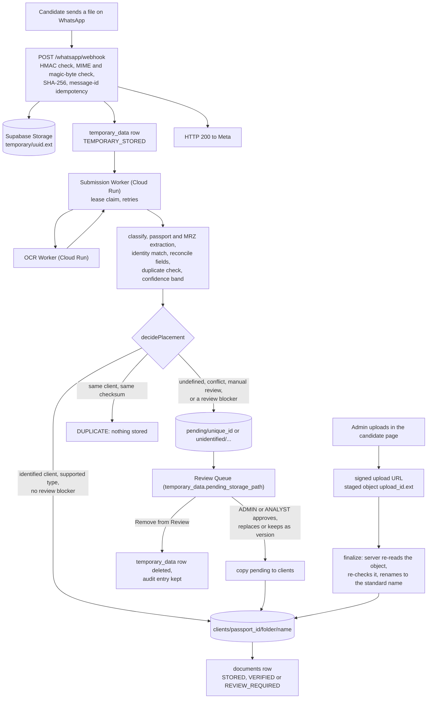
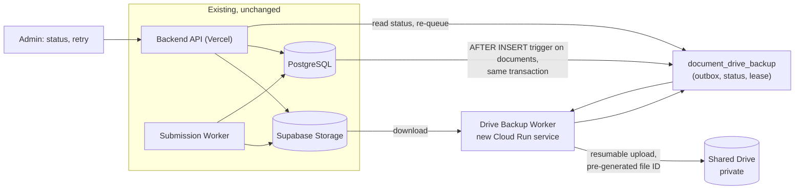

# Google Drive Document Backup: Research and Architecture Recommendation

| | |
|---|---|
| **Status** | Research only. Nothing is implemented, no schema or migration is changed. |
| **Date** | 2026-11-01 |
| **Branch** | `dev` |
| **Scope** | Back up candidate documents to Google Drive without disturbing the document flow, OCR, database records or Google Sheet Sync. |

**Convention used throughout.** Statements marked **Confirmed** come from the current repository code or the project's own documents. Statements marked **Proposed** are design recommendations. Statements marked **Verify** are facts about Google's products that this research could not settle from official documentation and must be tested or confirmed before coding.

---

## 1. Current Document Flow (Confirmed)

### 1.1 End to end



### 1.2 Facts that matter for a backup design

| Topic | Confirmed behavior | Source |
|---|---|---|
| **Storage** | One private Supabase Storage bucket (`SUPABASE_BUCKET`). No public or signed download URLs are created in the processing flow. | `Docs/06-storage-management.md`, `src/config/supabase.js` |
| **Paths** | `temporary/<uuid>.<ext>`, `clients/{passport_id}/{folder}/{name}`, `pending/{unique_id}/undefined/uncleared-docs/...`, `pending/unidentified/{temporary_id}/...`. IDs in paths must match `[A-Za-z0-9_-]+`. | `src/utils/storageNaming.js` |
| **Document types** | `PASSPORT`, `POLICE_SLIP`, `POLICE_REPORT`, `MEDICAL` (from WhatsApp or admin), and admin-upload-only `NIC`, `SKILL_VIDEO`, `SCAN`, `VISA_SUBMISSION`. | `DOCUMENT_STORAGE_TYPES`, `CANDIDATE_DOCUMENT_TYPES` |
| **Variants** | Only `POLICE_REPORT` has variants: `SL_VERIFIED`, `ROMANIA`, `SL_NORMAL`. Stored in `documents.document_variant`. (A source comment in `candidateService.js` still mentions affidavit variants; no such type exists.) | `POLICE_REPORT_VARIANTS` |
| **Names** | Standard names `passport.pdf`, `passport_v2.pdf`, ... The version is the count of the client's existing rows of that type plus one. Unclear documents keep a sanitized original name. Names are never overwritten (`exists()` then `copy()`, at most 20 attempts). | `standardFileName`, `permanentStorageService.js` |
| **Extensions** | From the validated MIME type only: `.pdf`, `.jpeg`, `.png`, and for skill videos `.mp4`, `.mov`, `.webm`. | `EXTENSION_BY_MIME_TYPE` |
| **Sizes** | 10 MB for documents (shared with WhatsApp intake), 50 MB for skill videos. | `MAX_VIDEO_FILE_SIZE`, `maxFileSizeFor` |
| **Hashes** | Lowercase SHA-256 computed once at intake. `documents` is unique on `(passport_id, file_sha256)` and indexed on `file_sha256`. A new photo of the same paper has different bytes and is a new version. | `Docs/06-storage-management.md` |
| **`documents` row** | `document_id` (UUID), `passport_id`, `document_type`, `document_variant`, `storage_path`, `stored_filename`, `mime_type`, `file_size`, `received_date`, `processing_status` (`STORED`), `verification_status` (`VERIFIED`, `REVIEW_REQUIRED`, `SUPERSEDED`), `file_sha256`, `temporary_id`. | `prisma/schema.prisma` |
| **Identity keys** | `passport_id` is the primary key and the path key. `unique_id` is a unique business reference (`0001`, `0002`, ...) shown in the Sheet. No code path changes `candidate.passport_id`: it is the primary key and `updateCandidateDetails` does not write it. | `candidateService.js`, schema |
| **Replace** | "Replace verified" makes the new file VERIFIED and keeps the old row as `SUPERSEDED`. The old file stays in storage. | `adminReviewActionService.js` |
| **Remove** | Removing a current document deletes the `documents` row **and then its storage object**, after writing an audit entry. SUPERSEDED versions are never removable. | `removeCandidateDocument` |
| **Candidate delete** | There is no delete endpoint. Sheet Sync does handle a candidate deleted directly in the database (`candidateDeleted`). | `rg candidate.delete` finds none |
| **Temporary objects** | Copied, not moved. Deleting them is a planned finalization step that is not built. | `Docs/06-storage-management.md` |
| **Cloud Run services** | Submission worker (asia-northeast1), OCR worker (asia-south1, private), Sheet Sync worker (private). The Admin/API runs on Vercel (region `hnd1`). | `Docs/02-system-architecture.md`, `Docs/08-cloud-deployment.md`, `vercel.json` |
| **Google authentication today** | Sheets only. The Sheet Sync worker uses Application Default Credentials (the Cloud Run runtime identity). No key file; `GOOGLE_APPLICATION_CREDENTIALS` must never be set. The API on Vercel has no Google access. | `src/services/googleSheetsAdapter.js`, `deploy/sheet-sync-worker.env.yaml` |
| **Google dependencies** | `@googleapis/sheets`, `google-auth-library`. No Drive client. | `package.json` |
| **Sheet Sync outbox** | `sheet_sync_queue` (per candidate, triggers write rows in the same transaction, at most one PENDING per candidate) and `candidate_form_sheet_sync` (one row per submission). Both use `status`, `attempts`, `next_attempt_at`, `lease_owner`, `lease_expires_at`, error class and code, and a dead-letter `FAILED`. | `prisma/schema.prisma`, `sheetSyncStore.js` |

### 1.3 Two findings that shape the design

1. **Removal is destructive.** After "Remove document" the file exists nowhere in our system. A Drive copy that is deleted along with it would make the backup useless for exactly the case where a backup matters. The backup must **not** follow deletions.
2. **Pending and temporary files are unresolved.** They have no `documents` row and no confirmed owner. They are not final candidate records, so they are out of scope for the first version (section 8.3).

---

## 2. Architecture Options Compared

### Option A: One-way backup (current storage stays the source of truth)

`Supabase Storage + documents table` → worker → `Google Drive`

| | |
|---|---|
| **Pros** | The existing flow is untouched. If Drive is down or misconfigured, nothing in intake, OCR, review or admin upload changes. Drive failure is a backup problem, not a product outage. Same pattern as the Sheet mirror, which already runs in production. Simple recovery story: Drive is rebuildable from the source. |
| **Cons** | Two copies to keep consistent. Drive can lag the source by seconds to minutes. Needs an outbox and a worker. |
| **Complexity** | Low to medium. |

### Option B: Google Drive as primary storage

| | |
|---|---|
| **What would have to change** | The WhatsApp intake, OCR worker input, placement, review actions (copy, replace, remove), admin direct upload (signed URLs are a Supabase feature) and all file reads would move to Drive, and `documents` would store Drive IDs. |
| **Risks** | Drive API latency, quotas and outages move into the critical path. No signed upload URL equivalent for the admin direct-upload flow. Drive offers no database transactions, so the "copy, then insert, roll back on failure" logic cannot be preserved. File IDs replace deterministic paths used in many places. Per-role access cannot be enforced by Drive. A large rewrite of tested, security-reviewed code. |
| **Complexity** | Very high. |

### Option C: Two-way synchronization

| | |
|---|---|
| **What it adds** | Changes in Drive (new files, edits, deletes, moves) flow back into the application. |
| **Risks** | Every conflict needs a rule (file edited in both places, deleted in one). A person deleting or renaming in Drive could remove evidence or break links. Drive-side uploads would bypass identity matching, OCR, hashing, duplicate and review rules, and the audit log. Change detection needs the Drive changes feed or push channels plus a reconcile loop. Hash drift and identity mapping (which candidate is this file?) become permanent problems. |
| **Complexity** | Highest, with ongoing operational risk. |

### Comparison

| Criterion | A: one-way backup | B: Drive primary | C: two-way |
|---|---|---|---|
| Impact on the existing flow | None | Rewrites it | Adds a second write path into it |
| Drive outage effect | Backup lags only | Product outage | Sync stalls and conflicts pile up |
| Security boundary | Unchanged | Redefined | Weakened (Drive edits bypass rules) |
| Delete and conflict rules | Simple (never delete) | Complex | Very complex |
| Effort | Low to medium | Very high | Very high |
| Recommended | **Yes** | No | No |

**Recommendation: Option A.** Two-way sync is not better here: the system of record has validation, identity, OCR, duplicate and audit rules that Drive cannot enforce.

---

## 3. Recommended Architecture (Proposed)



Principles:

1. **Supabase Storage plus the `documents` table remain the source of truth.** Drive is a one-way, append-only archive.
2. **Transactional outbox.** A database trigger enqueues a backup row in the same transaction as the `documents` insert, the pattern the project already uses for the Sheet mirror. Every write path (WhatsApp, admin upload, review approve, replace, keep as version) is covered without touching each one.
3. **Backup never blocks the main flow.** The worker is a separate Cloud Run service. The main flow only writes one extra outbox row.
4. **Never delete in Drive.** Removal, replacement and supersession change only database state.
5. **Idempotent by construction.** Pre-generated Drive file IDs make retries safe (section 9).
6. **Service-account access, Shared Drive, no public links** (sections 6, 7 and 12).
7. **Write gate and feature flag**, like `SHEET_SYNC_ENABLED`, so the feature ships disabled and is switched on deliberately.

---

## 4. Folder Structure

### 4.1 Recommended layout (Proposed)

```
Emlynk Candidate Documents/            (the Shared Drive itself)
└── {unique_id}/                       e.g. 0006
    ├── PASSPORT_20261031_a1b2c3d4.pdf
    ├── POLICE-REPORT_SL-VERIFIED_20261031_e5f6a7b8.pdf
    ├── MEDICAL_20261101_c9d0e1f2.pdf
    └── ...
```

**One folder per candidate, document type in the file name, no type subfolders.** Reasons:

- Fewer folders means fewer items. A Shared Drive is limited to 400,000 items (files, folders and shortcuts count; [Google Workspace Admin Help](https://support.google.com/a/answer/7338880)). With type subfolders each candidate costs up to 9 folders plus its files, roughly doubling item use.
- Folder creation is the one Drive call that is awkward to make idempotent. One folder per candidate means one folder to create, not nine.
- Names sort by type prefix, so a person browsing still sees documents grouped.

Alternative if staff strongly prefer type subfolders (`{unique_id}/Passport/`, `/Police Reports/`, `/Medical/`, `/Scan/`, `/NIC/`, `/Skill Video/`, `/Visa Submission/`): technically fine, but requires a folder-ID map per type and lazy creation with the same ID-first technique. Decide with the business (section 19).

### 4.2 What identifies a candidate folder

| Option | Assessment |
|---|---|
| Passport ID | Personally identifying and, in this system, also the storage path key. Putting it in Drive folder names spreads PII into a second system's names and into audit and share dialogs. Not recommended for names. |
| `unique_id` | Business reference already shown in the Sheet (`_SYSTEM_CANDIDATE_ID`), unique, not personal data by itself, human-friendly. **Recommended as the folder name.** |
| Internal UUID | Safest but unreadable; recovery without the database would be impossible. |
| Candidate name | Not unique, personal data, changes. Rejected. |

**Recommendation.** Name the folder with `unique_id`; make the **real identity** a stored mapping `passport_id → drive_folder_id` in our database (section 10). The folder name is only a label: if a `unique_id` is ever corrected, the folder keeps working and can be renamed best-effort. The passport ID is the immutable key (no application path changes it), so it is the right database key, but it stays out of Drive names.

Do not put names, passport numbers, NICs or phone numbers in folder names, file names, descriptions or `appProperties`.

---

## 5. File Naming Strategy (Proposed)

```
{TYPE}[_{VARIANT}]_{yyyymmdd}_{documentId8}.{ext}
PASSPORT_20261031_a1b2c3d4.pdf
POLICE-REPORT_SL-VERIFIED_20261031_e5f6a7b8.pdf
```

| Part | Why |
|---|---|
| `TYPE` | From `DOCUMENT_STORAGE_TYPES` (`PASSPORT`, `POLICE-SLIP`, `POLICE-REPORT`, `MEDICAL`, `NIC`, `SKILL-VIDEO`, `SCAN`, `VISA-SUBMISSION`). Sorts and groups. |
| `VARIANT` | Only for `POLICE_REPORT`, so the three variants never look alike. |
| Date | The document's `received_date` in UTC. Human context. |
| `documentId8` | First 8 hex characters of `documents.document_id`. Makes the name unique per document; the full ID is in `appProperties`. |
| `ext` | From the MIME type, as in the current storage. |

Deliberately excluded: the original file name (can contain a person's name), the passport ID, the phone number, and the version counter (`_v2` is a count at time of writing and is not stable; the `document_id` is).

**Versioning, not overwriting.** Each `documents` row gets its own Drive file. A replaced or corrected document is a new file; the old one stays. Nothing is ever overwritten, which also removes any need for Drive's own revision system. The SHA-256 is stored in the backup table and in `appProperties` (a short key such as `sha256`), not in the name, so duplicate content is visible without making names long.

---

## 6. Authentication Model

### 6.1 Options

| Model | Fit | Notes |
|---|---|---|
| **Service account, member of a Shared Drive** | **Best** | Server-to-server, no human login, no token expiry to manage. Google's admin guidance for storing files through the API is to use a Shared Drive with `supportsAllDrives=true`, or domain-wide delegation ([Workspace storage and upload limits](https://knowledge.workspace.google.com/admin/drive/storage-and-upload-limits-for-google-workspace)). |
| Service account + a folder shared from someone's My Drive | **Not viable** | Google's Shared drives page states: "Service accounts don't have storage quota and can't own files. Instead, they must upload files and folders into shared drives, or use OAuth 2.0 to upload items on behalf of a human user" ([Shared drives overview](https://developers.google.com/workspace/drive/api/guides/about-shareddrives)). Community reports of quota errors agree ([discussion](https://discuss.google.dev/t/storagequotaexceeded-the-users-drive-storage-quota-has-been-exceeded-for-service-account/104375)). |
| OAuth as a user account | Poor for production | Needs a stored refresh token, breaks if the person leaves, changes password policy, or is suspended. Ties ownership to one employee. |
| Domain-wide delegation | Only if needed | Lets a service account impersonate a user. Powerful and broad; only relevant if the organisation cannot use Shared Drives. Avoid unless forced. |

**Recommendation: a dedicated service account that is a member of one dedicated Shared Drive.**

### 6.2 Credentials and storage

- **No key file.** Run the worker on Cloud Run with its own runtime service account and use Application Default Credentials, exactly like the Sheet Sync worker. There is then no secret to leak or rotate. This avoids the key-rotation problem entirely.
- If a key were ever unavoidable (it should not be, because nothing in this design runs on Vercel), it would live in Secret Manager only, with a rotation schedule. Do **not** put a key in Vercel or in the repository.
- **Dedicated identity**, for example `emlynk-drive-backup@<project>.iam.gserviceaccount.com`, separate from the Sheet Sync account so a compromise of one does not reach the other.
- The worker also needs the Supabase service-role key (to download source files) and `DATABASE_URL`, held as Cloud Run secrets, as the submission worker does today.

### 6.3 Least privilege

- Shared Drive role: the lowest role that can create files and folders (Contributor or Content manager; **Verify** which role allows what in the current Shared Drive roles). Not Manager.
- **OAuth scope: Verify.** The narrowest scope is `drive.file`, which limits an app to files it created. Whether that is enough for a service account writing into a pre-existing Shared Drive (it must have access to the parent folder) needs a short spike. If it is not enough, the fallback is the full `drive` scope, which is acceptable only because the service account is a member of nothing except the backup Shared Drive.
- The service account holds no other Google Cloud roles beyond running the service and reading its secrets.
- On Cloud Run, access tokens from the metadata server carry the instance's scopes. The Sheet worker already works this way in production, so the same mechanism is expected to work for Drive (**Verify** in the spike).

---

## 7. Shared Drive vs Normal Drive

| Criterion | Normal Drive folder (My Drive) | Shared Drive (Google Workspace) |
|---|---|---|
| **Ownership** | Owned by one person's account | Owned by the organisation; files survive staff leaving |
| **Employee dependency** | High: if the owner leaves or is deleted, files go with them or need transfer | None |
| **Service account support** | Poor (no personal storage for service accounts; 403 on My Drive) | Designed for it (the documented route) |
| **Access control** | Per-folder sharing, easily widened by the owner | Membership roles, admin-controlled sharing rules |
| **Team continuity** | Fragile | Strong |
| **File recovery** | Owner's trash | Shared drive trash, recoverable by managers within the retention window |
| **Auditability** | Limited | Workspace audit and Drive log events (depends on the Workspace edition: **Verify**) |
| **Limits** | Per-user 750 GB/day upload cap | 400,000 items per shared drive; the 750 GB/day cap also covers uploads and copies into shared drives ([Drive API limits](https://developers.google.com/workspace/drive/api/guides/limits)) |
| **Cost** | Counts against the owner's quota | Counts against the organisation's pooled storage |

**Recommendation: a dedicated Shared Drive** (for example "Emlynk Candidate Documents"), which requires a Google Workspace organisation. Google's Drive API documentation lists the supported editions as Business Standard, Business Plus, Enterprise and Education, and states that personal `@gmail.com` accounts cannot create shared drives. There is no free Shared Drive. Whether Business Starter includes them is **not confirmed** (see [`GOOGLE_DRIVE_BACKUP_IMPLEMENTATION_GUIDE.md`](GOOGLE_DRIVE_BACKUP_IMPLEMENTATION_GUIDE.md) section 2 for pricing and the free-account alternative). If the business has no Workspace, this option is unavailable and the decision must go to the senior (section 19). A personal Gmail account with a shared folder is **not recommended** for production candidate documents.

---

## 8. Backup Trigger Point

### 8.1 Options

| Trigger | Assessment |
|---|---|
| Right after the WhatsApp upload (`temporary/`) | Too early: unidentified, possibly a duplicate, possibly rejected. Would back up files that never become records. |
| After OCR | The identity may still be unresolved. |
| After manual review | Misses documents that are auto-stored; adds a human dependency. |
| Only when VERIFIED | Would skip stored `REVIEW_REQUIRED` files that still need a copy. |
| **After the `documents` row commits** | The file is final, identified, hashed and in `clients/`. Every write path ends here. |

### 8.2 Recommendation

Trigger on **`AFTER INSERT` on `documents`**, in the same transaction, enqueueing one outbox row. Back up **every** stored document, including `REVIEW_REQUIRED` (data-safety first; verification status is metadata, not a reason to skip the copy). The main transaction's only added cost is one small row; if Drive is unreachable, nothing in the main flow fails.

A trigger (not application code) is recommended because writes come from several places (placement, admin finalize upload, review approve, replace verified, keep as version), and the project already uses triggers for exactly this reason (Sheet outbox, verification reset).

### 8.3 Out of scope for the first version

- `temporary/` and `pending/` objects (unresolved, no record).
- Documents that are never stored (`DUPLICATE`, `FAILED`).
- A later phase could mirror pending files into a clearly separate `_Pending Review` area if the business wants it.

### 8.4 One race to design for

Remove-document deletes the storage object right after its transaction commits. If it happens before the worker downloads the file, the bytes are gone. Mitigation: the worker marks that row `SOURCE_MISSING` (an operator-visible state) instead of retrying forever. The window is normally seconds to minutes. If the business cannot accept it, the removal path could be asked to wait for a backup (a small, separate change); this is decision Q8 in section 19.

---

## 9. Queue, Retry and Idempotency Design (Proposed)

### 9.1 Reuse of the Sheet Sync pattern

**Confirmed:** the project already has a durable outbox pattern: `candidate_form_sheet_sync` is a one-row-per-item outbox with `status`, `attempts`, `next_attempt_at`, lease fields, error class/code and a dead-letter state; `sheet_sync_queue` adds trigger-fed rows and claim logic in `sheetSyncStore.js`. A Drive backup is closer to the per-item table. Reuse the **design** (claim with a lease, retry with backoff, dead letter, config-halt without consuming attempts) but not the tables or the Sheet worker.

### 9.2 States

```
PENDING -> PROCESSING -> COMPLETED
              |-> PENDING   (retry, next_attempt_at set, backoff)
              |-> FAILED    (dead letter: permanent error or attempts exhausted)
              |-> SOURCE_MISSING (storage object not found)
```

`FAILED` and `SOURCE_MISSING` are visible to ADMIN/OWNER and can be re-queued manually.

### 9.3 Idempotent upload (the key idea)

Google documents that pre-generated IDs make retries safe: `files.generateIds` returns IDs you pass to `files.create`, and "if the file action is successful, subsequent retries return a 409 Conflict, so duplicates are not created" ([Drive upload guide](https://developers.google.com/workspace/drive/api/guides/manage-uploads)). Google's own bulk-import guidance also recommends generating IDs first and skipping files whose ID already exists ([bulk import guide](https://developers.google.com/workspace/cse/guides/bulk-import-files)).

Worker steps for one row:

1. **Claim** the row with a lease (compare-and-swap), as the existing workers do.
2. **Folder.** Look up `candidate_drive_folder` for the candidate. If absent: generate an ID, **store it first**, then create the folder with that ID; a 409 means it already exists, so continue.
3. **File ID.** If the row has no `drive_file_id`, generate one and **persist it before uploading**.
4. **Stream** the object from Supabase Storage and `files.create` with that ID (multipart for small files, resumable above about 5 MB per the [upload guide](https://developers.google.com/workspace/drive/api/guides/manage-uploads)).
5. **Verify:** on success, or on a 409, `files.get` and compare size and MD5 (`md5Checksum`) with the bytes streamed; then mark `COMPLETED`.
6. **Crash anywhere** (worker restart, lease expiry): the next claim reuses the stored IDs, so no duplicate file or folder is created.

### 9.4 Retry policy

Per Google's error guidance ([Resolve errors](https://developers.google.com/workspace/drive/api/guides/handle-errors), [Usage limits](https://developers.google.com/workspace/drive/api/guides/limits)):

| Error | Action |
|---|---|
| 403 `rateLimitExceeded` / `userRateLimitExceeded`, 429 | Retry with truncated exponential backoff with jitter (`min(2^n + random_ms, max_backoff)`, typically 32 to 64 s) |
| 5xx, network errors, timeouts | Retry with backoff; lease renewed or expired and re-claimed |
| 403 `dailyLimitExceeded` | Do not retry per row; halt the worker for a longer pause and alert (a limit, not a transient error) |
| 403 `storageQuotaExceeded` | Halt without consuming attempts (like the Sheet worker's configuration halt) and surface in admin status |
| 404 on the parent folder, 401/403 permission errors | Configuration error: halt, do not consume attempts, surface |
| Source object not found | `SOURCE_MISSING` |
| Attempts exhausted | `FAILED` (dead letter), operator retry |

Use a small, fixed concurrency (for example 2 to 3 uploads) and a global pause when quota errors appear.

---

## 10. Proposed Database Metadata (Proposed, not created)

Minimal: **two new tables, no changes to existing tables.**

### 10.1 `document_drive_backup` (one row per `documents` row)

| Column | Purpose |
|---|---|
| `document_id` (PK, text) | The backed-up document. **No foreign key**, so the row survives removal of the document, like `audit_logs`. |
| `passport_id` | The candidate (plain value, for the folder lookup and admin views). |
| `status` | `PENDING`, `PROCESSING`, `COMPLETED`, `FAILED`, `SOURCE_MISSING` |
| `drive_file_id` | Pre-generated ID, persisted before upload. |
| `file_sha256`, `file_size` | Copied from the document at enqueue, so the row is self-sufficient after a removal. |
| `source_path` | Storage path to download from (contains the passport ID; never logged). |
| `attempts`, `next_attempt_at`, `lease_owner`, `lease_expires_at` | Queue mechanics (as in the other outboxes). |
| `last_error_class`, `last_error_code` | Codes only, never Google's message text (as in `googleSheetsAdapter.js`). |
| `created_at`, `updated_at`, `completed_at` | Timing, also gives "last successful backup". |
| `lifecycle` (optional) | `ACTIVE`, `SUPERSEDED`, `REMOVED`: records what later happened to the document in the application, without touching Drive. |

### 10.2 `candidate_drive_folder`

| Column | Purpose |
|---|---|
| `passport_id` (PK) | The candidate. |
| `drive_folder_id` | The pre-generated, persisted folder ID. |
| `created_at` | |

### 10.3 Also required (not schema, but part of the same migration)

- An `AFTER INSERT` trigger on `documents` (and, if lifecycle is tracked, an `AFTER UPDATE` of `verification_status` and `AFTER DELETE`) that writes or updates the outbox row. Pattern: `20261006120000_sheet_sync_outbox`.
- Row Level Security enabled with no policies, as on every other table.
- A partial index on `(status, next_attempt_at)` for the claim query.

**Not needed:** columns on `documents`, columns on `candidate`, any change to storage.

---

## 11. Update, Replace and Delete Behavior (Proposed)

### 11.1 Options compared

| Behavior | Pros | Cons |
|---|---|---|
| Delete the Drive copy | Mirrors the app | Defeats the backup; for "Remove document" the Drive file would be the only copy |
| Mark inactive (metadata only) | Keeps everything; cheap | Needs a Drive metadata update (or only a database flag) |
| Move to an archive folder | Visible separation | Needs move calls and an archive structure; more API calls and races |
| **Keep every version, never delete** | Simplest, safest, immutable | Storage grows slowly; needs an explicit purge procedure for privacy requests |

**Recommendation: write-once, keep everything.** The Drive archive is append-only. The database records what happened (`lifecycle`); Drive is not rewritten.

### 11.2 Case by case

| Event | Application behavior (Confirmed) | Drive behavior (Proposed) |
|---|---|---|
| New document stored | `documents` row inserted | New file uploaded |
| Replaced verified | New row VERIFIED, old row SUPERSEDED, both files kept | New file uploaded; old stays; `lifecycle=SUPERSEDED` in the database |
| Corrected document uploaded | New row (and a new version name) | New file |
| Variant changes | A new document with the new variant | New file; the old file keeps its old variant name |
| Document removed | Row and storage object deleted, audit entry kept | **Keep the Drive file**; mark `lifecycle=REMOVED` |
| Candidate passport changes | Not possible in the app (primary key) | Not applicable; the mapping is keyed by passport ID |
| `unique_id` corrected | Possible only by direct database work | Folder name becomes stale; the stored folder ID still works; optional best-effort rename |
| Candidate deleted | No app path; direct database delete possible | **Never auto-delete Drive files**; orphaned folders flagged for review |
| Candidate merge / reassignment of a stored document | No such feature (only pending files can be assigned) | Not supported; if ever added, the Drive file must be moved or re-uploaded explicitly |
| Duplicate content (same SHA-256, same client) | Rejected as `DUPLICATE`, no row | Nothing to back up |

Privacy deletion (a candidate asks to be erased) is the one case that requires removing Drive data. It must be an explicit, audited, manual procedure that uses `document_drive_backup` to find the files, not an automatic side effect (section 12).

---

## 12. Security and Privacy Considerations

Candidate documents are passports, police reports, medical certificates, NICs and videos: high-sensitivity personal data.

| Concern | Recommendation |
|---|---|
| **Least privilege** | Only the backup service account and a short list of named humans (OWNER-level) are Shared Drive members. Application roles (ANALYST, REGISTRATION_DESK, JOB_HANDLER) get no Drive access: staff work in the admin console, where RBAC is enforced and audited. |
| **Private by default** | Shared Drive created with external sharing and link sharing disabled by the Workspace admin; members only. |
| **No public links, ever** | The worker never calls `permissions.create`. The service account holds no role that could widen sharing. Do not use "anyone with the link". |
| **Service account security** | No key file, ADC on Cloud Run, a dedicated account, a minimal Shared Drive role, no project-wide roles. Rotation is moot without keys. |
| **Encryption** | In transit: HTTPS to Google and to Supabase. At rest: Google encrypts Drive data by default. Customer-managed keys or client-side encryption are possible Workspace features but are out of scope. |
| **Audit** | Workspace Drive audit events show who and what accessed the files (depends on the edition: **Verify**). Our `document_drive_backup` table records what was backed up and when. Backup health actions by admins should be written to the existing append-only audit log. |
| **Logging** | Follow the project convention: no passport IDs, paths, checksums or file names in logs. The source path contains the passport ID, so it is never logged; errors carry codes only. |
| **File and folder names** | No names, passport numbers, NICs or phone numbers (section 4). |
| **Retention** | Define how long documents are kept in Drive (business and legal question, Q5). Keeping everything forever is the default of this design. |
| **Erasure requests** | Candidates are located in Sri Lanka and work in Romania (an EU country), so data-protection law may apply in more than one jurisdiction (**legal review required**). A documented purge procedure must exist before go-live: find the files via `document_drive_backup`, delete them in Drive and the Shared Drive trash, record it in the audit log. |
| **Accidental sharing** | Workspace admin policy prevents members from sharing outside the drive; the worker cannot share; periodic review of members. |
| **Cross-border and provider concentration** | The archive puts personal data in a second provider and region. Confirm with the senior that this is acceptable (Q4). |
| **Access to documents by role in the app** | Unchanged: the backup does not alter who can view documents in the admin console. |

---

## 13. API Limits and Operational Considerations

Based on official Google documentation (the quota numbers change; confirm in the Google Cloud Console for our project).

| Topic | Finding |
|---|---|
| **Usage limits** | Exceeding quotas returns 403 `User rate limit exceeded`; backend checks can return 429. Both should use exponential backoff. The usage-limits page notes that quotas changed on **1 May 2026**: projects created on or after that date are subject to the new quotas, while older projects that used the API keep the previous ones ([Usage limits](https://developers.google.com/workspace/drive/api/guides/limits)). Check the current quota table and which regime our Google Cloud project falls under. |
| **Daily upload cap** | 750 GB per day per user across My Drive and shared drives, also applying to copies; users hitting it cannot upload for 24 hours ([Usage limits](https://developers.google.com/workspace/drive/api/guides/limits)). Our volume (documents of at most 10 MB, videos up to 50 MB) is far below this. Whether the cap applies to a service account is not stated in the sources found (**Verify**, immaterial at this volume). |
| **Shared Drive item cap** | Google's two pages disagree: 400,000 items ([Admin Help](https://support.google.com/a/answer/7338880)) versus 500,000 items and 100 folder levels ([Drive API: shared drives](https://developers.google.com/workspace/drive/api/guides/about-shareddrives), updated 2026-09-03). Plan against the lower figure. At roughly 8 to 12 files per candidate plus one folder, 400,000 items is on the order of 30,000+ candidates. Compute the real figure from candidate count and expected files (Q7). |
| **Upload methods** | Simple and multipart uploads for small files; resumable uploads recommended above about 5 MB or when the network is unreliable. A resumable session URI expires after one week ([Upload guide](https://developers.google.com/workspace/drive/api/guides/manage-uploads)). Our largest file is 50 MB. |
| **Folder creation and search** | Avoid searching by name (eventual consistency, duplicates possible). Use stored folder IDs and pre-generated IDs instead; never "find or create by name". |
| **Large videos** | 50 MB skill videos are well within limits; stream rather than buffer where practical, or size the Cloud Run instance for it (the existing admin flow already handles files this size). |
| **Cost** | The Drive API itself is free; storage counts against the Workspace pooled storage. Confirm the available storage and plan (Q6). |
| **Throttling** | Fixed concurrency, backoff with jitter, a global pause on quota errors, and a rate cap for backfill. |

---

## 14. Integration with the Current Architecture

| Component | Impact |
|---|---|
| **Vercel backend / admin API** | No Google access and no change to its write paths. It only reads backup status and can re-queue failed rows. Do **not** call Drive from Vercel: serverless functions have short limits and no managed Google identity. |
| **Submission worker (Cloud Run)** | Unchanged. It keeps writing `documents`; the trigger enqueues the backup row. |
| **OCR worker** | Unchanged. |
| **Supabase / PostgreSQL** | Two new tables, one trigger. The Drive worker reads storage with the service-role key and the database with `DATABASE_URL`, held as Cloud Run secrets. |
| **Existing document storage** | Read-only source. Never modified by the backup. |
| **Sheet Sync worker** | Unchanged. It does not get Drive access. |

### Where should the code live?

| Option | Assessment |
|---|---|
| Inside the backend API | No: Vercel functions are the wrong place for long uploads and have no managed Google identity. |
| Extend the Sheet Sync worker | No: mixes unrelated responsibilities, gives the Sheets identity Drive access (a larger blast radius), couples deployments and failure modes. |
| Inside the submission worker | No: its queue is time-critical; Drive uploads could slow document intake. |
| **Separate Drive Backup worker** | **Yes.** A new Cloud Run service with its own service account, its own queue table and its own on/off switch. It can be built from the same container image with a different command (the submission worker and Sheet worker already work this way), so operating cost is low. Co-locate the region with the submission worker and the database to keep downloads fast. |

New repository files would be additive only: an adapter (`googleDriveAdapter`), a store and engine for the outbox, a process entry point, configuration, a deploy settings file, and tests, following `googleSheetsAdapter.js` and `sheetSyncStore.js` as models. The Drive client library (for example `@googleapis/drive`) would be a new dependency.

---

## 15. Monitoring and Admin UI (Minimal)

| Need | Recommendation |
|---|---|
| Backup status per document | A small status mark on the candidate's document rows: Backed up, Pending, Failed. Visible to OWNER, ADMIN and the roles that manage candidate documents. |
| Failed count and health | One card under Settings (ADMIN, OWNER): counts by status, age of the oldest pending item, time of the last successful backup, worker heartbeat. Derivable from the table; a worker heartbeat row like `sheet_sync_state` is optional. |
| Retry | A single "Retry failed" action that sets `FAILED` and `SOURCE_MISSING` rows back to `PENDING`, audited. |
| Notifications | The notification system is research only (`NOTIFICATION_SYSTEM_AUDIT.md`). Do not couple to it. Show repeated failures prominently on the Settings card now; add a Need Attention-style alert when that system exists. |
| Metrics and logs | Cloud Run logs with codes only, plus a Cloud Monitoring alert on the worker's error rate or on "no successful backup for N hours". |

---

## 16. Backfill of Existing Documents (Proposed; nothing migrated now)

1. **Enumerate** `documents` rows with no row in `document_drive_backup` (an anti-join), in `document_id` order with a cursor, so it is resumable.
2. **Insert** `PENDING` outbox rows in batches (for example 500), flagged as backfill so the worker can give them lower priority than live documents.
3. **Throttle:** the same worker, lower concurrency, an optional daily cap, run off-peak. Quota errors pause it automatically (section 9.4).
4. **Duplicate safety:** the same pre-generated-ID mechanism makes a re-run harmless; rows that are already `COMPLETED` are skipped.
5. **Missing sources:** old rows whose storage object no longer exists become `SOURCE_MISSING` and are reported, not retried forever.
6. **Progress:** counts by status give percent complete; a dry run first reports how many files and how many bytes would be sent.
7. **Verification:** sample files compared by MD5 after the run; total counts reconciled against `documents`.
8. **Rollback:** the backup is additive and never modifies the source, so stopping or abandoning it harms nothing.

---

## 17. Risks and Tradeoffs

| Risk | Likelihood | Impact | Mitigation |
|---|---|---|---|
| No Google Workspace available (no Shared Drive) | Unknown | Blocks the recommended design | Resolve Q1 before any coding; if unavailable, re-evaluate (OAuth or a different archive target) |
| Service-account scope or role needs wider access than expected | Medium | Wider blast radius | A short spike; keep the account a member of only the backup drive |
| File removed before backup | Low | One document unrecoverable | `SOURCE_MISSING` visibility; optional short removal delay (Q8) |
| Personal data in a second system and jurisdiction | Certain | Legal and reputational | Senior and legal approval; private drive; purge procedure; no PII in names |
| 400,000 item cap reached | Low at current scale | Backup stops | Flat folder layout, monitor item count, plan a second drive |
| Drive quota or outage | Medium | Backup lags | Outbox, backoff, a global pause; the main flow is unaffected |
| Backup silently stops | Medium | False sense of safety | Monitoring: age of oldest pending, last success, a Cloud Monitoring alert |
| Duplicate uploads | Low | Waste and confusion | Pre-generated IDs, verification by MD5 |
| Over-wide membership or sharing | Medium | Data exposure | Admin policy, member review, no `permissions.create` in code |
| Trigger adds failure modes to the main transaction | Low | Could block document writes | Keep the trigger minimal and tested; it only inserts one small row |
| Secrets sprawl (service-role key in another service) | Medium | Larger attack surface | Cloud Run secrets, a dedicated service, least privilege |

Tradeoff accepted: Drive can lag the source and will not mirror deletions. In exchange the main flow is untouched and the archive is safe against accidental or malicious deletion.

---

## 18. Implementation Phases (Proposed)

| Phase | Content | Exit criteria |
|---|---|---|
| **0. Decisions and spike** | Resolve section 19 questions. A throwaway spike: a Shared Drive, a service account, ADC on Cloud Run, create a folder and a file with pre-generated IDs, test `drive.file` vs `drive` scope, check quotas. | Auth model and scope confirmed; Workspace and legal approval in hand |
| **1. Core** | Migration (two tables, trigger, RLS), Drive adapter, store and engine, worker process, config with a disabled write gate, tests with fakes, deployment settings. | New documents backed up in stage; main flow unaffected when Drive is down (tested) |
| **2. Visibility** | Admin API for status and retry, the document status mark, the Settings card, audit entries, Cloud Monitoring alert. | Operators can see and fix failures |
| **3. Backfill** | Backfill command, dry run, throttled run in stage then production, reconciliation report. | All existing documents backed up or reported |
| **4. Optional** | Lifecycle labels in Drive, pending-files area, restore tooling, the privacy purge procedure as a tool, a second drive when nearing the item cap. | As approved |

Estimated implementation components: 1 migration (2 tables, 1 trigger), 1 Drive adapter, 1 outbox store and engine, 1 worker process and Cloud Run service, config and deploy files, 2 or 3 admin API endpoints, 2 small UI pieces, 1 backfill script, a test suite, and documentation updates. Rough effort for one developer, including tests and review: about 2 to 3 weeks for phases 1 and 2, plus about 1 week for phase 3 (an estimate, to be refined after the spike).

---

## 19. Questions Requiring Senior or Business Approval

1. **Does the organisation have Google Workspace?** (Required for a Shared Drive.) Who is its admin?
2. **What is the goal?** Disaster recovery only, or also staff browsing documents in Drive? (Browsing implies different permissions and probably different folder types.)
3. **Who may access the Drive,** and who approves membership changes? (Proposal: the service account plus named OWNER-level people only.)
4. **Is storing candidate documents in a second provider and region acceptable** (Sri Lankan candidates, Romanian placements)? Is legal or data-protection review needed?
5. **Retention and erasure:** how long are documents kept, and what is the procedure when a candidate asks for deletion? Should removed documents stay in the backup forever?
6. **Budget and storage:** current Workspace storage plan and headroom for the expected volume.
7. **Volume:** number of candidates and the expected documents and gigabytes per year (to check the 400,000-item cap).
8. **Remove-document race:** is the small window before backup acceptable, or should removal wait for a completed backup?
9. **Folder layout:** one folder per candidate with the type in the file name (recommended), or type subfolders?
10. **Folder name:** `unique_id` (recommended) or another reference?
11. **Pending/unresolved files:** should they ever be backed up?
12. **Which Cloud Run region and Google Cloud project** will host the worker?
13. **Who receives backup-failure alerts?**

---

## 20. Final Recommendation

Implement **Option A: a one-way, append-only backup** of stored candidate documents to a **dedicated, private Shared Drive**, written by a **separate Drive Backup worker on Cloud Run** that authenticates as a **dedicated service account with Application Default Credentials (no key file)**.

- Source of truth stays Supabase Storage plus `documents`.
- Enqueue by a **database trigger on `documents` inserts** (transactional outbox), so every existing write path is covered and the main flow can never fail because of Drive.
- **One folder per candidate named by `unique_id`**, file names `TYPE[_VARIANT]_date_documentId8.ext`, no personal data in names, the real identity held in a database mapping.
- **Pre-generated Drive IDs** for idempotent retries; exponential backoff with jitter; a dead-letter state with an admin retry.
- **Never delete or overwrite in Drive.** Replacements and removals are recorded in the database only.
- Minimal new data: two tables, one trigger, no change to existing tables.
- Start with a short spike (Workspace, scope, ADC, quotas), then core, visibility and backfill phases.

Do not choose Drive as primary storage (Option B) or two-way sync (Option C): both put Drive's limits and Drive-side edits into the path of a system whose value is its validation, identity and audit rules.

---

## Sources

Official Google documentation used (retrieved 2026-11-01):

- [Drive API usage limits](https://developers.google.com/workspace/drive/api/guides/limits)
- [Drive API: resolve errors](https://developers.google.com/workspace/drive/api/guides/handle-errors)
- [Drive API: upload file data (resumable, pre-generated IDs, 409 retry behavior)](https://developers.google.com/workspace/drive/api/guides/manage-uploads)
- [Google Workspace: bulk importing files (generate IDs first)](https://developers.google.com/workspace/cse/guides/bulk-import-files)
- [Google Workspace Admin Help: shared drive limits](https://support.google.com/a/answer/7338880)
- [Google Workspace Admin Help: storage and upload limits (service accounts and My Drive)](https://knowledge.workspace.google.com/admin/drive/storage-and-upload-limits-for-google-workspace)

Community source, not authoritative:

- [Google Developer Community: service account storage quota](https://discuss.google.dev/t/storagequotaexceeded-the-users-drive-storage-quota-has-been-exceeded-for-service-account/104375)

Repository sources: `Docs/06-storage-management.md`, `Docs/02-system-architecture.md`, `Docs/08-cloud-deployment.md`, `Docs/GOOGLE_SHEET_INTEGRATION.md`, `prisma/schema.prisma`, `src/utils/storageNaming.js`, `src/services/candidateService.js`, `src/services/adminReviewActionService.js`, `src/services/googleSheetsAdapter.js`, `src/services/sheetSyncStore.js`, `deploy/sheet-sync-worker.env.yaml`.

Items marked **Verify** above are not settled by official documentation found during this research and must be confirmed in the Phase 0 spike or with Google Workspace support.
