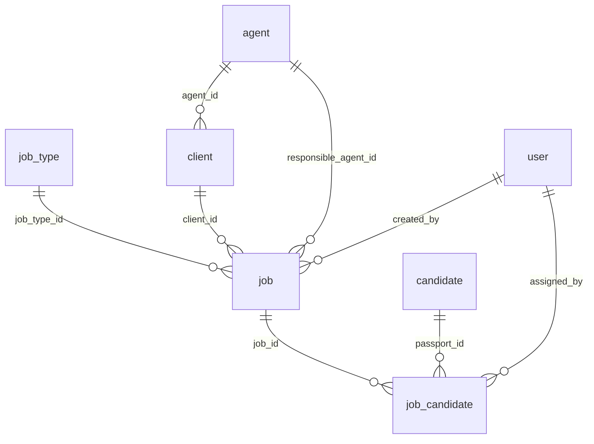

# Job Management — Implementation

Admin > **Jobs**: a real Job entity (Client, Job Type, responsible Agent), a real Candidate ↔ Job relation with history, and the rule that a candidate is on **at most one PROCESSING job** at a time.

Agents and Clients are managed in their own modules: see [`AGENT_CLIENT_MANAGEMENT.md`](AGENT_CLIENT_MANAGEMENT.md).

Migrations: `20261018120000_job_management` (additive) and `20261019120000_client_management` (renames the employer table `company` → `client`, adds `client.agent_id`, contact columns and `job.company_job_id`). Code: `src/services/jobService.js`, `src/services/jobAssignmentReader.js`, routes in `src/routes/admin.js`, admin pages `admin/src/pages/Jobs*.tsx`. Tests: `test/jobManagement.test.js` (real PostgreSQL via PGlite), `test/agentClientManagement.test.js`, `admin/src/test/jobs.test.tsx`.

> **Provenance.** The Job foundation was designed and first built on `version/candidate-extra-details-form` together with the Candidate Form. Only the independent Job core was brought to this branch (no `candidate_form_*` table, route, service or UI). The Candidate Form's job-group share link, and the change that retires the free-text `candidate_stages.job_id`, are **not** part of this branch. See `AGENT_CLIENT_MANAGEMENT.md` §9 for what a later merge has to reconcile.

---

## 1. Why

`candidate_stages.job_id` is a 50-character **free-text** box on the Test details stage. It is not a relation: it cannot say which candidates belong to a job, cannot stop a candidate being on two jobs, and carries no Client, Agent, country or Job Type. It is left exactly as it was (still editable on that stage, never read for assignment); the relational assignment is `job_candidate`. A later task can retire the text once staff have created the real Jobs.

## 2. Architecture

Tables (snake_case, singular): `job_type`, `agent`, `client`, `job_code_counter`, `job`, `job_candidate`.

* **Reused:** `candidate`, `user` (staff), `audit_logs` (every Job action is audited).
* **Job Type** is a controlled list (`code` auto-derived from the name, e.g. "Tile Fitter" → `TILE_FITTER`); no free-text type on a Job. The candidate's own trades (`candidate.job`) are unrelated.
* **Country** of a job is the responsible Agent's country, copied at creation (a later change of an Agent does not rewrite old Jobs).
* Jobs are **never hard-deleted** (`job_candidate.job_id` is `ON DELETE RESTRICT`; no delete route).

### 2.1 Three identifiers

| | Column | Who sets it | Mutable | Used as a key |
|---|---|---|---|---|
| **Internal Job ID** | `job.id` (UUID) | the database | **never** | **yes — every relation** |
| **Internal Job Code** | `job.job_code` `JOB-YYYY-NNNNNN` | the system (counter) | no | no; display reference |
| **Client Job ID** | `job.company_job_id` (e.g. `Y26S01`) | ADMIN / MANAGER, any time | **yes** | **no** — a plain label |

**`company_job_id` keeps its name on purpose.** It is the *employer's own external job reference* (a label the employer supplies), not the old "company" entity. Renaming the column would rename a business concept that did not change and would break anything that already reads it; the UI labels it **Client Job ID**. It is unique **per client** when present (`UNIQUE (client_id, company_job_id) WHERE company_job_id IS NOT NULL`), normalised by the service (trimmed, upper-cased, 1–40 characters from `A-Z 0-9` space `. _ / # -`), editable on a job in any status, and referenced by nothing. A duplicate within a client is `409 COMPANY_JOB_ID_EXISTS`.

## 3. Job Code

`JOB-YYYY-NNNNNN` from the yearly counter `job_code_counter(year, next_number)`, taken with one atomic `INSERT … ON CONFLICT DO UPDATE … RETURNING` inside the creation transaction: no number is handed out twice and a rejected creation does not burn one. Year = Asia/Colombo calendar year. The database also enforces `UNIQUE(job_code)` and the format.

## 4. Client and Agent on a Job

A Job belongs to one **Client** and records its **responsible Agent** (`job.responsible_agent_id`), which must be the Client's own Agent.

* `POST /jobs { jobTypeId, clientId, responsibleAgentId?, vacancies?, companyJobId? }` — `responsibleAgentId` is optional; omitted, the Client's Agent is used. Given, it must equal the Client's Agent or the request is `409 CLIENT_AGENT_MISMATCH`.
* The Client must exist, be **ACTIVE** (`409 CLIENT_INACTIVE`), have an Agent (`409 CLIENT_HAS_NO_AGENT`), and that Agent must be **ACTIVE** (`409 AGENT_INACTIVE`). The client and agent rows are share-locked in the transaction, so a concurrent deactivation (which locks `FOR UPDATE` and counts PROCESSING jobs) cannot leave a PROCESSING job on an inactive Client or Agent.
* `PUT /jobs/:id { clientId }` (PROCESSING jobs only) re-checks the same rules against the job's own Agent: a job can move only to another Client of the same Agent.
* The job's Agent, country, code and id cannot be edited.
* The job keeps its **own** Agent: when a Client is later moved to another Agent, existing Jobs are not rewritten.

## 5. Candidate assignment

`POST /api/admin/jobs/:jobId/candidates { passportId }`, one transaction: lock the job `FOR SHARE`, require PROCESSING (`409 JOB_NOT_PROCESSING`), lock the candidate `FOR UPDATE`, refuse if already on this job (`409 CANDIDATE_ALREADY_IN_JOB`) or on another PROCESSING job (`409 CANDIDATE_ON_ACTIVE_JOB`, never moved silently), then insert (or reactivate) the membership. `DELETE …/candidates/:passportId` releases the candidate from a PROCESSING job (row kept, `released_at` set).

The one-PROCESSING-job rule is enforced three times: the service under row locks, the partial unique index `job_candidate_one_active_per_candidate (passport_id) WHERE is_active`, and a trigger that allows `is_active` only on a PROCESSING job.

## 6. Lifecycle

`PROCESSING → COMPLETED` (`POST /jobs/:id/complete`) or `PROCESSING → CANCELLED` (`POST /jobs/:id/cancel { reason }`, reason required). Leaving PROCESSING releases every active membership in the same transaction (trigger); rows are kept as history. A COMPLETED / CANCELLED job never returns to PROCESSING (trigger); reopening is not implemented. `CHECK` constraints tie `completed_at`, `cancelled_at` and `cancel_reason` to the status.

## 7. Roles

| Role | Jobs |
|---|---|
| ADMIN, MANAGER | create / edit / complete / cancel; assign candidates; `job-options`; `POST /job-types` |
| ANALYST | read-only, and only jobs holding a candidate allocated to them (and only those candidates); other jobs are 404 |
| REGISTRATION_DESK | no Jobs API |

## 8. API

| Endpoint | Roles | Purpose |
|---|---|---|
| `GET /jobs?view=processing\|completed\|cancelled&search=&page=` | ADMIN, MANAGER, ANALYST (scoped) | list (50 per page) with tab counts |
| `GET /jobs/:jobId` | same | details and assigned candidates |
| `POST /jobs` | ADMIN, MANAGER | create (see §4) |
| `PUT /jobs/:jobId` `{ vacancies?, jobTypeId?, clientId?, companyJobId? }` | ADMIN, MANAGER | update a PROCESSING job; `companyJobId` alone also on a finished job |
| `POST /jobs/:jobId/candidates`, `DELETE /jobs/:jobId/candidates/:passportId` | ADMIN, MANAGER | membership |
| `POST /jobs/:jobId/complete`, `POST /jobs/:jobId/cancel` | ADMIN, MANAGER | lifecycle |
| `GET /job-options` | ADMIN, MANAGER | active job types, **active clients of active agents (with their `agentId`)**, active agents |
| `POST /job-types { name }` | ADMIN, MANAGER | add a job type |

Agents and Clients have their own endpoints (`AGENT_CLIENT_MANAGEMENT.md` §6); there is no `/companies` route.

Audit actions (category **Job**): `CREATE_JOB`, `UPDATE_JOB`, `COMPLETE_JOB`, `CANCEL_JOB`, `ADD_CANDIDATE_TO_JOB`, `REMOVE_CANDIDATE_FROM_JOB`, `CREATE_JOB_TYPE`.

`GET /candidates/:passportId` also returns `jobAssignments { current, history }`, read from `job_candidate` only.

## 9. Admin UI

* **Jobs** (sidebar; ADMIN / MANAGER / ANALYST): Processing / Completed / Cancelled tabs with counts, search, pagination; **New job** = job type (inline add) + **client** (the responsible agent and country are shown, taken from the client) + vacancies + optional Client Job ID.
* **Job details**: facts, Client Job ID (editable), candidates (add by search / remove), Complete and Cancel (reason) dialogs for ADMIN / MANAGER.

## 10. Tests

* `test/jobManagement.test.js` (23 tests, PGlite): codes and counters, references, assignment rules, concurrency, lifecycle triggers, roles and Analyst scope, lists / details / candidate page, RLS and the migration on a database with legacy data.
* `test/agentClientManagement.test.js` (32 tests): the Agent / Client / relationship rules above and the `company` → `client` migration.
* `admin/src/test/jobs.test.tsx` (20 tests) and `admin/src/test/agentClientManagement.test.tsx` (21 tests).

## 11. Open decisions

1. **Reopening** a COMPLETED / CANCELLED job is not implemented.
2. **Vacancies** are informational: assigning beyond the number is allowed.
3. Retiring the free-text `candidate_stages.job_id` (and showing the assignment on the Candidate Details page) is left to a later task.
