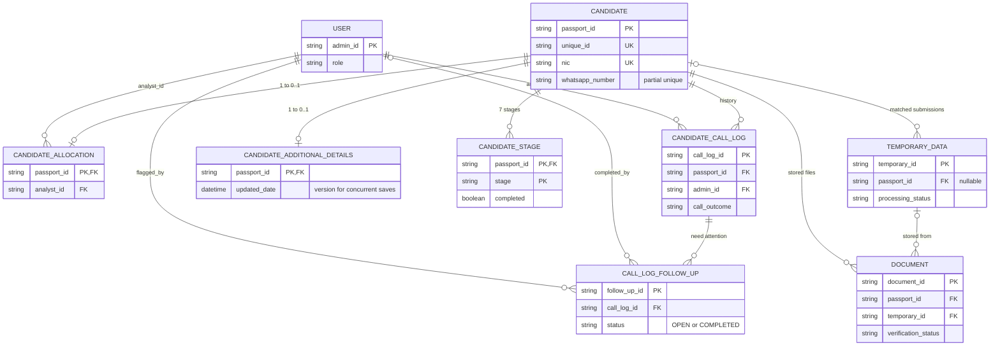
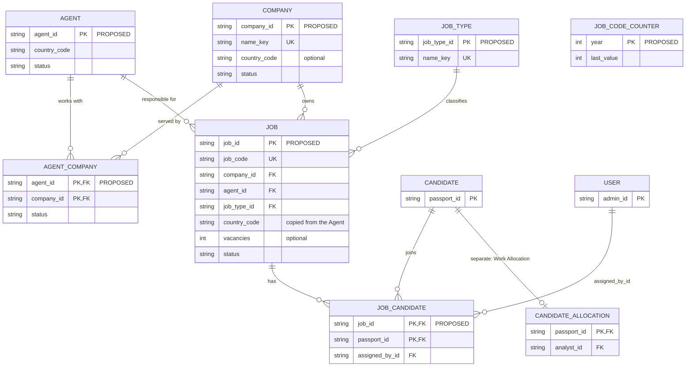
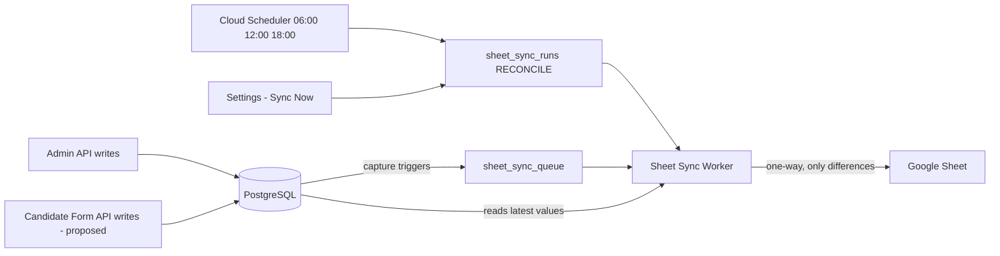
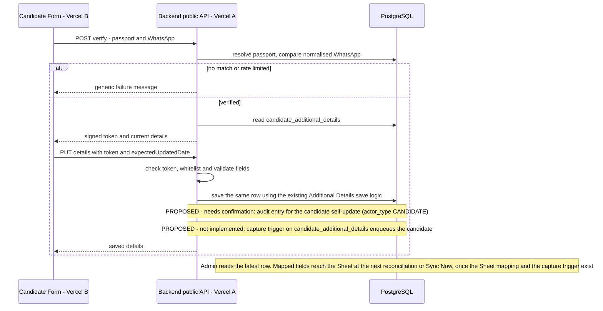

# Emlynk Master Database Architecture

**Status:** Architecture for senior review. Documentation only: no schema, migration or application code has changed.
**Branch:** `version/database-architecture-redesign`

This document is the detailed companion of the [README](../README.md). The README now contains **both** the **Master ER Diagram** (exact tables, foreign keys and cardinality) and the **Master Visual Database Architecture** (how the main parts connect and how data moves; its arrows show data access, ownership and flow, not only foreign keys). The same visual diagram is repeated in this document. This document holds the table inventory, module diagrams, the Candidate Extra Details public-form design, the proposed database changes, the migration plan, the invariants and the items for senior review.

Sources of truth:

- **Existing** = what `prisma/schema.prisma`, `prisma/migrations/` and `src/` implement today.
- **Proposed** = the approved Agent / Company / Job architecture ([CLIENT_AGENT_JOB_ARCHITECTURE.md](CLIENT_AGENT_JOB_ARCHITECTURE.md)) and the Candidate Extra Details public form designed in section 6.

Status labels used throughout:

| Label | Meaning |
|---|---|
| **Existing** | Implemented and deployed |
| **Proposed** | Approved architecture, not implemented |
| **Modified (proposed)** | Existing table with a proposed additive change |
| **Needs confirmation** | A proposal that needs decision (section 11) |

---

## 1. Table inventory

### 1.1 Existing tables (14)

From `prisma/schema.prisma` (Prisma model -> PostgreSQL table). `auth.users` is owned by Supabase, not by this schema.

| Model | Table | Status | Primary key | Foreign keys (on delete) | Purpose |
|---|---|---|---|---|---|
| `User` | `user` | Existing | `admin_id` | `auth_user_id` -> `auth.users.id` (added only where the `auth` schema exists) | Staff profile, role (`ADMIN`, `MANAGER`, `ANALYST`, `REGISTRATION_DESK`), status |
| `Candidate` | `candidate` | Existing | `passport_id` | none | Candidate identity, contact, passport and job data; `unique_id` unique legacy reference; `nic` unique; partial unique index on `whatsapp_number` |
| `CandidateAdditionalDetails` | `candidate_additional_details` | Existing | `passport_id` (1:1) | -> `candidate` (Cascade) | Passport name, permanent address, birthday, clothing sizes, parents, marital/family, other job skills |
| `CandidateStage` | `candidate_stages` | Existing | `(passport_id, stage)` | -> `candidate` (Cascade) | One row per candidate per stage (7 stages); Test details also holds a free-text `job_id`, `test_result`, `test_date` |
| `CandidateAllocation` | `candidate_allocation` | Existing | `passport_id` (1:1) | -> `candidate` (Cascade), `analyst_id` -> `user` (Restrict) | Work Allocation: which Analyst handles the candidate |
| `CandidateCallLog` | `candidate_call_logs` | Existing | `call_log_id` | -> `candidate` (Cascade), `admin_id` -> `user` (Restrict) | Candidate History: staff calls, `call_outcome` `ANSWERED` / `NO_ANSWER` |
| `CallLogFollowUp` | `call_log_follow_up` | Existing | `follow_up_id` | -> `candidate_call_logs` (Cascade), `flagged_by` / `completed_by` -> `user` (Restrict) | Need Attention follow-ups; one OPEN per call log (partial unique index) |
| `Document` | `documents` | Existing | `document_id` | -> `candidate` (no action), `temporary_id` -> `temporary_data` (SetNull) | Stored candidate documents, verification status, OCR confidence, police slip date, variant |
| `TemporaryData` | `temporary_data` | Existing | `temporary_id` | `passport_id` -> `candidate` (optional) | Every WhatsApp submission: processing state, review reason, pending path, submission queue lease |
| `AuditLog` | `audit_logs` | Existing | `audit_id` | `admin_id` -> `user` (Restrict) | Append-only history (a trigger rejects update / delete / truncate). `passport_id`, `temporary_id`, `document_id` are plain IDs, no FK |
| `RateLimit` | `rate_limits` | Existing | `key` | none | Shared rate-limit counters (per prefix + hashed client key) |
| `SheetSyncQueue` | `sheet_sync_queue` | Existing | `queue_id` | none (`unique_id` refers to `candidate.unique_id` logically) | Outbox: candidates changed since the last reconciliation (filled by DB triggers) |
| `SheetSyncRun` | `sheet_sync_runs` | Existing | `run_id` | none (`requested_by` is a plain user ID) | Durable `RECONCILE` / `TEST_CONNECTION` run requests and results |
| `SheetSyncState` | `sheet_sync_state` | Existing | `state_id` (single row) | none | Worker heartbeat, write gate, destinations, active / requested destination, writer lease |

Dropped earlier and not part of the current database: `admin_invitations`, `admin_password_resets` (removed at the Supabase Auth cutover).

### 1.2 Proposed tables (7), Agent / Company / Job

| Model | Table | Status | Primary key | Foreign keys | Purpose |
|---|---|---|---|---|---|
| `JobType` | `job_type` | Proposed | `job_type_id` | none | Controlled job-type list |
| `Agent` | `agent` | Proposed | `agent_id` | none | Broker in one country; name not unique |
| `Company` | `company` | Proposed | `company_id` | none | Employer; unique normalised name; optional country |
| `AgentCompany` | `agent_company` | Proposed | `(agent_id, company_id)` | -> `agent`, -> `company` (Restrict) | Many-to-many link, `ACTIVE` / `INACTIVE` |
| `JobCodeCounter` | `job_code_counter` | Proposed | `year` | none | Yearly counter for `JOB-YYYY-NNNNNN` |
| `Job` | `job` | Proposed | `job_id` | -> `company`, -> `agent`, -> `job_type` (Restrict) | Recruitment requirement; `job_code`; country copied from the Agent; `PROCESSING` / `COMPLETED` / `CANCELLED` |
| `JobCandidate` | `job_candidate` | Proposed | `(job_id, passport_id)` | -> `job` (Restrict), -> `candidate` (Cascade), `assigned_by_id` -> `user` (Restrict) | Candidate on a Job; one `PROCESSING` Job per candidate |

### 1.3 Modified existing tables (proposed)

| Table | Change | For | Status |
|---|---|---|---|
| `audit_logs` | `entity_type`, `entity_id` (nullable) + index | Agent / Company / Job history | Proposed (approved) |
| `audit_logs` | `admin_id` becomes nullable + `actor_type` (`STAFF` / `CANDIDATE`) | Auditing candidate self-updates from the public form | Proposed, **needs confirmation** (section 6.8) |

No change is proposed to `candidate`, `candidate_additional_details` or any other table.

---

## 2. Relationships confirmed in the current schema

| From | To | Cardinality | FK | On delete |
|---|---|---|---|---|
| `user.auth_user_id` | `auth.users.id` | 1 : 1 | yes (where `auth` exists) | n/a |
| `candidate_additional_details` | `candidate` | 0..1 : 1 | yes | Cascade |
| `candidate_stages` | `candidate` | many : 1 | yes | Cascade |
| `candidate_allocation` | `candidate` | 0..1 : 1 | yes | Cascade |
| `candidate_allocation.analyst_id` | `user` | many : 1 | yes | Restrict |
| `candidate_call_logs` | `candidate` | many : 1 | yes | Cascade |
| `candidate_call_logs.admin_id` | `user` | many : 1 | yes | Restrict |
| `call_log_follow_up` | `candidate_call_logs` | many : 1 | yes | Cascade |
| `call_log_follow_up.flagged_by` / `completed_by` | `user` | many : 1 / many : 0..1 | yes | Restrict |
| `documents` | `candidate` | many : 1 | yes | no action |
| `documents.temporary_id` | `temporary_data` | many : 0..1 | yes | SetNull |
| `temporary_data.passport_id` | `candidate` | many : 0..1 | yes | no action |
| `audit_logs.admin_id` | `user` | many : 1 | yes | Restrict |
| `audit_logs.passport_id` / `temporary_id` / `document_id` | candidate / submission / document | logical only | **no FK** (history outlives rows) | n/a |
| `sheet_sync_queue.unique_id` | `candidate.unique_id` | logical only | **no FK** (a deleted candidate must still be removed from the Sheet) | n/a |
| `sheet_sync_runs.requested_by` | `user.admin_id` | logical only | **no FK** | n/a |

Database triggers (not relations): `audit_logs` append-only triggers; Sheet capture triggers on `candidate`, `candidate_stages` and `documents` that enqueue the candidate into `sheet_sync_queue`.

---

## Master Visual Database Architecture

The same high-level diagram as in the README. The README's Master ER diagram and the tables in sections 1-2 answer *"What are the exact tables and relationships?"*; this diagram answers *"How do the main parts of the system connect, and how does data move through the database?"*. It adds no table, relation or rule.

- **Entry points**: Admin Dashboard and the existing `/api/admin`; the proposed Candidate Extra Details Form and its public API; the WhatsApp webhook; the background submission worker.
- **Candidate Form access**: `candidate` is read for verification only; `candidate_additional_details` is the only write target (no new table).
- **Document path**: the webhook records `temporary_data`; the submission worker processes it; a stored file becomes a `documents` row that references both the submission (`temporary_id`) and the candidate (`passport_id`).
- **Sheet sync**: capture triggers on `candidate`, `candidate_stages` and `documents` queue the candidate; the `candidate_additional_details` trigger is **proposed**; Cloud Scheduler and **Sync Now** create `RECONCILE` runs; the worker writes one way to the Sheet.

```mermaid
flowchart TB
    subgraph ENTRY["ENTRY POINTS"]
        ADMIN["Admin Dashboard - staff"]
        FORM["Candidate Extra Details Form - Vercel Project B - PROPOSED"]
        WA["WhatsApp Bot - Meta webhook"]
        SUBW["Background Submission Worker - Cloud Run"]
    end

    subgraph BACKEND["BACKEND - Vercel Project A"]
        API["Existing Express API - /api/admin"]
        PAPI["Public Candidate API - /api/public/candidate-details - PROPOSED"]
        HOOK["WhatsApp webhook - /whatsapp/webhook"]
    end

    ADMIN --> API
    FORM --> PAPI
    WA --> HOOK

    subgraph DB["POSTGRESQL - SOURCE OF TRUTH"]
        subgraph STAFF["A. STAFF / AUTH"]
            SUPA["Supabase Auth - auth.users"]
            USER["user"]
            AUDIT["audit_logs - append-only"]
            RL["rate_limits"]
        end

        subgraph CORE["B. CANDIDATE CORE"]
            CAND["candidate"]
            CAD["candidate_additional_details"]
            STAGE["candidate_stages"]
        end

        subgraph OPS["C. CANDIDATE OPERATIONS"]
            ALLOC["candidate_allocation"]
            CALL["candidate_call_logs"]
            FOLLOW["call_log_follow_up"]
            WARN["WORK ALLOCATION != JOB ASSIGNMENT"]
        end

        subgraph DOCS["D. DOCUMENT PROCESSING"]
            TEMP["temporary_data"]
            DOC["documents"]
        end

        subgraph SYNCT["E. GOOGLE SHEET SYNC TABLES"]
            Q["sheet_sync_queue"]
            RUNS["sheet_sync_runs"]
            STATE["sheet_sync_state"]
        end

        subgraph JOBS["F. AGENT / COMPANY / JOB - PROPOSED"]
            AGENT["agent - PROPOSED"]
            COMPANY["company - PROPOSED"]
            AC["agent_company - PROPOSED"]
            JT["job_type - PROPOSED"]
            JOB["job - PROPOSED"]
            JC["job_candidate - PROPOSED"]
            JCC["job_code_counter - PROPOSED"]
        end
    end

    subgraph SHEETSIDE["SHEET SYNC - OUTSIDE THE DATABASE"]
        SCHED["Cloud Scheduler 06:00 12:00 18:00"]
        SYNCNOW["Admin - Sync Now"]
        SHEETW["Sheet Sync Worker - Cloud Run"]
        GSHEET["Google Sheet"]
    end

    %% Entry points into the database
    API -->|"general authenticated DB access - role-checked, Analyst-scoped"| DB
    API -.->|"rate-limit counters"| RL
    HOOK -->|"records submission"| TEMP
    SUBW -->|"claims and processes"| TEMP
    PAPI -->|"verify only"| CAND
    PAPI -->|"read / update extra details"| CAD

    %% A. Staff / auth
    SUPA -->|"auth_user_id"| USER
    USER -->|"admin_id"| AUDIT

    %% B. Candidate core
    CAND --> CAD
    CAND --> STAGE

    %% C. Candidate operations
    CAND --> ALLOC
    CAND --> CALL
    CALL --> FOLLOW
    USER -->|"analyst_id"| ALLOC
    USER -->|"admin_id"| CALL
    USER -->|"flagged_by / completed_by"| FOLLOW
    ALLOC -.- WARN
    WARN -.- JC

    %% D. Document processing (documents references temporary_data and candidate)
    TEMP -->|"stored as - documents.temporary_id"| DOC
    DOC -->|"passport_id"| CAND
    TEMP -->|"passport_id, optional"| CAND

    %% Audit logical references (no foreign key)
    CAND -.->|"logical: passport_id"| AUDIT

    %% E. Google Sheet sync
    CAND -->|"capture trigger"| Q
    STAGE -->|"capture trigger"| Q
    DOC -->|"capture trigger"| Q
    CAD -.->|"proposed capture trigger"| Q
    ADMIN --> SYNCNOW
    SYNCNOW -->|"RECONCILE request"| RUNS
    SCHED -->|"RECONCILE request"| RUNS
    Q -->|"settled by the next run"| RUNS
    RUNS --> SHEETW
    STATE --> SHEETW
    SHEETW -->|"one-way: database to Sheet"| GSHEET

    %% F. Agent / Company / Job (proposed)
    AGENT --> AC
    COMPANY --> AC
    AGENT -->|"responsible Agent"| JOB
    COMPANY -->|"owns"| JOB
    JT --> JOB
    JOB --> JC
    CAND --> JC
    USER -->|"assigned_by"| JC
    JCC -.->|"used to generate job_code"| JOB
    JOB -.->|"logical: entity_type / entity_id"| AUDIT

    classDef existing fill:#1f2937,stroke:#64748b,color:#fff;
    classDef proposed fill:#3b2f10,stroke:#d6a84b,color:#fff;
    classDef application fill:#153047,stroke:#3b82f6,color:#fff;
    classDef external fill:#17352b,stroke:#34a853,color:#fff;
    classDef warning fill:#3b1f1f,stroke:#e35d6a,color:#fff;
    class USER,AUDIT,RL,CAND,CAD,STAGE,ALLOC,CALL,FOLLOW,TEMP,DOC,Q,RUNS,STATE existing;
    class AGENT,COMPANY,AC,JT,JOB,JC,JCC,FORM,PAPI proposed;
    class ADMIN,API,HOOK,SYNCNOW application;
    class SUPA,WA,SUBW,SCHED,SHEETW,GSHEET external;
    class WARN warning;
```



Legend: dark grey = existing table, amber = proposed (not implemented), blue = application / backend, green = external system or worker, red = rule or warning. **This diagram is not the foreign-key reference:** exact foreign keys and cardinalities are in the Master ER diagram. Solid arrows show data access, ownership or data flow (some of them are also foreign keys, which the ER diagram shows precisely). Dotted arrows are logical references without a foreign key, or proposed relationships and captures.

---

## 3. Candidate domain ER



---

## 4. Agent / Company / Job domain (proposed)

Full specification: [CLIENT_AGENT_JOB_ARCHITECTURE.md](CLIENT_AGENT_JOB_ARCHITECTURE.md). Summary of the approved rules: one Agent = one country, name not unique; Agent <-> Company many-to-many with `ACTIVE` links; a Job belongs to one Company and one responsible Agent, needs an `ACTIVE` link, copies its country from the Agent, has optional `vacancies >= 1`, a server-generated `JOB-YYYY-NNNNNN` code and status `PROCESSING` / `COMPLETED` / `CANCELLED` (Complete / Cancel with reason / Reopen); a Candidate is on at most one `PROCESSING` Job; removal deletes the link; no hard deletes; Analysts read-only and backend-scoped.



`JOB_CODE_COUNTER` has no relation: it is incremented in the Job-creating transaction. Work Allocation and Job assignment are separate relations and never reference each other.

---

## 5. Google Sheet Sync domain

### 5.1 How it works today (audited)

- **Capture:** triggers on `candidate`, `candidate_stages` and `documents` call `sheet_sync_enqueue(unique_id)`, which upserts one `PENDING` row per candidate into `sheet_sync_queue`. The application never enqueues directly.
- **Write:** the Sheet worker (Cloud Run) does **not** drain the queue continuously. A full database -> Sheet **reconciliation** (`RECONCILE` run in `sheet_sync_runs`) runs at **06:00, 12:00 and 18:00 Asia/Colombo** (Cloud Scheduler) or on **Settings -> Google Sheet Sync -> Sync Now**. It compares every candidate with the Sheet, writes only differences, and settles the queue rows it covered.
- **Gate:** nothing is written unless `SHEET_SYNC_ENABLED=true` (otherwise Sync Now is a dry run). Headers are validated exactly before any write.
- **Columns:** `src/services/sheetSchema.js` defines columns A-AO. **No Candidate Additional Details field is mapped today**, and the mapper does not read `candidate_additional_details`.
- **`candidate_additional_details` has no capture trigger.**



### 5.2 What Additional Details need to reach the Sheet

When the owner supplies the field-to-column mapping:

1. Add the columns to `sheetSchema.js` and to the Sheet header row in the same release (header validation is exact).
2. Read `candidate_additional_details` in `candidateSheetMapper.js` and map the agreed fields.
3. **Capture:** add a trigger on `candidate_additional_details` that reuses the existing `sheet_sync_capture_candidate_child()` function (it already resolves `passport_id` -> `unique_id`), so inserts and updates enqueue the candidate like stage and document changes do.

**Recommendation: database trigger** (not an application-side enqueue). Every existing capture is a trigger in the same transaction as the change; a trigger also covers Admin saves, public-form saves and any future writer with no code path to forget. Note that because reconciliation is a full comparison, Sync Now and the scheduled runs pick up mapped fields even without the trigger; the trigger keeps the queue (and the pending count shown in Settings) truthful.

**Auto vs manual:**

- **Auto:** a public-form or Admin save enqueues the candidate (trigger); the change reaches the Sheet at the **next scheduled reconciliation**. Real-time sync does not exist today (needs confirmation if faster updates are required).
- **Manual:** **Sync Now** reads the latest database values and updates the Sheet. No change needed beyond the mapping.

The public form never talks to Google Sheets.

---

## 6. Candidate Extra Details public form (proposed)

> **Status:** Proposed. Implementation pending.

### 6.1 What it is

A public web form where an **existing** candidate verifies with **Passport Number + WhatsApp Number** and then views and updates **their own Candidate Additional Details**. It is not registration, not a new Candidate model, and not general candidate editing. It is a second interface to the **same** `candidate_additional_details` row the Admin **Additional Details** panel uses.

### 6.2 Database impact (audit result)

- `candidate_additional_details` already holds every field the form needs (19 fields, table below), one optional row per candidate, keyed by `passport_id`. **No duplicate table is required** (no `candidate_public_details`, `candidate_form_details` or similar).
- The existing save logic already provides what the form needs: full field whitelist and validation (`parseAdditionalDetailsBody`), conditional family rules, compare-and-swap on `updated_date` (`409 DETAILS_CHANGED`), a transaction, and changed-fields-only audit entries.
- `candidate` is only **read** (verification); it is never written by the form.
- **One database change is recommended:** audit entries for candidate self-updates (6.8).
- Verification state needs **no table** (stateless signed token, 6.4). Rate limiting reuses the existing `rate_limits` table with new prefixes (6.6).

### 6.3 Field mapping

| UI field (Admin label) | DB column | Shown in Admin | Public form | Sheet mapping |
|---|---|---|---|---|
| Passport number | `candidate.passport_id` | Yes (read-only) | **No** (verification only) | existing column B |
| Name according to passport | `name_as_in_passport` | Yes | Editable | TBD |
| Permanent address | `permanent_address` | Yes | Editable | TBD |
| Birthday | `birthday` | Yes | Editable | TBD |
| T-shirt size | `tshirt_size` | Yes | Editable (XS-XXL) | TBD |
| Pant size | `pant_size` | Yes | Editable (preset or custom) | TBD |
| Shoe size (UK) | `shoe_size` | Yes | Editable (preset or custom) | TBD |
| Is father alive? | `father_alive` | Yes | Editable | TBD |
| Father full name | `father_full_name` | Yes | Editable (required if alive) | TBD |
| Father birthday | `father_birthday` | Yes | Editable | TBD |
| Is mother alive? | `mother_alive` | Yes | Editable | TBD |
| Mother full name | `mother_full_name` | Yes | Editable (required if alive) | TBD |
| Mother birthday | `mother_birthday` | Yes | Editable | TBD |
| Marital status | `marital_status` | Yes | Editable | TBD |
| Wife full name | `wife_full_name` | Yes | Editable (married only, required) | TBD |
| Wife birthday | `wife_birthday` | Yes | Editable (married only) | TBD |
| 1st child name | `child_1_name` | Yes | Editable (not when single) | TBD |
| 2nd child name | `child_2_name` | Yes | Editable (needs 1st) | TBD |
| 3rd child name | `child_3_name` | Yes | Editable (needs 2nd) | TBD |
| Other job skills | `other_job_skills` | Yes | Editable | TBD |
| WhatsApp number | `candidate.whatsapp_number` | Elsewhere (candidate details) | **No** (verification only) | existing column K |

All 19 Additional Details columns are already displayed in the Admin panel: **no Admin field is missing.** "Public form" values are the proposal; which fields stay editable is a senior item (11).

### 6.4 Verification

**Inputs:** Passport Number and WhatsApp Number.

| Input | Accepted | Matching (follows existing behaviour) |
|---|---|---|
| Passport Number | trimmed; spaces and hyphens removed; letters and digits, at most 20 (the existing passport-ID route pattern). **No `PN` prefix and no new format rule** | exact `passport_id`, otherwise the single case-insensitive match (`resolveCandidatePassportId`); zero or several matches = failure |
| WhatsApp Number | must start with `+`, then 8-15 digits (international; Sri Lankan or foreign, e.g. `+94771234567`, `+40712345678`, `+919876543210`) | compared as digits with the existing `normalizePhoneNumber()` against that candidate's stored `whatsapp_number` (stored values may or may not carry `+`) |

Both must belong to the **same** candidate. A candidate with no WhatsApp number on record cannot verify. Any failure returns the same generic answer, after the same work, with no hint about which value was wrong or whether either exists:

> We couldn't verify your details. Please check your Passport Number and WhatsApp Number and try again.

**After verification: stateless signed token (recommended).** The backend returns a short-lived token (for example 15 minutes) signed with HMAC-SHA256 (`node:crypto`, no new dependency) using a backend-only secret. Payload: `passport_id`, a hash of the normalised WhatsApp number, expiry, version. Every read and write re-checks the signature and expiry, that the candidate still exists, and that the stored WhatsApp still matches the hash, so a changed number invalidates old tokens. Nothing is stored.

| Option | Verdict |
|---|---|
| **Stateless signed token** | Recommended: no table, works on serverless, short expiry limits exposure |
| Server session | Needs a shared session store on Vercel (a new table); no benefit here |
| DB-backed one-time token | A new permanent table plus cleanup for a 15-minute need |

The token is kept in the form's memory / `sessionStorage` and sent as `Authorization: Bearer`; no cookies, so no CSRF surface.

### 6.5 Public API (proposed)

A separate router mounted at `/api/public/candidate-details`, independent of `/api/admin` (no staff authentication, no shared middleware other than JSON parsing, helmet and the error handler).

| Method | Path | Body / auth | Returns |
|---|---|---|---|
| POST | `/api/public/candidate-details/verify` | `{ passportNumber, whatsappNumber }` | `200 { token, expiresAt, details, updatedDate }` or the generic `401` |
| GET | `/api/public/candidate-details` | `Authorization: Bearer <token>` | `{ details, updatedDate }` |
| PUT | `/api/public/candidate-details` | token; the 19 fields + `expectedUpdatedDate` | saved `{ details, updatedDate }`, `400` field errors, `409 DETAILS_CHANGED`, `401` expired token |

- The save calls the **same** service as Admin (`saveAdditionalDetails`) with the candidate from the token, never from the request.
- Output is minimised: only the 19 Additional Details values and `updatedDate`. No candidate core data, IDs, stages, documents or staff data, and no "suggested" values from the candidate record.
- Field names in the request are whitelisted by the existing parser; anything else is ignored. Passport and WhatsApp are never accepted as editable fields.

### 6.6 Security boundary

| Protection | Design |
|---|---|
| Route boundary | `/api/public/candidate-details/*` only; it can reach exactly one candidate's Additional Details. `/api/admin/*` unchanged |
| Database access | Backend only (Prisma). The browser has no database or Supabase credentials and never writes to Supabase directly |
| Whitelist | The 19 Additional Details fields only; candidate record, stages, allocation, Jobs, documents, review state, IDs and audit values are unreachable |
| Verification | Passport + WhatsApp must match the same candidate; generic failure; same work on success and failure paths |
| Rate limiting | New, stricter limiters on the existing PostgreSQL store with their own prefixes: verify per IP (e.g. 10 failed attempts / 15 min) **and** per passport (e.g. 5 failed attempts / hour, keyed by a hash) against distributed guessing; read/save per token / IP (e.g. 60 / 15 min). Values need confirmation |
| Why not the existing limiter | The staff limiter allows 1000 requests / 15 min per IP (far too many guesses) and shares the `generic-api:` counter with `/auth` and `/api/admin` |
| CORS | Only on `/api/public/*`: `Access-Control-Allow-Origin` = the exact Candidate Form origin (`CANDIDATE_FORM_ORIGIN`), methods `GET, POST, PUT, OPTIONS`, headers `Content-Type, Authorization`, no credentials. Admin routes keep no CORS (same-origin) |
| Payload size | A small JSON limit on the public router (e.g. 16 KB; the global parser allows 100 KB) |
| Errors | Generic messages; no stack traces, IDs or existence hints |
| Logging | Failed verifications logged without raw passport or phone (hashes only); successful saves in `audit_logs` |
| Secrets | `CANDIDATE_FORM_TOKEN_SECRET` and `CANDIDATE_FORM_ORIGIN` live only in the backend project. The form project has only its public API base URL |
| Mobile networks | Candidates often share carrier IPs (CGNAT): keep the per-IP verify limit moderate and rely on the per-passport limit |

### 6.7 Repository and deployment

```
EmlynkWABot/
  admin/            existing React Admin (Vercel Project A, served at /admin)
  candidate-form/   NEW React app for Candidate Extra Details (Vercel Project B)
  src/              shared Express backend (Vercel Project A, api/index.js)
  prisma/           shared database schema
  ocr-worker/       OCR service (Cloud Run)
  Docs/
```

| | Vercel Project A (existing) | Vercel Project B (proposed) |
|---|---|---|
| Contents | Admin SPA + Express API (`api/index.js`) | `candidate-form/` static build only |
| Root / build | repository root, `vercel.json` | root directory `candidate-form/`, its own build (e.g. Vite -> `dist`) |
| Environment | `DATABASE_URL`, Supabase service role, Meta secrets, plus new `CANDIDATE_FORM_ORIGIN`, `CANDIDATE_FORM_TOKEN_SECRET` | `VITE_API_BASE_URL` only (public). **No database URL, no Supabase keys, no secrets** |
| URL | existing domain | its own Vercel URL (custom domain optional) |

Both projects build from the same GitHub repository; Project B calls Project A's `/api/public/candidate-details/*` over HTTPS.

### 6.8 Audit of candidate self-updates (needs confirmation)

Today `audit_logs.admin_id` is **required** and must reference a staff `user`; the Additional Details save only writes an audit entry when there is a staff actor. A candidate has no `user` row, so self-updates cannot be audited without a change.

**Recommended additive change:** make `audit_logs.admin_id` nullable and add `actor_type` (`STAFF` default, `CANDIDATE`), with `CHECK ((actor_type = 'STAFF') = (admin_id IS NOT NULL))`. Public saves then write `CREATE_ADDITIONAL_DETAILS` / `UPDATE_ADDITIONAL_DETAILS` with `actor_type = 'CANDIDATE'`, `passport_id`, the changed fields, and a reason such as "Updated by the candidate (public form)". Existing rows stay `STAFF`; Candidate History and the Audit Logs page show "Candidate (public form)" as the actor.

This also covers "last self-submitted date" and "submission source" (both derivable from the audit log), so no column is added to `candidate` or `candidate_additional_details`. Verification attempts are not stored (rate-limit counters and logs only).

Rejected: a fake "public form" row in `user` (it would need a Supabase Auth identity, and it would sit among staff accounts) and silently not auditing.

### 6.9 Admin integration

There is no second Admin workflow. The candidate saves into the same row, and the Admin **Additional Details** panel reads it on open, so staff see the latest values. If staff and the candidate edit at the same moment, the existing version check refuses the later save with `409 DETAILS_CHANGED`, and the form asks the user to reload. Candidate History shows the self-update as an activity entry (once 6.8 is in place).

### 6.10 Flow



---

## 7. Proposed database changes (summary for review)

### Existing tables unchanged

`user`, `candidate`, `candidate_additional_details`, `candidate_stages`, `candidate_allocation`, `candidate_call_logs`, `call_log_follow_up`, `documents`, `temporary_data`, `rate_limits`, `sheet_sync_queue`, `sheet_sync_runs`, `sheet_sync_state`.

### Existing tables modified

| Table | Change | Reason |
|---|---|---|
| `audit_logs` | `entity_type`, `entity_id` (nullable), `CHECK` pairing, index `(entity_type, entity_id, created_date)` | Agent / Company / Job history |
| `audit_logs` | `admin_id` nullable, `actor_type` (`STAFF` / `CANDIDATE`), `CHECK` | Candidate self-updates (needs confirmation) |
| `candidate_additional_details` | no column change; **new Sheet capture trigger** when the Sheet mapping is added | Auto-sync of mapped Additional Details |

### New tables

`job_type`, `agent`, `company`, `agent_company`, `job_code_counter`, `job`, `job_candidate`.

### Candidate Form

**No new table and no change to `candidate` or `candidate_additional_details` columns.** Required only: the `audit_logs` actor change (if self-updates are to be audited, recommended) and, later, the Sheet capture trigger with the mapping.

### Concise proposed model map (new / modified only)

```
Agent          agent_id PK, name (not unique), country_code CHAR(2), contact_number?, email?, status, dates
Company        company_id PK, name, name_key UNIQUE, country_code?, status, dates
AgentCompany   (agent_id, company_id) PK, status, created_date, ended_date?
JobType        job_type_id PK, name, name_key UNIQUE, status, dates
Job            job_id PK, job_code UNIQUE, company_id, agent_id, job_type_id, country_code,
               vacancies? (>= 1), status, completed_date?, cancelled_date?, dates
JobCandidate   (job_id, passport_id) PK, assigned_date, assigned_by_id
JobCodeCounter year PK, last_value
AuditLog +     entity_type?, entity_id?, actor_type (STAFF | CANDIDATE), admin_id nullable
Candidate      unchanged (only back-relations: jobCandidates)
CandidateAdditionalDetails  unchanged
```

---

## 8. Migration plan

All migrations are hand-written, additive SQL applied with `prisma migrate deploy` (`prisma migrate dev` cannot replay this repository's history). Every new table gets RLS enabled and privileges revoked from `anon` / `authenticated`. None is created in this phase.

| Order | Migration | Contents | Depends on |
|---|---|---|---|
| A | Agent / Company foundation | `job_type`, `agent`, `company`, `agent_company`; `audit_logs.entity_type` / `entity_id` + index; enable RLS on `candidate_allocation` (hardening, if confirmed) | approval |
| B | Job | `job_code_counter`, `job`, `job_candidate` (+ optional one-PROCESSING backstop) | A |
| C | Candidate Form audit | `audit_logs.admin_id` nullable + `actor_type` + `CHECK` | confirmation (11). If approved before A ships, fold it into A so `audit_logs` changes once |
| D | Sheet capture for Additional Details | trigger on `candidate_additional_details` using `sheet_sync_capture_candidate_child()` | ships with the owner's Sheet mapping (code + Sheet headers) |

No migration touches `candidate` rows (a bulk update would queue every candidate for the Sheet). The Candidate Form itself needs **no table migration**; C and D are the only related changes.

---

## 9. Data-flow invariants

1. Candidate identity exists once (`candidate.passport_id`); it is never duplicated.
2. Candidate Additional Details belong to the existing candidate (one row, keyed by `passport_id`).
3. Passport + WhatsApp only **verify** an existing candidate; neither is editable through the public form.
4. The public form cannot create a candidate.
5. The public form cannot edit system-controlled data (candidate record, stages, allocation, Jobs, documents, review state, audit).
6. Work Allocation (`candidate_allocation`) is independent from Job assignment (`job_candidate`).
7. A candidate is on at most one `PROCESSING` Job at a time.
8. A Job's country comes from its Agent.
9. A Job requires an `ACTIVE` Agent-Company link at creation.
10. PostgreSQL is the source of truth.
11. The Google Sheet is a one-way mirror (database -> Sheet); nothing writes Sheet data back.
12. New operational tables never mutate `candidate` (so they do not trigger Sheet sync unintentionally).
13. `audit_logs` is append-only.
14. Only the backend holds database and service credentials; no browser application writes to the database or to Supabase directly.

---

## 10. Consistency notes found during the audit

| Finding | Fixed in |
|---|---|
| README ER used `user_id` and old table names (`document`, `call_log`, `candidate_stage`) | README Master ER uses the real tables and keys |
| README listed only six tables; Work Allocation, Additional Details, Temporary Data, Sheet Sync, Rate Limit and Audit tables were missing | README Database Architecture |
| README said IVS Interview, Visa Approval and Finalizing the Job are temporarily disabled; the code has seven active stages in the order Test, Candidate Details, Document Submission, IVS Interview, Visa Submission, Visa Approval, Finalizing the Job | README Candidate stages |
| README listed `POST /auth/login`; sign-in happens in the browser with Supabase Auth, and the backend has `GET /auth/me` and `POST /auth/complete-invite` | README API section |
| README omitted Work Allocation, Analyst scoping and rate limiting | README |
| README setup used `prisma migrate dev`, which cannot replay this history | README setup (`migrate deploy`) |
| README structure listed `scripts/createAdmin.js`; the script is `createUser.js` | README repository structure |
| Additional Details are not mapped to the Sheet and have no capture trigger | Section 5.2 (planned with the mapping) |
| `candidate_allocation` is the only application table without row-level security (its privileges are revoked from `anon` / `authenticated` by the default-privilege rule, so it is not exposed today) | Proposed: `ENABLE ROW LEVEL SECURITY` in Migration A (item 12, section 11) |

---

## 11. Items for senior review

Only decisions that genuinely need confirmation. Confirmed Agent / Job rules are not reopened.

| # | Item | Recommendation |
|---|---|---|
| 1 | Candidate Form security model: public router, Passport + WhatsApp verification, generic failures, CORS to the form origin only | Approve as in 6.4-6.6 |
| 2 | Post-verification session: stateless HMAC-signed token, ~15 min, re-checked on every request | Approve; no session table |
| 3 | `audit_logs` actor change (`admin_id` nullable + `actor_type`) to audit candidate self-updates | Approve (Migration C, folded into A if timely) |
| 4 | Public rate limits: per-IP and per-passport values, and the accepted risk that repeated failures can temporarily lock one candidate's form | Approve starting values, tune after launch |
| 5 | Public editing semantics: may a candidate change or clear values staff entered (saves are full replacements today), and should any field be read-only (e.g. name according to passport)? | All 19 editable; confirm clearing |
| 6 | Sheet capture for Additional Details: database trigger vs application enqueue | Database trigger (matches the existing outbox) |
| 7 | Sync timing: is the 06:00 / 12:00 / 18:00 schedule (plus Sync Now) enough for public-form updates, or is near-real-time sync required? | Keep the schedule |
| 8 | CORS for Project B preview deployments: production origin only, or an allow-list | Production origin only |
| 9 | Registration Desk access to the Job module | No access until a need is stated |
| 10 | Cancelled Jobs: third tab or status filter | Third tab |
| 11 | Moving a `PROCESSING` Job to another Agent | Allowed only to an `ACTIVE`, linked Agent in the same country |
| 12 | Enable row-level security on `candidate_allocation` (the only table without it) | Yes, in Migration A |
