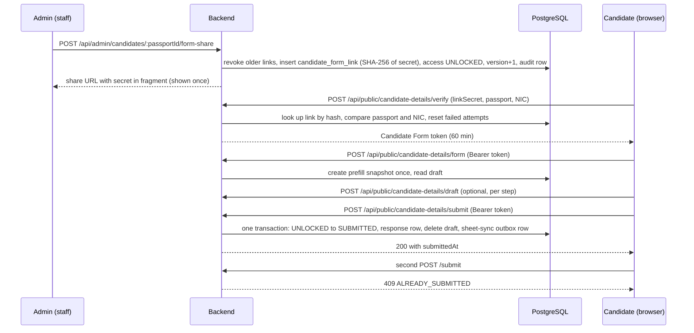

# Candidate Form Load Testing

| | |
|---|---|
| Branch | `version/load-testing` |
| Tooling commit | `15fc38f` (CF-01, CF-02, runner, dbState changes) |
| Environment | Local backend on `.env.loadtest`, dedicated load-test Supabase project |
| Test tool | k6 v2.2.0 |
| Results folder | `performance-tests/results/` (git-ignored) |
| Status | CF-01 executed (1 aborted run, 1 complete run). CF-02 executed once (complete run). |

Every number in this document is taken from the result files listed in [Appendix A](#appendix-a-source-files-for-every-number). Statements that are not backed by a saved file are labelled **Reported (no saved artifact)**.

---

## 1. Purpose

The Candidate Form is the public form a candidate fills in after staff share a link with them. The business rules that matter for load testing are:

- One candidate receives **one** unique Candidate Form link.
- A candidate submits **their own** form **once**.
- After submission the form is locked by business logic; any later submission is refused with `409 ALREADY_SUBMITTED`.
- Staff may send links to many candidates (the team mentioned 100–600), but those candidates submit over time, not in the same second.

The concern was whether several candidates submitting at the same time, or steadily over a period, could cause:

- failed form submissions;
- HTTP 500, 503 or 429 responses;
- database connection-pool exhaustion;
- a database crash;
- data corruption (lost, duplicated or cross-candidate rows).

---

## 2. Candidate Form Architecture Relevant to Load Testing

### 2.1 End-to-end flow



### 2.2 Step by step (confirmed in code)

| Step | Endpoint | Code | What happens |
|---|---|---|---|
| Create share link | `POST /api/admin/candidates/:passportId/form-share` | `src/routes/admin.js` → `createFormShareLink` in `src/services/candidateFormShareService.js` | Generates a 256-bit secret (`crypto.randomBytes(32)`, base64url). Stores only `hashLinkSecret(secret)` (SHA-256) in `candidate_form_link.token_hash`. In one transaction it locks the access row (`lockAccessRow`, `SELECT … FOR UPDATE`), refuses if already `SUBMITTED` (409 `FORM_SUBMITTED`), revokes earlier links, inserts the new `SINGLE` link (valid 3 days), sets `candidate_form_access` to `UNLOCKED` with `version + 1`, and writes an audit row. The secret is returned once, in the URL fragment `#k=<secret>`. |
| Verify | `POST /api/public/candidate-details/verify` | `src/routes/publicCandidateDetails.js` → `verifyFormLinkAccess` in `src/services/candidateFormVerificationService.js` | Input patterns are checked before any lookup. The link is found by the hash of the secret; passport and NIC are compared in constant time. Rate limiting counts **failed** attempts only: 10 per IP per 15 minutes and 5 per passport per hour (`PUBLIC_VERIFY_LIMITS`, `skipSuccessfulRequests: true`, PostgreSQL store). |
| Issue token | same route | `issueCandidateFormToken` in `src/services/candidateFormTokenService.js` | AES-256-GCM token `cf1~<iv>~<ciphertext>`. The payload binds the passport (`sub`), the link (`lnk`), the link kind, the job (group links) and the **lock version** (`ver`). Expires after 60 minutes. Nothing is stored server-side. |
| Session check | `/form`, `/draft`, `/submit` | `createRequireCandidateFormToken` in `src/middleware/requireCandidateFormToken.js` | On every request it decrypts the token, then re-reads the link and the access row. A `SUBMITTED` form gets `409 ALREADY_SUBMITTED` on `/form` and `/draft`. `/submit` uses `allowSubmitted: true`, so a retry with the **same** idempotency key can be answered with the original success. |
| Open form | `POST /api/public/candidate-details/form` | `loadCandidateForm` in `src/services/candidateFormDataService.js` | Creates the prefill snapshot (`candidate_form_prefill_snapshot`) the first time, then returns identity, prefill and saved draft. |
| Save draft | `POST /api/public/candidate-details/draft` | `saveCandidateFormDraft` | Upserts `candidate_form_draft` after the same validation as the submission. Not used by CF-01/CF-02. |
| Submit | `POST /api/public/candidate-details/submit` | `parseSubmission`, `submitCandidateForm` | One transaction: compare-and-set `UNLOCKED → SUBMITTED` for exactly the token's version (`updateMany … where status = UNLOCKED and version = ver`). If no row changed and the stored `submit_key` is not this request's key, it throws `409 ALREADY_SUBMITTED`. Otherwise it creates the prefill snapshot if missing, inserts `candidate_form_response`, deletes the draft, and inserts the `candidate_form_sheet_sync` outbox row. Returns `{ submittedAt }`. |
| Sheet sync | — | `src/services/formSubmissionSync.js` (worker) | Google is **not** called during submit. The outbox row is processed later by the separate sheet-sync worker, which is not started in load tests. |

Database protections that matter for the restore strategy (`prisma/migrations/20261017120000_candidate_form_share_and_response/migration.sql`):

- `candidate_form_access_submitted_is_final`: a `BEFORE UPDATE` trigger refuses any change to a `SUBMITTED` row.
- `candidate_form_response_is_final` and `candidate_form_prefill_snapshot_is_final`: `BEFORE UPDATE` triggers refuse value changes.
- All candidate-form tables reference `candidate(passport_id)` with `ON DELETE CASCADE`. `candidate_form_access`, `candidate_form_response` and `candidate_form_prefill_snapshot` reference `candidate_form_link(link_id)` with `ON DELETE SET NULL`.

---

## 3. Why the Initial Testing Approach Was Incorrect

### 3.1 One token reused across many virtual users

The first three Candidate Form scripts are still in the repository:

| Script | Endpoint | Load | Token |
|---|---|---|---|
| `performance-tests/candidate-form/candidate-form-submit-20vus.js` | `POST /submit` | 20 VUs × 50 iterations | one `CANDIDATE_FORM_TOKEN` for all |
| `performance-tests/candidate-form/candidate-form-draft-20vus.js` | `POST /draft` | 20 VUs × 50 iterations | the same single token |
| `performance-tests/candidate-form/candidate-form-load-20vus.js` | `POST /form` | 20 VUs × 50 iterations | the same single token |

All three read one token from `__ENV.CANDIDATE_FORM_TOKEN`, so every request acted as the **same candidate**.

**Reported (no saved artifact):** the team observed that:

- `submit` returned `409 ALREADY_SUBMITTED` after the first success;
- `draft` returned 409 after the form had been submitted;
- `form` returned 409 when used with a token whose form was already submitted.

The code confirms that these are business-rule responses, not load failures:

- `/form` and `/draft` use `requireSession` (no `allowSubmitted`), which answers a submitted form with `409 ALREADY_SUBMITTED`.
- `/submit` accepts one success per form. Each iteration in that script sends a new idempotency key, so every request after the first is refused with 409 by `submitCandidateForm`.

These runs did not represent 20 or 100 different candidates. They measured repeated requests by one candidate against a form that locks after one submission, so at best 1 of 1000 submit requests could succeed by design.

### 3.2 The `randomUUID` script failure

**Reported (no saved artifact):** an early version of the submit script failed in k6 before sending any HTTP request, because `randomUUID` was not available in the k6 script context. The run had 0 requests.

- **Cause:** a load-test-script problem. The application was never reached.
- **Fix:** the idempotency key was replaced by a value built from `__VU`, `__ITER` and `Date.now()` (the current `candidate-form-submit-20vus.js` uses `${__VU}-${__ITER}-${Date.now()}`). The final CF-01/CF-02 tooling uses `idempotencyKeyFor(runId, n)` in `performance-tests/candidate-form/identity.js` (`loadtest-cf-<6 digits>`, which matches the server's `^[A-Za-z0-9_-]{16,64}$` rule).

---

## 4. Corrected Realistic Candidate Form Test Design

### 4.1 Principles

| Principle | How it is enforced |
|---|---|
| One unique candidate per test identity | `identityFor(runId, n)` gives every candidate its own passport, NIC and WhatsApp number. |
| One unique share link per candidate | The runner calls the real `POST /api/admin/candidates/:passportId/form-share` once per candidate and checks that all link secrets are distinct. |
| One unique verification per candidate | k6 setup calls `/verify` with that candidate's own link, passport and NIC. |
| One unique token per candidate | Setup checks that no two candidates received the same token, and that each token opens its own candidate's form (`identity.passportNumber`). |
| Each candidate submits exactly once | CF-01: VU *n* submits candidate *n*. CF-02: `exec.scenario.iterationInTest` is unique across VUs, so each of the 100 iterations takes a different candidate. |
| Business rules not bypassed | No direct token minting with `CANDIDATE_FORM_TOKEN_SECRET`. The verify rate limiter is active. |
| No application changes | No public Candidate Form route or service was changed for these tests (see [Section 10](#10-database--query--pool-findings)). |

### 4.2 Files

| File | Role |
|---|---|
| `scripts/loadtest/runCandidateForm.mjs` | Runner: safety checks, candidate and link creation, k6 launch, result collection. `npm run loadtest:cf -- CF-01 \| CF-02`. |
| `performance-tests/candidate-form/identity.js` | Identities and answers (no k6 imports). Used by both k6 and the runner, which validates every answer set with the server's own `parseSubmission` before k6 starts. |
| `performance-tests/candidate-form/lib.js` | `loadTargets`, `verifyAndOpen`, `prepareSessions`, `submitOnce`, `submitNext`, `lockProbe`, `finish`, status counters. |
| `performance-tests/candidate-form/cf-01-submit-20vus.js` | CF-01 scenario. |
| `performance-tests/candidate-form/cf-02-sustained-100x20vus.js` | CF-02 scenario. |
| `scripts/loadtest/dbState.mjs` | Baseline snapshot, verify and restore, extended with the candidate-form tables. |

### 4.3 Identity ranges

`seq = CF_RUN_ID × 10000 + (n − 1)` for candidate *n*.

| Field | Candidate Form tests | Registration tests (for comparison) |
|---|---|---|
| Passport | `N9` + 6 digits | `P9` + 6 digits |
| NIC | `980000` + 6 digits | `990000` + 6 digits |
| WhatsApp | `+9498` + 7 digits | `+9499` + 7 digits |
| Names | `LOADTEST` / `CF<digits>` | `LOADTEST` / `REG<digits>` |

| Scenario | Run ID | Passports |
|---|---|---|
| CF-01 | 1 | `N9010000`–`N9010019` |
| CF-02 | 2 | `N9020000`–`N9020099` |

Why the ranges are separate:

- The passport letter differs (`N` instead of `P`), so a Candidate Form identity can never equal a registration identity, whatever run IDs are used. Both satisfy the registration rule "P or N followed by 7 digits" (`src/utils/passportId.js`).
- The NIC and WhatsApp prefixes differ too, so the NIC-unique and WhatsApp-unique constraints cannot collide either.
- Before every run, the runner checks that no candidate already uses any of the run's passports, NICs or WhatsApp numbers, and that no `candidate_form_access` row exists for them.

---

## 5. Database Baseline and Restore Strategy

### 5.1 Commands

```powershell
npm run loadtest:db -- counts     # row counts only
npm run loadtest:db -- snapshot   # new baseline, written OUTSIDE the repo
npm run loadtest:db -- verify     # compare the database with the latest baseline
npm run loadtest:db -- restore    # back to the latest baseline, then verify
```

Snapshots are written to `~/EmlynkWABot-loadtest-artifacts/snapshots/` (or `LOADTEST_ARTIFACTS_DIR`), never into the repository. A snapshot records the project it was taken from, and restore refuses a snapshot from a different project.

For each table, a snapshot stores the row count, a checksum of all rows, and the primary keys. Restore deletes every row whose key is not in the baseline, then recomputes the checksums.

### 5.2 Why the candidate-form tables had to be added

The original baseline covered only the tables registration writes: `candidate`, `candidate_stages`, `audit_logs`, `sheet_sync_queue` and `rate_limits`. The Candidate Form test also writes these six tables, which were added to `TABLES` in `dbState.mjs`:

| Table | Key used by the snapshot |
|---|---|
| `candidate_form_link` | `link_id` |
| `candidate_form_access` | `passport_id` |
| `candidate_form_response` | `passport_id` |
| `candidate_form_prefill_snapshot` | `passport_id` |
| `candidate_form_draft` | `passport_id` |
| `candidate_form_sheet_sync` | `submission_id` |

The existing baseline (`loadtest-baseline-2026-10-27T08-09-20-363Z.json`) predated these tables. A read-only `verify` against it, run during implementation, returned:

- `"complete": false`, with all six candidate-form tables listed under `missing`;
- `candidate`: 101 in the baseline, 301 in the database (leftover registration runs);
- `audit_logs`: 0 in the baseline, 200 in the database;
- all six candidate-form tables empty.

The procedure was therefore: restore with the old baseline (rows of removed candidates are removed from the candidate-form tables too), then take a new snapshot that covers all eleven tables. The runner refuses to start unless the latest baseline is complete **and** the database still matches it (`rate_limits` excepted, because its windows drift on their own).

### 5.3 Why child-first deletion matters

Restore deletes the candidate-form tables explicitly, before their candidates, in this order:

`candidate_form_sheet_sync` → `candidate_form_draft` → `candidate_form_response` → `candidate_form_prefill_snapshot` → `candidate_form_access` → `candidate_form_link`

If a candidate were deleted first, the cascade would delete its `candidate_form_link` rows. That delete sets `submitted_via_link_id` / `unlocked_via_link_id` to `NULL` on `candidate_form_access` (`ON DELETE SET NULL`), which is an `UPDATE` of a `SUBMITTED` row, and the `candidate_form_access_submitted_is_final` trigger refuses it. Deleting the child rows first avoids that. No candidate-form trigger is disabled.

The only trigger restore disables is `audit_logs_no_update_delete`, inside the restore transaction and re-enabled before commit. That behaviour predates this work.

### 5.4 Why tests must restore before and after

- The runner aborts if the database is not at its baseline. It prints the restore command.
- A run creates candidates, links, audit rows, sheet-sync queue rows and form rows. Restoring afterwards returns the load-test project to a known state for the next run.
- Restore also deletes `rate_limits` rows created since the baseline, including verify-limiter rows from a run.

---

## 6. CF-01 – 20 Concurrent Unique Candidate Submissions

### 6.1 Execution model

1. **Runner preparation** (not measured):
   - safety checks;
   - create 20 candidates with `POST /api/admin/candidates`;
   - create one share link each with `POST …/form-share`;
   - confirm 20 active `SINGLE` links on 20 `UNLOCKED` forms.
2. **k6 setup** (not measured):
   - for each candidate in turn: `/verify`, then `/form`, then a 0.5 s pause (`CF_SETUP_STAGGER_S`);
   - finally, reset the pool metrics on the sidecar.
3. **Measured burst:** `per-vu-iterations`, 20 VUs × 1 iteration. VU *n* submits candidate *n* once.
4. **Teardown:** candidate 1 sends a second, different submission (new idempotency key), which must get `409 ALREADY_SUBMITTED`.

Thresholds on the submit tag:

- `http_req_failed` rate < 0.01;
- `http_req_duration` p(95) < 6000 ms;
- `cf_submit_200` count == 20;
- `cf_lock_probe_409` count == 1.

### 6.2 Result (complete run)

Source: `CF-01-2026-10-27T13-17-50-787Z.json` and `.k6.log`. Pool max 13, `SHEET_SYNC_ENABLED=false`, job type `BARBENDER`.

**HTTP outcome (20 submit requests)**

| Status | Count |
|---|---|
| 200 | 20 |
| 409 | 0 |
| 429 | 0 |
| 500 | 0 |
| 503 | 0 |
| Other | 0 |
| Failure rate (`http_req_failed`, submit tag) | 0 % |
| k6 checks | 121 / 121 passed |
| Second-submit probe | refused with `ALREADY_SUBMITTED` (`cf_lock_probe_409` = 1) |

**Data integrity (the 20 candidates)**

| Check | Value |
|---|---|
| `candidate_form_access` `SUBMITTED` | 20 (0 not submitted) |
| Distinct `submit_key` | 20 |
| Submitted through own link (`submitted_via_link_id = unlocked_via_link_id`) | 20 |
| Links with `last_verified_at` set | 20 |
| `candidate_form_response` rows | 20 |
| `candidate_form_prefill_snapshot` rows | 20 |
| `candidate_form_sheet_sync` outbox rows | 20 |
| `candidate_form_draft` rows | 0 |
| `SUBMITTED` rows added across the whole table | 20 |

**Submit latency (20 requests)**

| avg | min | p50 | p90 | p95 | p99 | max |
|---|---|---|---|---|---|---|
| 5.52 s | 4.26 s | 5.07 s | 6.84 s | 6.94 s | 6.99 s | 7.01 s |

The submit scenario ran for 7.0 s of k6 time. The whole k6 run, including the sequential setup, took 99.9 s.

**Database pool (submit burst only; reset at the end of setup)**

| Metric | Value |
|---|---|
| Pool max | 13 |
| Peak active | 13 |
| Average active | 8.64 |
| Peak waiting | 8 |
| Average waiting | 3.58 |
| Queries | 66 |
| Average query execution | 272.73 ms |
| Average acquire wait | 657.12 ms |
| Maximum acquire wait | 2414.10 ms |

**Transactions (`pg_stat_database`)**

| Window | Commits | Rollbacks |
|---|---|---|
| k6 phase (setup + submits + teardown) | 473 | 1 |
| Whole run (preparation + k6) | 1079 | 1 |

### 6.3 Interpretation

- **Reliability and data integrity passed.** All 20 different candidates submitted successfully, with no 409, 429, 500 or 503. Exactly one response, one prefill snapshot and one outbox row were written per candidate, every submit key is distinct, and the lock refused a second submission.
- **The p95 < 6 s threshold technically failed** (p95 6.94 s). k6 exited with code 99 for that reason only. The runner's overall `passed` is `false` because the result uses the earlier single-verdict criteria, which included the p95 threshold and a zero-rollback check.
- **Business decision:** latency at this level was accepted, and latency is not treated as a correctness failure.
- **Pool pressure:** the 13-connection pool was fully used (peak active 13) and up to 8 queries waited for a connection. An average acquire wait of 657 ms is a large part of the 5.5 s average latency.
- **The one rollback** matches the second-submit probe. `submitCandidateForm` runs inside `db.$transaction` and throws `409 ALREADY_SUBMITTED` when the compare-and-set changes no row, which rolls that transaction back. All 20 real submissions returned 200. The aborted run, which had no probe, recorded 0 rollbacks. Rollbacks are not attributed per request, so this explanation comes from the code and counts, not from a direct measurement.

---

## 7. Failed CF-01 Attempt Before the Successful Run

Source: `CF-01-2026-10-27T13-09-21-120Z.json` and `.k6.log`.

| Item | Value |
|---|---|
| k6 exit code | 107 (script exception in setup) |
| Error | `verify failed for VU 1: HTTP 429` (thrown by `verifyAndOpen`) |
| Submit requests | 0 |
| Links verified (`last_verified_at` set) | 11 of 20 |
| `rate_limits` rows added | 11 |
| Pool during setup (not reset, so it covers the verify batch) | peak active 13, peak waiting 15, average acquire wait 1184.85 ms, maximum 6270.02 ms, 103 queries |
| Rollbacks (k6 phase) | 0 |

**Root cause.** The first version of `verifyAndOpen` sent all 20 `/verify` requests at once with `http.batch`, from k6's single source IP. The per-IP verify limiter allows 10 failed attempts per 15 minutes and counts only failures, but `express-rate-limit` adds each request to the count when it arrives and subtracts a success only after the response. Twenty requests in flight at once therefore counted against the limit before any successes were subtracted, and the rest were refused with 429.

This was a setup failure. The submit phase never started, so it is **not** a final-submit failure.

**Fix (load-test tooling only):**

- `verifyAndOpen` handles the candidates one at a time: verify, open the form, then `sleep(CF_SETUP_STAGGER_S)` (default 0.5 s).
- `setupTimeout` was raised to cover sequential setup (CF-01: 5 minutes).
- The pool metrics are reset as the last step of setup, so they cover only the submit burst.
- Thresholds apply only to the submit tag, so setup verify and form requests are not measured.
- The runner refuses to start while either verify limiter (`public-verify-ip:` or `public-verify-passport:`) still has failed attempts inside its window. It does not reset them.
- Rate limiting was **not** disabled or bypassed. No application code changed.

---

## 8. CF-02 – Sustained Submission Scenario

### 8.1 Design

| Item | Value |
|---|---|
| Candidates, links, tokens | 100 each, all unique |
| Executor | `shared-iterations`: 20 VUs, 100 iterations, `maxDuration` 10 m |
| Concurrency | at most 20 submissions in flight |
| Per candidate | exactly one submit (`submitNext` uses `exec.scenario.iterationInTest`) |
| Setup | sequential verify and open with a 0.5 s stagger; `setupTimeout` 15 m |
| Pool metrics | reset at the end of setup, right before the submissions |
| Thresholds | `http_req_failed` < 0.01 (submit tag), `cf_submit_200` == 100, `cf_lock_probe_409` == 1. **No latency threshold.** |
| Verdict | Integrity and stability decide `passed`. Latency is reported separately. |

### 8.2 Result

Source: `CF-02-2026-10-27T13-54-10-101Z.json`, `.k6.json` and `.k6.log`. Pool max 13, `SHEET_SYNC_ENABLED=false`.

**HTTP outcome (100 submit requests)**

| Status | Count |
|---|---|
| 200 | 100 |
| 409 | 0 |
| 429 | 0 |
| 500 / other 5xx | 0 |
| 503 | 0 |
| Success rate | 100 % |
| Failure rate (submit tag) | 0 % |
| k6 thresholds | all passed (exit code 0) |
| k6 checks | 601 / 601 passed |
| Second-submit probe | refused with `ALREADY_SUBMITTED` |

**Data integrity (the 100 candidates)**

| Check | Value |
|---|---|
| `SUBMITTED` | 100 (0 not submitted) |
| Distinct `submit_key` | 100 |
| Submitted through own link | 100 |
| Links verified | 100 |
| `candidate_form_response` rows | 100 |
| `candidate_form_prefill_snapshot` rows | 100 |
| `candidate_form_sheet_sync` outbox rows | 100 |
| `candidate_form_draft` rows | 0 |
| `SUBMITTED` rows added across the whole table | 100 |

**Duration and throughput**

| Metric | Value |
|---|---|
| Submission phase (end of setup to start of teardown) | 23.12 s |
| Throughput | 4.33 successful submissions per second |
| Whole k6 run | 8 m 12.9 s, almost all of it the sequential setup of 100 candidates |
| Runner `durationS` (k6 process) | 493.5 s |

**Submit latency: limitation of the saved result**

The CF-02 result JSON has **no submit-specific latency** (`submit.latencyMs` is empty). k6 exports a tag-filtered metric such as `http_req_duration{name:POST /api/public/candidate-details/submit}` only when a threshold refers to it, and CF-02 deliberately has no latency threshold. The runner's latency check therefore found no p95 and recorded `latencyPassed: false`. That value means "not captured", not "missed".

The closest saved figure is k6's `iteration_duration` for the 100 main-scenario iterations. Each iteration is exactly one submit request plus building the payload and running the checks, so it is an upper-bound proxy for submit latency, not a measurement of it:

| `iteration_duration` (100 iterations) | avg | min | p50 | p90 | p95 | p99 | max |
|---|---|---|---|---|---|---|---|
| CF-02 | 4.18 s | 3.25 s | 3.96 s | 4.81 s | 5.70 s | 5.87 s | 5.93 s |

The overall `http_req_duration` in the k6 log (p95 4.92 s, max 11.73 s) mixes 302 requests: 100 verify, 100 form, 100 submit, the sidecar reset and the probe. It does not describe the submits.

**Database pool (submission phase only)**

| Metric | Value |
|---|---|
| Pool max | 13 |
| Peak active | 13 |
| Average active | 11.24 |
| Peak waiting | 8 |
| Average waiting | 5.76 |
| Queries | 311 |
| Average query execution | 218.68 ms |
| Average acquire wait | 353.03 ms |
| Maximum acquire wait | 1659.04 ms |

**Transactions**

| Window | Commits | Rollbacks |
|---|---|---|
| k6 phase | 2378 | 1 |
| Whole run | 5334 | 1 |

### 8.3 Runner verdict as saved

| Verdict group | Saved value | Reason |
|---|---|---|
| `integrityPassed` | `true` | every integrity check true |
| `stabilityPassed` | `false` | only `noRollbacks` is false: 1 rollback in the k6 phase. Every HTTP check is true. |
| `latencyPassed` | `false` | no submit p95 was captured (see above). Not gating for CF-02. |
| `k6ThresholdsPassed` | `true` | exit code 0 |
| `poolWaited` | `true` | peak waiting 8 |
| `passed` | `false` | follows from `stabilityPassed: false` |

As in CF-01, the single rollback matches the second-submit probe, whose 409 is thrown inside the submit transaction. All 100 real submissions returned 200. The runner's `noRollbacks` rule does not allow for the probe's rollback, so it reports the expected probe as a stability failure.

**Conclusion for CF-02:** all 100 different candidates submitted exactly once with at most 20 in flight. There were no HTTP errors, no connection failures and no integrity problems, and the lock held. The saved `passed: false` comes from two runner limitations (the probe rollback and the missing latency metric), not from a failed submission. Both are listed as tooling improvements in [Section 12.3](#123-tooling-improvements-not-implemented).

---

## 9. Problems Encountered and Solutions

| Problem | Root cause | Evidence | Fix | Application logic changed? |
|---|---|---|---|---|
| Single-token scripts returned 409 | One `CANDIDATE_FORM_TOKEN` shared by 20 VUs × 50 iterations, so it was one candidate repeating. The form locks after one submit. | Script code reads one token. Status codes: **reported (no saved artifact)**. | Replaced by CF-01/CF-02: one candidate, link and token per submission. | No |
| `/form` and `/draft` returned 409 with a submitted form's token | `requireSession` answers a `SUBMITTED` form with `409 ALREADY_SUBMITTED` by design | `src/middleware/requireCandidateFormToken.js`. Status codes: **reported (no saved artifact)**. | Each candidate opens its own form before it submits. | No |
| `randomUUID` failure, 0 requests | Unsupported in the k6 script context | **Reported (no saved artifact).** | Key from `__VU`/`__ITER`/`Date.now()`, later `idempotencyKeyFor`. | No |
| Old baseline lacked candidate-form tables | `dbState.mjs` covered registration tables only | `verify` output: `complete: false`, 6 tables missing | Six tables added to `TABLES`; child-first restore; new snapshot required | No |
| Verify 429 during concurrent setup | 20 verifies in flight from one IP counted against the 10-failure limit before successes were subtracted | `CF-01-…13-09-21…`: exit 107, `HTTP 429`, 0 submits, 11 links verified | Sequential, staggered setup; metrics reset after setup; limiter check before run | No |
| Setup is slow for 100 candidates | Real flow, one candidate at a time: create candidate, create link, verify, open form | CF-02: 8 m 12.9 s of k6 time for a 23.1 s submit phase | Accepted. Setup is not measured; `setupTimeout` 15 m. | No |
| DB pool pressure under concurrent submits | 20 concurrent transactions on a 13-connection pool | CF-01: peak waiting 8, avg acquire 657 ms. CF-02: peak waiting 8, avg acquire 353 ms. | Measured only. No change. | No |
| CF-02 saved no submit latency | Tagged sub-metrics are exported only for metrics with thresholds | `CF-02…json`: `latencyMs` empty. `.k6.json` has no tagged `http_req_duration`. | **Not implemented.** Proxy `iteration_duration` reported here. | No |
| Probe rollback reported as a stability failure | `noRollbacks` expects 0, but the probe's 409 rolls back one transaction | CF-01 and CF-02: rollback 1 with probe; aborted run: 0 without probe | **Not implemented.** Documented here. | No |

---

## 10. Database / Query / Pool Findings

### 10.1 Pool behaviour

| Run | Pool max | Peak active | Peak waiting | Avg waiting | Avg acquire | Max acquire | Queries | Avg exec |
|---|---|---|---|---|---|---|---|---|
| CF-01 aborted (setup verify batch) | 13 | 13 | 15 | 4.40 | 1184.85 ms | 6270.02 ms | 103 | 217.79 ms |
| CF-01 complete (submit burst) | 13 | 13 | 8 | 3.58 | 657.12 ms | 2414.10 ms | 66 | 272.73 ms |
| CF-02 (submission phase) | 13 | 13 | 8 | 5.76 | 353.03 ms | 1659.04 ms | 311 | 218.68 ms |

Findings:

- In every run the pool reached its maximum (13), and requests waited for a connection.
- No run produced a connection error, an HTTP 5xx or a database crash. Unlike REG-04 at pool 15 (see `ADMIN_PANEL_LOAD_TESTING.md`), no max-client failure occurred at pool 13.
- Average query execution (≈ 218–273 ms) is high for simple statements. It is consistent with network round trips from the local backend to the remote Supabase pooler, which the registration tests also observed. This was not separately measured for the Candidate Form.
- **What the pool counters cover.** The instrumentation in `src/config/prisma.js` wraps `pool.query` only. Prisma's interactive transactions (`db.$transaction(async (tx) => …)`, which `submitCandidateForm` uses) take a connection through `pool.connect()` and run their statements on it, so they are **not** counted in `queries`, `avgAcquireWaitMs` or `maxAcquireWaitMs`. The query and acquire-wait figures describe the non-transactional statements around each submit:
  - the session check (link lookup, access lookup);
  - the active job types for validation.
  
  That is 66 queries for 20 submits plus one probe (CF-01) and 311 for 100 plus one probe (CF-02), about 3 per submit. `peakActive` and `peakWaiting` are sampled from the pool itself every 25 ms, so they **do** include transaction connections.
- Each submit transaction runs several statements on one connection: compare-and-set, candidate read, snapshot check or insert, response insert, draft delete and outbox insert. Each of them makes a round trip to the remote pooler.

### 10.2 Query changes

No Candidate Form application query was modified as part of this load-testing work. The public routes and services (`/verify`, `/form`, `/draft`, `/submit`, `candidateFormVerificationService.js`, `candidateFormTokenService.js`, `candidateFormDataService.js`, `requireCandidateFormToken.js`, `candidateFormShareService.js`) are unchanged on this branch. Observed pool and query metrics were measured only. Query optimization remains a future improvement.

For completeness, two application changes on this branch touch Candidate Form **tables**, but not the public Candidate Form flow:

- Commit `2922dc7` changed `pendingConflictsByCandidate` in `src/services/candidateFormSubmissionService.js` so the admin candidate list can pass in rows it has already loaded, instead of reading `candidate` again. It also removed a `to_regclass('public.candidate_form_access')` existence check from `submittedFormPassportIds` in `candidateService.js`. Both serve `GET /api/admin/candidates` (staff), not the public form, and are covered in `ADMIN_PANEL_LOAD_TESTING.md`.
- Commit `d830c40` added temporary pool instrumentation (`pool`, `poolMetrics` in `src/config/prisma.js`), which the sidecar reads for the pool numbers above. It does not change any query.

---

## 11. How to Run Candidate Form Tests

**Prerequisites**

- k6 is installed and on `PATH`.
- `.env.loadtest` exists, is git-ignored, and points at the load-test project. It must define `CANDIDATE_FORM_ORIGIN` and `CANDIDATE_FORM_TOKEN_SECRET`.

```powershell
# 1. Database at its baseline (the runner refuses to start otherwise)
npm run loadtest:db -- restore
# First time only, if the latest baseline predates the candidate-form tables:
npm run loadtest:db -- snapshot

# 2. Terminal 1: backend on .env.loadtest (pool from PROFILE, sheet sync off, metrics sidecar on 127.0.0.1:3999)
npm run loadtest:backend

# 3. Terminal 2: the ADMIN password of the LOAD-TEST project, set in this shell only
$env:LOADTEST_ADMIN_PASSWORD = "<admin password of the load-test project>"

# 4. Run a scenario
npm run loadtest:cf -- CF-01
npm run loadtest:cf -- CF-02

# 5. Restore after every run
npm run loadtest:db -- restore
```

Optional settings:

| Variable | Default | Purpose |
|---|---|---|
| `CF_RUN_ID` | 1 (CF-01), 2 (CF-02) | identity block |
| `JOB_TYPE` | `BARBENDER` | must be an active job type |
| `CF_SETUP_STAGGER_S` | 0.5 | pause between candidates in setup |
| `BASE_URL` | `http://localhost:3000` | backend |
| `LOADTEST_METRICS_PORT` | 3999 | sidecar port |

Results are written to `performance-tests/results/`:

- `<scenario>-<timestamp>.json`: runner result;
- `<scenario>-<timestamp>.k6.json`: k6 summary export;
- `<scenario>-<timestamp>.k6.log`: k6 console output.

The link secrets are kept only in a temporary `.targets.json` file in the same folder, which the runner deletes when k6 finishes.

---

## 12. Final Candidate Form Testing Status

### 12.1 What can safely be claimed

| Claim | Evidence |
|---|---|
| 20 different candidates submitted their own forms concurrently with 0 HTTP 500, 503, 429 or 409, and no database crash | CF-01 complete run |
| 100 different candidates submitted over 23.1 s, at most 20 at once, with 0 HTTP errors | CF-02 |
| Data integrity held: one `SUBMITTED` row, one distinct submit key, one response, one prefill snapshot and one outbox row per candidate, each submitted through its own link | CF-01 and CF-02 integrity checks |
| The business lock works under load: a second submission was refused with `ALREADY_SUBMITTED` | lock probe in CF-01 and CF-02 |
| Google is not called during submission; an outbox row is queued instead | code (`submitCandidateForm`); 20 / 100 outbox rows, sheet sync disabled |
| The pool was under pressure: all 13 connections in use and up to 8 waiting, with average acquire waits of 657 ms (CF-01) and 353 ms (CF-02) | sidecar metrics |
| Latency: CF-01 p95 6.94 s (above the 6 s target). CF-02 submit p95 not captured; `iteration_duration` proxy p95 5.70 s. | result files |

### 12.2 Known limitations

- **Local load-test environment.** The backend ran locally against the remote load-test Supabase project. Network latency to the pooler dominates query time. Production (Vercel / Cloud Run, production pooler, region) may behave differently in both directions.
- **One source IP.** All k6 traffic comes from one machine, which is why setup has to be sequential. Real candidates verify from many IPs.
- **20 concurrent submissions is not proof of unlimited capacity.** It shows the system is stable at 20 in flight with a 13-connection pool, nothing more.
- **Distributed is not simultaneous.** 500–600 candidates submitting over hours or days is a much lighter load than 500–600 submitting at once, and neither of those was tested. CF-02 covers 100 candidates over 23 s with 20 in flight.
- **Drafts were not exercised** by CF-01/CF-02. Real candidates save drafts with `/draft`.
- **The sheet-sync worker was not running.** The 20/100 outbox rows were never processed, so worker load on the database was not measured.
- **Each scenario ran once** (CF-01 once to completion). There is no repeat-run variance data.

### 12.3 Tooling improvements (not implemented)

- Capture CF-02 submit latency: add a non-gating threshold on the submit tag (for example `p(95)<60000`) so k6 exports the sub-metric, or record a custom `Trend` in `submitOnce`.
- Expect exactly one rollback from the lock probe (for example `rollbacks == expected probe count`) instead of zero.
- Add a scenario that exercises `/draft` between verify and submit.
- Repeat CF-01 and CF-02 several times to get a latency range rather than a single value.

---

## Appendix A. Source files for every number

All files are in `performance-tests/results/` (git-ignored, local only).

| Section | File |
|---|---|
| 6 (CF-01 complete) | `CF-01-2026-10-27T13-17-50-787Z.json`, `.k6.json`, `.k6.log` |
| 7 (CF-01 aborted) | `CF-01-2026-10-27T13-09-21-120Z.json`, `.k6.json`, `.k6.log` |
| 8 (CF-02) | `CF-02-2026-10-27T13-54-10-101Z.json`, `.k6.json`, `.k6.log` |
| 5.2 (old baseline) | read-only `npm run loadtest:db -- verify` output against `loadtest-baseline-2026-10-27T08-09-20-363Z.json`, run during implementation |
