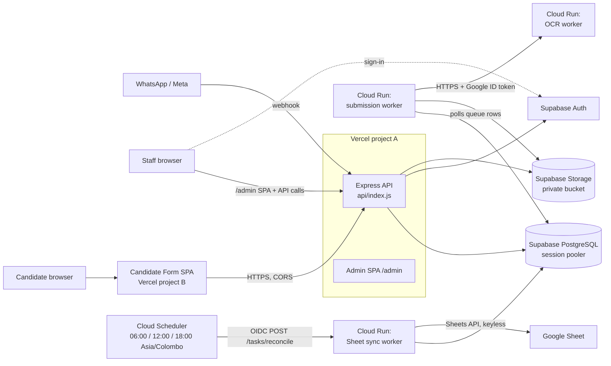

# EmlynkWABot – Project Setup Guide

A practical guide for a developer who is new to this repository. It explains how the project is put together, how to run it locally, how configuration works, and how stage and production are deployed.

**How this guide was written.** Everything here comes from the code, config files (`vercel.json`, `Dockerfile`s, `.env.example` files, `package.json`) and the existing `Docs/`. Where something could not be confirmed it is marked **Needs verification**. No real secrets, project IDs or credentials appear in this file: placeholders look like `<THIS>`.

Deeper references: [`Docs/11-development-guide.md`](Docs/11-development-guide.md), [`Docs/08-cloud-deployment.md`](Docs/08-cloud-deployment.md), [`Docs/DEPLOYMENT_AND_QA_PROCESS.md`](Docs/DEPLOYMENT_AND_QA_PROCESS.md), [`Docs/SUPABASE_AUTH.md`](Docs/SUPABASE_AUTH.md), [`Docs/GOOGLE_SHEET_INTEGRATION.md`](Docs/GOOGLE_SHEET_INTEGRATION.md), [`ocr-worker/README.md`](ocr-worker/README.md).

---

## 1. Project Overview

EmlynkWABot is a candidate recruitment and document-automation platform.

- Candidates send documents (passport, police report, medical report) over **WhatsApp**.
- The system reads them with **OCR**, classifies and verifies them, and files them in storage.
- Staff manage the whole candidate pipeline from an **admin dashboard**, with role-based access.
- Candidates can also fill in an extra-details form through a personal link (the **Candidate Form**).
- A one-way **Google Sheet mirror** keeps an operational copy of candidate data.

| Component | What it is | Runs on |
|---|---|---|
| **Backend API** | Express 5 app: admin API, auth checks, WhatsApp webhook, Candidate Form public API | Vercel (serverless function) in stage/production; a normal Node process locally |
| **Admin dashboard** | React 19 + Vite + TypeScript SPA served under `/admin` | Built into the same Vercel project as the API |
| **Candidate Form** | Separate public React + Vite SPA (`candidate-form/`) | Its own Vercel project |
| **Submission worker** | Polling worker that processes WhatsApp documents (`src/worker.js`) | Google Cloud Run |
| **OCR worker** | Tesseract.js OCR as an HTTP service (`ocr-worker/`) | Google Cloud Run |
| **Sheet sync worker** | Mirrors the database to Google Sheets (`src/sheetSyncWorker.js`) | Google Cloud Run |
| **Database** | PostgreSQL via Prisma | Supabase |
| **Auth and file storage** | Supabase Auth and a private Supabase Storage bucket | Supabase |

---

## 2. Repository Structure

Only folders that exist in the repository are listed.

| Path | Purpose |
|---|---|
| `src/` | Backend source (ES modules, no build step). `app.js` is the long-running entry; `httpHandler.js` is the serverless entry; `worker.js` and `sheetSyncWorker.js` are the worker entries. |
| `src/config/` | Environment checks (`env.js`), Prisma/pool setup, Sheet sync and Candidate Form config |
| `src/routes/`, `src/services/`, `src/middleware/`, `src/auth/` | API routes, business logic, request middleware, Supabase session verification |
| `api/index.js` | The single Vercel function entry. It re-exports `src/httpHandler.js`. |
| `admin/` | Admin dashboard (React + Vite). Own `package.json`. |
| `candidate-form/` | Public Candidate Form (React + Vite). Own `package.json`, own `vercel.json`. |
| `ocr-worker/` | Independent OCR service (Tesseract.js). Own `package.json` and `Dockerfile`. |
| `prisma/` | `schema.prisma`, `migrations/` (forward-only SQL) and `seed.js` |
| `generated/prisma/` | Generated Prisma client. Git-ignored; created by `prisma generate`. |
| `deploy/` | `sheet-sync-worker.env.yaml`: non-secret environment for the Sheet sync Cloud Run service |
| `scripts/` | Operator and one-off scripts (`createUser.js`, `checkDatabaseConnection.js`, `diagnoseDocument.js`, …) |
| `test/` | Backend tests (Node's built-in test runner) |
| `Docs/` | Project documentation. Start with `Docs/README.md`. |
| `public/` | Vercel static output. The admin build is written to `public/admin`. |
| `Dockerfile` (root) | Image for the **backend** code, used by the Cloud Run submission worker and Sheet sync worker |
| `docker-compose.yml` | A local PostgreSQL 16 container |
| `vercel.json` (root) | Vercel config for the backend and admin project |

Other root items (`UI/`, `Architecture.txt`, `check-duplicates.*`, `check.sql`, `eng.traineddata`) are not part of the running system. **Needs verification** whether any are still used.

---

## 3. System Architecture / Service Flow



How data moves:

1. **WhatsApp document.** Meta calls `POST /whatsapp/webhook` on the API (Vercel). The API stores the file in Supabase Storage `temporary/` and writes a `temporary_data` row in PostgreSQL, then answers 200. **PostgreSQL is the queue**: there is no other channel to the worker.
2. **Processing.** The submission worker (Cloud Run) polls the database every few seconds, claims a row, calls the OCR worker, then classifies, verifies, and files the document. Results appear in the admin dashboard.
3. **Admin.** Staff sign in with Supabase Auth in the browser. Every API call carries `Authorization: Bearer <Supabase access token>`. The backend verifies it with Supabase and reads the user's **role from the database** on every request.
4. **Candidate Form.** Staff create a share link in Admin. The candidate opens the form (separate Vercel project) and verifies with link + Passport + NIC. The form calls `/api/public/candidate-details/*` on the backend. The backend must allow the form's origin (`CANDIDATE_FORM_ORIGIN`).
5. **Google Sheet.** Database triggers record changes in `sheet_sync_queue`. The Sheet sync worker writes to Google Sheets on a schedule or when an admin clicks **Sync Now**. Candidate Form submissions are queued in `candidate_form_sheet_sync` and written to their own tab. Vercel never talks to Google.

Why it is split this way (from `Docs/08-cloud-deployment.md`): a Vercel function is not kept alive between requests, so the polling worker cannot run there. OCR is CPU- and memory-heavy, so it is isolated in its own service.

---

## 4. Local Development Setup

### 4.1 Prerequisites

| Tool | Version / note |
|---|---|
| Node.js | `^22.18.0` or `>=23.6.0` (required: the generated Prisma client is TypeScript that Node loads directly; startup fails otherwise) |
| npm | comes with Node |
| PostgreSQL | a dedicated **dev** Supabase project, or Docker for a local container (see 4.3) |
| Supabase project | needed for Auth and Storage even if the database is local |
| Docker | optional (local Postgres, building the OCR image) |
| Meta WhatsApp developer account + ngrok | only to test real webhook delivery |
| `gcloud` CLI, k6 | only for Cloud Run deployments / load tests |

### 4.2 Install

```bash
npm install                # backend; its postinstall runs `prisma generate`
npm run admin:install      # admin dashboard dependencies
npm run ocr:install        # OCR worker dependencies (also needed by the backend tests)
npm --prefix candidate-form install   # only if you work on the Candidate Form
```

### 4.3 Environment and database

```bash
cp .env.example .env                    # backend: fill in the values (section 5)
cp admin/.env.example admin/.env.local  # admin: Supabase URL + anon key only
cp candidate-form/.env.example candidate-form/.env.local   # only for the Candidate Form
```

**Database: pick one.**

| Option | When | Notes |
|---|---|---|
| **A. Dedicated dev Supabase project** | Recommended | Matches `.env.example`. Use the **session pooler** URL. You need a Supabase project anyway for Auth and Storage. |
| **B. Local Postgres via Docker** | Offline database work | `docker compose up -d` starts Postgres 16 (container `emlynk-postgres`, database `emlynk_docs`; credentials are in `docker-compose.yml`). Several migrations `REVOKE` privileges from Supabase's `anon` and `authenticated` roles, so a plain Postgres needs those roles created first (`Docs/12-testing-and-quality.md` describes this for throwaway test databases). **Needs verification** that a fresh `migrate deploy` works on the compose database without them. |

Never point local work at the stage or production database.

### 4.4 Prisma

```bash
npx prisma validate        # schema syntax and relations
npx prisma generate        # regenerate generated/prisma (also runs on npm install)
npx prisma migrate status  # which migrations are applied
npx prisma migrate deploy  # apply pending migrations, forward-only
```

- `Docs/11-development-guide.md` uses `npx prisma migrate dev` for a **local throwaway** database. **Never run `migrate dev` against a shared, stage or production database**: it can prompt for a reset and drop data.
- The Prisma datasource reads `DATABASE_URL` from the environment (`.env` is loaded automatically).
- `prisma7.config.ts` exists, but Prisma 6 does not load that filename by default. **Needs verification** whether it is used anywhere.
- On Windows, `prisma generate` can fail with `EPERM … query_engine-windows.dll.node` while a Node process is running. Stop all Node processes and retry.

### 4.5 First user and optional seed

Supabase Auth owns credentials, so the first admin is created with a script that creates both the Supabase identity and the application row:

```bash
npm run user:create -- --email admin@example.com --name "Your Name" --role ADMIN
```

If sign-in says "Your account is not active", the Supabase user has no matching, `ACTIVE` row in the `user` table. See section 6.6 for the SQL that adds or repairs it.

`npx prisma db seed` (`prisma/seed.js`) is mentioned in the dev guide, but the script references models (`admin`, passport-based `user`) that do not match the current schema (`user`, `candidate`). **Needs verification** before relying on it. Do not seed shared databases.

### 4.6 Run it

| What | Command | URL / port |
|---|---|---|
| Backend + submission worker in one process | `npm start` | http://localhost:3000 (`PORT` overrides) |
| Admin dev server (hot reload, proxies `/auth`, `/api`, `/health` to the backend) | `npm run admin:dev` | http://localhost:5173/admin/ (strict port) |
| Admin built and served by Express | `npm run admin:build`, then `npm start` | http://localhost:3000/admin |
| Submission worker only | `npm run worker` | no listener unless `PORT` is set |
| OCR worker | `npm run ocr:start` | http://127.0.0.1:8080 (loopback only) |
| Sheet sync worker | `npm run sheet:worker` | listener on `$PORT` |
| Candidate Form dev server | `npm --prefix candidate-form run dev` | http://localhost:5174 (strict port) |

Typical local session: two terminals, `npm start` and `npm run admin:dev`, with `OCR_SERVICE_URL=http://127.0.0.1:8080` and `npm run ocr:start` in a third if you test documents.

For the Candidate Form locally, set `CANDIDATE_FORM_ORIGIN=http://localhost:5174` and `CANDIDATE_FORM_TOKEN_SECRET` in the backend `.env`, and `VITE_API_BASE_URL=http://localhost:3000` in `candidate-form/.env.local`.

### 4.7 Tests

```bash
npm test                          # backend (Node test runner)
npm run ocr:test                  # OCR worker
npm run admin:test                # admin (Vitest)
npm --prefix admin run typecheck
npm --prefix candidate-form run typecheck
npm --prefix candidate-form test
```

`RUN_OCR_TESTS=1 npm test` also runs the tests that use real Tesseract (slow). On PowerShell: `$env:RUN_OCR_TESTS="1"; npm test`.

---

## 5. Environment Variables

### 5.1 How configuration works

- **Backend and workers read `process.env`.** Locally `dotenv` loads `.env`. On Vercel and Cloud Run the platform supplies the variables; there is no `.env` file in the image (`.dockerignore` excludes `.env*`).
- **Local env files are never deployed.** `.env`, `.env.prod`, `.env.preview` and similar files exist only on your machine. Cloud Run and Vercel do not read them, so editing one changes nothing in a deployed service. Deployed values live in Vercel's Environment Variables and in each Cloud Run service (plain variables and Secret Manager secrets).
- **A new secret version or env change needs a new revision.** Cloud Run reads secrets and env when a revision starts. After adding a Secret Manager version or changing a variable, run `gcloud run services update …` so the service restarts on it. Plain variables such as `SUPABASE_URL` do **not** change when a secret changes.
- **Startup validation** (`src/config/env.js`): the server and each worker refuse to start if a required variable is missing or malformed. Error messages name variables only, never values.
  - API server needs: `DATABASE_URL`, `SUPABASE_URL`, `SUPABASE_SERVICE_ROLE_KEY`, `SUPABASE_BUCKET`, `META_APP_SECRET`, `WHATSAPP_VERIFY_TOKEN`, `WHATSAPP_ACCESS_TOKEN`, `WHATSAPP_API_VERSION`, `OCR_SERVICE_URL`, `APP_BASE_URL`.
  - Submission worker needs only: `DATABASE_URL`, `SUPABASE_URL`, `SUPABASE_SERVICE_ROLE_KEY`, `SUPABASE_BUCKET`, `OCR_SERVICE_URL`.
  - Sheet sync worker needs only: `DATABASE_URL`, `SHEET_SPREADSHEET_ID`, `SHEET_TAB_NAME`.
- **Frontend variables are public.** Vite embeds `VITE_*` values in the browser bundle **at build time**. Never put a secret in a `VITE_*` variable. The admin app refuses a service-role key; the Candidate Form only accepts the `VITE_API_` prefix.
- **Backend-only secrets stay out of both frontends.** `SUPABASE_SERVICE_ROLE_KEY`, `CANDIDATE_FORM_TOKEN_SECRET`, WhatsApp/Meta secrets and database URLs must never appear in `admin/` or `candidate-form/`.
- **Stage vs production:** keep them separate (section 11). `APP_BASE_URL` and `CANDIDATE_FORM_ORIGIN` must be different in each environment.

Legend for the tables: **Secret?** Yes = store in a secret manager / sensitive env field, never commit. **Where**: `.env` = local file; **Vercel A** = backend + admin project; **Vercel B** = Candidate Form project; **CR** = Cloud Run service; **SM** = Google Secret Manager.

### 5.2 Backend / API

| Variable | Used by | Purpose | Local / Stage / Production | Secret? | Configure in |
|---|---|---|---|---|---|
| `DATABASE_URL` | API, both workers, Prisma CLI | PostgreSQL connection string | Local: dev DB. Stage/prod: Supabase **session pooler** URL, a different database per environment (**Needs verification**, see section 11) | **Yes** | `.env`; Vercel A; SM → CR |
| `DATABASE_POOL_MAX` | API, workers | Max `pg.Pool` connections per instance. Default **3**. Keep it low on Vercel: every instance has its own pool and the pooler has a client limit. | Optional everywhere | No | `.env`; Vercel A; CR |
| `SUPABASE_URL` | API, submission worker | Supabase project URL (`https://<ref>.supabase.co`) | Different project per environment | No | `.env`; Vercel A; CR |
| `SUPABASE_SERVICE_ROLE_KEY` | API, submission worker | Server-side Supabase key: verifies sessions, Storage, Auth Admin API | Per environment | **Yes** | `.env`; Vercel A; SM → CR |
| `SUPABASE_BUCKET` | API, submission worker | Private Storage bucket (`temporary/`, `clients/`, `pending/`) | Per environment | No | `.env`; Vercel A; CR |
| `META_APP_SECRET` | API only | Verifies the WhatsApp webhook signature (HMAC) | Per Meta app | **Yes** | `.env`; Vercel A |
| `WHATSAPP_VERIFY_TOKEN` | API only | Webhook verification challenge | Per Meta app | **Yes** | `.env`; Vercel A |
| `WHATSAPP_ACCESS_TOKEN` | API only | WhatsApp Cloud API calls | Per Meta app | **Yes** | `.env`; Vercel A |
| `WHATSAPP_API_VERSION` | API only | Graph API version, format `v21.0` | Same everywhere | No | `.env`; Vercel A |
| `OCR_SERVICE_URL` | API (startup check only), submission worker (real calls) | OCR service URL. Local `http://127.0.0.1:8080`; deployed `https://….run.app`. Plain `http://` is accepted **only** for loopback. | Local / deployed URL | No | `.env`; Vercel A; CR |
| `APP_BASE_URL` | API only | **Required.** This environment's admin site origin, no path, no trailing slash. Source of the invitation redirect `${APP_BASE_URL}/admin/setup-password`. | Local `http://localhost:5173`; stage and prod: each its own admin URL | No | `.env`; Vercel A |
| `CANDIDATE_FORM_ORIGIN` | API only | Exact origin of the Candidate Form (CORS allow-list and share-link base). https only, except localhost. **Bare origin, no path.** Without it the form does not work; nothing else is affected. | Local `http://localhost:5174`; stage/prod: that environment's form URL | No | `.env`; Vercel A |
| `CANDIDATE_FORM_TOKEN_SECRET` | API only | Encrypts/signs the candidate session token. At least 32 random characters. | Different per environment | **Yes** | `.env`; Vercel A |
| `TRUST_PROXY_HOPS` | API | Exact reverse-proxy hop count (never `true`). On Vercel it defaults to `1` when `VERCEL=1`; unset otherwise. | Optional | No | `.env`; Vercel A |
| `REQUIRED_DOCUMENT_TYPES` | API | Documents every client must have (must include `PASSPORT`). Default `PASSPORT,POLICE_REPORT,MEDICAL`. | Optional | No | `.env`; Vercel A |
| `PORT` | API, workers | Listen port. Default 3000 locally; the container sets 8080. Do **not** set on Vercel. | Optional | No | `.env`; CR sets it |
| `NODE_ENV` | API image | `production` in the Docker image (`Dockerfile`) | Production-like | No | Dockerfile |
| `NODEJS_HELPERS` | Vercel platform setting | Set to `0` so Express receives the raw request body (needed for webhook signature checks). Not read by app code. | Stage, prod | No | Vercel A |
| `VERCEL` | API | Set automatically by Vercel | Automatic | No | Automatic |
| `BOOTSTRAP_PASSWORD` | `npm run user:create` only | Password for the bootstrap user instead of the prompt | Local use only | **Yes** | Shell only |

Not used any more: `JWT_SECRET`, `SMTP_*`, `EMAIL_FROM`, `ADMIN_SETUP_URL_BASE` (Supabase Auth replaced them).

### 5.3 Admin frontend (build time, public)

| Variable | Used by | Purpose | Local / Stage / Production | Secret? | Configure in |
|---|---|---|---|---|---|
| `VITE_SUPABASE_URL` | Admin build | Supabase URL for browser sign-in | Per environment | No (public) | `admin/.env.local`; Vercel A (build env) |
| `VITE_SUPABASE_ANON_KEY` | Admin build | Supabase **anon / publishable** key. Never the service-role key. | Per environment | No (public) | `admin/.env.local`; Vercel A (build env) |
| `ADMIN_API_PROXY_TARGET` | Admin dev server only | Backend the Vite dev server proxies to. Default `http://localhost:3000`. | Local only | No | Shell |

These are baked in at build time: after changing them on Vercel you must **redeploy**.

### 5.4 Candidate Form frontend (build time, public)

| Variable | Used by | Purpose | Secret? | Configure in |
|---|---|---|---|---|
| `VITE_API_BASE_URL` | Candidate Form build | Backend's public origin, no trailing slash and **no `/admin`**. Also pinned into the form's CSP `connect-src`; an invalid value fails the build. | No (public) | `candidate-form/.env.local`; Vercel B |
| `VITE_API_ADMIN_MOBILE_NUMBERS` | Candidate Form build | Optional comma-separated contact numbers shown on error screens | No (public) | `candidate-form/.env.local`; Vercel B |

### 5.5 Google Sheet sync (sheet sync worker; some also read by the API)

| Variable | Purpose | Secret? | Configure in |
|---|---|---|---|
| `SHEET_SYNC_ENABLED` | **Write gate.** Only the exact value `true` allows writing to the Sheet. Missing, `false` or anything else = dry run. Keep `false` locally and in tests. | No | `.env`; CR |
| `SHEET_SPREADSHEET_ID` | Target spreadsheet ID | No (but identifies a real business sheet) | CR (`deploy/sheet-sync-worker.env.yaml`) |
| `SHEET_TAB_NAME` | Operational Mirror tab name (matched exactly) | No | CR |
| `SHEET_FORM_SUBMISSIONS_TAB_NAME` | Candidate Form submissions tab. Default `Candidate Form Submissions`. | No | CR |
| `SHEET_SYNC_DESTINATIONS` | Optional JSON list of several destination sheets (first = default). Worker only. | No | CR |
| `SHEET_SYNC_POLL_INTERVAL_MS` | Worker loop interval. Default 10000. | No | CR |
| `SHEET_SYNC_DELETION_GUARD_MAX`, `SHEET_SYNC_DELETION_GUARD_FRACTION` | Limits how many Sheet rows one run may mark inactive. Defaults 10 and 0.05. | No | CR |
| `SHEET_SYNC_BATCH_SIZE`, `SHEET_SYNC_MAX_RETRIES` | Still accepted but have **no effect** (they belonged to the removed real-time path) | No | CR |
| `SHEET_SYNC_SCHEDULER_AUDIENCE`, `SHEET_SYNC_SCHEDULER_INVOKER` | Enable the scheduler endpoint. **Both** must be set (worker URL; scheduler service-account e-mail) or `POST /tasks/reconcile` answers 404. | No | CR |
| `SHEET_SYNC_PILOT_CANDIDATE_IDS` | First-write pilot only: writes just those candidate IDs | No | CR (temporary) |
| `GOOGLE_APPLICATION_CREDENTIALS` | **Must NOT be set** for the Sheet sync worker (it refuses to start). Authentication is the service's own identity (keyless ADC). | — | — |

### 5.6 Google Cloud / OCR

| Variable | Used by | Purpose | Secret? | Configure in |
|---|---|---|---|---|
| `HOST` | OCR worker | Bind address. Default `127.0.0.1`; the image sets `0.0.0.0`. | No | Dockerfile |
| `PORT` | OCR worker | Default 8080 | No | Dockerfile / Cloud Run |
| `GOOGLE_APPLICATION_CREDENTIALS` | Backend, **only** when it runs outside Google Cloud and must call the private OCR service | Path to a key file of the OCR-invoker service account. Never commit; never put on Vercel. | **Yes** (file) | Shell / secret store |

The OCR worker itself needs no application secrets. It has no database or storage access.

### 5.7 Vercel / Supabase / other

- **Vercel** has no variables of its own beyond those in 5.2–5.4 (plus the automatic `VERCEL`).
- **Supabase** settings that are *not* environment variables but must be configured in the dashboard (section 6.4): allowed redirect URLs, SMTP, email templates, auth rate limits.

### 5.8 What to update when you add a variable

| Where the variable is read | Also update |
|---|---|
| Backend / API | `.env.example`; Vercel A (Preview **and** Production); Cloud Run services that read it; `src/config/env.js` if it is required or needs format checks; the tables above |
| Submission worker | `.env.example`; the Cloud Run submission-worker service; add it to `WORKER_REQUIRED_ENV_VARS` only if the worker cannot run without it |
| Sheet sync worker | `.env.example`; `deploy/sheet-sync-worker.env.yaml` (non-secret values only); the Cloud Run sheet-sync service |
| Admin frontend (`VITE_*`) | `admin/.env.example`; Vercel A (build env); redeploy |
| Candidate Form (`VITE_API_*`) | `candidate-form/.env.example`; Vercel B; redeploy |
| OCR worker | `ocr-worker/README.md`; the Cloud Run OCR service |

Secrets go to Vercel's sensitive env fields or Google Secret Manager, never to `deploy/*.yaml` or git.

---

## 6. Database / Supabase Setup

### 6.1 Prisma schema and migrations

- Schema: `prisma/schema.prisma` (client generated to `generated/prisma`). Migrations: `prisma/migrations/` (about 50, starting at `20260921064444_init_schema`).
- Migrations are **forward-only**. Never edit a migration that has been applied anywhere: it changes the checksum and breaks `migrate deploy`. Add a new migration instead.
- The server never runs migrations on startup. The root `Dockerfile` copies `prisma/migrations` so migrations can be run from the image (for example a Cloud Run Job).

### 6.2 Fresh database setup

1. Create a Supabase project and note: project URL, service-role key, and the **session pooler** connection string.
2. Create a **private** Storage bucket and set `SUPABASE_BUCKET`.
3. Set `DATABASE_URL` and run:
   ```bash
   npx prisma validate
   npx prisma migrate deploy
   npx prisma migrate status    # expect: up to date
   ```
4. Create the first ADMIN: `npm run user:create -- --email … --name "…" --role ADMIN`, or add it by hand with SQL (section 6.6). A migration refuses to run if any staff row lacks a linked Supabase identity.
5. Invite everyone else from the app (**Settings → Invite User**).

Do not load old or test data into a new environment. `prisma/seed.js` is **not** a reliable bootstrap (see 4.5).

### 6.3 `DATABASE_URL` (Supabase pooler)

- Use the **Supavisor session-mode pooler**, not the direct host. The direct host (`db.<ref>.supabase.co`) is IPv6 only and unreachable from Cloud Run's default egress.
- Session mode is required: the backend uses interactive Prisma transactions and `SELECT … FOR UPDATE` row locks, which need one connection held for the whole transaction.
- Connection limits matter. Each backend instance holds up to `DATABASE_POOL_MAX` sessions. If the pooler's client limit is reached, requests fail with `EMAXCONNSESSION` (HTTP 500) and even `prisma migrate status` can fail. Keep `DATABASE_POOL_MAX` low and close idle local connections.
- `prisma db pull` and `migrate diff --from-url` fail with `P4002` on Supabase because of a foreign key into the `auth` schema. This is accepted; use `migrate status` and `validate` instead.

### 6.4 Supabase Auth setup (manual, in the Supabase dashboard)

1. **Authentication → URL configuration:** set the Site URL to the admin site. Allowed redirect URLs must include `https://<host>/admin/setup-password` and `https://<host>/admin/reset-password`, plus `http://localhost:5173/admin/*` for local work.
2. **Email:** enable the Email provider, disable public sign-ups, configure custom SMTP and the Invite / Reset-password templates.
3. **Password policy and rate limits:** the app asks for at least 8 characters; review the auth rate limits.
4. Roles live in the application table `user` (`ADMIN`, `MANAGER`, `ANALYST`, `REGISTRATION_DESK`, `JOB_HANDLER`), not in Supabase. See `Docs/SUPABASE_AUTH.md`.

### 6.5 Storage

One private bucket holding `temporary/`, `clients/` and `pending/`. Only the backend accesses it, with the service-role key.

### 6.6 Adding an admin in Supabase (SQL)

Use this when you create a user in Supabase Authentication by hand (or `npm run user:create` is not an option) and need the matching application row. Signing in needs **both**:

1. a user in Supabase → **Authentication → Users** (this holds the password), and
2. a row in the application table `"user"` linked to it. The backend finds that row by `auth_user_id` and requires `status = 'ACTIVE'`. If the row is missing, unlinked or not active, sign-in fails with **"Your account is not active. Contact an administrator."**

| Column | Value |
|---|---|
| `admin_id` | Any unique text. The app uses a random UUID; `gen_random_uuid()::text` does the same. |
| `auth_user_id` | The `id` of that user in Supabase → Authentication → Users |
| `name` | Display name |
| `email` | Same email as the Supabase user (unique) |
| `role` | `ADMIN` for the first user |
| `status` | `ACTIVE` |

**Steps** (Supabase dashboard → **SQL Editor**, on the project your `DATABASE_URL` and `SUPABASE_URL` point to):

1. Create the user in **Authentication → Users → Add user** (set a password, tick auto-confirm).
2. Insert the application row, replacing the placeholders:

   ```sql
   insert into "user" (admin_id, auth_user_id, name, email, role, status)
   select gen_random_uuid()::text, id, '<Full Name>', email, 'ADMIN', 'ACTIVE'
   from auth.users
   where lower(email) = lower('<admin email>');
   ```

   `auth_user_id` is taken straight from `auth.users`, so it cannot be mistyped. If it reports `INSERT 0 0`, the email does not match any Supabase user.

3. Check it (`auth_user_id` must not be empty):

   ```sql
   select admin_id, auth_user_id, name, email, role, status from "user";
   ```

4. Sign out, then sign in again. The row is read on every request, so no redeploy is needed.

**If you already created an incomplete row** (for example with an empty `admin_id`), repair it instead of inserting a second one:

```sql
update "user"
set admin_id     = gen_random_uuid()::text,
    auth_user_id = (select id from auth.users where lower(email) = lower('<admin email>')),
    email        = '<admin email>',
    role         = 'ADMIN',
    status       = 'ACTIVE'
where name = '<Full Name>';
```

**Alternative without SQL:** `npm run user:create -- --email <admin email> --link --role ADMIN` creates the row for an existing Supabase user. It refuses if a row for that email already exists, so delete an incomplete one first.

Notes: only an `ADMIN` can open **Settings** (Invite User, Change Roles, Google Sheet Sync). Never edit `user` rows on a database you do not own the data of; use a dev project when testing.

---

## 7. Google Sheet Sync

Full reference: [`Docs/GOOGLE_SHEET_INTEGRATION.md`](Docs/GOOGLE_SHEET_INTEGRATION.md) and [`Docs/GOOGLE_SHEET_CANDIDATE_SYNC_ARCHITECTURE.md`](Docs/GOOGLE_SHEET_CANDIDATE_SYNC_ARCHITECTURE.md) (section 24 is the as-built runbook). Some counts in those documents are out of date (for example column counts); treat the code in `src/services/sheetSchema.js` as the truth.

### 7.1 End-to-end flow

```text
candidate / documents / stages change in PostgreSQL
   -> database triggers write one coalesced row per candidate into sheet_sync_queue
   -> (nothing is written to Google yet)
Cloud Scheduler (06:00, 12:00, 18:00 Asia/Colombo)   OR   admin clicks "Sync Now"
   -> a durable run is recorded in sheet_sync_runs
   -> the Sheet sync worker (Cloud Run) picks it up and reconciles the Sheet with the database
   -> Google Sheet tab "Emlynk Candidate Operational Mirror"

Candidate Form submitted -> candidate_form_sheet_sync (outbox row, same transaction)
   -> the same worker writes it to the "Candidate Form Submissions" tab
```

Key facts:

- **There is no real-time sync of the Operational Mirror.** Between runs, changes only wait in the queue. Each run mirrors the *current* database state.
- Candidate Form submissions are written by the same worker on every tick, but only while `SHEET_SYNC_ENABLED=true`.
- Rows are matched by header name, and the row key is the `_SYSTEM_CANDIDATE_ID` column. Rows are never deleted: a candidate removed from the database is marked `DELETED / INACTIVE`, within a deletion guard.
- Authentication is **keyless**: the Cloud Run service runs as a dedicated service account, which must be shared on the Sheet as Editor. No key file exists anywhere.
- Vercel (Settings API) only reads/writes PostgreSQL. It has no Google credentials.

### 7.2 Required configuration

| Item | Value |
|---|---|
| Worker env | `DATABASE_URL` (Secret Manager), `SHEET_SPREADSHEET_ID`, `SHEET_TAB_NAME`, `SHEET_SYNC_ENABLED`, tunables (section 5.5) |
| Non-secret env file | `deploy/sheet-sync-worker.env.yaml`, used with `gcloud run deploy … --env-vars-file` |
| Secret | `DATABASE_URL` via `--set-secrets` |
| Service | Cloud Run `emlynk-sheet-sync-worker` (documented region `asia-south1`), same root `Dockerfile` image, command `node src/sheetSyncWorker.js` |
| Scaling | `min-instances = max-instances = 1`, CPU always allocated (one writer per Sheet) |
| Access | Private (`--no-allow-unauthenticated`). The scheduler service account has only `roles/run.invoker` on this service. |
| Scheduler | One Cloud Scheduler job, `POST <worker-url>/tasks/reconcile` with an OIDC token |

`deploy/sheet-sync-worker.env.yaml` currently has `SHEET_SYNC_ENABLED: "true"` while its own comment says the safe default is writes disabled. **Needs verification** which value the live service uses before you redeploy from this file.

### 7.3 Test Connection and Sync Now

In the admin app: **Settings → Google Sheet Sync** (ADMIN only).

| Button | What it does |
|---|---|
| **Test Connection** | The worker reads row 1 of the target tab (read-only) and checks the headers. Expect `CONNECTED` and `SCHEMA_VALID`. |
| **Sync Now** | Requests a full reconciliation run. With writes disabled it is a **dry run**: it reads and compares, writes nothing, and records counts. |

Both only insert a durable request into `sheet_sync_runs`; the worker does the work, so they work even if you close the browser. Operator equivalents: `npm run sheet:request -- reconcile` and `npm run sheet:request -- test`. A read-only check without the database: `npm run sheet:check` (needs `SHEET_SPREADSHEET_ID` and `SHEET_TAB_NAME`, plus Google credentials).

### 7.4 When sync fails, check

| Symptom | Likely cause / action |
|---|---|
| Settings shows "worker not reporting" | No heartbeat for 2 minutes: worker down, wrong `DATABASE_URL`, or an old image. Read the worker logs. |
| Test Connection fails with a schema error | The Sheet's header row does not match the expected columns. Do not rename or delete system columns. |
| `ACCESS_DENIED` / `NOT_FOUND` | The worker's service account is not an Editor on the Sheet, or the spreadsheet ID / tab name is wrong. |
| Integration "halted" (`CONFIG_ERROR`) | Configuration problem. The worker re-checks every 5 minutes and resumes after the cause is fixed. |
| `DUPLICATE_CANDIDATE_ID` | The same `_SYSTEM_CANDIDATE_ID` appears twice in the Sheet. Fix it in the Sheet; nothing is written until then. |
| Runs complete but nothing is written | `SHEET_SYNC_ENABLED` is not exactly `true` (dry run). |
| Scheduler runs do nothing / 404 | `SHEET_SYNC_SCHEDULER_AUDIENCE` and `_INVOKER` are not both set. |
| New Admin feature missing or Sync Destination dropdown absent | Vercel and the worker deploy separately; the worker is on an old image. Rebuild and redeploy it. |
| Worker will not start | `GOOGLE_APPLICATION_CREDENTIALS` is set (it must not be), or a required variable is missing. |
| Test Connection and Sync Now stay **Queued**; `sheet_sync_runs` rows have `attempts 0` and `started_at` empty | No worker is processing them. The logs may show `worker_started` followed by `Shutting down: SIGTERM` a few seconds later: the service has `min-instances` 0 or CPU throttled, so Cloud Run stops the idle polling instance. | Set `--min-instances=1 --max-instances=1 --no-cpu-throttling` on the service (section 7.5). |
| Worker is running but `sheet_sync_state.worker_heartbeat_at` is empty in the database the admin page uses | The worker's `DATABASE_URL` secret points to a **different database**. Its first tick succeeds, but against the wrong database. | Compare project refs and update the secret (section 7.5, step 3). |
| Sync succeeded but the **old** Google Sheet changed; `target_hint` ends with the old spreadsheet ID | `SHEET_SPREADSHEET_ID` / `SHEET_TAB_NAME` on the Cloud Run service are still the old values (a local `.env.prod` is not read by Cloud Run), or `SHEET_SYNC_DESTINATIONS` overrides them. | Update the service's env vars and remove `SHEET_SYNC_DESTINATIONS` (section 7.5, step 4). Restore the old Sheet from its version history if it was changed. |

Logs: Cloud Logging filter `jsonPayload.event=~"^sheet_sync\."`, or:

```bash
gcloud run services logs read emlynk-sheet-sync-worker --project=<PROJECT_ID> --region=<REGION> --limit=50
```

If that command fails on Windows with a filter syntax error, use `gcloud logging read` with a **double-quoted** filter in cmd (single quotes only work in PowerShell and bash):

```bat
gcloud logging read "resource.type=cloud_run_revision AND resource.labels.service_name=emlynk-sheet-sync-worker" --limit=30 --freshness=1d --format="value(timestamp,textPayload,jsonPayload.event)"
```

Add `AND severity>=WARNING` to the filter to see only warnings and errors. Log entries with no text show as blank lines in that format; use `--format="value(timestamp,jsonPayload)"` to print their content. (Warnings such as "The request was not authenticated" mean someone opened the private service URL without a token. They are harmless.)

### 7.5 Checking and repairing the worker (database, instance, Sheet)

Run each SQL statement **on its own**: the Supabase SQL editor shows only the result of the last statement.

1. **Is the worker reporting to this database?**
   ```sql
   select worker_heartbeat_at, now() as now_time, target_hint, write_gate, integration_state
   from sheet_sync_state;
   ```
   A heartbeat within the last minute means the worker reaches this database. `target_hint` shows the **last 6 characters of the spreadsheet ID** and the tab name, so you can tell which Sheet it targets. An empty heartbeat means no worker is using this database.
2. **Are the runs being processed?**
   ```sql
   select kind, status, dry_run, started_at, error_code from sheet_sync_runs order by created_at desc limit 5;
   ```
   `QUEUED` with no `started_at` means nothing is handling them. `dry_run = false` means that run could write to the Sheet.
3. **Is the instance always on?** The service must show `minScale 1`, `maxScale 1` and `cpu-throttling 'false'`:
   ```bat
   gcloud run services describe emlynk-sheet-sync-worker --region <REGION> --format="yaml(status.latestReadyRevisionName,spec.template.metadata.annotations)"
   gcloud run services update emlynk-sheet-sync-worker --region <REGION> --min-instances=1 --max-instances=1 --no-cpu-throttling
   ```
   Running the update twice in a row replaces the revision and stops the first instance with `SIGTERM`. That is expected, not a crash.
4. **Does the worker use the right database?** Print the project ref of the secret (this prints only the ref, not the password; PowerShell):
   ```powershell
   (gcloud secrets versions access latest --secret=DATABASE_URL) -replace '.*postgres\.([a-z0-9]+):.*','$1'
   ```
   It must equal the ref of the Supabase project the admin page uses. If not, follow section 11.4.
5. **Does the worker use the right Sheet?** `target_hint` must end with the new spreadsheet ID. The variables are plain values and can be printed:
   ```bat
   gcloud run services describe emlynk-sheet-sync-worker --region <REGION> --format="yaml(spec.template.spec.containers[0].env)"
   ```

Emergency stop: set `SHEET_SYNC_ENABLED=false` on the service (new revision) and pause the scheduler job.

---

## 8. OCR Worker

### 8.1 Why it is separate

OCR (Tesseract.js, PDF rendering) is CPU- and memory-heavy. Moving it into its own service keeps the backend free of those spikes. The OCR service is stateless: it has no database or storage access. It receives a document, returns the text, and forgets it. Full reference: [`ocr-worker/README.md`](ocr-worker/README.md).

### 8.2 How the backend calls it

- The submission worker's queue calls `src/services/ocrClient.js`, which sends `POST /process` with the raw document bytes and the document's MIME type as `Content-Type`.
- `GET /health` returns `{ "status": "OK" }`.
- Failures: a busy or unreachable service is retried by the queue (about 1 minute later, up to 3 attempts), then the submission is recorded as FAILED at `TEXT_EXTRACTION`. A rejected document (too large, unreadable) fails immediately with the matching code.

### 8.3 Authentication

The Cloud Run service is **private** (no `--allow-unauthenticated`). The backend uses `google-auth-library` to mint a Google-signed identity token for the service URL from Application Default Credentials and sends it as `Authorization: Bearer …`.

- Running on Cloud Run (submission worker): the attached service account is used automatically and needs `roles/run.invoker` on the OCR service. No key file.
- Running elsewhere (local machine or other host): use `gcloud auth application-default login`, or `GOOGLE_APPLICATION_CREDENTIALS` pointing to an invoker service-account key kept outside the repo.
- A loopback URL (`http://127.0.0.1:8080`) gets no token. That is the only case the backend accepts plain `http://`.

### 8.4 Required variables

| Where | Variables |
|---|---|
| Backend / submission worker | `OCR_SERVICE_URL` |
| OCR worker | none required (`HOST`, `PORT` have defaults; the image sets `HOST=0.0.0.0`, `PORT=8080`) |

### 8.5 Deploy / update

Built from `ocr-worker/` with its own `Dockerfile` (Node 22, runs as the unprivileged `node` user). The documented recipe (full commands in `ocr-worker/README.md`):

```bash
gcloud services enable run.googleapis.com artifactregistry.googleapis.com cloudbuild.googleapis.com
gcloud artifacts repositories create <REPO> --repository-format=docker --location=<REGION>
gcloud builds submit ocr-worker --tag <REGION>-docker.pkg.dev/<PROJECT_ID>/<REPO>/ocr-worker:<TAG>
gcloud run deploy emlynk-ocr-worker --image=<IMAGE> --region=<REGION> \
  --no-allow-unauthenticated --ingress=all --port=8080 \
  --cpu=2 --memory=2Gi --concurrency=2 --timeout=300 --min-instances=0 --max-instances=2 --cpu-boost
gcloud run services add-iam-policy-binding emlynk-ocr-worker --region=<REGION> \
  --member=serviceAccount:<INVOKER_SA> --role=roles/run.invoker
```

To update: build a new tag and run `gcloud run deploy emlynk-ocr-worker --image=<NEW_IMAGE> --region=<REGION>` (other settings are kept). Roll back with `gcloud run services update-traffic … --to-revisions=<REVISION>=100`.

The README records that the **live** service runs with smaller settings than the recommended ones (512 MiB, 1 vCPU, concurrency 80), a known risk of out-of-memory on large photos. **Needs verification** of the current live values.

### 8.6 Logs

```bash
gcloud logging read 'resource.type="cloud_run_revision" AND resource.labels.service_name="emlynk-ocr-worker"' --limit=50
```

Logs hold MIME type, size, method, timings and reason codes, never document text or personal data. On the backend side, failures show as `RETRY_LATER` outcomes and then as FAILED submissions in the dashboard.

### 8.7 Common OCR setup issues (from the repo docs)

| Symptom | Cause |
|---|---|
| `403` on `GET /health` from the internet | Expected: the service is private. Call it with an identity token. |
| Backend logs `reason: CREDENTIALS` and retries | No usable Google credentials (a local machine without ADC). Run `gcloud auth application-default login` or use the loopback service. |
| Submissions stuck, then FAILED at `TEXT_EXTRACTION` | OCR service unreachable, wrong `OCR_SERVICE_URL`, or the caller lacks `roles/run.invoker` |
| `OCR_BUSY` (503) | All job slots and the wait queue are full; raise instances/CPU |
| OCR worker exits at start | English language data missing (`@tesseract.js-data/eng`): run `npm run ocr:install` |
| Backend refuses to start with an OCR URL error | `OCR_SERVICE_URL` is `http://` and not a loopback address |

---

## 9. Google Cloud Setup

Only services confirmed in the repo docs. Use your own `<PROJECT_ID>`; do not commit IDs.

| Service / resource | Role |
|---|---|
| **Cloud Run `emlynk-ocr-worker`** | OCR (documented region `asia-south1`) |
| **Cloud Run `emlynk-submission-worker`** | `node src/worker.js`, root `Dockerfile` image, documented region `asia-northeast1`, 1 instance, CPU always allocated |
| **Cloud Run `emlynk-sheet-sync-worker`** | `node src/sheetSyncWorker.js`, root `Dockerfile` image, documented region `asia-south1` |
| **Cloud Run Jobs** | `emlynk-sheet-sync-check` (read-only Sheet check) and `emlynk-db-migrate` (`npx prisma migrate deploy` from the backend image) are documented as the pattern. **Needs verification** that they exist in the live project. |
| **Artifact Registry** | Docker repositories for the images (documented: one for OCR, one for the backend/worker images) |
| **Cloud Build** | `gcloud builds submit` builds the images |
| **Secret Manager** | `DATABASE_URL`, `SUPABASE_SERVICE_ROLE_KEY` and the Meta/WhatsApp secrets (documented) |
| **Cloud Scheduler** | Job that triggers the Sheet sync reconcile |
| **Service accounts** | Backend/worker identity, Sheet sync identity, scheduler identity, OCR invoker (names are in `Docs/08-cloud-deployment.md` and `Docs/GOOGLE_SHEET_CANDIDATE_SYNC_ARCHITECTURE.md`) |

**APIs to enable:** Cloud Run (`run.googleapis.com`), Artifact Registry (`artifactregistry.googleapis.com`), Cloud Build (`cloudbuild.googleapis.com`). The Sheets API and Secret Manager / Cloud Scheduler APIs are implied by the features but are not listed in the repo's enable commands. **Needs verification.**

**Service-to-service authentication (identity tokens):**

- The submission worker → OCR: Google ID token, audience = OCR service URL, from the worker's attached service account. That account needs `roles/run.invoker` on the OCR service only (per service, not project-wide).
- Cloud Scheduler → Sheet sync worker: OIDC token from a dedicated scheduler service account. Cloud Run IAM rejects other callers, and the worker verifies the token again (signature, audience, verified e-mail).
- Sheet sync worker → Google Sheets: keyless ADC. Share the Sheet with the worker's service account as Editor.

**Where environment variables live on Cloud Run:** non-secret values as plain service env vars (or `--env-vars-file`); secrets via `--set-secrets=NAME=NAME:latest` from Secret Manager, with `roles/secretmanager.secretAccessor` granted on each secret to the service's account.

**Deploying a backend-image service** (submission worker shown; the Sheet sync worker uses `--args=src/sheetSyncWorker.js`):

```bash
gcloud builds submit --project=<PROJECT_ID> --tag=<REGION>-docker.pkg.dev/<PROJECT_ID>/<REPO>/worker:<TAG> .
gcloud run deploy emlynk-submission-worker --image=<IMAGE> --region=<REGION> \
  --service-account=<RUNTIME_SA> --command=node --args=src/worker.js \
  --no-allow-unauthenticated --min-instances=1 --max-instances=1 --no-cpu-throttling --cpu-boost \
  --set-secrets=DATABASE_URL=DATABASE_URL:latest,SUPABASE_SERVICE_ROLE_KEY=SUPABASE_SERVICE_ROLE_KEY:latest \
  --set-env-vars=SUPABASE_URL=<…>,SUPABASE_BUCKET=<…>,OCR_SERVICE_URL=<OCR_URL>
```

Remember the Vercel API and the Cloud Run workers deploy **separately**. A change to worker code takes effect only after the worker image is rebuilt and the service updated.

---

## 10. Vercel Setup

There are **two** Vercel projects from the same GitHub repository.

| | Project A: Backend + Admin | Project B: Candidate Form |
|---|---|---|
| Root directory | repository root | `candidate-form` |
| Config file | root `vercel.json` | `candidate-form/vercel.json` |
| Framework | `null` ("Other"), so Vercel does not auto-run `src/app.js` | `vite` |
| Install | `npm ci && npm --prefix admin install` | `npm ci` |
| Build | `npm --prefix admin run build -- --outDir ../public/admin --emptyOutDir` | `npm run build` |
| Output | `public` | `dist` |
| Runtime | one serverless function: `api/index.js` → `src/httpHandler.js`; region `hnd1`; `maxDuration` 60; includes `generated/prisma/**` | static files only |
| Routes | `/auth/*`, `/api/*`, `/whatsapp/*`, `/health` → function; `/admin`, `/admin/*` → `/admin/index.html` | everything → `/index.html` |
| Env variables | section 5.2 and 5.3 | section 5.4 only |

Notes:

- **The admin app lives under `/admin`.** Its Vite `base` is `/admin/` and its router basename is `/admin`. The API and admin share one origin, so no CORS is involved.
- **Base URL rules:** `APP_BASE_URL`, `CANDIDATE_FORM_ORIGIN` and `VITE_API_BASE_URL` are bare origins. Do **not** add `/admin` or a trailing slash to any of them; the first two are rejected by startup validation and `VITE_API_BASE_URL` fails the form's build.
- **Why the form is a separate project:** different build root and output, its own public domain, and a hard security boundary. It is public and untrusted, so it never shares secrets with the backend.
- **Preview vs Production scope.** Vercel environment variables are scoped. The `stage` branch builds as a **Preview** deployment, so a variable that is ticked only for Production will not be seen by stage.
- **Webhook:** `https://<vercel-domain>/whatsapp/webhook` (set in the Meta app together with `WHATSAPP_VERIFY_TOKEN`).
- **How it connects:** Vercel A connects to Supabase (database via the session pooler, Auth and Storage). It does **not** call Cloud Run for work: the OCR URL is only required by startup validation, and the submission worker (Cloud Run) does the OCR calls. The Candidate Form (B) only calls Vercel A.
- `vercel.json` also sets the security headers (CSP, HSTS, …) for `/admin`. A custom Supabase domain must be added to the CSP `connect-src` in both `vercel.json` and `src/createApp.js`.
- Branch binding: production tracks `main`; Preview deployments build `stage` and feature branches (`Docs/DEPLOYMENT_AND_QA_PROCESS.md`).

---

## 11. Stage and Production Setup

### 11.1 Branch flow

```text
version/* feature branches
        |  merge / cherry-pick after tests
        v
       dev        integration branch, must stay green
        |  full test suite + migration check
        v
      stage       Vercel Preview + final QA
        |  smoke tests + sign-off
        v
      main        production
```

`main` receives changes only from `stage`, after sign-off.

### 11.2 Environment separation

| | Local | Stage | Production |
|---|---|---|---|
| Git branch | feature / `dev` | `stage` | `main` |
| Backend + admin | `npm start` / `admin:dev` | Vercel A, **Preview** | Vercel A, **Production** |
| Candidate Form | localhost:5174 | Vercel B, Preview | Vercel B, Production |
| Database | dev DB | stage DB | production DB |
| `APP_BASE_URL` | `http://localhost:5173` | stage admin URL | production admin URL |
| `CANDIDATE_FORM_ORIGIN` | `http://localhost:5174` | stage form URL | production form URL |
| `SHEET_SYNC_ENABLED` | `false` | `false` unless deliberately piloting | `true` only after the controlled activation |

**Needs verification:** `Docs/GOOGLE_SHEET_CANDIDATE_SYNC_ARCHITECTURE.md` (section 24.9) lists as unresolved whether the `stage` Preview and production use the same Supabase database. There is only **one** real operational Sheet, so run exactly **one** Sheet sync worker, against the database whose candidates are authoritative.

### 11.3 Release steps

1. **Before merging:** all tests and type checks pass (section 4.7), `npx prisma validate`, and `npx prisma migrate status` is clean. Rehearse structural migrations on a throwaway Postgres first (clean path and upgrade path).
2. **Promote `dev` to `stage`:** `git checkout stage && git merge dev`; Vercel builds the Preview for both projects.
3. **Check Preview variables** exist for the Preview scope in both Vercel projects (section 5).
4. **Migrate the stage database:** `npx prisma migrate deploy` with the stage `DATABASE_URL`. Never `migrate dev`, never `migrate reset`.
5. **Deploy workers if their code changed:** rebuild the image, update the Cloud Run services (submission worker, Sheet sync worker; OCR only if `ocr-worker/` changed).
6. **Run the stage smoke tests** (`Docs/DEPLOYMENT_AND_QA_PROCESS.md`, section 11): sign-in for each role, candidate list, review actions, Share Form link, form verify and submit, Settings → Test Connection.
7. **Promote `stage` to `main`**, then migrate production the same way (`migrate deploy` only) **before or with** the code that needs it, and redeploy.
8. **Verify production** with the checklist in section 14.

Order matters for migrations: additive migrations first, because the old code must keep working until the new code is live.

### 11.4 Switching an environment to a new Supabase project or Google Sheet

Everything that references the old project must be changed by hand: nothing follows automatically. Missing one layer is what produces a half-switched system (for example workers on the new database while the Sheet worker still mirrors the old one).

| Layer | What to change | Takes effect |
|---|---|---|
| **Supabase (new project)** | Run `prisma migrate deploy`; create the private bucket; set Auth redirect URLs and SMTP (section 6.4); add the admin user and its `user` row (section 6.6) | immediately |
| **Secret Manager** | New **versions** of `DATABASE_URL` and `SUPABASE_SERVICE_ROLE_KEY` (and the Meta/WhatsApp secrets if they changed). `JWT_SECRET` and `SMTP_PASS` are no longer used. | a **new revision** of each service that reads the secret |
| **Cloud Run, plain env vars** | Submission worker: `SUPABASE_URL`, `SUPABASE_BUCKET`. Sheet worker: `SHEET_SPREADSHEET_ID`, `SHEET_TAB_NAME`; remove `SHEET_SYNC_DESTINATIONS` if set. | a new revision |
| **Vercel A** (API + admin) | `DATABASE_URL`, `SUPABASE_URL`, `SUPABASE_SERVICE_ROLE_KEY`, `SUPABASE_BUCKET`, `VITE_SUPABASE_URL`, `VITE_SUPABASE_ANON_KEY`, on the right scope (Preview / Production) | redeploy **with the build cache cleared** (the `VITE_*` values are baked into the bundle) |
| **Vercel B** (Candidate Form) | `VITE_API_BASE_URL` only if the backend's URL changed | redeploy |
| **Meta dashboard** | Webhook URL, if the backend's URL changed | immediately |

Steps (cmd; use your own region, `<REGION>`):

1. **Prepare the new database:** `npx prisma migrate deploy`, then add the admin user (section 6.6).
2. **Add new secret versions** in Secret Manager (paste values in the Console, not in chat or on a command line). If a secret is shared by several services, check what else reads it before changing it, or use a separate secret for one service and bind it with `--update-secrets=DATABASE_URL=<OTHER_SECRET>:latest`.
3. **Restart each worker on the new versions:**
   ```bat
   gcloud run services update emlynk-sheet-sync-worker --region <REGION> --update-secrets=DATABASE_URL=DATABASE_URL:latest
   gcloud run services update emlynk-submission-worker --region <REGION> --update-secrets=DATABASE_URL=DATABASE_URL:latest,SUPABASE_SERVICE_ROLE_KEY=SUPABASE_SERVICE_ROLE_KEY:latest
   ```
4. **Update the plain values**, and switch Sheet writes **off** while you do:
   ```bat
   gcloud run services update emlynk-submission-worker --region <REGION> --update-env-vars=SUPABASE_URL=https://<NEW_REF>.supabase.co,SUPABASE_BUCKET=<NEW_BUCKET>
   gcloud run services update emlynk-sheet-sync-worker --region <REGION> --update-env-vars="SHEET_SPREADSHEET_ID=<NEW_ID>,SHEET_TAB_NAME=<TAB_NAME>,SHEET_SYNC_ENABLED=false"
   ```
   Quote the whole argument when a value contains spaces (the tab name does). Printing the variables afterwards confirms them (section 7.5, step 5).
5. **Share the new Sheet** with the Sheet worker's service account as **Editor**:
   ```bat
   gcloud run services describe emlynk-sheet-sync-worker --region <REGION> --format="value(spec.template.spec.serviceAccountName)"
   ```
6. **Update Vercel** (table above) and redeploy.
7. **Verify in this order** (section 7.5): fresh heartbeat in the **new** database; `target_hint` ends with the new spreadsheet ID; **Test Connection** shows `CONNECTED` and `SCHEMA_VALID`; then enable writing (`--update-env-vars=SHEET_SYNC_ENABLED=true`), press **Sync Now**, and open the new Sheet.

While `SHEET_SYNC_ENABLED` is true, any Sync Now **writes**. A wrong spreadsheet ID in that state rewrites the wrong Sheet (the Sheet's version history can restore it). Keeping writes off until Test Connection passes on the new Sheet avoids that.

---

## 12. Adding or Changing an Environment Variable

Checklist:

1. **Code:** read it in the right place (`src/config/…`). If the app cannot work without it, add it to `REQUIRED_ENV_VARS` (or the worker's list) in `src/config/env.js` with a format check. Error messages must name the variable, never its value.
2. **`.env.example`:** add it with a comment and a placeholder. Frontends use `admin/.env.example` or `candidate-form/.env.example`. Never put a real value in any `.env.example`.
3. **Local:** add it to your `.env` (or `admin/.env.local`).
4. **Deployment environments:**
   - API variable → Vercel A, **Preview and Production** (and Cloud Run if a worker reads it).
   - Worker variable → the Cloud Run service (`--update-env-vars`, or `--set-secrets` for secrets).
   - Admin `VITE_*` → Vercel A build env. Candidate Form `VITE_API_*` → Vercel B.
5. **Secrets:** use Vercel sensitive fields or Secret Manager. Grant `secretAccessor` on that secret to the service account.
6. **Docs:** update the tables in section 5 of this file and, if relevant, `Docs/07-backend-development.md`.
7. **Redeploy** every affected service. Vite variables need a rebuild; Cloud Run needs a new revision.
8. **Verify:** the service starts (the startup check passes), and the feature that uses the variable works.

---

## 13. Common Setup Problems

Taken from the repo's docs, its code, and `Docs/EMLYNK_PROJECT_ISSUES_AND_SOLUTIONS_HISTORY.md` (section 53 has the new-environment incidents in detail).

| Problem | Cause | Fix |
|---|---|---|
| Sign-in says **"Your account is not active"** | The Supabase user has no matching `ACTIVE` row in the `user` table, or the row is incomplete (empty `admin_id`, missing `auth_user_id`) | Add or repair the row (section 6.6) |
| Same message, but the browser's Network tab shows `token?grant_type=password` **200** and `me` **401** | A 401 (not 403) means the backend rejected the token: it verifies with a **different Supabase project** than the browser signs in to, or `SUPABASE_SERVICE_ROLE_KEY` is not that project's service-role key. The sign-in page shows the same "not active" text for this case. | Make `SUPABASE_URL` + `SUPABASE_SERVICE_ROLE_KEY` (backend) and `VITE_SUPABASE_URL` + `VITE_SUPABASE_ANON_KEY` (admin) come from the same project, then restart the backend **and** Vite. A 403 afterwards is the missing-row case above. |
| Vite error: `Failed to resolve import "read-excel-file/browser"` | The package is declared and locked but not installed (`admin/node_modules` predates it) | Stop the dev server, run `npm --prefix admin ci`, start again |
| `gcloud` fails in cmd with `unrecognized arguments: AND …` or a filter syntax error | Single quotes are not quoting in cmd | Use double quotes around the filter (section 7.4) |
| Only one result appears in the Supabase SQL editor | The editor shows only the **last** statement's result | Run each statement on its own |
| A change in `.env.prod` has no effect on a deployed service | Local env files are not read by Cloud Run or Vercel | Update the service's own env (section 11.4) |
| Admin shows "Sign-in is not configured" | `admin/.env.local` empty or missing `VITE_SUPABASE_URL` / `VITE_SUPABASE_ANON_KEY` | Add them and restart Vite (or rebuild on Vercel) |
| Server exits at startup naming a variable | Required variable missing or malformed (`src/config/env.js`) | Set it; error text lists names only |
| Server exits: "Prisma client is not generated" or Node version error | `generated/prisma` missing or Node below 22.18 | `npx prisma generate`; upgrade Node |
| `APP_BASE_URL` rejected | It contains a path, trailing slash or `/admin` | Use the bare origin, e.g. `https://host` |
| Invite returns 503 `INVITE_NOT_CONFIGURED` | `APP_BASE_URL` missing/invalid | Fix it. Also add the setup/reset URLs to Supabase's allowed redirects. |
| Share Form returns 503 `FORM_NOT_CONFIGURED` | `CANDIDATE_FORM_ORIGIN` missing or has a path/trailing slash | Set the bare https origin in Vercel A (Preview scope for stage) and redeploy |
| Share links point to `localhost` | `CANDIDATE_FORM_ORIGIN` holds the local value in that environment | Correct it. The backend never derives links from the Host header. |
| Candidate Form root shows "Open your link" | Expected: a valid link carries `/#k=<secret>` | Open the form from Admin → Share Form |
| Candidate Form calls fail / CSP error | `VITE_API_BASE_URL` wrong, has `/admin` or a trailing slash, or CORS origin mismatch | Fix both values; rebuild the form |
| Stage behaves like production, or a variable has no effect | Variable scoped to Production only, or deployed from another branch | Enable **Preview** on the variable, redeploy |
| Vercel cannot find the `candidate-form` folder | The default branch lacked the folder when the project was created | Set Root Directory to `candidate-form` and use `stage` as the branch |
| Admin API returns 500; `EMAXCONNSESSION` | Supabase session-pooler client limit reached | Keep `DATABASE_POOL_MAX` low (3 on Vercel), stop idle local Node/IDE connections (`Docs/DEPLOYMENT_AND_QA_PROCESS.md` §12.6). Load tests on the `version/load-testing` branch saw this error at a pool of 15; that branch's docs have the measurements. |
| `prisma migrate deploy` fails with `P3009` or a checksum error | An applied migration was edited | Never edit applied migrations; add a new one. Use `migrate resolve` only if a run aborted cleanly. |
| `prisma generate` fails with `EPERM` on Windows | A running Node process holds the Prisma DLL | Stop Node processes, retry |
| Webhook signature fails on Vercel | Vercel parsed the body | Set `NODEJS_HELPERS=0` |
| All users share one rate-limit bucket on Vercel | `TRUST_PROXY_HOPS` wrong | Leave unset on Vercel (defaults to 1) or set exactly `1`. Never `true`. |
| OCR calls fail with auth errors | Caller lacks `roles/run.invoker`, no ADC | See section 8.7 |
| Sheet Test Connection fails / schema mismatch | Header row differs from expected, or the account is not an Editor | See section 7.4 |
| A worker starts but never gets a variable | Worker env is set separately from Vercel; the Cloud Run service was not updated | Update the Cloud Run service env/secrets and deploy a new revision |

---

## 14. Quick Verification Checklist

Use after local setup, and after each stage/production deploy.

**Local**

- [ ] `node -v` is 22.18 or newer
- [ ] `npx prisma validate` passes and `npx prisma migrate status` reports up to date
- [ ] `npm run db:check` connects to the database (`scripts/checkDatabaseConnection.js`)
- [ ] `npm start` runs without a startup error; `curl http://localhost:3000/health` returns OK
- [ ] `npm run admin:dev`, then http://localhost:5173/admin/ shows the sign-in page (not "not configured")
- [ ] You can sign in with the user created by `npm run user:create`; the dashboard loads (auth + database work)
- [ ] `npm run ocr:start`, then `curl http://127.0.0.1:8080/health` returns `{"status":"OK"}`
- [ ] `npm test` passes

**Stage / production**

- [ ] Vercel A and B deployments are green; all variables exist for the right scope (section 5)
- [ ] `https://<admin-host>/health` returns OK and `https://<admin-host>/admin` loads
- [ ] Sign-in works for each role; **Settings → Invite User** email arrives and its link opens `/admin/setup-password`
- [ ] `prisma migrate status` against that environment's database is up to date
- [ ] OCR worker answers with an identity token (`curl -H "Authorization: Bearer $(gcloud auth print-identity-token)" <OCR_URL>/health`), and returns 403 without one
- [ ] Submission worker logs show "Submission worker running" and no missing-variable error
- [ ] Share Form generates a link on the correct form domain; verify + submit works end to end
- [ ] **Settings → Google Sheet Sync → Test Connection** reports success (`CONNECTED`, `SCHEMA_VALID`)
- [ ] **Sync Now** completes. It is a dry run unless `SHEET_SYNC_ENABLED` is `true`; confirm the setting matches your intent.
- [ ] No secret appears in any `VITE_*` value, in git, or in client bundles

---

## Appendix: Items marked "Needs verification"

| Item | Why |
|---|---|
| Whether the Docker Compose Postgres can run `migrate deploy` without Supabase's `anon` / `authenticated` roles | Migrations revoke privileges from them; the repo documents creating the roles only for throwaway test databases |
| `prisma/seed.js` and `prisma7.config.ts` | The seed references models not in the current schema; the config file name is not read by Prisma 6 by default |
| Root files `UI/`, `Architecture.txt`, `check-duplicates.*`, `check.sql`, `eng.traineddata` | Purpose and current use not confirmed |
| Stage vs production database | The Sheet sync architecture document lists it as unresolved |
| `SHEET_SYNC_ENABLED` in `deploy/sheet-sync-worker.env.yaml` | The file sets `"true"` while its comment says writes are disabled by default |
| Live Cloud Run settings (OCR service sizing, existence of the check and migrate Cloud Run Jobs) | Documented, but not confirmable from the repository |
| Additional Google APIs (Sheets, Secret Manager, Cloud Scheduler) | Implied by the features; not listed in the repo's enable commands |
