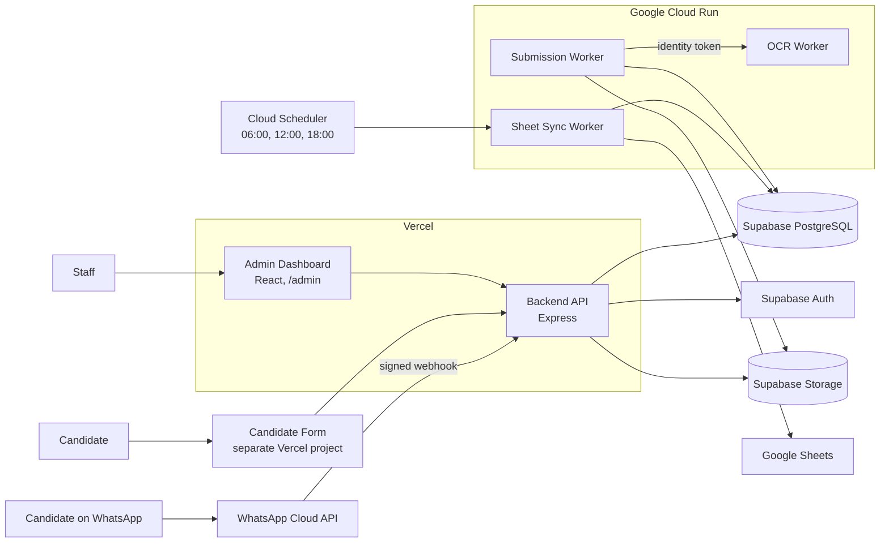
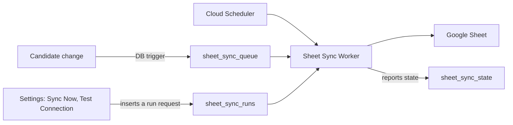

# EmlynkWABot: Candidate Recruitment & Document Automation

[](https://nodejs.org/)
[](https://expressjs.com/)
[](https://supabase.com/)
[](https://www.prisma.io/)
[](https://react.dev/)
[](#license)

EmlynkWABot is an internal recruitment platform. Staff register candidates and move them through a deployment pipeline (test, job, details, documents, interview, visa) from an admin dashboard. Candidates send documents over WhatsApp and fill in a personal-details form through a private link. OCR reads the documents, a review queue catches anything uncertain, and a Google Sheet mirrors the database for staff who work in a spreadsheet.

This README is the high-level overview. Detailed documentation lives in [`Docs/`](Docs/README.md) and is linked from each section below.

---

## Table of Contents

1. [Core Capabilities](#core-capabilities)
2. [Role Model](#role-model)
3. [Candidate Workflow](#candidate-workflow)
4. [System Architecture](#system-architecture)
5. [Database Overview](#database-overview)
6. [Important Database Features](#important-database-features)
7. [Google Sheet Sync](#google-sheet-sync)
8. [OCR and Document Processing](#ocr-and-document-processing)
9. [Candidate Bulk Import](#candidate-bulk-import)
10. [Authentication and Security](#authentication-and-security)
11. [Deployment Overview](#deployment-overview)
12. [Local Development](#local-development)
13. [Environment Configuration](#environment-configuration)
14. [Testing and Quality](#testing-and-quality)
15. [Repository Structure](#repository-structure)
16. [Documentation Index](#documentation-index)
17. [Current Status and Notes](#current-status-and-notes)
18. [License](#license)

---

## Core Capabilities

| Area | What it does |
|---|---|
| **Candidates** | Registration, server-side search and paging (100 per page), details, additional details, a derived workflow Status, and a Candidate History timeline of call logs and activity. |
| **Stages** | Per-candidate stage records: Test details, Job details, Candidate details, Document submission, IVS interview, Visa submission, Visa approval, Finalizing the job. |
| **Candidate Form** | A public, separately hosted form. Staff share a link; the candidate verifies with Passport + NIC and submits once. Staff then confirm or reject each answer field by field. Also supports job-group links. |
| **Verification** | Staff explicitly verify a candidate's details and documents. The verification resets automatically when the data it covered changes. |
| **Documents** | Admin uploads and WhatsApp intake, checksums and duplicate handling, a Missing Documents view, and the Police report 21-day workflow. |
| **OCR and review** | OCR runs in a separate worker. Low-confidence or unclear documents go to a Review Queue for a person's decision. |
| **WhatsApp intake** | A Meta webhook receives candidate documents and hands them to a durable background queue. |
| **Work Allocation** | ADMIN and OWNER allocate candidates to Analysts; an Analyst sees only their own candidates. |
| **Jobs, Agents, Clients** | Jobs with yearly job codes, many-to-many Agent and Client links, Job Types (ADMIN-managed list), and candidate assignment to jobs. |
| **Need Attention** | Call logs can be flagged for follow-up; follow-ups are listed by candidate and can be completed. |
| **Reports** | Overview, Daily Report (Asia/Colombo days, PDF export) and a monthly overview. |
| **Google Sheet** | A one-way database-to-Sheet operational mirror, plus a Candidate Form Submissions tab. |
| **Bulk import** | Upload a legacy `.xlsx` candidate sheet with preview, validation and a chunked commit. |
| **Audit** | An append-only audit log of review actions, corrections, role changes, allocations, imports and more. |
| **Auth and RBAC** | Supabase Auth for identity; a backend role check on every route. |

---

## Role Model

```
OWNER > ADMIN > ANALYST / REGISTRATION_DESK / JOB_HANDLER
```

| Role | Scope |
|---|---|
| `OWNER` | Highest authority. Everything ADMIN can do, plus managing ADMIN accounts. There is one OWNER per environment, set **in the database only**; the application never gives, changes or deactivates the OWNER role. |
| `ADMIN` | Full operational access: Settings, Google Sheet Sync, Job Types, Work Allocation, verification, Audit Logs and managing the roles below ADMIN. Cannot change or invite another ADMIN or the OWNER. |
| `ANALYST` | Review and candidate work on the candidates allocated to them. |
| `REGISTRATION_DESK` | The Candidates area: registration, details, stages, documents and call logs. No Settings or user management. |
| `JOB_HANDLER` | Manages Jobs, Agents and Clients. Reads Candidates; changes no candidate record. |

The former `MANAGER` role was **retired on 2026-10-30**. It is not an active role: it cannot be given or invited, and an account still holding it is refused on every route (`ROLE_NOT_SUPPORTED`) until an OWNER converts it to ADMIN (`npm run user:migrate-manager`).

The role is read from the database on every request, never from the token, so a role change applies to the next request. Details: [`Docs/ROLES_AND_PERMISSIONS.md`](Docs/ROLES_AND_PERMISSIONS.md) and [`Docs/OWNER_ROLE.md`](Docs/OWNER_ROLE.md).

---

## Candidate Workflow

The candidate's stages are stored in `candidate_stages`, one row per candidate and stage (`CANDIDATE_STAGES` in [`src/services/candidateService.js`](src/services/candidateService.js)):


The diagram shows display order only. **The application does not enforce this order**: stages are independent and can be completed in any order.

- `CANDIDATE_DETAILS` and `DOCUMENT_SUBMISSION` are completed **by data**, not by hand: the first when the required details and a passport are on record, the second when the required documents are (`PASSPORT`, `MEDICAL`, `POLICE_REPORT`, `SCAN`). The other stages are completed by staff.
- `TEST_DETAILS` records the test agent, Test ID, result (PASS or FAIL) and date. `JOB_DETAILS` reads the candidate's job and client from their job assignment.
- The progress stepper in the admin UI hides `IVS_INTERVIEW` and `FINALIZING_JOB`. Their data and panels still exist.
- The candidate list shows one derived **Status** (nothing stores it): Registered, Stopped with Test (a FAIL test result), Job Assigned, Form Submitted, Details Verified, Documents Verified, Visa Document Ready.
- Assigning a candidate to a job requires a passed test, and a candidate can be on several PROCESSING jobs at once.

More: [`Docs/20-candidate-management.md`](Docs/20-candidate-management.md), [`Docs/JOB_MANAGEMENT_IMPLEMENTATION.md`](Docs/JOB_MANAGEMENT_IMPLEMENTATION.md), [`Docs/AGENT_CLIENT_MANAGEMENT.md`](Docs/AGENT_CLIENT_MANAGEMENT.md).

---

## System Architecture



| Component | Notes |
|---|---|
| **Admin Dashboard** (`admin/`) | React 19, TypeScript, Vite, Tailwind CSS. Built into `public/admin` on Vercel, or served by Express locally. |
| **Backend API** (`src/`, `api/index.js`) | Express 5. A Vercel function in production (`api/index.js` calls `src/httpHandler.js`), a normal Node process locally. Serves the admin API, `/auth`, the WhatsApp webhook and the public Candidate Form API. |
| **Candidate Form** (`candidate-form/`) | A separate React app on its own Vercel project, talking to `/api/public/candidate-details`. |
| **Submission Worker** (`src/worker.js`) | Polls PostgreSQL for WhatsApp submissions and runs OCR, classification, identity matching and storage placement. Locally, `npm start` runs it inside the API process. |
| **OCR Worker** (`ocr-worker/`) | Tesseract.js and PDF text extraction as a private Cloud Run service. |
| **Sheet Sync Worker** (`src/sheetSyncWorker.js`) | Cloud Run service that writes to Google Sheets. The API on Vercel has no Google access. |
| **Supabase** | PostgreSQL (database and job queue), Auth (identity) and Storage (private document bucket). |

PostgreSQL is the coordination point: the API writes a row, the workers poll for it. There is no separate queue service. More: [`Docs/02-system-architecture.md`](Docs/02-system-architecture.md).

---

## Database Overview

The schema is [`prisma/schema.prisma`](prisma/schema.prisma) (about 30 tables) with forward-only SQL migrations in [`prisma/migrations/`](prisma/migrations). Prisma model names differ from table names; the diagram uses table names.

| Group | Tables |
|---|---|
| **Staff and audit** | `user`, `audit_logs`, `rate_limits` |
| **Candidate core** | `candidate`, `candidate_stages`, `candidate_call_logs`, `call_log_follow_up`, `candidate_additional_details`, `candidate_verification`, `candidate_allocation` |
| **Documents** | `documents`, `temporary_data` (WhatsApp submissions awaiting processing or review) |
| **Candidate Form** | `candidate_form_link`, `candidate_form_access`, `candidate_form_response`, `candidate_form_draft`, `candidate_form_prefill_snapshot`, `candidate_form_field_review`, `candidate_form_sheet_sync` |
| **Jobs, Agents, Clients** | `job`, `job_type`, `job_job_type`, `job_candidate`, `job_code_counter`, `agent`, `client`, `agent_client` |
| **Sheet Sync** | `sheet_sync_queue`, `sheet_sync_runs`, `sheet_sync_state` |
| **Bulk import** | `candidate_import` |

```mermaid
erDiagram
    AUTH_USERS ||--|| USER : "auth_user_id"
    USER ||--o{ AUDIT_LOGS : "acts"
    USER ||--o{ CANDIDATE_CALL_LOGS : "logs"
    USER ||--o{ CANDIDATE_ALLOCATION : "analyst"
    USER ||--o{ CANDIDATE_IMPORT : "imports"

    CANDIDATE ||--o{ DOCUMENTS : "has"
    CANDIDATE ||--o{ CANDIDATE_STAGES : "progresses"
    CANDIDATE ||--o{ CANDIDATE_CALL_LOGS : "has"
    CANDIDATE ||--o| CANDIDATE_ALLOCATION : "allocated"
    CANDIDATE ||--o| CANDIDATE_ADDITIONAL_DETAILS : "extra details"
    CANDIDATE ||--o| CANDIDATE_VERIFICATION : "verified"
    CANDIDATE ||--o{ TEMPORARY_DATA : "submissions"
    TEMPORARY_DATA ||--o{ DOCUMENTS : "stored as"
    CANDIDATE_CALL_LOGS ||--o{ CALL_LOG_FOLLOW_UP : "flagged"

    CANDIDATE ||--o{ JOB_CANDIDATE : "assigned"
    JOB ||--o{ JOB_CANDIDATE : "members"
    CLIENT ||--o{ JOB : "owns"
    AGENT ||--o{ JOB : "responsible"
    AGENT ||--o{ AGENT_CLIENT : "links"
    CLIENT ||--o{ AGENT_CLIENT : "links"
    JOB ||--o{ JOB_JOB_TYPE : "types"
    JOB_TYPE ||--o{ JOB_JOB_TYPE : "types"

    CANDIDATE ||--o{ CANDIDATE_FORM_LINK : "share links"
    JOB ||--o{ CANDIDATE_FORM_LINK : "job group link"
    CANDIDATE ||--o| CANDIDATE_FORM_ACCESS : "lock"
    CANDIDATE ||--o| CANDIDATE_FORM_RESPONSE : "answers"
    CANDIDATE ||--o| CANDIDATE_FORM_DRAFT : "draft"
    CANDIDATE ||--o| CANDIDATE_FORM_PREFILL_SNAPSHOT : "prefill"
    CANDIDATE ||--o{ CANDIDATE_FORM_FIELD_REVIEW : "staff review"
    CANDIDATE ||--o| CANDIDATE_FORM_SHEET_SYNC : "sheet outbox"

    CANDIDATE ||..o{ SHEET_SYNC_QUEUE : "unique_id, no FK"
```



Key relationships:

- `passport_id` is the candidate's primary key and the foreign key everywhere. `unique_id` is a separate business reference and the Sheet's row identity. They are never interchangeable.
- `user.auth_user_id` links to Supabase's `auth.users`. The application stores no password.
- An Agent has many Clients and a Client has many Agents (`agent_client`). A Job belongs to one Client and one responsible Agent, and has one or more Job Types (`job_job_type`).
- `audit_logs` keeps plain IDs without foreign keys to reviewed rows, so history outlives them. Users are deactivated, never deleted.
- The Sheet Sync tables hold counts and codes only, no candidate data.

Detailed schema: [`Docs/03-database-design.md`](Docs/03-database-design.md).

---

## Important Database Features

- **Unique IDs** are zero-padded numbers (`0001`, `0002`, ...), assigned by the application as the highest existing number plus one. They are not a database sequence. The bulk import allocates them under an advisory lock.
- **Uniqueness:** `passport_id` (primary key), `nic`, `unique_id` and `user.email` are unique. WhatsApp numbers are unique by their **canonical phone key** (`candidate_phone_key()`), so `0771234567`, `94771234567` and `+94771234567` count as the same number.
- **Verification-reset triggers** clear a candidate's Details Verified or Documents Verified marker in the same transaction as any change to the data it covered, whichever code path made the change.
- **Sheet-sync outbox triggers** on `candidate`, `candidate_stages`, `documents` and `candidate_additional_details` enqueue a row in `sheet_sync_queue` in the same transaction as the change. At most one PENDING row exists per candidate, so changes coalesce.
- **Append-only audit log:** a trigger rejects any update or delete on `audit_logs`.
- **Candidate Form integrity:** a submission is written once, and a submitted form's lock is terminal (both enforced by triggers).
- **Job rules:** a membership can be active only on a PROCESSING job, and finishing a job releases only that job's memberships.
- **Postgres-backed rate limiting** (`rate_limits`) shared by every serverless instance, storing no IP addresses.
- **Row Level Security** is enabled on application tables with no policies, so Supabase's public API roles see nothing. The backend connects with a role that bypasses RLS.

---

## Google Sheet Sync

The database is always the source of truth. The **Emlynk Candidate Operational Mirror** tab is a one-way copy of candidate, document and stage state (83 columns). Edits made in the Sheet are never read back.



- **Reconciliation** compares the Sheet with the database and writes only the differences. It runs on a schedule (06:00, 12:00 and 18:00 Asia/Colombo, once the Cloud Scheduler trigger is configured for the environment) and on demand (**Sync Now**). There is no real-time sync.
- **Test Connection** checks the Sheet connection, tab and headers without writing.
- **Safety:** a write gate (`SHEET_SYNC_ENABLED`), a deletion guard, header validation before any write, and a writer lease so a single process writes at a time. Google credentials stay in the worker.
- **Sync destination:** the worker can be configured with several Sheets. An ADMIN switches the destination from Settings; it is validated before it becomes active.
- A second tab, **Candidate Form Submissions**, receives each Candidate Form submission through its own outbox (`candidate_form_sheet_sync`).
- The bulk **Upload** feature feeds this same pipeline (see [Candidate Bulk Import](#candidate-bulk-import)).

More: [`Docs/GOOGLE_SHEET_INTEGRATION.md`](Docs/GOOGLE_SHEET_INTEGRATION.md) and [`Docs/GOOGLE_SHEET_CANDIDATE_SYNC_ARCHITECTURE.md`](Docs/GOOGLE_SHEET_CANDIDATE_SYNC_ARCHITECTURE.md).

---

## OCR and Document Processing

1. A candidate sends a document over WhatsApp. The signed webhook (`POST /whatsapp/webhook`) validates it, stores the file temporarily and commits a `temporary_data` row, then answers Meta immediately.
2. The **Submission Worker** claims the row with a lease and runs OCR, document classification, passport/MRZ extraction, identity matching and field reconciliation.
3. The result is routed by confidence: stored under the candidate, stored with a review flag, or held in the **Review Queue** for a person to approve, keep pending, re-type, assign to a client, replace or remove. Unclear results never silently overwrite trusted data.
4. Police slips start the **21-day police report** countdown, tracked on the Police Workflow page.

The **OCR Worker** (`ocr-worker/`) is a separate, stateless Cloud Run service. The backend calls it over HTTPS with a Google identity token, so OCR load never affects webhook latency or the admin API. It has no database or storage access.

More: [`Docs/04-whatsapp-integration.md`](Docs/04-whatsapp-integration.md), [`Docs/05-ocr-document-processing.md`](Docs/05-ocr-document-processing.md), [`Docs/06-storage-management.md`](Docs/06-storage-management.md), [`ocr-worker/README.md`](ocr-worker/README.md).

---

## Candidate Bulk Import

**Settings, Google Sheet Sync, Upload** (ADMIN and OWNER) imports a legacy candidate `.xlsx` into the database.

- **Upload:** the workbook is read in the browser; only allow-listed columns are sent to the server.
- **Preview:** each row is normalized, validated and classified as new, existing, duplicate, conflict or invalid. Nothing is written yet.
- **Conflicts:** a passport that appears twice in the file, or an NIC that belongs to another passport, is reported and skipped.
- **Existing candidates:** only blank fields are filled; a non-empty value is never overwritten. A candidate whose details are verified is skipped.
- **Commit:** after confirmation, 100 rows per request, each chunk in its own short transaction and hash-checked against the preview. A failed chunk rolls back alone.
- **Reconciliation:** the import's writes go through the normal triggers and a Sheet reconciliation is requested when it finishes.

More: [`Docs/CANDIDATE_BULK_IMPORT.md`](Docs/CANDIDATE_BULK_IMPORT.md).

---

## Authentication and Security

- **Supabase Auth** owns credentials, sessions, invitations and password recovery. The browser signs in with `signInWithPassword` and sends the access token as `Authorization: Bearer`. No cookie authenticates a request.
- **The backend checks the token with Supabase on every request** (so a signed-out session stops working), then loads the `user` row by `auth_user_id`. It must exist, be `ACTIVE` and hold a supported role. Roles from tokens or request bodies are never trusted.
- **Route authorization** is a role list per route in `src/routes/admin.js`; OWNER passes every list that names ADMIN. Retired or unknown roles are refused everywhere.
- **Audit logs** record review actions, role changes, allocations, imports and similar events, and cannot be edited.
- **Other protections:** a signed WhatsApp webhook, a strict Content Security Policy, helmet headers, PostgreSQL-backed rate limits, hashed Candidate Form link secrets with lockout after failed verifications, and RLS on application tables.
- **Secrets** (service-role key, Meta and Google credentials, database URL) exist only in server environments, never in the browser build.

More: [`Docs/SUPABASE_AUTH.md`](Docs/SUPABASE_AUTH.md), [`Docs/10-security.md`](Docs/10-security.md), [`Docs/CANDIDATE_EXTRA_DETAILS_FORM_SECURITY_RISKS.md`](Docs/CANDIDATE_EXTRA_DETAILS_FORM_SECURITY_RISKS.md).

---

## Deployment Overview

| Piece | Where |
|---|---|
| Admin Dashboard and Backend API | Vercel project A (`vercel.json`; the API is `api/index.js`) |
| Candidate Form | Vercel project B (root directory `candidate-form`) |
| Submission Worker | Google Cloud Run (the root `Dockerfile`, started with `node src/worker.js`) |
| OCR Worker | Google Cloud Run, private (`ocr-worker/Dockerfile`) |
| Sheet Sync Worker | Google Cloud Run (`deploy/sheet-sync-worker.env.yaml` holds its non-secret settings) |
| Database, Auth, Storage | Supabase |

Each environment (local, stage, production) has its own Supabase project, Vercel settings and Cloud Run configuration. The OWNER account is set separately in each. Schema changes are applied with `npx prisma migrate deploy`; the server never runs migrations itself.

Branches and the release flow, environment variables, migration rules and smoke tests: [`Docs/08-cloud-deployment.md`](Docs/08-cloud-deployment.md).

---

## Local Development

Requires Node.js 22.18+ (or 23.6+), npm, and a PostgreSQL database (the repo includes `docker-compose.yml` with PostgreSQL 16, or point `DATABASE_URL` at a Supabase project).

```bash
# 1. Install and configure
npm install                      # also runs `prisma generate`
cp .env.example .env             # then fill in values (see Environment Configuration)

# 2. Database (optional local PostgreSQL)
docker compose up -d
npx prisma validate
npx prisma migrate deploy        # forward-only; do not run `migrate dev` against a shared database
npm run db:check                 # checks the database connection

# 3. First staff account
npm run user:create -- --name "Full Name" --email owner@example.com --role OWNER

# 4. Run
npm start                        # backend API (also runs the submission worker); /health
npm run admin:install            # once
npm run admin:dev                # admin dashboard at http://localhost:5173/admin/
```

Optional processes:

```bash
npm run ocr:install && npm run ocr:start      # local OCR worker on :8080 (set OCR_SERVICE_URL)
npm run worker                                # submission worker alone
npm run sheet:worker                          # Sheet Sync worker (also sheet:check, sheet:request, sheet:demo)
npm --prefix candidate-form install && npm --prefix candidate-form run dev   # Candidate Form
```

Full guide: [`Docs/11-development-guide.md`](Docs/11-development-guide.md). Coding rules: [`Docs/CODING_STANDARDS.md`](Docs/CODING_STANDARDS.md).

---

## Environment Configuration

- **Local:** a git-ignored `.env` in the repository root. [`.env.example`](.env.example) lists every setting the server checks at startup. The admin dashboard reads `admin/.env.local` (see `admin/.env.example`).
- **Configuration groups:** the database connection; Supabase (project URL, storage bucket and the server-side service-role key); WhatsApp (verify token, access token, Meta app secret); the OCR worker URL; Candidate Form settings (its origin and token secret); the public base URL; and the Google Sheet settings.
- **Vercel and Cloud Run:** the same variables are set per project and per service, with secrets in the platform's secret store (for example Secret Manager on Cloud Run). The Cloud Run workers use their service identity, so no Google key file exists.
- **Admin build:** only `VITE_SUPABASE_URL` and the public anon key are embedded in the browser build. A secret key is refused.
- **Separation:** stage and production use separate Supabase projects, Vercel settings and Google resources.

> Never commit `.env` files or real credentials. Setting names are documented; values are not.

Details: [`Docs/08-cloud-deployment.md`](Docs/08-cloud-deployment.md) (Environment Variables) and [`Docs/SUPABASE_AUTH.md`](Docs/SUPABASE_AUTH.md).

---

## Testing and Quality

| Check | Command |
|---|---|
| Backend tests (Node's built-in runner, fakes only, no live services) | `npm test` |
| Admin tests (Vitest) | `npm run admin:test` |
| Admin typecheck | `npm --prefix admin run typecheck` |
| Admin production build (typecheck and Vite build) | `npm run admin:build` |
| Candidate Form tests and typecheck | `npm --prefix candidate-form test`, `npm --prefix candidate-form run typecheck` |
| OCR worker tests | `npm run ocr:test` |
| Prisma schema validation | `npx prisma validate` |

Tests use in-memory fakes for the database and storage, and synthetic fixtures; no real candidate data is used. Tests needing a real PostgreSQL run only against a throwaway container. Load and stress testing was done on the dedicated branches `version/load-testing` and `hotfix/loadtest-production-fixes`; no load-test tooling is part of `dev`.

More: [`Docs/12-testing-and-quality.md`](Docs/12-testing-and-quality.md).

---

## Repository Structure

```text
EmlynkWABot/
├── src/                  Backend: app.js (entry), createApp.js, worker.js, sheetSync*.js
│   ├── routes/           admin, auth, users, whatsapp, candidateImport, sheetSyncSettings, publicCandidateDetails
│   ├── services/         business logic (candidates, jobs, review, OCR client, sheet sync, import, ...)
│   ├── middleware/       requireActiveUser, requireRole, rate limiting, webhook signature
│   ├── auth/             Supabase token verification
│   └── config/ utils/
├── api/                  Vercel function entry (index.js)
├── admin/                Admin dashboard (React, TypeScript, Vite, Vitest)
├── candidate-form/       Public Candidate Form (separate Vercel project)
├── ocr-worker/           OCR service (Cloud Run)
├── prisma/               schema.prisma and SQL migrations
├── deploy/               Non-secret Cloud Run settings for the Sheet Sync worker
├── scripts/              Operator tools (user:create, migrate MANAGER role, DB check, ...)
├── test/                 Backend tests, helpers and fixtures
├── Docs/                 Project documentation (start at Docs/README.md)
├── Dockerfile            Backend and submission worker image
├── vercel.json           Vercel routing, build and security headers
└── docker-compose.yml    Local PostgreSQL 16
```

---

## Documentation Index

Start with [`Docs/README.md`](Docs/README.md), the categorised index of every document.

| Topic | Document |
|---|---|
| Overview and setup | [`01-project-overview.md`](Docs/01-project-overview.md), [`11-development-guide.md`](Docs/11-development-guide.md), [`CODING_STANDARDS.md`](Docs/CODING_STANDARDS.md) |
| Architecture and backend | [`02-system-architecture.md`](Docs/02-system-architecture.md), [`07-backend-development.md`](Docs/07-backend-development.md) |
| Database | [`03-database-design.md`](Docs/03-database-design.md) |
| WhatsApp, OCR, storage | [`04-whatsapp-integration.md`](Docs/04-whatsapp-integration.md), [`05-ocr-document-processing.md`](Docs/05-ocr-document-processing.md), [`06-storage-management.md`](Docs/06-storage-management.md) |
| Admin dashboard | [`09a-admin-dashboard-api.md`](Docs/09a-admin-dashboard-api.md) (API), [`09b-admin-dashboard-guide.md`](Docs/09b-admin-dashboard-guide.md) (screens) |
| Roles and RBAC | [`ROLES_AND_PERMISSIONS.md`](Docs/ROLES_AND_PERMISSIONS.md), [`OWNER_ROLE.md`](Docs/OWNER_ROLE.md) |
| Candidates | [`20-candidate-management.md`](Docs/20-candidate-management.md), [`CANDIDATE_PAGINATION_AND_PERFORMANCE.md`](Docs/CANDIDATE_PAGINATION_AND_PERFORMANCE.md), [`CANDIDATE_BULK_IMPORT.md`](Docs/CANDIDATE_BULK_IMPORT.md) |
| Candidate Form | [`CANDIDATE_FORM_FEATURE_ARCHITECTURE.md`](Docs/CANDIDATE_FORM_FEATURE_ARCHITECTURE.md), [`CANDIDATE_EXTRA_DETAILS_FORM_SHARE_LINKS_DESIGN.md`](Docs/CANDIDATE_EXTRA_DETAILS_FORM_SHARE_LINKS_DESIGN.md), [`CANDIDATE_EXTRA_DETAILS_FORM_SECURITY_RISKS.md`](Docs/CANDIDATE_EXTRA_DETAILS_FORM_SECURITY_RISKS.md), [`candidate-form/README.md`](candidate-form/README.md) |
| Jobs, Agents, Clients | [`JOB_MANAGEMENT_IMPLEMENTATION.md`](Docs/JOB_MANAGEMENT_IMPLEMENTATION.md), [`AGENT_CLIENT_MANAGEMENT.md`](Docs/AGENT_CLIENT_MANAGEMENT.md) |
| Google Sheet | [`GOOGLE_SHEET_INTEGRATION.md`](Docs/GOOGLE_SHEET_INTEGRATION.md), [`GOOGLE_SHEET_CANDIDATE_SYNC_ARCHITECTURE.md`](Docs/GOOGLE_SHEET_CANDIDATE_SYNC_ARCHITECTURE.md) |
| Security and auth | [`10-security.md`](Docs/10-security.md), [`SUPABASE_AUTH.md`](Docs/SUPABASE_AUTH.md) |
| Deployment | [`08-cloud-deployment.md`](Docs/08-cloud-deployment.md), [`ocr-worker/README.md`](ocr-worker/README.md) |
| Testing | [`12-testing-and-quality.md`](Docs/12-testing-and-quality.md) |
| Issues and history | [`EMLYNK_PROJECT_ISSUES_AND_SOLUTIONS_HISTORY.md`](Docs/EMLYNK_PROJECT_ISSUES_AND_SOLUTIONS_HISTORY.md), [`archive/`](Docs/archive) (historical) |
| Research, not implemented | [`NOTIFICATION_SYSTEM_AUDIT.md`](Docs/NOTIFICATION_SYSTEM_AUDIT.md) |

---

## Current Status and Notes

- **Active development** on the `dev` branch; `stage` and `main` follow the release flow in the deployment guide.
- **Roles:** `OWNER` was introduced above `ADMIN`; `MANAGER` was retired on 2026-10-30. The active model is `OWNER > ADMIN > ANALYST / REGISTRATION_DESK / JOB_HANDLER`.
- **Update Sheet is now Upload:** the bulk import button was renamed.
- **Authentication** moved fully to Supabase Auth; the application no longer issues its own tokens or sends account emails.
- Some documents under `Docs/` still describe earlier behavior; where a document and the code disagree, the code is correct.

## License

ISC (internal project for Emlynk).
