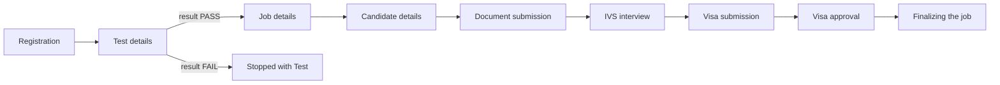
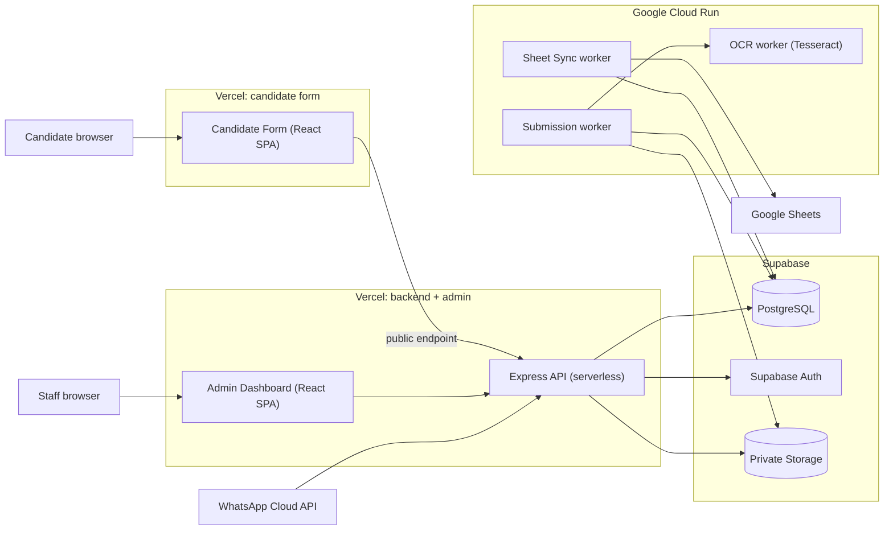
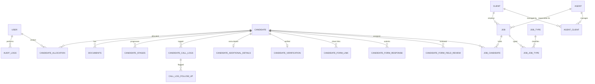

# EmlynkWABot

A candidate-operations platform for overseas job placement: WhatsApp document intake with OCR, a role-based staff dashboard, a public Candidate Form, and a Google Sheet operational mirror.

The system receives candidate documents over WhatsApp, reads and classifies them automatically, and gives staff a dashboard to register candidates, track them through the deployment stages, assign them to jobs and keep a live operational spreadsheet.

---

## Table of Contents

1. [Project Overview](#project-overview)
2. [Key Features](#key-features)
3. [Role-Based Access Control](#role-based-access-control)
4. [Candidate Workflow](#candidate-workflow)
5. [System Architecture](#system-architecture)
6. [Tech Stack](#tech-stack)
7. [Database Design](#database-design)
8. [UI Design System](#ui-design-system)
9. [Repository Structure](#repository-structure)
10. [Local Development](#local-development)
11. [Environment Configuration](#environment-configuration)
12. [Deployment Architecture](#deployment-architecture)
13. [Google Sheet Sync](#google-sheet-sync)
14. [OCR and Document Processing](#ocr-and-document-processing)
15. [Testing and Quality](#testing-and-quality)
16. [Security Overview](#security-overview)
17. [Documentation Index](#documentation-index)
18. [Current Development Notes](#current-development-notes)

---

## Project Overview

Overseas job placement involves a large volume of personal documents (passports, national IDs, police slips, medical reports, visa papers) and a long, multi-step process per candidate. EmlynkWABot supports that process end to end:

- **Candidate management.** Staff register candidates, edit their details, and follow each one through a fixed set of deployment stages.
- **Document handling.** Candidates (or staff) send documents over WhatsApp. Files are stored privately, read by OCR, classified, matched to a candidate and, where confidence is low, queued for human review.
- **Overseas job processing.** Jobs belong to a Client and a responsible Agent. Candidates are assigned to jobs and progress through visa and finalisation steps.
- **Candidate Form.** A separate public web form, opened through a secure share link, lets a candidate submit extra details themselves. Staff review the submitted values field by field.
- **Admin operations.** A role-based dashboard covers work allocation, follow-ups ("Need Attention"), the Daily Report, user management and audit logs.
- **Automation and integrations.** WhatsApp Cloud API, a Tesseract-based OCR service, Supabase (PostgreSQL, Auth, Storage) and a background worker that mirrors candidate data to Google Sheets.

## Key Features

Every item below is implemented in the current code.

| Area | What it does |
|---|---|
| Candidates | Registration, details, additional details, server-side paginated list, derived workflow Status |
| Deployment stages | Eight per-candidate stages with notes, completion and stage-specific fields (see [Candidate Workflow](#candidate-workflow)) |
| Candidate documents | Upload, remove, duplicate detection by checksum, required-document tracking, Missing Documents page |
| WhatsApp intake | Signed webhook, message idempotency, asynchronous processing queue |
| OCR / review | Classification, passport (MRZ) extraction, identity matching, confidence bands, Review Queue |
| Police workflow | Police-slip tracking with a 21-day countdown |
| Candidate Form | Share links, Passport + NIC verification, drafts, single submission, job-group links, field-by-field staff review, editable form branding |
| Need Attention | Call logs can be flagged as follow-ups; flag, complete and (ADMIN) delete |
| Work Allocation | Assign candidates to Analysts (ADMIN, TEAM_LEAD) |
| Jobs | Job codes, multiple job types, From/To country, candidate assignment, lifecycle status |
| Agents and Clients | Many-to-many Agent-Client management, locking and audit |
| Daily Report | Summary, Incomplete, Monthly overview, Summary by Roles (ADMIN), PDF export |
| Google Sheet Sync | Operational Mirror and Candidate Form Submissions tabs, queue + reconciliation, Sync Now, Test Connection |
| Bulk Upload | Excel/Sheet import of candidates into the database (ADMIN) |
| Auth and users | Supabase Auth, invitations, password recovery, role management |
| Audit logging | Append-only audit trail with an admin-facing Audit Logs page |
| Notifications | A notification bell exists in the header. The full notification system is **research only**, not implemented ([audit](Docs/NOTIFICATION_SYSTEM_AUDIT.md)) |
| UI | Light/dark theme, responsive layout, collapsible sidebar |

## Role-Based Access Control

```text
OWNER  >  ADMIN  >  TEAM_LEAD  >  ANALYST / REGISTRATION_DESK / JOB_HANDLER
```

The hierarchy shows **who manages whom**, not automatic permission inheritance. OWNER holds every ADMIN permission. **TEAM_LEAD inherits nothing from ADMIN**: it has its own explicit permission set, and a route admits TEAM_LEAD only where it is named. ANALYST, REGISTRATION_DESK and JOB_HANDLER are separate kinds of work, not a ladder.

| Role | Summary |
|---|---|
| **OWNER** | Highest authority. The single system owner: every ADMIN permission plus managing ADMIN accounts. Set in the database only. |
| **ADMIN** | Runs the system: candidates, documents, review, police, jobs, allocation, verification, Settings, Audit Logs, Google Sheet Sync, and user management below ADMIN. |
| **TEAM_LEAD** | Exactly seven areas: Candidates (all of them), Need Attention, Work Allocation, Jobs, Agents, Clients and the standard Daily Report. ADMIN-only actions inside those areas stay ADMIN-only. No Settings, user management, Audit Logs, Overview or Review Queue. |
| **ANALYST** | Candidate work (review, documents, stages, call logs) on **the candidates allocated to them** only; can read the Jobs holding their candidates. |
| **REGISTRATION_DESK** | Registers candidates and works on candidate records; nothing outside the Candidates area. |
| **JOB_HANDLER** | Manages Jobs, Agents and Clients; can read candidates but never changes a candidate record. |

> **MANAGER is retired and unsupported.** An account still holding it is refused everywhere until converted (`npm run user:migrate-manager`). ADMIN holds everything MANAGER could do.

Roles are read from the database on every request. The dashboard hides what a role cannot use, but the server enforces every rule. Full matrix: [Docs/ROLES_AND_PERMISSIONS.md](Docs/ROLES_AND_PERMISSIONS.md).

## Candidate Workflow

Each candidate has eight stage records (`candidate_stages`). The dashboard's progress stepper shows six of them; **IVS interview** and **Finalizing the job** remain stored stages but are hidden from the stepper, and **Additional details** sits beside Candidate details.



The stages are **not strictly linear** in the code: staff can open and update any stage, and a stage's completion is independent of the others. The list **Status** column is a single value derived from existing data (nothing stores or edits it):

`Registered` < `Job Assigned` < `Form Submitted` < `Details Verified` < `Documents Verified` < `Visa Document Ready`, with `Stopped with Test` overriding all of them while the Test result is FAIL.

Details: [Docs/20-candidate-management.md](Docs/20-candidate-management.md).

## System Architecture



- The admin dashboard and the Express API ship together as one Vercel project, same-origin. The Candidate Form is a separate, static Vercel project with no backend credentials.
- WhatsApp webhooks are acknowledged immediately; documents are processed asynchronously from a PostgreSQL-backed queue.
- The Sheet Sync worker reads PostgreSQL and writes to Google Sheets. Sheets are a mirror, never a source of truth.

More: [Docs/02-system-architecture.md](Docs/02-system-architecture.md).

## Tech Stack

| Category | Technology |
|---|---|
| Backend | Node.js (`^22.18.0 \|\| >=23.6.0`), Express 5, helmet, express-rate-limit |
| Admin frontend | React 19, TypeScript, Vite, Tailwind CSS 4, React Router 8, lucide-react, jsPDF, read-excel-file |
| Candidate Form | React 19, TypeScript, Vite (separate package, `candidate-form/`) |
| Database / ORM | PostgreSQL (Supabase), Prisma 6.19 with the `pg` driver adapter |
| Authentication | Supabase Auth (`@supabase/supabase-js`) |
| Storage | Supabase Storage (private bucket) |
| OCR | Tesseract.js, pdf-parse, `@napi-rs/canvas` (`ocr-worker/`, Express) |
| Integrations | WhatsApp Cloud API (Meta), Google Sheets API (`@googleapis/sheets`) |
| Cloud / deploy | Vercel, Google Cloud Run, Docker |
| Testing | Node test runner (backend, OCR worker), Vitest + Testing Library (admin, candidate form), PGlite |
| Fonts | Inter (body), Montserrat (headings) |

## Database Design

PostgreSQL schema defined in [prisma/schema.prisma](prisma/schema.prisma); changes ship as forward-only SQL migrations in `prisma/migrations/`. Some rules (partial unique indexes, triggers, functions) live only in SQL migrations.

| Category | Tables |
|---|---|
| Identity and access | `user`, `audit_logs`, `rate_limits` |
| Candidates | `candidate`, `candidate_additional_details`, `candidate_stages`, `candidate_call_logs`, `call_log_follow_up`, `candidate_allocation`, `candidate_verification` |
| Documents and intake | `documents`, `temporary_data` (the WhatsApp intake queue and unmatched files) |
| Candidate Form | `candidate_form_link`, `candidate_form_access`, `candidate_form_response`, `candidate_form_draft`, `candidate_form_prefill_snapshot`, `candidate_form_field_review`, `candidate_form_branding`, `candidate_form_sheet_sync` |
| Jobs | `job`, `job_type`, `job_job_type`, `job_candidate`, `job_code_counter` |
| Business entities | `agent`, `client`, `agent_client` |
| Integrations | `sheet_sync_queue`, `sheet_sync_runs`, `sheet_sync_state`, `candidate_import` (bulk Upload) |

### Simplified ER diagram

Only the main relationships are shown; most columns and supporting tables are omitted.



### Important database behaviours

- **Identity.** `candidate.passport_id` is the primary key; `unique_id` is a unique sequential business reference; `nic` is unique.
- **Phone uniqueness by number, not text.** A SQL function (`candidate_phone_key`) reduces any written form of a WhatsApp number to a comparison key, and a unique index prevents two candidates sharing one.
- **Document duplicates.** `documents` is unique on `(passport_id, file_sha256)`.
- **Append-only audit.** Triggers on `audit_logs` block UPDATE, DELETE and TRUNCATE.
- **Sheet Sync outbox.** Triggers capture candidate changes into `sheet_sync_queue` (identifiers only, no personal data); at most one PENDING row per candidate. Candidate Form submissions have their own sync table.
- **Immutable form records.** Triggers make submitted form responses, prefill snapshots and finished field reviews final.
- **Verification reset.** Triggers clear a candidate's details/documents verification when the verified data changes.
- **Job rules.** Triggers enforce valid job status transitions and that active candidate assignments sit on a processing job.
- **Roles are plain text** validated by the application (no database CHECK).

Details: [Docs/03-database-design.md](Docs/03-database-design.md).

## UI Design System

**Canonical source:** [admin/src/index.css](admin/src/index.css), a Tailwind 4 `@theme` block of CSS tokens, with a `:root[data-theme="dark"]` override. Theme switching only sets `data-theme` on `<html>` ([admin/src/theme/theme.ts](admin/src/theme/theme.ts)); the choice is remembered in `localStorage` and **defaults to light**. The latest change to this file is the platform rebrand to the `emlynk_style_guide` (2026-11-01).

The admin palette is a **neutral monochrome** (near-black primary on light greys) with a dark slate sidebar and semantic status colours.

| Token | Usage | Light | Dark |
|---|---|---|---|
| `--color-primary` | Main actions | `#171717` | `#e5e5e5` |
| `--color-primary-hover` | Hover | `#454545` | `#d4d4d4` |
| `--color-primary-soft` | Soft fill | `#e5e5e5` | `#353c46` |
| `--color-accent` | Accent | `#ef4444` | not overridden |
| `--color-page` | Page background | `#f0f0f0` | `#1f242b` |
| `--color-surface` | Cards and panels | `#ffffff` | `#262c34` |
| `--color-canvas` | Recessed areas | `#e5e5e5` | `#2c333c` |
| `--color-border` | Dividers | `#d4d4d4` | `#353c46` |
| `--color-ink` | Primary text | `#0a0a0a` | `#ffffff` |
| `--color-ink-muted` | Secondary text | `#525252` | `#b0b6bf` |
| `--color-sidebar` | Sidebar background | `#1f242b` | same |
| `--color-verified` | Success, completed | `#006045` | `#5ee9b5` |
| `--color-review` | Warning, needs review | `#973c00` | `#fee685` |
| `--color-critical` | Errors, destructive | `#c10007` | `#ff8a8c` |
| `--color-pending` | Neutral status | `#314158` | `#cbd5e1` |
| `--color-duplicate` | Duplicate marker | `#5d0ec0` | `#c4b5fd` |

Each status colour also has `-bg` and `-border` variants. Hover and active states have dedicated `primary-hover`, `primary-active` and `critical-hover` tokens.

| Aspect | Value |
|---|---|
| Typography | Inter Variable (body), Montserrat Variable (headings); scale from 12px labels to 30px headlines |
| Radius | Base `0.625rem` (10px), with derived sm / md / lg / xl |
| Shadows | Flat surfaces (`--shadow-surface` is none); popover and modal shadows only |
| Layout | Sidebar 256px (48px collapsed rail), header 56px, content max width 1600px |
| Patterns | Shared components in `admin/src/components/` (dialogs, forms, status badges, date picker, tables, breadcrumbs); flat bordered cards with minimal shadow |

**Inconsistency to be aware of.** The public Candidate Form ([candidate-form/src/styles.css](candidate-form/src/styles.css)) defines its **own** token set with a **red** primary (`#e7000b`), while the admin's primary is near-black. The page, surface and dark-mode backgrounds match the admin, so the two apps share a base but differ in primary colour. Confirm with the design owner whether this is intentional.

## Repository Structure

```text
/
├── src/               Express backend: routes, services, middleware, workers
├── api/               Vercel serverless entry point
├── admin/             Admin dashboard (React + Vite), built into public/admin
├── candidate-form/    Public Candidate Form (separate React + Vite app)
├── ocr-worker/        OCR service (Tesseract.js), deployed to Cloud Run
├── prisma/            schema.prisma, SQL migrations, seed
├── scripts/           Operational scripts (user creation, audits, diagnostics)
├── deploy/            Non-secret Cloud Run environment for the Sheet Sync worker
├── test/              Backend test suite (Node test runner)
├── Docs/              Technical documentation
├── vercel.json        Backend + admin Vercel routing and headers
├── Dockerfile         Backend / worker container image
└── docker-compose.yml Local PostgreSQL
```

## Local Development

**Prerequisites:** Node.js `^22.18.0 || >=23.6.0`, npm, Docker (for local PostgreSQL). A Meta WhatsApp developer account is only needed to test live webhook delivery.

```bash
# 1. Install backend and admin dependencies (postinstall runs prisma generate)
npm install
npm run admin:install

# 2. Start local PostgreSQL (container emlynk-postgres)
docker compose up -d

# 3. Configure environment
cp .env.example .env
cp admin/.env.example admin/.env.local   # browser-safe values only

# 4. Apply migrations, generate the Prisma client, optionally seed
npx prisma migrate dev
npx prisma db seed

# 5. Create the first user
npm run user:create -- --email admin@example.com --name "Your Name" --role ADMIN

# 6. Run
npm start               # backend + submission worker (http://localhost:3000)
npm run admin:dev       # admin dev server (http://localhost:5173)
```

Other commands: `npm run worker` (submission worker only), `npm run sheet:worker` (Sheet Sync worker), `npm run db:check`, `npm run admin:build`, `npm run ocr:install` / `npm run ocr:start`. The Candidate Form has its own scripts (`npm --prefix candidate-form run dev`). Full guide: [Docs/11-development-guide.md](Docs/11-development-guide.md).

## Environment Configuration

Copy [.env.example](.env.example) to `.env`; the admin app uses `admin/.env.example`. Never commit real values. Local, stage and production use different projects and secrets.

| Category | Examples of what is configured |
|---|---|
| Database | PostgreSQL connection string (use the Supabase pooler for serverless) |
| Supabase | Project URL, server-side service credentials, storage bucket |
| Admin frontend | Browser-safe Supabase URL and anon key only (`VITE_*`) |
| WhatsApp / Meta | App secret, verify token, access token, phone number id |
| OCR | OCR service URL and Cloud Run identity settings |
| Google Sheets | Spreadsheet id, tab names, write gate (`SHEET_SYNC_ENABLED`), scheduler settings |
| Candidate Form | Allowed form origin and token-signing secret (backend only) |
| App | Public base URL (`APP_BASE_URL`) |

Google access uses the runtime service identity (Application Default Credentials); **no key files**. Details: [Docs/08-cloud-deployment.md](Docs/08-cloud-deployment.md) and [Docs/07-backend-development.md](Docs/07-backend-development.md).

## Deployment Architecture

| Component | Platform | Notes |
|---|---|---|
| Backend API + Admin dashboard | Vercel (project A, repo root) | Express as one serverless function; admin served under `/admin` |
| Candidate Form | Vercel (project B, root `candidate-form/`) | Static SPA, no backend credentials |
| PostgreSQL, Auth, Storage | Supabase | Private storage bucket |
| OCR worker | Google Cloud Run | Called with a Google identity token |
| Submission worker | Google Cloud Run | Worker-only process of the backend image |
| Sheet Sync worker | Google Cloud Run | Runs as a dedicated service account; Cloud Scheduler trigger |
| Google Sheets | External | Operational mirror |

**Branches:** feature branches → `dev` → `stage` (Vercel preview and staging validation) → `main` (production). Migrations are forward-only (`npx prisma migrate deploy`). See [Docs/08-cloud-deployment.md](Docs/08-cloud-deployment.md).

**Google Drive document backup:** not present in the current code or deployment. Treat it as **planned**; it is not a deployed feature.

## Google Sheet Sync

An **operational mirror**: PostgreSQL stays the source of truth and the spreadsheet is a one-way copy for operations staff.

- Database triggers record changed candidates in an **outbox queue** (`sheet_sync_queue`), identifiers only.
- A **Cloud Run worker** drains the queue and **reconciles** the sheet against the database; deletion guards stop mass removals.
- Two tabs: the Operational Mirror and Candidate Form Submissions.
- **Settings > Google Sheet Sync** (ADMIN): status, *Test Connection*, *Sync Now*, and bulk **Upload** of candidates.
- Writing is off unless `SHEET_SYNC_ENABLED` is exactly `true`; scheduled runs need a Cloud Scheduler trigger.

Docs: [GOOGLE_SHEET_INTEGRATION.md](Docs/GOOGLE_SHEET_INTEGRATION.md), [GOOGLE_SHEET_CANDIDATE_SYNC_ARCHITECTURE.md](Docs/GOOGLE_SHEET_CANDIDATE_SYNC_ARCHITECTURE.md), [CANDIDATE_BULK_IMPORT.md](Docs/CANDIDATE_BULK_IMPORT.md).

## OCR and Document Processing

```text
WhatsApp message → webhook (signature checked, HTTP 200 fast)
  → temporary storage + temporary_data row
  → submission queue (lease and retries)
  → OCR worker (Cloud Run, text extraction)
  → classification → passport/MRZ extraction → identity matching
  → permanent placement in private storage + documents row
  → low confidence or conflicts → Review Queue (manual review)
```

The OCR worker is stateless: it receives a file, returns text and keeps nothing. Docs: [04-whatsapp-integration.md](Docs/04-whatsapp-integration.md), [05-ocr-document-processing.md](Docs/05-ocr-document-processing.md), [06-storage-management.md](Docs/06-storage-management.md), [ocr-worker/README.md](ocr-worker/README.md).

## Testing and Quality

| Suite | Command | Protects |
|---|---|---|
| Backend | `npm test` | API behaviour, RBAC, workflow, sheet sync, import, form security, OCR pipeline (in-memory fakes, no live services) |
| Backend with real OCR | `RUN_OCR_TESTS=1 npm test` | Real Tesseract extraction on fixtures |
| Admin | `npm run admin:test` | Screens, role visibility, forms, pagination |
| OCR worker | `npm run ocr:test` | The OCR service |
| Admin typecheck + build | `npm run admin:build` | TypeScript and production bundle |
| Candidate Form | `npm --prefix candidate-form run typecheck` / `test` / `build` | The public form |
| Prisma | `npx prisma validate`, `npx prisma migrate status` | Schema and migration ledger |

Details and the definition of done: [Docs/12-testing-and-quality.md](Docs/12-testing-and-quality.md).

## Security Overview

- **Authentication:** Supabase Auth; sessions and credentials never live in the application database.
- **Authorization:** server-side RBAC on every request, with the role read from the database; the UI only hides options. Inactive, invited and retired-role (MANAGER) accounts are refused.
- **Storage:** private bucket, no public URLs.
- **Webhook:** WhatsApp requests are verified by HMAC signature; messages are idempotent.
- **Audit logging:** append-only audit table.
- **Hardening:** helmet, rate limiting shared through PostgreSQL, strict CSP on `/admin`.
- **Candidate Form:** isolated project; identity verification, short-lived signed token, single submission.
- **Secrets:** environment variables and Secret Manager; Google services use service identities, not key files.

See [Docs/10-security.md](Docs/10-security.md) and [Docs/SUPABASE_AUTH.md](Docs/SUPABASE_AUTH.md).

## Documentation Index

| Document | Purpose |
|---|---|
| [Docs/README.md](Docs/README.md) | Full documentation index |
| [Docs/01-project-overview.md](Docs/01-project-overview.md) | What the system is and why |
| [Docs/02-system-architecture.md](Docs/02-system-architecture.md) | Components and topology |
| [Docs/03-database-design.md](Docs/03-database-design.md) | Schema, identity rules, migrations |
| [Docs/07-backend-development.md](Docs/07-backend-development.md) | Backend layout, API route map, env vars |
| [Docs/11-development-guide.md](Docs/11-development-guide.md) | Local setup and workflow |
| [Docs/CODING_STANDARDS.md](Docs/CODING_STANDARDS.md) | Coding rules |
| [Docs/ROLES_AND_PERMISSIONS.md](Docs/ROLES_AND_PERMISSIONS.md) | RBAC matrix |
| [Docs/OWNER_ROLE.md](Docs/OWNER_ROLE.md) | OWNER role |
| [Docs/09a-admin-dashboard-api.md](Docs/09a-admin-dashboard-api.md) / [09b](Docs/09b-admin-dashboard-guide.md) | Admin API reference / operator guide |
| [Docs/20-candidate-management.md](Docs/20-candidate-management.md) | Candidate stages and Status |
| [Docs/JOB_MANAGEMENT_IMPLEMENTATION.md](Docs/JOB_MANAGEMENT_IMPLEMENTATION.md) | Jobs |
| [Docs/AGENT_CLIENT_MANAGEMENT.md](Docs/AGENT_CLIENT_MANAGEMENT.md) | Agents and Clients |
| [Docs/CANDIDATE_FORM_FEATURE_ARCHITECTURE.md](Docs/CANDIDATE_FORM_FEATURE_ARCHITECTURE.md) | Candidate Form |
| [Docs/CANDIDATE_BULK_IMPORT.md](Docs/CANDIDATE_BULK_IMPORT.md) | Bulk Upload |
| [Docs/GOOGLE_SHEET_INTEGRATION.md](Docs/GOOGLE_SHEET_INTEGRATION.md) | Google Sheet Sync |
| [Docs/05-ocr-document-processing.md](Docs/05-ocr-document-processing.md) | OCR pipeline |
| [Docs/08-cloud-deployment.md](Docs/08-cloud-deployment.md) | Deployment and release process |
| [Docs/10-security.md](Docs/10-security.md) | Security |
| [Docs/12-testing-and-quality.md](Docs/12-testing-and-quality.md) | Testing |
| [Docs/NOTIFICATION_SYSTEM_AUDIT.md](Docs/NOTIFICATION_SYSTEM_AUDIT.md) | Notification research (not implemented) |

## Current Development Notes

- **MANAGER is retired**; **TEAM_LEAD** is the newest role, with its own explicit permission set.
- Active hierarchy: `OWNER > ADMIN > TEAM_LEAD > ANALYST / REGISTRATION_DESK / JOB_HANDLER`.
- Local, stage and production use separate environments and secrets.
- The notification system and Google Drive document backup are **planned**, not deployed.
