# EmlynkWABot — Candidate Recruitment & Document Automation

[](https://nodejs.org/)
[](https://expressjs.com/)
[](https://www.postgresql.org/)
[](https://www.prisma.io/)
[](https://supabase.com/)
[](https://www.docker.com/)
[](LICENSE)

> A recruitment automation platform. Candidates submit verification documents over WhatsApp; staff manage the full recruitment pipeline (registration, document review, work allocation, interviews, visa processing) from an admin dashboard backed by Supabase Auth, role-based authorization, OCR extraction and a one-way Google Sheet operational mirror.

> [!NOTE]
> This README describes the **current, implemented system**. Two approved but **not yet implemented** feature areas are included and labelled **Proposed**: [Agent / Company / Job Management](#agent--company--job-domain-proposed) and the [Candidate Extra Details Public Form](#candidate-extra-details-form-architecture-proposed). The detailed database design is in [`Docs/MASTER_DATABASE_ARCHITECTURE.md`](Docs/MASTER_DATABASE_ARCHITECTURE.md).

---

## Table of Contents

- [Overview](#overview)
- [System Capabilities](#system-capabilities)
- [Roles and Access](#roles-and-access)
- [System Architecture](#system-architecture)
- [Repository Structure](#repository-structure)
- [Deployment Architecture](#deployment-architecture)
- [Database Architecture](#database-architecture)
- [Master ER Diagram](#master-er-diagram)
- [Master Visual Database Architecture](#master-visual-database-architecture)
- [Candidate Domain](#candidate-domain)
- [Agent / Company / Job Domain (Proposed)](#agent--company--job-domain-proposed)
- [Candidate Extra Details Form Architecture (Proposed)](#candidate-extra-details-form-architecture-proposed)
- [Google Sheet Sync](#google-sheet-sync)
- [Storage / Document Flow](#storage--document-flow)
- [Authentication and Authorization](#authentication-and-authorization)
- [Admin Dashboard](#admin-dashboard)
- [Security](#security)
- [Technology Stack](#technology-stack)
- [Testing](#testing)
- [Environment and Setup](#environment-and-setup)
- [API Endpoints](#api-endpoints)
- [Development Roadmap](#development-roadmap)
- [Development Workflow and Git Conventions](#development-workflow-and-git-conventions)
- [Documentation Reference](#documentation-reference)
- [Project Status and License](#project-status-and-license)

---

## Overview

**Emlynk** streamlines recruitment candidate onboarding, document collection and deployment tracking. Candidates submit verification documents (passports, police reports and slips, medical certificates, scans) directly through WhatsApp. Staff (`ADMIN`, `MANAGER`, `ANALYST`, `REGISTRATION_DESK`) manage each candidate through one pipeline: registration, document review, interviews, visa processing and job finalization.

The system receives document payloads via WhatsApp webhooks, extracts text with a dedicated OCR service, reconciles submissions against existing candidates, routes documents by OCR confidence, tracks the police report 21-day deadline, and mirrors operational state to a Google Sheet for staff who work outside the dashboard.

### Business problem

1. **Error and misplacement risk**: manual downloading, renaming and filing loses records and misidentifies documents.
2. **Data overwrite and identity conflict**: unchecked updates can overwrite verified candidate data with a new, wrong submission.
3. **Police report deadlines**: police slips need follow-up within a strict 21-day window across hundreds of candidates.
4. **Poor document quality**: unclear uploads stall processing without an audit trail or a manual fallback.
5. **Fragmented visibility**: spreadsheet users lose sync with the system of record, and call notes needing follow-up get lost.

### Solution

- **Webhook receiver** for the official Meta WhatsApp Business API, acknowledging at once.
- **Asynchronous processing**: downloads, OCR and storage run in a background worker, never in the webhook.
- **Identity reconciliation**: `candidate.passport_id` is the primary key, `candidate.unique_id` a legacy reference; the sender's WhatsApp number is matched to protect existing records.
- **Confidence engine**: documents are routed by OCR confidence; unclear and undefined files are kept for staff review, never discarded.
- **21-day police report tracking** from the slip's submission date.
- **Candidate pipeline** of seven independently tracked stages.
- **Work Allocation**: candidates are assigned to Analysts, who only see their own candidates.
- **Supabase-backed identity**: Supabase Auth owns authentication; the application's `user` table owns role and status.
- **One-way operational mirror**: a worker mirrors candidate state to a Google Sheet; the database is always the source of truth.

---

## System Capabilities

### WhatsApp Document Intake

Meta webhook verification (`hub.verify_token`) and HMAC-verified event ingestion. Each submission is recorded in `temporary_data`, stored in temporary storage, and processed by the background submission worker (see [Storage / Document Flow](#storage--document-flow)).

### Candidate Management

Registration (WhatsApp number with a fixed leading `+`, NIC, passport dates, job types and experience), candidate details, the seven-stage pipeline, candidate documents (uploaded straight from the browser to private storage through a signed URL), and the **Candidate Pool** list with server-side search and paging (100 per page). See [Candidate Domain](#candidate-domain).

### Candidate Additional Details

Extended personal details per candidate in `candidate_additional_details`: name according to passport, permanent address, birthday, clothing sizes, father and mother details, marital and family details, other job skills. Saves are versioned (two editors cannot silently overwrite each other) and audited field by field.

### Candidate Work Allocation

ADMIN and MANAGER assign candidates to Analysts on the **Work Allocation** page (single, bulk and multi-Analyst distribution; reassign; unassign; all-or-nothing and audited). An Analyst only sees and works on the candidates allocated to them, enforced in the backend queries.

### Candidate History / Calls and Need Attention

A Candidate History drawer combines staff call logs (including **No Answer** attempts) with candidate activity. A call can be flagged **Need Attention**; open follow-ups are listed on the Need Attention page, grouped by candidate.

### Review Queue

WhatsApp submissions that need a person (identity, quality, conflicts, unclear documents) wait in the Review Queue: approve, keep pending, remove, retry a failed submission, link to a candidate, correct the document type, replace or keep a second version of a verified document. Every action is audited.

### Admin Dashboard

Overview, Documents, Review Queue, Candidates, Need Attention, Work Allocation, Missing Documents, Police Workflow, Daily Report, Audit Logs and Settings. See [Admin Dashboard](#admin-dashboard).

### Agent / Company / Job Management (Proposed)

> Status: Proposed / approved architecture. Implementation pending.

Agents (brokers, one country each), Companies (employers) and Jobs (a Company's recruitment requirement with a responsible Agent), with candidates added to Jobs. See [Agent / Company / Job Domain](#agent--company--job-domain-proposed).

### Candidate Extra Details Public Form (Proposed)

> Status: Proposed / approved architecture. Implementation pending.

A separate public web app where an existing candidate verifies with Passport Number + WhatsApp Number and updates their own Candidate Additional Details. See [Candidate Extra Details Form Architecture](#candidate-extra-details-form-architecture-proposed).

### Google Sheet Sync

One-way database -> Google Sheet mirror, scheduled three times a day plus a manual **Sync Now**. See [Google Sheet Sync](#google-sheet-sync).

### OCR

A dedicated `ocr-worker/` service on Google Cloud Run extracts passport fields (MRZ with check digits), police slip dates and document text. See [OCR service](#ocr-service).

---

## Roles and Access

Every staff member is a `user` with exactly one role, read from the database on every request and enforced per route by the backend (the sidebar only hides what a role cannot use).

| Role | Access |
|---|---|
| `ADMIN` | Everything, including user management (Invite User, Change Roles), Settings, Google Sheet Sync and Audit Logs |
| `MANAGER` | Everything except user management, Settings and Audit Logs. Manages Work Allocation |
| `ANALYST` | Dashboard reads, Review Queue actions and candidate work, **limited to the candidates allocated to them** (unlinked incoming files stay visible for review). Cannot register candidates or use Work Allocation |
| `REGISTRATION_DESK` | The Candidates area for **all** candidates: registration, details, stages, documents, call logs and Need Attention. No dashboard, reports, review or administration |

Use "staff", "user" or the role name rather than calling every user "an admin".

---

## System Architecture

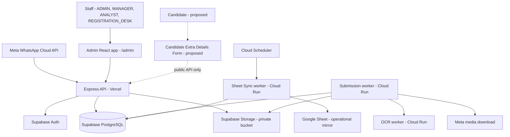

- **Admin frontend**: React / TypeScript / Vite, served at `/admin`.
- **Backend API**: Express + Prisma, the only component with database and Supabase service-role access.
- **Submission worker**: claims WhatsApp submissions from PostgreSQL (leases, retries), runs OCR, classification, identity matching and placement.
- **OCR worker**: stateless text extraction, called with a Google identity token.
- **Sheet Sync worker**: one-way reconciliation to the Google Sheet.
- **Candidate Extra Details Form** (dotted): proposed.

---

## Repository Structure

```text
EmlynkWABot/
├── admin/                  Admin dashboard (React + TypeScript + Vite), served at /admin
├── candidate-form/         PROPOSED: Candidate Extra Details public form (separate Vercel project)
├── api/index.js            Vercel function entry (the Express app, no worker)
├── src/                    Shared Express backend
│   ├── app.js              Long-running entry (API + submission worker), local / Docker
│   ├── httpHandler.js      HTTP-only app (Vercel)
│   ├── worker.js           Submission worker entry (Cloud Run)
│   ├── sheetSyncWorker.js  Google Sheet Sync worker entry (Cloud Run)
│   ├── config/  middleware/  routes/  services/  utils/  auth/
├── prisma/                 schema.prisma, migrations/, seed.js
├── ocr-worker/             OCR text-extraction service (Cloud Run)
├── deploy/                 Cloud Run environment files
├── scripts/                Operator tools (createUser.js, checkDatabaseConnection.js, diagnoseDocument.js, ...)
├── test/                   Backend tests (node:test, PostgreSQL via PGlite)
├── Docs/                   Architecture and feature documentation
├── vercel.json             Vercel project (admin build + API rewrites)
├── Dockerfile              Backend / worker image
└── docker-compose.yml      Local PostgreSQL 16
```

---

## Deployment Architecture

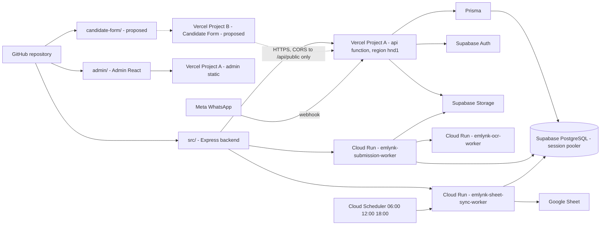

| Service | Where | Notes |
|---|---|---|
| Admin SPA + Express API + WhatsApp webhook | Vercel Project A (`api/index.js`, region `hnd1`) | Rewrites `/auth`, `/api`, `/whatsapp`, `/health` to the function; `/admin` is static |
| Candidate Extra Details Form | Vercel Project B (**proposed**) | Same repository, root `candidate-form/`, its own build and environment (public API base URL only) |
| Submission worker | Cloud Run `emlynk-submission-worker` (asia-northeast1) | Polls PostgreSQL, 2 OCR requests in flight |
| OCR worker | Cloud Run `emlynk-ocr-worker` (asia-south1) | Private, IAM-invoked |
| Sheet Sync worker | Cloud Run `emlynk-sheet-sync-worker` (asia-south1) | Single writer; scheduled by Cloud Scheduler |
| Database, Auth, Storage | Supabase | PostgreSQL through the Supavisor session pooler |

Details: [`Docs/08-cloud-deployment.md`](Docs/08-cloud-deployment.md).

---

## Database Architecture

PostgreSQL (Supabase) is the **source of truth**. All access goes through the backend with Prisma; no browser application connects to the database. `auth.users` belongs to Supabase Auth. Supabase's public API roles (`anon`, `authenticated`) have no privileges on application tables, and row-level security is enabled with no public policies on every table except `candidate_allocation` (privileges revoked only; enabling RLS there is a proposed hardening step).

| Model / table | Status | Purpose | Main relationships |
|---|---|---|---|
| `User` / `user` | Existing | Staff profile, role, status | `auth_user_id` -> `auth.users`; actor of audit entries, calls, follow-ups, allocations |
| `Candidate` / `candidate` | Existing | Core candidate identity (`passport_id` PK, `unique_id`, NIC, WhatsApp, passport and job data) | Parent of every candidate table |
| `CandidateAdditionalDetails` / `candidate_additional_details` | Existing | Extended personal / family / size details | 1 : 0..1 with candidate |
| `CandidateStage` / `candidate_stages` | Existing | Seven pipeline stages per candidate | many : 1 candidate |
| `CandidateAllocation` / `candidate_allocation` | Existing | Work Allocation: candidate -> Analyst | 0..1 per candidate; -> `user` |
| `CandidateCallLog` / `candidate_call_logs` | Existing | Candidate History calls (`ANSWERED` / `NO_ANSWER`) | -> candidate, -> `user` |
| `CallLogFollowUp` / `call_log_follow_up` | Existing | Need Attention follow-ups | -> call log, -> `user` (flagged / completed by) |
| `Document` / `documents` | Existing | Stored candidate documents and their status | -> candidate, -> `temporary_data` (optional) |
| `TemporaryData` / `temporary_data` | Existing | Every WhatsApp submission and its processing / review state | -> candidate (optional) |
| `AuditLog` / `audit_logs` | Existing, **modified (proposed)** | Append-only action history | -> `user`; candidate / document / submission by plain ID (no FK) |
| `RateLimit` / `rate_limits` | Existing | Shared rate-limit counters | none |
| `SheetSyncQueue` / `sheet_sync_queue` | Existing | Sheet outbox of changed candidates (DB triggers) | logical `unique_id`, no FK |
| `SheetSyncRun` / `sheet_sync_runs` | Existing | Reconcile / test-connection runs | none |
| `SheetSyncState` / `sheet_sync_state` | Existing | Worker state, destinations, writer lease (one row) | none |
| `JobType` / `job_type` | **Proposed** | Controlled job-type list | parent of Job |
| `Agent` / `agent` | **Proposed** | Broker in one country | many-to-many Company; parent of Job |
| `Company` / `company` | **Proposed** | Employer | many-to-many Agent; parent of Job |
| `AgentCompany` / `agent_company` | **Proposed** | Agent <-> Company link | -> agent, -> company |
| `JobCodeCounter` / `job_code_counter` | **Proposed** | Yearly counter for `JOB-YYYY-NNNNNN` | none |
| `Job` / `job` | **Proposed** | Recruitment requirement | -> company, agent, job type |
| `JobCandidate` / `job_candidate` | **Proposed** | Candidate on a Job | -> job, -> candidate, -> `user` |

### Proposed database changes (summary)

- **New tables:** `job_type`, `agent`, `company`, `agent_company`, `job_code_counter`, `job`, `job_candidate`.
- **Modified:** `audit_logs` gains `entity_type` / `entity_id` (Agent / Company / Job history) and, if confirmed, `actor_type` with a nullable `admin_id` (to audit candidate self-updates).
- **Candidate Extra Details form:** **no new table** and no change to `candidate` or `candidate_additional_details` columns; it reuses the existing Additional Details row.
- **Sheet Sync:** a capture trigger on `candidate_additional_details` when the owner supplies the Sheet column mapping.
- **Migration order:** A (Agent / Company foundation + audit entity columns), B (Job), C (audit actor, if confirmed), D (Sheet capture for Additional Details, with the mapping).

Full inventory, relationships, model map, migration plan, invariants and senior-review items: [`Docs/MASTER_DATABASE_ARCHITECTURE.md`](Docs/MASTER_DATABASE_ARCHITECTURE.md).

---

## Master ER Diagram

All tables of the application database. Solid lines are real foreign keys; dotted lines are **logical references without a foreign key**. Entities whose key is marked `PROPOSED` (and the `PROPOSED` columns of `AUDIT_LOG`) are not implemented yet; everything else exists today. Only keys and identity / status columns are shown.

```mermaid
erDiagram
    %% STAFF / AUTH
    AUTH_USERS ||--|| USER : "auth_user_id"
    USER ||--o{ AUDIT_LOG : "admin_id"
    USER ||--o{ CANDIDATE_CALL_LOG : "admin_id"
    USER ||--o{ CALL_LOG_FOLLOW_UP : "flagged_by"
    USER |o--o{ CALL_LOG_FOLLOW_UP : "completed_by"
    USER ||--o{ CANDIDATE_ALLOCATION : "analyst_id"

    %% CANDIDATE
    CANDIDATE ||--o| CANDIDATE_ADDITIONAL_DETAILS : "passport_id"
    CANDIDATE ||--o| CANDIDATE_ALLOCATION : "passport_id"
    CANDIDATE ||--o{ CANDIDATE_STAGE : "passport_id"
    CANDIDATE ||--o{ CANDIDATE_CALL_LOG : "passport_id"
    CANDIDATE_CALL_LOG ||--o{ CALL_LOG_FOLLOW_UP : "call_log_id"

    %% DOCUMENTS
    CANDIDATE ||--o{ DOCUMENT : "passport_id"
    CANDIDATE |o--o{ TEMPORARY_DATA : "passport_id, optional"
    TEMPORARY_DATA |o--o{ DOCUMENT : "temporary_id, optional"

    %% AUDIT (logical references, no FK)
    CANDIDATE ||..o{ AUDIT_LOG : "logical: passport_id"

    %% SHEET SYNC (logical references, no FK)
    CANDIDATE ||..o{ SHEET_SYNC_QUEUE : "logical: unique_id"

    %% NEW AGENT / COMPANY / JOB (proposed)
    AGENT ||--o{ AGENT_COMPANY : "agent_id"
    COMPANY ||--o{ AGENT_COMPANY : "company_id"
    COMPANY ||--o{ JOB : "company_id"
    AGENT ||--o{ JOB : "agent_id"
    JOB_TYPE ||--o{ JOB : "job_type_id"
    JOB ||--o{ JOB_CANDIDATE : "job_id"
    CANDIDATE ||--o{ JOB_CANDIDATE : "passport_id"
    USER ||--o{ JOB_CANDIDATE : "assigned_by_id"
    JOB ||..o{ AUDIT_LOG : "logical: entity_id"

    AUTH_USERS {
        uuid id PK "Supabase-managed"
    }
    USER {
        string admin_id PK
        uuid auth_user_id UK
        string email UK
        string role
        string status
    }
    AUDIT_LOG {
        string audit_id PK
        string admin_id FK "PROPOSED nullable for candidate actor"
        string action
        string passport_id "plain ID"
        string temporary_id "plain ID"
        string document_id "plain ID"
        string entity_type "PROPOSED"
        string entity_id "PROPOSED"
        string actor_type "PROPOSED"
    }
    CANDIDATE {
        string passport_id PK
        string unique_id UK
        string nic UK
        string whatsapp_number "partial unique"
    }
    CANDIDATE_ADDITIONAL_DETAILS {
        string passport_id PK, FK
        datetime updated_date
    }
    CANDIDATE_ALLOCATION {
        string passport_id PK, FK
        string analyst_id FK
    }
    CANDIDATE_STAGE {
        string passport_id PK, FK
        string stage PK
        boolean completed
        string job_id "free text, unrelated to Job"
    }
    CANDIDATE_CALL_LOG {
        string call_log_id PK
        string passport_id FK
        string admin_id FK
        string call_outcome
    }
    CALL_LOG_FOLLOW_UP {
        string follow_up_id PK
        string call_log_id FK
        string flagged_by FK
        string completed_by FK
        string status
    }
    DOCUMENT {
        string document_id PK
        string passport_id FK
        string temporary_id FK
        string document_type
        string verification_status
    }
    TEMPORARY_DATA {
        string temporary_id PK
        string passport_id FK
        string processing_status
        string message_id UK
    }
    RATE_LIMIT {
        string key PK
        int hits
    }
    SHEET_SYNC_QUEUE {
        string queue_id PK
        string unique_id "logical candidate ref"
        string status
    }
    SHEET_SYNC_RUN {
        string run_id PK
        string kind
        string status
    }
    SHEET_SYNC_STATE {
        string state_id PK "single row"
        string active_destination_key
    }
    AGENT {
        string agent_id PK "PROPOSED"
        string country_code
        string status
    }
    COMPANY {
        string company_id PK "PROPOSED"
        string name_key UK
        string status
    }
    AGENT_COMPANY {
        string agent_id PK, FK "PROPOSED"
        string company_id PK, FK
        string status
    }
    JOB_TYPE {
        string job_type_id PK "PROPOSED"
        string name_key UK
    }
    JOB {
        string job_id PK "PROPOSED"
        string job_code UK
        string company_id FK
        string agent_id FK
        string job_type_id FK
        string status
    }
    JOB_CANDIDATE {
        string job_id PK, FK "PROPOSED"
        string passport_id PK, FK
        string assigned_by_id FK
    }
    JOB_CODE_COUNTER {
        int year PK "PROPOSED"
        int last_value
    }
```

Standalone tables: `RATE_LIMIT`, `SHEET_SYNC_RUN`, `SHEET_SYNC_STATE` and `JOB_CODE_COUNTER` have no relationships by design. `CANDIDATE_ALLOCATION` (Work Allocation) and `JOB_CANDIDATE` (Job assignment) are separate relations and never reference each other.

---

## Master Visual Database Architecture

The **Master ER diagram** answers *"What are the exact tables and database relationships?"*. The **Master Visual Database Architecture** below answers *"How do the main parts of the system connect, and how does data move through the database?"*. It adds no table, relation or rule: the ER diagram and [`Docs/MASTER_DATABASE_ARCHITECTURE.md`](Docs/MASTER_DATABASE_ARCHITECTURE.md) remain the reference.

Entry points sit at the top, the database domains (A-F) inside PostgreSQL, and the Sheet sync services below. The Candidate Extra Details Form only **verifies** against `candidate` and only **writes** `candidate_additional_details`.

```mermaid
flowchart TB
    subgraph ENTRY["ENTRY POINTS"]
        ADMIN["Admin Dashboard - staff"]
        FORM["Candidate Extra Details Form - Vercel Project B - PROPOSED"]
        WA["WhatsApp Bot - Meta webhook"]
        SUBW["Background Submission Worker - Cloud Run"]
    end

    subgraph BACKEND["BACKEND - Vercel Project A"]
        API["Existing Express API - /api/admin"]
        PAPI["Public Candidate API - /api/public/candidate-details - PROPOSED"]
        HOOK["WhatsApp webhook - /whatsapp/webhook"]
    end

    ADMIN --> API
    FORM --> PAPI
    WA --> HOOK

    subgraph DB["POSTGRESQL - SOURCE OF TRUTH"]
        subgraph STAFF["A. STAFF / AUTH"]
            SUPA["Supabase Auth - auth.users"]
            USER["user"]
            AUDIT["audit_logs - append-only"]
            RL["rate_limits"]
        end

        subgraph CORE["B. CANDIDATE CORE"]
            CAND["candidate"]
            CAD["candidate_additional_details"]
            STAGE["candidate_stages"]
        end

        subgraph OPS["C. CANDIDATE OPERATIONS"]
            ALLOC["candidate_allocation"]
            CALL["candidate_call_logs"]
            FOLLOW["call_log_follow_up"]
            WARN["WORK ALLOCATION != JOB ASSIGNMENT"]
        end

        subgraph DOCS["D. DOCUMENT PROCESSING"]
            TEMP["temporary_data"]
            DOC["documents"]
        end

        subgraph SYNCT["E. GOOGLE SHEET SYNC TABLES"]
            Q["sheet_sync_queue"]
            RUNS["sheet_sync_runs"]
            STATE["sheet_sync_state"]
        end

        subgraph JOBS["F. AGENT / COMPANY / JOB - PROPOSED"]
            AGENT["agent - PROPOSED"]
            COMPANY["company - PROPOSED"]
            AC["agent_company - PROPOSED"]
            JT["job_type - PROPOSED"]
            JOB["job - PROPOSED"]
            JC["job_candidate - PROPOSED"]
            JCC["job_code_counter - PROPOSED"]
        end
    end

    subgraph SHEETSIDE["SHEET SYNC - OUTSIDE THE DATABASE"]
        SCHED["Cloud Scheduler 06:00 12:00 18:00"]
        SYNCNOW["Admin - Sync Now"]
        SHEETW["Sheet Sync Worker - Cloud Run"]
        GSHEET["Google Sheet"]
    end

    %% Entry points into the database
    API -->|"general authenticated DB access - role-checked, Analyst-scoped"| DB
    API -.->|"rate-limit counters"| RL
    HOOK -->|"records submission"| TEMP
    SUBW -->|"claims and processes"| TEMP
    PAPI -->|"verify only"| CAND
    PAPI -->|"read / update extra details"| CAD

    %% A. Staff / auth
    SUPA -->|"auth_user_id"| USER
    USER -->|"admin_id"| AUDIT

    %% B. Candidate core
    CAND --> CAD
    CAND --> STAGE

    %% C. Candidate operations
    CAND --> ALLOC
    CAND --> CALL
    CALL --> FOLLOW
    USER -->|"analyst_id"| ALLOC
    USER -->|"admin_id"| CALL
    USER -->|"flagged_by / completed_by"| FOLLOW
    ALLOC -.- WARN
    WARN -.- JC

    %% D. Document processing (documents references temporary_data and candidate)
    TEMP -->|"stored as - documents.temporary_id"| DOC
    DOC -->|"passport_id"| CAND
    TEMP -->|"passport_id, optional"| CAND

    %% Audit logical references (no foreign key)
    CAND -.->|"logical: passport_id"| AUDIT

    %% E. Google Sheet sync
    CAND -->|"capture trigger"| Q
    STAGE -->|"capture trigger"| Q
    DOC -->|"capture trigger"| Q
    CAD -.->|"proposed capture trigger"| Q
    ADMIN --> SYNCNOW
    SYNCNOW -->|"RECONCILE request"| RUNS
    SCHED -->|"RECONCILE request"| RUNS
    Q -->|"settled by the next run"| RUNS
    RUNS --> SHEETW
    STATE --> SHEETW
    SHEETW -->|"one-way: database to Sheet"| GSHEET

    %% F. Agent / Company / Job (proposed)
    AGENT --> AC
    COMPANY --> AC
    AGENT -->|"responsible Agent"| JOB
    COMPANY -->|"owns"| JOB
    JT --> JOB
    JOB --> JC
    CAND --> JC
    USER -->|"assigned_by"| JC
    JCC -.->|"used to generate job_code"| JOB
    JOB -.->|"logical: entity_type / entity_id"| AUDIT

    classDef existing fill:#1f2937,stroke:#64748b,color:#fff;
    classDef proposed fill:#3b2f10,stroke:#d6a84b,color:#fff;
    classDef application fill:#153047,stroke:#3b82f6,color:#fff;
    classDef external fill:#17352b,stroke:#34a853,color:#fff;
    classDef warning fill:#3b1f1f,stroke:#e35d6a,color:#fff;
    class USER,AUDIT,RL,CAND,CAD,STAGE,ALLOC,CALL,FOLLOW,TEMP,DOC,Q,RUNS,STATE existing;
    class AGENT,COMPANY,AC,JT,JOB,JC,JCC,FORM,PAPI proposed;
    class ADMIN,API,HOOK,SYNCNOW application;
    class SUPA,WA,SUBW,SCHED,SHEETW,GSHEET external;
    class WARN warning;
```

Legend: dark grey = existing table, amber = proposed (not implemented), blue = application / backend, green = external system or worker, red = rule or warning. **This diagram is not the foreign-key reference:** exact foreign keys and cardinalities are in the Master ER diagram. Solid arrows show data access, ownership or data flow (some of them are also foreign keys, which the ER diagram shows precisely). Dotted arrows are logical references without a foreign key, or proposed relationships and captures.

---

## Candidate Domain

### Registration

- **WhatsApp number**: a fixed, non-removable `+` followed by the country code and number; any international number (`+94771234567`, `+447911123456`, `+61412345678`).
- **Required**: WhatsApp number, NIC, passport issue date, passport expiry date, job type(s), job experience. **Optional**: address.
- Fields carry short hover / click hints (for example the accepted passport-number format), not inline paragraphs.
- Registration: ADMIN, MANAGER, REGISTRATION_DESK. A new candidate is unallocated.

### Candidate stages

Seven stages, tracked independently in `candidate_stages` (any subset can be complete):

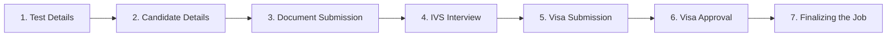

Candidate Details and Document Submission complete automatically from the candidate's data and documents; the others are completed by staff. Test Details also stores a free-text job ID, test result and test date (unrelated to the proposed Job module).

### Candidate Pool and search

The Candidates list searches in PostgreSQL **before** pagination (100 per page) across name, passport ID, unique ID, NIC, contact and WhatsApp numbers. Every word must match a field (case-insensitive substring); a Sri Lankan phone word also matches its `07…` / `947…` form. Search and page stay in the URL. An Analyst's list contains only their allocated candidates. Details: [`Docs/CANDIDATE_PAGINATION_AND_PERFORMANCE.md`](Docs/CANDIDATE_PAGINATION_AND_PERFORMANCE.md).

### Candidate Additional Details

One optional row per candidate in `candidate_additional_details`, edited in the candidate's **Additional details** panel: name according to passport, permanent address, birthday, T-shirt / pant / shoe size, father and mother (alive, name, birthday), marital status, wife (married only), up to three children (not when single, in order), other job skills. Rules: a parent's name is required when alive; a wife's name is required when married; dates cannot be in the future. Saves are full replacements, checked against the version that was loaded (`409` if someone else saved first), and only real changes are audited.

### Work Allocation

`candidate_allocation` holds at most one Analyst per candidate. The Work Allocation page (ADMIN, MANAGER) lists Unallocated / Allocated candidates with server-side search and paging, and assigns a selection to one or several Analysts (counts must add up), reassigns (explicit confirmation) or unassigns. Each request is one transaction with row locks; every change is audited (`ASSIGN_CANDIDATE`, `REASSIGN_CANDIDATE`, `UNASSIGN_CANDIDATE`). Only active Analysts can receive candidates. The Analyst's access follows the allocation on the very next request.

Work Allocation flow:

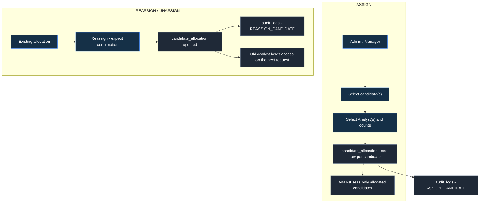

### Candidate History and Need Attention

Each candidate page opens a **Candidate History** drawer: one newest-first timeline of call logs (soft amber), **No Answer** attempts (soft red) and candidate activity from existing records (soft green: documents, registration, details, additional details, stage saves). Colour is never the only signal.

- **Add a call**: a compact, collapsible form; **No Answer** records an unanswered attempt without a note (it counts as a call); **Need Attention** creates the call and its open follow-up in one request.
- **Need Attention page** (`/admin/follow-ups`): open follow-ups grouped by candidate, with Open and Completed views. **Mark complete**: every candidate role. **Delete** (follow-up row only): ADMIN and MANAGER. Audited as `FLAG_FOLLOW_UP`, `COMPLETE_FOLLOW_UP`, `DELETE_FOLLOW_UP`.

Details: [`Docs/20-candidate-management.md`](Docs/20-candidate-management.md).

---

## Agent / Company / Job Domain (Proposed)

> Status: Proposed / approved architecture. Implementation pending.

| Entity | Rules |
|---|---|
| **Agent** | Broker in exactly one country; name not unique; `ACTIVE` / `INACTIVE`; works with many Companies; responsible for many Jobs |
| **Company** | Employer; unique normalised name; optional informational country; many Agents; owns Jobs |
| **AgentCompany** | Many-to-many link, `ACTIVE` / `INACTIVE` (ended, never deleted) |
| **JobType** | Controlled list, seeded from the job types already typed on candidates |
| **Job** | Internal `job_id` + human-readable `job_code` (`JOB-YYYY-NNNNNN`, yearly counter); one Company, one responsible Agent, one Job Type; **country copied from the Agent**; optional `vacancies >= 1`; `PROCESSING` -> `COMPLETED` / `CANCELLED` (cancel reason required), reopen allowed |
| **JobCandidate** | A candidate on a Job; many Jobs over time but **only one `PROCESSING` Job at a time** (409 otherwise); removal deletes the link (history in the audit log) |

Further rules: a Job needs an `ACTIVE` Agent-Company link; Agents and Companies with `PROCESSING` Jobs cannot be deactivated; nothing is hard-deleted; Analysts get read-only, backend-scoped access to Jobs that contain their allocated candidates. **Work Allocation and Job assignment are different concepts**: `candidate_allocation` says which Analyst handles a candidate, `job_candidate` says which Job the candidate belongs to.

Job flow (proposed):

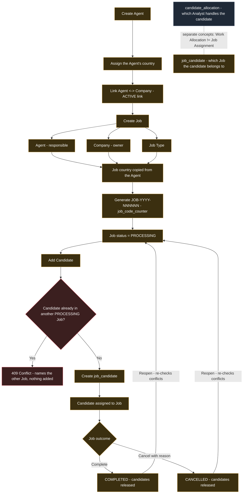

Specification (concurrency locking, Job code generation, API, UI): [`Docs/CLIENT_AGENT_JOB_ARCHITECTURE.md`](Docs/CLIENT_AGENT_JOB_ARCHITECTURE.md).

---

## Candidate Extra Details Form Architecture (Proposed)

> Status: Proposed / approved architecture. Implementation pending.

A separate public React app (`candidate-form/`, **Vercel Project B**) built from the same repository. It calls the existing backend (Vercel Project A) and uses the same PostgreSQL database. It is **not** registration, not a new candidate model and not general candidate editing: it is a second interface to the **same** `candidate_additional_details` row the Admin panel uses. **No duplicate table is needed.**

- **Verification**: Passport Number (trimmed, no prefix required, matched like the existing lookup: exact, else a single case-insensitive match) and WhatsApp Number (must start with `+`, compared as digits with the stored number). Both must belong to the same existing candidate. Any failure returns one generic message: *"We couldn't verify your details. Please check your Passport Number and WhatsApp Number and try again."*
- **Session**: a short-lived, HMAC-signed token from the backend (no session table), re-checked on every request.
- **Scope**: only the 19 Additional Details fields can be read or changed. Passport and WhatsApp are verification values, not editable. Candidate record, stages, allocation, Jobs, documents and staff data are unreachable.
- **API**: a separate route boundary, `/api/public/candidate-details/*` (verify, read, save), with its own strict rate limits, CORS restricted to the form's origin, a small payload limit and generic errors. `/api/admin/*` is unchanged.
- **Secrets**: the form project holds only the public API base URL: no database URL, no Supabase keys, no direct Supabase or Google access from the candidate's browser.
- **Admin**: no new workflow; staff see the latest values in the existing Additional Details panel.
- **Sheet**: mapped fields (mapping to be supplied by the owner) reach the Sheet through the normal database -> queue -> worker path, never directly from the form.
- **Audit**: recommended additive change so self-updates are audited with `actor_type = CANDIDATE` (needs confirmation).

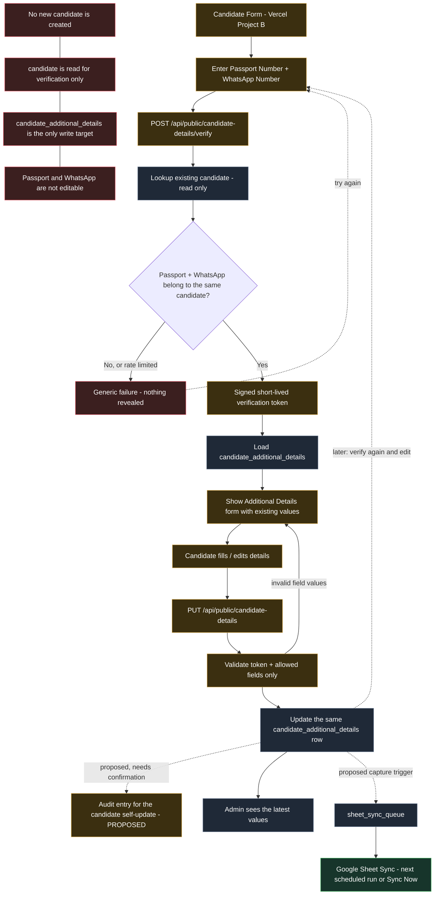

Full design (field mapping, rate limits, CORS, environment separation, alternatives): [`Docs/MASTER_DATABASE_ARCHITECTURE.md`](Docs/MASTER_DATABASE_ARCHITECTURE.md#6-candidate-extra-details-public-form-proposed).

### Data ownership

- **PostgreSQL** is the source of truth.
- **Admin** reads and writes through the backend.
- **Candidate Form** reads and writes only the allowed Candidate Additional Details, through the backend. It never accesses the database with credentials, never writes Google Sheets, never creates a candidate, and never changes stages, allocations or Jobs.
- **Google Sheet** is an operational mirror (database -> Sheet only).
- **OCR** is a document-processing service with no database or storage access.

---

## Google Sheet Sync

The operational Google Sheet is **`Emlynk Candidate Operational Mirror`**. The database is always the source of truth; the Sheet is a **one-way** mirror (Database -> Google Sheet). Edits made in the Sheet never change the database and are repaired by the next sync.

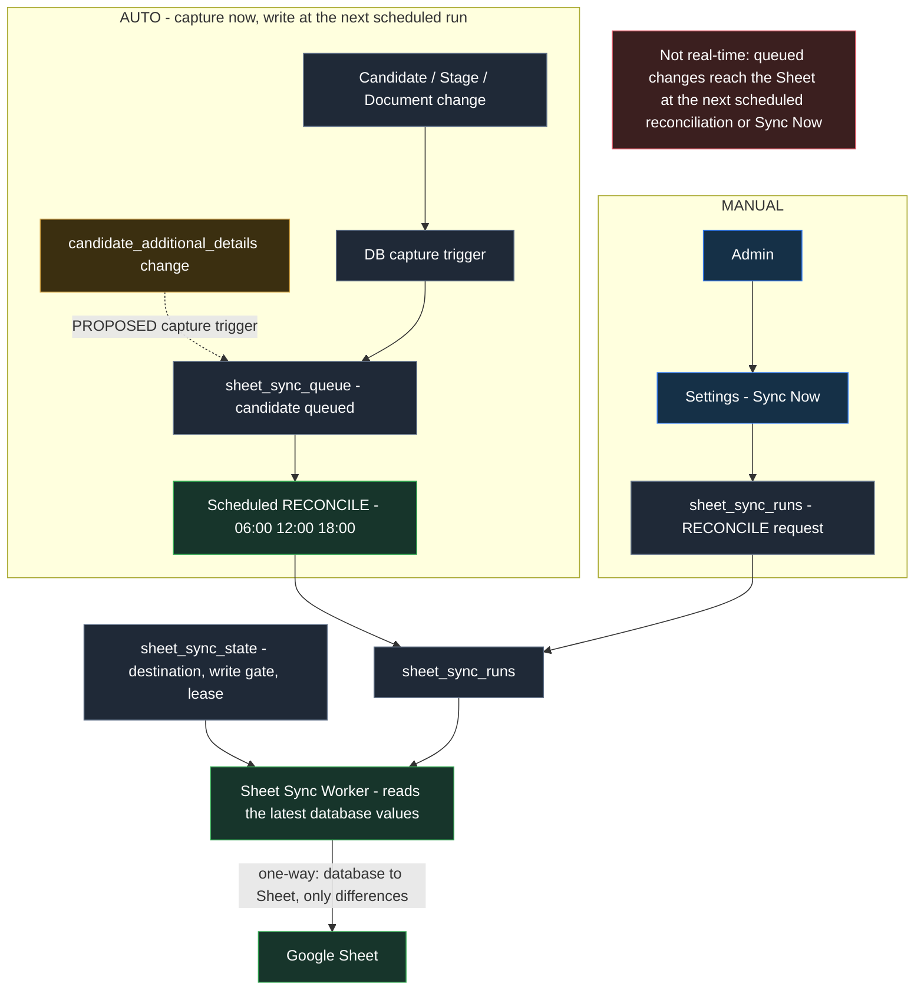

- **Capture**: triggers on `candidate`, `candidate_stages` and `documents` queue the changed candidate in `sheet_sync_queue`.
- **Automatic sync**: a full reconciliation at **06:00, 12:00 and 18:00 Asia/Colombo**; changes between runs are written together at the next run. Nothing syncs in real time.
- **Manual sync**: **Settings -> Google Sheet Sync -> Sync Now** reads the latest database values and updates the Sheet.
- **Write gate**: nothing is written unless `SHEET_SYNC_ENABLED=true`; otherwise Sync Now is a dry run reporting what it would change.
- **Sync destination**: when several Sheets are configured, ADMIN chooses one; it is validated (connection, tab, headers) before it becomes active, and the change is audited. Switching never copies Sheet data into the database. Credentials and spreadsheet IDs never reach the browser.
- **Document status mapping**: a mirrored document field shows its submitted date, or `Not Submitted`; no document field is left blank.
- **Safety**: the internal candidate ID (not a row position or an editable value) matches rows; headers are validated before writing; a deletion guard protects against mass removal.
- **Additional Details** are **not mapped** to the Sheet today. When the owner supplies the column mapping, the columns, the mapper and a capture trigger on `candidate_additional_details` are added together (see the master database document, section 5).

Details: [`Docs/GOOGLE_SHEET_CANDIDATE_SYNC_ARCHITECTURE.md`](Docs/GOOGLE_SHEET_CANDIDATE_SYNC_ARCHITECTURE.md), [`Docs/GOOGLE_SHEET_SYNC_FEATURE.md`](Docs/GOOGLE_SHEET_SYNC_FEATURE.md).

---

## Storage / Document Flow

### WhatsApp intake

1. **Verification** (`GET /whatsapp/webhook`): `hub.mode === "subscribe"` and `hub.verify_token` checked; `hub.challenge` returned.
2. **Ingestion** (`POST /whatsapp/webhook`): Meta's HMAC SHA-256 signature is verified; the submission is recorded in `temporary_data` and stored in temporary storage; the webhook answers 200 at once.
3. **Background processing**: the submission worker claims the row (lease, retries), downloads media, runs OCR, classifies the document, matches the sender's WhatsApp number and the passport to a candidate, and places the file.

### Temporary, pending and uncleared documents

- A document confidently linked to exactly one candidate goes to that candidate's folder and becomes a `documents` row.
- Anything that needs a person (identity, quality, conflict, a second file of a type that is already verified) is copied to `pending/` and waits in the **Review Queue**.
- Files from a number that matches no candidate go to `pending/unidentified/…/uncleared-docs` for review.
- Failed processing is retried by the worker and finally shown as a failed submission that staff can retry.
- Storage is a private Supabase bucket; the browser never receives a storage credential (files are streamed through the API).

### Single scan rule

A candidate has **one** scan slot (`SCAN`), not separate agreement, affidavit or contract slots. A new document requirement is a new document type, not a new scan category.

### Document confidence decision engine

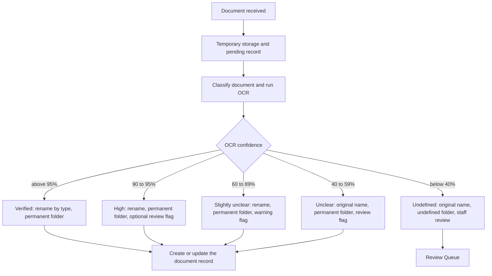

### Police report 21-day countdown

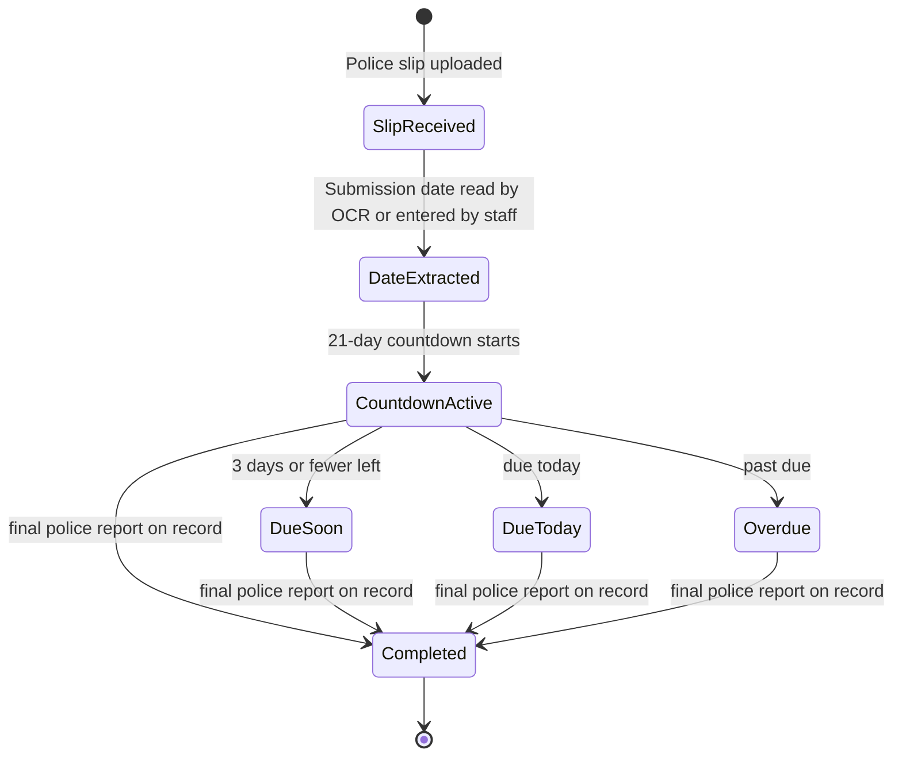

The Police Workflow page shows every candidate's status; once the final police report is on record the countdown stops.

### OCR service

`ocr-worker/` on Google Cloud Run, isolated from the backend. It extracts passport fields (MRZ with check digits and printed fields), the police slip submission date, and text from police reports, medical certificates and scanned PDFs. Two jobs run per instance with a small waiting queue; when full it answers `503 OCR_BUSY` and the submission is retried. Details: [`Docs/05-ocr-document-processing.md`](Docs/05-ocr-document-processing.md).

---

## Authentication and Authorization

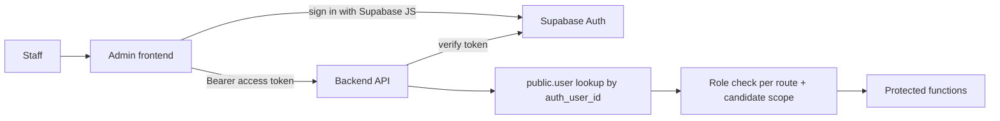

- **Authentication (Supabase Auth)**: sign-in, sessions, invitation and password-recovery emails. The backend verifies every access token with Supabase and never stores passwords or tokens.
- **Authorization (backend RBAC)**: the backend loads the `user` row (it must be `ACTIVE`) on every request, checks the route's allowed roles, and applies the Analyst candidate scope inside the database queries.
- **Invite User** (Settings, ADMIN): enter an email, choose any of the four roles; Supabase sends the setup link; the invited user sets a password and the application loads their profile and role.

---

## Admin Dashboard

Served at `/admin`. Full guide: [`Docs/09b-admin-dashboard-guide.md`](Docs/09b-admin-dashboard-guide.md).

| Area | What it is | Roles |
|---|---|---|
| **Overview** | Counts and links into pending work | ADMIN, MANAGER, ANALYST (scoped) |
| **Documents** | Stored documents and their status | ADMIN, MANAGER, ANALYST (scoped) |
| **Review Queue** | Submissions waiting for a person | ADMIN, MANAGER, ANALYST (scoped) |
| **Candidates** | Candidate Pool, registration, stages, additional details, documents, Candidate History | all roles (Analyst scoped) |
| **Need Attention** | Flagged calls, grouped by candidate | all roles (Analyst scoped) |
| **Work Allocation** | Assign candidates to Analysts | ADMIN, MANAGER |
| **Missing Documents** | Incomplete candidates and what they lack | ADMIN, MANAGER, ANALYST (scoped) |
| **Police Workflow** | The 21-day police report countdown | ADMIN, MANAGER, ANALYST (scoped) |
| **Daily Report** | Summary and Summary by Roles for a business day, PDF export | ADMIN, MANAGER, ANALYST (scoped); Summary by Roles: ADMIN, MANAGER |
| **Audit Logs** | Append-only action history | ADMIN |
| **Settings** | Change Roles, Invite User, Google Sheet Sync | ADMIN |

**Daily Report**: one business day (Asia/Colombo) at a time with Previous / Next / Today / date picker. *Summary* shows candidates registered and completed, visa completed, calls taken (No Answer counts), documents submitted (WhatsApp / manual), incomplete candidates by stage and police status (current state). *Summary by Roles* shows calls and manual uploads by staff currently holding a role. Known limits are stated on the page (current-state sections, current roles, older registrations without "registered by").

**Settings**: tabs **Change Roles** (`/admin/settings/roles`), **Invite User** (`/admin/settings/invite`) and **Google Sheet Sync** (`/admin/settings/sheet-sync`, with scheduled and manual runs shown separately, Test Connection, Sync Now and the sync destination).

**Theme**: Light (default) and Dark, driven by colour tokens in `admin/src/index.css`.

---

## Security

- **Credential isolation**: database URLs, Supabase service-role key, Meta and Google credentials live only in server environments; they are never committed or sent to a browser.
- **Supabase-managed credentials**: the application stores no passwords or session tokens.
- **Backend RBAC and candidate scope**: every protected route checks the role from the database; Analyst access is limited in the queries (out-of-scope candidates answer 404).
- **Rate limiting**: PostgreSQL-backed counters shared by every instance (`rate_limits`). Staff API and `/auth`: 1000 requests per 15 minutes per client IP; the admin static router has its own counter. If the store is unreachable the request fails rather than passing unlimited. The proposed public form gets its own, much stricter limits.
- **Public database roles**: privileges revoked from Supabase's `anon` and `authenticated` roles; row-level security enabled with no public policies on every table except `candidate_allocation` (proposed hardening).
- **Generic error responses**: authentication and verification failures never reveal whether an account or record exists.
- **Data-overwrite prevention**: low-confidence OCR results and unverified identity matches never overwrite trusted candidate data.
- **Append-only audit trail**: `audit_logs` rejects update, delete and truncate.
- **WhatsApp**: every webhook is HMAC-verified.
- **Google Sheet isolation**: Google access exists only in the Sheet Sync worker (keyless, its own service account).
- **Security headers**: helmet with a strict CSP; document previews are sandboxed.

---

## Technology Stack

| Layer | Technology |
|---|---|
| Runtime | Node.js `^22.18.0 \|\| >=23.6.0` (ES modules; loads the generated TypeScript Prisma client) |
| Web framework | Express 5 |
| Database | PostgreSQL 16 (Supabase in production, Docker locally) |
| ORM | Prisma (`@prisma/adapter-pg`) |
| Authentication | Supabase Auth |
| Object storage | Supabase Storage (private bucket) |
| OCR | `ocr-worker/` on Google Cloud Run (Tesseract.js, PDF text extraction) |
| Messaging | Meta WhatsApp Business API |
| Sheet sync | Google Sheets API, Cloud Run worker, Cloud Scheduler |
| Admin dashboard | React, TypeScript, Vite, Tailwind CSS |
| Hosting | Vercel (admin + API), Google Cloud Run (workers) |
| Local database | Docker Compose |

---

## Testing

| Suite | Command | What it covers |
|---|---|---|
| Backend | `npm test` | `node:test`; database tests run on a real PostgreSQL (PGlite) with every migration applied, through the real Prisma client and routers: RBAC, Analyst scope, Work Allocation concurrency, candidates, documents, review, reports, audit, Sheet sync, rate limiting |
| Admin frontend | `npm run admin:test` | Vitest + Testing Library: pages, forms, role visibility |
| Admin type check / build | `npm --prefix admin run typecheck`, `npm run admin:build` | TypeScript and the production build |
| OCR worker | `npm run ocr:test` | OCR service behaviour and limits |

Load-testing strategy (planned, not run against production): see the Docs folder.

---

## Environment and Setup

### Prerequisites

- Node.js 22.18+ (or 23.6+); the server checks it at startup.
- npm 9+, Docker Desktop (Compose), Git.

### Environment configuration

Create `.env` in the project root (`.env.example` lists every setting the server checks at startup):

```env
PORT=3000

# PostgreSQL (local Docker or the Supabase session pooler)
DATABASE_URL="Add database URL here"

# Supabase project (Auth + Storage)
SUPABASE_URL="Add Supabase project URL here"
SUPABASE_SERVICE_ROLE_KEY="Add Supabase service-role key here"
SUPABASE_BUCKET="Add Supabase storage bucket name here"

# WhatsApp Business API
WHATSAPP_VERIFY_TOKEN="Add whatsapp verify token here"

# OCR service: locally http://127.0.0.1:8080, in production the Cloud Run URL
OCR_SERVICE_URL="http://127.0.0.1:8080"

# Optional: required document types (must include PASSPORT)
# REQUIRED_DOCUMENT_TYPES=PASSPORT,POLICE_REPORT,MEDICAL
```

The proposed Candidate Form adds two backend-only settings (`CANDIDATE_FORM_ORIGIN`, `CANDIDATE_FORM_TOKEN_SECRET`); the form project itself only needs its public API base URL.

> [!CAUTION]
> Never commit `.env` files or real credentials. Service-role keys and other secrets are runtime configuration only.

### Database setup

```bash
docker compose up -d          # local PostgreSQL 16
npm install                   # also runs prisma generate (client in generated/prisma)
npx prisma migrate deploy     # apply the migrations
npx prisma db seed            # optional sample data
```

Migrations are hand-written SQL applied with `prisma migrate deploy`. `prisma migrate dev` is not used: it cannot replay this repository's migration history on a shadow database.

### Running

```bash
npm start                     # backend + submission worker, http://localhost:3000/health
npm run ocr:install           # once
npm run ocr:start             # OCR service on http://127.0.0.1:8080
npm run admin:install         # once
npm run admin:dev             # http://localhost:5173/admin/ (proxies /auth and /api)
npm run admin:build           # production build served by the backend at /admin
```

---

## API Endpoints

Full reference: [`Docs/09a-admin-dashboard-api.md`](Docs/09a-admin-dashboard-api.md). Errors are `{ message }` or `{ message, errors: [{ field, message }] }`; conflicts add a `code`.

### System and authentication

| Method | Endpoint | Description |
|---|---|---|
| `GET` | `/health` | Service status |
| `GET` | `/admin/*` | Admin dashboard (static; data behind auth) |
| `GET` | `/auth/me` | The signed-in user's profile and role (sign-in itself happens in the browser with Supabase Auth) |
| `POST` | `/auth/complete-invite` | Completes an invited user's setup |

### Admin API (`/api/admin`, authenticated, role-checked, Analyst-scoped)

| Area | Endpoints |
|---|---|
| Dashboard | `GET /overview`, `GET /documents`, `GET /documents/missing`, `GET /clients`, `GET /clients/:passportId`, `GET /police` |
| Reports | `GET /reports/daily`, `/reports/daily/summary`, `/reports/daily/incomplete`, `/reports/daily/roles` (ADMIN, MANAGER), `/reports/monthly` |
| Review | `GET /review`, `GET /review/:id`, `GET /review/:id/file`, `POST /review/:id/approve`, `/keep-pending`, `/remove`, `/retry`, `/replace-verified`, `/keep-as-version`, `/document-type`, `/assign-client`, `DELETE /temporary-documents/:id`, `POST /documents/:documentId/police-date` (ADMIN, MANAGER) |
| Candidates | `GET /candidates`, `POST /candidates`, `GET /candidates/:passportId`, `PUT /candidates/:passportId`, `PUT /candidates/:passportId/stages/:stage`, `POST /candidates/:passportId/documents/upload-target`, `/finalize`, `/:documentId/remove` |
| Additional details | `GET`, `PUT /candidates/:passportId/additional-details` |
| History / Need Attention | `GET`, `POST /candidates/:passportId/call-logs`, `POST /candidates/:passportId/call-logs/:callLogId/follow-up`, `GET /follow-ups`, `POST /follow-ups/:id/complete`, `DELETE /follow-ups/:id` (ADMIN, MANAGER) |
| Work Allocation (ADMIN, MANAGER) | `GET /work-allocation/candidates`, `GET /work-allocation/analysts`, `POST /work-allocation/assign`, `POST /work-allocation/unassign` |
| Administration (ADMIN) | `GET /audit-logs`, `GET /users`, `POST /users/invite`, `PUT /users/:userId/role`, `POST /users/:userId/deactivate`, `GET /settings/sheet-sync/status`, `POST /settings/sheet-sync/test`, `POST /settings/sheet-sync/run`, `GET /settings/sheet-sync/runs/:runId` |

### WhatsApp (`/whatsapp`)

| Method | Endpoint | Protection |
|---|---|---|
| `GET` | `/whatsapp/webhook` | Meta verify token |
| `POST` | `/whatsapp/webhook` | Meta HMAC signature |

### Proposed (not implemented)

- Agent / Company / Job: `/api/admin/agents`, `/companies`, `/job-types`, `/jobs` (+ `complete`, `cancel`, `reopen`, `candidates`). See [`Docs/CLIENT_AGENT_JOB_ARCHITECTURE.md`](Docs/CLIENT_AGENT_JOB_ARCHITECTURE.md).
- Candidate Extra Details: `POST /api/public/candidate-details/verify`, `GET` and `PUT /api/public/candidate-details`. See [`Docs/MASTER_DATABASE_ARCHITECTURE.md`](Docs/MASTER_DATABASE_ARCHITECTURE.md).

---

## Development Roadmap

| Phase | Area | Status | Key deliverables |
|:---:|---|:---:|---|
| 1 | Core document pipeline | ✅ Completed | WhatsApp ingestion, OCR, confidence engine, police 21-day workflow |
| 2 | Admin dashboard foundation | ✅ Completed | Overview, Documents, Review Queue, Candidate directory, Police Workflow |
| 3 | Candidate management pipeline | ✅ Completed | Registration, seven stages (incl. Visa Submission), call logs, single-scan model |
| 4 | Google Sheet operational mirror | ✅ Completed | One-way database -> Sheet mirror |
| 5 | Role-based staff management | ✅ Completed | Four roles, backend RBAC |
| 6 | Supabase Auth migration | ✅ Completed | Supabase sign-in, Invite User, password recovery |
| 7 | Scheduled Sheet sync and multi-Sheet config | ✅ Completed | 06:00 / 12:00 / 18:00 runs, Sync Now, validated sync destination |
| 8 | Need Attention | ✅ Completed | Follow-ups on call logs, Need Attention page |
| 9 | Daily Report redesign | ✅ Completed | Summary and Summary by Roles, PDF export |
| 10 | Settings consolidation | ✅ Completed | Change Roles, Invite User, Google Sheet Sync |
| 11 | Candidate History and Additional Details | ✅ Completed | History timeline, No Answer, Additional Details |
| 12 | Work Allocation and Analyst scoping | ✅ Completed | Allocation page and API; Analyst scope across candidates, review, overview and reports |
| 13 | Agent / Company / Job Management | ⏳ Proposed | Approved architecture; implementation pending |
| 14 | Candidate Extra Details public form | ⏳ Proposed | Architecture for senior review; implementation pending |
| 15 | Security, QA and deployment hardening | ⏳ Planned | Load testing, production hardening |

---

## Development Workflow and Git Conventions

```text
Implement one process -> Test and verify -> Update docs -> Commit checkpoint -> Next process
```

| Prefix | Category | Example |
|---|---|---|
| `feat:` | New feature | `feat(work-allocation): add candidate analyst assignments` |
| `fix:` | Bug fix | `fix(authz): enforce analyst candidate scope` |
| `docs:` | Documentation | `docs: document the master database architecture` |
| `test:` | Tests | `test(candidates): stabilize pagination tests` |
| `chore:` | Tooling | `chore: setup PostgreSQL container in docker-compose` |
| `refactor:` | Restructuring | `refactor: extract prisma client initialization` |

---

## Documentation Reference

- [`Docs/MASTER_DATABASE_ARCHITECTURE.md`](Docs/MASTER_DATABASE_ARCHITECTURE.md): complete database inventory, module diagrams, proposed changes, migrations, invariants, senior-review items.
- [`Docs/CLIENT_AGENT_JOB_ARCHITECTURE.md`](Docs/CLIENT_AGENT_JOB_ARCHITECTURE.md): Agent / Company / Job implementation specification (proposed).
- [`Docs/09b-admin-dashboard-guide.md`](Docs/09b-admin-dashboard-guide.md): every Admin screen, action and rule.
- [`Docs/09a-admin-dashboard-api.md`](Docs/09a-admin-dashboard-api.md): Admin API reference.
- [`Docs/20-candidate-management.md`](Docs/20-candidate-management.md): candidates, stages, Candidate History, Need Attention, Additional Details, Work Allocation.
- [`Docs/CANDIDATE_PAGINATION_AND_PERFORMANCE.md`](Docs/CANDIDATE_PAGINATION_AND_PERFORMANCE.md): Candidate Pool search and paging.
- [`Docs/GOOGLE_SHEET_CANDIDATE_SYNC_ARCHITECTURE.md`](Docs/GOOGLE_SHEET_CANDIDATE_SYNC_ARCHITECTURE.md), [`Docs/GOOGLE_SHEET_SYNC_FEATURE.md`](Docs/GOOGLE_SHEET_SYNC_FEATURE.md): Google Sheet sync.
- [`Docs/08-cloud-deployment.md`](Docs/08-cloud-deployment.md): Vercel and Cloud Run deployment.
- [`Docs/05-ocr-document-processing.md`](Docs/05-ocr-document-processing.md): OCR and document processing.
- [`Docs/SUPABASE_AUTH.md`](Docs/SUPABASE_AUTH.md): Supabase Auth setup and flows.
- [`Docs/EMLYNK_PROJECT_ISSUES_AND_SOLUTIONS_HISTORY.md`](Docs/EMLYNK_PROJECT_ISSUES_AND_SOLUTIONS_HISTORY.md): issues, fixes and lessons learned.
- [`Docs/archive/`](Docs/archive/): historical setup logs and the original proposal.

---

## Project Status and License

- **Status**: active development. Implemented features are described as current; Agent / Company / Job Management and the Candidate Extra Details public form are approved architecture awaiting implementation.
- **License**: ISC (internal project for Emlynk).
