# EmlynkWABot

A candidate-operations platform for overseas job placement: WhatsApp document intake with OCR, a role-based staff dashboard, a public Candidate Form, and a Google Sheet operational mirror.

The system receives candidate documents over WhatsApp, reads and classifies them automatically, and gives staff a dashboard to register candidates, track them through the deployment stages, assign them to jobs and keep a live operational spreadsheet.

---

## Table of Contents

1. [Project Overview](#project-overview)
2. [Key Features](#key-features)
3. [Role-Based Access Control](#role-based-access-control)
4. [Candidate Workflow](#candidate-workflow)
5. [System Architecture](#system-architecture)
6. [Application Components](#application-components)
7. [Tech Stack](#tech-stack)
8. [Database Architecture](#database-architecture)
9. [Entity Relationship Diagrams](#entity-relationship-diagrams)
   - [Core Candidate Management](#core-candidate-management)
   - [Candidate Form](#candidate-form)
   - [Job, Client and Agent](#job-client-and-agent)
   - [Integration and Background Processing](#integration-and-background-processing)
10. [Database Constraints and Business Rules](#database-constraints-and-business-rules)
11. [Data Flow Diagrams](#data-flow-diagrams)
12. [UI Design System](#ui-design-system)
13. [Repository Structure](#repository-structure)
14. [Local Development](#local-development)
15. [Environment Configuration](#environment-configuration)
16. [Deployment Architecture](#deployment-architecture)
17. [Integrations](#integrations)
18. [OCR and Document Processing](#ocr-and-document-processing)
19. [Testing and Quality](#testing-and-quality)
20. [Security Overview](#security-overview)
21. [Documentation Index](#documentation-index)
22. [Current Development Notes](#current-development-notes)

---

## Project Overview

Overseas job placement involves a large volume of personal documents (passports, national IDs, police slips, medical reports, visa papers) and a long, multi-step process per candidate. EmlynkWABot supports that process end to end:

- **Candidate management.** Staff register candidates, edit their details, and follow each one through a fixed set of deployment stages.
- **Document handling.** Candidates (or staff) send documents over WhatsApp. Files are stored privately, read by OCR, classified, matched to a candidate and, where confidence is low, queued for human review.
- **Overseas job processing.** Jobs belong to a Client and a responsible Agent. Candidates are assigned to jobs and progress through visa and finalisation steps.
- **Candidate Form.** A separate public web form, opened through a secure share link, lets a candidate submit extra details themselves. Staff review the submitted values field by field.
- **Admin operations.** A role-based dashboard covers work allocation, follow-ups ("Need Attention"), the Daily Report, user management and audit logs.
- **Automation and integrations.** WhatsApp Cloud API, a Tesseract-based OCR service, Supabase (PostgreSQL, Auth, Storage) and a background worker that mirrors candidate data to Google Sheets.

## Key Features

Every item below is implemented in the current code.

| Area | What it does |
|---|---|
| Candidates | Registration, details, additional details, server-side paginated list, derived workflow Status |
| Deployment stages | Eight per-candidate stages with notes, completion and stage-specific fields (see [Candidate Workflow](#candidate-workflow)) |
| Candidate documents | Upload, remove, duplicate detection by checksum, required-document tracking, Missing Documents page |
| WhatsApp intake | Signed webhook, message idempotency, asynchronous processing queue |
| OCR / review | Classification, passport (MRZ) extraction, identity matching, confidence bands, Review Queue |
| Police workflow | Police-slip tracking with a 21-day countdown |
| Candidate Form | Share links, Passport + NIC verification, drafts, single submission, job-group links, field-by-field staff review, editable form branding |
| Need Attention | Call logs can be flagged as follow-ups; flag, complete and (ADMIN) delete |
| Work Allocation | Assign candidates to Analysts (ADMIN, TEAM_LEAD) |
| Jobs | Job codes, multiple job types, From/To country, candidate assignment, lifecycle status |
| Agents and Clients | Many-to-many Agent-Client management, locking and audit |
| Daily Report | Summary, Incomplete, Monthly overview, Summary by Roles (ADMIN), PDF export |
| Google Sheet Sync | Operational Mirror and Candidate Form Submissions tabs, queue + reconciliation, Sync Now, Test Connection |
| Bulk Upload | Excel/Sheet import of candidates into the database (ADMIN) |
| Auth and users | Supabase Auth, invitations, password recovery, role management |
| Audit logging | Append-only audit trail with an admin-facing Audit Logs page |
| Notifications | A notification bell in the header, sourced per role from data the role can already open: the Review Queue (OWNER, ADMIN) or open Need Attention follow-ups (TEAM_LEAD, ANALYST: their own); none for REGISTRATION_DESK and JOB_HANDLER ([roles](Docs/ROLES_AND_PERMISSIONS.md)). The full notification system is **research only**, not implemented ([audit](Docs/NOTIFICATION_SYSTEM_AUDIT.md)) |
| UI | Light/dark theme, responsive layout, collapsible sidebar |

## Role-Based Access Control

```text
OWNER  >  ADMIN  >  TEAM_LEAD  >  ANALYST / REGISTRATION_DESK / JOB_HANDLER
```

The hierarchy shows **who manages whom**, not automatic permission inheritance. OWNER holds every ADMIN permission. **TEAM_LEAD inherits nothing from ADMIN**: it has its own explicit permission set, and a route admits TEAM_LEAD only where it is named. ANALYST, REGISTRATION_DESK and JOB_HANDLER are separate kinds of work, not a ladder.

| Role | Summary |
|---|---|
| **OWNER** | Highest authority. The single system owner: every ADMIN permission plus managing ADMIN accounts. Set in the database only. |
| **ADMIN** | Runs the system: candidates, documents, review, police, jobs, allocation, verification, Settings, Audit Logs, Google Sheet Sync, and user management below ADMIN. |
| **TEAM_LEAD** | Exactly seven areas: Candidates (all of them), Need Attention, Work Allocation, Jobs, Agents, Clients and the standard Daily Report. ADMIN-only actions inside those areas stay ADMIN-only. No Settings, user management, Audit Logs, Overview or Review Queue. |
| **ANALYST** | Only **the candidates allocated to them**: their workflow (details, stages, documents, call logs) and Need Attention. No dashboard, review queue, police workflow, reports or jobs. |
| **REGISTRATION_DESK** | The candidate registration workflow (Add Candidate): register, or load an existing passport ID and save its registration details and documents; views Need Attention read only. Nothing else. |
| **JOB_HANDLER** | Manages Jobs, Agents and Clients; views candidates and their workflow read only, never changes a candidate record. |

> **MANAGER is retired and unsupported.** An account still holding it is refused everywhere until converted (`npm run user:migrate-manager`). ADMIN holds everything MANAGER could do.

Roles are read from the database on every request. The dashboard hides what a role cannot use, but the server enforces every rule. Full matrix: [Docs/ROLES_AND_PERMISSIONS.md](Docs/ROLES_AND_PERMISSIONS.md).

## Candidate Workflow

Each candidate has eight stage records (`candidate_stages`). The dashboard's progress stepper shows six of them; **IVS interview** and **Finalizing the job** remain stored stages but are hidden from the stepper, and **Additional details** sits beside Candidate details.

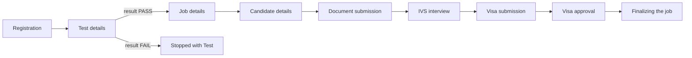

The stages are **not strictly linear** in the code: staff can open and update any stage, and a stage's completion is independent of the others. The list **Status** column is a single value derived from existing data (nothing stores or edits it):

`Registered` < `Job Assigned` < `Form Submitted` < `Details Verified` < `Documents Verified` < `Visa Document Ready`, with `Stopped with Test` overriding all of them while the Test result is FAIL.

Details: [Docs/20-candidate-management.md](Docs/20-candidate-management.md).

## System Architecture

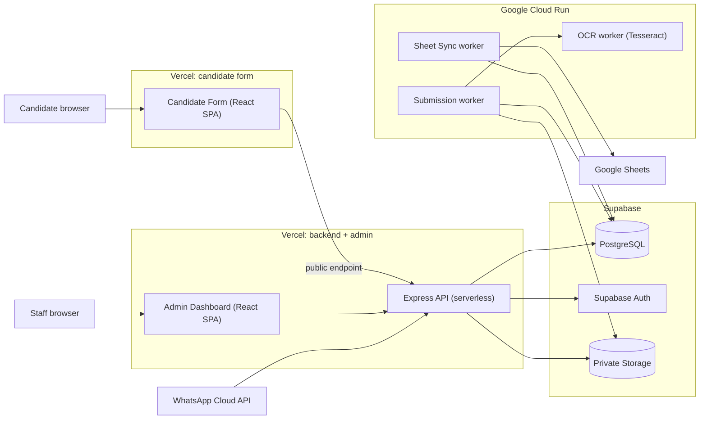

- The admin dashboard and the Express API ship together as one Vercel project, same-origin. The Candidate Form is a separate, static Vercel project with no backend credentials.
- WhatsApp webhooks are acknowledged only after the file is validated, stored in temporary storage and recorded in PostgreSQL; OCR, classification and placement then run asynchronously from a PostgreSQL-backed queue (`temporary_data`).
- The Sheet Sync worker reads PostgreSQL and writes to Google Sheets. Sheets are a mirror, never a source of truth.

More: [Docs/02-system-architecture.md](Docs/02-system-architecture.md). Per-feature flows are in [Data Flow Diagrams](#data-flow-diagrams); the infrastructure view is in [Deployment Architecture](#deployment-architecture).

## Application Components

| Component | Technology | Responsibility | Data / services used |
|---|---|---|---|
| **Admin Dashboard** | React 19, TypeScript, Vite (`admin/`, built into `public/admin`) | Staff UI for candidates, documents, review, jobs, agents/clients, allocation, reports, settings, audit logs. Hides what a role cannot use; the server enforces every rule. Signs in directly with Supabase Auth. | Express API (`/api/admin`), Supabase Auth (browser-safe URL and anon key only) |
| **Candidate Form** | React 19, TypeScript, Vite (`candidate-form/`, separate Vercel project) | Public form opened from a candidate-specific share link: verification, step-by-step draft saving, single final submission. Holds no backend credentials. | Express API only (`/api/public/candidate-details/*`) |
| **Express API** | Node.js, Express 5 (`src/`, entry `api/index.js` on Vercel) | RBAC and validation, all business rules, admin and public APIs, WhatsApp webhook, audit logging, queue/outbox writes, Sheet Sync requests. Never runs a polling loop on Vercel. | PostgreSQL (Prisma), Supabase Auth (token verification, user provisioning), Supabase Storage |
| **PostgreSQL** | Supabase-hosted PostgreSQL, Prisma 6.19 | System of record: all business data, the WhatsApp intake queue (`temporary_data`), the Sheet Sync outbox/run tables, rate-limit counters, and the triggers/constraints described below. | Written by the API and the workers; no direct access from browsers |
| **Supabase Auth** | Supabase (`auth.users`) | Sole owner of credentials and sessions. `user.auth_user_id` links an application profile to an Auth identity. | Admin dashboard (sign-in), Express API (token verification, invitations) |
| **Supabase Storage** | Private bucket | Candidate document files: `temporary/`, `pending/` and `clients/{passport_id}/…`. No public or signed URLs. **Separate from PostgreSQL**: the database stores only paths and checksums. | Express API, Submission worker |
| **WhatsApp integration** | Meta WhatsApp Cloud API; `src/routes/whatsapp.js` | Receives signed webhooks, downloads and validates media, stores it temporarily, records a `temporary_data` row, wakes the worker. | PostgreSQL, Supabase Storage |
| **Submission worker** | Same backend image, entry `src/worker.js` (Cloud Run); `src/app.js` runs it in-process locally | Claims `temporary_data` rows (lease and retries), runs the document pipeline, places files in private storage, writes `documents`. | PostgreSQL, OCR worker, Supabase Storage |
| **OCR worker** | Node.js, Tesseract.js, pdf-parse (`ocr-worker/`, Cloud Run, private) | Stateless text extraction. Receives a file, returns text, keeps nothing. Authenticated by Google identity token. | Called by the Submission worker; no database access |
| **Sheet Sync worker** | Backend image, entry `src/sheetSyncWorker.js` (Cloud Run) | Executes queued reconcile/test runs, answers Cloud Scheduler's authenticated trigger, drains the Candidate Form submission outbox, keeps a writer lease. | PostgreSQL, Google Sheets API (keyless service identity) |
| **Google Sheets** | Google Sheets | One-way operational mirror (Operational Mirror tab and Candidate Form Submissions tab). Never read back into the database. | Written only by the Sheet Sync worker |

## Tech Stack

| Category | Technology |
|---|---|
| Backend | Node.js (`^22.18.0 \|\| >=23.6.0`), Express 5, helmet, express-rate-limit |
| Admin frontend | React 19, TypeScript, Vite, Tailwind CSS 4, React Router 8, lucide-react, jsPDF, read-excel-file |
| Candidate Form | React 19, TypeScript, Vite (separate package, `candidate-form/`) |
| Database / ORM | PostgreSQL (Supabase), Prisma 6.19 with the `pg` driver adapter |
| Authentication | Supabase Auth (`@supabase/supabase-js`) |
| Storage | Supabase Storage (private bucket) |
| OCR | Tesseract.js, pdf-parse, `@napi-rs/canvas` (`ocr-worker/`, Express) |
| Integrations | WhatsApp Cloud API (Meta), Google Sheets API (`@googleapis/sheets`) |
| Cloud / deploy | Vercel, Google Cloud Run, Docker |
| Testing | Node test runner (backend, OCR worker), Vitest + Testing Library (admin, candidate form), PGlite |
| Fonts | Inter (body), Montserrat (headings) |

## Database Architecture

PostgreSQL schema defined in [prisma/schema.prisma](prisma/schema.prisma); changes ship as forward-only SQL migrations in `prisma/migrations/`. **Some rules exist only in SQL** (partial unique indexes, triggers, functions, CHECK constraints) because Prisma's schema language cannot express them; they are maintained through SQL migrations, never through the Prisma model. Row-level security is enabled in the migrations on the tables listed there with no privileges for Supabase's `anon` / `authenticated` roles, and default privileges for those roles were revoked for future tables (`20260924140000_restrict_public_database_access`); the backend connects as the table owner. (`candidate_allocation` is the one table whose migration contains no explicit `ENABLE ROW LEVEL SECURITY`; see [documentation inconsistencies](#current-development-notes).)

### How the application uses PostgreSQL

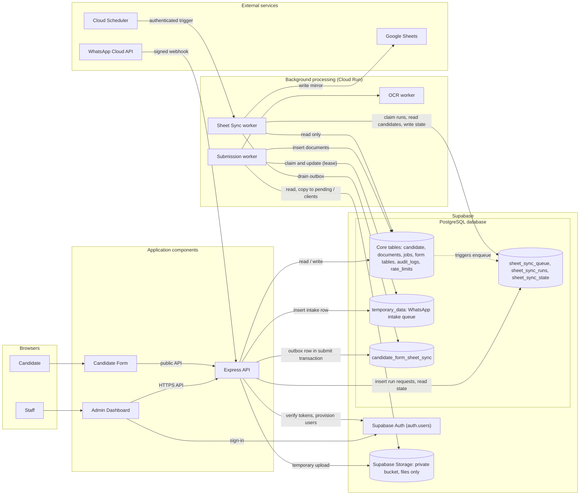

Supabase Storage holds the files; PostgreSQL holds only their paths (`storage_path`, `temporary_storage_path`, `pending_storage_path`) and SHA-256 checksums. The OCR worker has no database access.

### Database domains

| Domain | Tables |
|---|---|
| A. Identity and access | `user`, `audit_logs`, `rate_limits` |
| B. Candidate management | `candidate`, `candidate_additional_details`, `candidate_stages`, `candidate_call_logs`, `call_log_follow_up`, `candidate_allocation`, `candidate_verification` |
| C. Documents and WhatsApp intake | `documents`, `temporary_data` (the intake queue and unmatched files) |
| D. Candidate Form | `candidate_form_link`, `candidate_form_access`, `candidate_form_response`, `candidate_form_draft`, `candidate_form_prefill_snapshot`, `candidate_form_field_review`, `candidate_form_branding`, `candidate_form_sheet_sync` |
| E. Job management | `job`, `job_type`, `job_job_type`, `job_candidate`, `job_code_counter` |
| F. Business entities | `agent`, `client`, `agent_client` |
| G. Integration and synchronization | `sheet_sync_queue`, `sheet_sync_runs`, `sheet_sync_state`, `candidate_import` |

There are 32 tables in all. Foreign-key delete rules below are the ones in the migrations (`CASCADE`, `RESTRICT`, `SET NULL`). Deprecated columns are called out where they exist.

#### A. Identity and access

| Table | Purpose and key constraints |
|---|---|
| `user` | Staff profile, role and status. PK `admin_id`. `auth_user_id` (UUID) is unique and, on Supabase, a foreign key to `auth.users(id)` with `RESTRICT` (a user is deactivated, never deleted, because audit history references the row). `email` unique. `role` (OWNER, ADMIN, TEAM_LEAD, ANALYST, REGISTRATION_DESK, JOB_HANDLER) and `status` (INVITED, ACTIVE, INACTIVE) are plain text validated by the application; **no database CHECK**. Credentials are not stored here. |
| `audit_logs` | Append-only history of admin actions. PK `audit_id`. FK `admin_id` → `user` (`RESTRICT`). `temporary_id`, `document_id` and `passport_id` are plain text with **no foreign keys**, so entries outlive the rows they describe. Indexed by `(temporary_id, created_date)`, `(document_id, created_date)`, `(admin_id, created_date)`. UPDATE, DELETE and TRUNCATE are rejected by triggers. |
| `rate_limits` | Rate-limit counters shared by all serverless instances. PK `key` (`<limiter>:<sha256 of client key>`, so no IP address is stored); `hits`, `reset_at` (indexed). Operational state only. |

#### B. Candidate management

| Table | Purpose and key constraints |
|---|---|
| `candidate` | The candidate. **PK `passport_id`** (text; every child FK is `ON UPDATE CASCADE`, so a passport ID correction propagates). `unique_id` unique business reference. `nic` unique. `whatsapp_number` has partial/normalized unique indexes (see [constraints](#database-constraints-and-business-rules)). Indexed for the candidate list: `(created_date DESC, passport_id)`. `job` is a comma-separated list of job types. `departed_at` records "Departed" (set by bulk import). |
| `candidate_additional_details` | Optional extra details, **at most one row per candidate** (`passport_id` is both PK and FK, `CASCADE`). Also receives values staff confirm from the Candidate Form. |
| `candidate_stages` | Deployment stage records. **Composite PK `(passport_id, stage)`**, FK `CASCADE`. A missing row means an incomplete stage with no notes (rows are created once something is saved). The stage names are validated by the application, not by a CHECK. `job_id` is a legacy free-text column, no longer written. |
| `candidate_call_logs` | Calls noted by staff. PK `call_log_id`; FK `passport_id` (`CASCADE`), `admin_id` (`RESTRICT`). CHECKs: outcome is ANSWERED or NO_ANSWER, and a note is required unless NO_ANSWER. Indexed `(passport_id, created_date)`. |
| `call_log_follow_up` | A call log marked as needing attention ("Need Attention"). PK `follow_up_id`; FK `call_log_id` (`CASCADE`), `flagged_by` / `completed_by` → `user` (`RESTRICT`). **Partial unique index: at most one OPEN follow-up per call log.** CHECKs on status and completion. Deleting a follow-up never deletes the call log. |
| `candidate_allocation` | Work Allocation: which Analyst a candidate is assigned to. **PK `passport_id`** (one analyst per candidate; no row = unallocated); FK `analyst_id` → `user` (`RESTRICT`). A separate table so allocating never touches the `candidate` row. |
| `candidate_verification` | Manual "details verified" / "documents verified" marks. PK `passport_id` (`CASCADE`); `*_verified_at` / `*_verified_by` pairs must be set or cleared together (CHECK); FK to `user` (`RESTRICT`). Cleared automatically by triggers. |

#### C. Document management and WhatsApp intake

| Table | Purpose and key constraints |
|---|---|
| `documents` | A stored candidate document (the file itself is in Supabase Storage). PK `document_id`. FK `passport_id` → `candidate` (**`RESTRICT`**: a candidate with documents cannot be deleted). FK `temporary_id` → `temporary_data` (`SET NULL`). **Unique `(passport_id, file_sha256)`**; index on `file_sha256`. |
| `temporary_data` | One row per received WhatsApp file; **it is the durable processing queue**. PK `temporary_id`. `message_id` is unique (a redelivered message never creates a second row). FK `passport_id` → `candidate` (nullable, `SET NULL`, set only when identity resolves). Lease columns (`processing_attempts`, `processing_started_at`), `placement_path` (crash recovery), `processing_summary` / `review_reason` (what the Review Queue shows). Indexes: `(whatsapp_number, file_sha256)`, `(processing_status, created_date)`. |

#### D. Candidate Form

| Table | Purpose and key constraints |
|---|---|
| `candidate_form_link` | A share link. PK `link_id`. Only the SHA-256 of the link secret is stored (`token_hash`, unique, CHECK 64 hex characters). `kind` is SINGLE or JOB_GROUP; a CHECK requires exactly one target (`passport_id` for SINGLE, `job_id` for JOB_GROUP). Expiry, revocation, failed-attempt counter and lock. **Partial unique index: one active JOB_GROUP link per job.** FKs: `passport_id` (`CASCADE`), `job_id`, `created_by`, `revoked_by` (`RESTRICT`). |
| `candidate_form_access` | The per-candidate lock: LOCKED (no row) → UNLOCKED → SUBMITTED. PK/FK `passport_id` (`CASCADE`). `version` bumps on every change and invalidates earlier sessions; `submit_key` is the idempotency key. CHECK ties `status = 'SUBMITTED'` to `submitted_at`. **Trigger: a SUBMITTED row cannot change.** |
| `candidate_form_draft` | Saved progress, one row per candidate (PK/FK `passport_id`, `CASCADE`). `answers` is a JSON object (CHECK). Deleted by the final submit. |
| `candidate_form_prefill_snapshot` | The values the form was prefilled with, captured once for later comparison. PK/FK `passport_id`; `captured_via_link_id` → link (`SET NULL`). **Trigger: values cannot be changed.** |
| `candidate_form_response` | The candidate's submitted answers. PK/FK `passport_id` (`CASCADE`); `submitted_via_link_id` → link (`SET NULL`). CHECKs on the coded fields. **Trigger: values cannot be changed.** Server-derived `height_cm` and `distance_to_bucharest_km` are server-computed. |
| `candidate_form_field_review` | Staff decision on one submitted field. **Composite PK `(passport_id, field_key)`**; status CONFIRMED or REJECTED (no row = pending); `reviewed_by` → `user` (`RESTRICT`). **Trigger: a decision cannot be changed.** `field_key` refers to a form field by name (checked by a pattern, not a foreign key). |
| `candidate_form_branding` | The form's title, logo and colours. A single row, `id = 'default'` (CHECK); no row means the EMLYNK defaults. |
| `candidate_form_sheet_sync` | Outbox for the Candidate Form Submissions tab. PK `submission_id`; `passport_id` **unique** (one row per submission); lease, attempts and status (PENDING, PROCESSING, COMPLETED, FAILED). Holds no personal data. |

#### E. Job management

| Table | Purpose and key constraints |
|---|---|
| `job` | A job order. PK `id` (UUID). `job_code` unique, CHECK format `JOB-YYYY-NNNNNN`. FKs `client_id`, `responsible_agent_id`, `created_by` (all `RESTRICT`); deprecated `job_type_id`. `status` PROCESSING, COMPLETED or CANCELLED (CHECK) with matching timestamps/reason (CHECKs). `country_code` ("To Country") and `from_country_code` are ISO alpha-2 (CHECK). Optional `job_sector` (CONSTRUCTION or INDUSTRIAL). **Partial unique `(client_id, company_job_id)` where `company_job_id` is not null.** Never hard-deleted. |
| `job_type` | Controlled list of job types. `code` unique (CHECK pattern), `lower(name)` unique. |
| `job_job_type` | Join table Job ↔ Job Type (many-to-many). Composite PK `(job_id, job_type_id)`; `job_id` `CASCADE`, `job_type_id` `RESTRICT`. |
| `job_candidate` | Join table Job ↔ Candidate with history. **Composite PK `(job_id, passport_id)`**; `is_active`, `released_at`; FKs `job_id` (`RESTRICT`), `passport_id` (`CASCADE`), `assigned_by` (`RESTRICT`). |
| `job_code_counter` | Yearly counter; PK `year`, `next_number` ≥ 1 (CHECK). Incremented atomically by the application. No foreign key to `job`. |

#### F. Business entities

| Table | Purpose and key constraints |
|---|---|
| `agent` | The responsible agent of a job; carries a `country_code` (copied to each new job as the To Country). Unique on `(lower(name), country_code)`, plus a partial unique on `lower(name)` where the country is null (agents created by bulk import). Never hard-deleted (`is_active`). |
| `client` | The employer organisation. `lower(name)` unique. Never hard-deleted (`is_active`). Deprecated `agent_id` column (not read or written by the application). |
| `agent_client` | Join table Agent ↔ Client (many-to-many). Composite PK `(agent_id, client_id)`; both FKs `RESTRICT`. |

#### G. Integration and synchronization

| Table | Purpose and key constraints |
|---|---|
| `sheet_sync_queue` | Outbox for the Operational Mirror: "candidate `unique_id` changed". Written by database triggers; identifiers only. PK `queue_id`; **partial unique index: at most one PENDING row per `unique_id`**; `unique_id` is **not** a foreign key (the row may refer to a deleted candidate). |
| `sheet_sync_runs` | Durable requests: RECONCILE or TEST_CONNECTION. PK `run_id`. **Partial unique index: at most one QUEUED/RUNNING run per kind.** `summary` holds counts and codes only. |
| `sheet_sync_state` | A single row (`sheet-sync`): integration state, worker heartbeat, active/requested destination, and the **writer lease** that allows one writer to the Sheet at a time. |
| `candidate_import` | Coordinates a bulk Upload's preview and chunked commit: counts, reason codes, chunk hashes; **no candidate data**. FK `admin_id` → `user` (`RESTRICT`). `sync_run_id` is a plain text reference with no FK. |

Details: [Docs/03-database-design.md](Docs/03-database-design.md).

## Entity Relationship Diagrams

Four focused diagrams follow. Entity names are the actual table names in upper case. Solid lines are database foreign keys; **dashed lines are logical references with no foreign key** (labelled as such). Only key columns are shown. Relationship notation: `||` exactly one, `o|` zero or one, `o{` zero or many.

### Core Candidate Management

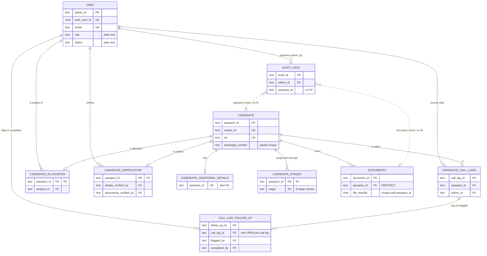

- Every candidate child table is keyed on `passport_id`; all are deleted with the candidate (`CASCADE`) **except** `documents` (`RESTRICT`).
- `candidate_allocation` is one-to-one with the candidate: this is what the Analyst's visibility is built on ([Candidate Allocation](#e-candidate-allocation)).
- `audit_logs` keeps reviewed items as plain IDs so history survives removal of the rows it describes.

### Candidate Form

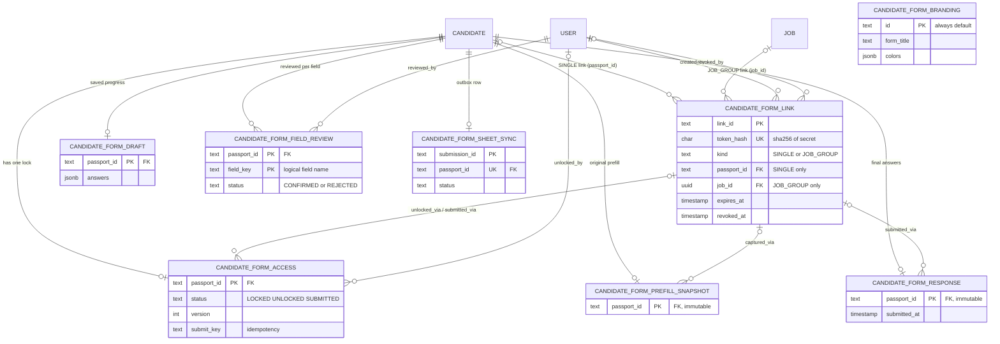

`candidate_form_branding` has no relationships: it is a single settings row (Settings > Candidate Form).

How the records fit together:

1. **Share link.** Staff create a link for a candidate; the secret is shown once and only its hash is stored. Creating a link unlocks the candidate's `candidate_form_access` and revokes any earlier link in the same transaction. A `JOB_GROUP` link instead targets a job; its members must have an active `job_candidate` row on that PROCESSING job. The "newest link wins" rule for SINGLE links is **enforced by the application** (there is no partial unique index for it).
2. **Verification and access.** The candidate supplies the link secret plus Passport and NIC. The server compares them in constant time and issues a short-lived (60 min) encrypted token. The token is re-checked against the link and `candidate_form_access.version` on every request.
3. **Draft.** Each completed step is saved into the candidate's single `candidate_form_draft` row. A draft is not a submission and leaves `candidate_form_access` and `candidate_form_response` untouched.
4. **Final response.** One transaction flips the access row from UNLOCKED to SUBMITTED (compare-and-swap on `version`), writes the prefill snapshot if missing, inserts `candidate_form_response`, deletes the draft and inserts the `candidate_form_sheet_sync` outbox row.
5. **Staff review.** Staff confirm or reject fields one at a time in `candidate_form_field_review`. Confirming copies that one value into the candidate's own record (`candidate` / `candidate_additional_details`) by application logic; the submitted response is never modified.

**Single submission and immutability.** The lock is SUBMITTED exactly once; a trigger then refuses any change to it. `candidate_form_response`, `candidate_form_prefill_snapshot` and finished `candidate_form_field_review` rows are protected by `BEFORE UPDATE` triggers (only link-reference changes and passport ID correction cascades are allowed through). The triggers guard **updates**; they do not block deletes.

### Job, Client and Agent

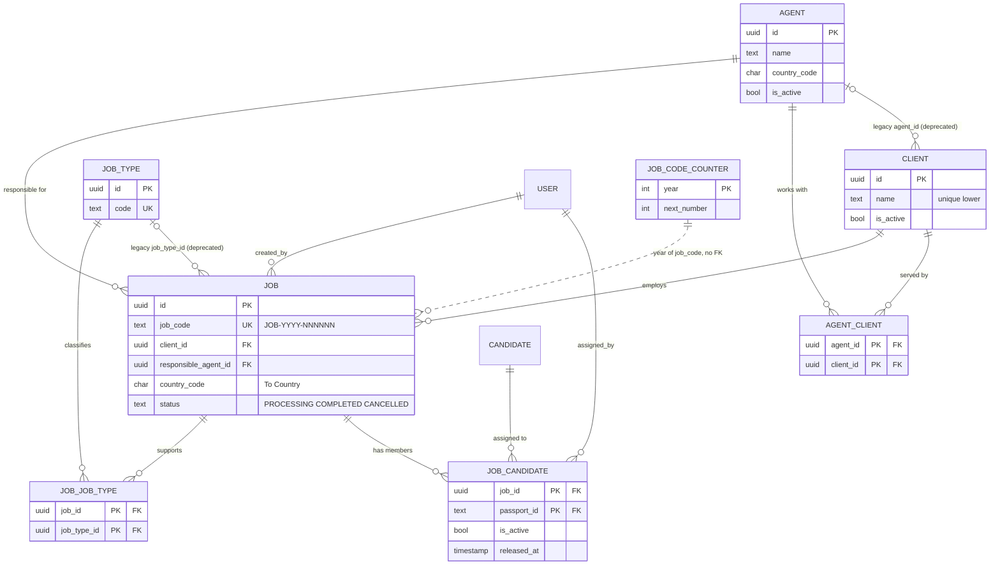

- **Many-to-many.** `agent_client` (Agent ↔ Client), `job_job_type` (Job ↔ Job Type) and `job_candidate` (Job ↔ Candidate) are join tables with composite primary keys, so a pair can exist only once.
- **A Job belongs to exactly one Client and one responsible Agent.** A Client can work with several Agents, and an Agent with several Clients; the Agent chosen for a job must be one of its Client's linked agents (application rule). The job copies the Agent's country as its To Country.
- **Candidate assignment.** `job_candidate` is both membership and history: `is_active` marks a current membership; staff removal sets `released_at` and clears `is_active`. A re-assigned candidate reuses the same row. A candidate **may be active on several PROCESSING jobs at once**; the same candidate cannot be on the same job twice (the PK). The application also requires a saved Test result of PASS before assigning.
- **Deprecated columns.** `job.job_type_id` and `client.agent_id` remain in the schema only for backward compatibility; `job_job_type` and `agent_client` are the source of truth.

### Integration and Background Processing

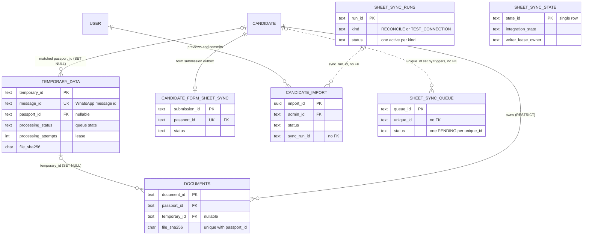

- **WhatsApp intake.** `temporary_data` is the queue: the webhook commits a row (status `TEMPORARY_STORED`) and the Submission worker claims it. A row's `passport_id` is set only when identity resolves to one existing candidate; an unmatched file keeps a null `passport_id`. `documents` rows are created only for files placed under `clients/{passport_id}/…`; files held for review (`pending/…`) stay in `temporary_data` with a `pending_storage_path`.
- **Operational Mirror.** `sheet_sync_queue` rows are written by triggers on `candidate`, `candidate_stages`, `documents` and `candidate_additional_details`. `sheet_sync_runs` carries Sync Now / Scheduler requests; `sheet_sync_state` is a single status-and-lease row. These three have no foreign keys to candidate tables.
- **Candidate Form submissions** use their own outbox (`candidate_form_sheet_sync`), separate from the mirror's queue.
- **Bulk import.** `candidate_import` stores only counts, codes and chunk hashes; the imported candidates themselves are written to the ordinary candidate tables.

## Database Constraints and Business Rules

Where each rule lives: **PG** = PostgreSQL constraint / index / trigger / function, **Prisma** = declared in `schema.prisma`, **App** = backend application logic.

| Rule | Why it exists | Enforced by |
|---|---|---|
| **Candidate primary key is `passport_id`** (text) | The passport number is the natural identity used across WhatsApp matching, documents and the Candidate Form. Every child table references it with `ON UPDATE CASCADE`, so a corrected passport number propagates. | PG (PK + FKs), Prisma |
| **`unique_id`** is a unique, sequential business reference | A short stable ID used by staff and as the Sheet row key. Computed as the highest numeric value + 1 (zero-padded, 4 digits) when registering; a collision is caught by the unique index and retried. | PG (unique index) + App (generation) |
| **Passport number uniqueness** | Primary key of `candidate`. | PG |
| **NIC uniqueness** | The same person must not be registered under two passport records. `nic` is nullable, so unlimited candidates may have no NIC. | PG (unique index), Prisma (`@unique`), App (pre-check) |
| **WhatsApp number uniqueness by number, not text** | The same number is written in several forms (`94…`, `+94…`, `07…`). The SQL function `candidate_phone_key()` reduces any form to digits (`94…`), and a partial unique index on that key stops two candidates sharing a number. A raw-text partial unique index also remains. One shared number (a known legacy value) is deliberately exempted from both indexes. The application has a matching `phoneKey` function (the two are tested for parity). | PG (function + two partial unique indexes) + App. Not in Prisma `@unique` on purpose. |
| **Document checksum duplicate detection** | Same file sent twice for one candidate must not create two records. The unique key is `(passport_id, file_sha256)`; the pipeline also checks other candidates' checksums and routes conflicts to review. | PG (unique index), Prisma (`@@unique`), App (placement rules) |
| **Candidate stage records** | One record per candidate and stage, no duplicates. Rows appear lazily; the eight stage names are not constrained in the database. | PG (composite PK), App (stage names, order-independence) |
| **Candidate allocation** | A candidate has at most one Analyst. Allocation lives in its own table so changing it never modifies the candidate row. | PG (PK on `passport_id`, FKs), App (who may allocate; history in `audit_logs`) |
| **Job-candidate assignment** | The same candidate cannot be on the same job twice (composite PK). An active membership must sit on a PROCESSING job (trigger). Leaving PROCESSING releases that job's active memberships in the same transaction. **A candidate may be active on several jobs**: the older "one active job per candidate" unique index was dropped by migration `20261029120000`. Test-result PASS is required to assign; vacancies are never enforced. | PG (PK, CHECK, two triggers) + App (PASS rule, locking) |
| **Job lifecycle** | PROCESSING → COMPLETED or CANCELLED only; a finished job can never return to PROCESSING (a trigger rejects it). CHECKs tie `completed_at` / `cancelled_at` / `cancel_reason` to the status. Jobs are never hard-deleted. `job_code` has a fixed format and is unique; `company_job_id` is unique per client when set. | PG (CHECKs, trigger, unique indexes), App |
| **Agent–Client many-to-many** | One Agent works with many Clients and vice versa. Removing a link deletes only the join row (`RESTRICT` protects both sides). | PG (composite PK, FKs), App (agent must belong to the job's client) |
| **Audit log immutability** | The audit trail must be trustworthy. Triggers reject UPDATE, DELETE and TRUNCATE on `audit_logs`, whoever runs them. | PG (triggers) |
| **Candidate Form record immutability** | A submission is evidence. A trigger makes a SUBMITTED lock final; separate triggers make `candidate_form_response`, `candidate_form_prefill_snapshot` and `candidate_form_field_review` rows unchangeable (only a passport ID correction or a link removal may cascade). There is no DELETE trigger. | PG (triggers) |
| **Single form submission** | The access row moves UNLOCKED → SUBMITTED once, using compare-and-swap on `version`; a second attempt gets 409. Repeating the *same* request (same idempotency key) returns the original success. `candidate_form_response` and `candidate_form_sheet_sync` both have a primary/unique key on `passport_id`. | PG (PK/unique, trigger) + App (transaction, idempotency key) |
| **Verification reset** | "Details verified" / "Documents verified" must not outlive the data they covered. Triggers clear the mark in the same transaction when a material candidate field, any additional-detail value, or a *required* document (PASSPORT, MEDICAL, POLICE_REPORT, SCAN) changes. The reset is audited only when the application named the acting user for the transaction. | PG (functions + triggers), App (actor setting) |
| **Sheet Sync outbox** | Triggers on `candidate`, `candidate_stages`, `documents` and `candidate_additional_details` record "candidate X changed" in `sheet_sync_queue` in the same transaction as the change (identifiers only, no personal data). A partial unique index keeps at most one PENDING row per candidate, so changes coalesce. | PG (function, triggers, partial unique index) |
| **One active sync run per kind** | Repeated "Sync Now" requests return the active run instead of piling up. | PG (partial unique index) |
| **One OPEN follow-up per call log** | Prevents duplicate "Need Attention" flags. | PG (partial unique index) |
| **One active job-group form link per job** | Regenerating a group link revokes the previous one first. | PG (partial unique index) + App |
| **Roles and statuses are plain text** | Roles change more often than migrations; the application validates them on every request and refuses unknown or retired roles. | App (no database CHECK) |
| **Row-level security and privileges** | Supabase's public API roles must not reach any table. RLS is enabled by the migrations on the tables created with it, `anon` / `authenticated` privileges are revoked (including by default for later tables), and the backend connects as the owner. | PG |

Triggers and functions in the database, for reference: `audit_logs_reject_change`; `sheet_sync_enqueue` / `sheet_sync_capture_candidate` / `sheet_sync_capture_candidate_child`; `candidate_form_access_submitted_is_final`, `candidate_form_values_are_final`, `candidate_form_field_review_is_final`; `job_status_transition`, `job_candidate_active_requires_processing`; `candidate_verification_reset`, `candidate_details_changed_reset`, `candidate_additional_details_changed_reset`, `documents_changed_reset`; and the pure SQL function `candidate_phone_key`.

## Data Flow Diagrams

### A. Candidate registration and management

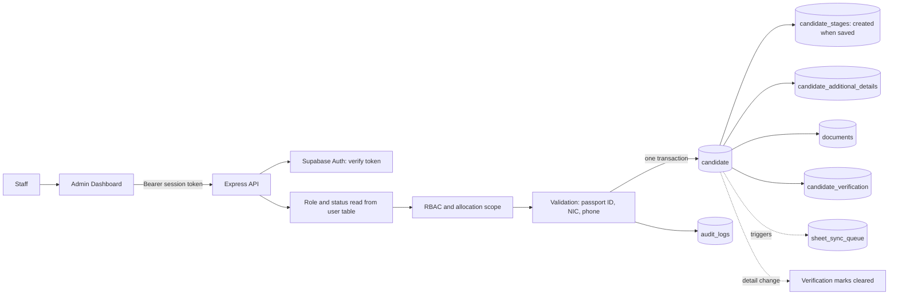

Registration creates the `candidate` row (with a generated `unique_id`) and an audit entry. The workflow then continues as staff open each stage: test details, job details, candidate details, document submission, visa steps. Each save creates or updates a `candidate_stages` row. Candidate details, additional details and documents feed the verification marks; the list Status is derived from existing data and never stored. Passing the Test result is what allows [job assignment](#job-client-and-agent). The user's role is read from the database on every request, not from the token.

### B. WhatsApp document processing

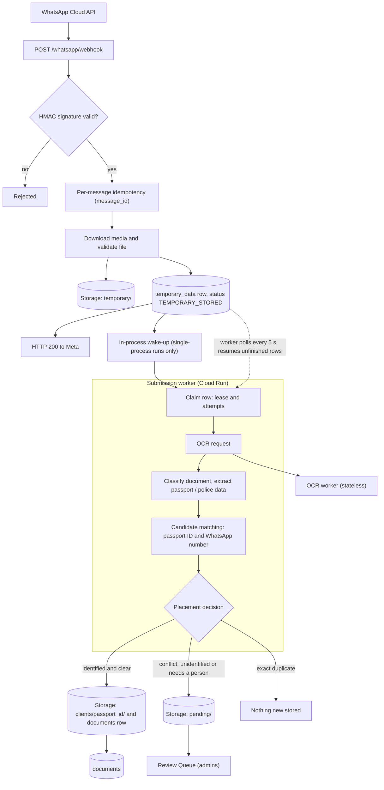

Order, as implemented:

1. The webhook verifies the HMAC signature before doing anything else, then handles each message with an in-process idempotency claim.
2. For each document or photo message it downloads the media from Meta, validates type and size, computes the SHA-256, stores the file under `temporary/` and commits a `temporary_data` row. Only then is Meta answered with 200 (a failure before the row exists answers 500 so Meta redelivers; `message_id` is unique so a redelivery never makes a second row).
3. The worker claims rows by compare-and-swap (a lease; 3 attempts, then FAILED). It sends the file to the OCR worker with a Google identity token, then classifies the document, extracts passport (MRZ) and police-slip fields, scores confidence and resolves identity.
4. A placement decision copies the file to `clients/{passport_id}/…` (and inserts `documents` in a fenced transaction), or to `pending/…`, or stores nothing for an exact duplicate. A document needing a person lands in the Review Queue with a stored review reason.

Detail: [Docs/04](Docs/04-whatsapp-integration.md), [Docs/05](Docs/05-ocr-document-processing.md), [Docs/06](Docs/06-storage-management.md).

### C. Candidate Form submission

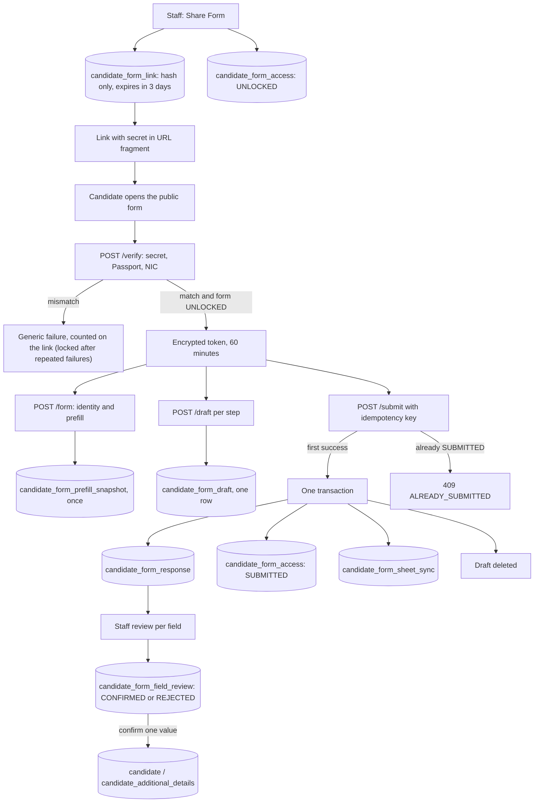

- **Candidate-specific links.** A link opens the form for one candidate (or, for a `JOB_GROUP` link, any active member of one PROCESSING job). The secret is 256 bits, travels in the URL fragment (never sent to a server) and only its SHA-256 is stored.
- **Verification.** The server checks the link (not revoked, expired or locked), then Passport and NIC in constant time. Every failure returns the same generic message. The token is re-validated against the link and the access `version` on every request, so revoking or replacing a link, or submitting, ends all sessions at once.
- **Draft saving is a different operation from submission.** `POST /draft` merges one step's validated answers into the candidate's draft row and touches nothing else. Only `POST /submit` writes the response, flips the lock, and deletes the draft.
- **Single successful submission.** The submit transaction updates the access row only if it is still UNLOCKED at the token's version. A second attempt is rejected with 409; a retry of the *same* request (same idempotency key) receives the original success.
- **Field-by-field review.** Staff confirm or reject each field; a decision is final. Confirming writes only that value into the candidate's own record and is audited. The public form never writes `candidate`, `candidate_additional_details` or `candidate_stages`.

Design and security: [CANDIDATE_FORM_FEATURE_ARCHITECTURE.md](Docs/CANDIDATE_FORM_FEATURE_ARCHITECTURE.md), [share links design](Docs/CANDIDATE_EXTRA_DETAILS_FORM_SHARE_LINKS_DESIGN.md), [security risks](Docs/CANDIDATE_EXTRA_DETAILS_FORM_SECURITY_RISKS.md).

### D. Google Sheets synchronization

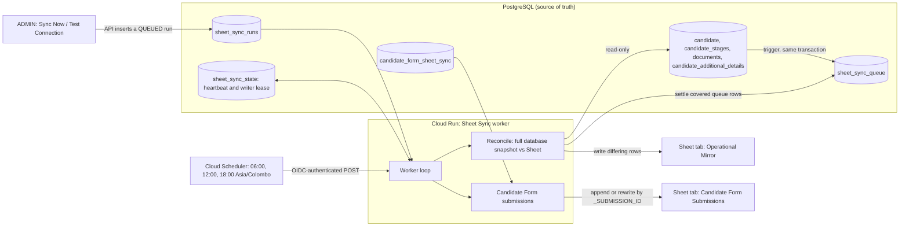

- **PostgreSQL is the source of truth; the Sheet is a one-way operational mirror.** Nothing read from the Sheet is ever written to the database.
- **The mirror is not real-time.** Triggers only record `sheet_sync_queue` rows. The Sheet is written by a full reconciliation of the current database, at the scheduled times and on an ADMIN's Sync Now. Each run mirrors the latest state, then settles the queue rows it covered.
- **Duplicate and loop protection (confirmed in code):** at most one PENDING queue row per candidate and one QUEUED/RUNNING run per kind (partial unique indexes); a database **writer lease** allows one writer per Sheet; rows are located by the `_SYSTEM_CANDIDATE_ID` column and duplicate IDs halt the run (nothing is written); only differing rows are rewritten; rows are never deleted (a removed candidate is marked "DELETED / INACTIVE", guarded by a mass-removal limit); writes are disabled unless `SHEET_SYNC_ENABLED` is exactly `true`.
- **Retry.** Retryable Google errors (429, 5xx, network) are recorded and the next run tries again; configuration and data-integrity errors halt the mirror until a successful Test Connection or reconciliation.
- **Candidate Form submissions are different:** they use their own outbox, are drained **every worker tick** (near real time, only while `SHEET_SYNC_ENABLED` is `true`) with exponential backoff, and are written by `_SUBMISSION_ID` (an existing row is rewritten, never appended twice). A Google outage never affects the candidate's submission.

Docs: [GOOGLE_SHEET_INTEGRATION.md](Docs/GOOGLE_SHEET_INTEGRATION.md), [GOOGLE_SHEET_CANDIDATE_SYNC_ARCHITECTURE.md](Docs/GOOGLE_SHEET_CANDIDATE_SYNC_ARCHITECTURE.md).

### E. Candidate allocation

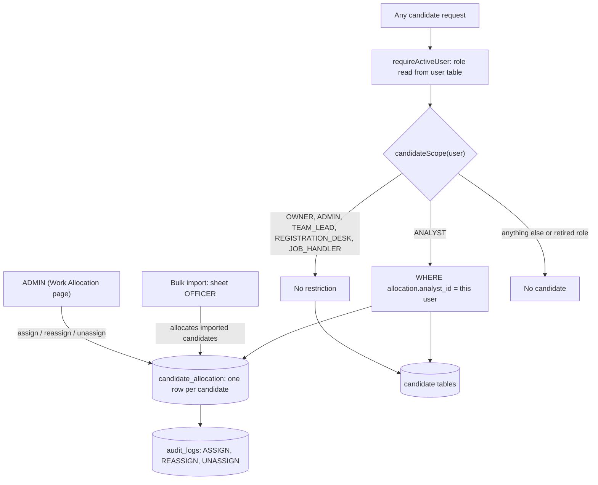

Allocation is a one-to-one table keyed on `passport_id` (no row = unallocated). One function (`src/services/candidateAccess.js`) turns the signed-in user into a query filter, and every candidate route, list, report and the Review Queue goes through it on every request. A reassignment or role change therefore applies to the very next request. The scope fails closed: an unknown or retired role sees no candidates. JOB_HANDLER receives candidates only through the Jobs workflow.

## UI Design System

**Canonical source:** [admin/src/index.css](admin/src/index.css), a Tailwind 4 `@theme` block of CSS tokens, with a `:root[data-theme="dark"]` override. Theme switching only sets `data-theme` on `<html>` ([admin/src/theme/theme.ts](admin/src/theme/theme.ts)); the choice is remembered in `localStorage` and **defaults to light**. The latest change to this file is the platform rebrand to the `emlynk_style_guide` (2026-11-01).

The admin palette is a **neutral monochrome** (near-black primary on light greys) with a dark slate sidebar and semantic status colours.

| Token | Usage | Light | Dark |
|---|---|---|---|
| `--color-primary` | Main actions | `#171717` | `#e5e5e5` |
| `--color-primary-hover` | Hover | `#454545` | `#d4d4d4` |
| `--color-primary-soft` | Soft fill | `#e5e5e5` | `#353c46` |
| `--color-accent` | Accent | `#ef4444` | not overridden |
| `--color-page` | Page background | `#f0f0f0` | `#1f242b` |
| `--color-surface` | Cards and panels | `#ffffff` | `#262c34` |
| `--color-canvas` | Recessed areas | `#e5e5e5` | `#2c333c` |
| `--color-border` | Dividers | `#d4d4d4` | `#353c46` |
| `--color-ink` | Primary text | `#0a0a0a` | `#ffffff` |
| `--color-ink-muted` | Secondary text | `#525252` | `#b0b6bf` |
| `--color-sidebar` | Sidebar background | `#1f242b` | same |
| `--color-verified` | Success, completed | `#006045` | `#5ee9b5` |
| `--color-review` | Warning, needs review | `#973c00` | `#fee685` |
| `--color-critical` | Errors, destructive | `#c10007` | `#ff8a8c` |
| `--color-pending` | Neutral status | `#314158` | `#cbd5e1` |
| `--color-duplicate` | Duplicate marker | `#5d0ec0` | `#c4b5fd` |

Each status colour also has `-bg` and `-border` variants. Hover and active states have dedicated `primary-hover`, `primary-active` and `critical-hover` tokens.

| Aspect | Value |
|---|---|
| Typography | Inter Variable (body), Montserrat Variable (headings); scale from 12px labels to 30px headlines |
| Radius | Base `0.625rem` (10px), with derived sm / md / lg / xl |
| Shadows | Flat surfaces (`--shadow-surface` is none); popover and modal shadows only |
| Layout | Sidebar 256px (48px collapsed rail), header 56px, content max width 1600px |
| Patterns | Shared components in `admin/src/components/` (dialogs, forms, status badges, date picker, tables, breadcrumbs); flat bordered cards with minimal shadow |

**Inconsistency to be aware of.** The public Candidate Form ([candidate-form/src/styles.css](candidate-form/src/styles.css)) defines its **own** token set with a **red** primary (`#e7000b`), while the admin's primary is near-black. The page, surface and dark-mode backgrounds match the admin, so the two apps share a base but differ in primary colour. Confirm with the design owner whether this is intentional.

## Repository Structure

```text
/
├── src/               Express backend: routes, services, middleware, workers
├── api/               Vercel serverless entry point
├── admin/             Admin dashboard (React + Vite), built into public/admin
├── candidate-form/    Public Candidate Form (separate React + Vite app)
├── ocr-worker/        OCR service (Tesseract.js), deployed to Cloud Run
├── prisma/            schema.prisma, SQL migrations, seed
├── scripts/           Operational scripts (user creation, audits, diagnostics)
├── deploy/            Non-secret Cloud Run environment for the Sheet Sync worker
├── test/              Backend test suite (Node test runner)
├── Docs/              Technical documentation
├── vercel.json        Backend + admin Vercel routing and headers
├── Dockerfile         Backend / worker container image
└── docker-compose.yml Local PostgreSQL
```

## Local Development

**Prerequisites:** Node.js `^22.18.0 || >=23.6.0`, npm, Docker (for local PostgreSQL). A Meta WhatsApp developer account is only needed to test live webhook delivery.

```bash
# 1. Install backend and admin dependencies (postinstall runs prisma generate)
npm install
npm run admin:install

# 2. Start local PostgreSQL (container emlynk-postgres)
docker compose up -d

# 3. Configure environment
cp .env.example .env
cp admin/.env.example admin/.env.local   # browser-safe values only

# 4. Apply migrations, generate the Prisma client, optionally seed
npx prisma migrate dev
npx prisma db seed

# 5. Create the first user
npm run user:create -- --email admin@example.com --name "Your Name" --role ADMIN

# 6. Run
npm start               # backend + submission worker (http://localhost:3000)
npm run admin:dev       # admin dev server (http://localhost:5173)
```

Other commands: `npm run worker` (submission worker only), `npm run sheet:worker` (Sheet Sync worker), `npm run db:check`, `npm run admin:build`, `npm run ocr:install` / `npm run ocr:start`. The Candidate Form has its own scripts (`npm --prefix candidate-form run dev`). Full guide: [Docs/11-development-guide.md](Docs/11-development-guide.md).

## Environment Configuration

Copy [.env.example](.env.example) to `.env`; the admin app uses `admin/.env.example`. Never commit real values. Local, stage and production use different projects and secrets.

| Category | Examples of what is configured |
|---|---|
| Database | PostgreSQL connection string (use the Supabase pooler for serverless) |
| Supabase | Project URL, server-side service credentials, storage bucket |
| Admin frontend | Browser-safe Supabase URL and anon key only (`VITE_*`) |
| WhatsApp / Meta | App secret, verify token, access token, phone number id |
| OCR | OCR service URL and Cloud Run identity settings |
| Google Sheets | Spreadsheet id, tab names, write gate (`SHEET_SYNC_ENABLED`), scheduler settings |
| Candidate Form | Allowed form origin and token-signing secret (backend only) |
| App | Public base URL (`APP_BASE_URL`) |

Google access uses the runtime service identity (Application Default Credentials); **no key files**. Details: [Docs/08-cloud-deployment.md](Docs/08-cloud-deployment.md) and [Docs/07-backend-development.md](Docs/07-backend-development.md).

## Deployment Architecture

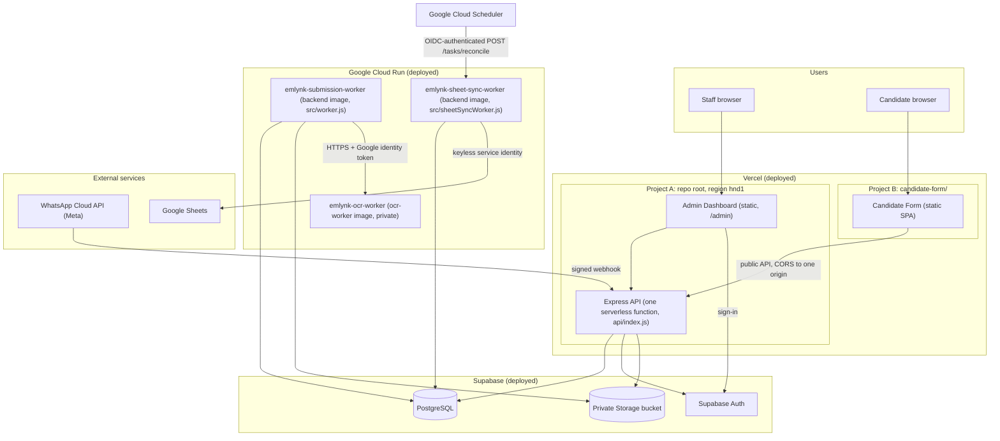

| Component | Platform | Notes |
|---|---|---|
| Backend API + Admin dashboard | Vercel (project A, repo root) | Express as one serverless function (`api/index.js`, region `hnd1`, 60 s max duration); admin served under `/admin` with a strict CSP. The function never runs a polling loop. |
| Candidate Form | Vercel (project B, root `candidate-form/`) | Static SPA with its own security headers, no backend credentials. |
| PostgreSQL, Auth, Storage | Supabase | Private storage bucket. Use the pooler connection string for serverless. |
| OCR worker | Google Cloud Run (`emlynk-ocr-worker`) | Private; called with a Google identity token. Separate Dockerfile in `ocr-worker/`. |
| Submission worker | Google Cloud Run (`emlynk-submission-worker`) | Same root `Dockerfile` as the API; started with `src/worker.js` (worker-only, plus a `/health` listener). Single instance. |
| Sheet Sync worker | Google Cloud Run (`emlynk-sheet-sync-worker`) | Same root `Dockerfile`; started with `src/sheetSyncWorker.js`. Dedicated service account; one instance (a database lease also guards the Sheet). Non-secret configuration in [deploy/sheet-sync-worker.env.yaml](deploy/sheet-sync-worker.env.yaml). |
| Cloud Scheduler | Google Cloud | Triggers the reconcile run at 06:00, 12:00 and 18:00 Asia/Colombo; needs `SHEET_SYNC_SCHEDULER_AUDIENCE` / `SHEET_SYNC_SCHEDULER_INVOKER` on the worker, otherwise the trigger answers 404. |
| Google Sheets, WhatsApp Cloud API | External | Operational mirror / document intake. |

The Submission worker and the Sheet Sync worker are **two Cloud Run services built from the same image** with different start commands. They are not one process.

**Local development services (not deployed):** `docker compose` PostgreSQL (`emlynk-postgres`), `npm start` (API **and** submission worker in one process), `npm run admin:dev`, `npm run ocr:start`, `npm run sheet:worker`. Locally the OCR service is called without an identity token.

**Branches:** feature branches → `dev` → `stage` (Vercel preview and staging validation) → `main` (production). Migrations are forward-only (`npx prisma migrate deploy`) and are never run by the server itself. See [Docs/08-cloud-deployment.md](Docs/08-cloud-deployment.md).

### Planned, not implemented

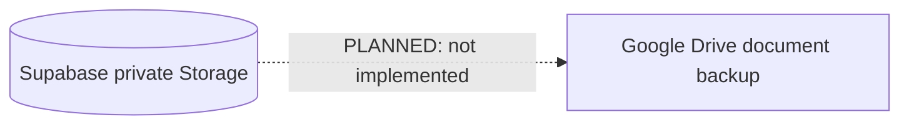

> **PLANNED — NOT IMPLEMENTED.** Google Drive document backup is not present in the current code or deployment. The notification system beyond the header bell is also research only. Neither appears in any diagram above.

## Integrations

| Integration | Direction | How it is implemented |
|---|---|---|
| **Supabase Auth** | Admin → Auth; API → Auth | The dashboard signs in with `supabase-js` (browser-safe URL and anon key). The API verifies the bearer token and reads the staff profile, role and status from `user` on each request; it also provisions invitations and users through the Supabase admin API. No credentials or sessions are stored in the application database. |
| **Supabase Storage** | API, Submission worker → Storage | Private bucket; paths `temporary/`, `pending/`, `clients/{passport_id}/…`. No public or signed URLs. |
| **WhatsApp Cloud API** | Meta → API | Verification handshake (`GET /whatsapp/webhook`) and signed deliveries (`POST`); media downloaded server-side. The system receives; it does not send business messages. |
| **OCR service** | Submission worker → OCR worker | Cloud Run IAM with a Google identity token; 4-minute client timeout. |
| **Google Sheets** | Sheet Sync worker → Sheets | Keyless (Application Default Credentials). Read-only scope while writes are disabled. See [Google Sheet Sync](#google-sheet-sync). |
| **Candidate import** | Browser → API | ADMIN uploads an `.xlsx` from Settings > Google Sheet Sync; the browser sends only allow-listed columns, the API previews and commits in chunks (`candidate_import`). |

### Google Sheet Sync

An **operational mirror**: PostgreSQL stays the source of truth and the spreadsheet is a one-way copy for operations staff.

- Database triggers record changed candidates in an **outbox** (`sheet_sync_queue`), identifiers only.
- The **Cloud Run worker reconciles** the sheet against the current database at the scheduled times and on **Sync Now**, then settles the queue rows it covered; deletion guards stop mass removals. There is no real-time mirror write.
- Two tabs: the Operational Mirror and Candidate Form Submissions (the latter is drained continuously from its own outbox).
- **Settings > Google Sheet Sync** (ADMIN): status, *Test Connection*, *Sync Now*, and bulk **Upload** of candidates.
- Writing is off unless `SHEET_SYNC_ENABLED` is exactly `true`.

Docs: [GOOGLE_SHEET_INTEGRATION.md](Docs/GOOGLE_SHEET_INTEGRATION.md), [GOOGLE_SHEET_CANDIDATE_SYNC_ARCHITECTURE.md](Docs/GOOGLE_SHEET_CANDIDATE_SYNC_ARCHITECTURE.md), [CANDIDATE_BULK_IMPORT.md](Docs/CANDIDATE_BULK_IMPORT.md).

## OCR and Document Processing

```text
WhatsApp message → webhook (HMAC signature checked first)
  → download + validate media → temporary/ storage + temporary_data row → HTTP 200
  → submission queue (lease, retries; polls PostgreSQL)
  → OCR worker (Cloud Run, text extraction)
  → classification → passport/MRZ extraction → confidence → identity matching
  → placement: clients/{passport_id}/ + documents row, or pending/ (review), or nothing (duplicate)
  → low confidence, conflicts or unidentified sender → Review Queue (manual review)
```

The OCR worker is stateless: it receives a file, returns text and keeps nothing. The full diagram is in [Data Flow B](#b-whatsapp-document-processing). Docs: [04-whatsapp-integration.md](Docs/04-whatsapp-integration.md), [05-ocr-document-processing.md](Docs/05-ocr-document-processing.md), [06-storage-management.md](Docs/06-storage-management.md), [ocr-worker/README.md](ocr-worker/README.md).

## Testing and Quality

| Suite | Command | Protects |
|---|---|---|
| Backend | `npm test` | API behaviour, RBAC, workflow, sheet sync, import, form security, OCR pipeline (in-memory fakes, no live services) |
| Backend with real OCR | `RUN_OCR_TESTS=1 npm test` | Real Tesseract extraction on fixtures |
| Admin | `npm run admin:test` | Screens, role visibility, forms, pagination |
| OCR worker | `npm run ocr:test` | The OCR service |
| Admin typecheck + build | `npm run admin:build` | TypeScript and production bundle |
| Candidate Form | `npm --prefix candidate-form run typecheck` / `test` / `build` | The public form |
| Prisma | `npx prisma validate`, `npx prisma migrate status` | Schema and migration ledger |

Details and the definition of done: [Docs/12-testing-and-quality.md](Docs/12-testing-and-quality.md).

## Security Overview

- **Authentication:** Supabase Auth; sessions and credentials never live in the application database.
- **Authorization:** server-side RBAC on every request, with the role read from the database; the UI only hides options. Inactive, invited and retired-role (MANAGER) accounts are refused.
- **Storage:** private bucket, no public URLs.
- **Webhook:** WhatsApp requests are verified by HMAC signature; messages are idempotent.
- **Audit logging:** append-only audit table.
- **Hardening:** helmet, rate limiting shared through PostgreSQL, strict CSP on `/admin`.
- **Candidate Form:** isolated project; identity verification, short-lived signed token, single submission.
- **Secrets:** environment variables and Secret Manager; Google services use service identities, not key files.

See [Docs/10-security.md](Docs/10-security.md) and [Docs/SUPABASE_AUTH.md](Docs/SUPABASE_AUTH.md).

## Documentation Index

| Document | Purpose |
|---|---|
| [Docs/README.md](Docs/README.md) | Full documentation index |
| [Docs/01-project-overview.md](Docs/01-project-overview.md) | What the system is and why |
| [Docs/02-system-architecture.md](Docs/02-system-architecture.md) | Components and topology |
| [Docs/03-database-design.md](Docs/03-database-design.md) | Schema, identity rules, migrations |
| [Docs/07-backend-development.md](Docs/07-backend-development.md) | Backend layout, API route map, env vars |
| [Docs/11-development-guide.md](Docs/11-development-guide.md) | Local setup and workflow |
| [Docs/CODING_STANDARDS.md](Docs/CODING_STANDARDS.md) | Coding rules |
| [Docs/ROLES_AND_PERMISSIONS.md](Docs/ROLES_AND_PERMISSIONS.md) | RBAC matrix |
| [Docs/OWNER_ROLE.md](Docs/OWNER_ROLE.md) | OWNER role |
| [Docs/09a-admin-dashboard-api.md](Docs/09a-admin-dashboard-api.md) / [09b](Docs/09b-admin-dashboard-guide.md) | Admin API reference / operator guide |
| [Docs/20-candidate-management.md](Docs/20-candidate-management.md) | Candidate stages and Status |
| [Docs/JOB_MANAGEMENT_IMPLEMENTATION.md](Docs/JOB_MANAGEMENT_IMPLEMENTATION.md) | Jobs |
| [Docs/AGENT_CLIENT_MANAGEMENT.md](Docs/AGENT_CLIENT_MANAGEMENT.md) | Agents and Clients |
| [Docs/CANDIDATE_FORM_FEATURE_ARCHITECTURE.md](Docs/CANDIDATE_FORM_FEATURE_ARCHITECTURE.md) | Candidate Form |
| [Docs/CANDIDATE_BULK_IMPORT.md](Docs/CANDIDATE_BULK_IMPORT.md) | Bulk Upload |
| [Docs/GOOGLE_SHEET_INTEGRATION.md](Docs/GOOGLE_SHEET_INTEGRATION.md) | Google Sheet Sync |
| [Docs/05-ocr-document-processing.md](Docs/05-ocr-document-processing.md) | OCR pipeline |
| [Docs/08-cloud-deployment.md](Docs/08-cloud-deployment.md) | Deployment and release process |
| [Docs/10-security.md](Docs/10-security.md) | Security |
| [Docs/12-testing-and-quality.md](Docs/12-testing-and-quality.md) | Testing |
| [Docs/GOOGLE_SHEET_CANDIDATE_SYNC_ARCHITECTURE.md](Docs/GOOGLE_SHEET_CANDIDATE_SYNC_ARCHITECTURE.md) | Sheet Sync design (parts describe the original real-time design) |
| [Docs/CANDIDATE_EXTRA_DETAILS_FORM_SHARE_LINKS_DESIGN.md](Docs/CANDIDATE_EXTRA_DETAILS_FORM_SHARE_LINKS_DESIGN.md) / [SECURITY_RISKS](Docs/CANDIDATE_EXTRA_DETAILS_FORM_SECURITY_RISKS.md) | Candidate Form share links and threat model |
| [Docs/04-whatsapp-integration.md](Docs/04-whatsapp-integration.md) / [06-storage-management.md](Docs/06-storage-management.md) | WhatsApp intake / storage placement |
| [Docs/SUPABASE_AUTH.md](Docs/SUPABASE_AUTH.md) | Supabase Auth |
| [Docs/NOTIFICATION_SYSTEM_AUDIT.md](Docs/NOTIFICATION_SYSTEM_AUDIT.md) | Notification research (not implemented) |

## Current Development Notes

- **MANAGER is retired**; **TEAM_LEAD** is the newest role, with its own explicit permission set.
- Active hierarchy: `OWNER > ADMIN > TEAM_LEAD > ANALYST / REGISTRATION_DESK / JOB_HANDLER`.
- Local, stage and production use separate environments and secrets.
- The notification system and Google Drive document backup are **planned**, not deployed.

### Documentation inconsistencies found

Differences between existing documents and the code, noted here rather than silently resolved. The code was treated as authoritative for this README.

- **One active job per candidate.** The comment on `JobCandidate` in `prisma/schema.prisma`, [Docs/JOB_MANAGEMENT_IMPLEMENTATION.md](Docs/JOB_MANAGEMENT_IMPLEMENTATION.md) and [Docs/09b-admin-dashboard-guide.md](Docs/09b-admin-dashboard-guide.md) still describe a one-active-job rule and a `CANDIDATE_ON_ACTIVE_JOB` error. Migration `20261029120000_job_candidate_multiple_active` dropped that unique index and `assignCandidate()` in `src/services/jobService.js` allows assignments to several jobs.
- **Sheet Sync is not real-time.** Parts of the Sheet Sync architecture document still describe incremental real-time draining of the queue. The worker's own header and [GOOGLE_SHEET_INTEGRATION.md](Docs/GOOGLE_SHEET_INTEGRATION.md) state that only scheduled reconciliations and Sync Now write to the mirror tab. (This README previously said the worker "drains the queue".)
- **Webhook acknowledgement.** The webhook answers Meta only after the file is validated, stored and recorded, not "immediately".
- **Row-level security.** [Docs/10-security.md](Docs/10-security.md) says every table has RLS enabled; the migration for `candidate_allocation` contains no `ENABLE ROW LEVEL SECURITY` statement. Privileges for `anon` / `authenticated` are revoked by default for later tables, but the RLS flag itself could not be confirmed from the repository.
- **Candidate stages.** "Eight stage records per candidate" is a maximum: rows are created when something is saved, and a missing row means an incomplete stage.
- **Role list comment.** The `User` model comment in the Prisma schema omits TEAM_LEAD; the application accepts it.
